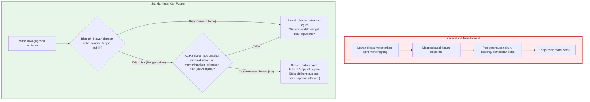

## Pendahuluan: Aporia yang Menggerogoti Masyarakat Bebas dari Dalam

Dalam wacana sipil kontemporer, tidak ada kebajikan yang begitu diagungkan—namun sekaligus begitu rapuh dan sarat kontradiksi internal—seperti **toleransi**.

Membiarkan semua pandangan diungkapkan tanpa represi kekerasan adalah capaian tertinggi Pencerahan dan demokrasi liberal. Namun, di era digital abad ke-21, ujaran kebencian dan ekstremisme justru membajak perisai «kebebasan berbicara» untuk menghancurkan masyarakat terbuka dari dalam.

Inilah inti dari **Paradoks Toleransi (Paradox of Tolerance)**:

> **«Haruskah masyarakat yang toleran tetap menoleransi mereka yang secara terang-terangan berusaha menghancurkannya?»**
> 
> **«Jika kita memberikan toleransi tanpa batas kepada mereka yang intoleran, masyarakat pada akhirnya akan ditelan oleh intoleransi dan kebebasan itu sendiri akan binasa. Namun jika kita merepresi kaum intoleran, bukankah masyarakat kita sendiri terjerumus menjadi rezim tiran yang tidak toleran?»**

Dilema ini bukan sekadar permainan kata teoretis. Republik Weimar tahun 1930-an runtuh karena kaum Nazi memanfaatkan hak pilih dan kebebasan berpendapat untuk membunuh demokrasi secara legal. Saat ini, meme kartun yang mengatasnamakan Karl Popper telah disalahartikan secara luas untuk membenarkan tindakan **membungkam dan membatalkan (cancel) siapa pun yang dianggap intoleran**. Hal ini melahirkan gelombang **meta-intoleransi**: persekusi massal terhadap suara-suara kritis atas nama kebajikan moral.

---

## Bab 1: Peringatan Karl Popper dan Kesesatan Meme Internet

Karl Popper (1902–1994) merumuskan paradoks ini dalam catatan kaki Bab 7 karyanya, *The Open Society and Its Enemies* (1945).

Meme internet selalu berhenti pada kalimat pertama ("toleransi tanpa batas akan memusnahkan toleransi"). Namun Popper segera menegaskan kalimat kuncinya:

> **«Dengan rumusan ini, saya tidak bermaksud menyatakan bahwa kita harus selalu menindas filsafat-filsafat intoleran; selama kita dapat melawannya dengan argumen rasional dan mengendalikannya melalui opini publik, penindasan tentu merupakan tindakan yang sangat tidak bijaksana (most unwise).»**

Popper secara tegas melarang represi selama dialog rasional masih berjalan. Hak untuk menindas dengan kekuatan fisik hanya berlaku jika kelompok tersebut **menolak argumen rasional dan mengajarkan pengikutnya untuk menjawab argumen dengan tinju dan pistol**.

---

## Bab 2: John Rawls dan Teori Keadilan

Dalam *A Theory of Justice* (1971), John Rawls menyatakan bahwa masyarakat adil memiliki **kewajiban untuk menoleransi kaum intoleran** selama tatanan konstitusional stabil. Lembaga-lembaga yang adil memiliki daya asimilasi: dengan menikmati kebebasan yang setara, kelompok radikal perlahan memoderasi fanatismenya. Pembatasan kebebasan hanya sah jika terdapat **bahaya nyata dan mendesak terhadap institusi kebebasan itu sendiri**.

---

## Bab 3: Demokrasi Militan dalam Hukum Dasar Jerman

Belajar dari bunuh diri legal Republik Weimar, Hukum Dasar Jerman 1949 mengadopsi prinsip **Demokrasi Militan (*Streitbare Demokratie*)**:
1. **Pasal 79 Ayat 3 (Klausul Keabadian)**: Martabat manusia dan tatanan demokrasi federal tidak boleh dihapus bahkan oleh amendemen konstitusi 100%.
2. **Pasal 21 Ayat 2 (Pembubaran Partai Inkonstitusional)**: Mahkamah Konstitusi Federal memegang wewenang tunggal untuk membubarkan partai yang berupaya merusak tatanan bebas demokratis (*FDGO*).

---

## Bab 4: Pendekatan AS: Amandemen Pertama dan Standar Brandenburg

Tradisi John Stuart Mill (*On Liberty*, 1859) meyakini kebenaran hanya terasah melalui benturan bebas dengan kekeliruan. Dalam kasus **_Brandenburg v. Ohio_ (1969)**, Mahkamah Agung AS menetapkan bahwa ujaran ekstrem dilindungi kecuali bila **secara langsung menghasut tindakan melanggar hukum yang segera terjadi (*imminent lawless action*)** dan berkemungkinan besar terjadi.

---

## Kesimpulan: Toleransi Waspada untuk Abad ke-21

Toleransi sejati menuntut keberanian intelektual:
1. **Lumpuhkan gagasan beracun dengan nalar dan argumen unggul**, bukan sensor histeris;
2. **Gunakan kekuatan hukum hanya terhadap kekerasan fisik dan pemberontakan nyata**;
3. **Tolak peradilan massa digital dan cancel culture.**
