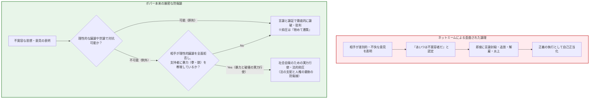
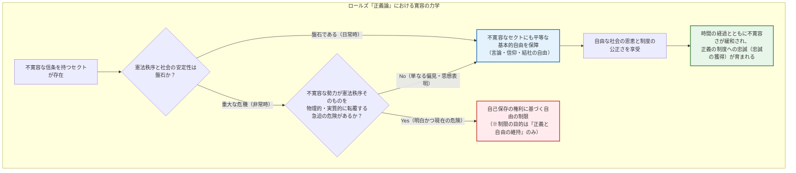
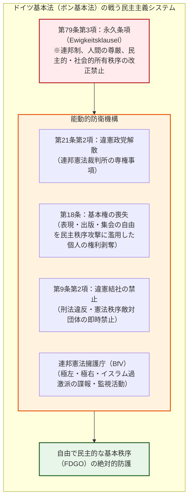
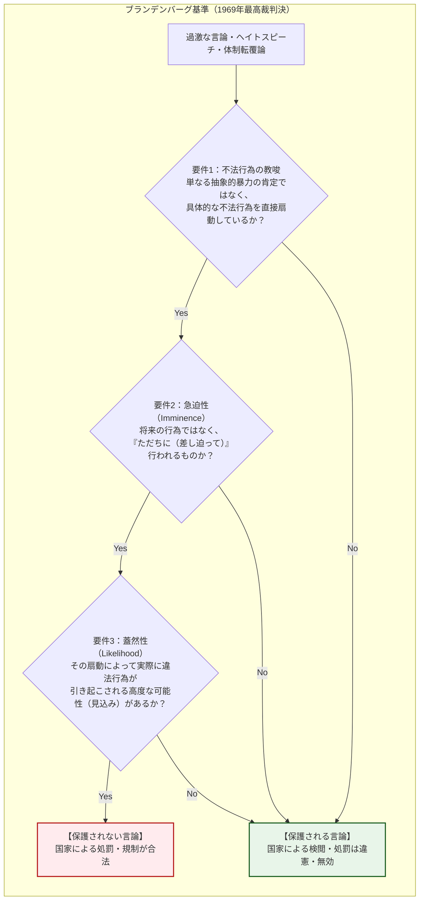
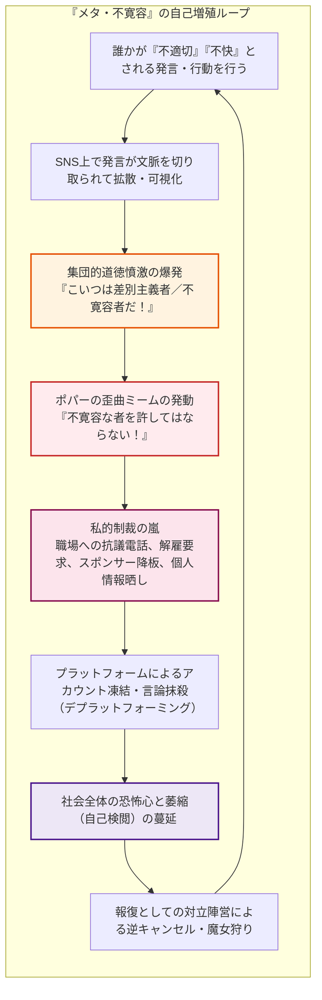
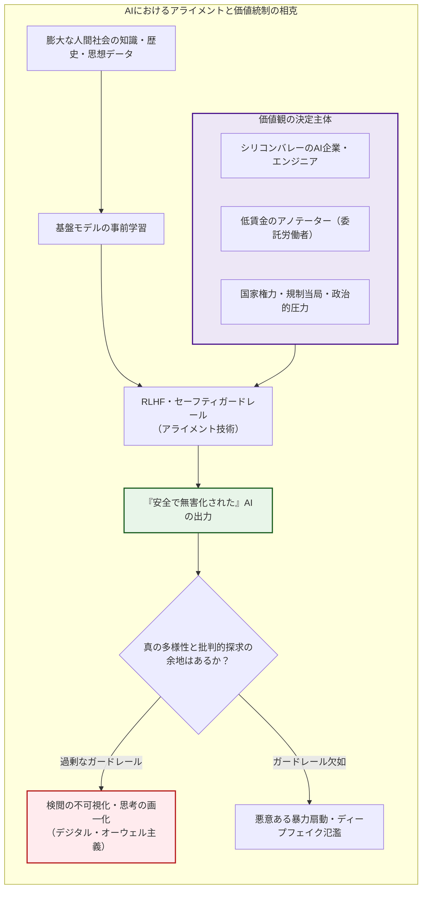
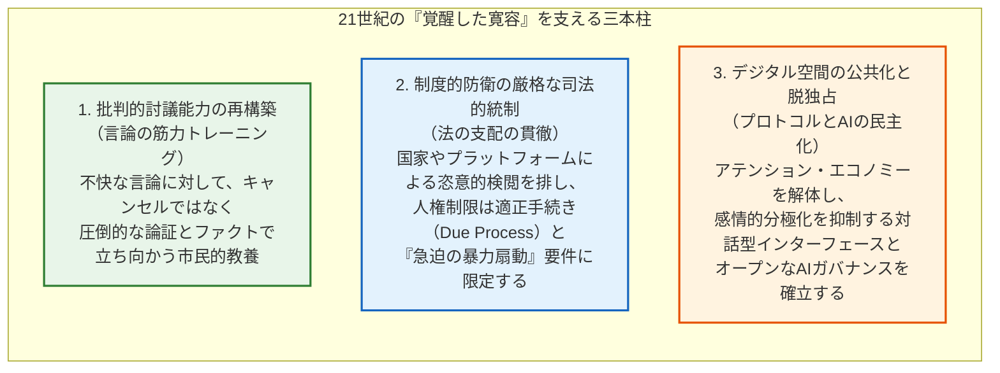

## はじめに：自由な社会を内側から蝕むアポリア

現代社会において、「寛容（Tolerance）」ほど普遍的な美徳として称揚されながら、同時にこれほど脆く、過酷な自己矛盾を内包する概念は他に存在しない。

あらゆる意見の表明を認め、多様な信条を包摂し、異端の存在を排除しないこと——これこそが近代啓蒙主義とリベラル・デモクラシー（自由民主主義）が数世紀の流血を経て打ち立てた至高の金字塔であった。しかし、21世紀のデジタル情報空間を生きる私たちは、極めて不穏な現実に直面している。絶対的な寛容を掲げて開かれた公共圏において、排外主義、急進的な陰謀論、全体主義的プロパガンダ、そして他者の人権を否定するヘイトスピーチが猛烈な勢いで増殖し、あろうことか「表現の自由」や「寛容」の盾を奪い取って、自由な社会の根幹そのものを食い破ろうとしているのである。

ここで生じる根源的な問いこそが、**「寛容のパラドックス（Paradox of Tolerance）」** である。

> **「寛容な社会は、自らを破壊しようとする不寛容な者たちに対しても、どこまでも寛容であり続けなければならないのか？」**
> 
> **「もし不寛容な者を寛容するならば、社会はやがて不寛容に呑み込まれて自由そのものが消滅する。しかし、もし不寛容な者を排除するならば、その社会自身が『不寛容な社会』へと堕落してしまうのではないか？」**

このジレンマは、決して机上の空論や哲学者の言葉遊びではない。歴史を振り返れば、1930年代のドイツ・ワイマール共和国は、当時世界で最も民主的で人権保障に満ちた憲法を持ちながら、ナチスという露骨な「不寛容の勢力」に選挙と言論の自由を完全に利用され、合法的な手続きを経て内側から自壊した。現代においても、ソーシャルメディア上のヘイトスピーチ規制をめぐる法論争、異論者を徹底的に糾弾・排斥する「キャンセルカルチャー」、そしてビッグテックやAIアルゴリズムによるコンテンツモデレーション（検閲）の是非に至るまで、あらゆる政治的・社会的分断の最前線にこのパラドックスが横たわっている。

だが、現在インターネットやソーシャルメディア上で流通している「寛容のパラドックス」の言説には、極めて深刻な知的倒錯が蔓延している。カール・ポパーの名を冠した簡略化された漫画インフォグラフィックが拡散され、**「不寛容な意見に対しては、直ちに不寛容であってよい（排除・弾圧・口封じしてよい）」** という乱暴な短絡が、まるで正義の免罪符であるかのように振りかざされているのだ。その結果、「差別やヘイトを許さない」という高潔な大義名分を掲げる側が、自らの教条に合致しない他者を即座に「不寛容者」とラベリングし、情け容赦ない個人攻撃や社会的抹殺に走るという、**「メタ・不寛容（不寛容への対抗を口実にした新たな不寛容の自己増殖）」** が世界中で吹き荒れている。

本稿の目的は、この安易なミーム的俗説を完全に解体し、政治哲学・比較憲法学・情報倫理学の最前線から「寛容のパラドックス」の真の全貌を明らかにすることである。

オーストリア出身の科学哲学者カール・ポパーが第二次世界大戦の最中に著した『開かれた社会とその敵』の厳密な原文読解から出発し、アメリカのロールズが『正義論』で試みた批判的再構築、ナチスの教訓から生まれた戦後ドイツ基本法の「戦う民主主義（Streitbare Demokratie）」の制度設計、アメリカ合衆国憲法修正第1条の「思想の自由市場」ドクトリン、さらには現代のSNSアルゴリズムとAIによる言論統制に至るまで、思想と制度の両面から徹底的に解剖していく。

自由な社会とは、何も守るものを持たない無防備な真空地帯ではない。しかし、自らを守るための防壁が、いつしか市民を閉じ込める監獄へと変貌してはならない。開かれた社会がその「開かれた本質」を失うことなく生き残るための、極限の知的冒険へと踏み出そう。

---

## 第1章：カール・ポパーの警告と「ネットミーム化された誤謬」

### 1.1 『開かれた社会とその敵』の時代背景：全体主義の挟撃

「寛容のパラドックス」という言葉の直接の起源は、カール・ライムント・ポパー（Karl Raimund Popper, 1902–1994）が1945年に発表した主著『開かれた社会とその敵（*The Open Society and Its Enemies*）』にある。

この記念碑的著作が執筆された文脈を理解することなくして、ポパーの意図を正確に汲み取ることは不可能である。ユダヤ系の血を引くポパーは、1930年代に祖国オーストリアがヒトラーのナチス・ドイツに併合（アンシュルス）される危機を察知し、1937年にニュージーランドへと亡命した。カンタベリー大学で哲学を講じながら、彼はナチズム（国家社会主義）の猛威と、東欧を席巻するスターリニズム（ソビエト型全体主義）という二大怪物が、人類が数百年かけて築き上げてきた自由と理性の文明を根底から瓦解させていく地獄絵図を痛恨の思いで目撃していた。

ポパーが本書で企図したのは、プラトン、ヘーゲル、そしてマルクスという西洋哲学の巨人たちの中に潜む「閉じた社会（Closed Society）」の萌芽——すなわち、歴史には不可避の法則があり、選ばれた指導者や階級がユートピアを実現するために個人を犠牲にしてもよいとする全体主義的思考様式——を徹底的に批判し、個人の自由な批判と反証可能性に基づいた「開かれた社会（Open Society）」を防衛することであった。

### 1.2 『開かれた社会とその敵』第7章注4の精密な原文分析

ポパーが「寛容のパラドックス」に言及したのは、本文の主要な議論の中ではなく、第7章「リーダーシップの原理」に付された**「注4（Chapter 7, Note 4）」** という、一見すると控えめな脚注においてであった。

しかし、この短い注釈こそが、後世に計り知れない影響を与えることとなった。現代のネット言論でしばしば切り取られ、歪曲されているこの箇所の、厳密な英語原文とその精密な和訳を以下に対照掲示する。

> **【Karl Popper, *The Open Society and Its Enemies*, Vol. 1, Chapter 7, Note 4 (1945)】**
> 
> *"Unlimited tolerance must lead to the disappearance of tolerance. If we extend unlimited tolerance even to those who are intolerant, if we are not prepared to defend a tolerant society against the onslaught of the intolerant, then the tolerant will be destroyed, and tolerance with them."*
> 
> （無制限の寛容は、必然的に寛容の消滅をもたらさざるを得ない。もし我々が不寛容な者たちにまで無制限の寛容を広げ、もし不寛容な者たちの強襲から寛容な社会を防衛する覚悟を持たないならば、寛容な者たちは滅ぼされ、彼らとともに寛容もまた滅び去るであろう。）

ネット上で出回るインフォグラフィックは、大抵この冒頭のセンテンスだけを引用し、「だから不寛容を排除せよ」と結論づけている。しかし、ポパーの真の慧眼と哲学的良心は、まさにこの**直後の文章**にこそ込められている。ポパーは次のように言葉を継ぐのである。

> *"In this formulation, I do not imply, for instance, that we should always suppress the utterance of intolerant philosophies; as long as we can counter them by rational argument and keep them in check by public opinion, suppression would certainly be most unwise."*
> 
> （**だがこの定式化において、私はたとえば、不寛容な哲学の表明を常に抑圧すべきであるなどと仄めかしているのではない。我々が理性的な議論によってそれらに対抗し、世論によってそれらを抑制できる限りにおいては、抑圧を行うことは確実に極めて愚策（most unwise）である。**）

ポパーは明示的に、「不寛容な言論を直ちに抑圧・禁止することは極めて愚かな行為である」と戒めている。理性的な対話や反論が機能し、社会の世論によって牽制できている段階での言論抑圧を、ポパーは断固として否定しているのだ。では、国家や社会が実力を行使して不寛容を抑圧する権利を主張すべきなのは、いかなる極限状況なのか。ポパーは次のように厳格な要件を定めている。

> *"But we should claim the right to suppress them if necessary even by force; for it may easily turn out that they are not prepared to meet us on the level of rational argument, but begin by denouncing all argument; they may forbid their followers to listen to rational argument, because it is deceptive, and teach them to answer arguments by the use of their fists or pistols."*
> 
> （**しかし我々は、必要とあらば実力（force）によってでも彼らを抑圧する権利を主張すべきである。なぜなら、彼らは理性的な議論の次元で我々に応じる用意が全くなく、あらゆる議論を頭から否定し欺瞞であるとして拒絶することから始めるかもしれないからである。彼らは追随者たちに対し、理性的議論に耳を傾けることを禁じ（なぜなら議論はペテンだからだと教え込み）、議論に対しては自らの「拳（fists）」や「拳銃（pistols）」をもって答えるよう教唆するかもしれないからである。**）

> *"We should therefore claim, in the name of tolerance, the right not to tolerate the intolerant. We should claim that any movement preaching intolerance places itself outside the law, and we should consider incitement to intolerance and persecution as criminal, in the same way as we should consider incitement to murder, or to kidnapping, or to the revival of the slave trade, as criminal."*
> 
> （それゆえに我々は、寛容の名において、不寛容な者たちを寛容しない権利を主張すべきである。不寛容を説くあらゆる運動は自らを法の外に置くものであると主張すべきであり、不寛容や迫害の扇動は、殺人の扇動や誘拐の扇動、あるいは奴隷貿易の復活の扇動と同様に、犯罪とみなすべきである。）

### 1.3 ネットミームによる「漫画的短絡」の罪過

近年、ポパーのこの注釈は、イラストレーターのピエ・コラール（Pictoline）らによる漫画インフォグラフィックを通じて世界中に拡散された。その内容は、ナチスの鉤十字をつけた人物が「自由な言論」を装って社会に入り込み、最終的に社会を破壊するため、「寛容を守るためには、不寛容な者を絶対に許してはならない」という教訓で締めくくられる。

このミームは一見するとわかりやすく説得力があるように思えるが、思想史的には**致命的な二つの歪曲**を犯している。

第1に、**「理性的な反論の義務」の忘却**である。
ポパーにとって、開かれた社会の基本プロトコルは「批判的合理主義（Critical Rationalism）」であった。私たちは神のような絶対的真理を知ることはできず、常に誤りを犯す存在（可謬主義: Fallibilism）である。だからこそ、互いに批判し合い、反証を試みる対話のプロセスが不可欠となる。不寛容な意見に対しても、まずは理性的な言論と論証によってその誤謬を暴き、世論の力によって周縁化することが第一義的な義務であるとポパーは強調した。国家権力や集団の圧力による言論抑圧は、議論が尽くされ、相手が理性のテーブルそのものを暴力で破壊しようとした際の「最後の防衛的手段（Ultima Ratio）」に過ぎない。

第2に、**「暴力の行使（拳と拳銃）」という物理的要件の脱落**である。
ポパーが「実力による抑圧」を容認したのは、相手が「議論そのものを拒絶し、暴力によって自らの信条を押し通そうとするファシスト的集団」である場合に限定されていた。ナチスの突撃隊（SA）のように、反対派の集会を暴力で襲撃し、言論の場そのものを力学的に解体しようとする者たちに対してのみ、寛容の防衛権が発動される。
ところがネットミームでは、この「暴力性」の要件が完全に捨象され、単に「自らの道徳的基準に合致しない意見」「不快で偏見に満ちた言説」を吐く人間を即座に「不寛容者」と断定し、言論空間から抹殺してよいというロジックへとすり替えられてしまったのである。

> [!WARNING]
> **ネットミーム的ポパー解釈の罠**
> ポパーの意図した「暴力と理性の拒絶に対する正当防衛」を、「不快な言論に対する道徳的処刑」へと拡大解釈することは、開かれた社会を守るどころか、社会そのものを「異端審問的な閉じた社会」へと逆戻りさせる極めて危険な知的堕落である。

---

## 第2章：ジョン・ロールズ『正義論』による規範的昇華

### 2.1 正義の二原理と「原初状態」の設計思想

ポパーの提起したパラドックスを、近代憲法学や規範的政治哲学の厳密な体系へと練り上げたのが、20世紀後半を代表するアメリカの哲学者ジョン・ロールズ（John Rawls, 1921–2002）である。

1971年に出版された主著『正義論（*A Theory of Justice*）』において、ロールズは社会契約説を刷新し、正義の諸原理を導出するための思考実験として**「原初状態（Original Position）」** と **「無知のヴェール（Veil of Ignorance）」** を提唱した。社会の構成員が、自らの人種、性別、資産、能力、さらには自らがどのような宗教や道徳的善の構想（包括的教説）を抱いているかについて一切知らない「無知のヴェール」を被った状態に置かれたとき、合理的個人はどのような社会ルールに合意するか。

ロールズは、すべての人が自らの基本的自由を最大化しつつ平等に保障されることを要求する**「第1原理（平等な基本的自由の原理）」** が、いかなる経済的効率性や多数派の功利主義的利益よりも優先されなければならない（「自由の優先性」）と論じた。

### 2.2 第35節「不寛容者への寛容」：包摂の義務と自己保存

『正義論』の第4章第35節において、ロールズは正面から「不寛容な者たちへの寛容（Toleration of the Intolerant）」を論じている。ロールズは問題を次の三つの問いに分解した。

1. 不寛容なセクト（宗教団体や政治集団）は、自らが寛容に扱われないときに不平を言う権利があるか？
2. 寛容なセクトは、どのようないかなる条件下において、不寛容なセクトを寛容に扱う義務があるか？
3. 寛容なセクトが不寛容なセクトを抑圧する権利を持つとすれば、それはどのような目的のためか？

ロールズの導き出した結論は、極めて深遠かつ実践的である。

第1に、不寛容なセクト自身には、自分が寛容に扱われないことに対して「正義の原則」を根拠に抗議する道徳的権利はない。なぜなら、彼ら自身が他者に対する平等な自由を拒絶している以上、他者に対して平等な自由を要求することは相互性の原則に反するからである。

しかし第2に、**「寛容な側には、たとえ相手が不寛容であっても、原則として彼らを寛容に扱わなければならない義務がある」** とロールズは断言する。なぜなら、社会の正義の制度は、構成員の個々の心情や道徳的純潔さによってではなく、客観的な「正義の憲法」によって統治されているからである。社会が公正で安定している限り、多数派や国家は、特定の集団が不寛容な信条を抱いているという単なる事実をもって彼らの基本的自由（信仰の自由、表現の自由、集会の自由）を剥奪してはならない。

ロールズがここで依拠したのは、正義の諸制度が持つ**「内在的な道徳的同化力（安定性の力学）」** である。

公正な憲法秩序のもとで生活する不寛容な集団は、自らの自由が保護されているという事実を日々体験することを通じて、次第にその社会の制度に対する忠誠心を育み、やがて自らの不寛容な教説を緩和していく。自由な制度そのものが、不寛容を溶かす強力な教育装置として機能するのである。

### 2.3 制限の正当化要件：自己保存の権利と急迫の危機

では、ロールズにおいて不寛容な勢力を制限・抑圧することが正当化されるのはいかなる瞬間か。ロールズは次のように定式化する。

> 「不寛容なセクトの自由が制限されるべきなのは、**寛容な人々が、自らの安全と自由の諸制度が危険に晒されていると誠実に信じるに足る正当な理由がある場合のみ** である。……正義の精神は、社会の自己保存の権利によってのみ制限され得る。」
> （John Rawls, *A Theory of Justice*, §35）

ロールズの基準は極めて厳格である。制限が許されるのは、「思想が不快であるから」でも「差別的な価値観を表明したから」でもない。**不寛容な勢力が現実に勢力を拡大し、他者の平等な自由を実力で奪い去り、自由な憲法体制そのものを物理的・不可逆的に破壊する「現実的かつ急迫した脅威（Clear and Present Danger）」が生じた瞬間に限られる**。

しかも、その抑圧は復讐や道徳的報復であってはならず、**「自由の体制を保全するために最小限必要な範囲」** に限定されなければならない。自由を制限できる根拠は「より大きな自由の保護」以外に存在しないのである。

### 2.4 ゲーム理論的モデル：寛容と不寛容の利得行列

寛容のパラドックスを数理的・合理的な相互作用として把握するために、ゲーム理論における「囚人のジレンマ」および反復ゲームのフレームワークを導入しよう。

市民社会における二つの主体——プレイヤーA（寛容な主体）とプレイヤーB（不寛容な主体）——の戦略的相互作用を考える。各プレイヤーは「協調（寛容: $C$）」または「裏切り（不寛容・排除: $D$）」を選択できる。

| プレイヤーA \ プレイヤーB | 寛容（$C$） | 不寛容（$D$） |
| :--- | :---: | :---: |
| **寛容（$C$）** | $(R, R) = (3, 3)$ **開かれた共存** | $(S, T) = (0, 5)$ **不寛容による支配（搾取）** |
| **不寛容（$D$）** | $(T, S) = (5, 0)$ **寛容派の裏切り** | $(P, P) = (1, 1)$ **万人の闘争（全体主義）** |

利得の順序は $T > R > P > S$（誘惑 > 報奨 > 懲罰 > 搾取）である。
- **$(R, R)$（双方が寛容）**: 多様な言論と協調が担保された最も繁栄する社会。
- **$(S, T)$（Aが寛容、Bが不寛容）**: 寛容派が無防備に不寛容を受け入れ、不寛容派が権力を掌握して言論空間を暴力的に占拠した状態（ポパーが警告した破滅）。
- **$(P, P)$（双方が不寛容）**: 互いに相手を排除・検閲・投獄し合う、息の詰まる専制社会。

ロバート・アクセルロッドの反復囚人のジレンマ研究が示すように、無条件の寛容（常に $C$ を出す「無差別のお人好し」戦略）は、悪意ある不寛容者（常に $D$ を出す戦略）に対して不可避的に破滅する。
社会が長期的に $(R, R)$ の開かれた協調を維持するための最適戦略は、アクセルロッドが証明した**「しっぺ返し（Tit-for-Tat）」**、あるいはロールズ的な**「寛容を原則とし、相手が裏切り（暴力や憲法破壊）に訴えた時のみ厳格に報復（抑圧）し、相手がルールに戻れば即座に宥和する戦略」** である。

数理的にも、「無制限の寛容」は進化的に安定な戦略（ESS）たり得ない。寛容が自らを維持するためには、裏切りに対する信憑性のある報復能力（抑圧の権利）を潜在的に保持していなければならないのである。

---

## 第3章：制度化されたパラドックス——ドイツ連邦基本法「戦う民主主義」

### 3.1 ワイマール体制の自殺と「民主主義のトロイの木馬」

寛容のパラドックスが世界史上で最も悲劇的な現実となったのが、戦間期ドイツのワイマール共和国（1919–1933）の崩壊である。

ワイマール憲法は、男女普通選挙、比例代表制、広範な社会権、思想信条の絶対的自由を認めた、当時人類史上最も進歩的な民主憲法であった。しかし、この憲法には致命的な哲学的弱点が存在していた。それは、**「価値相対主義的・法実証主義的な絶対的中立性」** である。いかなる思想であれ、議会で多数派を形成し、憲法改正手続き（議席の3分の2の賛成）を踏みさえすれば、民主主義そのものを廃止することすら合法的に許容されると解釈されていたのである。

ナチス（国家社会主義ドイツ労働者党）の宣伝相ヨーゼフ・ゲッベルスは、1935年に次のように公然と言い放った。

> 「民主主義の最高の冗談とは、自らの不倶戴天の敵に対して、自らを破壊するための手段を自ら提供したことである。」
> （ヨーゼフ・ゲッベルス）

ナチスは突撃隊による暴力で街頭を支配しながらも、表面的にはワイマール憲法の選挙制度を利用して議席を伸ばし、1933年にヒトラーが首相に任命されるや否や、国会放火事件を機に大統領緊急令を発布させて基本権を停止。同年の「全権委任法（授権法）」の成立によって議会制民主主義を完全に抹殺した。民主主義が、自らの寛容さゆえに、自らを殺害する武器を敵に手渡してしまったのである。

### 3.2 カール・レーヴェンシュタインの防衛的民主主義論

この惨劇を亡命先のアメリカから鋭く告発したのが、ドイツの法学者カール・レーヴェンシュタイン（Karl Loewenstein, 1891–1973）であった。

レーヴェンシュタインは1937年、コロンビア・ロー・レビューに発表した歴史的論文『戦闘的民主主義と基本権（*Militant Democracy and Fundamental Rights*）』において、ファシズムは民主主義のルールに従うふりをしながらその精神を破壊する「感情的・軍事的な新技術」であると指摘した。そして、民主主義が生き残るためには、自らをただ受動的に差し出す「無抵抗の平和主義」を捨て去り、法と制度の力をもって不寛容な敵を先制的に無力化する**「戦う民主主義（Militant Democracy / Streitbare Demokratie）」** へと武装しなければならないと主張したのである。

> 「民主主義の基本法秩序は、自らを合法的に破壊しようとするいかなる企図に対しても、自殺を許容する権利を認めてはならない。」
> （カール・レーヴェンシュタイン）

### 3.3 ボン基本法における憲法防衛機構

第二次世界大戦後の1949年、西ドイツで制定されたドイツ連邦共和国基本法（ボン基本法）は、ワイマール憲法の痛恨の反省の上に立ち、「戦う民主主義」を国家の根幹原理として制度的に組み込んだ。

ボン基本法の設計思想は、主に以下の条文によって構成されている。

1. **基本法第79条第3項【永久条項（Ewigkeitsklausel）】**:
   憲法改正手続きによっても絶対に改変できない条項。第1条（人間の尊厳の不可侵）および第20条（民主的・社会的な連邦国家、主権在民、権力分立、抵抗権）の基本原則の破棄は、国民投票や議会の100%の賛成があっても法的に無効である。憲法改正による合法的独裁への移行を根本から封殺した。
2. **基本法第21条第2項【違憲政党解散】**:
   その目的や党員の行動が「自由で民主的な基本秩序（freiheitliche demokratische Grundordnung: FDGO）」を侵害・撤廃すること、あるいはドイツ連邦共和国の存立を危うくすることを目指す政党は、**連邦憲法裁判所（BVerfG）の判決によって解散させることができる**。行政や議会が恣意的に政党を潰すことはできず、最高司法機関の厳格な司法審査に委ねられている。
3. **基本法第18条【基本権の喪失】**:
   意見表明の自由、出版の自由、集会の自由、結社の自由などを「自由で民主的な基本秩序」を攻撃するために濫用した個人に対しては、連邦憲法裁判所はその基本権を剥奪・喪失させることができる。

### 3.4 歴史的判例と現代の激動：SRP・KPDからAfD問題へ

ドイツ連邦憲法裁判所は、実際にこの「戦う民主主義」の宝刀を抜いてきた。

- **SRP（社会主義帝国党）解散判決（1952年）**: ナチスの後継政党として元将校らが結成した極右政党を、ヒトラー政権の全体主義を再興しようとするものとして違憲解散。
- **KPD（ドイツ共産党）解散判決（1956年）**: プロレタリア独裁を目指し、自由民主主義体制の転覆を掲げた共産党を違憲解散。

しかし、21世紀に入り、「戦う民主主義」は極めて繊細な司法解釈の進化を迫られている。2017年の極右政党**NPD（ドイツ国家民主党）解散請求判決**において、連邦憲法裁判所は画期的な判断を下した。NPDの反憲法的な意図を認めつつも、政党解散という極刑を科すためには、単に反民主主義的な思想を抱いているだけでなく、**「その目的を実現し、議会制民主主義を破壊しうる具体的な成功の可能性（潜在性: Potentialität）」** が存在しなければならないとして、影響力が極小であったNPDの解散請求を棄却したのである。

そして現在、ドイツ論壇を激震させているのが、右派ポピュリズム政党**AfD（ドイツのための選択肢）** をめぐる攻防である。旧東ドイツ地域などで第1党・第2党の支持を集めるAfDに対し、憲法擁護庁（BfV）は一部の州支部や青年組織を「極右確定勢力」として監視対象に指定。政界や知識人からは「基本法第21条に基づくAfD解散請求を提起すべきだ」という声が上がる一方で、「数百万人の有権者の支持を得ている政党を司法判断で解散させれば、民主主義の信頼そのものが崩壊し、かえって社会の分断と地下組織化を招く」という強い慎重論が拮抗している。

国家が「誰が民主主義の敵か」を公権力によって決定することは、必然的に現職権力による野党弾圧の誘惑を招く。「不寛容と戦う国家」自身が、最も恐ろしい不寛容の執行者へと変貌しかねないというアポリアが、ここでも浮き彫りとなっている。

---

## 第4章：アメリカ型アプローチ——修正第1条と「思想の自由市場」

### 4.1 J.S.ミル『自由論』の系譜：誤謬にも価値がある

ドイツが「国家による防衛的介入」を選択したのに対し、正反対のアプローチをとったのがアメリカ合衆国である。その哲学的土台には、イギリスの思想家ジョン・スチュアート・ミル（John Stuart Mill, 1806–1873）の古典的自由主義がある。

1859年の不朽の名著『自由論（*On Liberty*）』において、ミルは言論の自由を抑圧することの害悪を四つの論点から論証した。ミルが最も強調したのは、**「たとえ完全に誤っており、不寛容で有害に見える意見であっても、それを沈黙させてはならない」** という逆説的なテーゼであった。

1. もし抑圧された意見が「真理」を含んでいた場合、人類は誤りを正す機会を失う。
2. たとえ抑圧された意見が「100%の誤り」であったとしても、それを自由に語らせ、真理と公然と衝突させなければ、真理の側は生きた信念であることをやめ、単なる死んだ教条（Dead Dogma）へと形骸化してしまう。
3. 反対意見との激しい論争を通じて初めて、人々は自らの正しさを支える論拠を深く理解し、精神的な活力を維持できる。

ミルにとって、思想の正しさを保証する唯一の方法は、あらゆる反対意見からの攻撃に常に身を晒し続けること（「開かれた論争の場」）だけであった。

### 4.2 修正第1条ドクトリンと「差し迫った不法行為の扇動」基準

アメリカ合衆国憲法修正第1条は、極めて簡潔かつ絶対的な言葉で言論の自由を保障している。

> *"Congress shall make no law respecting an establishment of religion, or prohibiting the free exercise thereof; or abridging the freedom of speech, or of the press..."*
> （連邦議会は、国教の樹立を定め、信教の自由を侵す法律を制定してはならない。また、言論または出版の自由を侵す法律を制定してはならない……）

20世紀初頭、オリバー・ウェンデル・ホームズ判事らは、第一次世界大戦下の反戦ビラ配布事件（シェンク事件、1919年）などで**「明白かつ現在の危険（Clear and Present Danger）」** の原則を定立した。火事でもない劇場で「火事だ！」と叫んでパニックを引き起こすような言論は保護されないという論理である。ホームズはさらにアブラムス事件（1919年）の反対意見において、**「思想の自由市場（Marketplace of Ideas）」** という不朽の概念を提示した。

> 「究極的な善は、思想の自由な取引によって最もよく達成される。真理の最善の試練とは、市場の競争において自らを受け入れさせる思想の力である。」
> （オリバー・ウェンデル・ホームズ判事）

このドクトリンが極点に達したのが、1969年の**ブランデンバーグ対オハイオ州事件（*Brandenburg v. Ohio*）** である。白人至上主義団体クー・クラックス・クラン（KKK）の指導者が集会で黒人やユダヤ人に対する暴力的復讐を示唆する演説を行い、州の犯罪的サンディカリズム法違反で起訴された。しかし連邦最高裁は全員一致で有罪判決を破棄し、現代アメリカ憲法学の最高峰となる以下の厳格な基準を打ち立てた。

ブランデンバーグ基準のもとでは、たとえナチズムの礼賛であれ、人種差別の扇動であれ、それが**「差し迫った不法行為を直接的に扇動し、かつ実際にその行為が引き起こされる蓋然性が極めて高い場合（Incitement to imminent lawless action）」** でない限り、国家が法律によって事前に禁止したり事後的に処罰することは違憲となる。1977年のコリン対スミス事件（スコーキー事件）では、ユダヤ人ホロコースト生存者が多く暮らすイリノイ州スコーキーの街頭を、鉤十字を掲げたネオナチがデモ行進する権利すら修正第1条のもとで司法によって防衛された。

### 4.3 二大体系の徹底比較：ドイツとアメリカの分岐

なぜアメリカは、ヨーロッパ諸国のようにヘイトスピーチやナチス賛美を法律で禁止（ホロコースト否定言論の処罰等）しないのか。

それは、**「国家権力という最も強大かつ危険な存在に、『何が正しい言論で、何が不寛容な言論か』を判定する裁量権を絶対に渡してはならない」** という、国家不信の哲学が徹底しているからである。一度国家に「有害な言論を禁止する権力」を与えてしまえば、政権交代や権力の腐敗によって、体制を批判する正当な言論までが「不寛容」「過激思想」として弾圧される口実になるという冷徹な計算がそこにある。

| 比較項目 | ポパー（批判的合理主義） | ロールズ（公正としての正義） | ミル（自由論） | レーヴェンシュタイン / ドイツ基本法 | アメリカ合衆国最高裁（修正第1条） |
| :--- | :--- | :--- | :--- | :--- | :--- |
| **思想の核心** | 批判的議論と反証可能性の防衛 | 正義の憲法体制の自己保存 | 思想の自由市場による真理の洗練 | 戦う民主主義（能動的自己防衛） | 差し迫った不法行為の扇動基準 |
| **寛容の根拠** | 人間の可謬性と理性的対話 | 原初状態での基本的自由の優先性 | 個人の自律と社会の精神的活力 | 人間の尊厳と客観的価値秩序 | 国家権力による検閲権力の絶対的排除 |
| **不寛容抑圧のトリガー** | 理性の完全拒絶と**暴力（拳・銃）の行使** | 自由の体制に対する**明白かつ急迫の危機** | 他者に対する直接の物理的侵害（他者危害原則） | 自由で民主的な基本秩序に対する**敵対的企図・潜在性** | **差し迫った不法行為の扇動**かつ高度な発生蓋然性 |
| **国家の介入権限** | 最後の手段としての警察力行使 | 憲法制度防衛のための最小限の介入 | 刑法上の実害防止に厳格に限定 | 連邦憲法裁判所による政党解散・権利剥奪 | 原則として国家の言論介入を全面違憲排除 |
| **最大の懸念リスク** | 不寛容勢力による開かれた社会の破壊 | 正義の制度の崩壊と市民的自由の喪失 | 社会的多数派による精神的専制（同調圧力） | ナチス的全体主義の合法的復活 | 国家権力による「正しさの独占」と政治的弾圧 |

---

## 第5章：デジタル公共圏の変質と「メタ・不寛容の暴走」

### 5.1 ハーバーマス的討議倫理の解体とアテンション・エコノミー

ドイツの哲学者ユルゲン・ハーバーマス（Jürgen Habermas, 1929–）は、市民が互いを対等な対話者として承認し、感情や暴力を排して理性的論拠のみに基づいて合意形成を目指す「コミュニケーション的行為（Communicative Action）」と「討議倫理」こそが、民主的公共圏の理想であると説いた。

しかし、21世紀のインターネットとSNS（ソーシャル・ネットワーキング・サービス）は、このハーバーマス的夢想を完膚なきまでに打ち砕いた。現代のプラットフォーム資本主義を駆動しているのは、理性的な対話ではなく**「アテンション・エコノミー（関心経済）」** である。

アルゴリズムは、ユーザーの滞在時間を最大化し、広告収益を最大化するために最適化されている。認知科学や社会心理学が証明している通り、人々のエンゲージメント（クリック、シェア、リツイート、コメント）を最も強烈に喚起する情動は、「知的な納得」ではなく**「怒り」「道徳的憤激（Moral Outrage）」「他者への軽蔑」** である。その結果、デジタル公共圏は、理性的議論の場ではなく、敵対陣営に対する憎悪と嘲笑を競い合う感情の闘技場へと変貌した。

### 5.2 キャンセルカルチャーの社会病理：「メタ・不寛容」の無限ループ

この分極化した言論空間において、「寛容のパラドックス」は最もグロテスクな形で武器化された。それが現代の**「キャンセルカルチャー（Cancel Culture）」** である。

キャンセルカルチャーの力学は、極めて単純でありながら強烈な自己増殖性を持つ。

このプロセスの最も恐ろしい点は、制裁を加える群衆が**「自分たちは社会の寛容と正義を守るために、不寛容な悪を成敗しているのだ」** という無謬の倫理的陶酔に浸っていることである。彼らにとって、対象となった人物は「ポパーの言う不寛容者」であり、したがって一切の人権や弁明の機会を与える必要はなく、徹底的に社会的・経済的に破滅させることが道徳的正義となる。

ここにおいて、パラドックスは二重化する。
**「不寛容を排除する」という名目によって行われる私的制裁そのものが、他者の些細な過誤や異論を一切許さない究極の「不寛容」を社会に蔓延させているのである。**

これはもはや開かれた社会の防衛ではない。かつて中世ヨーロッパで行われた「魔女狩り」や、フランス革命期のジャコバン派による「恐怖政治」、あるいは文化大革命における「吊るし上げ」のデジタル版に他ならない。異論を唱えれば即座に「不寛容者」の烙印を押されて破滅させられる社会では、市民は口を閉ざし、自己検閲に走り、真の自由な精神は窒息死する。

### 5.3 私的検閲とデプラットフォーミング：主権者なき検閲官

さらに問題を複雑にしているのが、現代の言論空間のインフラが、国家ではなく一握りの巨大テック企業（Alphabet, Meta, X, ByteDance等）によって私有化・寡頭支配されているという事実である。

憲法上の表現の自由（日本国憲法第21条や米国憲法修正第1条）は、伝統的に「国家権力による公的検閲」を禁止する規範として設計されてきた。私企業であるプラットフォームが利用規約に基づいて特定のアカウントを凍結したり投稿を削除することは、形式的には「私的自治」の範囲内とされる。

しかし、現代におけるSNSは、事実上の**「グローバルな公共広場（Digital Public Square）」** である。一握りのシリコンバレーのエリートや不透明なモデレーション・チームが、密室で策定されたガイドラインに基づき、誰が発言を許され、誰がデジタル空間から抹殺（デプラットフォーミング）されるべきかを決定する。2021年の米国連邦議会議事堂襲撃事件後のドナルド・トランプ大統領（当時）のアカウント一斉凍結は、たとえその扇動性が問題視されたとしても、司法の適正手続き（Due Process）を経ることなく、私企業の一存で国家元首の言論手段を完全に剥奪できるという事実を世界に知らしめ、国際社会に深刻な衝撃を与えた。

国家による検閲を逃れた先で私たちが直面したのは、**「アルゴリズムとテック貴族による主権なき検閲」** という、新たな不寛容の支配構造であった。

---

## 第6章：AI時代の言論空間とアルゴリズム的統制

### 6.1 LLMのアライメントとRLHF：誰の「寛容」がコード化されるのか

AI技術、とりわけ大規模言語モデル（LLM）の爆発的普及は、寛容のパラドックスに全く新しい技術的次元をもたらした。

現代のLLM（ChatGPT, Claude, Gemini等）は、単にインターネット上のテキストを学習するだけでなく、**「アライメント（Alignment）」** と呼ばれる安全性調整のプロセスを経て社会に提供される。その中核技術が、**「人間のフィードバックによる強化学習（RLHF: Reinforcement Learning from Human Feedback）」** や憲法AI（Constitutional AI）である。

モデルが差別的、暴力的、あるいはヘイトスピーチとみなされる回答を出力しないよう、微細なガードレールが埋め込まれている。しかし、ここで不可避的に浮上するのが、まさに哲学的アポリアである。

> **「何が『ヘイト』であり、何が『不寛容』であり、何が『有害』であるかを、一体誰が決定するのか？」**

歴史的・哲学的な論争、宗教的信条、性道徳、ジェンダー観、国家観、あるいは地政学的対立において、何が「客観的正義」であるかについて全人類の一致した合意など存在しない。にもかかわらず、AI開発企業は、訴訟リスクの回避やレピュテーション・リスクへの恐怖から、極めてリベラル・西欧中産階級的な価値観に偏ったセーフティフィルターを埋め込む傾向がある。

その結果、学術的に正当な歴史的議論や、従来の常識を疑う哲学的な異論、あるいは政治的にセンシティブな論点が、「ポリシー違反」「有害なコンテンツ」として一括してAIによって生成拒否される事態が頻発している。これは、かつて教会の異端審問官が担っていた役割を、不可視のニューラルネットワークの重みパラメータが代替していることに他ならない。

### 6.2 デジタル・オーウェル主義の回避：分散型公共圏の模索

もし未来の知識生産、教育、ニュース配信、市民的対話のインターフェースがすべて少数のプロプライエタリ（私有型）AIに独占されるならば、人類はかつてない洗練された**「不可視の検閲社会（デジタル・オーウェル主義）」** を迎えることになる。

そこでは、国家が警察を派遣して本を焼く必要すらない。そもそも反体制的な思想や「不寛容」とみなされた言葉そのものが、AIの出力画面に現れる前に静かに蒸発させられるからである。ジョージ・オーウェルが『1984年』で描いた「ニュースピーク（新語法）」——思考の幅を狭めるために言葉そのものを削減・去勢するシステム——が、最先端のAIアライメント技術によって完成してしまう危険性がある。

このディストピアを回避するためには、どのようなアーキテクチャが必要なのか。

1. **オープンソースモデルと分散型AIエコシステムの防衛**:
   中央集権的なテック企業による価値観の独占を解体し、多様な思想的背景を持つコミュニティが独自のモデルを運用・監査できる環境を法的に保障すること。
2. **システム・プロンプトとアライメントの透明性**:
   AIが何を基準に特定の出力を拒絶しているのか、その倫理規定と推論ログの客観的検証可能性（監査可能性）を義務付けること。
3. **「安全」の定義に関する主権的・公的討議の確立**:
   何を許容し何を排除すべきかという規範的決定を私企業の倫理委員会に丸投げするのをやめ、市民社会、法学者、哲学者、多様なステークホルダーが参加する開かれた公的フォーラムによってガイドラインを民主的に統制すること。

---

## 第7章：結論——開かれた社会を生き抜くための「覚醒した寛容」

### 7.1 寛容とは受動的諦念ではなく「能動的・覚醒的闘争」である

ポパー、ロールズ、ミル、ドイツ基本法の苦闘、そして現代のデジタル公共圏の混迷を巡る思索の旅を経て、私たちは今、冒頭の問いへと立ち戻る。

> **「不寛容をどこまで許容すべきか？」**

本稿の探究から導き出される結論は、以下のテーゼに集約される。

第1に、**「寛容とは、何でも受け入れる無関心や受動的諦念（Indifference）ではない」** ということである。
何が正しく何が邪悪であるかに対する判断を放棄し、あらゆる言動を野放図に許す態度は、寛容ではなく単なる「知的・倫理的怠惰」に過ぎない。真の寛容とは、自らと相容れない異論や価値観に直面したとき、激しい生理的不快感を覚えながらも、まずはそれを理性的な対話の場にとどめ、批判と検証のプロセスに晒すという**強靭な意志と自己抑制**を意味する。

第2に、**「不寛容に対する抑圧権の発動は、厳格極まりない最後の防衛線に限定されなければならない」** ということである。
ポパーの原典が明確に示した通り、単に偏見に満ちた言論や不快な思想を表明しているだけの段階で、安易に「不寛容のパラドックス」を振りかざして口封じをしてはならない。理性的な反論や世論の批判で対抗できる限り、言論抑圧は「極めて愚策」である。実力による制限が許されるのは、相手が**「理性的議論を公然と拒絶し、他者の基本的自由を物理的暴力によって破壊しようとする明白かつ急迫の危機」** を引き起こした瞬間に限られる。

第3に、**「『不寛容への対抗』を口実にした私的制裁（キャンセルカルチャー）は、それ自体が最も危険な不寛容の形態である」** という戒めである。
ネット上で敵対陣営を安易に「不寛容者」とラベリングし、破滅に追い込む行為は、ポパーの思想を最も醜悪な形で冒涜するものである。それは開かれた社会を守る行為ではなく、社会を相互監視と恐怖が支配する閉じた全体主義へと堕落させる行為に他ならない。

### 7.2 21世紀の開かれた社会を創る三つの処方箋

開かれた社会とは、一度完成すれば自動的に維持される安住の地ではない。それは、内部からの不寛容の誘惑と、自衛を口実にした権力の肥大化という両極の脅威に常に脅かされながら、綱渡りのように維持し続けなければならない極めて脆弱なシステムである。

不寛容な敵を恐れるあまり、私たち自身が不寛容の怪物になってはならない。
暴力には法と正義の確固たる実力をもって立ち向かい、偏見と誤謬には尽きることのない理性的言論をもって立ち向かう。この困難極まる二正面作戦を引き受ける知的勇気こそが、現代を生きる私たちに求められている「覚醒した寛容（Vigilant Tolerance）」の真髄なのである。
