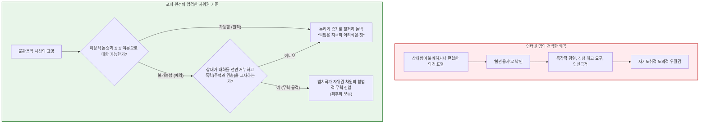
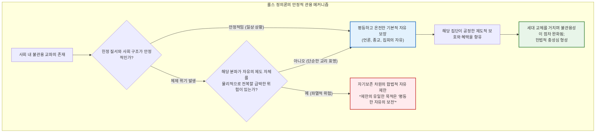
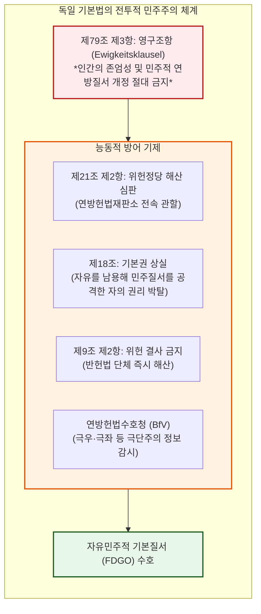
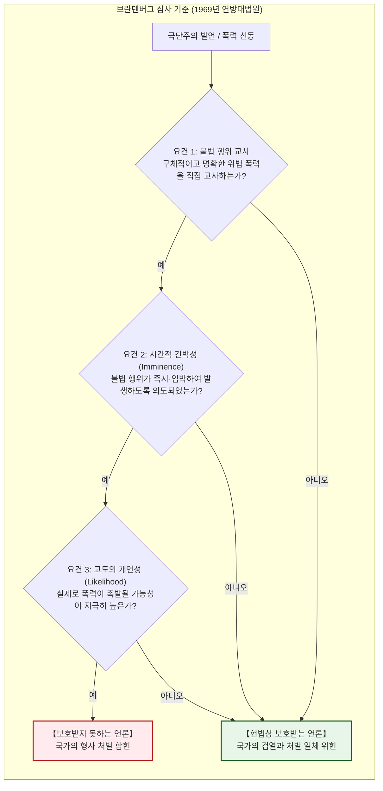
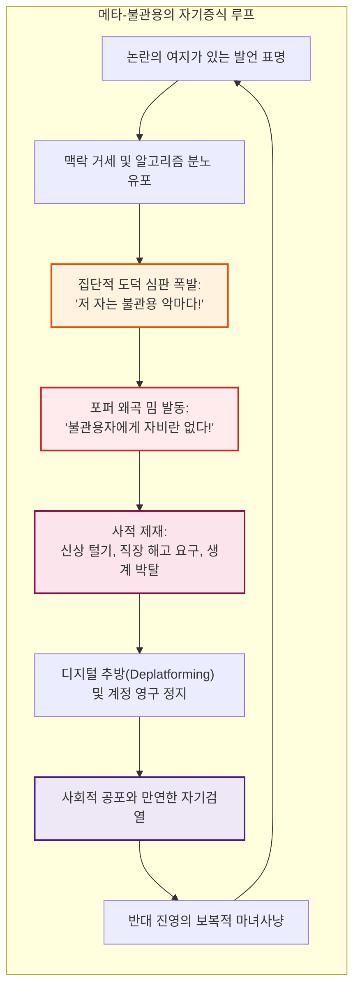
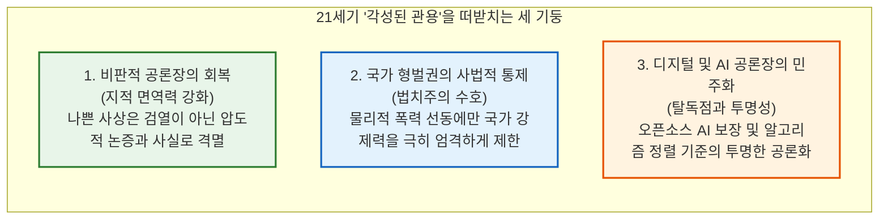

## 서론: 자유 사회를 안으로부터 침식하는 아포리아

현대 시민사회에서 **‘관용(Tolerance)’**만큼 보편적 미덕으로 칭송받으면서도, 동시에 이토록 취약하고 치명적인 자기모순을 내포한 개념은 없습니다.

모든 의견의 자유로운 표명을 인정하고, 이질적인 도덕관을 포용하며, 이단자를 결코 폭력으로 배제하지 않는 원칙—이것이야말로 계몽주의와 자유민주주의가 수세기에 걸친 피비린내 나는 종교전쟁을 딛고 세워 올린 최고의 금자탑이었습니다. 그러나 21세기 디지털 정보 공간에서 우리는 극히 불안한 현실을 목도하고 있습니다. 절대적 개방성에 기반한 공론장에서 혐오 표현, 배타적 선동, 음모론이 무제한 증식하며 도리어 ‘표현의 자유’를 방패 삼아 자유 사회의 기틀 자체를 갉아먹고 있는 것입니다.

여기서 발생하는 근본적 딜레마가 바로 **‘관용의 역설(Paradox of Tolerance)’**입니다:

> **“관용적 사회는 자신을 완전히 파괴하려는 불관용자들에게까지 무제한의 관용을 베풀어야 하는가?”**
> 
> **“불관용자에게 무제한의 관용을 허용한다면 사회는 종국에 불관용에 집어삼켜져 자유 자체가 소멸할 것이다. 그러나 불관용자를 억압하고 배제한다면, 그 사회 자신 또한 권위주의적인 불관용 사회로 타락하는 것이 아닌가?”**

이 딜레마는 결코 상아탑 속 언어유희가 아닙니다. 1930년대 바이마르 공화국은 당시 가장 민주적인 헌법을 가지고 있었으나, 나치는 그 표현과 선거의 자유를 이용해 합법적으로 민주주의를 질식시켰습니다. 오늘날 소셜 미디어의 혐오 발언 규제 논쟁, 이견을 가진 자를 사회적으로 매장하는 ‘캔슬 컬처(Cancel Culture)’, 빅테크와 AI 알고리즘의 불투명한 콘텐츠 검열에 이르기까지 이 역설은 현대 정치적 양극화의 핵심을 가로지르고 있습니다.

그러나 인터넷상에는 포퍼의 이름을 빌린 만화 밈(meme)이 유행하며 **“불관용하다고 낙인찍힌 의견은 즉시 입을 틀어막고 사회적으로 파멸시켜도 좋다”**는 극단적 왜곡이 횡행하고 있습니다. 그 결과, 다양성을 지킨다는 명분으로 반대자를 무자비하게 린치하는 **‘메타-불관용(Meta-Intolerance)’**이 만연해 있습니다.

본고는 이러한 세속적 통념을 해체하고, 칼 포퍼의 원전부터 롤스의 정의론, 독일 기본법의 ‘전투적 민주주의’, 미 연방대법원의 ‘명백하고 현존하는 위험’ 법리, AI 시대의 알고리즘 통제까지 관용의 역설의 심층을 학문적으로 엄밀하게 분석합니다.

---

## 제1장: 칼 포퍼의 경고와 인터넷 밈의 치명적 왜곡

### 1.1 역사적 맥락: 전체주의의 협공 속에서 탄생한 『열린 사회와 그 적들』

관용의 역설이라는 개념의 직계 기원은 오스트리아 출신의 영국 철학자 칼 포퍼(Karl Raimund Popper, 1902–1994)가 1945년에 발표한 명저 『열린 사회와 그 적들』(*The Open Society and Its Enemies*)에 있습니다.

유대계 혈통인 포퍼는 1937년 나치의 오스트리아 병합 직전 뉴질랜드로 망명하여 캔터베리 대학에서 가르치며 히틀러의 파시즘과 스탈린주의 전체주의가 유럽 문명을 파괴하는 참상을 뼈저리게 목격했습니다. 포퍼는 플라톤, 헤겔, 마르크스 철학에 깃든 '닫힌 사회'의 전체주의적 독소를 비판하고, 비판적 합리주의(Critical Rationalism)와 점진적 사회공학에 기초한 '열린 사회'를 옹호했습니다.

### 1.2 텍스트 정밀 독해: 제7장 주석 4의 진정한 의미

포퍼는 관용의 역설을 본문이 아닌 **제7장 주석 4(Chapter 7, Note 4)**라는 각주에서 전개했습니다:

> *“무제한의 관용은 필연적으로 관용의 소멸을 낳는다. 우리가 심지어 불관용자들에게까지 무제한의 관용을 베푼다면, 그리고 불관용자들의 맹공으로부터 관용적 사회를 방어할 준비가 되어 있지 않다면, 관용적인 사람들은 파멸할 것이며 그들과 함께 관용도 사라질 것이다.”*

인터넷 밈은 대개 이 첫 문장에서 인용을 멈추고 "따라서 불관용자를 박멸하라"고 단정합니다. 그러나 포퍼의 진정한 철학적 절제와 통찰은 바로 그 뒤에 이어집니다:

> *“**이러한 정식화를 통해 내가 예를 들어 불관용적 철학의 표명을 언제나 억압해야 한다고 말하려는 것은 아니다. 우리가 이성적인 논증으로 그것들에 맞설 수 있고 공공 여론을 통해 그것들을 억제할 수 있는 한, 억압은 분명 지극히 어리석은 짓(most unwise)일 것이다.**”*

포퍼는 명시적으로 이성적 토론과 여론의 비판이 작동하는 한 표현 억압은 **‘지극히 어리석은 짓’**이라고 경고했습니다. 국가가 강제력을 동원해 억압할 수 있는 예외적 순간에 대해 포퍼는 다음과 같은 엄격한 요건을 규정했습니다:

> *“**그러나 우리는 필요하다면 심지어 완력(힘)으로라도 그들을 억압할 권리를 주장해야 한다. 왜냐하면 그들은 이성적인 논증의 차원에서 우리와 마주할 준비가 전혀 되어 있지 않고 모든 논증을 기만이라며 처음부터 거부해 버릴 수 있기 때문이다. 그들은 추종자들에게 이성적 논증에 귀 기울이는 것을 금지하고, 논증에 대해서는 ‘주먹이나 권총’으로 대답하라고 가르칠 수 있기 때문이다.**”*

> [!WARNING]
> **통속적 포퍼주의의 함정**
> 무장 돌격대로 민주주의를 무력 파괴하려는 극단주의자에 대한 방어적 억압권을, 인터넷에서 마음에 들지 않는 견해를 가진 타인을 마녀사냥하는 면죄부로 악용하는 것은 열린 사회의 기본 원리를 송두리째 짓밟는 행위입니다.

---

## 제2장: 존 롤스 『정의론』과 불관용자에 대한 관용 의무

### 2.1 원초적 입장과 기본적 자유의 우선성

존 롤스(John Rawls, 1921–2002)는 『정의론』(1971)에서 **무지의 베일(Veil of Ignorance)**이라는 원초적 입장을 통해 공리주의적 효율보다 앞서는 **평등한 기본적 자유의 우선성(정의의 제1원칙)**을 확립했습니다.

### 2.2 제35절: 불관용자에 대한 관용

롤스는 제35절에서 불관용자를 관용해야 하는가에 대해 명쾌한 해답을 제시합니다:
1. **불관용자에게 항의할 권리가 있는가?** 없음. 타인의 자유를 부정하는 자는 상호성의 원칙상 자신에 대한 평등한 대우를 요구할 도덕적 근거를 상실함.
2. **그럼에도 사회는 그들을 관용해야 하는가?** **그렇다.** 정의로운 헌정 체제의 도덕성은 시민들의 성인군자 같은 마음씨가 아니라 객관적 법 제도의 공정성에 기초하기 때문임.
3. **정의로운 제도의 동화력**: 자유로운 헌법의 보호를 받는 불관용 종파는 제도의 공정성을 체험하면서 점차 맹신을 누그러뜨리고 민주주의 헌정 질서에 대한 내적 충성심을 키우게 됨.

### 2.3 게임이론적 분석: 반복 죄수의 딜레마

관용파(플레이어 A)와 불관용파(플레이어 B)의 상호작용은 반복 죄수의 딜레마와 같습니다. 무조건적 관용(All-C)은 착취당해 멸망하지만, 로버트 액설로드가 입증한 진화적으로 안정한 전략(ESS)은 **‘팃포탯(Tit-for-Tat)’**입니다: 관용으로 시작하되, 상대가 폭력으로 규칙을 깨뜨리면 단호히 응징하고, 규칙을 준수하면 즉시 관용으로 복귀하는 것입니다.

---

## 제3장: 제도화된 역설: 독일 기본법의 ‘전투적 민주주의’

바이마르 공화국(1919–1933)의 비극은 민주적 다수결만 확보하면 민주주의 자체를 폐지하는 개헌조차 ‘합법’으로 인정한 가치상대주의적 법실증주의에 있었습니다. 나치의 선전장관 괴벨스는 “민주주의가 자기를 죽일 무기를 원수에게 스스로 쥐여준 것은 민주주의 최고의 농담”이라고 조롱했습니다.

망명 법학자 카를 뢰벤슈타인(1937)은 민주주의가 무방비 상태로 자살할 권리를 인정해선 안 되며 **‘전투적 민주주의(Streitbare Demokratie)’**로 무장해야 한다고 역설했습니다.

1. **제79조 제3항 (영구조항)**: 인간의 존엄(제1조)과 민주공화정(제20조)은 의회 100%의 찬성으로도 영원히 폐지할 수 없음.
2. **제21조 제2항 (위헌정당 해산)**: 자유민주적 기본질서(FDGO)를 침해하려는 정당은 연방헌법재판소의 판결로 해산할 수 있음(1952년 신나치 SRP, 1956년 공산당 KPD 해산).
3. **잠재성 기준과 현대의 AfD 논쟁**: 2017년 NPD 판결에서 헌재는 정당 해산을 위해선 단순한 반헌법적 신념을 넘어 ‘민주주의를 무너뜨릴 실현 가능한 잠재성’이 필요하다고 판시했습니다. 수백만 표를 얻는 정당(독일을 위한 대안, AfD)을 사법적으로 강제 해산하는 것은 대의 민주주의 자체를 훼손하고 갈등을 지하 폭력으로 밀어 넣을 위험을 안고 있습니다.

---

## 제4장: 미국식 접근: 수정헌법 제1조와 사상의 자유시장

미국은 밀(J.S. Mill)의 전통에 따라 진리는 오류와의 자유롭고 치열한 대결 속에서만 생명력을 유지한다고 믿습니다.

미 연방대법원은 1969년 **브란덴버그 판결(Brandenburg v. Ohio)**을 통해 **“임박한 불법 행위를 직접 선동하고 실현 가능성이 극히 높은 경우(Incitement to imminent lawless action)”**가 아닌 한, 국가가 혐오 발언을 법으로 사전 금지하는 것을 엄격히 위헌으로 선언했습니다. 국가 권력에게 ‘무엇이 불관용인가’를 재단할 칼자루를 쥐여주는 것이 더 위험하다는 확신 때문입니다.

| 비교 항목 | 칼 포퍼 | 존 롤스 | J.S. 밀 | 독일 기본법 체계 | 미 연방대법원 |
| :--- | :--- | :--- | :--- | :--- | :--- |
| **사상의 기초** | 비판적 합리주의와 반증 | 공정으로서의 정의 | 사상의 자유시장 | 전투적 민주주의 | 반검열 절대주의 |
| **관용의 근거** | 인간 지식의 가류성 | 기본적 자유의 사전식 우선 | 진리의 생명력 연마 | 객관적 가치질서 수호 | 국가 권력에 대한 불신 |
| **탄압의 임계점** | 대화 전면 거부 및 **물리적 폭력** | 헌정 체제의 **현실적·급박한 위기** | 타인에 대한 실질적 물리적 피해 | 자유민주 질서에 대한 **전복 잠재성** | **임박한 불법 폭력 선동**과 고도의 개연성 |

---

## 제5장: 디지털 공론장과 캔슬 컬처의 메타-불관용

현대 소셜 미디어의 알고리즘은 분노와 부족주의적 적개심을 상품화합니다.

**캔슬 컬처**는 포퍼의 말을 악용하여 다른 생각을 가진 개인을 사회적으로 매장하는 디지털 인민재판으로 변질되었습니다. 불관용을 없앤다는 명분 아래 행해지는 사적 제재 자체가 사회에서 가장 지독한 불관용을 증식시키고 있는 것입니다.

---

## 제6장: 인공지능 시대와 비가시적 알고리즘 검열

대규모 언어 모델(LLM)의 RLHF(인간 피드백 기반 강화학습)는 소수의 실리콘밸리 테크 엘리트에게 인류의 사상을 사전 검열할 전권을 부여하고 있습니다. 코드가 주관적 기준에 따라 민감한 철학적·정치적 쟁점을 증발시킬 때, 우리는 조지 오웰이 경고한 **디지털 신어(Digital Newspeak)**의 디스토피아에 직면하게 됩니다.

---

## 제7장: 결론: 21세기를 위한 ‘각성된 관용’

진정한 관용은 수동적 무관심이나 비겁한 굴복이 아닙니다.
폭력에는 확고한 법치와 정의의 힘으로 맞서고, 편견과 오류에는 지칠 줄 모르는 이성적 대화로 맞서는 지적 용기—이것이야말로 21세기 열린 사회를 지켜내기 위한 **‘각성된 관용(Vigilant Tolerance)’**의 본질입니다.
