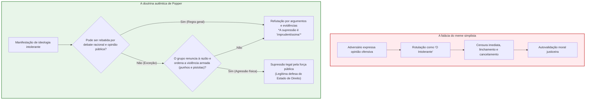
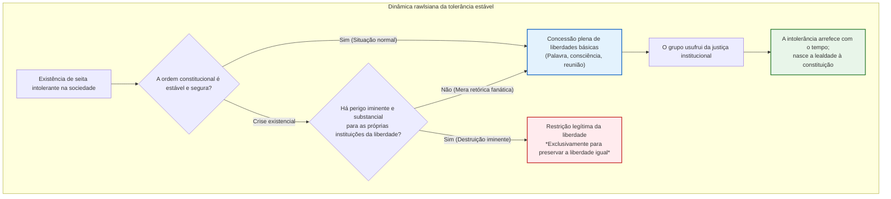

## Introdução: A aporia que corrói as sociedades livres por dentro

No debate civil contemporâneo, nenhuma virtude é tão universalmente louvada — e, ao mesmo tempo, tão frágil e carregada de contradições internas — quanto a **tolerância**.

Permitir a manifestação de todas as opiniões, acolher convicções morais divergentes e jamais proscrever o dissidente: essa foi a suprema conquista forjada ao longo de séculos de conflitos sangrentos pelo Iluminismo e pela democracia liberal. Contudo, no ecossistema digital do século XXI, confrontamo-nos com uma realidade perturbadora. No seio de um espaço público edificado sobre a abertura irrestrita, a xenofobia, teorias da conspiração radicais, propaganda totalitária e discursos de ódio que aviltam a dignidade humana proliferam com força descomunal. Pior ainda: essas forças antiliberais apropriam-se dos escudos da «liberdade de expressão» e da «tolerância» para minar, a partir de dentro, as próprias bases da sociedade aberta.

Disso decorre o dilema basilar conhecido como o **Paradoxo da Tolerância**:

> **«Deve uma sociedade tolerante permanecer infinitamente tolerante mesmo perante aqueles que buscam sua aniquilação completa?»**
> 
> **«Se concedermos tolerância ilimitada aos intolerantes, a sociedade será engolida pela intolerância e a própria liberdade desaparecerá. Mas se reprimirmos os intolerantes, não degenerará a própria sociedade num regime autoritário e intolerante?»**

Esse dilema não é mero exercício retórico. Historicamente, a República de Weimar dos anos 1930 detinha a constituição democrática mais avançada do seu tempo; contudo, o nazismo instrumentalizou suas liberdades eleitorais e de manifestação para liquidar legalmente a ordem constitucional. Hoje, das leis contra discursos de ódio aos tribunais de exceção da «cultura do cancelamento» e à moderação algorítmica opaca das Big Techs e da inteligência artificial, esse paradoxo delimita as linhas de fratura do mundo contemporâneo.

Entretanto, uma grave deturpação intelectual contaminou o debate público: um meme em quadrinhos atribuído a Karl Popper difundiu a ideia equivocada de que **«é legítimo silenciar e cancelar imediatamente qualquer opinião rotulada como intolerante»**. Esse atalho gerou uma avassaladora **«meta-intolerância»**: sob o pretexto de combater o ódio, qualquer pessoa que expresse divergência é sumariamente banida e destruída socialmente.

Este ensaio analisa a fundo os fundamentos históricos, jusfilosóficos e tecnológicos do paradoxo da tolerância.

---

## Capítulo 1: O alerta de Karl Popper e a falácia do meme da Internet

### 1.1 Contexto histórico: Entre o fascismo e o stalinismo

O conceito do paradoxo da tolerância tem origem direta no filósofo austro-britânico Karl Raimund Popper (1902–1994) em sua obra seminal de 1945, *A Sociedade Aberta e Seus Inimigos (The Open Society and Its Enemies)*.

Tendo fugido da Áustria em 1937 rumo à Nova Zelândia diante da iminente anexação nazista, Popper testemunhou a devastação da civilização europeia pelos totalitarismos nazista e soviético. Em sua obra, criticou Platão, Hegel e Marx por justificarem o esmagamento do indivíduo em nome de supostas leis históricas. Em oposição à «sociedade fechada», Popper defendeu a «sociedade aberta», fundada na razão crítica, na falibilidade humana e no debate desimpedido.

### 1.2 Exegese rigorosa: Capítulo 7, Nota 4

Popper apresentou o paradoxo em uma discreta nota de rodapé: **o capítulo 7, nota 4**.

> *«A tolerância ilimitada deve levar ao desaparecimento da tolerância. Se estendermos a tolerância ilimitada mesmo àqueles que são intolerantes, se não estivermos preparados para defender uma sociedade tolerante contra o ataque dos intolerantes, então os tolerantes serão destruídos, e com eles a tolerância.»*

Os memes habitualmente encerram a citação nesse ponto. Contudo, a advertência decisiva de Popper surge no parágrafo seguinte:

> *«Com isso não quero dizer, por exemplo, que devamos sempre suprimir a manifestação de filosofias intolerantes; enquanto pudermos combatê-las pelo argumento racional e mantê-las sob controle pela opinião pública, a supressão seria certamente uma atitude imprudentíssima.»*

Popper afirma taxativamente: **a repressão é imprudentíssima (most unwise)** enquanto pudermos responder com argumentos racionais e crítica pública. Quando, então, a sociedade tem o direito de usar a força? Popper impõe critérios rigorosos:

> *«Mas devemos reivindicar o direito de suprimi-las, se necessário até pela força; pois pode facilmente acontecer que elas não estejam dispostas a se encontrar conosco no nível do argumento racional, mas comecem por rejeitar qualquer argumento; podem proibir seus seguidores de ouvir argumentos racionais porque estes seriam enganadores, ensinando-os a responder aos argumentos pelo uso de seus punhos ou pistolas.»*

> [!WARNING]
> **O perigo do popperianismo vulgar**
> Degradar um princípio de legítima defesa contra milícias armadas que violentam o debate público em um pretexto para linchar dissidentes intelectuais nas redes sociais é uma traição imperdoável à Sociedade Aberta.

---

## Capítulo 2: John Rawls e a Teoria da Justiça

### 2.1 A Posição Original e a Prioridade da Liberdade

Em *Uma Teoria da Justiça* (1971), John Rawls (1921–2002) traduziu o paradoxo em princípios de direito constitucional. Sob o **Véu da Ignorância**, sujeitos racionais estabelecem a **prioridade absoluta das liberdades básicas iguais (Primeiro Princípio)** sobre qualquer cálculo de utilidade pública.

### 2.2 Seção 35: A tolerância para com os intolerantes

Na Seção 35, Rawls formula três teses centrais:
1. **Os intolerantes têm direito à queixa?** Não, pois quem rejeita a reciprocidade não pode exigir coerência moral de terceiros.
2. **A sociedade deve tolerá-los?** **Sim.** As instituições de uma constituição justa são imparciais e devem resguardar a liberdade de expressão e consciência mesmo dos intolerantes enquanto a ordem constitucional não for abalada.
3. **O poder assimilador das instituições livres**: O convívio sob uma constituição justa exerce uma atração pacificadora. As facções extremistas gradualmente amenizam seu dogmatismo ao experimentarem as garantias da liberdade.

### 2.3 Teoria dos Jogos e a Matriz da Tolerância

A interação social configura um Dilema do Prisioneiro iterado:

| Jogador A / Jogador B | Cooperar / Tolerar ($C$) | Trair / Intolerância ($D$) |
| :--- | :---: | :---: |
| **Cooperar / Tolerar ($C$)** | $(3, 3)$ : Sociedade Aberta Próspera | $(0, 5)$ : Servidão e Golpe Totalitário |
| **Trair / Reprimir ($D$)** | $(5, 0)$ : Repressão Preventiva | $(1, 1)$ : Estado Policialesco |

A estratégia estável provada por Robert Axelrod é o **Olho por Olho (Tit-for-Tat)**: cooperar por princípio, retaliar firmemente qualquer quebra das regras democráticas (violência) e perdoar imediatamente quando a ordem for restaurada.

---

## Capítulo 3: A «Democracia Militante» na Lei Fundamental Alemã

### 3.1 A tragédia de Weimar e o suicídio legal da constituição

A República de Weimar (1919–1933) pereceu vítima do seu **positivismo cego**: qualquer emenda constitucional era aceita se obtivesse quórum parlamentar, permitindo a Hitler aniquilar a república através das urnas e de decretos de emergência.

Joseph Goebbels zombou abertamente:
> *«Esta será sempre uma das melhores piadas da democracia: ter fornecido ela própria aos seus inimigos mortais os meios pelos quais foi aniquilada.»*

### 3.2 Karl Loewenstein e a defesa militante

O jurista alemão exilado Karl Loewenstein defendeu em 1937 que a democracia não pode ser suicida; deve estruturar-se como **Democracia Militante (*Streitbare Demokratie*)**, munindo-se de mecanismos legais para proibir partidos subversivos antes de sua ascensão ao poder absoluto.

### 3.3 A Arquitetura Protetiva do Grundgesetz (1949)

A Lei Fundamental de Bonn consagrou preceitos pioneiros:
1. **Artigo 79(3) (Cláusula de Eternidade / *Ewigkeitsklausel*)**: Imutabilidade incondicional da dignidade da pessoa humana (Art. 1) e dos princípios republicanos e democráticos (Art. 20).
2. **Artigo 21(2) (Proibição de Partidos Inconstitucionais)**: Prerrogativa do Tribunal Constitucional de Karlsruhe para banir partidos que ameacem a ordem livre e democrática (*FDGO*).
3. **Artigo 18 (Perda de Direitos Fundamentais)**: Cassação de direitos de quem deles abusar para destruir a democracia.

---

## Capítulo 4: A Tradição Norte-Americana: Primeira Emenda e o Mercado de Ideias

Em contraste com a Europa, os EUA adotaram o ideário de John Stuart Mill (*Sobre a Liberdade*, 1859): o choque contínuo entre verdade e erro é a única garantia contra a fossilização das ideias.

A Suprema Corte estabeleceu no caso **_Brandenburg v. Ohio_ (1969)** que o discurso só pode ser punido pelo Estado se houver **incitação direta e iminente a uma ação ilícita com alta probabilidade de ocorrência**. A tradição americana teme muito mais o arbítrio estatal do que as ideias extremistas.

---

## Capítulo 5: O Espaço Digital, Cancelamento e Inteligência Artificial

A economia da atenção transformou as redes sociais em arenas de fúria e tribalismo. A **cultura do cancelamento** perverteu a advertência de Popper num salvo-conduto para justiçamentos morais e banimento digital, enquanto a mediação por algoritmos de IA (RLHF) impõe filtros de valor opacos ditados por corporações do Vale do Silício, prenunciando um **orwellianismo digital**.

---

## Conclusão: Tolerância Vigilante para o Século XXI

A tolerância legítima requer:
1. **Coragem dialética**: Esmagar ideias nefastas com fatos e argumentos no debate público.
2. **Rigor da lei**: Conter a violência física sob estrito controle judicial e devido processo legal.
3. **Rejeição à inquisição moral**: Impedir que o combate à intolerância degenere em linchamento coletivo.

A Sociedade Aberta sobrevive não construindo prisões mentais, mas enfrentando destemidamente o desafio da liberdade.
