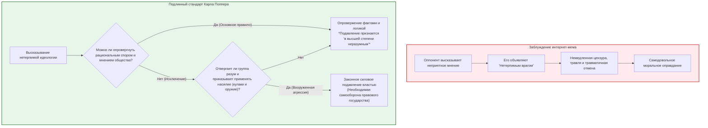

## Введение: Апория, подтачивающая свободное общество изнутри

В современном общественном дискурсе нет добродетели более восхваляемой — и одновременно более хрупкой и исполненной внутренних противоречий, — чем **толерантность (терпимость)**.

Допускать выражение любых мнений, интегрировать несхожие мировоззрения и никогда насильственно не изгонять инакомыслящего: это было высшим триумфом, завоеванным Просвещением и либеральной демократией ценой столетий кровопролитных войн. Однако в цифровом пространстве XXI века мы сталкиваемся с глубоко тревожной реальностью. В открытом публичном пространстве ксенофобия, радикальные теории заговора, тоталитарная пропаганда и язык вражды, отрицающий человеческое достоинство, распространяются с разрушительной силой. Хуже того: эти антилиберальные силы цинично прикрываются «свободой слова» и «толерантностью», чтобы изнутри уничтожить институты свободного общества.

Из этого проистекает фундаментальная дилемма, известная как **Парадокс толерантности (Paradox of Tolerance)**:

> **«Должно ли толерантное общество оставаться бесконечно терпимым даже по отношению к тем, кто открыто стремится к его полному уничтожению?»**
> 
> **«Если мы предоставим нетерпимым безграничную толерантность, общество неизбежно будет поглощено нетерпимостью, и свобода исчезнет. Но если мы начнем подавлять и исключать нетерпимых, не превратится ли само наше общество в авторитарный и нетерпимый режим?»**

Эта дилемма не является схоластическим упражнением. В 1930-е годы Веймарская республика в Германии обладала самой демократичной и передовой конституцией своего времени; тем не менее нацисты хладнокровно использовали избирательные свободы и свободу собраний, чтобы легальным путем ликвидировать республику. Сегодня — от законов о противодействии хейтспичу и судилищ «культуры отмены» до непрозрачной алгоритмической цензуры Big Tech и искусственного интеллекта — этот парадокс определяет линии раскола современного мира.

Но в интернете циркулирует чудовищное упрощение: комикс-мем со ссылкой на Карла Поппера проповедует тезис о том, что **«любое мнение, объявленное нетерпимым, можно немедленно цензурировать, травить и уничтожать»**. Это породило волну **«мета-нетерпимости»**: под предлогом защиты справедливости любого человека с альтернативной точкой зрения клеймят «фашистом» и подвергают социальной казни.

Настоящее исследование призвано разрушить эту вульгарную карикатуру и представить исчерпывающий философский, правовой и технологический анализ парадокса толерантности.

---

## Глава 1: Предостережение Карла Поппера и фальшивка интернет-мема

### 1.1 Исторический контекст: В тисках нацизма и сталинизма

Концепция парадокса толерантности берет начало в фундаментальном труде австро-британского философа Карла Раймунда Поппера (1902–1994) *«Открытое общество и его враги»* (1945).

Покинув Австрию в 1937 году из-за угрозы нацистского террора и эмигрировав в Новую Зеландию, Поппер наблюдал крушение европейской цивилизации под ударами нацизма и советского тоталитаризма. В своей книге он подверг беспощадной критике идеи Платона, Гегеля и Маркса, приносивших личность в жертву «законам истории». Этому «закрытому обществу» Поппер противопоставил «Открытое общество», основанное на критическом рационализме, признании человеческой погрешимости (фаллибилизме) и свободной конкуренции идей.

### 1.2 Точный анализ первоисточника: Глава 7, Примечание 4

Поппер сформулировал парадокс в небольшом примечании: **Глава 7, примечание 4**.

> *«Безграничная толерантность должна привести к исчезновению толерантности. Если мы распространим безграничную толерантность даже на тех, кто нетерпим, если мы не будем готовы защищать толерантное общество от атак нетерпимых, толерантные будут уничтожены, и вместе с ними исчезнет толерантность.»*

Интернет-мемы всегда обрывают цитату на этой фразе. Однако главное предостережение Поппера содержится в следующих предложениях:

> *«Этой формулировкой я отнюдь не хочу сказать, например, что мы должны всегда подавлять высказывание нетерпимых философий; пока мы можем противостоять им с помощью рациональных аргументов и сдерживать их силой общественного мнения, подавление было бы в высшей степени неразумным (most unwise).»*

Поппер прямо подчеркивает: **подавление в высшей степени неразумно**, пока работают разум и открытая дискуссия. Когда же общество имеет право прибегнуть к силе? Поппер выдвигает предельно строгие критерии:

> *«Но мы должны заявить о своем праве подавлять их, при необходимости даже силой; ибо может легко оказаться, что они не готовы встретиться с нами на уровне рациональной аргументации, но начинают с отвержения всякой дискуссии; они могут запретить своим последователям слушать рациональные аргументы, объявив их обманом, и научить их отвечать на аргументы ударами кулаков или выстрелами пистолетов.»*

> [!WARNING]
> **Опасность вульгарного попперианства**
> Использовать доктрину самообороны против вооруженных фашистских боевиков как инструмент для расправы с политическими и этическими оппонентами в интернете — значит совершить прямое предательство идеалов Открытого общества.

---

## Глава 2: Джон Ролз и «Теория справедливости»

В трактате *«Теория справедливости»* (1971) Джон Ролз показал, что под **Завесой неведения** рациональные субъекты закрепляют **приоритет равных базовых свобод (Первый принцип справедливости)**.

В параграфе 35 Ролз доказывает: справедливое общество **обязано проявлять толерантность к нетерпимым**, пока институты остаются стабильными. Справедливые институты обладают преобразующей силой: живя под защитой свободной конституции, радикальные меньшинства с течением времени смягчают фанатизм и проникаются уважением к демократическому строю.

Ограничение свободы допустимо исключительно тогда, когда возникает **непосредственная и материальная угроза институтам самой свободы**.

---

## Глава 3: «Воинствующая демократия» в Основном законе ФРГ

Горький опыт падения Веймарской республики, где нацисты разрушили систему конституционным путем, заставил послевоенную Германию внедрить концепцию **«Воинствующей демократии» (Streitbare Demokratie)** Карла Лёвенштейна:
1. **Статья 79, пункт 3 (Вечная оговорка / *Ewigkeitsklausel*)**: Запрещает любые изменения конституции, посягающие на человеческое достоинство (ст. 1) или демократический строй (ст. 20).
2. **Статья 21, пункт 2 (Запрет антиконституционных партий)**: Федеральный конституционный суд в Карлсруэ наделен эксклюзивным правом распускать партии, стремящиеся подорвать свободный демократический порядок (*FDGO*).

---

## Глава 4: Американский подход: Первая поправка и рынок идей

В традиции Джона Стюарта Милля (*«О свободе»*, 1859) свободное столкновение истины с заблуждением считается единственной защитой от окостенения мысли.

В прецеденте **_Бранденбург против Огайо_ (1969)** Верховный суд США постановил, что экстремистская речь защищена Конституцией, если она не направлена на **непосредственное подстрекательство к неизбежному беззаконию (*imminent lawless action*)** с высокой вероятностью его совершения.

---

## Глава 5: Цифровое пространство, культура отмены и цензура ИИ

Алгоритмы соцсетей, построенные на экономике внимания, разрушили идеалы рационального диалога Хабермаса, подменив их яростью и поляризацией. **Культура отмены** извратила предостережение Поппера, превратившись в цифровой суд Линча.

Одновременно с этим непрозрачное выравнивание ИИ (RLHF) корпорациями Кремниевой долины создает угрозу **цифрового оруэллианства**, когда крамольные мысли превентивно уничтожаются программным кодом.

---

## Заключение: Бдительная толерантность XXI века

Истинная толерантность — это не малодушие и не равнодушие:
1. **Сокрушать деструктивные идеи силой рационального аргумента**, а не истерической цензурой.
2. **Применять силу закона исключительно против физического насилия** под строгим судебным контролем.
3. **Отвергать цифровые инквизиции**, сохраняя верность свободе и критическому разуму.
