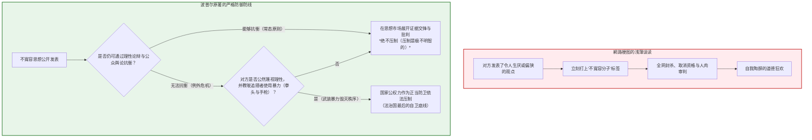
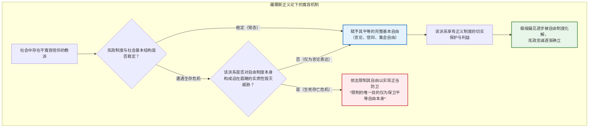
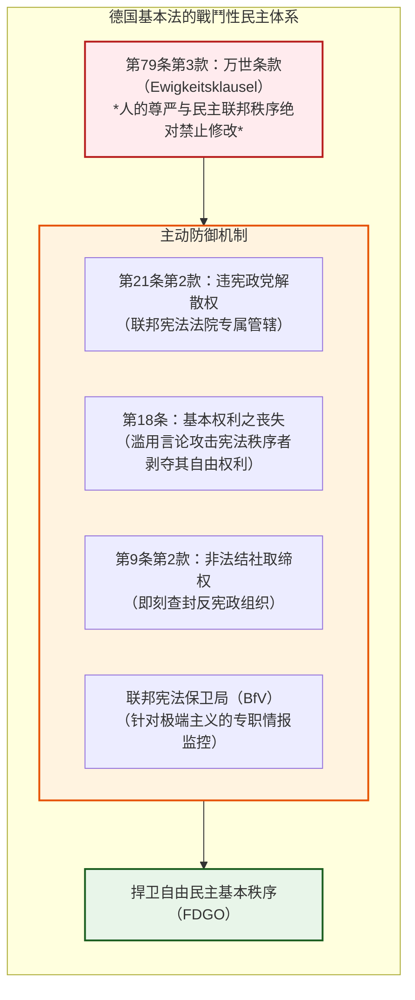
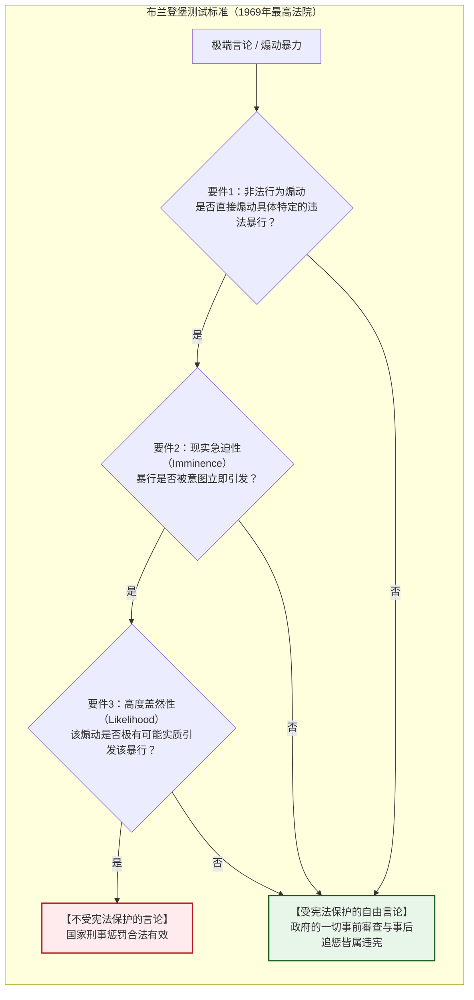
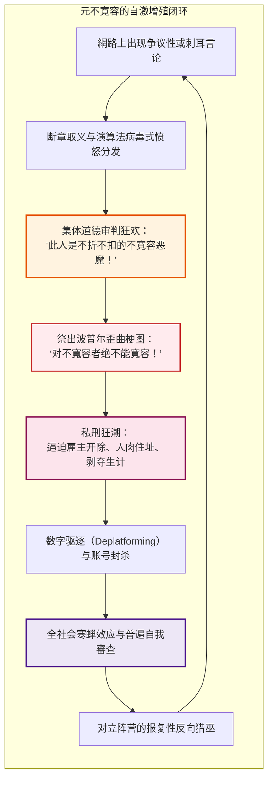
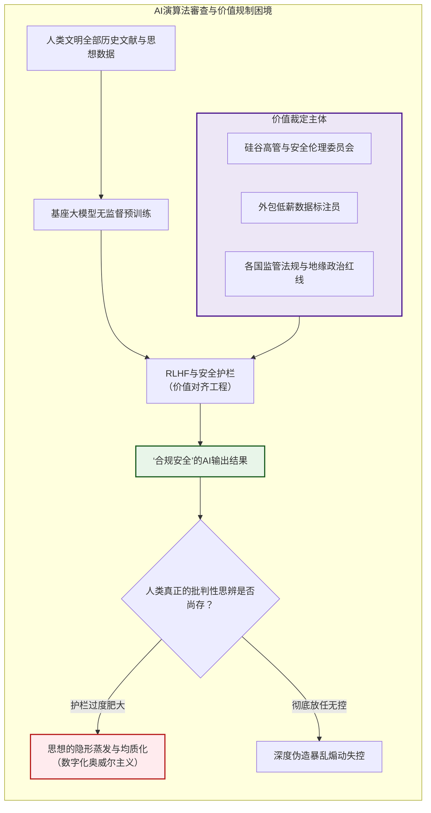
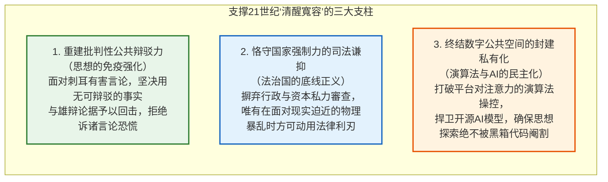

## 引言：从内部侵蚀自由社会的阿波利亚

在当代公共话语中，几乎没有任何一种德性像**“寬容（Tolerance）”**那样受到普遍赞颂，却又如此脆弱且充满深沉的内在自我矛盾。

允许所有观点的自由表达，包容截然不同的道德信仰，绝不凭借暴力清洗异见者——这是启蒙运动与自由民主制度历经数百年残酷流血战争后确立的至高成就。然而，置身21世纪的数字化公共领域，我们正目睹着一场深刻的危机：在以绝对開放为根基的網路空间中，排外狂热、极端阴谋论、极权主义宣传以及践踏人类尊严的仇恨言论以前所未有的烈度蔓延，甚至频频绑架“言论自由”与“寬容”的盾牌，反噬并摧毁自由秩序本身。

由此诞生了政治哲学史上著名的根本难题——**“寬容的悖論（Paradox of Tolerance）”**：

> **“一个寬容的社会，是否必须对那些意图彻底摧毁寬容的极端势力保持无限的寬容？”**
> 
> **“如果我们对不寬容者实施无限制的寬容，社会终将被不寬容所吞噬，自由本身随之毁灭；然而，如果我们诉诸国家强权压制并不容忍那些不寬容者，我们的社会自身岂非堕落成了专制与不寬容的渊薮？”**

这一困境绝非学者书斋里的智力文字游戏。回溯历史，20世纪30年代德国魏玛共和国拥有当时世界上最民主、保障人权最彻底的宪法，然而纳粹党却利用其毫无防备的选举与言论自由，通过完全合法的程序自内部彻底颠覆了宪政体制。在今天，从各国关于仇恨言论规制的立法拉锯，到社交網路上愈演愈烈的“取消文化（Cancel Culture）”狂潮，乃至科技巨头与人工智能（AI）演算法暗箱操作的内容審查，这个悖論始终横亘于现代政治分裂的核心。

然而，在社交網路上广泛流传的“寬容悖論”观念中，充斥着极其危险的浅薄误读。一幅假借卡尔·波普尔之名的網路漫画梗图被病毒式传播，兜售着一种粗暴的逻辑：**“只要将对方认定为‘不寬容者’，就可以正义凛然地剥夺其发言权、封杀、人肉搜索并实施社会性处决。”** 其结果演变成了一场席卷全球的**“元不寬容（Meta-Intolerance）”**：任何与主流道德教条相左的异见者，都会被扣上“不寬容”的大帽子遭到残酷抹杀。

本文旨在彻底粉碎这一世俗流俗的断章取义，从政治哲学、比较宪政学与資訊伦理学的高度，对“寬容的悖論”展开学理与制度层面的全面解剖。

---

## 第一章：卡尔·波普尔的原旨警示与網路梗图的致命误读

### 1.1 历史语境：极权主义夹缝中的《開放社会及其敌人》

“寬容的悖論”这一概念直接出自奥地利裔英国哲学家卡尔·莱蒙德·波普尔（Karl Raimund Popper, 1902–1994）于1945年出版的划时代巨著《開放社会及其敌人》（*The Open Society and Its Enemies*）。

理解波普尔的思想，必须还原其写作的历史炼狱。波普尔因犹太血统于1937年在纳粹吞并奥地利前夕流亡新西兰，在坎特伯雷大学任教期间，他怀着极度悲愤的心情目睹了希特勒法西斯主义与苏联斯大林主义对欧洲文明的毁灭性摧残。在书中，他深刻剖析了柏拉图、黑格尔与马克思哲学中潜藏的“封闭社会”基因，坚决捍卫基于理性批判、反驳检验（证伪主义）与和平制度更迭的“開放社会”。

### 1.2 文本细读：第七章附注4的完整内涵

波普尔提出寬容悖論的语境，并非在正文核心论述，而是在其**第七章附注4（Chapter 7, Note 4）**这一隐蔽的脚注中：

> *“无限的寬容必将导致寬容的消失。如果我们把无限的寬容扩展到甚至包括那些不寬容者，如果我们不准备保卫一个寬容的社会免受不寬容者的袭击，那么寬容者就会被消灭，而寬容也随之消失。”*

網路上的浅薄配图几乎全在此处戛然而止，草率得出“所以必须消灭不寬容者”的荒谬推论。然而，波普尔真正的哲学良知与审慎界限，恰恰体现在其后紧接着的论述中：

> *“**在这一表述中，我绝不是暗示，例如我们应该一律压制不寬容哲学的发表；只要我们能够通过理性的论证来对抗它们，并借由公众舆论将其控制在可容忍的范围内，压制它们无疑是极不明智的（most unwise）。**”*

波普尔白纸黑字地告诫：只要理性论辩与公众批判依然有效，诉诸压制言论是**“极其不智的（most unwise）”**。那么，自由社会究竟在何种极端临界点上，才拥有诉诸强制力的自卫权利？波普尔给出了严格的法律事实构成：

> *“**但是，在必要时，哪怕诉诸武力，我们也应声称拥有压制它们的权利；因为很容易出现的情况是：他们根本不准备在理性论辩的层面上同我们交锋，而是从一开始就全盘否定一切理性争鸣；他们可能禁止其追随者聆听理性的论证，宣称那是骗人的把戏，并教导他们用自己的‘拳头’或‘手枪’来回答论辩。**”*

> *“因此，我们应当以寬容的名义，要求不寬容那些不寬容者的权利。我们应当宣布，任何宣扬不寬容的运动都将置身于法律之外，我们应当将煽动不寬容和迫害的行为定为犯罪，如同我们将煽动谋杀、绑架或复活奴隶贸易定为犯罪一样。”*

### 1.3 網路梗图的二大致命盲区

流行梗图犯下了两个根本性的哲学错误：
1. **抛弃了理性反驳的第一义务**：波普尔的開放社会以“批判理性主义”为立足点。面对有害言论，公民的首要责任是用论据与事实公开击溃谬误，而非求助于暴力封口。
2. **彻底抹杀了“诉诸实体暴力（拳头与手枪）”的刚性门槛**：波普尔限定的强制压制，针对的是纳粹冲锋队式武装夺权团伙，绝非網路上发表刺耳观点的异见者。

> [!WARNING]
> **庸俗波普尔主义的深渊**
> 将针对武装暴动自卫权曲解为剥夺思想言论自由的私刑借口，绝不是在捍卫開放社会，而是亲手将開放社会推向闭塞极权的恐怖泥潭。

---

## 第二章：约翰·羅爾斯与《正义论》的规范性重构

### 2.1 原初状态与平等的自由原则

约翰·羅爾斯（John Rawls, 1921–2002）在1971年的经典巨著《正义论》（*A Theory of Justice*）中，在**无知之幕（Veil of Ignorance）**的思想实验下推导出了**平等的最大基本自由优先原则（正义第一原则）**，这一原则在规范位阶上绝对优先于一切功利主义效率计算。

### 2.2 第35节：对不寬容者的容忍义务

在《正义论》第35节，羅爾斯论证了三个具有深远宪政意义的命题：
1. **不寬容派是否有权抱怨自己未被寬容？** 没有。因为拒绝承认他人自由的人，失去了在正义原则上要求平等待遇的道德资格。
2. **正义社会是否仍有义务容忍他们？** **有。** 一个正义的宪政体制依靠的是客观法律制度的正义性，而非公民个体的道德纯洁。只要国家的基本自由制度是巩固的，法律绝不能仅仅依据某种派别抱有偏狭教义就剥夺其思想、信仰与言论自由。
3. **正义制度的同化力**：生活在受到平等保护的公正体制下的不寬容群体，随着代际更替，会逐渐体会到公正法治的好处，从而自发减弱狂热，产生对宪政体制的内生认同。

### 2.3 博弈论视角：囚徒困境与以牙还牙策略

如果将寬容者（玩家A）与不寬容者（玩家B）的博弈模型化为重复博弈中的囚徒困境：

| 玩家A / 玩家B | 合作 / 寬容 ($C$) | 背叛 / 不寬容 ($D$) |
| :--- | :---: | :---: |
| **合作 / 寬容 ($C$)** | $(3, 3)$ : 開放社会的繁荣共存 | $(0, 5)$ : 遭极权夺权蚕食奴役 |
| **背叛 / 压制 ($D$)** | $(5, 0)$ : 预防性专制镇压 | $(1, 1)$ : 警察国家与全面互害 |

罗伯特·阿克塞尔罗德证明的进化稳定策略（ESS）是**“以牙还牙（Tit-for-Tat）”**：以寬容为基石；一旦对方动用暴力撕毁规则，立刻坚决施加对等反制；对方回归宪政规则，则立刻重新寬容。

---

## 第三章：制度化的悖論：德国基本法的“戰鬥性民主”

### 3.1 魏玛体制的“合法性自杀”教训

魏玛共和国（1919–1933）的悲剧根源在于其**价值中立的法律实证主义**：只要掌握国会三分之二多数，任何修宪甚至废除民主制度本身都被视为“合法”。纳粹宣传部长戈培尔曾公开嘲弄民主制度“亲手把绞死自己的绳索递给了死敌”。

### 3.2 卡尔·洛文施泰因与《戰鬥性民主》

流亡法学家洛文施泰因在1937年提出，民主绝不能陷入毫无防备的自杀性被动，必须全副武装成为**“戰鬥性民主（Streitbare / Militant Democracy）”**。

1. **第79条第3款【万世条款（Ewigkeitsklausel）】**：人类尊严（第1条）及民主联邦原则（第20条）绝不容许以任何合法修宪程序废除。
2. **第21条第2款【违宪政党解散权】**：唯独联邦宪法法院有权取缔意图破坏“自由民主基本秩序（FDGO）”的政党（如1952年取缔新纳粹SRP，1956年取缔共产党KPD）。
3. **潜在性标准（Potentialität）与当代AfD争议**：在2017年新纳粹NPD案中，法院确立了政党必须具备“摧毁秩序的现实成功可能性”方可取缔的标准。当面对坐拥数百万选民支持的德国选择党（AfD）时，国家若轻易诉诸政党取缔，反将深陷摧毁民主代表性与将政治对抗推向地下暴力的双重危局。

---

## 第四章：美国进路：第一修正案与“思想的自由市场”

与德国的主动干预模式截然不同，美国承袭约翰·斯图尔特·密尔《论自由》（1859）传统，坚信真理只有在与谬误的公开激烈交锋中才能保持生机。

美国最高法院在著名的 **_布兰登堡诉俄亥俄州案（Brandenburg v. Ohio, 1969）_** 中确立了举世闻名的**“迫在眉睫的非法行为（Imminent Lawless Action）”**标准：除非极端言论直接意在煽动、且极有可能立即诱发具体的违法暴行，否则政府一律无权因言定罪。美国宪政的根本逻辑是：**比起狂热分子的谬论，国家掌控“裁定何为不寬容”的权力对自由的危害要致命万倍。**

| 比较维度 | 卡尔·波普尔 | 约翰·羅爾斯 | 约翰·斯图尔特·密尔 | 德国基本法体系 | 美国联邦最高法院 |
| :--- | :--- | :--- | :--- | :--- | :--- |
| **思想基石** | 批判理性主义与证伪 | 作为公平的正义 | 思想的自由市场 | 戰鬥性民主 | 反審查绝对主义 |
| **寬容之依据** | 人类认识的有限与可谬 | 基本自由的辞书式优先 | 真理在争鸣中淬炼 | 客观价值秩序的维护 | 彻底防范利维坦的专制 |
| **压制之触发点** | 拒绝理性并**诉诸物理暴力** | 宪政体系面临**现实迫近危机** | 造成实质物理侵害（伤害原则） | 敌对意图且具**倾覆现实潜在性** | **意图并极可能引发即刻暴乱** |

---

## 第五章：数字公域的异化与“取消文化”的元不寬容

当代演算法驱动的“注意力经济”彻底瓦解了哈贝马斯的商谈伦理，情绪化的道德愤怒成为流量最大的商品。

在**取消文化（Cancel Culture）**的裹挟下，波普尔的警句被扭曲成網路红卫兵式的私刑工具：任何发表离经叛道观点的个体都会被剥夺工作、社会关系与網路发声渠道。**以“铲除不寬容”为名的狂暴私刑，自身已堕落为最危险的不寬容源泉。**

与此同时，当代公共广场被几大硅谷科技巨头寡头垄断，未经正当司法程序（Due Process）的封号与演算法限流，构成了现代社会中最专横的“私有化審查”。

---

## 第六章：人工智能时代的技术黑箱与不可见審查

大语言模型（LLM）的对齐技术（RLHF与Constitutional AI）赋予了少数科技精英隐蔽審查人类思想的生杀大权。

当不符合硅谷中产阶级道德教条的学术探讨和边缘观点被底层代码静默“蒸发”时，人类正滑向乔治·奥威尔所描绘的**数字新语（Digital Newspeak）**深渊。为了避免这一噩梦，我们必须坚持开源開放的AI生态，推进模型对齐准则的透明化与多方共治。

---

## 第七章：结论：21世纪的“清醒寬容”

真正的寬容绝非无原则的纵容软弱：
1. **用理性批判与确凿事实压倒谬误**，拒绝患上言论審查恐慌症；
2. **仅在面对现实迫近的物理暴力与叛乱时，方可启动法治强制力**；
3. **警惕一切假借寬容之名建立的網路宗教裁判所。**

一个開放的社会，绝不会靠把自己改造成一座密不透风的思维监狱来幸存；它唯有凭借永不枯竭的思辨勇气，在自由与秩序的刀锋上挺拔屹立。
