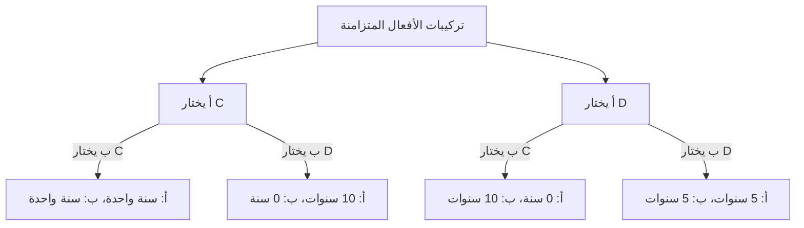
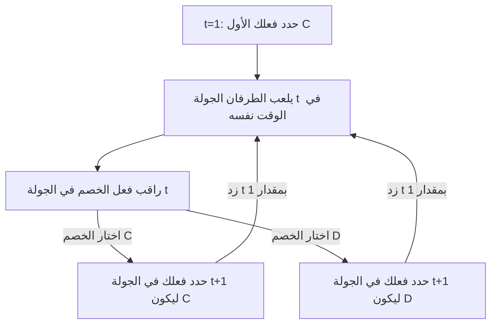

قد يكون التعاون أفضل لكلا اللاعبين، مع بقاء حافز لدى كل منهما للابتعاد عنه. تحلل [معضلة السجين](https://kenji.blog/ar/p/prisoners-dilemma/) هذا التعارض من خلال أفعال وعوائد محددة. وليست قانونًا يقول إن البشر يخونون حتمًا أو إن المجموعات المتعاونة تنجو حتمًا.

فيما يتعلق بالتاريخ، تعرض [مواد مقرر جامعة كورنيل](https://www.cs.cornell.edu/~rafael/networks-html/chapter1.html) عمل Merrill Flood وMelvin Dresher في عام 1950، وشرح Albert Tucker باستخدام قصة عن السجناء. نميز هنا بين حوافز التفاعل لمرة واحدة، والاستراتيجيات المتكررة، والنماذج التطورية، وملاحظات الحيوانات.

## 1. تحويل مدد سجن خيالية إلى عوائد

لنفترض أن مشتبهًا بهما، أ وب، لا يستطيعان التشاور، ويختاران في الوقت نفسه الصمت C (التعاون بينهما) أو الاعتراف D (الابتعاد عن هذا التعاون). في هذا السيناريو الخيالي تكون مدد السجن التالية مؤكدة. وهو لا يصف قواعد التحقيق أو صفقات الإقرار بالذنب الفعلية، ولا يعني أن الاعتراف يؤدي إلى البراءة.

| أ / ب | C: الصمت | D: الاعتراف |
| --- | --- | --- |
| C: الصمت | أ: سنة واحدة، ب: سنة واحدة | أ: 10 سنوات، ب: 0 سنة |
| D: الاعتراف | أ: 0 سنة، ب: 10 سنوات | أ: 5 سنوات، ب: 5 سنوات |

يريد كل شخص تقصير مدة سجنه فقط؛ ولا تضيف الصداقة أو السمعة أو الشعور بالذنب منفعة أخرى. نستخدم u_i، وهو سالب مدة السجن y_i، عائدًا. العائد السالب لا يعني مدة سجن سالبة. T هو عائدك عندما تختار D وحدك، وR عندما يختار الطرفان C، وP عندما يختاران D، وS عندما تختار C وحدك.

$$
u_i=-y_i,\quad y_i\in\{0,1,5,10\},\qquad T=0>R=-1>P=-5>S=-10
$$

يسرد الرسم تركيبات الأفعال المختارة في الوقت نفسه. ولا يسمح لأ بأن يراقب فعل ب أولًا ثم يختار.

## 2. الهيمنة وتوازن ناش وكفاءة باريتو

في u_i، يمثل الوسيط الأول فعلك أنت والثاني فعل اللاعب الآخر. سواء اختار الآخر C أو D، يكون عائدك أعلى باختيار D.

$$
u_i(D,C)=0>-1=u_i(C,C),\qquad u_i(D,D)=-5>-10=u_i(C,D)
$$

لذلك تكون D **استراتيجية مهيمنة بصرامة**. وإذا قدرت احتمال اختيار الآخر C بالرمز q، يظل فرق العائدين المتوقعين موجبًا. يختلف q عن p الذي سنستخدمه لاحقًا لاحتمال ملاقاة لاعب TFT آخر داخل المجموعة.

$$
\begin{aligned}0&\le q\le1,\\\mathrm{EU}(D)&=-5+5q,\\\mathrm{EU}(C)&=-10+9q,\\\mathrm{EU}(D)-\mathrm{EU}(C)&=5-4q\ge1.\end{aligned}
$$

إذا عظم الطرفان منفعتهما المتوقعة وفق هذا الجدول، يختاران DD. ولأن D تتفوق بصرامة على C أمام استراتيجيات الآخر الخالصة والمختلطة، فإن DD هو توازن ناش الوحيد. **توازن ناش** هو توليفة من الاستراتيجيات لا يستطيع فيها أي لاعب زيادة عائده بتغيير استراتيجيته وحدها مع ثبات استراتيجية الآخر. ولا يعني ذلك أن التغيير المشترك لا يمكن أن يحسن النتيجة.

تكون النتيجة **كفؤة وفق باريتو (مثلى وفق باريتو)** إذا لم توجد نتيجة أخرى ممكنة تحسن عائد لاعب واحد على الأقل دون خفض عائد أي شخص. بين تركيبات الأفعال الخالصة في الجدول، تكون CC وCD وDC كفؤة، أما DD فليست كذلك؛ إذ يؤدي الانتقال إلى CC إلى تحسين عائدي الطرفين. لا يسرد هذا التعداد كامل مجموعة العوائد الكفؤة عند السماح بالاختيار العشوائي بين النتائج.

وبشكل منفصل، عند جمع العوائد العددية بأوزان متساوية، تحقق CC أعلى مجموع. تعريف الكفاءة ومعيار المجموع أمران مختلفان.

$$
(u_1+u_2)(CC)=-2,\qquad(u_1+u_2)(CD)=(u_1+u_2)(DC)=(u_1+u_2)(DD)=-10
$$

هذا تحليل لحوافز نموذج ذي عوائد محددة، وليس برهانًا على جميع الدوافع البشرية أو على شقاء اجتماعي حتمي.

## 3. فحص التطبيقات من خلال العوائد والمؤسسات

### المنافسة السعرية

قد يفيد النموذج أحيانًا كتقريب لحافز البيع بسعر أقل من المنافس لزيادة المبيعات، مع تقلص هوامش الربح إذا خفض الطرفان الأسعار. لكن الطلب والتكاليف والجودة ودخول السوق تغير العوائد؛ ولا يضمن السعر الأقل الاحتكار. ويختلف مجموع أرباح الشركات عن الرفاه الاجتماعي الذي يشمل المستهلكين.

### البيئة والموارد المشتركة

عندما تتشارك الأطراف فوائد خفض الانبعاثات ويتحمل كل منها تكاليفه، يمكن فحص حافز الاستفادة من جهود الآخرين دون المساهمة. لكن الواقع يشمل دولًا متعددة وأضرارًا وتكاليف غير متماثلة واتفاقات ورقابة. لا يحدد جدول اللاعبين هذا وحده النتائج المناخية أو النمو الاقتصادي لكل دولة. كما أن مشكلات الموارد المشتركة ليست كلها اللعبة الثنائية نفسها.

### سباق التسلح

تستخدم نماذج تبسط حوافز نزع السلاح والاحتفاظ به أيضًا للتفكير في السباق النووي بين الولايات المتحدة والاتحاد السوفيتي أثناء الحرب الباردة. فالقدرات الفعلية والمعلومات والتحقق والتحالفات مهمة. لا يثبت الجدول حتمية تاريخية مفادها أن نزع السلاح من جانب واحد أمام خصم مسلح يهدد دائمًا بقاء الدولة، ولا يترك إلا زيادة التسلح خيارًا.

## 4. التكرار واستراتيجية Tit for Tat

عندما تستمر العلاقة، قد تغير الاستجابات المستقبلية للأفعال الحالية العوائد. لكن التكرار لا يضمن التعاون. إذا تكررت لعبة المرحلة نفسها عددًا معلومًا وثابتًا ومحدودًا من المرات، وكانت السجلات قابلة للملاحظة والبنية والعقلانية معرفة مشتركة، فإن الاستقراء العكسي من الجولة الأخيرة يعطي توازنًا تامًا في الألعاب الفرعية مع DD في كل جولة. تناقش [مذكرات MIT](https://www.ocw.mit.edu/courses/14-15j-networks-spring-2018/pages/lecture-and-recitation-notes/recitation-10-notes/) أيضًا الفرق بين التكرار المحدود وغير المحدود؛ وتختلف عوائدها العددية عن عوائد هذا المقال.

تختار **Tit for Tat (TFT)** الفعل C أولًا، ثم تقلد فعل الخصم في الجولة السابقة بدءًا من الجولة الثانية. يرمز a_i,t إلى فعلك في الجولة t، وj إلى اللاعب الآخر.

$$
a_{i,1}=C,\qquad a_{i,t}=a_{j,t-1}\quad(t\ge2)
$$

بعد التعاون أو الابتعاد عنه، تلعب الجولة التالية قبل ملاحظة نتيجتها. لا تتنبأ الاستراتيجية بفعل الخصم الحالي، ولا تراقب ندمه الداخلي.

تفيد [ورقة Axelrod وHamilton المنشورة عام 1981](https://public.websites.umich.edu/~axe/research/Axelrod%20and%20Hamilton%20EC%201981.pdf) بأن TFT التي قدمها Anatol Rapoport حققت أعلى متوسط نقاط في بطولتي برامج Axelrod. تختلف العوائد هناك، T=5 وR=3 وP=1 وS=0، عن جدول مدد السجن هنا. لا تبدأ TFT بالابتعاد عن التعاون، وتستجيب لابتعاد الخصم، وتعود إلى التعاون في الجولة التالية لعودته إليه. وقاعدتها موجزة أيضًا. لكن ذلك لا يجعلها الأفضل أمام كل خصم ونظام نقاط وأفق زمني واحتمال خطأ.

حتى بين لاعبي TFT، قد يؤدي خطأ في الفعل ينتج CD إلى DC ثم CD، فتستمر حالات الابتعاد المتناوبة. نقاط البطولة والتوازن والتطور البيولوجي والسلوك المرغوب أخلاقيًا أسئلة مختلفة.

## 5. تطور التعاون: بنية المجموعات والأدلة الحيوانية

### متى قد تتمتع مجموعة متعاونة صغيرة بأفضلية

تحتاج اللعبة التطورية إلى تحديد من يلتقي بمن بين الأفراد ذوي قواعد السلوك المحددة، وكيف يؤثر الأداء في الأجيال التالية. إعطاء الأولوية للبقاء أو التكاثر ليس أمرًا باختيار D في كل موقف.

متى قد تحقق مجموعة TFT صغيرة أداء أفضل في جماعة سكانية يستخدم باقي أفرادها ALLD؟ لنأخذ نموذجًا بسيطًا للنقاط المخصومة: يبقى الخصوم ثابتين، وتتكرر الأفعال المتزامنة، ولا أخطاء، ويعبر δ عن وزن المستقبل. تختار ALLD الفعل D في كل جولة. V(X,Y) هي النقاط المخصومة للاستراتيجية X أمام Y.

$$
\begin{aligned}0&\le\delta<1,\\V(\mathrm{TFT},\mathrm{TFT})&=\frac{-1}{1-\delta},\\V(\mathrm{TFT},\mathrm{ALLD})&=-10-\frac{5\delta}{1-\delta},\\V(\mathrm{ALLD},\mathrm{ALLD})&=\frac{-5}{1-\delta}.\end{aligned}
$$

نفترض أن عضو مجموعة TFT النادرة يلتقي لاعب TFT آخر باحتمال p، وإلا يلتقي ALLD. نقارنه بالمقيمين الذين يلتقون ALLD وحدهم تقريبًا، في الحد الذي تصبح فيه حصة المجموعة ضئيلة يمكن إهمالها. p هو نسبة خصوم TFT بين لقاءات لاعب TFT، وليس نسبة TFT في كامل الجماعة السكانية.

$$
\begin{aligned}V_{\mathrm{cluster}}&=pV(\mathrm{TFT},\mathrm{TFT})+(1-p)V(\mathrm{TFT},\mathrm{ALLD}),\\V_{\mathrm{cluster}}-V(\mathrm{ALLD},\mathrm{ALLD})&=\frac{p(9-5\delta)-5(1-\delta)}{1-\delta}.\end{aligned}
$$

شرط تحقيق نقاط أعلى بصرامة من مرجع ALLD هو:

$$
0\le p\le1,\qquad V_{\mathrm{cluster}}>V(\mathrm{ALLD},\mathrm{ALLD})\quad\Longleftrightarrow\quad p>\frac{5(1-\delta)}{9-5\delta}
$$

مثلًا، عندما يكون δ=0.9، يجب أن يحقق احتمال اللقاء داخل المجموعة الشرط التالي:

$$
\delta=\frac9{10}\quad\Longrightarrow\quad p>\frac{5(1-9/10)}{9-5(9/10)}=\frac19
$$

| p | نقاط TFT المخصومة المتوقعة | مرجع ALLD أمام ALLD | المقارنة |
| --- | --- | --- | --- |
| <bdi dir="ltr">0</bdi> | <bdi dir="ltr">-55</bdi> | <bdi dir="ltr">-50</bdi> | أقل |
| <bdi dir="ltr">1/20</bdi> | <bdi dir="ltr">-52.75</bdi> | <bdi dir="ltr">-50</bdi> | أقل |
| <bdi dir="ltr">1/9</bdi> | <bdi dir="ltr">-50</bdi> | <bdi dir="ltr">-50</bdi> | متساوٍ |
| <bdi dir="ltr">1/5</bdi> | <bdi dir="ltr">-46</bdi> | <bdi dir="ltr">-50</bdi> | أعلى |

وبخاصة، إذا لم تلتق TFT بأي TFT آخر، فلكل δ:

$$
p=0\quad\Longrightarrow\quad V_{\mathrm{cluster}}-V(\mathrm{ALLD},\mathrm{ALLD})=-5<0
$$

إذًا، لا يضمن الأفق الطويل وحده أفضلية TFT المعزولة. يقارن الحساب نقاطًا قد تكون سالبة، لا معدلات التكاثر أو البقاء. ومن دون تحديد قواعد تغير الجماعة السكانية، لا يمكنه إثبات الإقصاء النهائي أو تثبيت استراتيجية فيها. تضع ورقة 1981 أيضًا شروطًا للاتصال داخل المجموعة والاستمرارية عند بحث النشأة الأولية للتعاون.

### عدم مساواة الخفافيش والنحل باستراتيجية واحدة

أجرت [دراسة Carter وWilkinson عام 2013](https://science.umd.edu/faculty/wilkinson/Carter%26Wilk_PRSB13.pdf) اختبارات صيام على 20 خفاشًا مصاصًا للدماء في الأسر. وأفادت بوجود ارتباط بين الطعام المتلقى من شريك والطعام المقدم إليه، وعلاقات اجتماعية مستمرة. لكن الارتباط وحده لا يثبت أن تلقي الطعام يسبب التقديم التالي أو أن الخفافيش تنفذ TFT.

كما أن اجتماعية نحل العسل لا تعني تلقائيًا TFT. يناقش Axelrod وHamilton تضحية العاملات مثالًا لفهم المنافع عبر القرابة. فالقرابة والمنافع المتبادلة والتعرف الفردي وبنية التفاعلات تتطلب دراسات منفصلة. ولا يمكن أيضًا مساواة اللياقة البيولوجية (fitness) مباشرة بالأخلاق البشرية أو الثقة.

## 6. التفكير في الآليات التي تدعم التعاون

تحدد معضلة السجين حالات لا تدعم فيها الحوافز الفردية، عند عوائد معينة، نتيجة يرغب فيها الطرفان. عند التفكير في التعاون، ينبغي فحص:

- **العوائد والخيارات**: هل تغير العقوبات أو تقاسم التكاليف أو المكافآت المقارنة بين الأفعال فعلًا؟ يجب فحص آثار المؤسسات والشروط القانونية في كل تطبيق واقعي.
- **الملاحظة والالتزامات**: إلى أي مدى يمكن التحقق من الأفعال، وما مدى إلزام الوعود والاستجابات؟ إذا لم تغير المحادثة عوائد اللعبة ذات التفاعل الواحد أو خياراتها، تظل D مهيمنة بصرامة.
- **الأفق الزمني واللقاءات**: ما وزن المستقبل، وكيف تنتهي العلاقة، ومن نلتقيه مجددًا، وكيف نتعامل مع الأخطاء؟

وجود توازن تعاوني أو شروط نقاط مواتية يختلف عن اختيار التعاون فعلًا وترسخه. تساعد النماذج في فحص الافتراضات المحددة التي تدعمه، ولا تثبت قيمة الثقة دون شروط.
