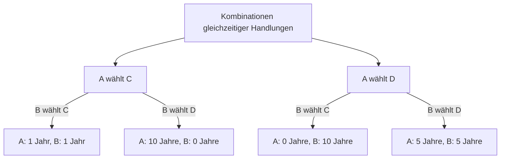
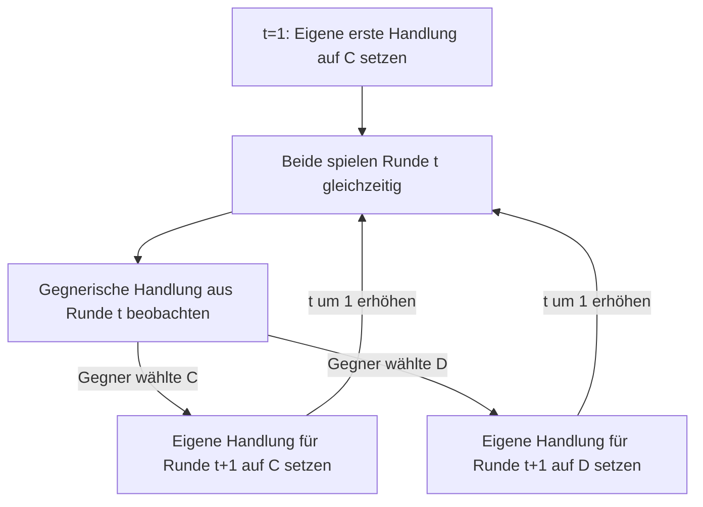

Kooperation kann für beide besser sein, obwohl jeder einen Anreiz haben kann, davon abzuweichen. Das [Gefangenendilemma](https://kenji.blog/de/p/prisoners-dilemma/) untersucht diesen Konflikt anhand festgelegter Auszahlungen und Handlungsmöglichkeiten. Es ist kein Gesetz, wonach Menschen immer defektieren oder kooperative Gruppen zwangsläufig überleben.

Zur Geschichte beschreiben die [Kursunterlagen der Cornell University](https://www.cs.cornell.edu/~rafael/networks-html/chapter1.html) die Arbeiten von Merrill Flood und Melvin Dresher im Jahr 1950 sowie Albert Tuckers Darstellung durch eine Geschichte über Gefangene. Hier unterscheiden wir einmalige Anreize, wiederholte Strategien, evolutionäre Modelle und Tierbeobachtungen.

## 1. Fiktive Haftzeiten in Auszahlungen übersetzen

Zwei Verdächtige A und B können sich nicht absprechen und wählen gleichzeitig Schweigen C (Kooperation miteinander) oder Gestehen D (Abweichen von dieser Kooperation). Im fiktiven Szenario stehen die folgenden Haftzeiten fest. Es beschreibt weder tatsächliche Ermittlungsregeln oder strafprozessuale Absprachen noch eine Regel, wonach ein Geständnis zum Freispruch führt.

| A / B | C: Schweigen | D: Gestehen |
| --- | --- | --- |
| C: Schweigen | A: 1 Jahr, B: 1 Jahr | A: 10 Jahre, B: 0 Jahre |
| D: Gestehen | A: 0 Jahre, B: 10 Jahre | A: 5 Jahre, B: 5 Jahre |

Jeder möchte ausschließlich die eigene Haftzeit verkürzen; Freundschaft, Ansehen und Schuldgefühle gehen nicht als zusätzlicher Nutzen ein. Als Auszahlung u_i verwenden wir die negative Haftdauer y_i. Eine negative Auszahlung bedeutet keine negative Haftzeit. T ist die eigene Auszahlung, wenn nur man selbst D wählt; R bei beiderseitigem C, P bei beiderseitigem D und S, wenn nur man selbst C wählt.

$$
u_i=-y_i,\quad y_i\in\{0,1,5,10\},\qquad T=0>R=-1>P=-5>S=-10
$$

Das Diagramm zählt Kombinationen gleichzeitig gewählter Handlungen auf. A beobachtet nicht erst Bs Handlung, um dann zu entscheiden.

## 2. Dominanz, Nash-Gleichgewicht und Pareto-Effizienz

Bei u_i bezeichnet das erste Argument die eigene Handlung und das zweite die des anderen Spielers. Unabhängig davon, ob der andere C oder D wählt, ist die eigene Auszahlung bei D höher.

$$
u_i(D,C)=0>-1=u_i(C,C),\qquad u_i(D,D)=-5>-10=u_i(C,D)
$$

D ist damit eine **streng dominante Strategie**. Wird dem gegnerischen C die Wahrscheinlichkeit q zugeordnet, ist auch die Differenz der erwarteten Auszahlungen positiv. Dieses q unterscheidet sich von der später verwendeten Wahrscheinlichkeit p für Begegnungen innerhalb einer Gruppe.

$$
\begin{aligned}0&\le q\le1,\\\mathrm{EU}(D)&=-5+5q,\\\mathrm{EU}(C)&=-10+9q,\\\mathrm{EU}(D)-\mathrm{EU}(C)&=5-4q\ge1.\end{aligned}
$$

Maximieren beide anhand dieser Tabelle ihren eigenen erwarteten Nutzen, wählen sie DD. Da D gegenüber reinen wie gemischten gegnerischen Strategien streng dominiert, ist DD das einzige Nash-Gleichgewicht. Ein **Nash-Gleichgewicht** ist ein Strategieprofil, in dem kein Spieler durch Änderung nur der eigenen Strategie seine Auszahlung erhöhen kann, solange die andere Strategie festbleibt. Eine gemeinsame Änderung kann das Ergebnis dennoch verbessern.

Ein Ergebnis ist **Pareto-effizient (Pareto-optimal)**, wenn kein anderes erreichbares Ergebnis mindestens einen Spieler besserstellt, ohne jemanden schlechterzustellen. Unter den reinen Handlungsprofilen der Tabelle sind CC, CD und DC effizient. DD ist es nicht: Der Wechsel zu CC verbessert beide Auszahlungen. Damit ist nicht die gesamte effiziente Auszahlungsmenge beschrieben, wenn Zufallsauswahlen zwischen Ergebnissen zulässig sind.

Davon getrennt hat CC die höchste Summe, wenn die numerischen Auszahlungen gleich gewichtet addiert werden. Effizienzdefinition und Summenkriterium sind unterschiedliche Bewertungen.

$$
(u_1+u_2)(CC)=-2,\qquad(u_1+u_2)(CD)=(u_1+u_2)(DC)=(u_1+u_2)(DD)=-10
$$

Dies analysiert Anreize in einem festgelegten Auszahlungsmodell. Es beweist weder universelle menschliche Motive noch unvermeidbares gesellschaftliches Unglück.

## 3. Anwendungen anhand von Auszahlungen und Institutionen prüfen

### Preiswettbewerb

Das Modell kann manchmal als Analogie für den Anreiz dienen, den Rivalen zu unterbieten, um mehr zu verkaufen, während beiderseitige Preissenkungen die Margen verringern. Nachfrage, Kosten, Qualität und Markteintritt verändern aber die Auszahlungen; Unterbieten garantiert kein Monopol. Die Summe der Unternehmensgewinne unterscheidet sich zudem von der gesellschaftlichen Wohlfahrt einschließlich der Verbraucher.

### Umwelt und gemeinsame Ressourcen

Wenn der Nutzen von Emissionsminderungen geteilt wird, jeder Akteur jedoch Kosten trägt, lassen sich Anreize zum Trittbrettfahren auf den Anstrengungen anderer untersuchen. In der Realität gibt es aber mehrere Staaten, asymmetrische Schäden und Kosten, Abkommen und Überwachung. Diese Zweipersonentabelle bestimmt weder Klimaergebnisse noch das Wirtschaftswachstum einzelner Länder. Auch Probleme gemeinsamer Ressourcen sind nicht alle dasselbe Zweipersonenspiel.

### Wettrüsten

Modelle vereinfachter Anreize zur Abrüstung und zum Beibehalten von Waffen werden auch zur Betrachtung des nuklearen Wettrüstens zwischen den USA und der Sowjetunion im Kalten Krieg verwendet. Tatsächliche Fähigkeiten, Informationen, Verifikation und Bündnisse spielen eine Rolle. Die Tabelle beweist keine historische Zwangsläufigkeit, wonach einseitige Abrüstung gegenüber einem bewaffneten Rivalen immer die nationale Existenz bedroht und nur Aufrüstung zulässt.

## 4. Wiederholung und Tit for Tat

Bei fortgesetzten Beziehungen können zukünftige Reaktionen auf heutiges Handeln die Auszahlungen verändern. Wiederholung garantiert jedoch keine Kooperation. Wird dasselbe Stufenspiel eine bekannte, feste und endliche Zahl von Malen wiederholt, sind die Verläufe beobachtbar und sind Struktur und Rationalität gemeinsames Wissen, ergibt Rückwärtsinduktion ab der letzten Runde ein teilspielperfektes Gleichgewicht mit DD in jeder Runde. Die [MIT-Unterlagen](https://www.ocw.mit.edu/courses/14-15j-networks-spring-2018/pages/lecture-and-recitation-notes/recitation-10-notes/) behandeln ebenfalls den Unterschied zwischen endlicher und unendlicher Wiederholung; ihre numerischen Auszahlungen unterscheiden sich von unseren.

**Tit for Tat (TFT)** wählt zuerst C und kopiert danach die vorherige Handlung des Gegners. a_i,t bezeichnet die eigene Handlung in Runde t, j den anderen Spieler.

$$
a_{i,1}=C,\qquad a_{i,t}=a_{j,t-1}\quad(t\ge2)
$$

Nach Kooperation wie nach Defektion wird die nächste Runde gespielt, bevor ihr Ergebnis beobachtet wird. Die Strategie sieht weder die aktuelle gegnerische Handlung voraus noch beobachtet sie innere Reue.

Der [Aufsatz von Axelrod und Hamilton aus dem Jahr 1981](https://public.websites.umich.edu/~axe/research/Axelrod%20and%20Hamilton%20EC%201981.pdf) berichtet, dass die von Anatol Rapoport eingereichte TFT in beiden Programmturnieren Axelrods die höchste durchschnittliche Punktzahl erzielte. Die dortigen Auszahlungen T=5, R=3, P=1 und S=0 unterscheiden sich von unserer Haftzeittabelle. TFT defektiert nicht zuerst, reagiert auf gegnerische Defektion und kehrt in der Runde nach der Rückkehr des Gegners zur Kooperation ebenfalls zurück. Die Regel ist zudem kurz. Daraus folgt keine Überlegenheit gegenüber allen Gegnern, Wertungen, Zeithorizonten oder Fehlerbedingungen.

Selbst zwischen zwei TFT-Spielern kann ein Handlungsfehler mit CD anschließend DC, dann wieder CD hervorrufen und abwechselnde Defektion aufrechterhalten. Turnierpunkte, Gleichgewicht, biologische Evolution und moralisch wünschenswertes Handeln sind unterschiedliche Fragen.

## 5. Evolution der Kooperation: Gruppenstruktur und Tierbeobachtungen

### Wann eine kleine kooperative Gruppe im Vorteil sein kann

Ein evolutionäres Spiel muss festlegen, wem Individuen mit bestimmten Verhaltensregeln begegnen und wie sich ihre Leistung auf nachfolgende Generationen auswirkt. Überleben oder Fortpflanzung zu priorisieren ist keine Anweisung, unter allen Umständen D zu wählen.

Wann kann eine kleine TFT-Gruppe in einer ansonsten ALLD nutzenden Population besser abschneiden? Betrachten wir ein einfaches Modell diskontierter Punktzahlen: Die Gegner bleiben fest, die Handlungen erfolgen wiederholt und gleichzeitig, Fehler treten nicht auf, und δ gewichtet die Zukunft. ALLD wählt in jeder Runde D. V(X,Y) ist die diskontierte Punktzahl von Strategie X gegen Y.

$$
\begin{aligned}0&\le\delta<1,\\V(\mathrm{TFT},\mathrm{TFT})&=\frac{-1}{1-\delta},\\V(\mathrm{TFT},\mathrm{ALLD})&=-10-\frac{5\delta}{1-\delta},\\V(\mathrm{ALLD},\mathrm{ALLD})&=\frac{-5}{1-\delta}.\end{aligned}
$$

Ein Mitglied einer seltenen TFT-Gruppe treffe mit Wahrscheinlichkeit p auf einen anderen TFT-Spieler und ansonsten auf ALLD. Verglichen wird mit ansässigen Spielern, die fast nur ALLD begegnen, im Grenzfall eines vernachlässigbar kleinen Gruppenanteils. p ist hier der TFT-Anteil unter den Gegnern eines TFT-Spielers, nicht die Häufigkeit von TFT in der gesamten Population.

$$
\begin{aligned}V_{\mathrm{cluster}}&=pV(\mathrm{TFT},\mathrm{TFT})+(1-p)V(\mathrm{TFT},\mathrm{ALLD}),\\V_{\mathrm{cluster}}-V(\mathrm{ALLD},\mathrm{ALLD})&=\frac{p(9-5\delta)-5(1-\delta)}{1-\delta}.\end{aligned}
$$

Die Bedingung für eine strikt höhere Punktzahl als die ALLD-Referenz lautet:

$$
0\le p\le1,\qquad V_{\mathrm{cluster}}>V(\mathrm{ALLD},\mathrm{ALLD})\quad\Longleftrightarrow\quad p>\frac{5(1-\delta)}{9-5\delta}
$$

Bei δ=0,9 muss beispielsweise die Wahrscheinlichkeit einer Begegnung innerhalb der Gruppe folgende Bedingung erfüllen:

$$
\delta=\frac9{10}\quad\Longrightarrow\quad p>\frac{5(1-9/10)}{9-5(9/10)}=\frac19
$$

| p | Erwartete diskontierte Punktzahl von TFT | Referenz ALLD gegen ALLD | Vergleich |
| --- | --- | --- | --- |
| 0 | -55 | -50 | Niedriger |
| 1/20 | -52,75 | -50 | Niedriger |
| 1/9 | -50 | -50 | Gleich |
| 1/5 | -46 | -50 | Höher |

Insbesondere gilt für jedes δ, wenn TFT keinem anderen TFT begegnet:

$$
p=0\quad\Longrightarrow\quad V_{\mathrm{cluster}}-V(\mathrm{ALLD},\mathrm{ALLD})=-5<0
$$

Ein langer Zeithorizont allein garantiert isolierter TFT daher keinen Vorteil. Diese Rechnung vergleicht Punktzahlen, die negativ sein dürfen, keine Fortpflanzungs- oder Überlebensraten. Ohne Regeln für die Aktualisierung der Population lässt sich weder endgültige Verdrängung noch die Fixierung einer Strategie beweisen. Auch der Aufsatz von 1981 knüpft das anfängliche Entstehen der Kooperation an Kontakte innerhalb der Gruppe und an Fortsetzung.

### Fledermäuse und Bienen nicht mit derselben Strategie gleichsetzen

Die [Studie von Carter und Wilkinson aus dem Jahr 2013](https://science.umd.edu/faculty/wilkinson/Carter%26Wilk_PRSB13.pdf) führte Fastenversuche mit 20 Vampirfledermäusen in Gefangenschaft durch. Sie berichtete Zusammenhänge zwischen der von einem Partner erhaltenen und der ihm gegebenen Nahrung sowie dauerhafte soziale Beziehungen. Diese Korrelation allein beweist weder, dass der Nahrungserhalt die nächste Spende verursacht, noch, dass Fledermäuse TFT ausführen.

Auch das Sozialverhalten von Honigbienen ist nicht automatisch TFT. Axelrod und Hamilton besprechen die Selbstaufopferung von Arbeiterinnen als Beispiel für Vorteile durch Verwandtschaft. Verwandtschaft, wechselseitige Vorteile, individuelle Wiedererkennung und Kontaktstruktur müssen getrennt untersucht werden. Biologische Fitness darf ebenso wenig einfach mit menschlicher Moral oder Vertrauen gleichgesetzt werden.

## 6. Mechanismen betrachten, die Kooperation stützen

Das Gefangenendilemma benennt Fälle, in denen individuelle Anreize bei festgelegten Auszahlungen ein für beide erwünschtes Ergebnis nicht stützen. Bei Überlegungen zur Kooperation ist zu prüfen:

- **Auszahlungen und Handlungsmöglichkeiten**: Verändern Sanktionen, Kostenteilung oder Belohnungen tatsächlich den Vergleich zwischen Handlungen? Institutionelle Wirkungen und rechtliche Bedingungen sind für jede reale Anwendung gesondert zu untersuchen.
- **Beobachtung und Zusagen**: Wie zuverlässig lassen sich Handlungen feststellen und wie verbindlich sind Versprechen und Reaktionen? Verändert ein Gespräch weder Auszahlungen noch Optionen eines einmaligen Spiels, bleibt D streng dominant.
- **Zeithorizont und Begegnungen**: Wie stark zählt die Zukunft, wie endet die Beziehung, wem begegnet man erneut und wie werden Fehler behandelt?

Ein kooperatives Gleichgewicht oder günstige Punktzahlbedingungen sind nicht dasselbe wie tatsächlich gewählte und etablierte Kooperation. Modelle helfen, ihre konkreten Voraussetzungen zu prüfen; sie beweisen den Wert von Vertrauen nicht bedingungslos.
