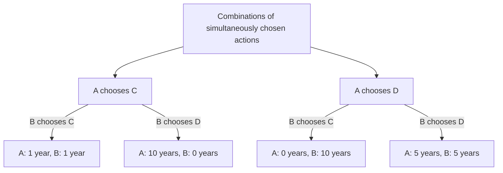
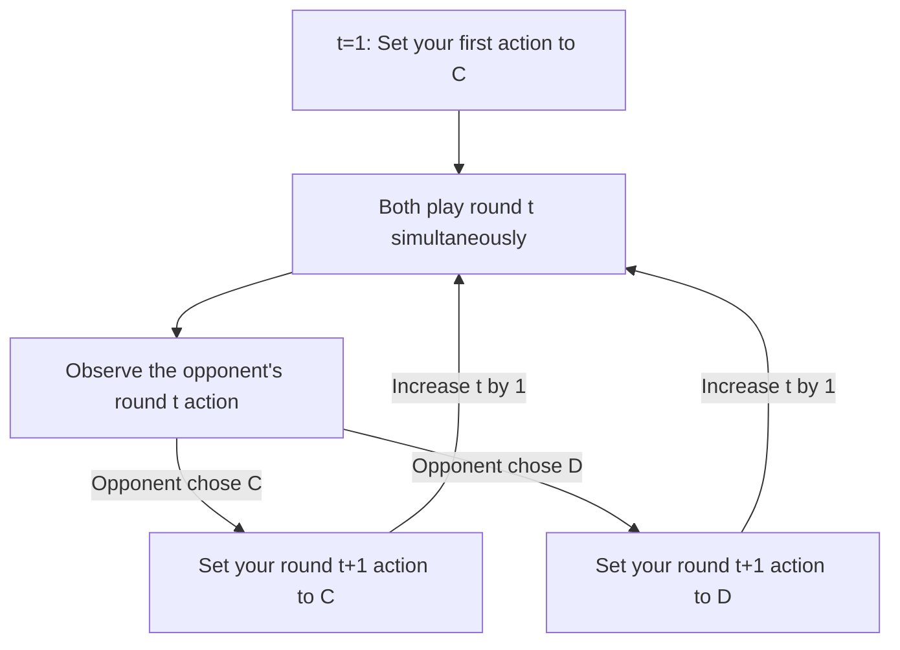

Cooperation can be better for both players, yet each may have an incentive to leave it. The [prisoner's dilemma](https://kenji.blog/en/p/prisoners-dilemma/) studies this conflict through specified payoffs and choices. It is not a law that people must defect or that cooperative groups must survive.

For its history, [Cornell's course notes](https://www.cs.cornell.edu/~rafael/networks-html/chapter1.html) describe the work of Merrill Flood and Melvin Dresher in 1950 and Albert Tucker's presentation through a story about prisoners. Here we distinguish one-shot incentives, repeated strategies, evolutionary models and observations of animals.

## 1. Turning fictional sentences into payoffs

Suppose two suspects, A and B, cannot consult each other and simultaneously choose silence C (cooperation with each other) or confession D (leaving that cooperation). The following sentences are certain in this fictional setting. It does not describe actual investigation or plea-bargaining rules, or establish that a confession leads to acquittal.

| A / B | C: silence | D: confession |
| --- | --- | --- |
| C: silence | A: 1 year, B: 1 year | A: 10 years, B: 0 years |
| D: confession | A: 0 years, B: 10 years | A: 5 years, B: 5 years |

Each person wants only to shorten their own sentence; friendship, reputation and guilt add no utility. We use u_i, the negative of sentence duration y_i, as the payoff. A negative payoff does not mean a negative sentence. T is your payoff when you alone choose D, R when both choose C, P when both choose D and S when you alone choose C.

$$
u_i=-y_i,\quad y_i\in\{0,1,5,10\},\qquad T=0>R=-1>P=-5>S=-10
$$

This diagram enumerates simultaneous action combinations. It does not let A observe B's action before choosing.

## 2. Dominance, Nash equilibrium and Pareto efficiency

Compare u_i with your own action as the first argument and the other player's as the second. Whether the other chooses C or D, you receive a higher payoff from D.

$$
u_i(D,C)=0>-1=u_i(C,C),\qquad u_i(D,D)=-5>-10=u_i(C,D)
$$

This is a **strictly dominant strategy**. If you assign probability q to the other player choosing C, the difference in expected payoffs is also positive. This q is distinct from the within-cluster matching probability p used later.

$$
\begin{aligned}0&\le q\le1,\\\mathrm{EU}(D)&=-5+5q,\\\mathrm{EU}(C)&=-10+9q,\\\mathrm{EU}(D)-\mathrm{EU}(C)&=5-4q\ge1.\end{aligned}
$$

If both maximize their own expected utility using this table, they choose DD. Because D strictly dominates against both pure and mixed opposing strategies, DD is the unique Nash equilibrium. A **Nash equilibrium** is a strategy profile in which no player can increase their payoff by changing only their own strategy while the other's remains fixed. It does not mean that a joint change cannot improve the outcome.

An outcome is **Pareto efficient (Pareto optimal)** if no other feasible outcome improves at least one player's payoff without reducing anyone else's. Among the table's pure action profiles, CC, CD and DC are efficient, whereas DD is not: changing to CC improves both players' payoffs. This list does not enumerate the entire efficient payoff set when lotteries over outcomes are allowed.

Separately, adding the numerical payoffs with equal weights gives CC the highest total. The definition of efficiency and this sum criterion are different.

$$
(u_1+u_2)(CC)=-2,\qquad(u_1+u_2)(CD)=(u_1+u_2)(DC)=(u_1+u_2)(DD)=-10
$$

This is an analysis of incentives in a specified payoff model, not a proof of universal human motives or societal misery.

## 3. Checking real applications through payoffs and institutions

### Price competition

The model can sometimes provide an analogy for incentives to undercut a rival to increase sales, alongside shrinking margins when both cut prices. But demand, costs, quality and market entry change payoffs, and undercutting does not necessarily secure a monopoly. The sum of firms' profits also differs from social welfare including consumers.

### The environment and shared resources

When the benefits of emission reductions are shared but each actor bears costs, we can examine incentives to free-ride on others' efforts. Yet multiple countries, asymmetric damage and costs, agreements and monitoring mean that this two-player table cannot determine climate outcomes or countries' economic growth. Shared-resource problems are not all the same two-player game either.

### Arms races

Models simplifying disarmament and armament incentives are also used to think about the Cold War nuclear arms race between the United States and the Soviet Union. Actual capabilities, information, verification and alliances matter. This table does not prove the historical inevitability that unilateral disarmament against an armed rival must threaten national survival and leave armament as the only choice.

## 4. Repetition and Tit for Tat

When a relationship continues, future responses to present actions can change payoffs. Repetition does not, however, guarantee cooperation. If the same stage game repeats a known, fixed, finite number of times, histories are observable, and structure and rationality are common knowledge, backward induction from the last round yields a subgame-perfect equilibrium with DD in every round. [MIT's notes](https://www.ocw.mit.edu/courses/14-15j-networks-spring-2018/pages/lecture-and-recitation-notes/recitation-10-notes/) also discuss the finite/infinite distinction; their numerical payoffs differ from this article's.

**Tit for Tat (TFT)** chooses C first, then copies the opponent's previous action. Let a_i,t be your action in round t, with j denoting the other player.

$$
a_{i,1}=C,\qquad a_{i,t}=a_{j,t-1}\quad(t\ge2)
$$

After either cooperation or defection, the next round is played before its outcome is observed. The strategy does not anticipate the opponent's current action or observe an internal state of repentance.

[Axelrod and Hamilton's 1981 paper](https://public.websites.umich.edu/~axe/research/Axelrod%20and%20Hamilton%20EC%201981.pdf) reports that TFT, submitted by Anatol Rapoport, achieved the highest average score in Axelrod's two program tournaments. Their payoffs T=5, R=3, P=1 and S=0 differ from this article's sentence table. TFT does not initiate defection, responds to an opponent's defection and returns to cooperation in the round after the opponent does. Its rule is also concise. This does not make it best under every opponent, scoring system, horizon or error condition.

Even between two TFT players, an action error producing CD can be followed by DC, then CD, sustaining alternating defection. Tournament scores, equilibrium, biological evolution and morally desirable behavior are different questions.

## 5. Cooperation's evolution: group structure and animal evidence

### When a small cooperative cluster can have an advantage

An evolutionary game specifies whom individuals with particular behavioral rules meet and how performance affects subsequent generations. Prioritizing survival or reproduction is not equivalent to an instruction to choose D in every setting.

When can a small TFT cluster do better in a population otherwise using ALLD? Consider a simple discounted-score model. Opponents remain fixed, moves are simultaneous and repeated, there are no errors, and δ weights the future. ALLD chooses D every round. V(X,Y) is the discounted score of strategy X against Y.

$$
\begin{aligned}0&\le\delta<1,\\V(\mathrm{TFT},\mathrm{TFT})&=\frac{-1}{1-\delta},\\V(\mathrm{TFT},\mathrm{ALLD})&=-10-\frac{5\delta}{1-\delta},\\V(\mathrm{ALLD},\mathrm{ALLD})&=\frac{-5}{1-\delta}.\end{aligned}
$$

Assume a member of a rare TFT cluster meets another TFT with probability p and otherwise meets ALLD. Compare it with residents who meet almost only ALLD, in the limit of a negligibly small cluster. Here p is the proportion of a TFT player's opponents using TFT, not TFT's prevalence in the whole population.

$$
\begin{aligned}V_{\mathrm{cluster}}&=pV(\mathrm{TFT},\mathrm{TFT})+(1-p)V(\mathrm{TFT},\mathrm{ALLD}),\\V_{\mathrm{cluster}}-V(\mathrm{ALLD},\mathrm{ALLD})&=\frac{p(9-5\delta)-5(1-\delta)}{1-\delta}.\end{aligned}
$$

The condition for a strictly higher score than the ALLD baseline is:

$$
0\le p\le1,\qquad V_{\mathrm{cluster}}>V(\mathrm{ALLD},\mathrm{ALLD})\quad\Longleftrightarrow\quad p>\frac{5(1-\delta)}{9-5\delta}
$$

For example, when δ=0.9, the required within-cluster matching probability is:

$$
\delta=\frac9{10}\quad\Longrightarrow\quad p>\frac{5(1-9/10)}{9-5(9/10)}=\frac19
$$

| p | TFT expected discounted score | ALLD-versus-ALLD baseline | Comparison |
| --- | --- | --- | --- |
| 0 | -55 | -50 | Lower |
| 1/20 | -52.75 | -50 | Lower |
| 1/9 | -50 | -50 | Equal |
| 1/5 | -46 | -50 | Higher |

In particular, if TFT never meets another TFT, the difference for every δ is:

$$
p=0\quad\Longrightarrow\quad V_{\mathrm{cluster}}-V(\mathrm{ALLD},\mathrm{ALLD})=-5<0
$$

Thus, a long horizon alone does not guarantee an advantage for isolated TFT. This calculation compares scores that may be negative. They are not reproduction or survival rates; without specifying population-update rules, we cannot prove eventual elimination or fixation. The 1981 paper also conditions the initial establishment of cooperation on within-cluster contact and continuation.

### Do not identify bats and bees with one strategy

[Carter and Wilkinson's 2013 study](https://science.umd.edu/faculty/wilkinson/Carter%26Wilk_PRSB13.pdf) used fasting trials on 20 captive bats and reported associations between food received from a partner and food donated to that partner, alongside lasting social relationships. That correlation alone does not establish that receipt causes the next donation or that bats execute TFT.

Honeybee sociality is not automatically TFT either. Axelrod and Hamilton discuss worker self-sacrifice as an example for considering benefits through kinship. Kinship, mutual benefits, individual recognition and interaction structure require separate investigation. Biological fitness cannot simply be equated with human morality or trust.

## 6. Considering mechanisms that support cooperation

The prisoner's dilemma identifies cases where individual incentives under specified payoffs fail to sustain a mutually desirable result. To consider cooperation, examine:

- **Payoffs and choices**: Do sanctions, cost sharing or rewards actually change the comparison between actions? Institutional effects and legal conditions require investigation in each real application.
- **Observation and commitments**: How reliably can actions be observed, and how binding are promises and responses? If conversation leaves a one-shot game's payoffs and choices unchanged, D remains strictly dominant.
- **Horizon and matching**: How much does the future count, how does the relationship end, whom does one meet again, and how are errors handled?

The existence of a cooperative equilibrium or favorable score conditions differs from cooperation actually being chosen and becoming established. Models help us examine the specific assumptions supporting cooperation; they do not establish the value of trust unconditionally.
