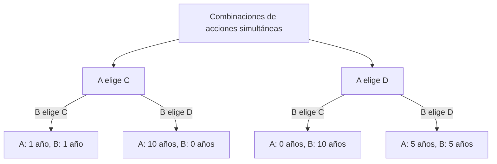
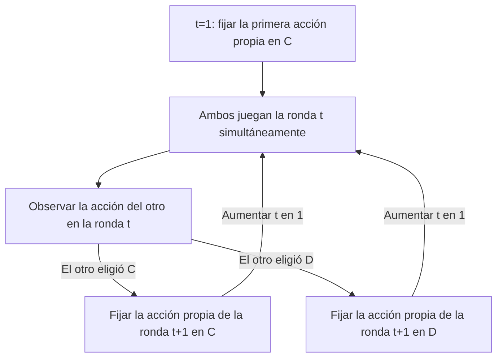

La cooperación puede ser mejor para ambos participantes y, aun así, cada uno puede tener incentivos para abandonarla. El [dilema del prisionero](https://kenji.blog/es/p/prisoners-dilemma/) analiza este conflicto mediante unas acciones y unos pagos especificados. No es una ley que obligue a las personas a traicionar ni que garantice la supervivencia de los grupos cooperativos.

Sobre su historia, las [notas de un curso de Cornell](https://www.cs.cornell.edu/~rafael/networks-html/chapter1.html) describen el trabajo de Merrill Flood y Melvin Dresher en 1950 y la presentación de Albert Tucker mediante una historia de prisioneros. Aquí distinguiremos los incentivos de una interacción única, las estrategias repetidas, los modelos evolutivos y las observaciones de animales.

## 1. De unas condenas ficticias a los pagos

Supongamos que dos sospechosos, A y B, no pueden consultarse y eligen simultáneamente guardar silencio C (cooperar entre sí) o confesar D (abandonar esa cooperación). En esta situación ficticia se cumplen con certeza las siguientes condenas. No se describen las reglas reales de una investigación o de un acuerdo de culpabilidad, ni se afirma que confesar implique ser absuelto.

| A / B | C: silencio | D: confesión |
| --- | --- | --- |
| C: silencio | A: 1 año, B: 1 año | A: 10 años, B: 0 años |
| D: confesión | A: 0 años, B: 10 años | A: 5 años, B: 5 años |

Cada persona solo desea reducir su propia condena; la amistad, la reputación y la culpa no aportan utilidad adicional. El pago u_i es el negativo de la duración de la condena y_i. Un pago negativo no significa una condena negativa. T es el pago cuando solo uno mismo elige D; R, cuando ambos eligen C; P, cuando ambos eligen D; y S, cuando solo uno mismo elige C.

$$
u_i=-y_i,\quad y_i\in\{0,1,5,10\},\qquad T=0>R=-1>P=-5>S=-10
$$

El diagrama enumera combinaciones de acciones elegidas simultáneamente. No permite que A observe la acción de B antes de elegir.

## 2. Dominancia, equilibrio de Nash y eficiencia de Pareto

En u_i, el primer argumento representa la acción propia y el segundo la del otro jugador. Tanto si el otro elige C como si elige D, el pago propio es mayor al elegir D.

$$
u_i(D,C)=0>-1=u_i(C,C),\qquad u_i(D,D)=-5>-10=u_i(C,D)
$$

Por eso D es una **estrategia estrictamente dominante**. Si se asigna una probabilidad q a que el otro elija C, la diferencia entre los pagos esperados también es positiva. Esta q es distinta de la probabilidad p de emparejamiento dentro de un grupo que utilizaremos después.

$$
\begin{aligned}0&\le q\le1,\\\mathrm{EU}(D)&=-5+5q,\\\mathrm{EU}(C)&=-10+9q,\\\mathrm{EU}(D)-\mathrm{EU}(C)&=5-4q\ge1.\end{aligned}
$$

Si ambos maximizan su propia utilidad esperada con esta tabla, eligen DD. Como D domina estrictamente a C frente a estrategias tanto puras como mixtas del otro, DD es el único equilibrio de Nash. Un **equilibrio de Nash** es un perfil de estrategias en el que ningún jugador puede aumentar su pago cambiando solo su propia estrategia mientras la del otro permanece fija. Esto no impide que un cambio conjunto mejore el resultado.

Un resultado es **eficiente en el sentido de Pareto (óptimo de Pareto)** si ningún otro resultado factible mejora el pago de al menos un participante sin reducir el de ninguno. Entre los perfiles de acciones puras de la tabla, CC, CD y DC son eficientes; DD no lo es, porque pasar a CC mejora el pago de ambos. Esta lista no describe todo el conjunto de pagos eficientes si se permiten sorteos entre resultados.

Por separado, si sumamos los pagos numéricos con el mismo peso, CC tiene el mayor total. La definición de eficiencia y este criterio de suma son diferentes.

$$
(u_1+u_2)(CC)=-2,\qquad(u_1+u_2)(CD)=(u_1+u_2)(DC)=(u_1+u_2)(DD)=-10
$$

Se trata de analizar incentivos en un modelo de pagos especificado, no de demostrar motivaciones humanas universales ni una desgracia social inevitable.

## 3. Examinar las aplicaciones mediante pagos e instituciones

### Competencia de precios

El modelo puede servir a veces como analogía del incentivo a bajar el precio respecto al rival para vender más, junto con la reducción de márgenes cuando ambos bajan sus precios. Pero la demanda, los costes, la calidad y la entrada de empresas cambian los pagos; bajar precios tampoco garantiza un monopolio. La suma de los beneficios empresariales es distinta del bienestar social que incluye a los consumidores.

### Medio ambiente y recursos compartidos

Cuando se comparten los beneficios de reducir emisiones pero cada parte asume sus costes, podemos examinar el incentivo a aprovechar el esfuerzo ajeno sin contribuir. Sin embargo, hay múltiples países, daños y costes asimétricos, acuerdos y mecanismos de seguimiento. Esta tabla de dos jugadores no determina por sí sola los resultados climáticos ni el crecimiento económico de cada país. Los problemas de recursos compartidos tampoco son todos el mismo juego de dos participantes.

### Carrera armamentista

Los modelos que simplifican los incentivos a desarmarse o mantener armamento también ayudan a pensar en la carrera nuclear entre Estados Unidos y la Unión Soviética durante la Guerra Fría. Importan las capacidades reales, la información, la verificación y las alianzas. La tabla no demuestra una necesidad histórica según la cual desarmarse unilateralmente ante un rival armado amenace siempre la supervivencia nacional y no deje más opción que aumentar el armamento.

## 4. Repetición y estrategia Tit for Tat

Cuando continúa una relación, las respuestas futuras a las acciones presentes pueden cambiar los pagos. Pero repetir una interacción no garantiza la cooperación. Si el mismo juego de etapa se repite un número conocido, fijo y finito de veces, las historias son observables y la estructura y la racionalidad son de conocimiento común, la inducción hacia atrás desde la última ronda da un equilibrio perfecto en subjuegos con DD en todas las rondas. Las [notas del MIT](https://www.ocw.mit.edu/courses/14-15j-networks-spring-2018/pages/lecture-and-recitation-notes/recitation-10-notes/) también estudian la diferencia entre repetición finita e infinita; sus pagos numéricos son distintos de los de este artículo.

**Tit for Tat (TFT), también llamada toma y daca**, elige C en la primera ronda y después copia la acción anterior del otro jugador. a_i,t representa la acción propia en la ronda t; j identifica al otro jugador.

$$
a_{i,1}=C,\qquad a_{i,t}=a_{j,t-1}\quad(t\ge2)
$$

Tanto después de cooperar como después de no hacerlo, se juega la siguiente ronda antes de observar su resultado. La estrategia no anticipa la acción actual del otro ni observa un estado interno de arrepentimiento.

El [artículo de Axelrod y Hamilton de 1981](https://public.websites.umich.edu/~axe/research/Axelrod%20and%20Hamilton%20EC%201981.pdf) informa de que TFT, presentada por Anatol Rapoport, obtuvo la mayor puntuación media en los dos torneos de programas de Axelrod. Los pagos T=5, R=3, P=1 y S=0 de esos torneos difieren de nuestra tabla de condenas. TFT no inicia la defección, responde a la del otro y vuelve a cooperar en la ronda posterior a que el otro lo haga. Su regla también es breve. Esto no la convierte en la mejor estrategia frente a cualquier rival, sistema de puntuación, horizonte o posibilidad de error.

Incluso entre dos jugadores TFT, un error de acción que produzca CD puede ir seguido de DC, luego de CD, y mantener una alternancia de defecciones. La puntuación en un torneo, el equilibrio, la evolución biológica y una conducta moralmente deseable son cuestiones distintas.

## 5. Evolución de la cooperación: estructura de grupos y evidencia animal

### Cuándo puede tener ventaja un pequeño grupo cooperativo

Un juego evolutivo debe especificar con quién se encuentran los individuos que siguen determinadas reglas de conducta y cómo su rendimiento afecta a las generaciones siguientes. Priorizar la supervivencia o la reproducción no equivale a una instrucción de elegir D en toda situación.

¿Cuándo puede rendir mejor un pequeño grupo TFT en una población que, por lo demás, utiliza ALLD? Consideremos un modelo sencillo de puntuaciones descontadas: los oponentes permanecen fijos, las acciones son simultáneas y repetidas, no hay errores y δ pondera el futuro. ALLD elige D en cada ronda. V(X,Y) es la puntuación descontada de la estrategia X frente a Y.

$$
\begin{aligned}0&\le\delta<1,\\V(\mathrm{TFT},\mathrm{TFT})&=\frac{-1}{1-\delta},\\V(\mathrm{TFT},\mathrm{ALLD})&=-10-\frac{5\delta}{1-\delta},\\V(\mathrm{ALLD},\mathrm{ALLD})&=\frac{-5}{1-\delta}.\end{aligned}
$$

Supongamos que un miembro de un grupo TFT poco frecuente encuentra otro TFT con probabilidad p y, en caso contrario, un ALLD. Lo comparamos con residentes que encuentran casi exclusivamente ALLD, en el límite en que el grupo representa una fracción despreciable de la población. Aquí p es la proporción de oponentes TFT entre los encuentros de un jugador TFT, no la frecuencia de TFT en toda la población.

$$
\begin{aligned}V_{\mathrm{cluster}}&=pV(\mathrm{TFT},\mathrm{TFT})+(1-p)V(\mathrm{TFT},\mathrm{ALLD}),\\V_{\mathrm{cluster}}-V(\mathrm{ALLD},\mathrm{ALLD})&=\frac{p(9-5\delta)-5(1-\delta)}{1-\delta}.\end{aligned}
$$

La condición para superar estrictamente la puntuación de referencia ALLD es:

$$
0\le p\le1,\qquad V_{\mathrm{cluster}}>V(\mathrm{ALLD},\mathrm{ALLD})\quad\Longleftrightarrow\quad p>\frac{5(1-\delta)}{9-5\delta}
$$

Por ejemplo, con δ=0,9, la probabilidad de emparejamiento dentro del grupo debe satisfacer:

$$
\delta=\frac9{10}\quad\Longrightarrow\quad p>\frac{5(1-9/10)}{9-5(9/10)}=\frac19
$$

| p | Puntuación descontada esperada de TFT | Referencia ALLD frente a ALLD | Comparación |
| --- | --- | --- | --- |
| 0 | -55 | -50 | Inferior |
| 1/20 | -52,75 | -50 | Inferior |
| 1/9 | -50 | -50 | Igual |
| 1/5 | -46 | -50 | Superior |

En particular, si TFT nunca encuentra otro TFT, para cualquier δ se obtiene:

$$
p=0\quad\Longrightarrow\quad V_{\mathrm{cluster}}-V(\mathrm{ALLD},\mathrm{ALLD})=-5<0
$$

Por tanto, un horizonte largo no basta para garantizar una ventaja a TFT aislada. Este cálculo compara puntuaciones que pueden ser negativas, no tasas de reproducción o supervivencia. Sin especificar reglas de actualización de la población, no demuestra una eliminación final ni la fijación de una estrategia. El artículo de 1981 también condiciona el establecimiento inicial de la cooperación al contacto dentro del grupo y a la continuidad.

### No identificar murciélagos y abejas con una misma estrategia

El [estudio de Carter y Wilkinson de 2013](https://science.umd.edu/faculty/wilkinson/Carter%26Wilk_PRSB13.pdf) realizó pruebas de ayuno con 20 murciélagos vampiros en cautividad e informó de asociaciones entre el alimento recibido de un compañero y el donado a ese compañero, junto con relaciones sociales duraderas. La correlación por sí sola no demuestra que recibir alimento cause la siguiente donación ni que los murciélagos ejecuten TFT.

La vida social de las abejas tampoco equivale automáticamente a TFT. Axelrod y Hamilton tratan el sacrificio de las obreras como un ejemplo para considerar los beneficios mediante el parentesco. El parentesco, los beneficios recíprocos, el reconocimiento individual y la estructura de las interacciones requieren investigaciones diferenciadas. La aptitud biológica (fitness) no puede equipararse sin más con la moralidad o la confianza humanas.

## 6. Pensar en los mecanismos que sostienen la cooperación

El dilema del prisionero identifica situaciones en las que, con unos pagos dados, los incentivos individuales no sostienen un resultado que ambos prefieren. Para pensar en la cooperación, conviene examinar:

- **Pagos y acciones disponibles**: ¿Las sanciones, el reparto de costes o las recompensas cambian realmente la comparación entre acciones? Los efectos institucionales y las condiciones legales deben estudiarse en cada aplicación real.
- **Observación y compromisos**: ¿Con qué fiabilidad pueden observarse las acciones y cuán vinculantes son las promesas y las respuestas? Si conversar no cambia los pagos ni las opciones de un juego de una sola interacción, D sigue siendo estrictamente dominante.
- **Horizonte y emparejamientos**: ¿Cuánto pesa el futuro, cómo termina la relación, con quién se vuelve a interactuar y cómo se gestionan los errores?

La existencia de un equilibrio cooperativo o de condiciones favorables de puntuación es distinta de que la cooperación se elija y llegue a establecerse. Los modelos ayudan a examinar los supuestos concretos que la sostienen; no demuestran incondicionalmente el valor de la confianza.
