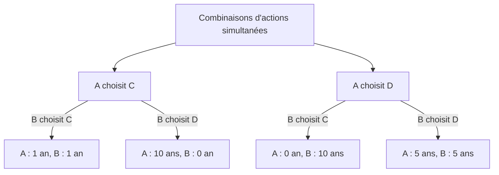
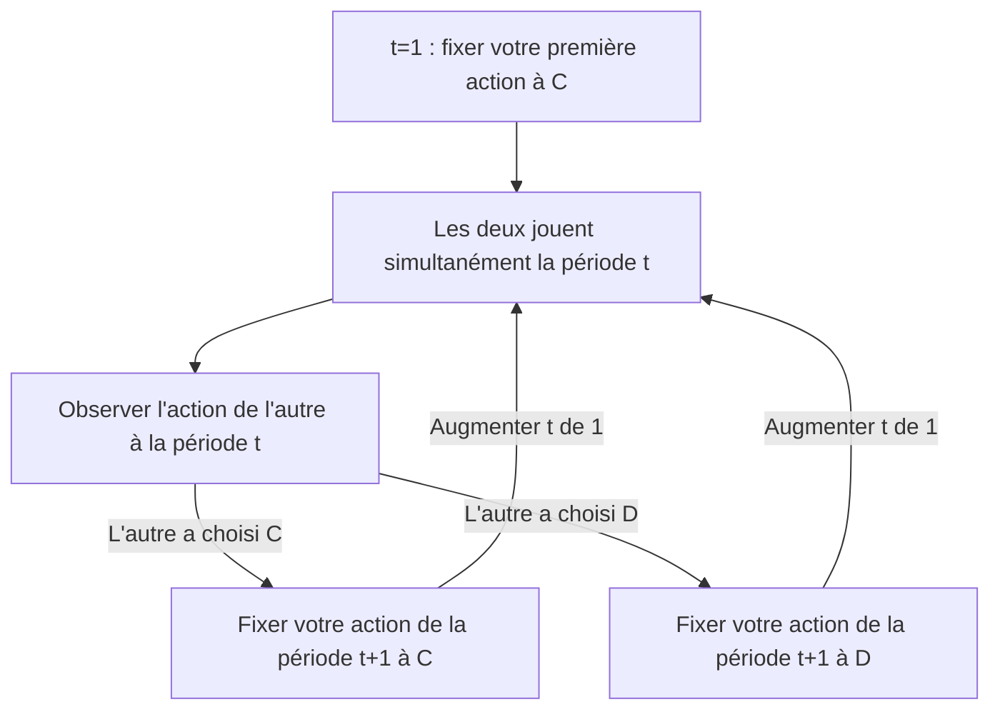

La coopération peut être préférable pour les deux participants, alors que chacun peut avoir intérêt à s'en écarter. Le [dilemme du prisonnier](https://kenji.blog/fr/p/prisoners-dilemma/) analyse ce conflit à partir d'actions et de gains définis. Ce n'est pas une loi selon laquelle les humains doivent trahir ou les groupes coopératifs doivent survivre.

Concernant son histoire, les [notes d'un cours de Cornell](https://www.cs.cornell.edu/~rafael/networks-html/chapter1.html) présentent les travaux de Merrill Flood et Melvin Dresher en 1950 et l'explication d'Albert Tucker sous la forme d'une histoire de prisonniers. Nous distinguerons ici les incitations d'une interaction unique, les stratégies répétées, les modèles évolutifs et les observations animales.

## 1. Transformer des peines fictives en gains

Supposons que deux suspects, A et B, ne puissent pas se concerter et choisissent simultanément le silence C (coopérer entre eux) ou les aveux D (s'écarter de cette coopération). Dans cette situation fictive, les peines suivantes sont certaines. Il ne s'agit pas d'une description des règles réelles d'enquête ou de négociation pénale, ni d'une affirmation selon laquelle avouer entraîne un acquittement.

| A / B | C : silence | D : aveux |
| --- | --- | --- |
| C : silence | A : 1 an, B : 1 an | A : 10 ans, B : 0 an |
| D : aveux | A : 0 an, B : 10 ans | A : 5 ans, B : 5 ans |

Chacun souhaite uniquement réduire sa propre peine ; l'amitié, la réputation et la culpabilité n'ajoutent aucune utilité. Le gain u_i est l'opposé de la durée de peine y_i. Un gain négatif ne signifie pas une peine négative. T est votre gain lorsque vous seul choisissez D ; R, lorsque les deux choisissent C ; P, lorsque les deux choisissent D ; et S, lorsque vous seul choisissez C.

$$
u_i=-y_i,\quad y_i\in\{0,1,5,10\},\qquad T=0>R=-1>P=-5>S=-10
$$

Le diagramme énumère les combinaisons d'actions choisies simultanément. Il ne permet pas à A d'observer l'action de B avant de choisir.

## 2. Dominance, équilibre de Nash et efficacité de Pareto

Dans u_i, le premier argument représente votre action et le second celle de l'autre joueur. Que l'autre choisisse C ou D, votre gain est supérieur en choisissant D.

$$
u_i(D,C)=0>-1=u_i(C,C),\qquad u_i(D,D)=-5>-10=u_i(C,D)
$$

C'est une **stratégie strictement dominante**. Si vous attribuez une probabilité q au choix de C par l'autre, la différence de gains espérés est également positive. Ce q est distinct de la probabilité p de rencontrer un autre membre du groupe, utilisée plus loin.

$$
\begin{aligned}0&\le q\le1,\\\mathrm{EU}(D)&=-5+5q,\\\mathrm{EU}(C)&=-10+9q,\\\mathrm{EU}(D)-\mathrm{EU}(C)&=5-4q\ge1.\end{aligned}
$$

Si les deux maximisent leur propre utilité espérée avec ce tableau, ils choisissent DD. Comme D domine strictement C face aux stratégies pures comme mixtes de l'autre, DD est l'unique équilibre de Nash. Un **équilibre de Nash** est un profil de stratégies dans lequel aucun joueur ne peut augmenter son gain en changeant seulement sa propre stratégie, celle de l'autre restant fixe. Cela n'exclut pas qu'un changement conjoint améliore le résultat.

Un résultat est **efficace au sens de Pareto (optimal au sens de Pareto)** si aucun autre résultat réalisable n'améliore le gain d'au moins un joueur sans réduire celui de quelqu'un d'autre. Parmi les profils d'actions pures du tableau, CC, CD et DC sont efficaces. DD ne l'est pas : passer à CC améliore les gains des deux joueurs. Cette liste n'énumère pas tout l'ensemble des gains efficaces si l'on autorise des tirages au sort entre résultats.

Séparément, si l'on additionne les gains numériques avec des poids égaux, CC donne le total le plus élevé. La définition de l'efficacité et ce critère de somme sont différents.

$$
(u_1+u_2)(CC)=-2,\qquad(u_1+u_2)(CD)=(u_1+u_2)(DC)=(u_1+u_2)(DD)=-10
$$

Il s'agit d'une analyse des incitations dans un modèle aux gains spécifiés, pas d'une preuve sur toutes les motivations humaines ou sur un malheur social inévitable.

## 3. Examiner les applications à travers les gains et les institutions

### Concurrence par les prix

Le modèle peut parfois servir d'analogie pour l'incitation à vendre moins cher que son rival afin d'accroître ses ventes, ainsi que pour la réduction des marges lorsque les deux baissent leurs prix. Mais la demande, les coûts, la qualité et l'entrée sur le marché modifient les gains ; baisser les prix ne garantit pas un monopole. La somme des profits des entreprises diffère aussi du bien-être social incluant les consommateurs.

### Environnement et ressources partagées

Lorsque les bénéfices d'une réduction des émissions sont partagés mais que chacun en supporte les coûts, on peut examiner l'incitation à profiter des efforts d'autrui sans contribuer. Toutefois, il existe plusieurs pays, des dommages et coûts asymétriques, des accords et une surveillance. Ce tableau à deux joueurs ne détermine pas à lui seul les conséquences climatiques ou la croissance économique de chaque pays. Les problèmes de ressources partagées ne correspondent pas tous au même jeu à deux participants.

### Course aux armements

Des modèles simplifiant les incitations au désarmement et au maintien des armes sont également utilisés pour réfléchir à la course nucléaire entre les États-Unis et l'Union soviétique pendant la guerre froide. Les capacités réelles, l'information, la vérification et les alliances comptent. Le tableau ne démontre pas une nécessité historique selon laquelle un désarmement unilatéral face à un rival armé menace toujours la survie nationale et impose l'armement comme seule option.

## 4. Répétition et stratégie Tit for Tat

Lorsqu'une relation se poursuit, les réponses futures aux actions présentes peuvent modifier les gains. Mais la répétition ne garantit pas la coopération. Si le même jeu élémentaire se répète un nombre connu, fixe et fini de fois, que les historiques sont observables et que la structure et la rationalité sont de connaissance commune, l'induction à rebours depuis la dernière période donne un équilibre parfait en sous-jeux avec DD à chaque période. Les [notes du MIT](https://www.ocw.mit.edu/courses/14-15j-networks-spring-2018/pages/lecture-and-recitation-notes/recitation-10-notes/) traitent aussi de la différence entre répétition finie et infinie ; leurs gains numériques diffèrent de ceux de cet article.

**Tit for Tat (TFT)** choisit C au départ, puis copie l'action précédente de l'adversaire. a_i,t est votre action à la période t, et j désigne l'autre joueur.

$$
a_{i,1}=C,\qquad a_{i,t}=a_{j,t-1}\quad(t\ge2)
$$

Après une coopération comme après une défection, la période suivante est jouée avant que son résultat soit observé. La stratégie n'anticipe pas l'action actuelle de l'autre et n'observe pas un état intérieur de repentir.

L'[article d'Axelrod et Hamilton de 1981](https://public.websites.umich.edu/~axe/research/Axelrod%20and%20Hamilton%20EC%201981.pdf) rapporte que TFT, soumise par Anatol Rapoport, a obtenu le meilleur score moyen dans les deux tournois de programmes d'Axelrod. Les gains T=5, R=3, P=1 et S=0 de ces tournois diffèrent de notre tableau de peines. TFT ne fait pas défection en premier, répond à la défection adverse et reprend la coopération à la période suivant celle où l'autre la reprend. Sa règle est aussi concise. Cela ne la rend pas meilleure face à tous les adversaires, systèmes de score, horizons ou risques d'erreur.

Même entre deux joueurs TFT, une erreur d'action produisant CD peut être suivie de DC, puis de CD, entretenant une alternance de défections. Les scores de tournoi, l'équilibre, l'évolution biologique et une conduite moralement souhaitable sont des questions distinctes.

## 5. Évolution de la coopération : structure des groupes et observations animales

### Quand un petit groupe coopératif peut être avantagé

Un jeu évolutif doit préciser qui rencontre qui parmi les individus suivant certaines règles de comportement, et comment leurs performances affectent les générations suivantes. Donner la priorité à la survie ou à la reproduction n'équivaut pas à une instruction de choisir D dans toute situation.

Quand un petit groupe TFT peut-il faire mieux dans une population utilisant sinon ALLD ? Considérons un modèle simple de scores actualisés : les adversaires restent fixes, les actions sont simultanées et répétées, il n'y a pas d'erreur et δ pondère le futur. ALLD choisit D à chaque période. V(X,Y) est le score actualisé de la stratégie X face à Y.

$$
\begin{aligned}0&\le\delta<1,\\V(\mathrm{TFT},\mathrm{TFT})&=\frac{-1}{1-\delta},\\V(\mathrm{TFT},\mathrm{ALLD})&=-10-\frac{5\delta}{1-\delta},\\V(\mathrm{ALLD},\mathrm{ALLD})&=\frac{-5}{1-\delta}.\end{aligned}
$$

Supposons qu'un membre d'un groupe TFT rare rencontre un autre TFT avec une probabilité p et, sinon, un ALLD. On le compare à des résidents rencontrant presque exclusivement ALLD, à la limite où le groupe représente une fraction négligeable de la population. Ici p est la proportion d'adversaires TFT dans les rencontres d'un joueur TFT, pas la fréquence de TFT dans toute la population.

$$
\begin{aligned}V_{\mathrm{cluster}}&=pV(\mathrm{TFT},\mathrm{TFT})+(1-p)V(\mathrm{TFT},\mathrm{ALLD}),\\V_{\mathrm{cluster}}-V(\mathrm{ALLD},\mathrm{ALLD})&=\frac{p(9-5\delta)-5(1-\delta)}{1-\delta}.\end{aligned}
$$

La condition pour dépasser strictement le score de référence ALLD est :

$$
0\le p\le1,\qquad V_{\mathrm{cluster}}>V(\mathrm{ALLD},\mathrm{ALLD})\quad\Longleftrightarrow\quad p>\frac{5(1-\delta)}{9-5\delta}
$$

Par exemple, avec δ=0,9, la probabilité de rencontre au sein du groupe doit satisfaire :

$$
\delta=\frac9{10}\quad\Longrightarrow\quad p>\frac{5(1-9/10)}{9-5(9/10)}=\frac19
$$

| p | Score actualisé espéré de TFT | Référence ALLD face à ALLD | Comparaison |
| --- | --- | --- | --- |
| 0 | -55 | -50 | Inférieur |
| 1/20 | -52,75 | -50 | Inférieur |
| 1/9 | -50 | -50 | Égal |
| 1/5 | -46 | -50 | Supérieur |

En particulier, si TFT ne rencontre jamais un autre TFT, pour tout δ on obtient :

$$
p=0\quad\Longrightarrow\quad V_{\mathrm{cluster}}-V(\mathrm{ALLD},\mathrm{ALLD})=-5<0
$$

Ainsi, un horizon long ne suffit pas à garantir un avantage à TFT isolée. Ce calcul compare des scores pouvant être négatifs, pas des taux de reproduction ou de survie. Sans règles de mise à jour de la population, il ne prouve ni élimination finale ni fixation d'une stratégie. L'article de 1981 conditionne lui aussi l'établissement initial de la coopération aux contacts au sein du groupe et à la continuité.

### Ne pas assimiler chauves-souris et abeilles à une même stratégie

L'[étude de Carter et Wilkinson de 2013](https://science.umd.edu/faculty/wilkinson/Carter%26Wilk_PRSB13.pdf) a réalisé des essais de jeûne sur 20 chauves-souris vampires en captivité et rapporté des associations entre la nourriture reçue d'un partenaire et celle donnée à ce partenaire, ainsi que des relations sociales durables. Cette corrélation seule ne prouve pas que recevoir de la nourriture cause le don suivant ni que les chauves-souris exécutent TFT.

La socialité des abeilles n'équivaut pas non plus automatiquement à TFT. Axelrod et Hamilton discutent du sacrifice des ouvrières comme exemple pour considérer les bénéfices liés à la parenté. La parenté, les bénéfices réciproques, la reconnaissance individuelle et la structure des interactions nécessitent des investigations distinctes. La valeur sélective biologique (fitness) ne peut pas être simplement assimilée à la moralité ou à la confiance humaines.

## 6. Réfléchir aux mécanismes qui soutiennent la coopération

Le dilemme du prisonnier identifie des situations où, pour des gains définis, les incitations individuelles ne soutiennent pas un résultat souhaitable pour les deux participants. Pour réfléchir à la coopération, examinez :

- **Gains et choix** : Les sanctions, le partage des coûts ou les récompenses changent-ils réellement la comparaison entre actions ? Les effets institutionnels et les conditions juridiques doivent être étudiés pour chaque application réelle.
- **Observation et engagements** : Dans quelle mesure peut-on vérifier les actions, et quelle est la force contraignante des promesses et des réponses ? Si la conversation ne modifie ni les gains ni les choix d'un jeu à interaction unique, D reste strictement dominante.
- **Horizon et rencontres** : Quel poids donner au futur, comment la relation finit-elle, qui rencontre-t-on de nouveau et comment traite-t-on les erreurs ?

L'existence d'un équilibre coopératif ou de conditions favorables de score diffère du fait que la coopération soit effectivement choisie et s'établisse. Les modèles aident à examiner les hypothèses concrètes qui la soutiennent ; ils ne prouvent pas inconditionnellement la valeur de la confiance.
