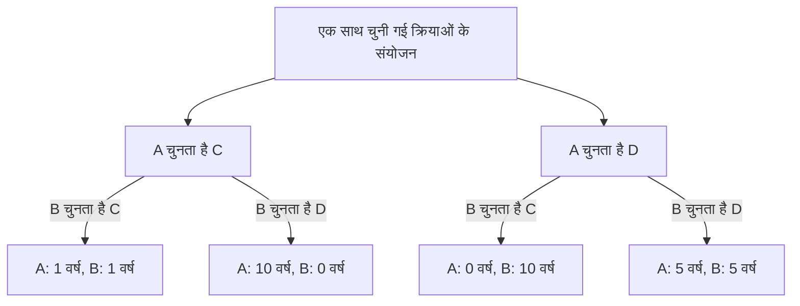
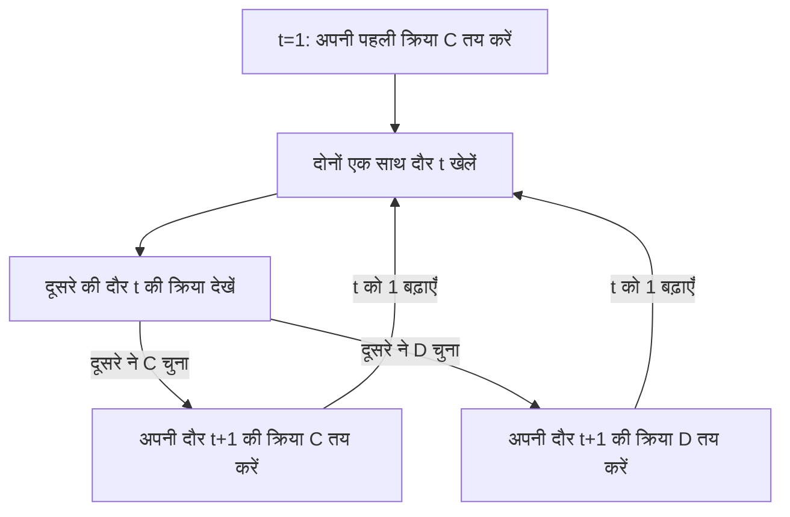

सहयोग दोनों खिलाड़ियों के लिए बेहतर हो सकता है, फिर भी हर खिलाड़ी के पास उससे हटने का प्रोत्साहन हो सकता है। [कैदी की दुविधा](https://kenji.blog/hi/p/prisoners-dilemma/) तय प्रतिफलों और विकल्पों के आधार पर इस टकराव का विश्लेषण करती है। यह ऐसा नियम नहीं है कि मनुष्य अवश्य धोखा देंगे या सहयोगी समूह अवश्य जीवित रहेंगे।

इतिहास के संबंध में, [कॉर्नेल विश्वविद्यालय के पाठ्यक्रम नोट्स](https://www.cs.cornell.edu/~rafael/networks-html/chapter1.html) 1950 में Merrill Flood और Melvin Dresher के काम तथा Albert Tucker की कैदियों वाली कहानी का उल्लेख करते हैं। यहाँ हम एक बार की अंतःक्रिया के प्रोत्साहनों, दोहराई जाने वाली रणनीतियों, विकासवादी मॉडलों और पशुओं के अवलोकनों को अलग रखेंगे।

## 1. काल्पनिक सजाओं को प्रतिफल में बदलना

मान लें कि दो संदिग्ध A और B आपस में सलाह नहीं कर सकते। वे एक साथ चुप रहने C (आपसी सहयोग) या कबूल करने D (उस सहयोग से हटने) का चुनाव करते हैं। इस काल्पनिक परिस्थिति में नीचे दी गई सजाएँ निश्चित हैं। यह वास्तविक जाँच या दोष-स्वीकृति समझौते के नियमों का वर्णन नहीं है, न ही यह कहता है कि कबूल करने से व्यक्ति बरी हो जाता है।

| A / B | C: चुप रहना | D: कबूल करना |
| --- | --- | --- |
| C: चुप रहना | A: 1 वर्ष, B: 1 वर्ष | A: 10 वर्ष, B: 0 वर्ष |
| D: कबूल करना | A: 0 वर्ष, B: 10 वर्ष | A: 5 वर्ष, B: 5 वर्ष |

हर व्यक्ति केवल अपनी सजा की अवधि घटाना चाहता है; दोस्ती, प्रतिष्ठा और अपराधबोध से अतिरिक्त उपयोगिता नहीं जोड़ी जाती। सजा की अवधि y_i के ऋणात्मक मान को प्रतिफल u_i मानते हैं। ऋणात्मक प्रतिफल का अर्थ ऋणात्मक सजा नहीं है। T तब अपना प्रतिफल है जब केवल आप D चुनते हैं; R दोनों के C चुनने पर, P दोनों के D चुनने पर और S केवल आपके C चुनने पर मिलता है।

$$
u_i=-y_i,\quad y_i\in\{0,1,5,10\},\qquad T=0>R=-1>P=-5>S=-10
$$

यह आरेख एक साथ चुनी जाने वाली क्रियाओं के संयोजन गिनाता है। इसमें A पहले B की क्रिया देखकर निर्णय नहीं लेता।

## 2. प्रभुत्व, नैश संतुलन और पारेटो दक्षता

u_i में पहला तर्क अपनी क्रिया और दूसरा दूसरे खिलाड़ी की क्रिया दर्शाता है। दूसरा खिलाड़ी C चुने या D, अपना प्रतिफल D चुनने पर अधिक है।

$$
u_i(D,C)=0>-1=u_i(C,C),\qquad u_i(D,D)=-5>-10=u_i(C,D)
$$

इसलिए D **सख्ती से प्रभुत्वशाली रणनीति (strictly dominant strategy)** है। यदि दूसरे के C चुनने की संभावना q मानी जाए, तब भी अपेक्षित प्रतिफलों का अंतर धनात्मक है। यह q आगे इस्तेमाल होने वाली समूह के भीतर मिलने की संभावना p से अलग है।

$$
\begin{aligned}0&\le q\le1,\\\mathrm{EU}(D)&=-5+5q,\\\mathrm{EU}(C)&=-10+9q,\\\mathrm{EU}(D)-\mathrm{EU}(C)&=5-4q\ge1.\end{aligned}
$$

यदि दोनों इस तालिका के अनुसार अपनी अपेक्षित उपयोगिता अधिकतम करते हैं, तो वे DD चुनते हैं। दूसरे की शुद्ध और मिश्रित, दोनों प्रकार की रणनीतियों के विरुद्ध D सख्ती से C से बेहतर है, इसलिए DD अकेला नैश संतुलन है। **नैश संतुलन** ऐसा रणनीति-संयोजन है जिसमें दूसरे की रणनीति स्थिर रहने पर कोई खिलाड़ी केवल अपनी रणनीति बदलकर प्रतिफल नहीं बढ़ा सकता। इसका अर्थ यह नहीं कि दोनों का एक साथ बदलना भी परिणाम सुधार नहीं सकता।

कोई परिणाम **पारेटो दक्ष (पारेटो इष्टतम)** है यदि कोई दूसरा संभव परिणाम किसी का प्रतिफल घटाए बिना कम-से-कम एक खिलाड़ी का प्रतिफल नहीं बढ़ा सकता। तालिका के शुद्ध क्रिया-संयोजनों में CC, CD और DC दक्ष हैं। DD दक्ष नहीं है, क्योंकि CC पर जाने से दोनों का प्रतिफल बढ़ता है। परिणामों के बीच यादृच्छिक चयन की अनुमति देने पर मिलने वाले पूरे दक्ष प्रतिफल-समुच्चय को यहाँ सूचीबद्ध नहीं किया गया है।

अलग से, संख्यात्मक प्रतिफलों को समान भार देकर जोड़ें तो CC का कुल सबसे अधिक है। दक्षता की परिभाषा और कुल योग का मानदंड अलग हैं।

$$
(u_1+u_2)(CC)=-2,\qquad(u_1+u_2)(CD)=(u_1+u_2)(DC)=(u_1+u_2)(DD)=-10
$$

यह तय प्रतिफल वाले मॉडल के प्रोत्साहनों का विश्लेषण है, सभी वास्तविक मानवीय उद्देश्यों या सामाजिक दुर्भाग्य का सार्वभौमिक प्रमाण नहीं।

## 3. वास्तविक अनुप्रयोगों को प्रतिफलों और संस्थाओं से जाँचना

### मूल्य प्रतिस्पर्धा

दूसरे से कम कीमत लगाकर बिक्री बढ़ाने के प्रोत्साहन और दोनों के कीमत घटाने पर लाभ-मार्जिन कम होने की उपमा के रूप में मॉडल कभी उपयोगी हो सकता है। लेकिन माँग, लागत, गुणवत्ता और बाजार में नए प्रवेश प्रतिफल बदलते हैं; सस्ता बेचने से एकाधिकार निश्चित नहीं होता। कंपनियों के लाभ का योग भी उपभोक्ताओं को शामिल करने वाले सामाजिक कल्याण से अलग है।

### पर्यावरण और साझा संसाधन

जब उत्सर्जन घटाने के लाभ साझा हों पर हर पक्ष अपनी लागत उठाए, तो दूसरों के प्रयास का लाभ बिना योगदान किए लेने के प्रोत्साहन जाँचे जा सकते हैं। लेकिन वास्तविकता में कई देश, असमान क्षतियाँ और लागतें, समझौते और निगरानी हैं। दो खिलाड़ियों की यह तालिका अकेले जलवायु परिणाम या हर देश की आर्थिक वृद्धि तय नहीं करती। साझा संसाधनों की हर समस्या भी यही दो-खिलाड़ी खेल नहीं है।

### हथियारों की होड़

शीत युद्ध में अमेरिका और सोवियत संघ की परमाणु हथियारों की होड़ पर सोचने में भी निरस्त्रीकरण और हथियार बनाए रखने के प्रोत्साहनों को सरल करने वाले मॉडल उपयोग होते हैं। वास्तविक क्षमता, सूचना, सत्यापन और गठबंधन महत्त्वपूर्ण हैं। यह तालिका ऐसी ऐतिहासिक अनिवार्यता सिद्ध नहीं करती कि हथियारबंद प्रतिद्वंद्वी के सामने एकतरफा निरस्त्रीकरण हमेशा राष्ट्रीय अस्तित्व को खतरे में डालता है और हथियार बढ़ाना ही एकमात्र विकल्प है।

## 4. पुनरावृत्ति और टिट-फॉर-टैट रणनीति

संबंध जारी रहने पर वर्तमान क्रियाओं के प्रति भविष्य की प्रतिक्रियाएँ प्रतिफल बदल सकती हैं। लेकिन पुनरावृत्ति सहयोग की गारंटी नहीं देती। यदि वही एक-चरणीय खेल ज्ञात, निश्चित और सीमित बार दोहराया जाए, पिछले घटनाक्रम देखे जा सकें और संरचना तथा तर्कसंगतता साझा ज्ञान हों, तो अंतिम दौर से पीछे की ओर आगमन करने पर हर दौर में DD वाला उपखेल-पूर्ण संतुलन मिलता है। [MIT के नोट्स](https://www.ocw.mit.edu/courses/14-15j-networks-spring-2018/pages/lecture-and-recitation-notes/recitation-10-notes/) भी सीमित और अनंत पुनरावृत्ति का अंतर बताते हैं; उनके संख्यात्मक प्रतिफल इस लेख से अलग हैं।

**टिट-फॉर-टैट (Tit for Tat, TFT)** पहले दौर में C चुनती है और दूसरे दौर से दूसरे खिलाड़ी की पिछले दौर की क्रिया दोहराती है। a_i,t दौर t में आपकी क्रिया है और j दूसरे खिलाड़ी को दर्शाता है।

$$
a_{i,1}=C,\qquad a_{i,t}=a_{j,t-1}\quad(t\ge2)
$$

सहयोग के बाद भी और उससे हटने के बाद भी, अगला दौर खेलने के बाद ही उसका परिणाम देखा जाता है। रणनीति दूसरे की वर्तमान क्रिया का पूर्वज्ञान नहीं रखती, न ही उसके मन के पछतावे को देखती है।

[Axelrod और Hamilton का 1981 का शोधपत्र](https://public.websites.umich.edu/~axe/research/Axelrod%20and%20Hamilton%20EC%201981.pdf) बताता है कि Anatol Rapoport की प्रस्तुत TFT ने Axelrod की दोनों प्रोग्राम प्रतियोगिताओं में सबसे ऊँचा औसत स्कोर पाया। वहाँ के प्रतिफल T=5, R=3, P=1 और S=0 इस लेख की सजा-तालिका से अलग हैं। TFT पहले सहयोग से नहीं हटती, दूसरे के हटने पर प्रतिक्रिया देती है और उसके सहयोग पर लौटने के अगले दौर में स्वयं भी लौटती है। इसका नियम भी छोटा है। इसका अर्थ हर प्रतिद्वंद्वी, स्कोर-प्रणाली, अवधि और त्रुटि की स्थिति में सर्वोत्तम होना नहीं है।

दो TFT खिलाड़ियों के बीच भी क्रिया की एक गलती से CD बने तो आगे DC, फिर CD होकर बारी-बारी से असहयोग जारी रह सकता है। प्रतियोगिता का स्कोर, संतुलन, जैविक विकास और नैतिक रूप से वांछनीय व्यवहार अलग प्रश्न हैं।

## 5. सहयोग का विकास: समूह संरचना और पशुओं के साक्ष्य

### छोटा सहयोगी समूह कब लाभ में हो सकता है

विकासवादी खेल में यह स्पष्ट करना होता है कि खास व्यवहार-नियम वाले जीव किससे मिलते हैं और प्रदर्शन अगली पीढ़ी को कैसे प्रभावित करता है। जीवित रहने या प्रजनन को प्राथमिकता देना हर परिस्थिति में D चुनने का निर्देश नहीं है।

बाकी सभी के ALLD अपनाने वाली आबादी में छोटा TFT समूह कब बेहतर कर सकता है? एक सरल छूटित स्कोर (discounted score) मॉडल लें: प्रतिद्वंद्वी स्थिर हैं, क्रियाएँ बार-बार और एक साथ होती हैं, कोई त्रुटि नहीं है और δ भविष्य को दिया गया भार है। ALLD हर दौर में D चुनती है। V(X,Y), रणनीति X का Y के विरुद्ध छूटित स्कोर है।

$$
\begin{aligned}0&\le\delta<1,\\V(\mathrm{TFT},\mathrm{TFT})&=\frac{-1}{1-\delta},\\V(\mathrm{TFT},\mathrm{ALLD})&=-10-\frac{5\delta}{1-\delta},\\V(\mathrm{ALLD},\mathrm{ALLD})&=\frac{-5}{1-\delta}.\end{aligned}
$$

मान लें कि दुर्लभ TFT समूह का सदस्य संभावना p से दूसरे TFT से मिलता है, अन्यथा ALLD से। तुलना उस सीमा में है जहाँ समूह का अनुपात नगण्य हो और पहले से मौजूद ALLD लगभग केवल ALLD से मिलें। p, TFT खिलाड़ी के प्रतिद्वंद्वियों में TFT का अनुपात है, पूरी आबादी में TFT की आवृत्ति नहीं।

$$
\begin{aligned}V_{\mathrm{cluster}}&=pV(\mathrm{TFT},\mathrm{TFT})+(1-p)V(\mathrm{TFT},\mathrm{ALLD}),\\V_{\mathrm{cluster}}-V(\mathrm{ALLD},\mathrm{ALLD})&=\frac{p(9-5\delta)-5(1-\delta)}{1-\delta}.\end{aligned}
$$

ALLD के आधारभूत स्कोर से सख्ती से अधिक होने की शर्त है:

$$
0\le p\le1,\qquad V_{\mathrm{cluster}}>V(\mathrm{ALLD},\mathrm{ALLD})\quad\Longleftrightarrow\quad p>\frac{5(1-\delta)}{9-5\delta}
$$

उदाहरण के लिए δ=0.9 पर समूह के भीतर मिलने की संभावना को यह शर्त पूरी करनी होगी:

$$
\delta=\frac9{10}\quad\Longrightarrow\quad p>\frac{5(1-9/10)}{9-5(9/10)}=\frac19
$$

| p | TFT का अपेक्षित छूटित स्कोर | ALLD के विरुद्ध ALLD का आधारभूत स्कोर | तुलना |
| --- | --- | --- | --- |
| 0 | -55 | -50 | कम |
| 1/20 | -52.75 | -50 | कम |
| 1/9 | -50 | -50 | समान |
| 1/5 | -46 | -50 | अधिक |

विशेष रूप से, TFT कभी किसी दूसरे TFT से न मिले तो हर δ के लिए:

$$
p=0\quad\Longrightarrow\quad V_{\mathrm{cluster}}-V(\mathrm{ALLD},\mathrm{ALLD})=-5<0
$$

इसलिए केवल लंबी अवधि अलग-थलग TFT के लाभ की गारंटी नहीं देती। यह गणना उन स्कोरों की तुलना है जो ऋणात्मक भी हो सकते हैं, प्रजनन या जीवित रहने की दरों की नहीं। आबादी बदलने के नियम तय किए बिना अंतिम उन्मूलन या किसी रणनीति का पूरी आबादी में स्थिर हो जाना भी सिद्ध नहीं होता। 1981 का शोधपत्र भी सहयोग की शुरुआती स्थापना को समूह के भीतर संपर्क और निरंतरता की शर्तों से जोड़ता है।

### चमगादड़ों और मधुमक्खियों को एक ही रणनीति न मानना

[Carter और Wilkinson के 2013 के अध्ययन](https://science.umd.edu/faculty/wilkinson/Carter%26Wilk_PRSB13.pdf) ने कैद में रखे 20 रक्तपायी चमगादड़ों पर उपवास परीक्षण किए। इसमें किसी साथी से मिले भोजन और उसी को दिए भोजन के बीच संबंध तथा टिकाऊ सामाजिक रिश्ते बताए गए। लेकिन केवल सहसंबंध यह सिद्ध नहीं करता कि भोजन मिलना अगले दान का कारण है या चमगादड़ TFT चलाते हैं।

मधुमक्खियों की सामाजिकता भी अपने-आप TFT नहीं है। Axelrod और Hamilton श्रमिक मधुमक्खियों के आत्मत्याग को आनुवंशिक संबंध से मिलने वाले लाभों पर विचार करने का उदाहरण बनाते हैं। आनुवंशिक संबंध, पारस्परिक लाभ, व्यक्तिगत पहचान और संपर्क संरचना की अलग जाँच आवश्यक है। जैविक फिटनेस (fitness) को सीधे मानवीय नैतिकता या विश्वास के समान भी नहीं मान सकते।

## 6. सहयोग को सहारा देने वाले तंत्रों पर विचार

कैदी की दुविधा उन स्थितियों को स्पष्ट करती है जहाँ तय प्रतिफलों के अंतर्गत व्यक्तिगत प्रोत्साहन दोनों के वांछित परिणाम को सहारा नहीं देते। सहयोग पर सोचते समय जाँचें:

- **प्रतिफल और विकल्प**: क्या दंड, लागत का बँटवारा या पुरस्कार वास्तव में क्रियाओं की तुलना बदलते हैं? संस्थागत प्रभाव और कानूनी शर्तें हर वास्तविक अनुप्रयोग में अलग जाँचनी होंगी।
- **अवलोकन और वचनबद्धता**: क्रियाओं की कितनी विश्वसनीय पुष्टि हो सकती है और वादे तथा प्रतिक्रियाएँ कितनी बाध्यकारी हैं? यदि बातचीत एक बार के खेल के प्रतिफल या विकल्प नहीं बदलती, तो D का सख्त प्रभुत्व बना रहता है।
- **अवधि और मिलने वाले प्रतिद्वंद्वी**: भविष्य का भार कितना है, संबंध कैसे समाप्त होता है, दोबारा किससे मिलते हैं और त्रुटियों से कैसे निपटते हैं?

सहयोगी संतुलन या अनुकूल स्कोर की शर्तों का मौजूद होना अलग बात है, और वास्तव में सहयोग का चुना जाना तथा स्थापित होना अलग। गणितीय मॉडल सहयोग को सहारा देने वाली खास धारणाओं की जाँच में मदद करते हैं; वे विश्वास का मूल्य बिना शर्त सिद्ध नहीं करते।
