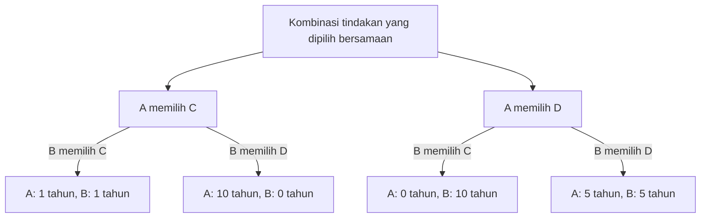
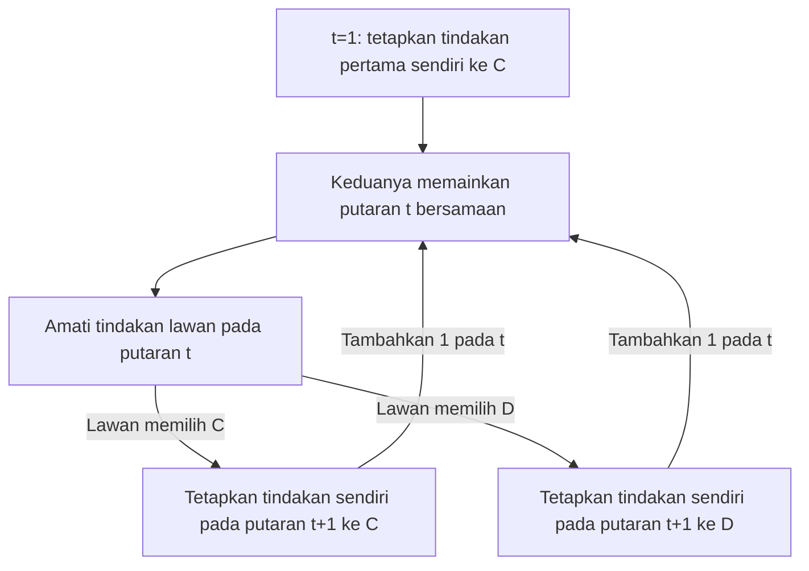

Kerja sama dapat lebih baik bagi kedua pemain, tetapi masing-masing tetap dapat memiliki insentif untuk meninggalkannya. [Dilema tahanan](https://kenji.blog/id/p/prisoners-dilemma/) menganalisis konflik ini dengan pilihan dan imbalan yang ditetapkan. Ini bukan hukum bahwa manusia pasti berkhianat atau kelompok kooperatif pasti bertahan hidup.

Tentang sejarahnya, [catatan kuliah Cornell](https://www.cs.cornell.edu/~rafael/networks-html/chapter1.html) menjelaskan penelitian Merrill Flood dan Melvin Dresher pada 1950 serta penjelasan Albert Tucker melalui cerita tahanan. Di sini kita membedakan insentif satu interaksi, strategi berulang, model evolusi, dan pengamatan hewan.

## 1. Mengubah masa hukuman fiktif menjadi imbalan

Anggap dua tersangka, A dan B, tidak dapat berunding dan secara bersamaan memilih diam C (bekerja sama satu sama lain) atau mengaku D (meninggalkan kerja sama itu). Dalam situasi fiktif ini, masa hukuman berikut berlaku dengan pasti. Ini bukan penjelasan aturan penyelidikan atau kesepakatan pengakuan bersalah yang nyata, dan tidak menyatakan bahwa mengaku berarti dibebaskan dari tuduhan.

| A / B | C: diam | D: mengaku |
| --- | --- | --- |
| C: diam | A: 1 tahun, B: 1 tahun | A: 10 tahun, B: 0 tahun |
| D: mengaku | A: 0 tahun, B: 10 tahun | A: 5 tahun, B: 5 tahun |

Setiap orang hanya ingin memperpendek masa hukumannya sendiri; persahabatan, reputasi, dan rasa bersalah tidak menambah utilitas. Imbalan u_i adalah negatif dari masa hukuman y_i. Imbalan negatif tidak berarti masa hukuman negatif. T adalah imbalan Anda jika hanya Anda memilih D; R jika keduanya C; P jika keduanya D; dan S jika hanya Anda memilih C.

$$
u_i=-y_i,\quad y_i\in\{0,1,5,10\},\qquad T=0>R=-1>P=-5>S=-10
$$

Diagram ini mencantumkan kombinasi tindakan yang dipilih bersamaan. A tidak mengamati tindakan B terlebih dahulu sebelum memilih.

## 2. Dominasi, ekuilibrium Nash, dan efisiensi Pareto

Dalam u_i, argumen pertama adalah tindakan sendiri dan argumen kedua tindakan pemain lain. Baik pemain lain memilih C maupun D, imbalan sendiri lebih tinggi dengan D.

$$
u_i(D,C)=0>-1=u_i(C,C),\qquad u_i(D,D)=-5>-10=u_i(C,D)
$$

Karena itu D adalah **strategi dominan ketat (strictly dominant strategy)**. Jika peluang pemain lain memilih C dinilai sebesar q, selisih imbalan harapan juga positif. q ini berbeda dari peluang p untuk bertemu TFT lain di dalam kelompok yang digunakan nanti.

$$
\begin{aligned}0&\le q\le1,\\\mathrm{EU}(D)&=-5+5q,\\\mathrm{EU}(C)&=-10+9q,\\\mathrm{EU}(D)-\mathrm{EU}(C)&=5-4q\ge1.\end{aligned}
$$

Jika keduanya memaksimalkan utilitas harapannya sendiri berdasarkan tabel ini, mereka memilih DD. Karena D mendominasi C secara ketat terhadap strategi lawan yang murni maupun campuran, DD adalah satu-satunya ekuilibrium Nash. **Ekuilibrium Nash** adalah profil strategi di mana tidak ada pemain yang dapat meningkatkan imbalannya dengan mengubah strateginya sendiri saja sementara strategi lawan tetap. Ini tidak berarti perubahan bersama tidak dapat memperbaiki hasil.

Suatu hasil **efisien Pareto (optimal Pareto)** jika tidak ada hasil layak lain yang meningkatkan imbalan setidaknya satu pemain tanpa mengurangi imbalan siapa pun. Di antara profil tindakan murni pada tabel, CC, CD, dan DC efisien; DD tidak, karena berpindah ke CC meningkatkan imbalan keduanya. Daftar ini tidak mencakup seluruh himpunan imbalan efisien jika pemilihan acak di antara hasil diizinkan.

Secara terpisah, penjumlahan imbalan numerik dengan bobot sama memberi CC total tertinggi. Definisi efisiensi dan kriteria penjumlahan ini berbeda.

$$
(u_1+u_2)(CC)=-2,\qquad(u_1+u_2)(CD)=(u_1+u_2)(DC)=(u_1+u_2)(DD)=-10
$$

Ini adalah analisis insentif dalam model dengan imbalan tertentu, bukan bukti tentang semua motif manusia atau kemalangan sosial yang tak terelakkan.

## 3. Memeriksa penerapan melalui imbalan dan institusi

### Persaingan harga

Model ini kadang dapat menjadi analogi bagi insentif menurunkan harga di bawah pesaing untuk meningkatkan penjualan, sekaligus menyusutnya margin jika keduanya menurunkan harga. Namun, permintaan, biaya, kualitas, dan masuknya pelaku baru mengubah imbalan; harga lebih rendah tidak menjamin monopoli. Jumlah laba perusahaan juga berbeda dari kesejahteraan sosial yang mencakup konsumen.

### Lingkungan dan sumber daya bersama

Ketika manfaat pengurangan emisi dibagi bersama tetapi setiap pihak menanggung biaya, kita dapat menelaah insentif menikmati upaya pihak lain tanpa ikut berkontribusi. Namun, dunia nyata memiliki banyak negara, kerugian dan biaya yang tidak simetris, perjanjian, serta pemantauan. Tabel dua pemain ini tidak menentukan hasil iklim atau pertumbuhan ekonomi setiap negara. Masalah sumber daya bersama pun tidak semuanya merupakan permainan dua pemain yang sama.

### Perlombaan senjata

Model yang menyederhanakan insentif melucuti atau mempertahankan senjata juga digunakan untuk memikirkan perlombaan nuklir AS dan Uni Soviet pada Perang Dingin. Kemampuan nyata, informasi, verifikasi, dan aliansi penting. Tabel ini tidak membuktikan keniscayaan sejarah bahwa pelucutan sepihak menghadapi lawan bersenjata selalu mengancam kelangsungan negara sehingga menambah senjata merupakan satu-satunya pilihan.

## 4. Pengulangan dan strategi Tit for Tat

Ketika hubungan berlanjut, tanggapan di masa depan terhadap tindakan sekarang dapat mengubah imbalan. Namun, pengulangan tidak menjamin kerja sama. Jika permainan tahap yang sama diulang dalam jumlah yang diketahui, tetap, dan terbatas, riwayat dapat diamati, serta struktur dan rasionalitas menjadi pengetahuan bersama, induksi mundur dari putaran terakhir menghasilkan ekuilibrium sempurna subpermainan dengan DD pada setiap putaran. [Catatan MIT](https://www.ocw.mit.edu/courses/14-15j-networks-spring-2018/pages/lecture-and-recitation-notes/recitation-10-notes/) juga membahas perbedaan pengulangan terbatas dan tak terbatas; imbalan numeriknya berbeda dari artikel ini.

**Tit for Tat (TFT)** memilih C pada awalnya, lalu mulai putaran kedua meniru tindakan lawan pada putaran sebelumnya. a_i,t adalah tindakan Anda pada putaran t, dan j menyatakan pemain lain.

$$
a_{i,1}=C,\qquad a_{i,t}=a_{j,t-1}\quad(t\ge2)
$$

Setelah bekerja sama maupun menyimpang, putaran berikutnya dimainkan sebelum hasilnya diamati. Strategi ini tidak mengetahui tindakan lawan saat ini terlebih dahulu, atau mengamati penyesalan dalam pikirannya.

[Artikel Axelrod dan Hamilton tahun 1981](https://public.websites.umich.edu/~axe/research/Axelrod%20and%20Hamilton%20EC%201981.pdf) melaporkan bahwa TFT yang diajukan Anatol Rapoport memperoleh skor rata-rata tertinggi dalam kedua turnamen program Axelrod. Imbalan T=5, R=3, P=1, dan S=0 di sana berbeda dari tabel masa hukuman kita. TFT tidak lebih dulu meninggalkan kerja sama, menanggapi penyimpangan lawan, dan kembali bekerja sama pada putaran setelah lawan melakukannya. Aturannya juga ringkas. Ini tidak menjadikannya strategi terbaik untuk setiap lawan, sistem skor, jangka waktu, atau kondisi kesalahan.

Bahkan antara dua pemain TFT, kesalahan tindakan yang menghasilkan CD dapat diikuti DC, lalu CD, sehingga penyimpangan bergantian terus terjadi. Skor turnamen, ekuilibrium, evolusi biologis, dan perilaku yang diinginkan secara moral adalah pertanyaan yang berbeda.

## 5. Evolusi kerja sama: struktur kelompok dan bukti dari hewan

### Kapan kelompok kooperatif kecil dapat unggul

Permainan evolusioner perlu menetapkan siapa bertemu siapa di antara individu dengan aturan perilaku tertentu, serta bagaimana kinerja memengaruhi generasi berikutnya. Mengutamakan kelangsungan hidup atau reproduksi tidak sama dengan perintah memilih D dalam setiap situasi.

Kapan kelompok kecil TFT dapat berkinerja lebih baik dalam populasi yang selebihnya memakai ALLD? Pertimbangkan model sederhana skor terdiskonto: lawan tetap, tindakan dilakukan berulang dan bersamaan, tidak ada kesalahan, dan δ memberi bobot pada masa depan. ALLD memilih D setiap putaran. V(X,Y) adalah skor terdiskonto strategi X melawan Y.

$$
\begin{aligned}0&\le\delta<1,\\V(\mathrm{TFT},\mathrm{TFT})&=\frac{-1}{1-\delta},\\V(\mathrm{TFT},\mathrm{ALLD})&=-10-\frac{5\delta}{1-\delta},\\V(\mathrm{ALLD},\mathrm{ALLD})&=\frac{-5}{1-\delta}.\end{aligned}
$$

Anggap anggota kelompok TFT yang langka bertemu TFT lain dengan peluang p dan selain itu bertemu ALLD. Perbandingan dilakukan dalam limit ketika proporsi kelompok dapat diabaikan, sehingga penghuni ALLD yang sudah ada hampir hanya bertemu ALLD. p adalah proporsi lawan TFT dalam pertemuan seorang pemain TFT, bukan frekuensi TFT di seluruh populasi.

$$
\begin{aligned}V_{\mathrm{cluster}}&=pV(\mathrm{TFT},\mathrm{TFT})+(1-p)V(\mathrm{TFT},\mathrm{ALLD}),\\V_{\mathrm{cluster}}-V(\mathrm{ALLD},\mathrm{ALLD})&=\frac{p(9-5\delta)-5(1-\delta)}{1-\delta}.\end{aligned}
$$

Syarat untuk memperoleh skor yang secara ketat lebih tinggi daripada acuan ALLD adalah:

$$
0\le p\le1,\qquad V_{\mathrm{cluster}}>V(\mathrm{ALLD},\mathrm{ALLD})\quad\Longleftrightarrow\quad p>\frac{5(1-\delta)}{9-5\delta}
$$

Misalnya, ketika δ=0,9, peluang pertemuan di dalam kelompok harus memenuhi:

$$
\delta=\frac9{10}\quad\Longrightarrow\quad p>\frac{5(1-9/10)}{9-5(9/10)}=\frac19
$$

| p | Skor terdiskonto harapan TFT | Acuan ALLD melawan ALLD | Perbandingan |
| --- | --- | --- | --- |
| 0 | -55 | -50 | Lebih rendah |
| 1/20 | -52,75 | -50 | Lebih rendah |
| 1/9 | -50 | -50 | Sama |
| 1/5 | -46 | -50 | Lebih tinggi |

Khususnya, jika TFT tidak pernah bertemu TFT lain, untuk setiap δ berlaku:

$$
p=0\quad\Longrightarrow\quad V_{\mathrm{cluster}}-V(\mathrm{ALLD},\mathrm{ALLD})=-5<0
$$

Jadi, jangka waktu panjang saja tidak menjamin keunggulan TFT yang terisolasi. Perhitungan ini membandingkan skor yang boleh bernilai negatif, bukan tingkat reproduksi atau kelangsungan hidup. Tanpa aturan pembaruan populasi, kita tidak dapat membuktikan penyingkiran akhir atau fiksasi suatu strategi. Artikel tahun 1981 juga memberi syarat kontak di dalam kelompok dan kelanjutan bagi terbentuknya kerja sama pada awalnya.

### Tidak menyamakan kelelawar dan lebah dengan satu strategi

[Studi Carter dan Wilkinson tahun 2013](https://science.umd.edu/faculty/wilkinson/Carter%26Wilk_PRSB13.pdf) melakukan uji puasa pada 20 kelelawar vampir dalam penangkaran. Studi itu melaporkan hubungan antara makanan yang diterima dari pasangan interaksi dan makanan yang diberikan kepadanya, serta hubungan sosial yang bertahan lama. Korelasi saja tidak membuktikan bahwa penerimaan makanan menyebabkan pemberian berikutnya atau kelelawar menjalankan TFT.

Sifat sosial lebah madu juga tidak otomatis sama dengan TFT. Axelrod dan Hamilton membahas pengorbanan lebah pekerja sebagai contoh untuk mempertimbangkan manfaat melalui kekerabatan. Kekerabatan, manfaat timbal balik, pengenalan individu, dan struktur interaksi memerlukan penelitian terpisah. Kebugaran biologis (fitness) tidak dapat begitu saja disamakan dengan moralitas atau kepercayaan manusia.

## 6. Memikirkan mekanisme yang menopang kerja sama

Dilema tahanan menunjukkan keadaan ketika insentif individu, dengan imbalan yang ditetapkan, tidak menopang hasil yang diinginkan kedua pihak. Untuk memikirkan kerja sama, periksa:

- **Imbalan dan pilihan**: Apakah sanksi, pembagian biaya, atau hadiah benar-benar mengubah perbandingan tindakan? Efek institusional dan kondisi hukum perlu diteliti pada setiap penerapan nyata.
- **Pengamatan dan komitmen**: Seberapa andal tindakan dapat dipastikan, dan seberapa mengikat janji serta tanggapan? Jika percakapan tidak mengubah imbalan atau pilihan permainan satu interaksi, D tetap dominan secara ketat.
- **Jangka waktu dan pertemuan**: Seberapa besar bobot masa depan, bagaimana hubungan berakhir, siapa yang ditemui lagi, dan bagaimana kesalahan ditangani?

Adanya ekuilibrium kooperatif atau kondisi skor yang menguntungkan berbeda dari kerja sama yang benar-benar dipilih dan menjadi mapan. Model membantu memeriksa asumsi konkret yang menopangnya; model tidak membuktikan nilai kepercayaan tanpa syarat.
