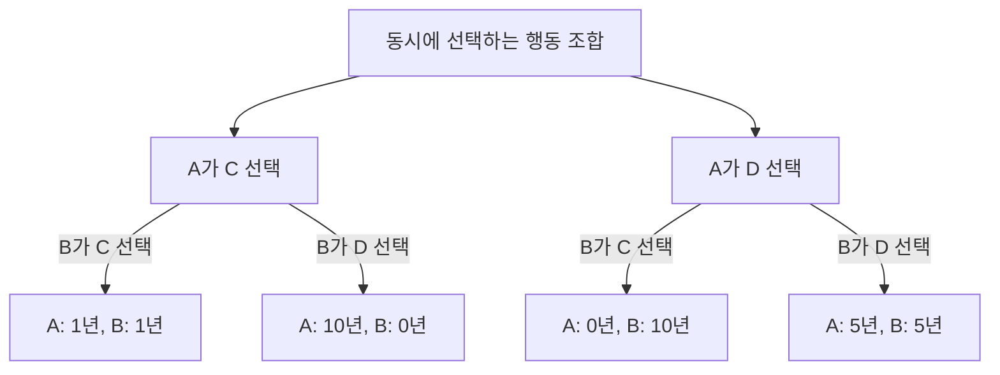
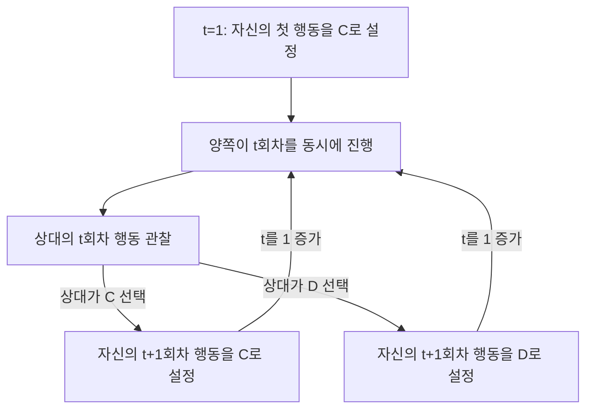

협력하면 두 사람 모두에게 더 좋을 수 있지만, 각자에게는 협력에서 이탈할 유인이 있을 수 있습니다. [죄수의 딜레마](https://kenji.blog/ko/p/prisoners-dilemma/)는 주어진 보수와 선택을 통해 이 갈등을 분석합니다. 사람이 반드시 배신한다거나 협력 집단이 반드시 살아남는다는 법칙은 아닙니다.

역사에 관해서는 [코넬대학교 강의 자료](https://www.cs.cornell.edu/~rafael/networks-html/chapter1.html)가 1950년 Merrill Flood와 Melvin Dresher의 연구, Albert Tucker의 죄수 이야기를 통한 설명을 소개합니다. 이 글에서는 일회성 상호작용의 유인, 반복 전략, 진화 모형, 동물 관찰을 구분합니다.

## 1. 가상의 형량을 보수로 바꾸기

두 용의자 A와 B가 상의할 수 없으며, 침묵 C(서로 협력) 또는 자백 D(그 협력에서 이탈)를 동시에 선택한다고 합시다. 이 가상 설정에서는 아래 형량이 확정적으로 적용됩니다. 실제 수사나 유죄협상 제도의 설명이 아니며, 자백하면 무죄가 된다는 뜻도 아닙니다.

| A / B | C: 침묵 | D: 자백 |
| --- | --- | --- |
| C: 침묵 | A: 1년, B: 1년 | A: 10년, B: 0년 |
| D: 자백 | A: 0년, B: 10년 | A: 5년, B: 5년 |

각자는 자신의 형량을 줄이는 것만 원하며, 우정·평판·죄책감의 효용은 별도로 반영하지 않습니다. 형량 y_i의 음수를 보수 u_i로 삼습니다. 음의 보수가 음의 형량을 뜻하지는 않습니다. T는 자신만 D를 선택했을 때, R은 양쪽이 C일 때, P는 양쪽이 D일 때, S는 자신만 C일 때의 보수입니다.

$$
u_i=-y_i,\quad y_i\in\{0,1,5,10\},\qquad T=0>R=-1>P=-5>S=-10
$$

아래 그림은 동시에 선택하는 행동의 조합을 나열합니다. A가 B의 행동을 먼저 관찰한 뒤 선택하는 순차 게임이 아닙니다.

## 2. 우월 전략, 내쉬 균형과 파레토 효율성

u_i의 첫 번째 인수는 자신의 행동, 두 번째 인수는 상대의 행동을 나타냅니다. 상대가 C이든 D이든 자신은 D를 선택할 때 더 높은 보수를 받습니다.

$$
u_i(D,C)=0>-1=u_i(C,C),\qquad u_i(D,D)=-5>-10=u_i(C,D)
$$

이것이 **엄격한 우월 전략**입니다. 상대가 C를 선택할 확률을 q로 보아도 기대보수의 차이는 양수입니다. 이 q는 뒤에서 사용할 소집단 내 상대 매칭 확률 p와 다른 변수입니다.

$$
\begin{aligned}0&\le q\le1,\\\mathrm{EU}(D)&=-5+5q,\\\mathrm{EU}(C)&=-10+9q,\\\mathrm{EU}(D)-\mathrm{EU}(C)&=5-4q\ge1.\end{aligned}
$$

두 사람이 이 표에 따라 각자의 기대효용을 극대화하면 DD를 선택합니다. 상대의 순수전략과 혼합전략 모두에 대해 D가 C보다 엄격히 우월하므로, DD는 유일한 내쉬 균형입니다. **내쉬 균형**은 상대의 전략이 고정되어 있을 때 누구도 자기 전략만 바꿔 보수를 높일 수 없는 전략 조합입니다. 두 사람이 함께 바꿔도 개선할 수 없다는 뜻은 아닙니다.

**파레토 효율성(파레토 최적성)**은 누구의 보수도 낮추지 않으면서 적어도 한 사람의 보수를 높이는 다른 가능한 결과가 없다는 뜻입니다. 표의 순수 행동 조합 CC, CD, DC는 모두 파레토 효율적입니다. DD는 CC로 바꾸면 양쪽 모두 개선되므로 효율적이지 않습니다. 결과 사이의 추첨을 허용할 때 가능한 효율적 보수 집합 전체를 여기서 열거한 것은 아닙니다.

한편 수치 보수를 같은 가중치로 더하면 CC의 합계가 가장 높습니다. 효율성의 정의와 이 합계 기준은 구분해야 합니다.

$$
(u_1+u_2)(CC)=-2,\qquad(u_1+u_2)(CD)=(u_1+u_2)(DC)=(u_1+u_2)(DD)=-10
$$

이는 주어진 보수 모형의 유인 분석이지, 모든 현실의 동기나 사회적 불행을 일괄적으로 증명하는 설명은 아닙니다.

## 3. 현실에 적용하기 전에 보수와 제도 살펴보기

### 가격 경쟁

상대보다 가격을 낮춰 판매량을 늘릴 유인과, 양쪽 모두 가격을 낮추면 이윤 폭이 줄어드는 상황을 이 모형으로 비유할 수 있습니다. 하지만 수요·비용·품질·시장 진입이 보수를 바꾸며, 가격 인하가 반드시 독점으로 이어지지는 않습니다. 기업 이윤의 합계는 소비자를 포함한 사회후생과도 다릅니다.

### 환경과 공유 자원

배출 감축의 편익을 공유하면서 각자가 비용을 부담한다면 다른 이의 노력에 무임승차할 유인을 분석할 수 있습니다. 그러나 현실에는 여러 국가, 비대칭적인 피해와 비용, 협정과 감시가 있습니다. 이 두 사람의 표만으로 기후 결과나 각국의 경제성장을 확정할 수는 없습니다. 공유 자원 문제 역시 모두 같은 두 사람 게임은 아닙니다.

### 군비 경쟁

냉전기 미국과 소련의 핵 군비 경쟁을 생각할 때도 군축과 무장 유지의 유인을 단순화한 모형을 사용합니다. 실제 역량·정보·검증·동맹 등이 중요합니다. 이 표는 상대가 무장했을 때 일방적 군축이 반드시 국가 존망을 위협하므로 군비 확장 외에는 선택이 없다는 역사적 필연성을 증명하지 않습니다.

## 4. 반복 상호작용과 팃포탯 전략

관계가 계속되면 현재 행동에 대한 미래의 반응이 보수를 바꿀 수 있습니다. 그러나 반복 자체가 협력을 보장하지는 않습니다. 같은 단계 게임을 알려진 고정된 유한 횟수만큼 반복하고, 과거 이력이 관찰 가능하며, 구조와 합리성이 공통지식이라면, 마지막 회차부터 역진귀납하여 매 회차 DD인 부분게임 완전균형을 얻습니다. [MIT 강의 자료](https://www.ocw.mit.edu/courses/14-15j-networks-spring-2018/pages/lecture-and-recitation-notes/recitation-10-notes/)도 유한·무한 반복의 차이를 다루며, 그 수치 보수는 이 글과 다릅니다.

**팃포탯(Tit for Tat, TFT)**은 처음에 C를 선택하고 이후에는 상대의 직전 행동을 따라 합니다. a_i,t는 t회차 자신의 행동이며 j는 상대를 나타냅니다.

$$
a_{i,1}=C,\qquad a_{i,t}=a_{j,t-1}\quad(t\ge2)
$$

협력 뒤든 이탈 뒤든 다음 회차를 진행한 다음 그 결과를 관찰합니다. 상대의 이번 행동을 미리 알거나 내면의 반성을 관찰하는 전략이 아닙니다.

[Axelrod와 Hamilton의 1981년 논문](https://public.websites.umich.edu/~axe/research/Axelrod%20and%20Hamilton%20EC%201981.pdf)은 Anatol Rapoport가 제출한 TFT가 Axelrod의 두 프로그램 대회에서 모두 평균 점수 1위를 기록했다고 보고합니다. 대회의 T=5, R=3, P=1, S=0은 이 글의 형량 표와 다릅니다. TFT는 먼저 이탈하지 않고 상대의 이탈에 반응하며, 상대가 협력을 재개한 다음 회차에 협력으로 돌아갑니다. 규칙도 간결합니다. 그렇다고 모든 상대·채점·기간·실수 조건에서 최강인 것은 아닙니다.

두 TFT끼리도 행동 실수로 CD가 발생하면 다음에 DC, 다시 CD가 이어져 번갈아 이탈할 수 있습니다. 대회 점수, 균형, 생물 진화, 도덕적으로 바람직한 행동은 서로 다른 문제입니다.

## 5. 협력의 진화: 집단 구조와 동물의 증거

### 작은 협력 집단이 유리할 수 있는 조건

진화 게임에서는 어떤 행동 규칙을 가진 개체가 누구와 만나며 성과가 다음 세대에 어떻게 영향을 주는지 명시해야 합니다. 생존이나 번식을 우선한다는 것이 모든 상황에서 D를 선택하라는 지시는 아닙니다.

나머지 개체가 모두 ALLD를 사용하는 개체군에서 소수의 TFT는 언제 더 좋은 성과를 낼까요? 간단한 할인 점수 모형을 생각합시다. 상대는 고정되어 있고, 양쪽이 동시에 반복 행동하며, 실수는 없고, δ는 미래에 부여하는 가중치입니다. ALLD는 매 회차 D를 선택합니다. V(X,Y)는 전략 X가 Y를 상대할 때의 할인 점수입니다.

$$
\begin{aligned}0&\le\delta<1,\\V(\mathrm{TFT},\mathrm{TFT})&=\frac{-1}{1-\delta},\\V(\mathrm{TFT},\mathrm{ALLD})&=-10-\frac{5\delta}{1-\delta},\\V(\mathrm{ALLD},\mathrm{ALLD})&=\frac{-5}{1-\delta}.\end{aligned}
$$

드문 TFT 소집단의 구성원이 확률 p로 다른 TFT를 만나고, 그렇지 않으면 ALLD를 만난다고 합시다. 소집단의 비중이 0에 가까워 기존 ALLD가 거의 ALLD만 만나는 극한에서 비교합니다. p는 TFT 참가자가 만나는 상대 중 TFT의 비율이지, 전체 개체군에서 TFT가 차지하는 비율이 아닙니다.

$$
\begin{aligned}V_{\mathrm{cluster}}&=pV(\mathrm{TFT},\mathrm{TFT})+(1-p)V(\mathrm{TFT},\mathrm{ALLD}),\\V_{\mathrm{cluster}}-V(\mathrm{ALLD},\mathrm{ALLD})&=\frac{p(9-5\delta)-5(1-\delta)}{1-\delta}.\end{aligned}
$$

ALLD 기준 점수보다 엄격히 높을 조건은 다음과 같습니다.

$$
0\le p\le1,\qquad V_{\mathrm{cluster}}>V(\mathrm{ALLD},\mathrm{ALLD})\quad\Longleftrightarrow\quad p>\frac{5(1-\delta)}{9-5\delta}
$$

예를 들어 δ=0.9일 때 집단 내 상대 매칭 확률은 다음을 만족해야 합니다.

$$
\delta=\frac9{10}\quad\Longrightarrow\quad p>\frac{5(1-9/10)}{9-5(9/10)}=\frac19
$$

| p | TFT의 기대 할인 점수 | ALLD 대 ALLD 기준 | 비교 |
| --- | --- | --- | --- |
| 0 | -55 | -50 | 낮음 |
| 1/20 | -52.75 | -50 | 낮음 |
| 1/9 | -50 | -50 | 같음 |
| 1/5 | -46 | -50 | 높음 |

특히 TFT가 다른 TFT를 전혀 만나지 못하면 모든 δ에 대해 다음이 성립합니다.

$$
p=0\quad\Longrightarrow\quad V_{\mathrm{cluster}}-V(\mathrm{ALLD},\mathrm{ALLD})=-5<0
$$

따라서 장기적 지속만으로 고립된 TFT의 우위를 보장할 수는 없습니다. 이 계산은 음수도 가능한 점수를 비교하며, 번식률이나 생존율을 계산하지 않습니다. 개체군 갱신 규칙을 지정하지 않고서는 최종 도태나 특정 전략의 고정을 증명할 수도 없습니다. 1981년 논문 역시 협력의 초기 성립에 집단 내 접촉과 지속성이라는 조건을 둡니다.

### 박쥐와 꿀벌을 같은 전략으로 단정하지 않기

[Carter와 Wilkinson의 2013년 연구](https://science.umd.edu/faculty/wilkinson/Carter%26Wilk_PRSB13.pdf)는 사육 상태의 흡혈박쥐 20마리에 대한 금식 실험에서 특정 상대에게 받은 먹이와 그 상대에게 제공한 먹이 사이의 연관성, 지속적인 사회적 관계를 보고했습니다. 그러나 상관관계만으로 먹이를 받은 것이 다음 제공을 유발했다거나 박쥐가 TFT를 실행한다고 증명할 수는 없습니다.

꿀벌의 사회성도 자동으로 TFT와 같아지는 것은 아닙니다. Axelrod와 Hamilton은 일벌의 자기희생을 혈연을 통한 이익을 논의하는 예로 듭니다. 혈연관계, 상호 이익, 개체 식별, 접촉 구조 등은 구분해서 연구해야 합니다. 생물학적 적합도(fitness)를 인간의 도덕이나 신뢰와 곧바로 동일시할 수도 없습니다.

## 6. 협력을 뒷받침하는 장치 생각하기

죄수의 딜레마는 주어진 보수 아래 개인의 유인이 양쪽 모두 원하는 결과를 뒷받침하지 못하는 상황을 보여줍니다. 협력을 생각할 때는 다음을 살펴봐야 합니다.

- **보수와 선택지**: 제재, 비용 분담, 보상이 실제로 행동 간 비교를 바꾸는가? 제도 효과와 법적 조건은 각각의 현실 문제에서 검토해야 합니다.
- **관찰과 약속**: 행동을 얼마나 확실히 확인할 수 있고 약속과 대응에 얼마나 구속력이 있는가? 대화가 일회성 게임의 보수나 선택지를 바꾸지 않는다면 D의 엄격한 우월성은 그대로입니다.
- **기간과 상대 매칭**: 미래에 얼마의 가중치를 두고, 관계는 어떻게 끝나며, 누구와 다시 만나고, 실수는 어떻게 처리하는가?

협력 균형이나 유리한 점수 조건이 존재한다는 것과 실제로 협력을 선택해 정착시킨다는 것은 다릅니다. 수리 모형은 협력을 뒷받침하는 구체적 전제를 살피도록 돕지, 신뢰의 가치를 무조건 증명하지는 않습니다.
