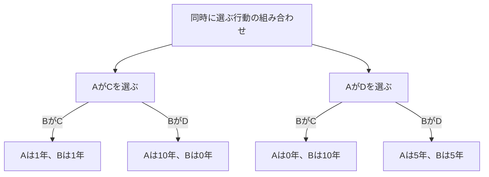
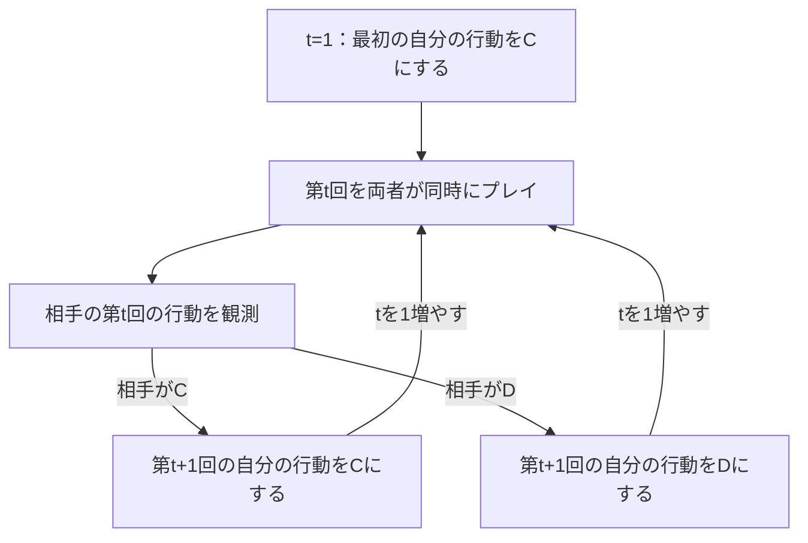

協力した方が双方にとってよいのに、各人には協力から外れる誘因がある。[囚人のジレンマ](https://kenji.blog/p/prisoners-dilemma/)は、この食い違いを利得と選択肢を定めて調べるモデルです。人が必ず裏切ることや、協力集団が必ず生き残ることを示す法則ではありません。

その歴史について、[Cornell大学の講義資料](https://www.cs.cornell.edu/~rafael/networks-html/chapter1.html)は、1950年のMerrill FloodとMelvin Dresherの研究と、Albert Tuckerによる囚人の物語での説明を挙げています。ここでは、一回限りの誘因、繰り返しの戦略、進化モデル、生物の観察を区別します。

## 1. 架空の刑期を利得に変換する

2人の容疑者A・Bが相談できず、同時に黙秘C（互いに協力）か自白D（その協力から離脱）を選ぶとします。次の刑期が確定する架空の設定です。現実の捜査・司法取引の制度や、自白すれば無罪になるという規則を説明するものではありません。

| A／B | C：黙秘 | D：自白 |
| --- | --- | --- |
| C：黙秘 | Aは1年、Bは1年 | Aは10年、Bは0年 |
| D：自白 | Aは0年、Bは10年 | Aは5年、Bは5年 |

各人は自分の刑期だけを短くしたいとし、友情・評判・罪悪感の追加の効用は含めません。刑期y_iの符号を反転したu_iを利得として使います。負の利得は、負の刑期という意味ではありません。Tは自分だけD、Rは双方C、Pは双方D、Sは自分だけCの利得です。

$$
u_i=-y_i,\quad y_i\in\{0,1,5,10\},\qquad T=0>R=-1>P=-5>S=-10
$$

次の図は同時の行動の組み合わせを列挙しています。Bの行動を先に観測してからAが選ぶ手順ではありません。

## 2. 支配戦略・ナッシュ均衡・パレート効率性

自分の行動を第1引数、相手の行動を第2引数としてu_iを比較します。相手がCでもDでも、自分はDの方が高い利得を得ます。

$$
u_i(D,C)=0>-1=u_i(C,C),\qquad u_i(D,D)=-5>-10=u_i(C,D)
$$

これが**厳密な支配戦略**です。相手がCを選ぶと考える確率をqとすると、期待利得の差も正です。このqは、後の集団内の対戦割合pとは別の変数です。

$$
\begin{aligned}0&\le q\le1,\\\mathrm{EU}(D)&=-5+5q,\\\mathrm{EU}(C)&=-10+9q,\\\mathrm{EU}(D)-\mathrm{EU}(C)&=5-4q\ge1.\end{aligned}
$$

同じ利得表で双方が自分の期待効用を最大にするなら、DDが選ばれます。Dは相手の純粋戦略にも混合戦略にも厳密に優越するため、DDが唯一のナッシュ均衡です。**ナッシュ均衡**は、相手の戦略を固定したとき、自分だけ戦略を変えても利得を増やせない戦略の組です。2人で同時に変えても改善できない、という意味ではありません。

**パレート効率的（パレート最適）**とは、誰の利得も下げずに少なくとも1人を改善する、別の実現可能な結果がないことです。表の純粋な行動の組ではCC・CD・DCが効率的で、DDはCCへ変えれば双方が改善するため効率的ではありません。この列挙は、結果を抽選で混ぜる場合の効率的な利得集合全体を列挙したものではありません。

一方、同じ重みで数値を足す評価ではCCの合計利得が最大です。効率性の定義と合計の評価は分けます。

$$
(u_1+u_2)(CC)=-2,\qquad(u_1+u_2)(CD)=(u_1+u_2)(DC)=(u_1+u_2)(DD)=-10
$$

これは利得を定めたモデルの誘因の分析であり、現実の人の動機や社会全体の不幸を一括して証明するものではありません。

## 3. 現実への応用は利得と制度から確かめる

### 価格競争

相手より安くして売上を増やす誘因と、双方の値下げによる利幅の縮小を考える類推として使える場合があります。ただし、需要・原価・品質・新規参入により利得は変わり、安売りすれば必ず独占できるとは限りません。企業の利潤の合計と、消費者を含む社会の厚生も異なります。

### 環境と共有資源

排出削減の便益を共有しながら各主体が費用を負担するとき、他者の努力にただ乗りする誘因を調べられます。ただし、複数の国、非対称な被害や費用、協定、監視があるため、この2人の表だけで温暖化の帰結や各国の経済成長を決めることはできません。共有資源の問題も、すべてが同一の2人ゲームというわけではありません。

### 軍拡競争

冷戦期の米ソの核軍拡を考える際にも、軍縮と軍備維持の誘因を単純化したモデルが使われます。しかし、実際には能力・情報・検証・同盟などが関わります。「相手が武装したら自国の軍縮は必ず国家存亡の危機になるので軍拡しかない」という歴史的必然を、この表は証明しません。

## 4. 繰り返しとしっぺ返し戦略

同じ相手との関係が続くと、今の行動に対する将来の反応が利得を変え得ます。ただし、繰り返せば必ず協力するわけではありません。同じ一回ゲームを既知の固定された有限回だけ繰り返し、履歴が観測でき、構造と合理性が共有知識なら、最後からの後ろ向き帰納で各回DDという部分ゲーム完全均衡が得られます。有限回と無限期間の違いは、[MITの講義ノート](https://www.ocw.mit.edu/courses/14-15j-networks-spring-2018/pages/lecture-and-recitation-notes/recitation-10-notes/)でも扱われています。同ノートの利得の数値は本文とは異なります。

**しっぺ返し戦略（Tit for Tat、TFT）**は、最初にCを選び、その後は相手の前回の行動をまねます。a_i,tは自分の第t回の行動で、jは相手です。

$$
a_{i,1}=C,\qquad a_{i,t}=a_{j,t-1}\quad(t\ge2)
$$

この図では、協力した後も離脱した後も、次の回をプレイしてから観測します。相手の現在の行動を先読みしたり、反省したという内心を観測したりする戦略ではありません。

[AxelrodとHamiltonの1981年の論文](https://public.websites.umich.edu/~axe/research/Axelrod%20and%20Hamilton%20EC%201981.pdf)は、Anatol Rapoportが提出したTFTが、Axelrodの2つのプログラム大会で平均得点首位だったと報告しています。そこでの利得T=5、R=3、P=1、S=0は、この記事の刑期の表とは違います。自分から離脱しない、相手の離脱に反応する、相手が協力に戻れば次回に戻る、という性質を備え、ルールも簡潔です。これは、どの対戦相手・得点・期間・誤りの条件でも最強という意味ではありません。

例えばTFT同士でも、一方の行動ミスでCDとなれば、次にDC、またCDと相互の離脱が続くことがあります。大会の得点、均衡、生物の進化、道徳的に望ましい行動は、それぞれ別の問いです。

## 5. 協力の進化：集団構造と生物の実例

### 小さな協力集団が有利になる条件

進化ゲームでは、行動規則を持つ個体が誰と出会い、成績がどのように次世代へ反映されるかを定めます。「生存や繁殖を優先する」ことを、どの場面でもDを選ぶ命令と同一視してはいけません。

少数のTFTが、ALLDばかりの集団でも有利になるのはどんな場合でしょうか。簡単な割引得点モデルで考えます。相手は固定で、同時行動を繰り返し、誤りはなく、δは将来の重みです。ALLDは毎回Dを選ぶ戦略です。V(X,Y)は戦略XがYと対戦する割引得点です。

$$
\begin{aligned}0&\le\delta<1,\\V(\mathrm{TFT},\mathrm{TFT})&=\frac{-1}{1-\delta},\\V(\mathrm{TFT},\mathrm{ALLD})&=-10-\frac{5\delta}{1-\delta},\\V(\mathrm{ALLD},\mathrm{ALLD})&=\frac{-5}{1-\delta}.\end{aligned}
$$

稀なTFT集団の一員が、確率pで別のTFTと、それ以外ではALLDと出会うと仮定します。既存ALLD側はほぼALLDとしか出会わないという、集団が十分小さい極限で比較します。pは全人口に占めるTFTの割合ではなく、TFT側の対戦相手の割合です。

$$
\begin{aligned}V_{\mathrm{cluster}}&=pV(\mathrm{TFT},\mathrm{TFT})+(1-p)V(\mathrm{TFT},\mathrm{ALLD}),\\V_{\mathrm{cluster}}-V(\mathrm{ALLD},\mathrm{ALLD})&=\frac{p(9-5\delta)-5(1-\delta)}{1-\delta}.\end{aligned}
$$

基準のALLD得点より厳密に高くなる条件は、次の通りです。

$$
0\le p\le1,\qquad V_{\mathrm{cluster}}>V(\mathrm{ALLD},\mathrm{ALLD})\quad\Longleftrightarrow\quad p>\frac{5(1-\delta)}{9-5\delta}
$$

例えばδ=0.9なら、必要な集団内対戦割合は次の値になります。

$$
\delta=\frac9{10}\quad\Longrightarrow\quad p>\frac{5(1-9/10)}{9-5(9/10)}=\frac19
$$

| p | TFT側の期待割引得点 | ALLD同士の基準得点 | 比較 |
| --- | --- | --- | --- |
| 0 | -55 | -50 | 低い |
| 1/20 | -52.75 | -50 | 低い |
| 1/9 | -50 | -50 | 同じ |
| 1/5 | -46 | -50 | 高い |

特に、TFTが他のTFTと全く出会わない場合、どのδでも次の差になります。

$$
p=0\quad\Longrightarrow\quad V_{\mathrm{cluster}}-V(\mathrm{ALLD},\mathrm{ALLD})=-5<0
$$

したがって、長く続くだけで孤立したTFTが必ず有利になるわけではありません。この計算は、負の値も許す得点比較です。繁殖率や生存率そのものではなく、増減の規則を置かずに集団の最終的な淘汰や固定を証明することもできません。1981年の論文も、協力の初期成立に集団内の接触割合と継続性の条件を置いています。

### 吸血コウモリとミツバチを同じ戦略と決めつけない

[CarterとWilkinsonの2013年の研究](https://science.umd.edu/faculty/wilkinson/Carter%26Wilk_PRSB13.pdf)は、飼育下で20個体を対象とする絶食試験を行い、相手から受けた食物と相手へ与える食物の関連や、継続的な社会関係を報告しました。ただし、その相関だけで、受領が次の提供を引き起こすことや、コウモリがTFTを実行していることが証明されるわけではありません。

ミツバチの社会性も、自動的にTFTと同じものとはいえません。AxelrodとHamiltonの論文は、働きバチの自己犠牲を血縁による利益を考える例として論じています。血縁、相互的な利益、個体識別や接触構造などの仕組みは区別して検討する必要があります。生物の適応度と、人間の道徳や信頼をそのまま同一視することもできません。

## 6. 協力を支える仕組みを考える

囚人のジレンマは、定めた利得の下で、個別の誘因が双方に望ましい結果を支えない場合を明確にします。協力を考えるときは、次の条件を確認します。

- **利得や選択肢**：制裁・費用負担・報酬などが実際に行動の比較を変えるか。制度の効果や法的条件は、それぞれの現実の問題で検証が必要です。
- **観測と約束**：相手の行動をどの程度確認でき、約束や反応にどの程度の拘束力があるか。会話しても一回ゲームの利得や選択肢が変わらなければ、Dの厳密な優越はそのままです。
- **期間と対戦関係**：将来の重み、終わり方、誰と再び出会うか、誤りをどう扱うか。

協力する均衡や有利な得点条件が存在することと、実際に協力が選ばれ定着することは別です。数理モデルは、信頼の価値を無条件に証明する道具ではなく、協力を支える前提を具体的に問い直すために役立ちます。
