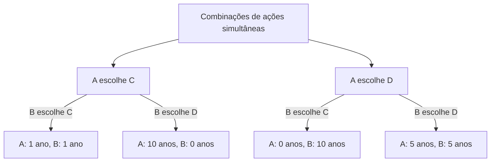
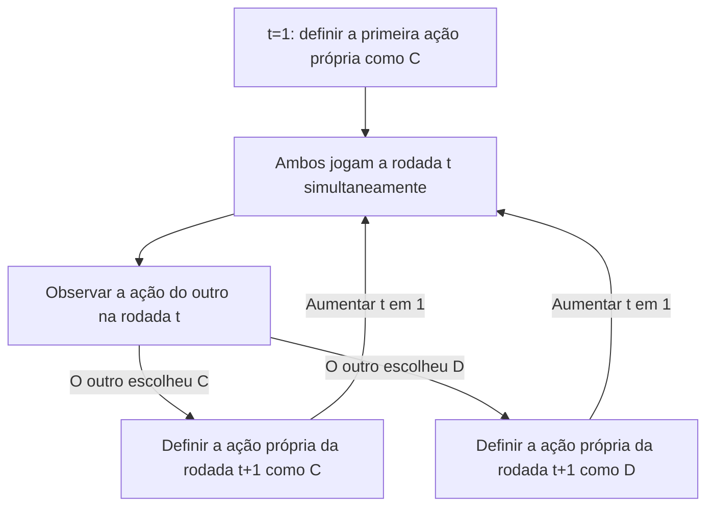

A cooperação pode ser melhor para os dois participantes, embora cada um possa ter incentivos para abandoná-la. O [dilema do prisioneiro](https://kenji.blog/pt/p/prisoners-dilemma/) analisa esse conflito por meio de ações e pagamentos especificados. Não é uma lei segundo a qual as pessoas necessariamente traem ou os grupos cooperativos necessariamente sobrevivem.

Sobre a história, as [notas de um curso de Cornell](https://www.cs.cornell.edu/~rafael/networks-html/chapter1.html) descrevem o trabalho de Merrill Flood e Melvin Dresher em 1950 e a apresentação de Albert Tucker por meio de uma história de prisioneiros. Aqui distinguimos os incentivos de uma interação única, estratégias repetidas, modelos evolutivos e observações de animais.

## 1. Transformando penas fictícias em pagamentos

Suponha que dois suspeitos, A e B, não possam conversar e escolham simultaneamente o silêncio C (cooperação entre si) ou a confissão D (abandono dessa cooperação). As penas abaixo são certas nesse cenário fictício. Ele não descreve regras reais de investigação ou de negociação penal, nem estabelece que confessar leva à absolvição.

| A / B | C: silêncio | D: confissão |
| --- | --- | --- |
| C: silêncio | A: 1 ano, B: 1 ano | A: 10 anos, B: 0 anos |
| D: confissão | A: 0 anos, B: 10 anos | A: 5 anos, B: 5 anos |

Cada pessoa deseja apenas reduzir a própria pena; amizade, reputação e culpa não acrescentam utilidade. Usamos como pagamento u_i o negativo da duração da pena y_i. Um pagamento negativo não significa uma pena negativa. T é o pagamento quando só você escolhe D; R, quando ambos escolhem C; P, quando ambos escolhem D; e S, quando só você escolhe C.

$$
u_i=-y_i,\quad y_i\in\{0,1,5,10\},\qquad T=0>R=-1>P=-5>S=-10
$$

O diagrama enumera combinações de ações escolhidas simultaneamente. Não permite que A observe a ação de B antes de decidir.

## 2. Dominância, equilíbrio de Nash e eficiência de Pareto

Em u_i, o primeiro argumento representa sua ação e o segundo, a do outro participante. Quer o outro escolha C ou D, você recebe um pagamento maior escolhendo D.

$$
u_i(D,C)=0>-1=u_i(C,C),\qquad u_i(D,D)=-5>-10=u_i(C,D)
$$

Essa é uma **estratégia estritamente dominante**. Se você atribuir probabilidade q à escolha de C pelo outro, a diferença entre os pagamentos esperados também será positiva. Esse q é diferente da probabilidade p de encontrar outro membro do grupo, usada mais adiante.

$$
\begin{aligned}0&\le q\le1,\\\mathrm{EU}(D)&=-5+5q,\\\mathrm{EU}(C)&=-10+9q,\\\mathrm{EU}(D)-\mathrm{EU}(C)&=5-4q\ge1.\end{aligned}
$$

Se ambos maximizam a própria utilidade esperada com essa tabela, escolhem DD. Como D domina estritamente C contra estratégias tanto puras quanto mistas do outro, DD é o único equilíbrio de Nash. Um **equilíbrio de Nash** é um perfil de estratégias no qual nenhum participante aumenta seu pagamento mudando apenas a própria estratégia, enquanto a do outro permanece fixa. Isso não impede que uma mudança conjunta melhore o resultado.

Um resultado é **eficiente no sentido de Pareto (ótimo de Pareto)** se nenhum outro resultado viável melhora o pagamento de pelo menos um participante sem reduzir o de ninguém. Entre os perfis de ações puras da tabela, CC, CD e DC são eficientes. DD não é: mudar para CC melhora os pagamentos de ambos. Essa lista não enumera todo o conjunto de pagamentos eficientes quando se permitem sorteios entre resultados.

Separadamente, somar os pagamentos numéricos com pesos iguais dá a CC o maior total. A definição de eficiência e esse critério de soma são diferentes.

$$
(u_1+u_2)(CC)=-2,\qquad(u_1+u_2)(CD)=(u_1+u_2)(DC)=(u_1+u_2)(DD)=-10
$$

Trata-se de uma análise de incentivos em um modelo com pagamentos definidos, não de uma prova sobre motivações humanas universais ou desgraça social inevitável.

## 3. Examinando aplicações por meio de pagamentos e instituições

### Concorrência de preços

O modelo pode servir, em certos casos, como analogia do incentivo a cobrar menos que o concorrente para vender mais, junto à redução das margens quando ambos baixam os preços. Mas demanda, custos, qualidade e entrada no mercado mudam os pagamentos; vender mais barato não garante um monopólio. A soma dos lucros das empresas também difere do bem-estar social que inclui os consumidores.

### Meio ambiente e recursos compartilhados

Quando os benefícios da redução de emissões são compartilhados, mas cada parte assume seus custos, podemos examinar incentivos a aproveitar o esforço alheio sem contribuir. Porém, existem vários países, danos e custos assimétricos, acordos e monitoramento. Essa tabela de dois participantes não determina os resultados climáticos ou o crescimento econômico de cada país. Problemas de recursos compartilhados também não são todos o mesmo jogo de duas pessoas.

### Corrida armamentista

Modelos que simplificam os incentivos ao desarmamento e à manutenção de armas também ajudam a pensar na corrida nuclear entre Estados Unidos e União Soviética durante a Guerra Fria. Capacidades reais, informação, verificação e alianças importam. A tabela não prova uma necessidade histórica segundo a qual o desarmamento unilateral diante de um rival armado sempre ameaça a sobrevivência nacional, deixando a expansão dos armamentos como única escolha.

## 4. Repetição e estratégia Tit for Tat

Quando uma relação continua, as respostas futuras às ações presentes podem mudar os pagamentos. Mas a repetição não garante cooperação. Se o mesmo jogo de estágio se repete um número conhecido, fixo e finito de vezes, os históricos são observáveis e a estrutura e a racionalidade são de conhecimento comum, a indução retroativa a partir da última rodada fornece um equilíbrio perfeito em subjogos com DD em todas as rodadas. As [notas do MIT](https://www.ocw.mit.edu/courses/14-15j-networks-spring-2018/pages/lecture-and-recitation-notes/recitation-10-notes/) também discutem a diferença entre repetição finita e infinita; seus pagamentos numéricos diferem dos deste artigo.

**Tit for Tat (TFT)** escolhe C primeiro e depois copia a ação anterior do oponente. a_i,t é sua ação na rodada t, e j representa o outro participante.

$$
a_{i,1}=C,\qquad a_{i,t}=a_{j,t-1}\quad(t\ge2)
$$

Após cooperar ou deixar de cooperar, a rodada seguinte é jogada antes que seu resultado seja observado. A estratégia não antecipa a ação atual do outro nem observa um estado interno de arrependimento.

O [artigo de Axelrod e Hamilton de 1981](https://public.websites.umich.edu/~axe/research/Axelrod%20and%20Hamilton%20EC%201981.pdf) relata que TFT, apresentada por Anatol Rapoport, obteve a maior pontuação média nos dois torneios de programas de Axelrod. Seus pagamentos T=5, R=3, P=1 e S=0 diferem da nossa tabela de penas. TFT não inicia a deserção, responde à deserção do outro e volta a cooperar na rodada posterior àquela em que o outro volta a cooperar. Sua regra também é curta. Isso não a torna a melhor estratégia para qualquer oponente, sistema de pontuação, horizonte ou condição de erro.

Mesmo entre dois participantes TFT, um erro de ação que produza CD pode ser seguido de DC, depois CD, mantendo deserções alternadas. Pontuação em torneios, equilíbrio, evolução biológica e conduta moralmente desejável são questões distintas.

## 5. Evolução da cooperação: estrutura de grupos e evidências animais

### Quando um pequeno grupo cooperativo pode ter vantagem

Um jogo evolutivo precisa especificar quem encontra quem entre indivíduos com determinadas regras de comportamento e como o desempenho afeta as gerações seguintes. Priorizar sobrevivência ou reprodução não equivale a uma instrução para escolher D em qualquer situação.

Quando um pequeno grupo TFT pode ter desempenho melhor em uma população que, no restante, usa ALLD? Considere um modelo simples de pontuação descontada: os oponentes permanecem fixos, as ações são simultâneas e repetidas, não há erros, e δ pondera o futuro. ALLD escolhe D em toda rodada. V(X,Y) é a pontuação descontada da estratégia X contra Y.

$$
\begin{aligned}0&\le\delta<1,\\V(\mathrm{TFT},\mathrm{TFT})&=\frac{-1}{1-\delta},\\V(\mathrm{TFT},\mathrm{ALLD})&=-10-\frac{5\delta}{1-\delta},\\V(\mathrm{ALLD},\mathrm{ALLD})&=\frac{-5}{1-\delta}.\end{aligned}
$$

Suponha que um membro de um grupo TFT raro encontre outro TFT com probabilidade p e, nos demais casos, encontre ALLD. A comparação é com residentes que encontram quase somente ALLD, no limite de um grupo com proporção desprezível na população. Aqui p é a proporção de oponentes TFT nos encontros de um participante TFT, não a frequência de TFT em toda a população.

$$
\begin{aligned}V_{\mathrm{cluster}}&=pV(\mathrm{TFT},\mathrm{TFT})+(1-p)V(\mathrm{TFT},\mathrm{ALLD}),\\V_{\mathrm{cluster}}-V(\mathrm{ALLD},\mathrm{ALLD})&=\frac{p(9-5\delta)-5(1-\delta)}{1-\delta}.\end{aligned}
$$

A condição para superar estritamente a pontuação de referência ALLD é:

$$
0\le p\le1,\qquad V_{\mathrm{cluster}}>V(\mathrm{ALLD},\mathrm{ALLD})\quad\Longleftrightarrow\quad p>\frac{5(1-\delta)}{9-5\delta}
$$

Por exemplo, com δ=0,9, a probabilidade de encontrar outro TFT dentro do grupo precisa satisfazer:

$$
\delta=\frac9{10}\quad\Longrightarrow\quad p>\frac{5(1-9/10)}{9-5(9/10)}=\frac19
$$

| p | Pontuação descontada esperada de TFT | Referência ALLD contra ALLD | Comparação |
| --- | --- | --- | --- |
| 0 | -55 | -50 | Inferior |
| 1/20 | -52,75 | -50 | Inferior |
| 1/9 | -50 | -50 | Igual |
| 1/5 | -46 | -50 | Superior |

Em particular, se TFT nunca encontra outro TFT, para qualquer δ temos:

$$
p=0\quad\Longrightarrow\quad V_{\mathrm{cluster}}-V(\mathrm{ALLD},\mathrm{ALLD})=-5<0
$$

Portanto, um horizonte longo por si só não garante vantagem a TFT isolada. Esse cálculo compara pontuações que podem ser negativas, não taxas de reprodução ou sobrevivência. Sem especificar regras de atualização da população, não podemos provar a eliminação final nem a fixação de uma estratégia. O artigo de 1981 também condiciona o estabelecimento inicial da cooperação ao contato dentro do grupo e à continuidade.

### Não identificar morcegos e abelhas com uma só estratégia

O [estudo de Carter e Wilkinson de 2013](https://science.umd.edu/faculty/wilkinson/Carter%26Wilk_PRSB13.pdf) realizou testes de jejum com 20 morcegos-vampiros em cativeiro e relatou associações entre o alimento recebido de um parceiro e o doado a ele, juntamente com relações sociais duradouras. A correlação por si só não demonstra que receber alimento causa a próxima doação ou que os morcegos executam TFT.

A sociabilidade das abelhas também não equivale automaticamente a TFT. Axelrod e Hamilton discutem o sacrifício das operárias como exemplo para considerar benefícios por meio do parentesco. Parentesco, benefícios recíprocos, reconhecimento individual e estrutura das interações exigem investigações distintas. Aptidão biológica (fitness) não pode ser simplesmente equiparada à moralidade ou à confiança humanas.

## 6. Pensando nos mecanismos que sustentam a cooperação

O dilema do prisioneiro identifica situações em que os incentivos individuais, com pagamentos especificados, não sustentam um resultado desejável para ambos. Para pensar na cooperação, examine:

- **Pagamentos e escolhas**: Sanções, divisão de custos ou recompensas realmente mudam a comparação entre ações? Efeitos institucionais e condições legais precisam ser investigados em cada aplicação real.
- **Observação e compromissos**: Com que segurança as ações podem ser observadas e quão vinculantes são promessas e respostas? Se a conversa não muda os pagamentos nem as escolhas de um jogo de uma única interação, D continua estritamente dominante.
- **Horizonte e encontros**: Qual o peso do futuro, como termina a relação, quem se encontra novamente e como os erros são tratados?

A existência de um equilíbrio cooperativo ou de condições favoráveis de pontuação é diferente de a cooperação ser escolhida e se estabelecer. Os modelos ajudam a examinar os pressupostos específicos que sustentam a cooperação; não provam incondicionalmente o valor da confiança.
