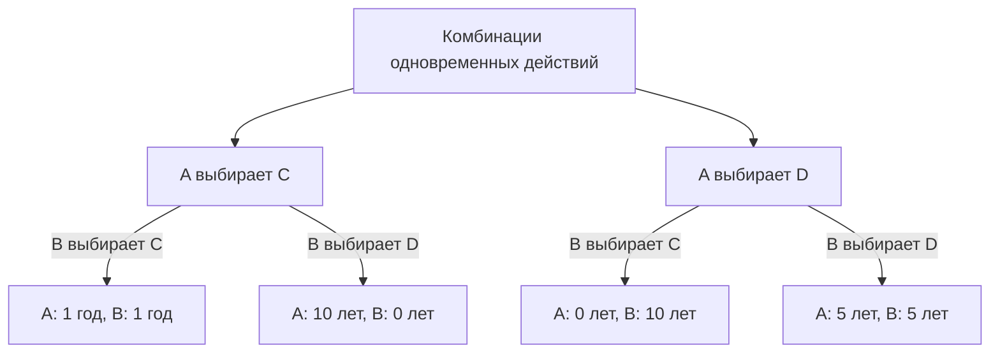
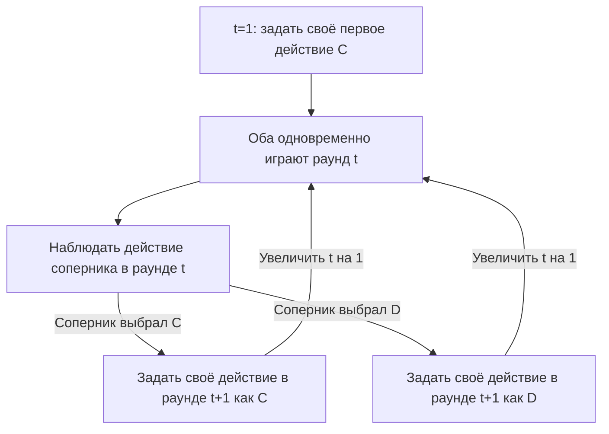

Сотрудничество может быть выгоднее для обоих игроков, хотя у каждого может сохраняться стимул от него отклониться. [Дилемма заключённого](https://kenji.blog/ru/p/prisoners-dilemma/) анализирует этот конфликт при заданных выигрышах и действиях. Это не закон, по которому люди обязательно предают, а сотрудничающие группы обязательно выживают.

Об истории [материалы курса Корнеллского университета](https://www.cs.cornell.edu/~rafael/networks-html/chapter1.html) рассказывают о работе Merrill Flood и Melvin Dresher в 1950 году и об объяснении Albert Tucker через историю заключённых. Здесь мы разделим стимулы однократного взаимодействия, повторяемые стратегии, эволюционные модели и наблюдения за животными.

## 1. Превращаем вымышленные сроки в выигрыши

Пусть два подозреваемых, A и B, не могут договориться и одновременно выбирают молчание C (сотрудничество друг с другом) или признание D (отказ от этого сотрудничества). В этой вымышленной ситуации следующие сроки определены наверняка. Это не описание реальных правил расследования или сделки о признании вины и не утверждение, что признание ведёт к оправданию.

| A / B | C: молчание | D: признание |
| --- | --- | --- |
| C: молчание | A: 1 год, B: 1 год | A: 10 лет, B: 0 лет |
| D: признание | A: 0 лет, B: 10 лет | A: 5 лет, B: 5 лет |

Каждый хочет только сократить собственный срок; дружба, репутация и чувство вины не добавляют полезности. Выигрыш u_i равен длительности заключения y_i с обратным знаком. Отрицательный выигрыш не означает отрицательный срок. T — ваш выигрыш, когда только вы выбираете D; R — когда оба выбирают C; P — когда оба выбирают D; S — когда только вы выбираете C.

$$
u_i=-y_i,\quad y_i\in\{0,1,5,10\},\qquad T=0>R=-1>P=-5>S=-10
$$

Схема перечисляет комбинации одновременно выбираемых действий. Она не позволяет A сначала увидеть действие B, а затем выбрать своё.

## 2. Доминирование, равновесие Нэша и эффективность по Парето

Первый аргумент u_i обозначает собственное действие, второй — действие другого игрока. Выбирает ли другой C или D, собственный выигрыш выше при D.

$$
u_i(D,C)=0>-1=u_i(C,C),\qquad u_i(D,D)=-5>-10=u_i(C,D)
$$

Поэтому D — **строго доминирующая стратегия**. Если вероятность выбора C другим игроком оценивается как q, разность ожидаемых выигрышей тоже положительна. Это q отличается от используемой далее вероятности p встречи с другим TFT внутри группы.

$$
\begin{aligned}0&\le q\le1,\\\mathrm{EU}(D)&=-5+5q,\\\mathrm{EU}(C)&=-10+9q,\\\mathrm{EU}(D)-\mathrm{EU}(C)&=5-4q\ge1.\end{aligned}
$$

Если оба максимизируют собственную ожидаемую полезность по этой таблице, они выбирают DD. Поскольку D строго доминирует над C против чистых и смешанных стратегий другого игрока, DD — единственное равновесие Нэша. **Равновесие Нэша** — профиль стратегий, в котором никто не может увеличить свой выигрыш, изменив только собственную стратегию при неизменной стратегии другого. Совместное изменение при этом может улучшить результат.

Исход **эффективен по Парето (оптимален по Парето)**, если нет другого допустимого исхода, улучшающего выигрыш хотя бы одного игрока без уменьшения чьего-либо выигрыша. Среди чистых профилей действий в таблице CC, CD и DC эффективны. DD неэффективен: переход к CC улучшает выигрыши обоих. Этот перечень не описывает всё множество эффективных выигрышей, если разрешены случайные выборы между исходами.

Отдельно, при сложении численных выигрышей с одинаковыми весами CC даёт наибольшую сумму. Определение эффективности и критерий суммы различаются.

$$
(u_1+u_2)(CC)=-2,\qquad(u_1+u_2)(CD)=(u_1+u_2)(DC)=(u_1+u_2)(DD)=-10
$$

Это анализ стимулов в модели с заданными выигрышами, а не доказательство универсальных человеческих мотивов или неизбежного общественного несчастья.

## 3. Проверяем применения через выигрыши и институты

### Ценовая конкуренция

Модель иногда может служить аналогией стимула снизить цену относительно конкурента ради увеличения продаж и сокращения маржи при обоюдном снижении цен. Но спрос, затраты, качество и вход на рынок меняют выигрыши; более низкая цена не гарантирует монополию. Сумма прибылей компаний также отличается от общественного благосостояния с учётом потребителей.

### Окружающая среда и общие ресурсы

Если выгоды сокращения выбросов общие, а затраты несёт каждый участник, можно исследовать стимул пользоваться чужими усилиями без собственного вклада. Однако в реальности есть множество стран, асимметричные ущерб и затраты, соглашения и контроль. Эта таблица двух игроков сама по себе не определяет климатические последствия или экономический рост каждой страны. Проблемы общих ресурсов тоже не сводятся к одной и той же игре двух участников.

### Гонка вооружений

Модели упрощённых стимулов к разоружению и сохранению вооружений используются и при рассмотрении ядерной гонки США и СССР во время холодной войны. Важны реальные возможности, информация, проверка и союзы. Таблица не доказывает исторической неизбежности, будто одностороннее разоружение перед вооружённым соперником всегда угрожает существованию страны и оставляет лишь наращивание вооружений.

## 4. Повторение и стратегия Tit for Tat

Когда отношения продолжаются, будущие реакции на сегодняшние действия могут менять выигрыши. Но повторение не гарантирует сотрудничества. Если одна и та же однопериодная игра повторяется известное фиксированное конечное число раз, истории наблюдаемы, а структура и рациональность являются общим знанием, обратная индукция от последнего раунда даёт совершенное в подыграх равновесие с DD в каждом раунде. [Материалы MIT](https://www.ocw.mit.edu/courses/14-15j-networks-spring-2018/pages/lecture-and-recitation-notes/recitation-10-notes/) тоже рассматривают отличие конечного повторения от бесконечного; их численные выигрыши отличаются от наших.

**Tit for Tat (TFT)** сначала выбирает C, а со второго раунда копирует предыдущее действие соперника. a_i,t — ваше действие в раунде t, j обозначает другого игрока.

$$
a_{i,1}=C,\qquad a_{i,t}=a_{j,t-1}\quad(t\ge2)
$$

После сотрудничества и после отказа от него следующий раунд разыгрывается до наблюдения его результата. Стратегия не предвидит текущее действие соперника и не наблюдает его внутреннее раскаяние.

[Статья Axelrod и Hamilton 1981 года](https://public.websites.umich.edu/~axe/research/Axelrod%20and%20Hamilton%20EC%201981.pdf) сообщает, что TFT, представленная Anatol Rapoport, получила наивысший средний балл в обоих турнирах программ Axelrod. Выигрыши T=5, R=3, P=1 и S=0 там отличаются от нашей таблицы сроков. TFT не отказывается от сотрудничества первой, отвечает на отказ соперника и возвращается к сотрудничеству в раунде после его возвращения. Её правило также кратко. Это не делает её лучшей против любых соперников, систем подсчёта, горизонтов или условий ошибок.

Даже между двумя TFT ошибка действия, давшая CD, может привести к DC, затем снова CD, поддерживая чередование отказов от сотрудничества. Турнирные баллы, равновесие, биологическая эволюция и морально желательное поведение — разные вопросы.

## 5. Эволюция сотрудничества: структура групп и наблюдения за животными

### Когда небольшая сотрудничающая группа может иметь преимущество

Эволюционная игра должна задавать, с кем встречаются особи с определёнными правилами поведения и как результаты влияют на следующие поколения. Приоритет выживания или размножения не равнозначен указанию выбирать D в любой ситуации.

Когда небольшая группа TFT может показать лучший результат в популяции, где остальные используют ALLD? Рассмотрим простую модель дисконтированных баллов: соперники фиксированы, действия повторяются одновременно, ошибок нет, а δ задаёт вес будущего. ALLD выбирает D в каждом раунде. V(X,Y) — дисконтированный балл стратегии X против Y.

$$
\begin{aligned}0&\le\delta<1,\\V(\mathrm{TFT},\mathrm{TFT})&=\frac{-1}{1-\delta},\\V(\mathrm{TFT},\mathrm{ALLD})&=-10-\frac{5\delta}{1-\delta},\\V(\mathrm{ALLD},\mathrm{ALLD})&=\frac{-5}{1-\delta}.\end{aligned}
$$

Пусть участник редкой группы TFT встречает другого TFT с вероятностью p, а иначе — ALLD. Сравнение проводится с резидентами, встречающими почти только ALLD, в пределе пренебрежимо малой доли группы. Здесь p — доля TFT среди соперников игрока TFT, не частота TFT во всей популяции.

$$
\begin{aligned}V_{\mathrm{cluster}}&=pV(\mathrm{TFT},\mathrm{TFT})+(1-p)V(\mathrm{TFT},\mathrm{ALLD}),\\V_{\mathrm{cluster}}-V(\mathrm{ALLD},\mathrm{ALLD})&=\frac{p(9-5\delta)-5(1-\delta)}{1-\delta}.\end{aligned}
$$

Условие строго большего балла по сравнению с базовым ALLD:

$$
0\le p\le1,\qquad V_{\mathrm{cluster}}>V(\mathrm{ALLD},\mathrm{ALLD})\quad\Longleftrightarrow\quad p>\frac{5(1-\delta)}{9-5\delta}
$$

Например, при δ=0,9 вероятность встречи внутри группы должна удовлетворять условию:

$$
\delta=\frac9{10}\quad\Longrightarrow\quad p>\frac{5(1-9/10)}{9-5(9/10)}=\frac19
$$

| p | Ожидаемый дисконтированный балл TFT | База ALLD против ALLD | Сравнение |
| --- | --- | --- | --- |
| 0 | -55 | -50 | Ниже |
| 1/20 | -52,75 | -50 | Ниже |
| 1/9 | -50 | -50 | Равен |
| 1/5 | -46 | -50 | Выше |

В частности, если TFT никогда не встречает другого TFT, для любого δ:

$$
p=0\quad\Longrightarrow\quad V_{\mathrm{cluster}}-V(\mathrm{ALLD},\mathrm{ALLD})=-5<0
$$

Поэтому один лишь долгий горизонт не гарантирует преимущества изолированной TFT. Расчёт сравнивает баллы, которые могут быть отрицательными, а не показатели размножения или выживания. Без правил обновления популяции он не доказывает окончательного вытеснения или фиксации стратегии. Статья 1981 года тоже ставит первоначальное возникновение сотрудничества в зависимость от контактов внутри группы и продолжения взаимодействия.

### Не приравниваем летучих мышей и пчёл к одной стратегии

[Исследование Carter и Wilkinson 2013 года](https://science.umd.edu/faculty/wilkinson/Carter%26Wilk_PRSB13.pdf) включало испытания с голоданием 20 летучих мышей-вампиров в неволе. Оно сообщило о связи между пищей, полученной от партнёра и отданной ему, а также об устойчивых социальных отношениях. Одна корреляция не доказывает, что получение пищи вызывает следующую передачу или что мыши выполняют TFT.

Социальность медоносных пчёл тоже не означает автоматически TFT. Axelrod и Hamilton рассматривают самопожертвование рабочих пчёл как пример выгод через родство. Родство, взаимные выгоды, индивидуальное узнавание и структура контактов требуют раздельного изучения. Биологическую приспособленность (fitness) также нельзя просто отождествлять с человеческой моралью или доверием.

## 6. Рассматриваем механизмы, поддерживающие сотрудничество

Дилемма заключённого выявляет случаи, когда при заданных выигрышах индивидуальные стимулы не поддерживают желательный для обоих результат. Размышляя о сотрудничестве, следует проверить:

- **Выигрыши и варианты действий**: Меняют ли санкции, распределение затрат или вознаграждения сравнение действий? Институциональные эффекты и правовые условия нужно исследовать для каждого реального применения.
- **Наблюдение и обязательства**: Насколько надёжно можно установить действия и насколько обязательны обещания и реакции? Если разговор не меняет выигрыши или варианты однократной игры, D остаётся строго доминирующей.
- **Горизонт и встречи**: Каков вес будущего, как заканчиваются отношения, с кем встречаются вновь и как обрабатываются ошибки?

Существование кооперативного равновесия или благоприятных условий по баллам отличается от того, что сотрудничество действительно выбрано и закрепилось. Модели помогают проверять конкретные предпосылки его поддержки, но не доказывают ценность доверия безусловно.
