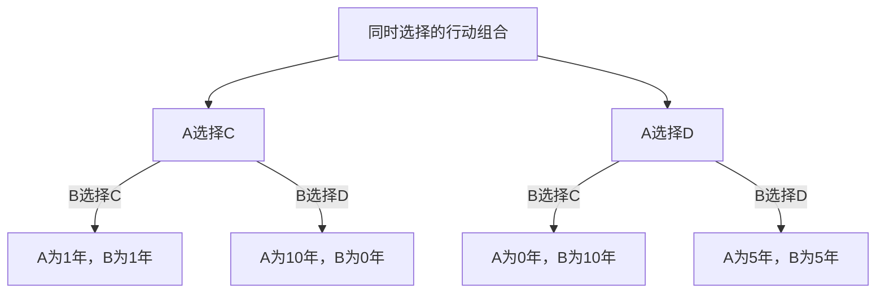
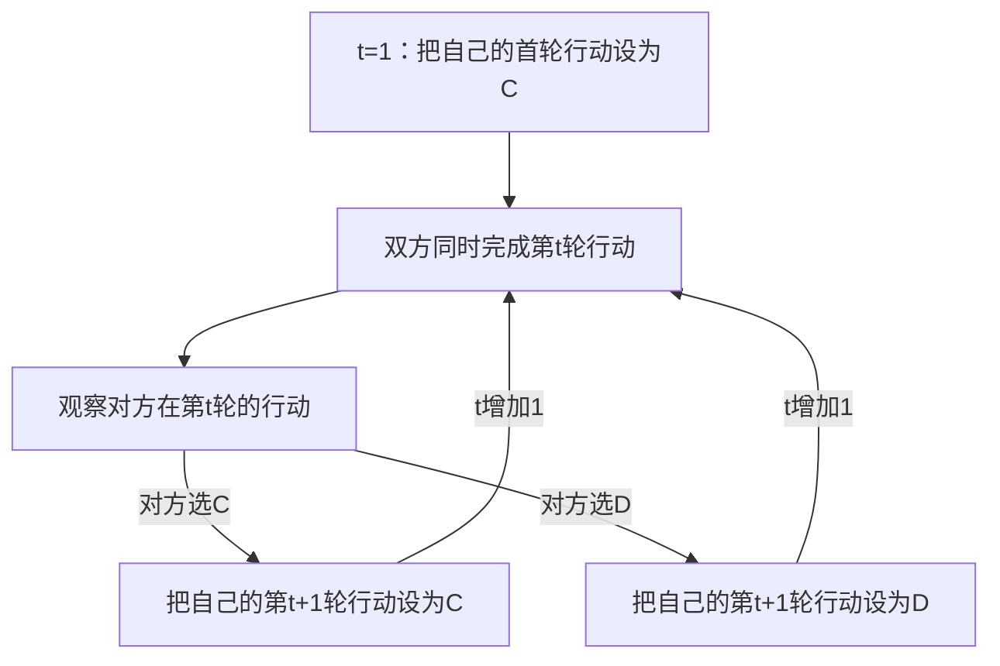

合作可能对双方都更好，但每个人又可能有偏离合作的激励。[囚徒困境](https://kenji.blog/zh-cn/p/prisoners-dilemma/)用给定的收益和选项分析这种冲突。它不是证明人必然背叛、合作群体必然存活的规律。

关于历史，[康奈尔大学的课程资料](https://www.cs.cornell.edu/~rafael/networks-html/chapter1.html)介绍了Merrill Flood与Melvin Dresher在1950年的研究，以及Albert Tucker用囚徒故事作出的阐释。本文区分单次互动的激励、重复策略、演化模型和动物观察。

## 1. 把虚构刑期转换为收益

假设两名嫌疑人A、B不能商量，同时选择沉默C（彼此合作）或招供D（偏离这种合作）。以下刑期在这个虚构设定中确定生效。它不是现实侦查、辩诉交易制度的说明，也不意味着招供就会无罪。

| A／B | C：沉默 | D：招供 |
| --- | --- | --- |
| C：沉默 | A为1年，B为1年 | A为10年，B为0年 |
| D：招供 | A为0年，B为10年 | A为5年，B为5年 |

每个人只想缩短自己的刑期，不另计友情、声誉或内疚的效用。把刑期y_i取负，作为收益u_i。负的收益不表示负的刑期。T是只有自己选D的收益，R是双方C，P是双方D，S是只有自己选C的收益。

$$
u_i=-y_i,\quad y_i\in\{0,1,5,10\},\qquad T=0>R=-1>P=-5>S=-10
$$

下图枚举同时选择的行动组合，并不是让A先观察B的行动再选择。

## 2. 占优策略、纳什均衡与帕累托有效性

比较u_i时，第一个参数表示自己的行动，第二个表示对方的行动。不论对方选C还是D，自己选D的收益都更高。

$$
u_i(D,C)=0>-1=u_i(C,C),\qquad u_i(D,D)=-5>-10=u_i(C,D)
$$

这就是**严格占优策略**。若认为对方选择C的概率是q，期望收益之差也为正。这个q与后文群体内的匹配概率p是不同变量。

$$
\begin{aligned}0&\le q\le1,\\\mathrm{EU}(D)&=-5+5q,\\\mathrm{EU}(C)&=-10+9q,\\\mathrm{EU}(D)-\mathrm{EU}(C)&=5-4q\ge1.\end{aligned}
$$

若双方按这张表最大化自己的期望效用，就会选择DD。D对对方的纯策略和混合策略都严格优于C，因此DD是唯一的纳什均衡。**纳什均衡**是指固定对方策略时，任何人都无法仅通过改变自己的策略来提高收益的策略组合；并不是说两人共同改变也无法改善结果。

**帕累托有效（帕累托最优）**是指不存在另一个可行结果，能在不降低任何人收益的同时改善至少一人。在表中的纯行动组合中，CC、CD和DC具有帕累托有效性；DD可以改为CC使双方改善，因此不具有帕累托有效性。这里并未列举允许在结果之间随机抽签时的整个有效收益集合。

另一方面，如果把数值按相同权重相加，CC的收益总和最高。有效性的定义与总和标准应分开。

$$
(u_1+u_2)(CC)=-2,\qquad(u_1+u_2)(CD)=(u_1+u_2)(DC)=(u_1+u_2)(DD)=-10
$$

这是对给定收益模型中激励的分析，不是对所有现实动机或社会不幸的一揽子证明。

## 3. 应用到现实之前，先核对收益和制度

### 价格竞争

这个模型有时能类比降价增加销量的激励，以及双方降价造成的利润率压缩。但需求、成本、质量和市场进入都会改变收益，降价也不必然带来垄断。企业利润总和与包含消费者在内的社会福利并不相同。

### 环境与公共资源

在减排收益被共享、各方承担成本时，可以分析搭他人努力便车的激励。但现实中有多个国家、不对称的损害与成本、协定和监督，不能仅用这张两人表确定气候后果或各国经济增长。公共资源问题也并不全是同一种两人博弈。

### 军备竞赛

思考冷战时期美苏核军备竞赛时，也会使用简化裁军与维持军备激励的模型。但实际能力、信息、核查和联盟等都很重要。这张表不能证明“对方武装时，单方面裁军必然危及国家存亡，因此只能扩军”这一历史必然性。

## 4. 重复互动与一报还一报策略

关系持续时，未来对当前行为的回应可能改变收益。但重复不保证合作。如果同一单次博弈重复已知、固定且有限的次数，历史可观察，结构与理性是共同知识，那么从最后一轮后向归纳，可得每轮DD的子博弈精炼均衡。[MIT的讲义](https://www.ocw.mit.edu/courses/14-15j-networks-spring-2018/pages/lecture-and-recitation-notes/recitation-10-notes/)也讨论有限与无限期的区别，其数值收益与本文不同。

**一报还一报策略（Tit for Tat，TFT）**首先选C，以后模仿对方上一轮的行动。a_i,t表示自己在第t轮的行动，j表示对方。

$$
a_{i,1}=C,\qquad a_{i,t}=a_{j,t-1}\quad(t\ge2)
$$

无论此前合作还是偏离合作，都先完成下一轮再观察其结果。这个策略不会预知对方本轮的行动，也不观察对方内心是否悔改。

[Axelrod与Hamilton在1981年的论文](https://public.websites.umich.edu/~axe/research/Axelrod%20and%20Hamilton%20EC%201981.pdf)报告，Anatol Rapoport提交的TFT在Axelrod的两次程序竞赛中，平均得分均排名第一。竞赛采用的T=5、R=3、P=1、S=0与本文刑期表不同。TFT不主动偏离合作，会回应对方的偏离，并在对方恢复合作后的下一轮恢复合作；规则也很简洁。但这不意味着它在任意对手、计分、期限和失误条件下都最强。

例如两个TFT参与者之间，一次行动失误造成CD后，可能接着出现DC、再出现CD，交替偏离合作。竞赛得分、均衡、生物演化和道德上可取的行为是不同问题。

## 5. 合作的演化：群体结构与动物证据

### 小型合作群体何时占优

演化博弈需要说明，具有某种行为规则的个体与谁相遇，以及表现如何影响下一代。优先考虑生存或繁殖，不等于在所有场景都选择D的指令。

在其余个体都采用ALLD的种群中，少数TFT何时表现更好？考虑一个简单的折现得分模型：对手固定，双方重复同时行动，没有失误，δ表示未来的权重。ALLD每轮都选D。V(X,Y)是策略X对阵Y的折现得分。

$$
\begin{aligned}0&\le\delta<1,\\V(\mathrm{TFT},\mathrm{TFT})&=\frac{-1}{1-\delta},\\V(\mathrm{TFT},\mathrm{ALLD})&=-10-\frac{5\delta}{1-\delta},\\V(\mathrm{ALLD},\mathrm{ALLD})&=\frac{-5}{1-\delta}.\end{aligned}
$$

假设稀少的TFT群体成员以概率p遇到另一TFT，否则遇到ALLD。在该群体占比趋于零、原有ALLD几乎只遇到ALLD的极限下比较。p是TFT一方的对手中采用TFT的比例，不是整个种群中的TFT比例。

$$
\begin{aligned}V_{\mathrm{cluster}}&=pV(\mathrm{TFT},\mathrm{TFT})+(1-p)V(\mathrm{TFT},\mathrm{ALLD}),\\V_{\mathrm{cluster}}-V(\mathrm{ALLD},\mathrm{ALLD})&=\frac{p(9-5\delta)-5(1-\delta)}{1-\delta}.\end{aligned}
$$

严格高于ALLD基准得分的条件是：

$$
0\le p\le1,\qquad V_{\mathrm{cluster}}>V(\mathrm{ALLD},\mathrm{ALLD})\quad\Longleftrightarrow\quad p>\frac{5(1-\delta)}{9-5\delta}
$$

例如δ=0.9时，群体内匹配概率需要满足：

$$
\delta=\frac9{10}\quad\Longrightarrow\quad p>\frac{5(1-9/10)}{9-5(9/10)}=\frac19
$$

| p | TFT的期望折现得分 | ALLD对阵ALLD的基准 | 比较 |
| --- | --- | --- | --- |
| 0 | -55 | -50 | 较低 |
| 1/20 | -52.75 | -50 | 较低 |
| 1/9 | -50 | -50 | 相同 |
| 1/5 | -46 | -50 | 较高 |

尤其是TFT完全不遇到其他TFT时，对每个δ都有：

$$
p=0\quad\Longrightarrow\quad V_{\mathrm{cluster}}-V(\mathrm{ALLD},\mathrm{ALLD})=-5<0
$$

因此，长期持续本身不能保证孤立TFT占优。这个计算比较的是允许负值的得分，并非繁殖率或存活率；不指定种群更新规则，也不能证明最终淘汰或某策略占据整个种群。1981年的论文同样为合作的初步成立设定了群体内部接触和持续性的条件。

### 不把蝙蝠和蜜蜂直接认定为同一种策略

[Carter与Wilkinson在2013年的研究](https://science.umd.edu/faculty/wilkinson/Carter%26Wilk_PRSB13.pdf)在圈养条件下对20只吸血蝙蝠进行禁食试验，报告了从某伙伴获得食物与向该伙伴提供食物之间的关联，以及持续的社会关系。但相关性本身不能证明获得食物会引发下一次提供，或蝙蝠执行了TFT。

蜜蜂的社会性也不会自动等同于TFT。Axelrod与Hamilton将工蜂的自我牺牲作为讨论亲缘收益的例子。亲缘关系、互惠收益、个体识别和接触结构等机制需要区分研究。也不能把生物适合度与人类道德或信任直接等同。

## 6. 思考支撑合作的机制

囚徒困境明确了在给定收益下，个人激励无法支撑双方都希望得到的结果的情形。思考合作时，应检查：

- **收益与选项**：制裁、成本分担或奖励是否确实改变行动之间的比较？制度效果与法律条件需要在各自的实际问题中检验。
- **观察与承诺**：多大程度上能够核实行动，承诺与回应有多强的约束力？如果交谈并未改变单次博弈的收益或选项，D的严格优势仍然存在。
- **期限与配对**：未来有多大权重，关系如何结束，与谁再次相遇，又如何处理失误？

存在合作均衡或有利的得分条件，不同于实际选择合作并使其稳定建立。数理模型帮助我们检查支撑合作的具体前提，而不是无条件证明信任的价值。
