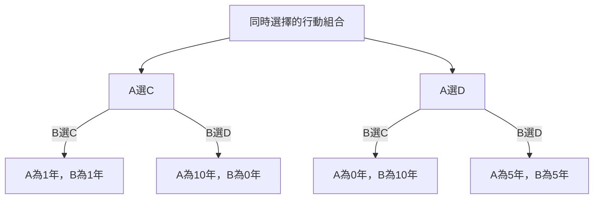
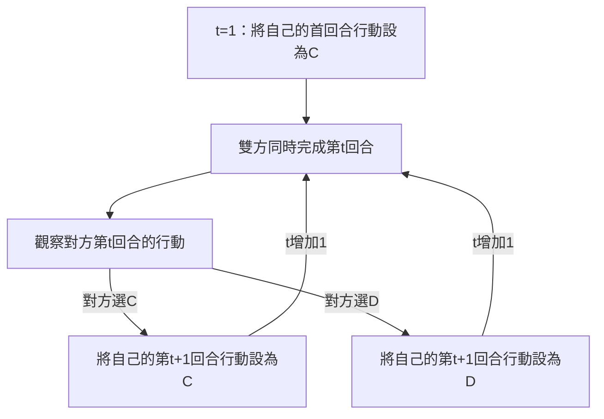

合作可能對雙方都較好，但每個人又可能有背離合作的誘因。[囚徒困境](https://kenji.blog/zh-tw/p/prisoners-dilemma/)透過給定的報酬與選項來分析這種衝突。它不是證明人必然背叛、合作群體必然存活的法則。

關於歷史，[康乃爾大學的課程資料](https://www.cs.cornell.edu/~rafael/networks-html/chapter1.html)介紹了Merrill Flood與Melvin Dresher在1950年的研究，以及Albert Tucker用囚徒故事作出的說明。本文區分單次互動的誘因、重複策略、演化模型與動物觀察。

## 1. 將虛構刑期轉換為報酬

假設兩名嫌疑人A、B不能商量，同時選擇沉默C（彼此合作）或認罪D（背離這種合作）。在這個虛構設定中，以下刑期確定生效。它不是現實偵查或認罪協商制度的說明，也不表示認罪就會無罪。

| A／B | C：沉默 | D：認罪 |
| --- | --- | --- |
| C：沉默 | A為1年，B為1年 | A為10年，B為0年 |
| D：認罪 | A為0年，B為10年 | A為5年，B為5年 |

每個人只想縮短自己的刑期，不另外計入友情、聲譽或內疚的效用。將刑期y_i取負，作為報酬u_i。負的報酬不表示負的刑期。T是只有自己選D時的報酬，R是雙方C，P是雙方D，S是只有自己選C時的報酬。

$$
u_i=-y_i,\quad y_i\in\{0,1,5,10\},\qquad T=0>R=-1>P=-5>S=-10
$$

下圖列舉同時選擇的行動組合，並不是讓A先看到B的行動再選擇。

## 2. 優勢策略、納許均衡與柏雷多效率

比較u_i時，第一個引數表示自己的行動，第二個表示對方的行動。不論對方選C或D，自己選D的報酬都較高。

$$
u_i(D,C)=0>-1=u_i(C,C),\qquad u_i(D,D)=-5>-10=u_i(C,D)
$$

這就是**嚴格優勢策略**。若認為對方選C的機率為q，期望報酬的差也為正。這個q與後文小群體內的配對機率p是不同變數。

$$
\begin{aligned}0&\le q\le1,\\\mathrm{EU}(D)&=-5+5q,\\\mathrm{EU}(C)&=-10+9q,\\\mathrm{EU}(D)-\mathrm{EU}(C)&=5-4q\ge1.\end{aligned}
$$

若雙方依這張表極大化自己的期望效用，就會選DD。D對對方的純策略與混合策略都嚴格優於C，因此DD是唯一的納許均衡。**納許均衡**是指固定對方策略時，任何人都無法僅靠改變自己的策略來提高報酬的策略組合；並不是說兩人一起改變也無法改善結果。

**柏雷多效率（Pareto efficiency，也稱Pareto optimality）**是指不存在另一個可行結果，能在不降低任何人報酬的同時改善至少一人。表中的純行動組合CC、CD與DC都具有柏雷多效率；DD可以改成CC讓雙方改善，因此不具有柏雷多效率。這裡並未列出允許在結果之間抽籤時，整個有效率的報酬集合。

另一方面，若將數值以相同權重相加，CC的報酬總和最高。效率的定義與總和標準應分開。

$$
(u_1+u_2)(CC)=-2,\qquad(u_1+u_2)(CD)=(u_1+u_2)(DC)=(u_1+u_2)(DD)=-10
$$

這是對給定報酬模型中誘因的分析，不是對所有現實動機或社會不幸的一概證明。

## 3. 應用到現實之前，先檢查報酬與制度

### 價格競爭

這個模型有時能類比降價增加銷量的誘因，以及雙方降價造成的利潤壓縮。但需求、成本、品質與市場進入都會改變報酬，降價也不必然帶來壟斷。企業利潤總和與包含消費者在內的社會福利並不相同。

### 環境與共享資源

在減量效益共享、各方承擔成本時，可以分析搭他人努力便車的誘因。但現實中有多個國家、不對稱的損害與成本、協定及監督，不能只用這張兩人表確定氣候後果或各國經濟成長。共享資源問題也不全是同一種兩人賽局。

### 軍備競賽

思考冷戰時期美蘇核軍備競賽時，也會使用簡化裁軍與維持軍備誘因的模型。但實際能力、資訊、查證及聯盟等都很重要。這張表不能證明「對方武裝時，單方面裁軍必然危及國家存亡，因此只能擴軍」這種歷史必然性。

## 4. 重複互動與以牙還牙策略

關係持續時，未來對當前行為的回應可能改變報酬。但重複不保證合作。如果同一單次賽局重複已知、固定且有限的次數，歷史可觀察，結構與理性是共同知識，那麼由最後一回合逆向歸納，可得每回合DD的子賽局完美均衡。[MIT的講義](https://www.ocw.mit.edu/courses/14-15j-networks-spring-2018/pages/lecture-and-recitation-notes/recitation-10-notes/)也討論有限與無限期的差異，其數值報酬與本文不同。

**以牙還牙策略（Tit for Tat，TFT）**首先選C，之後模仿對方上一回合的行動。a_i,t表示自己在第t回合的行動，j表示對方。

$$
a_{i,1}=C,\qquad a_{i,t}=a_{j,t-1}\quad(t\ge2)
$$

不論先前合作或背離合作，都先完成下一回合再觀察結果。這個策略不會預知對方本回合的行動，也不觀察對方內心是否悔改。

[Axelrod與Hamilton於1981年的論文](https://public.websites.umich.edu/~axe/research/Axelrod%20and%20Hamilton%20EC%201981.pdf)報告，Anatol Rapoport提交的TFT在Axelrod的兩次程式競賽中，平均得分都排名第一。競賽採用的T=5、R=3、P=1、S=0與本文刑期表不同。TFT不主動背離合作，會回應對方的背離，並在對方恢復合作後的下一回合恢復合作；規則也很簡潔。但這不表示它在任意對手、計分、期限與失誤條件下都最強。

例如兩名TFT參賽者之間，一次行動失誤造成CD後，可能接著出現DC、再出現CD，交替背離合作。競賽得分、均衡、生物演化及道德上可取的行為，是不同問題。

## 5. 合作的演化：群體結構與動物證據

### 小型合作群體何時較有利

演化賽局需要說明，具有某種行為規則的個體與誰相遇，以及表現如何影響下一代。優先考慮生存或繁殖，不等於在所有情境都選D的指令。

在其餘個體都採ALLD的族群中，少數TFT何時表現較好？考慮一個簡單的折現得分模型：對手固定，雙方重複同時行動，沒有失誤，δ表示未來的權重。ALLD每回合都選D。V(X,Y)是策略X對上Y的折現得分。

$$
\begin{aligned}0&\le\delta<1,\\V(\mathrm{TFT},\mathrm{TFT})&=\frac{-1}{1-\delta},\\V(\mathrm{TFT},\mathrm{ALLD})&=-10-\frac{5\delta}{1-\delta},\\V(\mathrm{ALLD},\mathrm{ALLD})&=\frac{-5}{1-\delta}.\end{aligned}
$$

假設稀少的TFT小群體成員以機率p遇到另一TFT，否則遇到ALLD。在小群體占比趨近零、既有ALLD幾乎只遇到ALLD的極限下比較。p是TFT一方的對手中採TFT的比例，不是整個族群中TFT的比例。

$$
\begin{aligned}V_{\mathrm{cluster}}&=pV(\mathrm{TFT},\mathrm{TFT})+(1-p)V(\mathrm{TFT},\mathrm{ALLD}),\\V_{\mathrm{cluster}}-V(\mathrm{ALLD},\mathrm{ALLD})&=\frac{p(9-5\delta)-5(1-\delta)}{1-\delta}.\end{aligned}
$$

嚴格高於ALLD基準得分的條件為：

$$
0\le p\le1,\qquad V_{\mathrm{cluster}}>V(\mathrm{ALLD},\mathrm{ALLD})\quad\Longleftrightarrow\quad p>\frac{5(1-\delta)}{9-5\delta}
$$

例如δ=0.9時，小群體內的配對機率需要滿足：

$$
\delta=\frac9{10}\quad\Longrightarrow\quad p>\frac{5(1-9/10)}{9-5(9/10)}=\frac19
$$

| p | TFT的期望折現得分 | ALLD對上ALLD的基準 | 比較 |
| --- | --- | --- | --- |
| 0 | -55 | -50 | 較低 |
| 1/20 | -52.75 | -50 | 較低 |
| 1/9 | -50 | -50 | 相同 |
| 1/5 | -46 | -50 | 較高 |

特別是TFT完全不遇到其他TFT時，對每個δ都有：

$$
p=0\quad\Longrightarrow\quad V_{\mathrm{cluster}}-V(\mathrm{ALLD},\mathrm{ALLD})=-5<0
$$

因此，長期持續本身不能保證孤立TFT較有利。這個計算比較的是允許負值的得分，不是繁殖率或存活率；不指定族群更新規則，也不能證明最後的淘汰或某策略占據整個族群。1981年的論文同樣為合作的初步成立設定了群體內接觸與持續性的條件。

### 不將蝙蝠與蜜蜂直接視為同一策略

[Carter與Wilkinson於2013年的研究](https://science.umd.edu/faculty/wilkinson/Carter%26Wilk_PRSB13.pdf)在圈養條件下對20隻吸血蝙蝠進行禁食試驗，報告了從某夥伴獲得食物與向該夥伴提供食物之間的關聯，以及持續的社會關係。但相關性本身不能證明獲得食物會引發下一次提供，或蝙蝠執行了TFT。

蜜蜂的社會性也不會自動等同於TFT。Axelrod與Hamilton將工蜂的自我犧牲作為討論親緣利益的例子。親緣關係、互惠利益、個體識別及接觸結構等機制需要區分研究。也不能把生物適存度（fitness）與人類道德或信任直接等同。

## 6. 思考支撐合作的機制

囚徒困境明確呈現，在給定報酬下，個人誘因無法支撐雙方都想要的結果的情形。思考合作時，應檢查：

- **報酬與選項**：制裁、成本分攤或獎勵是否確實改變行動之間的比較？制度效果與法律條件需要在各自的實際問題中檢驗。
- **觀察與承諾**：能在多大程度上確認行動，承諾與回應有多強的約束力？如果交談並未改變單次賽局的報酬或選項，D的嚴格優勢仍然存在。
- **期限與配對**：未來有多大權重，關係如何結束，與誰再次相遇，又如何處理失誤？

存在合作均衡或有利的得分條件，不等於實際選擇合作並使其穩定建立。數理模型幫助我們檢查支撐合作的具體前提，而不是無條件證明信任的價值。
