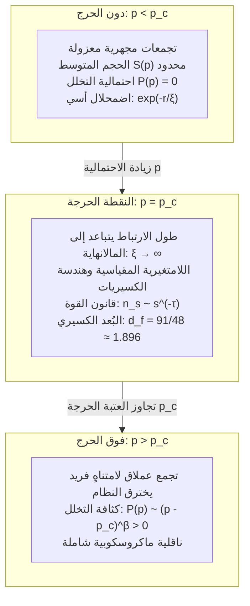

## مقدمة: القفزة المباغتة من العزلة المحلية إلى الاتصال الشامل

تأمل في المشهد اليومي البسيط لإعداد قهوة التقطير اليدوية: يُصب الماء الساخن برفق فوق طبقة مسحوق القهوة المطحونة. تُمتص القطرات الأولى بالكامل داخل المسام المجهرية بين الحبيبات، مبللة السطح الخارجي فقط دون أن تفلت قطرة واحدة من الفوهة السفلية. ولكن مع استمرار الصب، نصل إلى لحظة دقيقة فاصلة: فجأة وبشكل مباغت، تبدأ القهوة بالتقاطر بانتظام داخل الإبريق. لقد نفذت جزيئات الماء (تخللت / Percolated) عبر الوسط المسامي، مؤسسة شبكة متصلة من القنوات الماكروسكوبية التي تربط السطح بالقاع.

هذه الظاهرة الفيزيائية هي الأصل الاشتقاقي لـ <strong>نظرية التخلل (Percolation Theory)</strong>. طُرحت هذه النظرية عام 1957 بواسطة عالمي الرياضيات البريطانيين جون هامرسيلي وسيمون برودبنت، استناداً إلى مسألة احتمالية نقية:
> "في شبكة بلورية لامتناهية تُربط فيها النقاط المتجاورة باحتمالية عشوائية مستقلة $p$، متى وكيف تتحد التجمعات الصغيرة المعزولة لتشكل فجأة شبكة عملاقة لامتناهية تخترق الفضاء بأكمله؟"

على عكس التوقع البديهي بالنمو التدريجي، طالما ظلت الاحتمالية $p$ أقل ولو بمقدار جزء من المليون عن العتبة الحاسمة (<strong>الاحتمالية الحرجة $p_c$</strong>)، تظل جميع التجمعات المتكونة متناهية الصغر ولا يمكنها اختراق النظام. ولكن بمجرد أن تتجاوز $p$ العتبة $p_c$ ولو بقيد أنملة، يولد فجأة وباحتمالية تامة تجمع لامتناهٍ يخترق النظام بأكمله.

هذا الحدث يمثل <strong>تحولاً طورياً هندسياً (Geometric Phase Transition)</strong> خالصاً، ينشأ تلقائياً دون الحاجة إلى طاقة أو حرارة، مدفوعاً بقوانين الاحتمالات وهندسة الفضاء وحدها.

---

## 1. النماذج الرياضية الأساسية: تخلل الروابط وتخلل المواقع

على شبكة منتظمة لامتناهية $G = (V, E)$:
- <strong>تخلل الروابط (Bond Percolation)</strong>: كل الرؤوس $V$ موجودة؛ كل حافة $e \in E$ تكون مفتوحة باحتمال $p$ ومغلقة باحتمال $1 - p$.
- <strong>تخلل المواقع (Site Percolation)</strong>: كل الحواف موجودة؛ كل رأس $v \in V$ يكون مشغولاً باحتمال $p$ وفارغاً باحتمال $1 - p$.

---

## 2. العتبة الحرجة $p_c$ والحل الدقيق لكستن (1980)

تُعرف احتمالية التخلل $P(p)$ بأنها احتمالية أن يكون التجمع الحاوي لنقطة الأصل لامتناهياً:
$$P(p) = \mathbb{P}_p(|C(0)| = \infty)$$
والعتبة الحرجة هي $p_c = \inf \{ p \in [0, 1] \mid P(p) > 0 \}$. وتثبت مبرهنة بيرتون-كين وجود <strong>تجمع لامتناهٍ واحد فقط</strong> لكل $p > p_c$.

في عام 1980، أثبت هاري كستن الحل الدقيق لتخلل الروابط على الشبكة المربعة ثنائية الأبعاد عبر الثنائية الذاتية:
$$p_c^{\text{bond}}(\mathbb{Z}^2) = \frac{1}{2}$$

---

## 3. الظواهر الحرجة والشمولية (Universality)

عند الاقتراب من النقطة الحرجة $p \to p_c$، <strong>يتباعد طول الارتباط $\xi(p)$ إلى اللانهاية</strong>:
$$\xi(p) \propto |p - p_c|^{-\nu}$$
يفقد النظام مقياس الطول المميز ويصبح <strong>لامتغير مقياسياً</strong>. وتؤكد فرضية الشمولية أن الأسس الحرجة لا تعتمد على التفاصيل الهندسية المجهرية للشبكة، بل تتحدد حصراً بأبعاد الفضاء $d$.
في البعدين ($d = 2$):
$$\nu = \frac{4}{3}, \quad \beta = \frac{5}{36}, \quad \gamma = \frac{43}{18}, \quad d_f = \frac{91}{48} \approx 1.8958$$

---

## 4. البنية الكسيرية للتجمع الحرج

عند $p = p_c$، يشكل التجمع بنية كسيرية ذاتية التشابه ببعد كسيري $d_f \approx 1.896$ (في البعدين).
وتحليله كهربائياً يظهر:
1. <strong>الأطراف العمياء (Dangling Ends)</strong>: تشكل معظم الكتلة ولكن لا يمر بها تيار؛
2. <strong>العمود الفقري (Backbone)</strong>: مسارات مغلقة يتدفق فيها التيار ($d_B \approx 1.64$)؛
3. <strong>الروابط الحمراء (Red Bonds)</strong>: روابط مفردة يؤدي قطع أي منها إلى انهيار التوصيل الشامل للنظام كلياً ($d_R = 1/\nu = 0.75$).

---

## 5. نظرية الحقل التوافقي وتطور شرام-لوفنر (SLE)

في عام 2001، أثبت ستانيسلاف سميرنوف رياضياً ثبات التوافق في تخلل الشبكة المثلثية وصيغة كاردي، ونال ميدالية فيلدز عام 2006. وأثبتت معادلة شرام-لوفنر التفاضلية العشوائية ($\mathrm{SLE}_6$) أن البعد الكسيري لحدود تجمعات التخلل يساوي تماماً $d_h = 1 + 6/8 = 1.75$.

---

## 6. الشبكات المعقدة والانهيارات المتتالية

- <strong>الشبكات عديمة المقياس (Scale-Free)</strong>: نظراً لتباعد العزم الثاني للدرجات $\langle k^2 \rangle \to \infty$، تهبط عتبة الأعطال العشوائية إلى $p_c = 0$، مما يمنحها مناعة فائقة.
- <strong>الهجمات الموجهة</strong>: استهداف 2% إلى 5% فقط من العقد المركزية (Hubs) يؤدي إلى تفكك الشبكة فجأة.
- <strong>الشبكات المتداخلة</strong>: التبعية المتبادلة بين شبكات الكهرباء والإنترنت تحول التخلل إلى انهيار متفجر مباغت من الدرجة الأولى يؤدي إلى انقطاع كلي للتيار.

## خاتمة

تكشف نظرية التخلل عن سر الانبثاق التلقائي في الطبيعة: كيف يمكن للنظام والاتصال الشامل أن يولدا فجأة من رحم العشوائية التامة بمجرد تجاوز عتبة رياضية صارمة.
