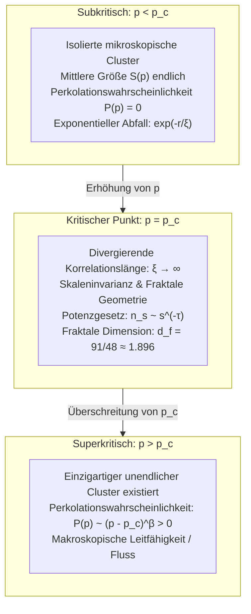

## Einleitung: Der dramatische Sprung von lokaler Isolation zu globaler Konnektivität

Denken Sie an das morgendliche Kaffeekochen mit einem Handfilter: Heißes Wasser wird langsam auf das gemahlene Kaffeepulver gegossen. Die ersten Tropfen werden von den winzigen Poren zwischen den Kaffeepartikeln vollständig aufgesaugt und befeuchten lediglich die Oberfläche. Aus der unteren Öffnung des Filters tritt kein einziger Tropfen aus. Gießt man jedoch kontinuierlich weiter, geschieht an einem ganz bestimmten Punkt etwas Schlagartiges: Plötzlich beginnt der Kaffee in einem gleichmäßigen Rhythmus in die Kanne zu tropfen. Die Wassermoleküle haben das poröse Medium durchdrungen (perkoliert) und einen durchgehenden makroskopischen Kanal gebildet.

Dieses Phänomen der Fluiddurchdringung gab der <strong>Perkolationstheorie (Percolation Theory)</strong> ihren Namen. 1957 von den britischen Mathematikern John Hammersley und Simon Broadbent eingeführt, beginnt sie mit einer scheinbar einfachen wahrscheinlichkeitstheoretischen Fragestellung:
> "Wenn in einem unendlichen Gitter benachbarte Punkte mit einer unabhängigen Wahrscheinlichkeit $p$ verbunden werden, wann und wie schließen sich isolierte Cluster plötzlich zu einem unendlichen Netzwerk zusammen, das den gesamten Raum durchspannt?"

Entgegen der naiven Vermutung wächst die Verbindung nicht allmählich. Solange $p$ auch nur minimal unterhalb einer messerscharfen Schwelle (<strong>kritische Perkolationsschwelle $p_c$</strong>) liegt, bleiben alle Cluster ausnahmslos endlich. Sobald $p$ diesen Wert jedoch um einen winzigen Bruchteil überschreitet, entsteht schlagartig mit Wahrscheinlichkeit 1 ein <strong>unendlicher Cluster</strong>, der das gesamte System durchspannt.

Dies ist ein reiner <strong>geometrischer Phasenübergang (Geometric Phase Transition)</strong>, der völlig ohne Temperatur oder energetische Hamilton-Operatoren allein durch Wahrscheinlichkeit und Raumtopologie gesteuert wird.

---

## 1. Mathematische Grundmodelle: Bindungs- und Platzperkolation

Auf einem unendlichen Gittergraphen $G = (V, E)$ unterscheidet man zwei fundamentale Modelle:
- <strong>Bindungsperkolation (Bond Percolation)</strong>: Alle Knoten $V$ existieren; jede Kante $e \in E$ ist mit Wahrscheinlichkeit $p$ offen und mit $1 - p$ geschlossen.
- <strong>Platzperkolation (Site Percolation)</strong>: Alle Kanten sind vorhanden; jeder Knoten $v \in V$ ist mit Wahrscheinlichkeit $p$ besetzt und mit $1 - p$ unbesetzt.
Mathematisch lässt sich jede Bindungsperkolation exakt als Platzperkolation auf dem Kantengraphen (Line Graph) abbilden.

---

## 2. Der kritische Schwellenwert $p_c$ und Kestens exakte Lösung

Die <strong>Perkolationswahrscheinlichkeit $P(p)$</strong> ist die Wahrscheinlichkeit, dass der das Ursprungszentrum enthaltende Cluster unendlich groß ist:
$$P(p) = \mathbb{P}_p(|C(0)| = \infty)$$
Der kritische Schwellenwert ist $p_c = \inf \{ p \in [0, 1] \mid P(p) > 0 \}$. Nach dem Burton-Keane-Theorem existiert für $p > p_c$ fast sicher <strong>genau ein</strong> unendlicher Cluster.

1980 bewies Harry Kesten die exakte Schwelle für die Bindungsperkolation auf dem 2D-Quadratgitter unter Ausnutzung der Selbstdualität planarer Graphen:
$$p_c^{\text{bond}}(\mathbb{Z}^2) = \frac{1}{2}$$

---

## 3. Kritische Phänomene und Universalität

Nähert sich $p \to p_c$, divergiert die charakteristische <strong>Korrelationslänge $\xi(p)$ gegen Unendlich</strong>:
$$\xi(p) \propto |p - p_c|^{-\nu}$$
Das System verliert jede charakteristische Längenskala und wird <strong>skaleninvariant</strong>.
Die <strong>Universalitätshypothese</strong> besagt, dass die kritischen Exponenten ($\nu, \beta, \gamma, \tau, \eta$) vollkommen unabhängig von der mikroskopischen Gittergeometrie sind und nur von der Raumdimension $d$ abhängen.
In zwei Dimensionen ($d=2$):
$$\nu = \frac{4}{3}, \quad \beta = \frac{5}{36}, \quad \gamma = \frac{43}{18}, \quad d_f = \frac{91}{48} \approx 1.8958$$

---

## 4. Fraktale Struktur des kritischen Clusters

Bei $p = p_c$ bildet der Cluster ein selbstähnliches Fraktal mit fraktaler Dimension $d_f = d - \beta/\nu \approx 1.896$ (in 2D).
Elektrisch betrachtet besteht er aus:
1. <strong>Dangling Ends (Sackgassen)</strong>: Stellen die Hauptmasse dar, tragen aber keinen Strom;
2. <strong>Backbone (Rückgrat)</strong>: Geschlossene Schleifen, die Strom leiten ($d_B \approx 1.64$);
3. <strong>Red Bonds (Rote Bindungen)</strong>: Einzelverbindungen, deren Durchtrennung das gesamte Netz lahmlegt ($d_R = 1/\nu = 0.75$).

---

## 5. Konforme Feldtheorie und SLE (Fields-Medaille)

2001 bewies Stanislav Smirnov die konforme Invarianz der 2D-Perkolation und Cardys Formel, wofür er 2006 mit der Fields-Medaille ausgezeichnet wurde. Oded Schramms Schramm-Loewner-Evolution ($\mathrm{SLE}_6$) lieferte den rigorosen Beweis für die fraktale Dimension der Clusterränder: $d_h = 1 + 6/8 = 1.75$.

---

## 6. Komplexe Netzwerke und Kaskadeneffekte

- <strong>Skalenfreie Netzwerke</strong>: Da das zweite Moment der Knotengrade $\langle k^2 \rangle \to \infty$ divergiert, sinkt die Perkolationsschwelle auf $p_c = 0$. Sie sind extrem robust gegen zufälligen Ausfall von bis zu 99 % der Knoten.
- <strong>Verwundbarkeit bei gezielten Angriffen</strong>: Die gezielte Zerstörung von nur 2-5 % der größten Hubs zerstört das Netzwerk vollständig.
- <strong>Interdependente Netzwerke</strong>: Bei gekoppelten Strom- und Kommunikationsnetzen führt Perkolation zu explosiven Kaskadenausfällen (katastrophale Blackouts).

## Fazit

Die Perkolationstheorie demonstriert, wie aus reiner lokaler Zufälligkeit durch das Überschreiten einer mathematischen Schwelle spontan makroskopische Ordnung und globale Vernetzung entstehen.
