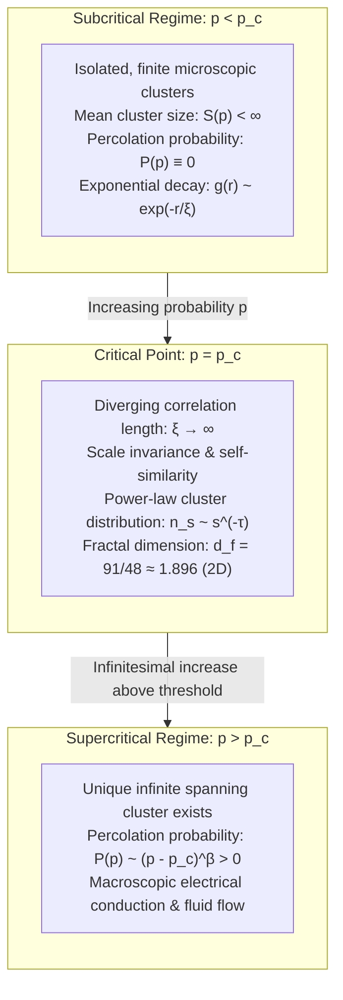
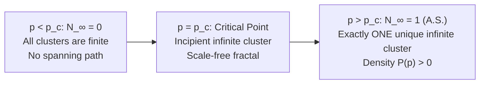
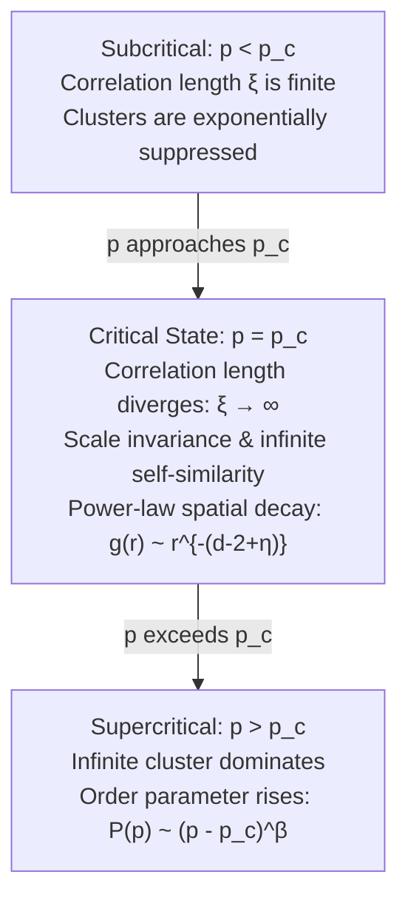
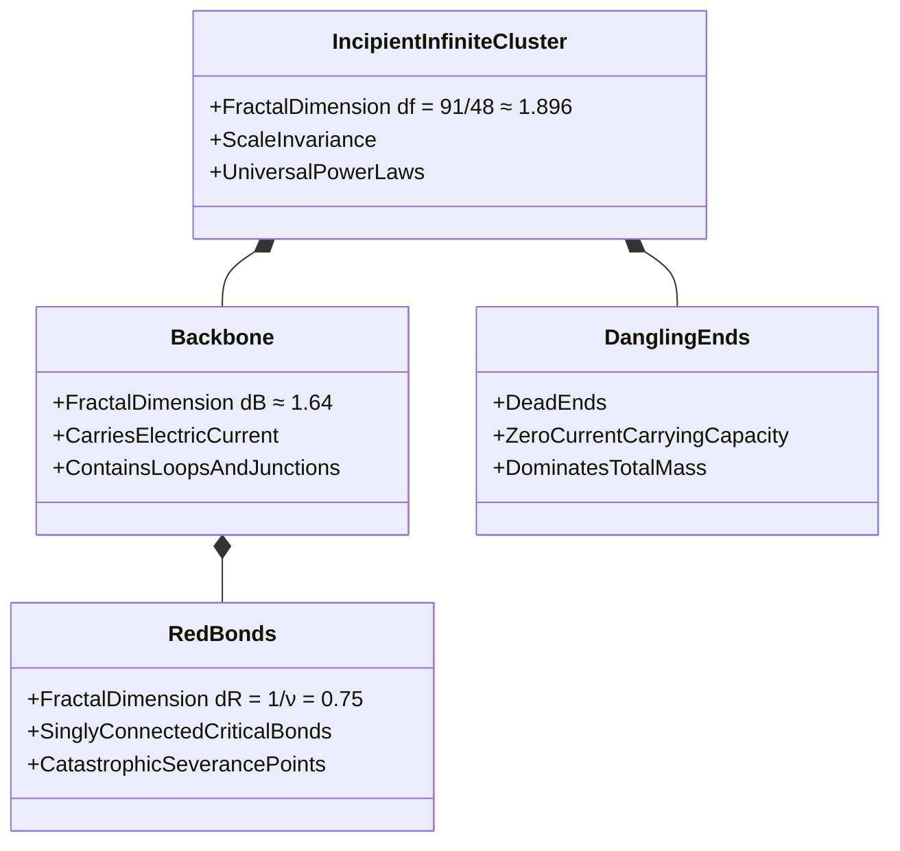
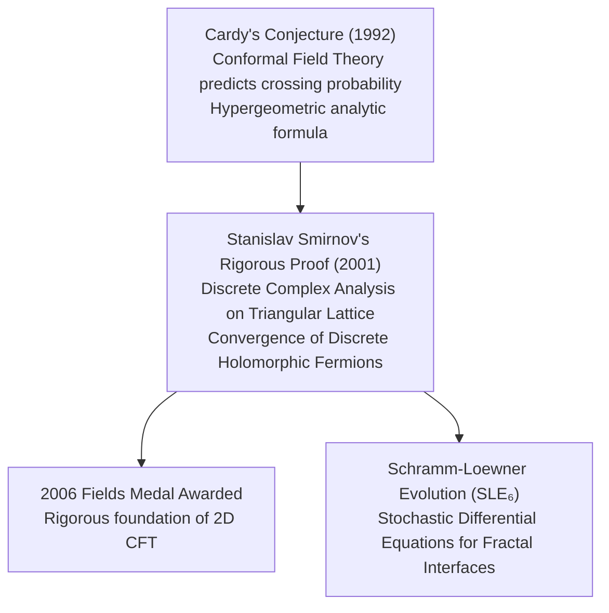
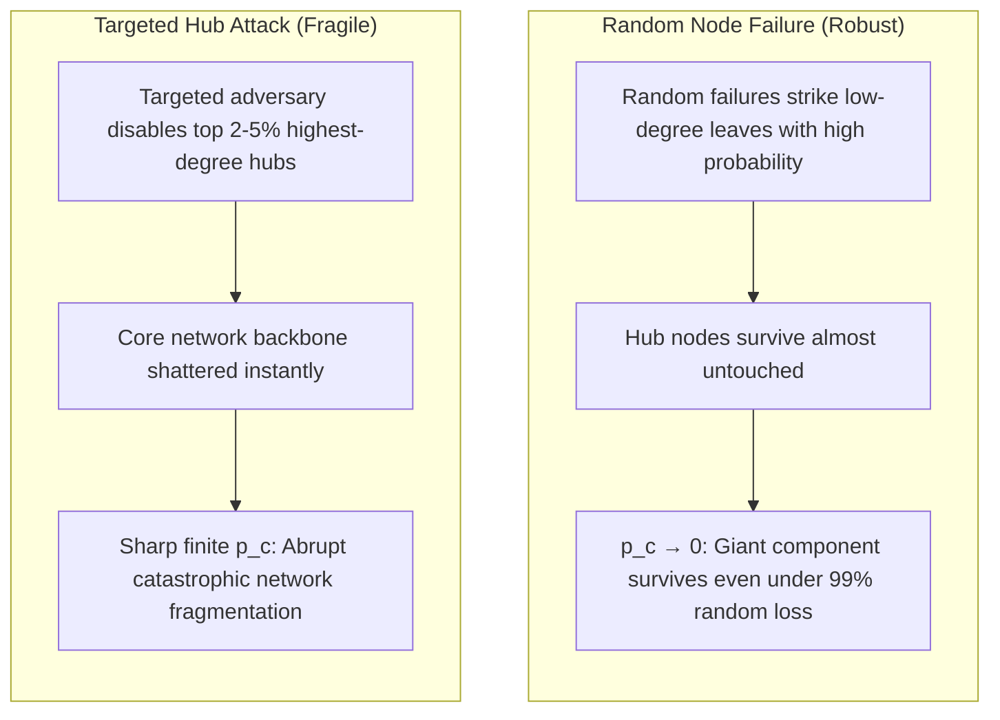
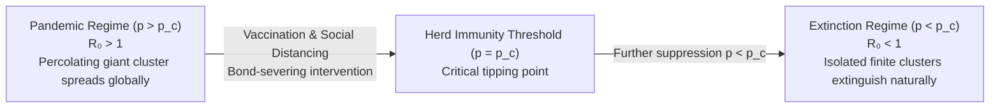

## Introduction: The Dramatic Leap from Local Isolation to Global Connectivity

Consider the serene morning ritual of brewing a cup of pour-over drip coffee. Hot water is gently poured onto a bed of finely ground coffee beans packed inside a conical filter. The first few droplets are quickly absorbed into the tiny interstitial pores between the solid particles, moistening the surface without a single drop escaping from the bottom spout. However, as the pouring continues, there arrives a singular, definitive threshold: quite suddenly, amber liquid begins dripping into the carafe in a steady, rhythmic cadence. Fluid molecules have successfully permeated through the porous medium, establishing a continuous, unobstructed labyrinth of macroscopic fluid channels that bridges the top surface to the bottom apex.

This physical phenomenon—the permeation of fluid through a porous matrix—is the etymological origin of one of the most profound branches of modern probability theory and statistical physics: <strong>Percolation Theory</strong>. Formulated in 1957 by British mathematicians Simon Broadbent and John Hammersley, percolation theory begins with an deceptively elementary probabilistic question:
> "In an infinite regular lattice network, if adjacent vertices or connecting edges are randomly opened with an independent probability $p$, when and how do small, isolated clusters abruptly coalesce to forge a colossal, infinite network that spans the entire universe?"

Intuitively, one might assume that smoothly increasing the connection probability $p$ from $0$ to $1$ would result in a similarly smooth, gradual expansion of connected clusters. Yet, nature and pure mathematics reveal a reality that is violently discontinuous and spectacular. So long as $p$ remains even a hair's breadth below a sharp mathematical threshold—the <strong>critical probability (percolation threshold) $p_c$</strong>—every single connected cluster in the system remains strictly finite and exponentially localized. It is mathematically impossible for fluid or electricity to traverse from one boundary to the other.

However, the instant $p$ exceeds $p_c$ by an infinitesimal margin (even by $10^{-6}$), an infinite, macroscopic cluster—a <strong>giant percolation component</strong>—bursts into existence with probability 1. The global connectivity of the system undergoes a sudden, radical metamorphosis.

This dramatic transformation is a bona fide <strong>geometrical phase transition</strong>. While conventional thermodynamic phase transitions (such as the freezing of liquid water into crystalline ice or the spontaneous magnetization of iron below the Curie temperature) are driven by the competition between internal energetic interactions and entropic fluctuations (described by Boltzmann-Gibbs statistics), percolation requires <strong>no temperature, no Hamiltonian, and no particle interactions</strong>. It is an intrinsic, pure manifestation of <strong>geometric connectivity and probability alone</strong>.

Today, percolation theory forms the foundational mathematical architecture underpinning an extraordinary diversity of scientific disciplines:
- <strong>Epidemiology and Pandemic Thresholds</strong>: Why an infectious pathogen with a basic reproduction number $R_0 > 1$ suddenly escapes localized clusters to trigger an uncontrollable global pandemic across human contact graphs.
- <strong>Resilience of Critical Infrastructure</strong>: The precise tipping point at which random component failures in the internet router topology or high-voltage electric transmission grids culminate in a catastrophic, cascading blackout.
- <strong>Forest Fire Dynamics</strong>: The critical tree density above which a single lightning strike transforms from a self-extinguishing local flame into an all-consuming firestorm engulfing thousands of square kilometers.
- <strong>Smart Nanocomposite Materials</strong>: How dispersing microscopic carbon nanotubes or metallic nanoparticles into an insulating polymer matrix triggers an abrupt surge in electrical conductivity by ten orders of magnitude at a specific critical volume fraction.

In this definitive academic treatise, we embark on an exhaustive exploration into the mathematics of percolation and critical phenomena: from the rigorous definitions of site and bond percolation, the analytical derivation of $p_c$ via duality, and the scaling laws of universality classes, to fractal geometry, Conformal Field Theory (CFT), Schramm-Loewner Evolution (SLE), and the vulnerability of interdependent complex networks.



---

## 1. Mathematical Formalism: Lattices, Clusters, and Graph Percolation

To place percolation theory upon an unshakeable mathematical foundation, we formalize the concepts of space, graphs, and random configurations.

### 1.1 The Infinite Lattice Graph

Let $G = (V, E)$ be an infinite connected graph embedded in $d$-dimensional Euclidean space $\mathbb{R}^d$. 
- The set of vertices $V$ represents the sites. For the canonical $d$-dimensional hypercubic lattice $\mathbb{Z}^d$, the vertex set is $V = \mathbb{Z}^d = \{(x_1, \dots, x_d) \mid x_i \in \mathbb{Z}\}$.
- The set of edges $E$ represents the bonds connecting nearest neighbors:
  $$e = \langle u, v \rangle \in E \iff \|u - v\|_1 = \sum_{i=1}^d |u_i - v_i| = 1$$
The degree or <strong>coordination number</strong> of each vertex is denoted by $z$. In $d=2$, the square lattice has $z = 4$, the triangular lattice has $z = 6$, and the honeycomb (hexagonal) lattice has $z = 3$. In $d=3$, the simple cubic lattice has $z = 6$.

### 1.2 Bond Percolation (Edge Percolation)

In <strong>bond percolation</strong>, all vertices $V$ are considered present and active. Each edge $e \in E$ is independently assigned a binary random variable $\omega(e) \in \{0, 1\}$ according to a Bernoulli measure with parameter $p \in [0, 1]$:
$$\mathbb{P}_p(\omega(e) = 1) = p, \quad \mathbb{P}_p(\omega(e) = 0) = 1 - p$$
- If $\omega(e) = 1$, the bond $e$ is designated as <strong>open</strong> (conductive, traversable).
- If $\omega(e) = 0$, the bond $e$ is designated as <strong>closed</strong> (blocked, severed).

A configuration $\omega = (\omega(e))_{e \in E}$ is an element of the product probability space $\Omega_E = \{0, 1\}^E$, equipped with the product $\sigma$-algebra $\mathcal{F}_E$ and product measure $\mathbb{P}_p = \prod_{e \in E} \mu_e$.

Two vertices $u, v \in V$ are said to be <strong>connected</strong> (denoted $u \leftrightarrow v$) if there exists a self-avoiding finite path of open edges $(e_1, e_2, \dots, e_k)$ connecting $u$ to $v$. The connected component containing vertex $v$ is called the <strong>cluster</strong> of $v$, denoted $C(v)$:
$$C(v) = \{ u \in V \mid v \leftrightarrow u \}$$
The size of the cluster is the number of its constituent vertices, $|C(v)|$.

```mermaid
graph LR
    subgraph BondModel ["Bond Percolation (Edge Randomness)"]
        direction LR
        B1((v₁)) ---|Open (Prob p)| B2((v₂))
        B2 -.-|Closed (Prob 1-p)| B3((v₃))
        B2 ---|Open (Prob p)| B4((v₄))
    end
    subgraph SiteModel ["Site Percolation (Vertex Randomness)"]
        direction LR
        S1["Occupied (Prob p)"] === S2["Occupied (Prob p)"]
        S2 -.- S3["Empty (Prob 1-p)"]
        S2 === S4["Occupied (Prob p)"]
    end
```

### 1.3 Site Percolation (Vertex Percolation)

In <strong>site percolation</strong>, all edges $E$ are present, but the vertices $v \in V$ are independently declared <strong>occupied</strong> with probability $p$, or <strong>empty</strong> (vacant) with probability $1 - p$:
$$\mathbb{P}_p(\omega(v) = 1) = p, \quad \mathbb{P}_p(\omega(v) = 0) = 1 - p$$
Two occupied vertices are connected if there is an unbroken chain of adjacent occupied vertices between them.

### 1.4 Universality of Site Percolation over Bond Percolation

There is a profound structural hierarchy between the two models:
<strong>Theorem</strong>: *Any bond percolation problem on a graph $G = (V, E)$ can be reformulated identically as a site percolation problem on the corresponding line graph (covering lattice) $L(G)$.*
The vertices of $L(G)$ correspond to the edges of $G$, and two vertices in $L(G)$ are adjacent if and only if their corresponding edges in $G$ share a common endpoint.
Conversely, a general site percolation problem cannot, in general, be mapped onto a bond percolation problem. Thus, site percolation is mathematically more general and subsumes bond percolation as a special case.

---

## 2. The Critical Threshold $p_c$: Rigorous Foundations and Analytical Duality

The central object of investigation in percolation theory is the sharp transition between the subcritical and supercritical phases.

### 2.1 The Order Parameter: Percolation Probability $P(p)$

Let $0 \in V$ denote the origin of the lattice. The <strong>percolation probability</strong> (also serving as the thermodynamic order parameter) $P(p)$ is defined as the probability that the cluster containing the origin is infinite in cardinality:
$$P(p) = \mathbb{P}_p(|C(0)| = \infty)$$

The <strong>critical threshold (percolation threshold)</strong> $p_c$ is defined rigorously by:
$$p_c = \sup \{ p \in [0, 1] \mid P(p) = 0 \} = \inf \{ p \in [0, 1] \mid P(p) > 0 \}$$

By the monotonicity of product measures (via the Holley inequality / FKG inequality), $P(p)$ is a non-decreasing function of $p$.
Furthermore, by <strong>Kolmogorov's Zero-One Law</strong> applied to the tail $\sigma$-algebra of invariant events under translation:
$$\mathbb{P}_p(\exists \text{ an infinite cluster in } G) = \begin{cases} 0 & \text{if } p < p_c \\ 1 & \text{if } p > p_c \end{cases}$$

### 2.2 Uniqueness of the Infinite Cluster

In 1989, Alberto Gandolfi, Michael Keane, and Luiz Russo (and independently Richard Burton and Michael Keane using ergodic theory) proved one of the deepest theorems in modern probability:
<strong>Theorem (Burton-Keane Uniqueness Theorem)</strong>: *On any amenable transitively invariant lattice (such as $\mathbb{Z}^d$), for any $p \in [0, 1]$, the number of infinite open clusters $N_\infty$ satisfies:*
$$\mathbb{P}_p(N_\infty \in \{0, 1\}) = 1$$
*Specifically, for $p \le p_c$, $N_\infty = 0$ almost surely; for $p > p_c$, there exists exactly ONE unique infinite cluster almost surely.*
There can never be two or more competing infinite clusters coexisting independently; in the supercritical regime, they invariably merge into a single, omni-spanning topological giant.



### 2.3 The Crown Jewel of Exact Solutions: Kesten's Proof for 2D Square Bond Percolation

In general, determining the exact numerical value of $p_c$ for arbitrary lattices in three or more dimensions is an analytically intractable problem, demanding petascale Monte Carlo algorithms. However, in two dimensions, planarity and the concept of <strong>graph duality</strong> allow for legendary analytical breakthroughs.

Consider the 2D square lattice $\mathbb{Z}^2$. In 1960, Michael Fisher conjectured that the critical threshold for bond percolation on the square lattice is exactly $p_c = 1/2$. The complete, rigorous proof was finally delivered by <strong>Harry Kesten in 1980</strong>.

#### Planar Graph Duality
For the planar graph $G = (\mathbb{Z}^2, E)$, define its <strong>dual graph</strong> $G^* = (V^*, E^*)$ by placing a dual vertex in the center of every face (plaquette) of $G$. For each primal bond $e \in E$, there is a unique perpendicular dual bond $e^* \in E^*$ that intersects $e$.
Notice that the dual graph of a square lattice is another square lattice shifted by $(1/2, 1/2)$. Thus, the square lattice is <strong>self-dual</strong>:
$$G^* \cong G$$

#### The Geometric Crossing Argument
Let $R = [0, L] \times [0, L]$ be an $L \times L$ square domain on the lattice. Define:
- $\mathcal{H}(R)$: the event that there exists a horizontal crossing of open bonds from the left boundary to the right boundary of $R$.
- $\mathcal{V}^*(R)$: the event that there exists a vertical crossing of dual closed bonds from the top boundary to the bottom boundary of $R^*$.

By planar topology (Jordan Curve Theorem), either there exists a path of open bonds crossing horizontally, OR there exists a path of dual closed bonds blocking it vertically. They are mutually exclusive and exhaustive events:
$$\mathcal{H}(R) \cup \mathcal{V}^*(R) = \Omega, \quad \mathcal{H}(R) \cap \mathcal{V}^*(R) = \emptyset$$
Therefore:
$$\mathbb{P}_p(\mathcal{H}(R)) + \mathbb{P}_{1-p}(\mathcal{V}^*(R)) = 1$$
By $90^\circ$ rotational symmetry and self-duality:
$$\mathbb{P}_p(\mathcal{H}(R)) = \mathbb{P}_p(\mathcal{V}(R))$$
At the symmetric point $p = 1/2$:
$$\mathbb{P}_{1/2}(\mathcal{H}(R)) = \frac{1}{2}$$
for any square dimension $L$. Using Russo-Seymour-Welsh (RSW) theory and delicate sharp threshold inequalities, Kesten proved that if $p < 1/2$, the crossing probability decays exponentially to zero as $L \to \infty$, whereas if $p > 1/2$, it converges exponentially to 1. Hence, the critical point is rigorously pinned:
$$p_c^{\text{bond}}(\mathbb{Z}^2) = \frac{1}{2}$$

### 2.4 Analytical and Numerical Thresholds Across Diverse Lattices

| Dimensionality | Lattice Geometry | Coordination Number $z$ | $p_c^{\text{bond}}$ | $p_c^{\text{site}}$ |
|---|---|---|---|---|
| <strong>$d = 1$</strong> | Linear Chain | 2 | $1.000000$ (Exact) | $1.000000$ (Exact) |
| <strong>$d = 2$</strong> | Honeycomb | 3 | $1 - 2\sin(\pi/18) \approx 0.652704$ (Exact) | $\approx 0.6962$ |
| <strong>$d = 2$</strong> | Square | 4 | $1/2 = 0.500000$ (Exact) | $\approx 0.592746$ |
| <strong>$d = 2$</strong> | Triangular | 6 | $2\sin(\pi/18) \approx 0.347296$ (Exact) | $1/2 = 0.500000$ (Exact) |
| <strong>$d = 3$</strong> | Simple Cubic | 6 | $\approx 0.24881$ | $\approx 0.31160$ |
| <strong>$d = 3$</strong> | Body-Centered Cubic (BCC) | 8 | $\approx 0.18025$ | $\approx 0.24600$ |
| <strong>$d = 3$</strong> | Face-Centered Cubic (FCC) | 12 | $\approx 0.11900$ | $\approx 0.19800$ |
| <strong>$d = 4$</strong> | Hypercubic 4D | 8 | $\approx 0.16013$ | $\approx 0.197$ |
| <strong>$d \to \infty$</strong> | Bethe Lattice (Cayley Tree) | $z$ | $\frac{1}{z - 1}$ (Exact) | $\frac{1}{z - 1}$ (Exact) |

Key observations emerge:
1. <strong>The Invariant Inequality</strong>: For any regular graph, $p_c^{\text{site}} \ge p_c^{\text{bond}}$. Bond percolation facilitates connectivity more efficiently than site percolation.
2. <strong>Mean-Field Cayley Tree</strong>: On a tree without cycles, each branch expands into $z - 1$ forward branches. The percolation transition occurs when the branching process expectation reaches parity: $(z - 1)p = 1 \implies p_c = \frac{1}{z - 1}$.

---

## 3. Critical Phenomena, Scaling Theory, and Universality Classes

The true mathematical triumph of percolation theory resides in its behavior near the critical point $p_c$, where thermodynamic singularities and power-law scaling emerge.

### 3.1 Divergence of the Correlation Length $\xi(p)$

In the subcritical regime $p < p_c$, the probability that two distant sites $x$ and $y$ separated by Euclidean distance $r = \|x - y\|$ belong to the same cluster decays exponentially:
$$g(x, y) = \mathbb{P}_p(x \leftrightarrow y) \sim \exp\left( - \frac{r}{\xi(p)} \right)$$
The characteristic parameter $\xi(p)$ is the <strong>correlation length</strong>. It measures the typical spatial diameter of the largest finite clusters.

As $p \to p_c$, the correlation length <strong>diverges to infinity</strong>:
$$\xi(p) \propto |p - p_c|^{-\nu}$$
where $\nu$ is the fundamental correlation length critical exponent.

The divergence $\xi \to \infty$ implies that the system loses all intrinsic physical length scales. Whether inspected at microscopic atomic scales, macroscopic human scales, or astronomical scales, the network looks statistically indistinguishable. The system enters a state of pristine <strong>scale invariance</strong>.



### 3.2 System of Critical Exponents

Near $p_c$, all observable geometric and statistical quantities exhibit non-analytic singularities characterized by universal power laws:

1. <strong>Order Parameter (Percolation Probability) $P(p)$</strong>:
   $$P(p) \propto (p - p_c)^\beta \quad (p > p_c)$$
2. <strong>Mean Cluster Size $S(p)$</strong>:
   The average number of sites in finite clusters diverges from both sides of the transition:
   $$S(p) = \frac{\sum_{s=1}^\infty s^2 n_s(p)}{\sum_{s=1}^\infty s n_s(p)} \propto |p - p_c|^{-\gamma}$$
3. <strong>Cluster Number Density $n_s(p)$</strong>:
   The expected number of clusters of size $s$ per lattice site at $p = p_c$ follows Fisher's power law:
   $$n_s(p_c) \propto s^{-\tau}$$
   Away from criticality, a scaling function $f(s/\xi^{d_f})$ introduces an exponential cutoff:
   $$n_s(p) \sim s^{-\tau} f(s |p - p_c|^{1/\sigma})$$
4. <strong>Critical Pair Connectivity Decay</strong>:
   At $p = p_c$, the spatial correlation function transitions from exponential decay to algebraic power-law decay:
   $$g(r) \propto \frac{1}{r^{d - 2 + \eta}}$$

### 3.3 The Universality Hypothesis

In statistical mechanics, the <strong>Universality Hypothesis</strong> states that while non-universal quantities (such as the exact value of $p_c$) depend sensitively on microscopic lattice details (bond vs. site, lattice symmetry, interaction range), <strong>the critical exponents ($\nu, \beta, \gamma, \tau, \eta, \sigma$) depend exclusively on the spatial dimension $d$ of the system and underlying topological symmetries</strong>.

| Critical Exponent | Physical Significance | $d = 2$ (Exact Rational) | $d = 3$ (Numerical Simulation) | $d \ge 6$ (Mean-Field Theory) |
|---|---|---|---|---|
| <strong>$\nu$</strong> | Correlation length $\xi \sim \|p - p_c\|^{-\nu}$ | <strong>$4/3$</strong> | $\approx 0.876$ | <strong>$1/2$</strong> |
| <strong>$\beta$</strong> | Infinite cluster density $P \sim (p - p_c)^\beta$ | <strong>$5/36$</strong> | $\approx 0.418$ | <strong>$1$</strong> |
| <strong>$\gamma$</strong> | Mean size divergence $S \sim \|p - p_c\|^{-\gamma}$ | <strong>$43/18$</strong> | $\approx 1.793$ | <strong>$1$</strong> |
| <strong>$\tau$</strong> | Fisher cluster size exponent $n_s \sim s^{-\tau}$ | <strong>$187/91$</strong> | $\approx 2.189$ | <strong>$5/2$</strong> |
| <strong>$\eta$</strong> | Pair correlation decay exponent | <strong>$5/24$</strong> | $\approx -0.046$ | <strong>$0$</strong> |
| <strong>$\sigma$</strong> | Cutoff scaling exponent | <strong>$36/91$</strong> | $\approx 0.45$ | <strong>$1/2$</strong> |
| <strong>$d_f$</strong> | Fractal dimension of critical cluster | <strong>$91/48 \approx 1.896$</strong> | $\approx 2.523$ | <strong>$4$</strong> |

### 3.4 Scaling Relations (Hyperscaling)

The critical exponents are not independent; they are bound together by fundamental <strong>scaling relations</strong> originating from the homogeneity of the free energy / cluster generating functions:
$$\gamma + 2\beta = \beta(\delta + 1)$$
$$\tau = 2 + \frac{\beta}{\beta + \gamma} = 2 + \frac{\beta}{\nu d_f}$$
$$\gamma = \nu(2 - \eta)$$
When hyperscaling holds (for $d < d_c = 6$):
$$d\nu = 2\beta + \gamma$$
Above the <strong>upper critical dimension $d_c = 6$</strong>, spatial fluctuations become irrelevant, and the mean-field exponents of the Cayley tree become exact for Euclidean lattices.

---

## 4. Fractal Geometry of the Incipient Infinite Cluster

At the critical threshold $p = p_c$, the emerging cluster—termed the <strong>Incipient Infinite Cluster (IIC)</strong>—is a magnificent mathematical fractal.

### 4.1 Fractal Dimension $d_f$

In classical Euclidean geometry, the mass $M(R)$ of an object contained within a bounding sphere of radius $R$ scales as $M(R) \propto R^d$. 
For the incipient percolation cluster, which is riddled with holes, voids, and self-similar convolutions at every magnification:
$$M(R) \propto R^{d_f} \quad (d_f < d)$$

The fractal dimension $d_f$ is directly related to the critical exponents via hyperscaling:
$$d_f = d - \frac{\beta}{\nu}$$
In two dimensions ($d = 2$):
$$d_f = 2 - \frac{5/36}{4/3} = 2 - \frac{5}{48} = \frac{91}{48} \approx 1.8958$$
In three dimensions ($d = 3$):
$$d_f \approx 2.523$$



### 4.2 Anatomical Decomposition: Backbone, Dead Ends, and Red Bonds

If an electric potential difference is applied across two opposite boundaries of the incipient infinite cluster, current flows through the structure. This physical process allows us to dissect the fractal anatomy into three distinct topological sub-structures:

1. <strong>Dangling Ends (Dead Ends)</strong>: Paths that lead to dead ends. No macroscopic steady-state electric current can pass through them. Astonishingly, dangling ends constitute the overwhelming majority of the cluster's mass.
2. <strong>The Backbone</strong>: The biconnected core of loops and parallel channels through which current actively circulates. In $d=2$, the backbone has a strictly lower fractal dimension:
   $$d_B \approx 1.6432 < d_f \approx 1.8958$$
3. <strong>Red Bonds (Singly Connected Cutting Bonds)</strong>: The most fragile and critical links within the backbone. A bond is defined as "red" if cutting that single bond completely severs the conductive pathway, reducing the macroscopic conductivity to zero.
   Using Conformal Field Theory and rigorous probability, the fractal dimension of red bonds in $d=2$ is proven to be exactly:
   $$d_R = \frac{1}{\nu} = \frac{3}{4} = 0.75$$
   The fact that a colossal network spanning thousands of miles can have its global function completely destroyed by severing elements residing in a fractal subspace of dimension $d_R = 0.75$ is a sobering insight into systemic fragility.

---

## 5. Modern Mathematical Frontiers: Conformal Field Theory and SLE

In the late 20th and early 21st centuries, two-dimensional percolation became the epicenter of mathematical physics, culminating in two Fields Medals.

### 5.1 Conformal Invariance

In 1980, Alexander Polyakov conjectured that at the critical point of a second-order phase transition, physical systems exhibit invariance not merely under Euclidean translations, rotations, and isotropic dilations, but under the infinite-dimensional group of <strong>local conformal transformations</strong> (angle-preserving mappings).

For a 2D planar domain $\Omega \subset \mathbb{C}$, any holomorphic function $\phi: \Omega \to \Omega'$ with non-vanishing derivative $\phi'(z) \ne 0$ defines a conformal map. Conformal invariance means that the crossing probabilities between boundary arcs of $\Omega$ depend solely on the conformal modulus (cross-ratio) of the domain, allowing complex geometries to be mapped onto the upper half-plane $\mathbb{H} = \{z \in \mathbb{C} \mid \operatorname{Im}(z) > 0\}$.

### 5.2 Cardy's Formula (1992)

Applying the operator algebra of Conformal Field Theory with central charge $c = 0$, British physicist John Cardy derived a closed-form formula for crossing probabilities in a polygonal domain.

For a planar rectangle $[0, L] \times [0, W]$ with conformal aspect ratio $\tau = i W / L$, the probability $F(r)$ of an open horizontal crossing is given analytically by the hypergeometric function:
$$F(\eta) = \frac{\Gamma(2/3)}{\Gamma(1/3)\Gamma(4/3)} \cdot \eta^{1/3} \cdot {_2F_1}\left(\frac{1}{3}, \frac{2}{3}; \frac{4}{3}; \eta\right)$$
where $\eta$ is the modular cross-ratio of the four corners mapped to the real axis.



### 5.3 Smirnov's Breakthrough (2001)

While Cardy's formula was universally confirmed by numerical experiments, it lacked a rigorous mathematical foundation. In 2001, Russian mathematician <strong>Stanislav Smirnov</strong> published a proof establishing Cardy's formula for site percolation on the 2D triangular lattice.

Smirnov introduced a discrete version of complex analysis on the lattice. He defined discrete holomorphic observables (discrete fermions) possessing the three-fold symmetry of the triangular lattice and proved that as the lattice mesh size $\epsilon \to 0$, these observables converge uniformly to solutions of the classical Cauchy-Riemann equations:
$$\bar{\partial} f(z) = 0$$
This established conformal invariance as an incontrovertible mathematical theorem, earning Smirnov the Fields Medal in 2006.

### 5.4 Schramm-Loewner Evolution ($\mathrm{SLE}_6$)

Concurrently, Oded Schramm (1999) introduced <strong>Schramm-Loewner Evolution ($\mathrm{SLE}_\kappa$)</strong>, a revolutionary mathematical framework that classifies the scaling limits of 2D non-self-crossing random fractal interfaces using stochastic differential equations.

In the upper half-plane $\mathbb{H}$, a continuous curve $\gamma(t)$ growing from the boundary is encoded by its conformal Riemann mapping $g_t: \mathbb{H} \setminus \gamma[0, t] \to \mathbb{H}$, governed by Loewner's differential equation:
$$\frac{\partial g_t(z)}{\partial t} = \frac{2}{g_t(z) - \xi_t}, \quad g_0(z) = z$$
Schramm showed that for the curve to satisfy conformal invariance and the domain Markov property, the driving function $\xi_t$ must be a one-dimensional Brownian motion:
$$\xi_t = \sqrt{\kappa} B_t$$
where $\kappa \ge 0$ is a universal parameter characterizing the curve's winding roughness.

It has been rigorously established that the <strong>outer boundary of critical 2D percolation clusters corresponds precisely to $\mathrm{SLE}_6$ ($\kappa = 6$)</strong>.
Using SLE theory, the fractal dimension of the percolation hull $d_h$ was derived with exact precision:
$$d_h = 1 + \frac{\kappa}{8} = 1 + \frac{6}{8} = \frac{7}{4} = 1.75$$
Wendelin Werner, who co-developed the geometric properties of SLE with Oded Schramm and Gregory Lawler, was awarded the Fields Medal in 2006 alongside Smirnov.

---

## 6. Percolation on Complex Networks: Scale-Free Topologies and Interdependence

Moving from translationally invariant lattices to irregular, high-dimensional <strong>Complex Networks</strong> unveils profound phenomena governing real-world infrastructure and social systems.

### 6.1 Scale-Free Networks and the Disappearance of $p_c$

Real-world graphs—such as the global internet router topology, financial transaction webs, and biological protein interactomes—are characterized by heavy-tailed degree distributions following a power law:
$$P(k) \propto k^{-\gamma_{\text{net}}} \quad (2 < \gamma_{\text{net}} \le 3)$$
where $k$ is the degree (number of connections) of a node.

In 2000, Reuven Cohen, Daniel ben-Avraham, and Shlomo Havlin analyzed random site percolation (random node failures) on scale-free networks using the Molloy-Reed criterion:
$$p_c = 1 - \frac{1}{\frac{\langle k^2 \rangle}{\langle k \rangle} - 1}$$
When the degree exponent $\gamma_{\text{net}} \le 3$, the second moment of the degree distribution <strong>diverges to infinity</strong>:
$$\langle k^2 \rangle = \sum_{k=1}^\infty k^2 P(k) \to \infty \implies p_c \to 0$$

#### The Implication: Infinite Robustness to Random Failure
A critical threshold $p_c = 0$ means that an infinite connected giant component persists almost surely, no matter how many nodes fail at random! Even if $95\%$ or $99\%$ of the nodes are destroyed uniformly at random, the handful of hyper-connected "hub" nodes remain intact and maintain the topological integrity of the global network.



### 6.2 The Achilles' Heel: Targeted Attacks

However, this extraordinary robustness comes at a terrifying price. If an adversary launches a <strong>targeted attack</strong>, removing nodes in descending order of their degree $k$, the network collapses with catastrophic rapidity. 
Disabling merely the top $2\%$ to $5\%$ of the largest hubs pulverizes the giant component into millions of isolated, useless fragments. The critical percolation threshold surges, exposing the extreme structural vulnerability of modern decentralized systems.

### 6.3 Interdependent Networks and Cascading Blackouts

In 2010, Buldyrev, Parshani, Paul, Stanley, and Havlin generalized percolation theory to <strong>Interdependent Networks</strong>.

Consider an electric power grid and a telecommunications control network:
- Power stations rely on internet routers for automated frequency synchronization and switch control.
- Internet routers rely on the electrical grid for operational power.

When nodes in one network fail, it severs support for dependent nodes in the partner network. This induces an iterative avalanche of failures:
1. Node failure in Network $A \implies$
2. Dependent failure in Network $B \implies$
3. Further disconnection in Network $A \implies$
4. Total structural breakdown.

In single isolated networks, the percolation transition is a <strong>continuous (second-order)</strong> phase transition with graceful degradation. In interdependent networks, however, the transition morphs into an <strong>explosive, discontinuous (first-order) collapse</strong>. The giant component drops abruptly from a healthy macroscopic size to zero with zero warning signs, explaining the sudden, widespread catastrophic blackouts observed in national power grids.

---

## 7. Real-World Applications: From Epidemiology to Materials Science

The predictive power of percolation mathematics reaches deep into the practical fabric of our civilization.

### 7.1 Mathematical Epidemiology: The Percolation Basis of Pandemics

In the classic Kermack-McKendrick SIR (Susceptible-Infectious-Recovered) model, an infectious disease spreads across a contact network where each edge transmits the pathogen with probability $T$ (transmissibility).

This transmission process maps <strong>isomorphically onto bond percolation</strong> with bond probability $p = T$.
- The basic reproduction number $R_0$ corresponds to the expected branching ratio of the percolation cluster.
- The epidemic threshold $R_0 = 1$ is the percolation critical point $p_c$.
- A localized outbreak represents a finite cluster ($p < p_c$).
- A global pandemic represents the emergence of the infinite percolation cluster ($p > p_c$).

Public health interventions—such as widespread vaccination, mask mandates, and social distancing—serve as physical implementations of <strong>site and bond percolation reduction</strong>. By lowering the effective connection probability $p$ below $p_c$, herd immunity is achieved: the network undergoes a reverse geometric phase transition, fragmenting the transmission pathway and extinguishing the epidemic.



### 7.2 Percolation in Nanocomposites and Conductive Polymers

In modern materials science, creating ultralight, flexible conductive materials involves blending conductive nanofillers (such as single-walled carbon nanotubes, graphene flakes, or metal nanowires) into insulating polymer matrices.

This is governed by <strong>Continuum Percolation</strong>. Below a critical filler volume fraction $\phi_c$, the material remains an electrical insulator ($\sigma \approx 10^{-14} \text{ S/m}$). Upon reaching $\phi_c$ (often as low as $0.1\%$ to $1\%$ volume fraction for high-aspect-ratio carbon nanotubes), the particles make physical contact, establishing a percolating network across the entire macroscopic component. The bulk conductivity jumps by ten orders of magnitude:
$$\sigma(\phi) \propto (\phi - \phi_c)^t \quad (\phi > \phi_c)$$
where $t$ is the universal transport critical exponent ($t \approx 2.0$ in $3D$). This principle is utilized to engineer aircraft electromagnetic interference (EMI) shielding, flexible displays, and artificial robotic skin.

### 7.3 Porous Geophysics: Geothermal Extraction and Fracking

In petroleum engineering and geothermal energy extraction, fluid mobility through subterranean bedrock depends on the percolation of microscopic fracture networks. Hydraulic fracturing ("fracking") artificially injects pressurized fluid to create micro-cracks. When the crack density surpasses the 3D percolation threshold, impermeable shale suddenly transforms into a permeable reservoir, enabling hydrocarbons or superheated steam to flow freely into the extraction wellbore.

---

## Conclusion: The Emergence of Order from Pure Geometry

What is the fundamental philosophical and mathematical message conveyed by percolation theory?

It is the profound revelation that <strong>macroscopic order, global connectivity, and systemic function can emerge spontaneously from complete local randomness, without any central orchestrator, energetic driving force, or microscopic blueprint.</strong>

A collection of disconnected, chaotic dots, knowing nothing of each other or the broader space they inhabit, need only have their local connection probability nudged across an unyielding mathematical boundary: $p_c$. At that exact instant, the universe of disconnected points dissolves, and in its place stands a colossal, unified, self-similar continuum.

From the quiet seeping of morning coffee to the sudden collapse of financial markets, from the spread of infectious disease to the firing of billions of interconnected neurons generating human consciousness, percolation theory serves as our mathematical lens into one of nature's most enchanting secrets: the sudden, miraculous birth of wholeness out of isolation.
