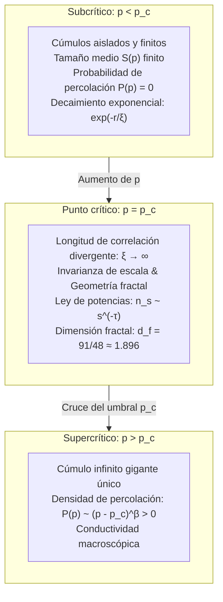

## Introducción: Del aislamiento local a la conectividad global

Piense en la preparación cotidiana de un café filtrado matutino: el agua hirviendo se vierte delicadamente sobre una capa de café molido. Las primeras gotas son absorbidas por los poros microscópicos entre las partículas sólidas, humedeciendo la superficie sin que caiga una sola gota por el pico inferior del filtro. Sin embargo, al continuar vertiendo agua, se alcanza un umbral exacto: repentinamente, el café líquido comienza a gotear en la jarra a un ritmo constante. Las moléculas de agua han percolado a través del medio poroso, estableciendo un laberinto continuo que conecta la parte superior con la base.

Este fenómeno dio nombre a la <strong>teoría de percolación (Percolation Theory)</strong>. Formulada en 1957 por John Hammersley y Simon Broadbent, parte de una pregunta probabilística elemental:
> "¿En una red infinita donde los nodos adyacentes se conectan aleatoriamente con probabilidad independiente $p$, cuándo y de qué manera pequeños grupos aislados coalescen de golpe para formar una red infinita que atraviesa todo el espacio?"

A diferencia de un crecimiento gradual, mientras $p$ permanezca incluso una millonésima por debajo del umbral crítico (<strong>probabilidad crítica $p_c$</strong>), todos los cúmulos formados son estrictamente finitos. Pero tan pronto como $p$ supera $p_c$, aparece de manera abrupta y con probabilidad 1 un <strong>cúmulo infinito</strong> que atraviesa todo el sistema.

Esta es una <strong>transición de fase geométrica</strong>, que surge de forma puramente probabilística y topológica, sin interacción energética ni temperatura.

---

## 1. Modelos fundamentales: Percolación de enlaces y de sitios

En un grafo reticular regular infinito $G = (V, E)$:
- <strong>Percolación de enlaces (Bond Percolation)</strong>: todos los vértices $V$ existen; cada arista $e \in E$ está abierta con probabilidad $p$ y cerrada con probabilidad $1 - p$.
- <strong>Percolación de sitios (Site Percolation)</strong>: todas las aristas existen; cada nodo $v \in V$ está ocupado con probabilidad $p$ y vacío con probabilidad $1 - p$.
Cualquier problema de percolación de enlaces puede reformularse exactamente como percolación de sitios en su grafo lineal (Line Graph).

---

## 2. El umbral crítico $p_c$ y el teorema de Kesten (1980)

La probabilidad de percolación $P(p)$ es la probabilidad de que el cúmulo que contiene al origen sea infinito:
$$P(p) = \mathbb{P}_p(|C(0)| = \infty)$$
El umbral crítico es $p_c = \inf \{ p \in [0, 1] \mid P(p) > 0 \}$. El teorema de Burton-Keane demuestra que para $p > p_c$ existe <strong>exactamente un único</strong> cúmulo infinito casi seguro.

En 1980, Harry Kesten demostró analíticamente el valor exacto para la red cuadrada bidimensional mediante autodualidad:
$$p_c^{\text{bond}}(\mathbb{Z}^2) = \frac{1}{2}$$

---

## 3. Fenómenos críticos y Universalidad

Al aproximarse a $p_c$, la <strong>longitud de correlación diverge</strong>:
$$\xi(p) \propto |p - p_c|^{-\nu}$$
El sistema se vuelve <strong>invariante de escala</strong>. La <strong>hipótesis de universalidad</strong> establece que los exponentes críticos ($\nu, \beta, \gamma, \tau, \eta$) son independientes de la geometría microscópica de la red y dependen exclusivamente de la dimensión espacial $d$.
En dos dimensiones ($d = 2$):
$$\nu = \frac{4}{3}, \quad \beta = \frac{5}{36}, \quad \gamma = \frac{43}{18}, \quad d_f = \frac{91}{48} \approx 1.8958$$

---

## 4. Geometría fractal y descomposición interna

En $p = p_c$, el cúmulo crítico es un fractal con dimensión $d_f \approx 1.896$ en 2D.
Desde la perspectiva de conducción eléctrica, se compone de:
1. <strong>Extremos ciegos (Dangling Ends)</strong>: Constituyen la mayor parte de la masa pero no transportan corriente;
2. <strong>Columna vertebral (Backbone)</strong>: Red de lazos conductores cerrados ($d_B \approx 1.64$);
3. <strong>Enlaces rojos (Red Bonds)</strong>: Enlaces singulares cuyo corte interrumpe totalmente la conductividad macroscópica ($d_R = 1/\nu = 0.75$).

---

## 5. Teoría de campos conformes y SLE (Medalla Fields)

En 2001, Stanislav Smirnov probó rigurosamente la invarianza conforme en la red triangular 2D y la fórmula de Cardy, recibiendo la Medalla Fields en 2006. La evolución de Schramm-Loewner ($\mathrm{SLE}_6$) demostró que la dimensión fractal del borde del cúmulo es exactamente $d_h = 1 + 6/8 = 1.75$.

---

## 6. Redes complejas y fallos en cascada

- <strong>Redes libres de escala</strong>: Como el segundo momento $\langle k^2 \rangle \to \infty$, el umbral ante fallos aleatorios cae a $p_c = 0$, otorgando una robustez casi invulnerable.
- <strong>Ataques dirigidos</strong>: La desconexión selectiva de entre el 2% y el 5% de los nodos centrales (hubs) desintegra catastróficamente toda la red.
- <strong>Redes interdependientes</strong>: La interconexión entre la red eléctrica y la de telecomunicaciones genera transiciones explosivas de primer orden con apagones masivos instantáneos.

## Conclusión

La teoría de percolación demuestra cómo, a partir de elementos puramente aleatorios y desordenados, surge de manera espontánea un orden macroscópico colosal al cruzar un umbral matemático exacto.
