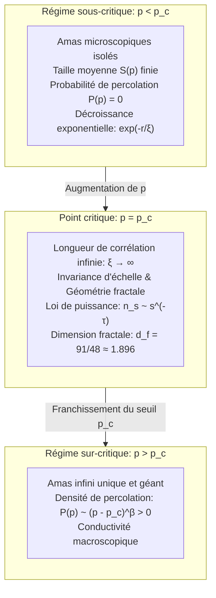

## Introduction : Du confinement local à la connectivité globale

Pensez à la préparation d'un café filtre matinal : l'eau bouillante est versée délicatement sur la mouture. Les premières gouttes sont absorbées par les pores microscopiques des particules de café, humidifiant seulement la surface sans qu'aucune goutte ne s'échappe par la base. Puis, de manière soudaine, le café commence à s'écouler régulièrement dans la carafe. Les molécules d'eau ont percolé à travers le milieu poreux, établissant un labyrinthe continu reliant la surface au fond du filtre.

Ce phénomène d'écoulement à travers un milieu poreux a donné son nom à la <strong>théorie de la percolation (Percolation Theory)</strong>. Formulée en 1957 par Simon Broadbent et John Hammersley, elle pose un problème probabiliste fondamental :
> « Sur un réseau infini où les connexions entre sites voisins sont ouvertes avec une probabilité indépendante $p$, à quel moment et selon quel mécanisme de petits amas isolés fusionnent-ils soudainement pour former un réseau infini traversant l'espace tout entier ? »

Tant que $p$ reste strictement inférieur à un seuil précis (<strong>probabilité critique $p_c$</strong>), tous les amas formés restent rigoureusement de taille finie. Mais dès que $p$ franchit $p_c$, un amas infini émerge instantanément avec une probabilité égale à 1.

Il s'agit d'une véritable <strong>transition de phase géométrique</strong>, qui émerge spontanément sans nécessiter d'énergie ou de température, par la seule force des lois de la probabilité et de la connectivité spatiale.

---

## 1. Modèles fondamentaux : Percolation de liens et de sites

Sur un graphe régulier infini $G = (V, E)$, on définit :
- <strong>Percolation de liens (Bond Percolation)</strong> : tous les sommets $V$ existent ; chaque arête $e \in E$ est ouverte avec probabilité $p$ et fermée avec probabilité $1 - p$.
- <strong>Percolation de sites (Site Percolation)</strong> : toutes les arêtes existent ; chaque sommet $v \in V$ est occupé avec probabilité $p$ et vacant avec probabilité $1 - p$.

---

## 2. Le seuil critique $p_c$ et la solution exacte de Kesten (1980)

La probabilité de percolation $P(p)$ représente la probabilité que l'amas contenant l'origine soit de taille infinie :
$$P(p) = \mathbb{P}_p(|C(0)| = \infty)$$
Le seuil critique est défini par $p_c = \inf \{ p \in [0, 1] \mid P(p) > 0 \}$. Le théorème de Burton-Keane garantit l'existence d'un <strong>unique amas infini</strong> pour $p > p_c$.

En 1980, Harry Kesten a prouvé rigoureusement le seuil exact de percolation de liens sur le réseau carré 2D grâce à la dualité planaire :
$$p_c^{\text{bond}}(\mathbb{Z}^2) = \frac{1}{2}$$

---

## 3. Phénomènes critiques et Universalité

Au voisinage de $p_c$, la longueur de corrélation diverge :
$$\xi(p) \propto |p - p_c|^{-\nu}$$
Le système devient invariant d'échelle. L'<strong>universalité</strong> stipule que les exposants critiques ne dépendent que de la dimension spatiale $d$ et non de la géométrie microscopique du réseau.
En deux dimensions ($d=2$) :
$$\nu = \frac{4}{3}, \quad \beta = \frac{5}{36}, \quad \gamma = \frac{43}{18}, \quad d_f = \frac{91}{48} \approx 1.8958$$

---

## 4. Géométrie fractale et anatomie de l'amas critique

À $p = p_c$, l'amas critique est une fractale de dimension $d_f \approx 1.896$ en 2D.
Il se décompose en :
1. <strong>Bribes mortes (Dangling Ends)</strong> : représentent la majorité de la masse mais ne transportent aucun courant ;
2. <strong>Squelette conducteur (Backbone)</strong> : boucles fermées où circule le courant ($d_B \approx 1.64$) ;
3. <strong>Liens rouges (Red Bonds)</strong> : goulets d'étranglement dont la rupture coupe le courant à l'échelle globale ($d_R = 1/\nu = 0.75$).

---

## 5. Théorie des champs conformes et SLE (Médaille Fields)

En 2001, Stanislav Smirnov a démontré rigoureusement l'invariance conforme de la percolation 2D et la formule de Cardy, obtenant la médaille Fields en 2006. Le formalisme de l'évolution de Schramm-Loewner ($\mathrm{SLE}_6$) a ensuite permis de déterminer la dimension fractale exacte des lignes de contour des amas : $d_h = 1 + 6/8 = 1.75$.

---

## 6. Réseaux complexes et vulnérabilité systémique

- <strong>Réseaux sans échelle (Scale-Free)</strong> : face à des pannes aléatoires, le seuil de percolation tend vers $p_c = 0$, garantissant une robustesse quasi-infinie.
- <strong>Attaques ciblées</strong> : la destruction ciblée de quelques pourcents des nœuds centraux (hubs) fragmente instantanément le réseau.
- <strong>Réseaux interdépendants</strong> : le couplage entre réseau électrique et réseau informatique engendre des pannes en cascade explosives de premier ordre.

## Conclusion

La théorie de la percolation illustre avec éclat l'émergence de l'ordre macroscopique à partir du désordre microscopique le plus complet.
