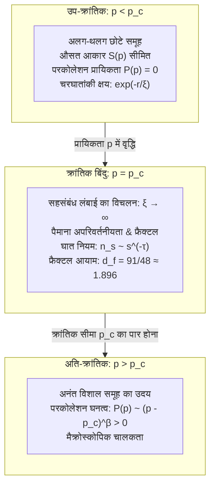

## प्रस्तावना: स्थानीय अलगाव से वैश्विक संपर्क तक की नाटकीय छलांग

सुबह के समय फ़िल्टर कॉफ़ी बनाने के दृश्य की कल्पना कीजिए: महीन पिसे हुए कॉफ़ी पाउडर पर धीरे-धीरे गर्म पानी डाला जाता है। पानी की शुरुआती कुछ बूंदें कॉफ़ी के कणों के बीच के सूक्ष्म छिद्रों में पूरी तरह समा जाती हैं और केवल ऊपरी सतह को गीला करती हैं; फ़िल्टर के निचले सिरे से एक भी बूंद बाहर नहीं निकलती। लेकिन जैसे ही पानी डालना जारी रहता है, एक सटीक क्षण पर अचानक एम्बर रंग की कॉफ़ी की बूंदें नियमित ताल में नीचे टपकने लगती हैं। पानी के अणुओं ने उस छिद्रयुक्त माध्यम में 'परकोलेशन (रिसाव)' की प्रक्रिया पूरी कर ली है और ऊपर से नीचे तक एक निरंतर द्रव मार्ग स्थापित कर लिया है।

छिद्रयुक्त माध्यम से द्रव के रिसने की इसी घटना से सांख्यिकीय भौतिकी और प्रायिकता सिद्धांत की एक अत्यंत महत्वपूर्ण शाखा का नामकरण हुआ: <strong>परकोलेशन सिद्धांत (Percolation Theory)</strong>। 1957 में ब्रिटिश गणितज्ञ जॉन हैमर्सले और साइमन ब्रॉडबेंट द्वारा प्रस्तुत यह सिद्धांत एक सरल प्रश्न से शुरू होता है:
> "एक अनंत जालक (Lattice) में यदि पड़ोसी बिंदुओं को स्वतंत्र प्रायिकता $p$ के साथ यादृच्छिक रूप से जोड़ा जाए, तो अलग-थलग छोटे समूह कब और कैसे अचानक पूरे स्थान को पार करने वाले एक अनंत नेटवर्क में विलीन हो जाते हैं?"

प्रायिकता $p$ जब तक एक सटीक सीमा (<strong>क्रांतिक प्रायिकता $p_c$</strong>) से थोड़ी सी भी कम रहती है, तब तक बनने वाले सभी समूह सीमित आकार के रहते हैं। परंतु जैसे ही $p$ का मान $p_c$ को पार करता है, प्रायिकता 1 के साथ अचानक एक <strong>अनंत समूह</strong> अस्तित्व में आ जाता है।

यह एक शुद्ध <strong>ज्यामितीय चरण संक्रमण (Geometric Phase Transition)</strong> है, जो बिना किसी तापमान या ऊर्जा अन्योन्यक्रिया के, केवल ज्यामिति और प्रायिकता के नियमों से स्वतः घटित होता है।

---

## 1. मौलिक मॉडल: बॉन्ड और साइट परकोलेशन

एक अनंत नियमित जालक $G = (V, E)$ पर दो बुनियादी मॉडल होते हैं:
- <strong>बॉन्ड परकोलेशन (Bond Percolation)</strong>: सभी शीर्ष $V$ मौजूद होते हैं; प्रत्येक कोर $e \in E$ प्रायिकता $p$ के साथ खुली और $1 - p$ के साथ बंद होती है।
- <strong>साइट परकोलेशन (Site Percolation)</strong>: सभी कोरें जुड़ी होती हैं; प्रत्येक शीर्ष $v \in V$ प्रायिकता $p$ से भरा और $1 - p$ से खाली होता है।

---

## 2. क्रांतिक सीमा $p_c$ और केस्टन का प्रमेय (1980)

परकोलेशन प्रायिकता $P(p)$ वह प्रायिकता है जिसके तहत मूल बिंदु वाला समूह अनंत आकार का हो:
$$P(p) = \mathbb{P}_p(|C(0)| = \infty)$$
क्रांतिक सीमा $p_c = \inf \{ p \in [0, 1] \mid P(p) > 0 \}$ है। बर्टन-कीन प्रमेय सिद्ध करता है कि $p > p_c$ के लिए निश्चित रूप से <strong>केवल एक</strong> अनंत समूह होता है।

1980 में हैरी केस्टन ने द्वैतता के आधार पर 2D वर्गाकार जालक के बॉन्ड परकोलेशन के सटीक मान को सिद्ध किया:
$$p_c^{\text{bond}}(\mathbb{Z}^2) = \frac{1}{2}$$

---

## 3. क्रांतिक परिघटनाएं और सार्वभौमिकता (Universality)

जब $p \to p_c$, <strong>सहसंबंध लंबाई $\xi(p)$ अनंत की ओर विचलित होती है</strong>:
$$\xi(p) \propto |p - p_c|^{-\nu}$$
तंत्र पूरी तरह से <strong>पैमाना-अपरिवर्तनीय</strong> बन जाता है। सार्वभौमिकता का सिद्धांत कहता है कि क्रांतिक घातांक जालक की ज्यामिति पर नहीं, बल्कि केवल अंतरिक्ष के आयाम $d$ पर निर्भर करते हैं।
द्वि-आयामीय ($d = 2$) प्रणाली में:
$$\nu = \frac{4}{3}, \quad \beta = \frac{5}{36}, \quad \gamma = \frac{43}{18}, \quad d_f = \frac{91}{48} \approx 1.8958$$

---

## 4. फ्रैक्टल ज्यामिति और आंतरिक संरचना

$p = p_c$ पर बनने वाला समूह एक फ्रैक्टल होता है जिसका आयाम $d_f \approx 1.896$ (2D में) है।
विद्युत धारा के प्रवाह की दृष्टि से इसके घटक हैं:
1. <strong>डैंगलिंग एंड्स (Dangling Ends)</strong>: द्रव्यमान का बड़ा हिस्सा, लेकिन कोई धारा नहीं बहती;
2. <strong>बैकबोन (Backbone)</strong>: धारा प्रवाहित करने वाले बंद लूप ($d_B \approx 1.64$);
3. <strong>रेड बॉन्ड्स (Red Bonds)</strong>: वे महत्वपूर्ण कड़ियां जिन्हें काटने पर पूरे तंत्र का विद्युत प्रवाह तुरंत शून्य हो जाता है ($d_R = 1/\nu = 0.75$)।

---

## 5. कन्फॉर्मल फील्ड थ्योरी और SLE (फील्ड्स मेडल)

2001 में स्तानिस्लाव स्मिरनोव ने 2D त्रिकोणीय जालक पर कन्फॉर्मल इनवेरिएंस और कार्डी के सूत्र को सिद्ध किया, जिसके लिए उन्हें 2006 में फील्ड्स मेडल प्रदान किया गया। ओडेड श्राम के श्राम-लोवेनर इवोल्यूशन ($\mathrm{SLE}_6$) ने सिद्ध किया कि समूहों की सीमाओं का फ्रैक्टल आयाम सटीक रूप से $d_h = 1 + 6/8 = 1.75$ है।

---

## 6. जटिल नेटवर्क और ब्लैकआउट

- <strong>स्केल-फ्री नेटवर्क</strong>: डिग्री वितरण के दूसरे मोमेंट $\langle k^2 \rangle \to \infty$ के कारण यादृच्छिक विफलताओं की सीमा $p_c = 0$ हो जाती है, जिससे वे अत्यंत मजबूत होते हैं।
- <strong>लक्षित हमले</strong>: केवल शीर्ष 2% से 5% प्रमुख हबों को नष्ट करने पर पूरा नेटवर्क तुरंत छिन्न-भिन्न हो जाता है।
- <strong>परस्पर निर्भर नेटवर्क</strong>: बिजली ग्रिड और इंटरनेट के आपसी जुड़ाव से कैस्केडिंग विफलताएं होती हैं, जिससे अचानक बड़े पैमाने पर ब्लैकआउट हो जाता है।

## निष्कर्ष

परकोलेशन सिद्धांत यह सिद्ध करता है कि पूर्ण अव्यवस्था और यादृच्छिकता के बीच से भी, केवल एक गणितीय सीमा $p_c$ को पार करने पर प्रकृति में एक विशाल वैश्विक व्यवस्था और संरचना का स्वतः जन्म होता है।
