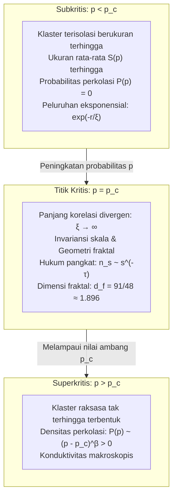

## Pendahuluan: Lompatan Dramatis dari Isolasi Lokal Menuju Konektivitas Global

Bayangkan proses menyeduh kopi manual (pour-over drip coffee): air panas dituangkan perlahan ke atas bubuk kopi di dalam penyaring kerucut. Beberapa tetes air pertama langsung diserap ke dalam pori-pori mikroskopis di antara partikel kopi, hanya membasahi lapisan atas tanpa ada satu tetes pun yang merembes ke bawah. Namun, saat penyiraman air terus berlanjut, pada suatu momen yang sangat presisi, cairan kopi tiba-tiba mulai menetes secara berirama ke dalam teko penampung. Molekul air telah berhasil merembes (terperkolasi) melalui medium berpori, menciptakan saluran makroskopis tak terputus yang menghubungkan permukaan atas hingga ujung dasar penyaring.

Fenomena rembesan fluida melalui medium berpori ini menjadi asal-usul penamaan <strong>Teori Perkolasi (Percolation Theory)</strong>. Dirumuskan pada tahun 1957 oleh matematikawan Inggris John Hammersley dan Simon Broadbent, teori ini menjawab pertanyaan probabilitas murni:
> "Dalam ruang kisi tak hingga di mana titik-titik yang bertetangga dihubungkan secara acak dengan probabilitas independen $p$, kapan dan bagaimana klaster-klaster kecil yang terisolasi tiba-tiba bersatu membentuk jaringan raksasa tak hingga yang membentang di seluruh semesta?"

Berbeda dari intuisi bahwa konektivitas berkembang perlahan, selama probabilitas $p$ masih berada sedikit saja di bawah ambang batas (<strong>probabilitas kritis $p_c$</strong>), seluruh klaster yang terbentuk tetap terbatas ukurannya. Namun, saat $p$ melampaui $p_c$, seketika itu juga dengan probabilitas 1 muncul sebuah <strong>klaster tak hingga</strong> yang menembus seluruh sistem.

Ini adalah sebuah <strong>transisi fase geometris (Geometric Phase Transition)</strong> murni yang berlangsung tanpa interaksi energi maupun suhu, semata-mata dikendalikan oleh hukum probabilitas dan geometri ruang.

---

## 1. Model Dasar: Perkolasi Ikatan dan Perkolasi Situs

Pada graf kisi beraturan tak hingga $G = (V, E)$:
- <strong>Perkolasi Ikatan (Bond Percolation)</strong>: semua simpul $V$ ada; setiap sisi $e \in E$ terbuka dengan probabilitas $p$ dan tertutup dengan probabilitas $1 - p$.
- <strong>Perkolasi Situs (Site Percolation)</strong>: semua sisi ada; setiap simpul $v \in V$ terisi dengan probabilitas $p$ dan kosong dengan probabilitas $1 - p$.

---

## 2. Ambang Kritis $p_c$ dan Bukti Kesten (1980)

Probabilitas perkolasi $P(p)$ didefinisikan sebagai probabilitas bahwa klaster yang memuat titik asal memiliki ukuran tak hingga:
$$P(p) = \mathbb{P}_p(|C(0)| = \infty)$$
Ambang batas kritis didefinisikan sebagai $p_c = \inf \{ p \in [0, 1] \mid P(p) > 0 \}$. Teorema Burton-Keane membuktikan bahwa untuk $p > p_c$ hanya ada <strong>tepat satu</strong> klaster tak terhingga.

Pada tahun 1980, Harry Kesten membuktikan ambang batas eksak untuk perkolasi ikatan pada kisi persegi dua dimensi melalui konsep dualitas graf:
$$p_c^{\text{bond}}(\mathbb{Z}^2) = \frac{1}{2}$$

---

## 3. Fenomena Kritis dan Universalitas

Saat $p \to p_c$, <strong>panjang korelasi $\xi(p)$ divergen menuju tak hingga</strong>:
$$\xi(p) \propto |p - p_c|^{-\nu}$$
Sistem menjadi <strong>invarian skala</strong>. Prinsip <strong>universalitas</strong> menyatakan bahwa eksponen kritis ($\nu, \beta, \gamma, \tau, \eta$) tidak bergantung pada bentuk mikroskopis kisi, melainkan hanya ditentukan oleh dimensi ruang $d$.
Dalam dua dimensi ($d = 2$):
$$\nu = \frac{4}{3}, \quad \beta = \frac{5}{36}, \quad \gamma = \frac{43}{18}, \quad d_f = \frac{91}{48} \approx 1.8958$$

---

## 4. Geometri Fraktal dan Anatomi Klaster

Pada $p = p_c$, klaster pembawa perkolasi memiliki sifat fraktal dengan dimensi $d_f \approx 1.896$ (pada 2D).
Dari sudut pandang aliran listrik, klaster ini tersusun dari:
1. <strong>Dangling Ends (Ujung Buntu)</strong>: Mendominasi sebagian besar massa klaster namun tidak mengalirkan arus listrik;
2. <strong>Backbone (Tulang Punggung)</strong>: Lingkaran konduktif tertutup pembawa arus ($d_B \approx 1.64$);
3. <strong>Red Bonds (Ikatan Merah)</strong>: Jalur tunggal kritis di mana pemutusan satu ikatan saja mematikan seluruh konduksi sistem ($d_R = 1/\nu = 0.75$).

---

## 5. Teori Medan Konformal dan SLE (Medali Fields)

Pada tahun 2001, Stanislav Smirnov membuktikan invariansi konformal perkolasi 2D dan rumus Cardy pada kisi segitiga, yang membawanya meraih Medali Fields pada tahun 2006. Kerangka Schramm-Loewner Evolution ($\mathrm{SLE}_6$) membuktikan bahwa garis batas luar klaster memiliki dimensi fraktal eksak $d_h = 1 + 6/8 = 1.75$.

---

## 6. Jaringan Kompleks dan Keruntuhan Kaskade

- <strong>Jaringan Bebas Skala (Scale-Free)</strong>: Karena momen kedua derajat simpul divergen $\langle k^2 \rangle \to \infty$, ambang batas terhadap kegagalan acak runtuh menjadi $p_c = 0$, memberikan ketahanan luar biasa.
- <strong>Serangan Terarah</strong>: Menghancurkan 2% hingga 5% simpul pusat (hub) utama memecah belah jaringan secara instan.
- <strong>Jaringan Interdependen</strong>: Saling ketergantungan antara jaringan listrik dan jaringan telekomunikasi memicu kegagalan kaskade eksplosif orde pertama.

## Kesimpulan

Teori perkolasi memperlihatkan bagaimana dari keacakan mikroskopis murni, tatanan makroskopis yang koheren dapat lahir secara spontan begitu suatu ambang probabilitas terlewati.
