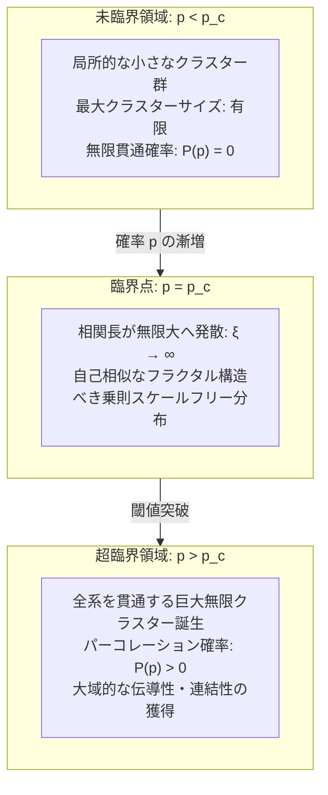
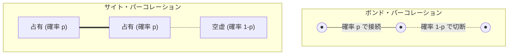
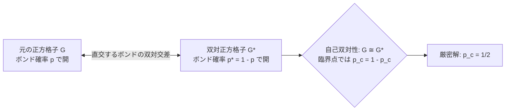
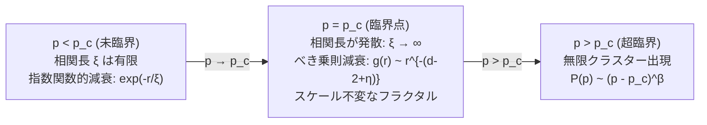
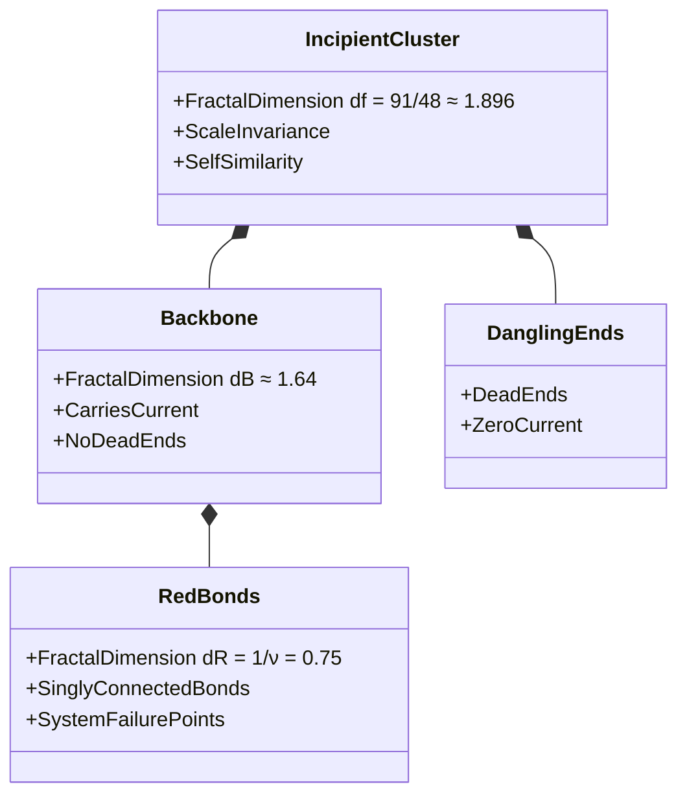
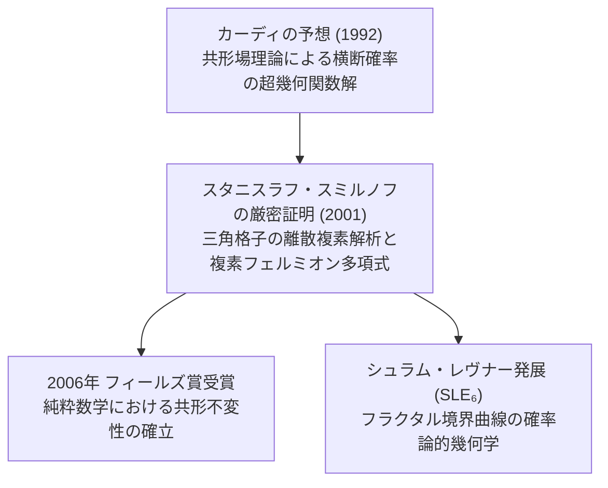
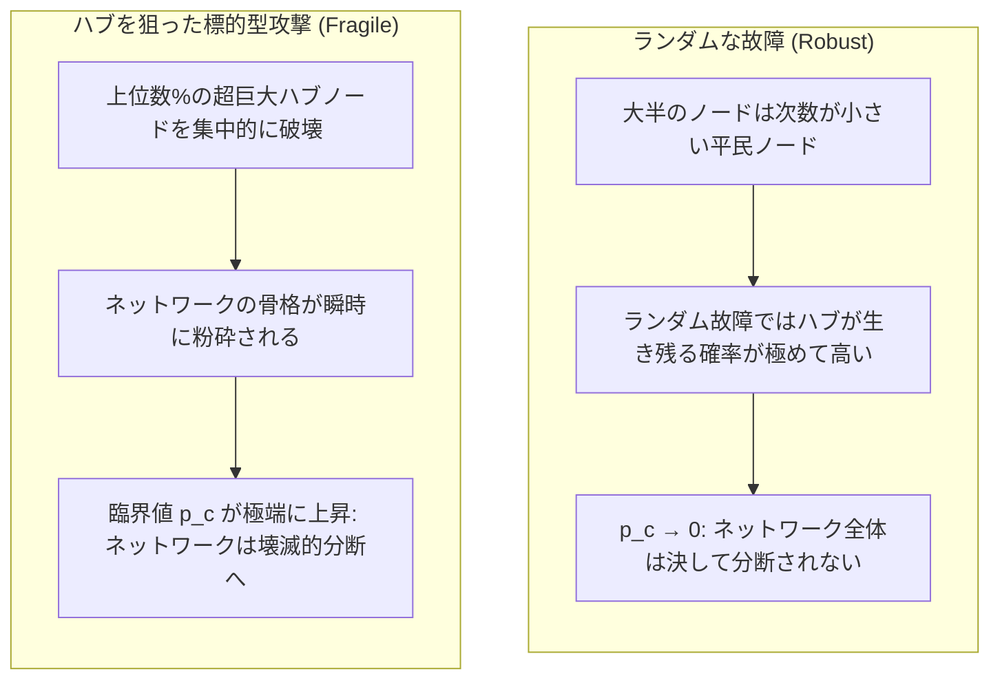
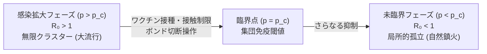

## 序論：局所的な孤立から大域的な連結への劇的な飛躍

一杯のドリップコーヒーを淹れる朝の光景を思い浮かべてみてください。挽いたコーヒー豆の粉末が敷き詰められたドリッパーに、熱湯を静かに注ぎ込みます。最初の数滴の水は粉末の隙間に吸い込まれ、表面を湿らせるだけで底からは一滴も落ちてきません。しかし、湯を注ぎ続けると、ある瞬間に至って突然、琥珀色の液体がドリッパーの抽出口からポタポタと規則正しいリズムで滴り落ち始めます。多孔質（ポーラス）な粉末の隙間を水分子が浸透（パーコレート）し、上部から底部へと貫通する連続した水路が形成されたのです。

この「水が多孔質媒体を染み通る現象」を語源として名付けられた数学・統計物理学の理論が、<strong>パーコレーション理論（Percolation Theory / 浸透理論）</strong>です。1957年にイギリスの数学者ジョン・ハマスリー（John Hammersley）とサイモン・ブロードベント（Simon Broadbent）によって提唱されたこの理論は、一見すると極めてシンプルな幾何学的確率モデルから出発します：
> 「無限に広がる格子状の空間において、隣り合う格子点同士をランダムな確率 $p$ でつないでいくとき、孤立した小さなクラスターはいつ、いかにして空間全体を無限に貫通する巨大なネットワークへと結合するのか？」

直感的には、接続確率 $p$ を $0$ から $1$ へと滑らかに増加させれば、つながりの広がりも滑らかに成長していくように思えるかもしれません。しかし、自然界と数学が示す現実は驚くほど劇的です。確率 $p$ がある閾値（<strong>臨界確率 $p_c$</strong>）をほんのわずかでも下回っている限り、形成されるつながりはすべて有限のサイズにとどまり、空間全体を横断することは絶対にありません。ところが、$p$ がその臨界点 $p_c$ を $0.0001\%$ でも上回った瞬間、全系を貫通する「無限クラスター」が唐突に出現し、システム全体の連結性が不連続に跳ね上がるのです。

この劇的な転換は、水が氷へと凍りつく現象や、強磁性体がキュリー温度を境に磁石としての性質を獲得する現象と完全に同等の<strong>幾何学的相転移（Geometric Phase Transition）</strong>です。熱力学的な相転移が分子間の相互作用エネルギーとエントロピーのせめぎ合いによって生じるのに対し、パーコレーションは「エネルギー」や「温度」といった物理パラメータを一切介さず、<strong>純粋な幾何学的配置と確率の法則のみ</strong>によって自発的な秩序化を引き起こします。

今日、パーコレーション理論は物性物理学の枠組みを遥かに超え、現代科学のあらゆる領域で基盤的な数理言語として機能しています：
- <strong>感染症のパンデミック閾値</strong>：人と人との接触感染確率が閾値を超えると、局所的な集団感染（クラスター）が突如として地球規模のパンデミックへと爆発するメカニズム。
- <strong>インターネットと社会インフラの頑健性</strong>：ルーターや送電網のノードがランダムに故障した際、システム全体の通信網や電力網がいつ破局的な大停電（ブラックアウト）を起こすかの限界予測。
- <strong>森林火災の延焼モデル</strong>：森林の樹木密度がある限界値を超えた瞬間に、落雷による一箇所の火種が森林全体を焼き尽くす巨大火災へと拡大する相転移。
- <strong>複合材料の電気伝導性</strong>：絶縁体プラスチックにカーボンナノチューブや金属粒子を少量ずつ混ぜていくと、特定の体積分率で突如として電気が流れる導電性プラスチックへと変貌する現象。

本稿では、ばらばらの孤立した点が巨大なネットワークへと統合される瞬間に潜む深遠な数理——サイト・パーコレーションとボンド・パーコレーションの厳密な定義から、臨界確率 $p_c$ の解析的導出、臨界指数が描く普遍性（Universality）と自己相似なフラクタル構造、そして2次元における共形場理論（CFT）やシュラム・レヴナー発展（SLE）の現代数学に至るまでを、徹底的に解き明かしていきます。

---

## 1. パーコレーションの基本モデル：サイトとボンド

パーコレーション理論を数学的に厳密に定式化するために、まず空間の離散的フレームワークとして「格子（Lattice）」を導入します。最も基本的かつ代表的なモデルが、<strong>サイト・パーコレーション（Site Percolation）</strong>と<strong>ボンド・パーコレーション（Bond Percolation）</strong>です。

### 1.1 格子グラフの定義

$d$ 次元ユークリッド空間 $\mathbb{R}^d$ における無限格子グラフを $G = (V, E)$ と表します。
- $V$ は格子点（頂点 / Site）の集合です。例えば2次元正方格子（Square Lattice $\mathbb{Z}^2$）の場合、$V = \{(x, y) \mid x, y \in \mathbb{Z}\}$ です。
- $E$ は隣接する格子点間を結ぶ枝（結合 / Bond / Edge）の集合です。正方格子では、ユークリッド距離が 1 である頂点ペア同士を結びます：$e = \langle u, v \rangle \in E \iff \|u - v\|_1 = 1$。
各頂点から出る枝の数を<strong>配位数（Coordination Number）</strong>と呼び、$z$ で表します（2次元正方格子では $z = 4$、3次元立方格子では $z = 6$、2次元三角格子では $z = 6$、蜂の巣格子では $z = 3$）。

### 1.2 ボンド・パーコレーション（Bond Percolation）

ボンド・パーコレーションでは、格子のすべての頂点 $V$ は最初から存在しているものとし、各枝（ボンド）$e \in E$ が独立に確率 $p \in [0, 1]$ で「開（Open / 接続）」状態になり、確率 $1 - p$ で「閉（Closed / 遮断）」状態になると仮定します。

数学的には、確率空間 $(\Omega_E, \mathcal{F}_E, \mathbb{P}_p)$ 上のベルヌーイ確率変数族 $\{\omega(e)\}_{e \in E}$ を考えます：
$$\mathbb{P}_p(\omega(e) = 1) = p, \quad \mathbb{P}_p(\omega(e) = 0) = 1 - p$$
ここで $\omega(e) = 1$ はボンドが開いていることを意味します。開いているボンドのみを辿って互いに到達可能な頂点の極大部分集合を<strong>クラスター（Cluster）</strong>と呼びます。

### 1.3 サイト・パーコレーション（Site Percolation）

サイト・パーコレーションでは逆に、すべてのボンドが存在している前提のもとで、各格子点（サイト）$v \in V$ が独立に確率 $p$ で「占有（Occupied）」され、確率 $1 - p$ で「空虚（Empty）」になるとモデル化します。
$$\mathbb{P}_p(\omega(v) = 1) = p, \quad \mathbb{P}_p(\omega(v) = 0) = 1 - p$$
互いに隣接する占有サイトの連続した塊がクラスターを構成します。

### 1.4 ボンドとサイトの包括関係

数学的に重要な事実として、<strong>任意のボンド・パーコレーション問題は、対応する線グラフ（Line Graph / 被覆格子）上のサイト・パーコレーション問題として厳密に書き直すことができます</strong>。しかし、その逆（一般的なサイト・パーコレーションを元のグラフのボンド・パーコレーションに還元すること）は一般には不可能です。この意味において、サイト・パーコレーションの方がより一般的で包括的な数学構造を持っています。

---

## 2. 臨界確率 $p_c$：相転移の発生条件

パーコレーション現象の核心は、確率 $p$ を変化させたときに現れる明確な閾値現象にあります。

### 2.1 パーコレーション確率 $P(p)$ と臨界点 $p_c$ の厳密な定義

原点 $0 \in V$ を含むクラスターを $C(0)$ と表し、そのサイズ（頂点数）を $|C(0)|$ とします。
原点を含むクラスターのサイズが無限大になる事象を $\{|C(0)| = \infty\}$ と書き、その生起確率を<strong>パーコレーション確率（または秩序母数 / Order Parameter）</strong> $P(p)$ と定義します：
$$P(p) = \mathbb{P}_p(|C(0)| = \infty)$$

直感的には、$P(p)$ は空間内にランダムに選んだある1点が、無限に広がる巨大な連結網に飲み込まれている確率を表します。
このとき、<strong>臨界確率（Critical Threshold）</strong> $p_c$ は以下のように厳密に定義されます：
$$p_c = \sup \{ p \in [0, 1] \mid P(p) = 0 \} = \inf \{ p \in [0, 1] \mid P(p) > 0 \}$$

コルモゴロフの 0-1 法則（Kolmogorov's Zero-One Law）により、無限クラスターが存在する確率それ自体は、任意の $p$ において $0$ または $1$ のいずれかしか取り得ません。すなわち：
$$\mathbb{P}_p(\exists \text{ an infinite cluster}) = \begin{cases} 0 & (p < p_c) \\ 1 & (p > p_c) \end{cases}$$

### 2.2 臨界確率の厳密解：2次元正方格子のボンド・パーコレーション

一般の格子モデルにおいて臨界確率 $p_c$ を解析的な閉じた式（厳密解）で求めることは極めて困難であり、多くの3次元以上の格子では数値シミュレーション（モンテカルロ法）による高精度な近似値に頼っています。
しかし、2次元の特定の対称性の高い格子においては、<strong>双対格子（Dual Lattice）</strong>の概念を用いることで、驚くほど美しい厳密解が導かれます。その金字塔が、1980年にハリー・ケステン（Harry Kesten）によって最終的に厳密証明された2次元正方格子のボンド・パーコレーションの臨界値です：
$$p_c = \frac{1}{2}$$

#### 双対格子と自己双対性（Self-Duality）
2次元平面上の正方格子 $G = (\mathbb{Z}^2, E)$ に対して、その各正方形の面（プラケット）の中心に頂点を置き、元の正方格子のボンドと直交するように枝を張った格子を<strong>双対格子 $G^* = (V^*, E^*)$</strong> と呼びます。
幾何学的に明らかなように、正方格子の双対格子は再び全く同じ構造を持つ正方格子になります。これを<strong>自己双対（Self-Dual）</strong>と呼びます。

元の格子 $G$ において、ある領域を左から右へと横断する開いたボンドの経路が存在しない（横断が阻止されている）ことと、双対格子 $G^*$ においてその経路を断ち切るように上から下へと横断する「閉じたボンドに対応する双対開ボンド」の経路が存在することは、トポロジカルに完全に同値です。
したがって、元の格子のボンドが開く確率 $p$ と、双対格子でボンドが開く確率 $p^* = 1 - p$ の間に対称性が成立します。もし相転移を起こす臨界点が唯一であるならば、自己双対性から必然的に臨界点は自分自身と一致しなければなりません：
$$p_c = 1 - p_c \implies p_c = \frac{1}{2}$$
ケステンはこの直観的予想を、直交交差事象（Crossing Probability）に関するルッソ・シーモア・ウェルシュ（RSW）理論などの高度な確率論的手法を駆使して厳密に証明しました。

### 2.3 様々な格子における臨界確率一覧

次元や格子の幾何学的形状によって臨界確率 $p_c$ は大きく異なります。下表に代表的な格子モデルの臨界確率をまとめます。

| 次元 | 格子の種類 | 配位数 $z$ | ボンド臨界値 $p_c^{\text{bond}}$ | サイト臨界値 $p_c^{\text{site}}$ |
|---|---|---|---|---|
| <strong>1次元</strong> | 直線格子 | 2 | $1.000000$ (厳密) | $1.000000$ (厳密) |
| <strong>2次元</strong> | 蜂の巣格子（Honeycomb） | 3 | $1 - 2\sin(\pi/18) \approx 0.652704$ (厳密) | $\approx 0.6962$ |
| <strong>2次元</strong> | 正方格子（Square） | 4 | $1/2 = 0.500000$ (厳密) | $\approx 0.592746$ |
| <strong>2次元</strong> | 三角格子（Triangular） | 6 | $2\sin(\pi/18) \approx 0.347296$ (厳密) | $1/2 = 0.500000$ (厳密) |
| <strong>3次元</strong> | 単純立方格子（Simple Cubic） | 6 | $\approx 0.2488$ | $\approx 0.3116$ |
| <strong>3次元</strong> | 体心立方格子（BCC） | 8 | $\approx 0.1803$ | $\approx 0.246$ |
| <strong>3次元</strong> | 面心立方格子（FCC） | 12 | $\approx 0.119$ | $\approx 0.198$ |
| <strong>無限次元</strong> | ベーテ格子（Bethe Lattice / Cayley Tree） | $z$ | $\frac{1}{z - 1}$ (厳密) | $\frac{1}{z - 1}$ (厳密) |

この表から、いくつかの普遍的な幾何学的傾向を読み取ることができます：
1. <strong>配位数 $z$ が大きいほど、$p_c$ は小さくなる</strong>：1つのノードから伸びる選択肢が多ければ多いほど、わずかな接続確率でも全系を貫通しやすくなります。
2. <strong>常に $p_c^{\text{site}} \ge p_c^{\text{bond}}$ が成り立つ</strong>：ボンド・パーコレーションの方がサイト・パーコレーションよりも連結を作りやすく、臨界確率が低くなります。
3. <strong>ベーテ格子（平均場近似）の明快さ</strong>：ループが存在しない樹状グラフ（ベーテ格子）では、各分岐点で前進する枝の数が $z - 1$ 本であるため、分岐プロセスが無限に続く条件は単純に $(z - 1)p = 1$、すなわち $p_c = \frac{1}{z-1}$ と求まります。

---

## 3. 臨界現象と普遍性（Universality）：スケールフリーとべき乗則

パーコレーションが真に物理学者や数学者を魅了してやまない理由は、臨界点 $p_c$ の近傍において現れる<strong>臨界現象（Critical Phenomena）</strong>の圧倒的な美しさにあります。

### 3.1 相関長 $\xi$ の発散とスケール不変性

$p < p_c$ の未臨界領域では、すべてのクラスターは有限です。2つの格子点 $x, y$ が同じクラスターに属する確率（対相関関数 $g(x, y)$）は、距離 $r = \|x - y\|$ に対して指数関数的に減衰します：
$$g(x, y) = \mathbb{P}_p(x \leftrightarrow y) \sim \exp\left( - \frac{r}{\xi(p)} \right)$$
ここで現れる特性的な長さスケール $\xi(p)$ を<strong>相関長（Correlation Length）</strong>と呼びます。相関長は、典型的なクラスターの空間的広がり（直径）の平均的な大きさを表しています。

ところが、確率 $p$ を臨界点 $p_c$ に近づけていくと、驚くべきことが起こります。相関長 $\xi(p)$ が急激に増大し、臨界点において<strong>無限大へと発散</strong>するのです：
$$\xi(p) \propto |p - p_c|^{-\nu} \quad (p \to p_c)$$
ここで $\nu$（ニュー）は相関長に関する<strong>臨界指数（Critical Exponent）</strong>です。

相関長 $\xi \to \infty$ という事実は、システムから「特性的な長さスケール」が完全に消失したことを意味します。ミリメートル単位で見ても、メートル単位で見ても、キロメートル単位で見ても、あらゆる空間スケールで同じ統計的幾何構造がフラクタルとして無限に入れ子状に出現する——これが<strong>スケール不変性（Scale Invariance）</strong>です。

### 3.2 臨界指数の一覧とスケーリング仮説

臨界点 $p_c$ の近傍において、あらゆる物理的・幾何学的測定量は、滑らかな解析的振る舞いを捨て去り、$|p - p_c|$ の<strong>べき乗則（Power Law）</strong>に従って特異的に振る舞います。

主要な臨界指数を以下のように定義します：

1. <strong>パーコレーション確率（秩序母数） $P(p)$</strong>:
   $$P(p) \propto (p - p_c)^\beta \quad (p > p_c)$$
   $p \le p_c$ では $P(p) = 0$ であり、$p_c$ を超えるとべき指数 $\beta$ で立ち上がります。

2. <strong>有限クラスターの平均サイズ $S(p)$</strong>:
   原点を含む有限クラスターの平均サイズは、臨界点において上下両側から無限大へと発散します：
   $$S(p) = \sum_{s=1}^\infty s \cdot w_s \propto |p - p_c|^{-\gamma}$$
   ここで $\gamma$ は平均クラスターサイズの発散指数です。

3. <strong>クラスターサイズ分布 $n_s(p)$</strong>:
   サイズ $s$ を持つクラスターの数密度（1サイトあたりの期待個数）は、臨界点 $p = p_c$ において純粋なべき乗則に従います：
   $$n_s(p_c) \propto s^{-\tau}$$
   ここで $\tau$（タウ）はフィッシャー指数（Fisher Exponent）です。

4. <strong>臨界点での対相関関数のべき減衰</strong>:
   $p = p_c$ では、相関関数は指数減衰から代数的なべき減衰へと変化します：
   $$g(r) \propto r^{-(d - 2 + \eta)}$$

### 3.3 臨界指数の普遍性（Universality）

統計力学における最も深遠な発見の一つが、これらの臨界指数（$\beta, \gamma, \nu, \tau, \eta$ など）が持つ<strong>普遍性（Universality）</strong>です。

臨界確率 $p_c$ そのものの値は、格子の幾何学的形状（正方格子か、三角格子か、蜂の巣格子か）や、サイトかボンドかというミクロな詳細に強く依存します。
しかし、<strong>臨界指数は、ミクロな格子の違いに一切依存せず、空間の次元 $d$ のみによって完全に一意に決定される</strong>のです！

| 臨界指数 | 物理的意味 | 2次元 ($d=2$) 厳密値 | 3次元 ($d=3$) 数値計算値 | 6次元以上 ($d \ge 6$) 平均場理論 |
|---|---|---|---|---|
| <strong>$\nu$</strong> | 相関長 $\xi \sim \|p - p_c\|^{-\nu}$ | <strong>$4/3$</strong> | $\approx 0.876$ | <strong>$1/2$</strong> |
| <strong>$\beta$</strong> | 無限クラスター確率 $P \sim (p - p_c)^\beta$ | <strong>$5/36$</strong> | $\approx 0.418$ | <strong>$1$</strong> |
| <strong>$\gamma$</strong> | 平均サイズ $S \sim \|p - p_c\|^{-\gamma}$ | <strong>$43/18$</strong> | $\approx 1.793$ | <strong>$1$</strong> |
| <strong>$\tau$</strong> | クラスターサイズ分布 $n_s \sim s^{-\tau}$ | <strong>$187/91$</strong> | $\approx 2.189$ | <strong>$5/2$</strong> |
| <strong>$\eta$</strong> | 臨界相関の減衰 $g(r) \sim r^{-(d-2+\eta)}$ | <strong>$5/24$</strong> | $\approx -0.046$ | <strong>$0$</strong> |
| <strong>$d_f$</strong> | 巨大クラスターのフラクタル次元 | <strong>$91/48 \approx 1.896$</strong> | $\approx 2.523$ | <strong>$4$</strong> |

正方格子で解こうが、三角格子で解こうが、ランダムなボロノイ分割格子で解こうが、2次元であれば例外なく $\beta = 5/36$、$\nu = 4/3$ という全く同一の有理数に収束します。ミクロな物理の詳細が、臨界点における長距離相関の荒波によってすべて洗い流され、空間の次元性という極めて根源的なトポロジー的特徴だけが純粋な数学的秩序として浮き彫りになるのです。

---

## 4. 臨界点における幾何学：フラクタルと自己相似性

臨界点 $p = p_c$ に達した瞬間に出現する、系全体をかろうじて貫通する「生まれ立ての無限クラスター（Incipient Infinite Cluster / IIC）」は、どのような幾何学的形態をしているのでしょうか？

### 4.1 ハウスドルフ次元とフラクタル次元 $d_f$

通常のユークリッド幾何学において、半径 $R$ の球の体積（質量）$M(R)$ は、空間の次元 $d$ に応じて $M(R) \propto R^d$ でスケールします（2次元の円なら面積は $R^2$、3次元なら $R^3$）。
しかし、臨界点 $p_c$ におけるパーコレーション・クラスターは、無数の隙間や穴がすべてのスケールで空いた「スポンジのようなスカスカの構造」をしています。

半径 $R$ の領域内に含まれるクラスターの質量 $M(R)$ を測定すると、非整数（フラクタル）の次元 $d_f$ を用いて次のようにスケールします：
$$M(R) \propto R^{d_f} \quad (d_f < d)$$

2次元パーコレーション（$d=2$）の場合、このフラクタル次元は厳密に以下のように求まります：
$$d_f = d - \frac{\beta}{\nu} = 2 - \frac{5/36}{4/3} = 2 - \frac{5}{48} = \frac{91}{48} \approx 1.8958$$
3次元パーコレーション（$d=3$）では：
$$d_f \approx 2.52$$

$d_f \approx 1.896$ という値は、このクラスターが1次元の曲線（$d=1$）よりも遥かに複雑に空間を埋め尽くしている一方で、2次元の平面（$d=2$）ほどには中身が詰まっていないことを雄弁に物語っています。どの倍率で拡大しても、自分自身の縮小コピーと統計的に区別がつかない自己相似なフラクタル模様が無限に連続しているのです。

### 4.2 バックボーン（Backbone）とレッド・ボンド（Red Bonds）

臨界クラスターを流れる電流の観点から分解すると、さらに驚くべき内部構造が姿を現します。クラスターの両端に電圧をかけたとき：
1. <strong>ダングリング・ボンド（行き止まり / Dangling Ends）</strong>：クラスターに接続されているものの、行き止まりになっているため電流が流れない無駄な枝葉。クラスターの質量の大部分は実はこの行き止まりで占められています。
2. <strong>バックボーン（背骨 / Backbone）</strong>：電流が実際に流れることができるループと主要経路の集合体。そのフラクタル次元は $d_B \approx 1.64$（2次元）となります。
3. <strong>レッド・ボンド（特異切断点 / Red Bonds）</strong>：バックボーンの中でも最も脆弱な「たった1本切断されただけで、系全体の導電性が完全に失われる」単一接続ボンド（Singly Connected Bonds）。火薬の導火線に例えて「レッド・ボンド」と呼ばれます。そのフラクタル次元は厳密に：
   $$d_R = \frac{1}{\nu} = \frac{3}{4} = 0.75$$
   となります。巨大なネットワークの命運が、わずか $d_R = 0.75$ という極めて希薄な特異点たちの連鎖によって握られているという事実は、現代のインフラ耐障害性理論において極めて重い教訓を与えています。

---

## 5. 2次元パーコレーションの超絶数学：共形場理論とSLE

2次元パーコレーションの数学は、20世紀末から21世紀初頭にかけて、数理物理学と純粋数学の最高峰が融合する舞台となりました。その主役となったのが、<strong>共形場理論（Conformal Field Theory / CFT）</strong>と、フィールズ賞受賞業績となった<strong>シュラム・レヴナー発展（Schramm-Loewner Evolution / SLE）</strong>です。

### 5.1 共形不変性（Conformal Invariance）

臨界点 $p_c$ におけるパーコレーションは、回転・平行移動・拡大縮小に対する不変性（スケール不変性）だけでなく、局所的に角度を保つ任意の幾何学的変換である<strong>共形変換（Conformal Transformation）</strong>に対しても統計的に不変であるという大胆な予想が、1980年代にアレクサンドル・ポリャコフらによって提唱されました。

共形不変性が成り立つならば、複雑な境界条件を持つ任意の2次元領域（例えば多角形や曲面）におけるパーコレーション現象を、複素関数論のリーマン写像定理を用いて標準的な円板や上半平面へと写像し、解析的に厳密解を計算できることになります。

### 5.2 カーディの公式（Cardy's Formula）

1992年、イギリスの理論物理学者ジョン・カーディ（John Cardy）は共形場理論の手法を駆使して、ある幾何学的横断確率に関する驚くべき公式を導出しました。

2次元平面上の正三角形領域 $ABC$ において、底辺 $AB$ 上の点と他の2辺を結ぶパーコレーション経路が存在する確率を計算すると、複素モジュラー関数（超幾何関数）で記述される美しい閉じた式が得られます。
長方形領域 $[0, L] \times [0, W]$（アスペクト比 $r = L/W$）を左右に横断するクラスターが存在する確率 $F(r)$ は、超幾何関数 $_2F_1$ を用いて厳密に以下のように表されます：
$$F(r) = \frac{2\pi \sqrt{3}}{\Gamma(1/3)^3} \cdot \eta^{1/3} \cdot {_2F_1}\left(\frac{1}{3}, \frac{2}{3}; \frac{4}{3}; \eta\right)$$
ここで $\eta$ は長方形を上半平面に等角写像した際の交差比（Cross-ratio）です。

### 5.3 スミルノフの証明とフィールズ賞（2001）

カーディの公式は物理学的には圧倒的な説得力を持っていましたが、数学的に厳密な証明は10年近く未解決のままでした。
2001年、ロシアの数学者<strong>スタニスラフ・スミルノフ（Stanislav Smirnov）</strong>は、三角格子のサイト・パーコレーションにおいてカーディの公式が厳密に成立することを証明しました。スミルノフは格子上の離散的な正則関数（Discrete Holomorphic Functions）を巧みに構成し、格子間隔をゼロにする連続極限（Scaling Limit）においてそれがコーシー・リーマンの方程式を満たす正則関数へと収束することを示したのです。この歴史的偉業により、スミルノフは2006年の国際数学者会議でフィールズ賞を受賞しました。

### 5.4 シュラム・レヴナー発展（$\mathrm{SLE}_\kappa$）

オデッド・シュラム（Oded Schramm）が1999年に導入した<strong>シュラム・レヴナー発展（SLE）</strong>は、2次元の自己回避ランダムウォークやパーコレーションのクラスター外周境界線（Percolation Exploration Path）が、連続極限において従う確率微分方程式です。

上半平面 $\mathbb{H}$ における曲線の成長を、1次元の標準ブラウン運動 $B_t$ によって駆動されるレヴナー方程式で記述します：
$$\frac{\partial g_t(z)}{\partial t} = \frac{2}{g_t(z) - \sqrt{\kappa} B_t}, \quad g_0(z) = z$$
ここでパラメータ $\kappa$（カッパ）は曲線の曲がりくねり度合い（揺らぎの強さ）を表します。
パーコレーションのクラスター境界線は、厳密に <strong>$\kappa = 6$ の SLE（$\mathrm{SLE}_6$）</strong> に一致することが証明されています。
SLE理論により、クラスターの外周境界（Hull）のフラクタル次元 $d_h$ は、パラメータ $\kappa$ を用いて以下の普遍公式で与えられます：
$$d_h = 1 + \frac{\kappa}{8} = 1 + \frac{6}{8} = \frac{7}{4} = 1.75$$
パーコレーションの境界線のフラクタル次元が正確に $7/4$ であるという事実が、確率論と複素解析の極限において完全に証明されたのです。

---

## 6. 複雑ネットワーク上のパーコレーション

格子という規則正しい幾何学的空間から離れ、現代社会を支える「複雑ネットワーク（Complex Networks）」の上でパーコレーションを考えると、さらに劇的で実用的な現象が姿を現します。

### 6.1 スケールフリー・ネットワークと極限の頑健性

現実のインターネット（ルーター網）、WWW（ハイパーリンク網）、航空路線網、生体内のタンパク質相互作用ネットワークなどは、正方格子のような均質的な構造をしていません。一部のノードが極端に膨大な接続数（次数 $k$）を持つ「ハブ（Hub）」として君臨し、次数の分布がべき乗則に従う<strong>スケールフリー・ネットワーク（Scale-Free Network）</strong>です：
$$P(k) \propto k^{-\gamma_{\text{net}}} \quad (2 < \gamma_{\text{net}} \le 3)$$

アルバート＝ラズロ・バラバシ（Albert-László Barabási）らは、スケールフリー・ネットワークに対してランダムにノードを故障・除去していく（ランダム・サイト・パーコレーション）実験を行い、世界を驚かせる結論に達しました。

次数分布の2次モーメント $\langle k^2 \rangle$ が発散する無限大スケールフリー・ネットワークにおいては、<strong>ランダム故障に対する臨界確率 $p_c$ が厳密に 0 になる</strong>のです：
$$p_c = 1 - \frac{1}{\frac{\langle k^2 \rangle}{\langle k \rangle} - 1} \xrightarrow{\langle k^2 \rangle \to \infty} 0$$

これは何を意味するのでしょうか？
ルーターがランダムに $50\%, 80\%, 95\%$ 故障して機能を停止したとしても、残されたわずかなノードたちがハブを経由して依然として全系の連結を保ち続けることを意味します。インターネットが日常的に世界中で発生する数千台規模のサーバー障害に対しても全体崩壊を起こさないのは、スケールフリー・パーコレーションの「$p_c = 0$」という数学的頑健性（Robustness）に守られているからです。

### 6.2 アキレス腱：標的型攻撃に対する極端な脆弱性

しかし、この圧倒的な頑健性の裏には、致命的な「アキレス腱」が潜んでいます。
悪意あるサイバー攻撃やテロリストが、最も次数の高いハブノード上位数％をピンポイントで狙い撃ちにして破壊した場合（標的型パーコレーション）、状況は一変します。巨大なハブを失ったスケールフリー・ネットワークは、わずか数％のノード喪失であっけなく臨界崩壊を起こし、無数のばらばらな孤立ノードへと粉砕されてしまうのです（脆弱性 / Fragility）。

### 6.3 相互依存ネットワークとカスケード破壊

2010年、物理学者シュロモ・ハブリン（Shlomo Havlin）らは、パーコレーション理論をさらに現実的な<strong>相互依存ネットワーク（Interdependent Networks）</strong>へと拡張しました。

現代社会では、電力網（Power Grid）と通信網（Computer Network）は互いに依存し合っています：
- 発電所や変電所を制御・監視するためには通信網のサーバーが動いていなければならない。
- 通信網のルーターやサーバーが動くためには電力網から電力が供給されていなければならない。

このように異なる2つのネットワークが相互に依存している場合、パーコレーション転移の性質は、通常の連続的な2次相転移から、<strong>不連続で爆発的な1次相転移（First-Order Discontinuous Transition）</strong>へと変貌します。
電力網のノードが数カ所停止しただけで、通信網の一部がダウンし、その通信網の停止がさらなる発電所の停止を招くという「悪魔の相互連鎖（カスケード障害 / Cascading Failure）」が発生します。臨界点 $p_c$ に達した瞬間、予告も前兆もなく、全システムが一瞬にして全滅する大崩壊（ブラックアウト）を引き起こすのです。

---

## 7. 現代社会への応用：感染症・材料・情報伝播

パーコレーション理論の数理は、今や純粋幾何学の枠を飛び出し、私たちの生命と生活を支える工学や社会科学の最前線で応用されています。

### 7.1 感染症数理とパンデミック閾値

感染症の伝播モデル（SIRモデルなど）において、感染者から感受性者への伝播確率を $T$（透過性 / Transmissibility）とします。社会の人間関係ネットワークの上で、病原体が感染を広げていくプロセスは、まさに<strong>人間関係グラフ上のボンド・パーコレーションそのもの</strong>です。

基本再生産数 $R_0$（1人の感染者が平均して何人に感染させるか）が 1 を超えると感染が爆発する現象は、パーコレーションにおける $p > p_c$ への突入と完全に同一です。
社会全体のワクチン接種や行動制限（ロックダウン、マスク着用）は、グラフ上のボンド確率 $p$ やサイト確率 $q$ を引き下げ、系全体を臨界点以下の $p < p_c$（未臨界領域）へと押し戻す幾何学的相転移操作に他なりません。

### 7.2 複合材料のパーコレーション伝導性

高分子ポリマーなどの絶縁体材料に、導電性のカーボンブラックやグラフェン、銀ナノワイヤを添加して導電性複合材料（Conductive Polymer Composites）を製造するプロセスは、3次元連続空間のパーコレーション（コンティニュアム・パーコレーション）の代表例です。

添加剤の体積分率 $\phi$ がパーコレーション閾値 $\phi_c$ に達するまでは、材料の電気伝導度 $\sigma$ はほぼゼロ（絶縁体）のままです。しかし、$\phi = \phi_c$（通常わずか数％の体積比）に達した瞬間、粒子同士が接触して材料内部を端から端まで貫通する電気伝導パスが完成し、導電率は数十万倍から数億倍へと跳ね上がります：
$$\sigma(\phi) \propto (\phi - \phi_c)^t \quad (\phi > \phi_c)$$
ここで $t$ は電気伝導度に関する動的臨界指数です（3次元では $t \approx 2.0$）。この原理により、航空機の静電気放電シールドや、軽量で曲げられる電子回路、ウェアラブル生体センサーが実用化されています。

### 7.3 地熱発電・石油工学と多孔質流体力学

地下深部の岩盤から熱水やシェールガスを抽出する現場では、岩石内部の微小な亀裂（クラック）の連結性が死活問題となります。水圧破砕法（フラッキング）によって岩盤に人工的なクラックを注入していくと、クラック密度がパーコレーション臨界値を超えた瞬間に、孤立していたガスや熱水が井戸へと一気に噴出するようになります。パーコレーション理論に基づく浸透率テンソルの解析は、資源探査工学の不可欠な数学基盤です。

---

## 結語：無秩序の海から突如として生まれる秩序の神秘

パーコレーション理論が私たちに教えてくれる最も深遠な哲学的・科学的教訓とは何でしょうか？

それは、<strong>「個々の要素が完全にランダムで無秩序であり、大域的な目的や中央の指令塔が一切存在しなかったとしても、要素間の接続確率という極めて単純な局所的パラメータが臨界値を超えた瞬間、全体としての巨視的な秩序、連結性、そして新たな機能が突如として自発的に立ち現れる」</strong>という創発（Emergence）の真理です。

臨界点 $p_c$ を境とする劇的な変化は、魔法や奇跡ではありません。それは確率論、幾何学、トポロジーが織り成す冷徹で美しい数学的必然です。

コーヒーの粉を染み通る一滴の雫から、大都会の灯りを支える送電ネットワーク、未知のウイルスの感染爆発、そして無数の神経細胞（ニューロン）が結合して意識の光を生み出す人間の脳に至るまで——。世界は無数の「ばらばらの点」で満ち満ちています。そしてそれらの点がいつ、いかにして巨大な一つのつながりへと跳躍を果たすのか、その境界線に立つとき、私たちはパーコレーション理論という壮大な数理の鏡を通して、自然界が秘めた最も根源的な相転移の美を目撃するのです。
