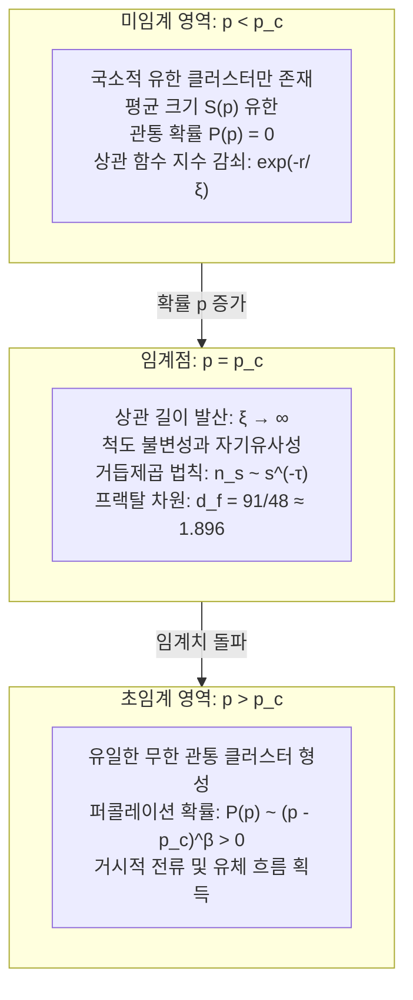

## 서론: 국소적 고립에서 거시적 연결로의 극적인 도약

아침에 핸드드립 커피를 내리는 순간을 떠올려 보십시오. 곱게 갈린 원두 가루가 채워진 드리퍼에 뜨거운 물을 조심스럽게 붓습니다. 처음 몇 방울의 물은 가루 사이의 미세한 기공 속으로 순식간에 흡수되어 윗표면만 적실 뿐, 드리퍼 바닥 추출구로는 단 한 방울의 액체도 떨어지지 않습니다. 그러나 물을 계속 부어 나가다 보면, 어느 특정한 순간에 도달했을 때 갑자기 호박색 커피 원액이 규칙적인 리듬을 그리며 바닥으로 똑똑 떨어지기 시작합니다. 다공성 매질 내부의 미세 공극들을 물 분자가 침투(Percolate)하여, 상단에서 하단으로 이어지는 거시적 유체 통로를 완성한 것입니다.

이처럼 '유체가 다공성 물질을 뚫고 스며드는 현상'에서 유래한 현대 확률론과 통계물리학의 핵심 이론이 바로 <strong>퍼콜레이션 이론(Percolation Theory / 침투 이론)</strong>입니다. 1957년 영국 수학자 존 해머슬리(John Hammersley)와 사이먼 브로드벤트(Simon Broadbent)에 의해 제창된 이 이론은 지극히 단순한 기하학적 확률 모델에서 출발합니다:
> "무한히 넓은 격자 공간에서 인접한 점들을 독립 확률 $p$로 무작위 연결할 때, 고립된 작은 클러스터들은 언제, 어떻게 시스템 전체를 관통하는 무한 네트워크로 결합하는가?"

직관적으로는 연결 확률 $p$를 $0$에서 $1$로 부드럽게 증가시키면 클러스터의 크기도 점진적으로 커질 것처럼 느껴집니다. 그러나 수학이 증명하는 진실은 극도로 불연속적입니다. 연결 확률 $p$가 특정 임계값(<strong>임계 확률 $p_c$</strong>)보다 단 $0.0001\%$라도 작은 동안에는 생성되는 모든 클러스터가 유한한 크기에 머무르며 전체를 관통하지 못합니다. 그러나 $p$가 $p_c$를 넘어서는 순간, 전 계를 가로지르는 '무한 클러스터'가 확률 1로 갑작스럽게 출현하며 계의 거시적 연결성이 폭발적으로 도약합니다.

이 현상은 온도나 에너지 상호작용 없이 오직 <strong>확률과 기하학적 연결 법칙만으로 자발적 질서가 형성되는 기하학적 상전이(Geometric Phase Transition)</strong>입니다.

오늘날 퍼콜레이션 이론은 다음과 같은 다양한 복잡계 분석의 수학적 토대를 제공합니다:
- <strong>감염병의 집단 면역과 팬데믹 임계치</strong>: 감염 확률이 임계값을 넘을 때 국소 감염이 전 세계적 대유행으로 폭발하는 과정;
- <strong>인터넷 및 전력망의 내결함성</strong>: 무작위 고장과 표적 공격 하에서 대정전(블랙아웃)이 발생하는 임계점 예측;
- <strong>산불 확산 모델</strong>: 산림 내 수목 밀도가 임계치를 초과할 때 발생하는 전면적 산불 재앙;
- <strong>전도성 나노 복합재료</strong>: 절연체 플라스틱에 미량의 탄소나노튜브를 첨가하여 전도성을 급격히 획득시키는 기술.

---

## 1. 퍼콜레이션의 수학적 모델: 본드와 사이트

$d$차원 공간의 무한 격자 그래프 $G = (V, E)$ 상에서 두 가지 대표 모델이 정의됩니다.
- <strong>본드 퍼콜레이션(Bond Percolation)</strong>: 정점 $V$는 모두 존재하며, 인접한 두 정점을 잇는 변(본드) $e \in E$가 독립 확률 $p$로 열리고(Open), 확률 $1 - p$로 닫힙니다(Closed).
- <strong>사이트 퍼콜레이션(Site Percolation)</strong>: 변은 모두 연결되어 있으나 각 정점(사이트) $v \in V$가 독립 확률 $p$로 점유되고(Occupied), $1 - p$로 비어 있습니다(Empty).

---

## 2. 임계 확률 $p_c$와 2차원 사각 격자의 엄밀해

원점을 포함하는 클러스터 $C(0)$의 크기가 무한대가 될 확률을 <strong>퍼콜레이션 확률(질서 매개변수) $P(p)$</strong>라 정의합니다:
$$P(p) = \mathbb{P}_p(|C(0)| = \infty)$$
임계 확률 $p_c$는 다음과 같이 정의됩니다:
$$p_c = \sup \{ p \in [0, 1] \mid P(p) = 0 \} = \inf \{ p \in [0, 1] \mid P(p) > 0 \}$$
콜모고로프 0-1 법칙에 의해 무한 클러스터가 존재할 확률은 $p < p_c$에서 0, $p > p_c$에서 1입니다. 또한 버튼-킨 정리에 의해 $p > p_c$에서 무한 클러스터는 오직 하나만 존재합니다.

1980년 해리 케스텐(Harry Kesten)은 평면 그래프의 자기쌍대성(Self-Duality)과 RSW 교차 확률 이론을 통해 2차원 사각 격자의 본드 퍼콜레이션 임계값을 엄밀히 증명했습니다:
$$p_c^{\text{bond}}(\mathbb{Z}^2) = \frac{1}{2}$$

---

## 3. 임계 현상과 보편성(Universality)

$p \to p_c$일 때 전형적인 클러스터 직경을 나타내는 <strong>상관 길이 $\xi(p)$가 무한대로 발산</strong>합니다:
$$\xi(p) \propto |p - p_c|^{-\nu}$$
시스템의 특성 길이가 사라지면서 계는 완벽한 <strong>척도 불변성(Scale Invariance)</strong>을 갖는 프랙탈이 됩니다.

통계역학의 경이로운 원리인 <strong>보편성(Universality)</strong>에 따르면, 미시적 격자 모양이 사각이든 삼각이든 무관하게 <strong>임계 지수($\nu, \beta, \gamma, \tau, \eta$)는 공간 차원 $d$에 의해서만 결정</strong>됩니다.
2차원($d=2$)의 경우 등각장론에 의해 정확한 유리수 해를 갖습니다:
$$\nu = \frac{4}{3}, \quad \beta = \frac{5}{36}, \quad \gamma = \frac{43}{18}, \quad d_f = \frac{91}{48} \approx 1.896$$

---

## 4. 임계 클러스터의 내부 구조와 프랙탈 기하학

임계점에서 계를 관통하는 클러스터는 공간을 채우지 못하는 프랙탈 질량 $M(R) \propto R^{d_f}$ ($d_f \approx 1.896$)을 가집니다.
전류가 흐르는 관점에서 분해하면:
1. <strong>막다른 가지(Dangling Ends)</strong>: 질량의 대부분을 차지하지만 전류가 흐르지 않음;
2. <strong>백본(Backbone)</strong>: 실제 전류가 흐르는 닫힌 루프 네트워크 ($d_B \approx 1.64$);
3. <strong>레드 본드(Red Bonds)</strong>: 단 하나만 끊어져도 계 전체 전도성이 파괴되는 단일 연결선 ($d_R = 1/\nu = 0.75$).

---

## 5. 현대 수학의 성과: 등각 불변성과 SLE (필즈상)

2001년 스타니슬라프 스미르노프(Stanislav Smirnov)는 2차원 삼각 격자 사이트 퍼콜레이션의 스케일링 극한에서 등각 불변성을 증명하여 2006년 필즈상을 수상했습니다. 오데드 슈람(Oded Schramm)의 슈람-뢰브너 진화($\mathrm{SLE}_6$)를 통해 퍼콜레이션 경계선의 프랙탈 차원이 정확히 $d_h = 1 + 6/8 = 1.75$임이 증명되었습니다.

---

## 6. 복잡계 네트워크와 상호의존 시스템

- <strong>스케일 프리 네트워크</strong>: 차수 분포가 멱법칙을 따를 때 $\langle k^2 \rangle \to \infty$로 인해 무작위 노드 고장에 대한 임계값 $p_c \to 0$입니다. 99%의 노드가 고장 나도 거대 클러스터가 파괴되지 않는 무한한 내구성을 지닙니다.
- <strong>표적 공격 취약성</strong>: 상위 수%의 핵심 허브를 파괴하면 $p_c$가 급격히 상승하여 즉각 산산조각 납니다.
- <strong>상호의존 네트워크</strong>: 전력망과 통신망이 결합되면 상전이가 불연속적인 1차 폭발적 붕괴로 전환되어 순식간에 전국적 블랙아웃이 발생합니다.

## 결론

퍼콜레이션 이론은 개별 요소가 완전히 무질서하더라도, 국소 연결 확률이라는 단순한 규칙이 임계점 $p_c$를 넘어서는 순간 전체로서의 거대한 질서와 기능이 자발적으로 탄생함을 증명합니다.
