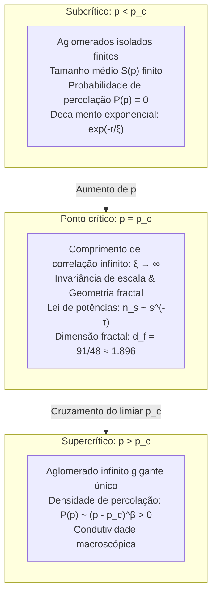

## Introdução: Do isolamento local à conectividade global

Imagine o preparo artesanal de um café coado: a água quente é despejada suavemente sobre o pó moído. As primeiras gotas são absorvidas pelos poros microscópicos entre as partículas sólidas, umedecendo apenas a superfície sem que saia uma única gota pela base. No entanto, continuando a infusão, atinge-se um limiar exato: subitamente, o café começa a gotejar em ritmo constante. As moléculas de água percolaram através do meio poroso, estabelecendo uma rede contínua de canais que une a superfície ao fundo.

Este fenômeno inspirou o nome da <strong>teoria da percolação (Percolation Theory)</strong>. Proposta em 1957 por John Hammersley e Simon Broadbent, ela investiga:
> "Numa rede infinita onde pontos adjacentes são conectados com probabilidade independente $p$, quando e como pequenos agrupamentos isolados se fundem repentinamente para formar uma rede infinita que atravessa todo o espaço?"

Enquanto $p$ permanece ligeiramente abaixo de um valor crítico (<strong>probabilidade crítica $p_c$</strong>), todos os agrupamentos gerados são estritamente finitos. Mas assim que $p$ supera $p_c$, surge instantaneamente, com probabilidade 1, um <strong>aglomerado infinito</strong> que atravessa todo o sistema.

Trata-se de uma <strong>transição de fase geométrica</strong>, que ocorre exclusivamente por leis de probabilidade e topologia espacial, sem intervenção de energia térmica ou temperatura.

---

## 1. Modelos fundamentais: Percolação de ligações e de sítios

Num grafo reticular regular infinito $G = (V, E)$:
- <strong>Percolação de ligações (Bond Percolation)</strong>: todos os vértices $V$ existem; cada aresta $e \in E$ está aberta com probabilidade $p$ e fechada com probabilidade $1 - p$.
- <strong>Percolação de sítios (Site Percolation)</strong>: todas as arestas existem; cada vértice $v \in V$ está ocupado com probabilidade $p$ e vazio com probabilidade $1 - p$.

---

## 2. O limiar crítico $p_c$ e a solução exata de Kesten (1980)

A probabilidade de percolação $P(p)$ representa a probabilidade de o aglomerado da origem ser infinito:
$$P(p) = \mathbb{P}_p(|C(0)| = \infty)$$
O limiar crítico é $p_c = \inf \{ p \in [0, 1] \mid P(p) > 0 \}$. O teorema de Burton-Keane garante que, para $p > p_c$, existe <strong>exatamente um único</strong> aglomerado infinito quase certamente.

Em 1980, Harry Kesten provou analiticamente a solução exata para a rede quadrada 2D via autodualidade:
$$p_c^{\text{bond}}(\mathbb{Z}^2) = \frac{1}{2}$$

---

## 3. Fenômenos críticos e Universalidade

Próximo a $p_c$, o <strong>comprimento de correlação diverge</strong>:
$$\xi(p) \propto |p - p_c|^{-\nu}$$
O sistema torna-se <strong>invariante de escala</strong>. Pela <strong>universalidade</strong>, os expoentes críticos ($\nu, \beta, \gamma, \tau, \eta$) dependem apenas da dimensão espacial $d$ e não da geometria microscópica da rede.
Em duas dimensões ($d = 2$):
$$\nu = \frac{4}{3}, \quad \beta = \frac{5}{36}, \quad \gamma = \frac{43}{18}, \quad d_f = \frac{91}{48} \approx 1.8958$$

---

## 4. Estrutura fractal e anatomia interna

Em $p = p_c$, o aglomerado crítico é um fractal com $d_f \approx 1.896$ (em 2D).
Ele se decompõe em:
1. <strong>Pontas cegas (Dangling Ends)</strong>: maior parte da massa, sem condução de corrente;
2. <strong>Espinha dorsal (Backbone)</strong>: anéis fechados que conduzem corrente ($d_B \approx 1.64$);
3. <strong>Ligações vermelhas (Red Bonds)</strong>: elos únicos cuja ruptura extingue a condução macroscópica ($d_R = 1/\nu = 0.75$).

---

## 5. Teoria de campos conformes e SLE (Medalha Fields)

Em 2001, Stanislav Smirnov provou rigorosamente a invariância conforme na rede triangular 2D e a fórmula de Cardy, sendo agraciado com a Medalha Fields em 2006. A evolução de Schramm-Loewner ($\mathrm{SLE}_6$) confirmou que a fronteira dos aglomerados tem dimensão fractal exata $d_h = 1 + 6/8 = 1.75$.

---

## 6. Redes complexas e colapsos em cascata

- <strong>Redes livres de escala</strong>: O segundo momento divergente $\langle k^2 \rangle \to \infty$ faz com que $p_c = 0$, conferindo robustez absoluta contra falhas aleatórias.
- <strong>Ataques direcionados</strong>: Eliminar os 2% a 5% maiores hubs destrói a rede por completo.
- <strong>Redes interdependentes</strong>: O acoplamento entre redes elétricas e de dados gera falhas catastróficas em cascata de primeira ordem.

## Conclusão

A teoria da percolação revela a majestade da emergência espontânea: a partir do acaso microscópico, a superação de um limiar exato forja a ordem e a conectividade de todo o universo.
