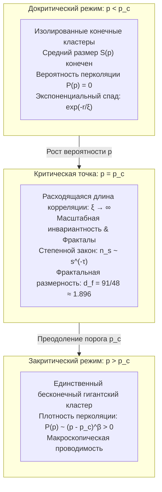

## Введение: От локальной изоляции к глобальной связности

Представьте утренний процесс приготовления фильтр-кофе: горячая вода тонкой струей подается на слой свежемолотых зерен. Первые капли целиком поглощаются микроскопическими порами между частицами, смачивая лишь поверхность, и ни единая капля не вытекает снизу. Однако при непрерывном проливе наступает четкий критический момент: внезапно кофе начинает ритмично капать в колбу. Молекулы воды проникли (проперколировали) сквозь пористую среду, образовав макроскопический непрерывный канал от поверхности ко дну фильтра.

Это явление просачивания жидкости дало название <strong>теории перколяции (Percolation Theory / теории протекания)</strong>. Созданная в 1957 году британскими математиками Джоном Хаммерсли и Саймоном Бродбентом, теория формулирует фундаментальный вопрос:
> «Если на бесконечной регулярной решетке соседние узлы случайным образом соединяются с независимой вероятностью $p$, когда и каким образом изолированные кластеры внезапно объединяются в бесконечную сеть, пронизывающую все пространство?»

Пока вероятность $p$ остается хотя бы на одну миллионную ниже критического порога (<strong>критической вероятности $p_c$</strong>), все образующиеся кластеры строго конечны. Но как только $p$ превышает $p_c$, в системе с вероятностью 1 внезапно рождается <strong>бесконечный кластер</strong>, меняя макроскопические свойства всей системы.

Это явление представляет собой чистый <strong>геометрический фазовый переход</strong>, возникающий исключительно благодаря законам теории вероятностей и топологии, без участия температуры или энергетических взаимодействий.

---

## 1. Базовые модели: Перколяция связей и узлов

На бесконечной решетке $G = (V, E)$ определяются две модели:
- <strong>Перколяция связей (Bond Percolation)</strong>: все узлы $V$ присутствуют; каждое ребро $e \in E$ открыто с вероятностью $p$ и закрыто с вероятностью $1 - p$.
- <strong>Перколяция узлов (Site Percolation)</strong>: все ребра существуют; каждый узел $v \in V$ занят с вероятностью $p$ и пуст с вероятностью $1 - p$.

---

## 2. Критический порог $p_c$ и строгое решение Кестена (1980)

<strong>Вероятность перколяции $P(p)$</strong> — это вероятность того, что кластер, содержащий начало координат, бесконечен:
$$P(p) = \mathbb{P}_p(|C(0)| = \infty)$$
Критический порог определяется как $p_c = \inf \{ p \in [0, 1] \mid P(p) > 0 \}$. Теорема Бертона — Кина доказывает, что при $p > p_c$ почти наверное существует <strong>ровно один</strong> бесконечный кластер.

В 1980 году Гарри Кестен доказал точное значение порога перколяции связей на 2D-квадратной решетке с помощью самодвойственности:
$$p_c^{\text{bond}}(\mathbb{Z}^2) = \frac{1}{2}$$

---

## 3. Критические явления и Универсальность

При $p \to p_c$ <strong>длина корреляции неограниченно расходится</strong>:
$$\xi(p) \propto |p - p_c|^{-\nu}$$
Система становится <strong>масштабно-инвариантной</strong>. Согласно <strong>гипотезе универсальности</strong>, критические индексы ($\nu, \beta, \gamma, \tau, \eta$) зависят только от размерности пространства $d$ и не зависят от формы решетки.
В двух измерениях ($d = 2$):
$$\nu = \frac{4}{3}, \quad \beta = \frac{5}{36}, \quad \gamma = \frac{43}{18}, \quad d_f = \frac{91}{48} \approx 1.8958$$

---

## 4. Фрактальная геометрия и внутренняя анатомия

При $p = p_c$ критический кластер представляет собой самоподобный фрактал с $d_f \approx 1.896$ в 2D.
С точки зрения электропроводимости он состоит из:
1. <strong>Тупиковых ветвей (Dangling Ends)</strong>: составляют большую часть массы, но не проводят ток;
2. <strong>Остова (Backbone)</strong>: замкнутые проводящие контуры ($d_B \approx 1.64$);
3. <strong>Красных связей (Red Bonds)</strong>: критические перемычки, разрыв которых полностью прекращает проводимость ($d_R = 1/\nu = 0.75$).

---

## 5. Конформная теория поля и эволюция Шрамма — Лёвнера (SLE)

В 2001 году Станислав Смирнов доказал конформную инвариантность 2D-перколяции и формулу Карди, получив медаль Филдса в 2006 году. Теория эволюции Шрамма — Лёвнера ($\mathrm{SLE}_6$) установила точную фрактальную размерность границ кластеров: $d_h = 1 + 6/8 = 1.75$.

---

## 6. Сложные сети и каскадные аварии

- <strong>Бесмасштабные сети</strong>: из-за расходимости второго момента степенного распределения $\langle k^2 \rangle \to \infty$ порог при случайных сбоях равен $p_c = 0$, обеспечивая феноменальную надежность.
- <strong>Уязвимость к целевым атакам</strong>: разрушение всего 2–5% главных хабов приводит к мгновенному распаду сети.
- <strong>Взаимозависимые сети</strong>: связь электросетей и интернета преобразует перколяцию во взрывной переход первого рода с масштабными блэкаутами.

## Заключение

Теория перколяции демонстрирует торжество спонтанного порядка: из хаоса отдельных элементов при преодолении математического порога $p_c$ рождается глобальное единство.
