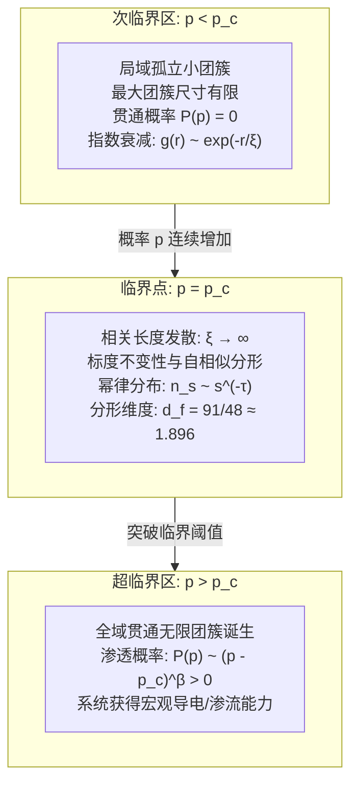

## 引言：从局部孤立到全局连通的剧烈跃迁

想象一个宁静清晨冲泡手冲咖啡的场景：将研磨好的咖啡粉均匀平铺在滤杯中，缓缓注入热水。最初注入的几滴水瞬间被咖啡粉颗粒之间的微孔隙完全吸收，仅润湿了表层，滤杯底部没有一滴液体流出。然而，随着水流的持续注入，在某一精确的时刻，琥珀色的咖啡液突然开始以稳定的节律从滤杯底部滴落。流体分子在多孔介质中成功“渗透（Percolate）”，形成了一条从上表面贯通至底部顶点的宏观通道。

这一流体穿透多孔介质的物理现象，正是现代概率论与统计物理学重要支柱——<strong>渗透理论（Percolation Theory / 渗流理论）</strong>的名字来源。1957年，英国数学家约翰·哈默斯利（John Hammersley）与西蒙·布罗德本特（Simon Broadbent）正式提出了该模型：
> “在一个无限规则的点阵空间中，若相邻节点以独立的概率 $p$ 随机建立连接，互不相连的微小团簇在何时、以何种机制突然连接成一个贯穿整个空间的无限网络？”

直觉上，人们可能会认为，当连接概率 $p$ 从 $0$ 平滑增加至 $1$ 时，连通团簇的规模也会平滑缓慢地增长。然而，大自然与数学所揭示的真理却极其剧烈：只要概率 $p$ 哪怕比某个决定性阈值（<strong>临界概率 $p_c$</strong>）低了百万分之一，系统中生成的所有团簇规模都严格处于有限范围之内，空间两端绝不可能导通；而一旦 $p$ 超过 $p_c$ 哪怕极微小的量，一个横跨整个系统的“无限团簇”便会以概率 1 骤然诞生，系统全局连通性发生不连续的剧烈飞跃。

这一现象是纯粹的<strong>几何相变（Geometric Phase Transition）</strong>。与水结成冰或铁磁体在居里温度磁化等传统热力学相变不同，渗透相变完全不需要温度、能量或粒子间哈密顿量相互作用，而是<strong>仅凭概率与几何连通拓扑</strong>自发涌现的有序化过程。

如今，渗透理论已广泛应用于前沿交叉科学：
- <strong>流行病学大流行阈值</strong>：人际接触传染概率超过临界阈值时，局部聚集性疫情如何突变为全球性大流行；
- <strong>现代电网与通信网络韧性</strong>：路由器或输电节点随机故障时，系统何处会触发灾难性大停电；
- <strong>森林火灾蔓延动力学</strong>：林木密度超过临界点导致山火瞬间失控；
- <strong>新型纳米复合导电材料</strong>：绝缘聚合物基体中掺入微量碳纳米管实现电导率跃迁的机理。

---

## 1. 渗透的基本数学模型：节点与连键

在数学上，我们在 $d$ 维欧几里得空间 $\mathbb{R}^d$ 的无限规则格子图 $G = (V, E)$ 上严格定义渗透模型。

### 1.1 键渗透（Bond Percolation）
所有格点 $V$ 均完好存在。每条连接相邻格点的边（键）$e \in E$ 以独立概率 $p \in [0, 1]$ 处于“导通（Open）”状态，以概率 $1 - p$ 处于“断开（Closed）”状态：
$$\mathbb{P}_p(\omega(e) = 1) = p, \quad \mathbb{P}_p(\omega(e) = 0) = 1 - p$$
通过连续导通边相互连通的格点极大子集称为一个<strong>团簇（Cluster）</strong>。

### 1.2 点渗透（Site Percolation）
所有边均存在，但每个格点 $v \in V$ 以独立概率 $p$ 被“占据（Occupied）”，以概率 $1 - p$ 为“空置（Empty）”。相邻的被占据格点集合构成团簇。

数学上已严格证明：<strong>任何图上的键渗透问题，都可以严格等价地重写为其对应线图（Line Graph）上的点渗透问题</strong>。因此，点渗透在结构上更为普适。

---

## 2. 临界概率 $p_c$ 与对偶性严密解

### 2.1 序参量与临界阈值定义
设原点 $0 \in V$ 所在的团簇为 $C(0)$。定义<strong>渗透概率（序参量）</strong> $P(p)$ 为包含原点的团簇规模为无限大的概率：
$$P(p) = \mathbb{P}_p(|C(0)| = \infty)$$
则临界概率 $p_c$ 严格定义为：
$$p_c = \sup \{ p \in [0, 1] \mid P(p) = 0 \} = \inf \{ p \in [0, 1] \mid P(p) > 0 \}$$
根据柯尔莫哥洛夫 0-1 律，无限团簇存在的全空间概率在 $p < p_c$ 时严格为 0，在 $p > p_c$ 时严格为 1。并且伯顿-基恩定理（Burton-Keane Theorem）证明，在 $p > p_c$ 时，系统中<strong>有且仅有一个</strong>唯一的无限贯通团簇！

### 2.2 二维方格键渗透的严密解：凯斯滕定理（Kesten, 1980）
在二维方格格子 $\mathbb{Z}^2$ 上，利用平面图的<strong>对偶格（Dual Lattice）</strong>性质，凯斯滕给出了数学物理史上的里程碑证明：
$$p_c^{\text{bond}}(\mathbb{Z}^2) = \frac{1}{2}$$

方格格子的对偶格仍是方格格子（自对偶性 $G^* \cong G$）。在有限正方形区域内，原格子存在横向贯通导通路径，与对偶格子存在纵向贯通断开路径，在拓扑上互斥且穷尽。在对称点 $p = 1/2$ 处，贯通概率恰好对称。凯斯滕通过严格的 RSW（Russo-Seymour-Welsh）交叉概率理论证明了相变点必然精确位于 $p = 1/2$。

---

## 3. 临界现象、标度律与普适性（Universality）

### 3.1 相关长度 $\xi$ 的发散与自相似性
在未临界区 $p < p_c$，两点相连的概率随距离 $r$ 指数衰减：$g(r) \sim \exp(-r/\xi)$。
当 $p \to p_c$ 时，表征特征尺度的<strong>相关长度 $\xi$ 发散至无穷大</strong>：
$$\xi(p) \propto |p - p_c|^{-\nu}$$
系统彻底失去了特征空间尺度，从而在所有观测尺度下展现出完美的<strong>标度不变性（Scale Invariance）</strong>。

### 3.2 临界指数体系与普适类
在临界点附近，所有物理量均服从具有代数奇点的幂律分布：
- <strong>渗透概率</strong>：$P(p) \propto (p - p_c)^\beta \quad (p > p_c)$
- <strong>有限团簇平均尺寸</strong>：$S(p) \propto |p - p_c|^{-\gamma}$
- <strong>团簇尺寸分布</strong>：$n_s(p_c) \propto s^{-\tau}$
- <strong>对相关函数</strong>：$g(r) \propto r^{-(d - 2 + \eta)}$

统计物理中极其震撼的结论是<strong>普适性（Universality）</strong>：虽然 $p_c$ 的具体数值取决于具体的格子微观形状，但<strong>临界指数（$\nu, \beta, \gamma, \tau, \eta$）与格子的微观几何完全无关，仅由空间维度 $d$ 唯一决定！</strong>

二维空间下（$d=2$），临界指数由共形场理论严格求得有理数解：
$$\nu = \frac{4}{3}, \quad \beta = \frac{5}{36}, \quad \gamma = \frac{43}{18}, \quad \tau = \frac{187}{91}$$

---

## 4. 临界团簇的分形几何与骨架结构

在 $p = p_c$ 处诞生的新生无限团簇具有非整数的<strong>分形维度（Fractal Dimension）</strong> $d_f$：
$$M(R) \propto R^{d_f}, \quad d_f = d - \frac{\beta}{\nu}$$
在二维中：
$$d_f = 2 - \frac{5/36}{4/3} = \frac{91}{48} \approx 1.8958$$

导电分解表明，临界团簇包含：
1. <strong>死枝（Dangling Ends）</strong>：占团簇质量的绝大部分，不承载宏观稳态电流；
2. <strong>导电骨架（Backbone）</strong>：承载电流的闭合环路网，分形维数 $d_B \approx 1.64$；
3. <strong>红键（Red Bonds / 致命切断键）</strong>：单键断裂即可导致全局断电的特异点，其分形维数严格为 $d_R = 1/\nu = 0.75$。

---

## 5. 二维共形场论与SLE（菲尔兹奖里程碑）

2001年，俄罗斯数学家斯塔尼斯拉夫·斯米尔诺夫（Stanislav Smirnov）严格证明了二维三角晶格点渗透在连续极限下满足<strong>共形不变性（Conformal Invariance）</strong>，确立了卡迪公式（Cardy's Formula），并由此荣获2006年菲尔兹奖。

随后，奥德·施拉姆（Oded Schramm）创立的<strong>施拉姆-勒夫纳演化（$\mathrm{SLE}_\kappa$）</strong>证明：临界渗透团簇的外周边界曲线严格服从 $\kappa = 6$ 的 $\mathrm{SLE}_6$ 随机微分方程，其边界分形维度严格为：
$$d_h = 1 + \frac{\kappa}{8} = 1 + \frac{6}{8} = \frac{7}{4} = 1.75$$

---

## 6. 复杂网络上的渗透：无标度网络的韧性与阿喀琉斯之踵

在现实互联网、航空网等度分布满足幂律 $P(k) \sim k^{-\gamma_{\text{net}}}$（$2 < \gamma_{\text{net}} \le 3$）的<strong>无标度网络（Scale-Free Network）</strong>中：
- <strong>面对随机故障时</strong>：因二阶矩 $\langle k^2 \rangle \to \infty$，临界阈值 $p_c = 0$！这意味着即使随机破坏99%的节点，巨连通片依然存在，系统对随机故障具有无限韧性。
- <strong>面对蓄意攻击时</strong>：若定向攻击度数最高的数个超级枢纽（Hub），$p_c$ 骤增，网络只需切除2%～5%的关键节点就会彻底粉碎性解体。

---

## 结语：纯粹几何涌现出的秩序奇迹

渗透理论揭示了大自然最深沉的创生机理：即使底层个体完全混沌盲目、不存在任何全局指令或能量驱动，仅仅当局部连接概率跨越冷酷的临界点 $p_c$ 时，宏观的秩序、全局的连通与全新的物理功能便会自发诞生。从晨光中的一滴咖啡，到大脑亿万神经元的思维闪光，渗透的数学向我们展现了局部孤立跃迁至大域整体的无尽壮美。
