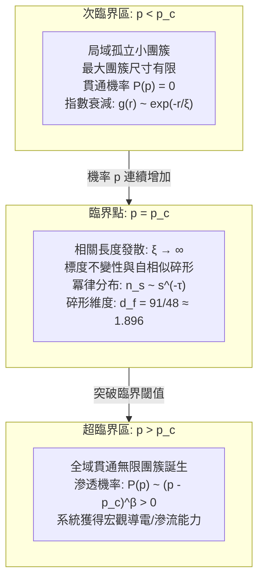

## 引言：從局部孤立到全局連通的劇烈躍遷

想像一個寧靜清晨沖泡手沖咖啡的場景：將研磨好的咖啡粉均勻平鋪在濾杯中，緩緩注入熱水。最初注入的幾滴水瞬間被咖啡粉顆粒之間的微孔隙完全吸收，僅潤濕了表層，濾杯底部沒有一滴液體流出。然而，隨著水流的持續注入，在某一精確的時刻，琥珀色的咖啡液突然開始以穩定的節律從濾杯底部滴落。流體分子在多孔介質中成功「滲透（Percolate）」，形成了一條從上表面貫通至底部頂點的宏觀通道。

這一流體穿透多孔介質的物理現象，正是現代機率論與統計物理學重要支柱——<strong>滲透理論（Percolation Theory / 滲流理論）</strong>的名字來源。1957年，英國數學家約翰·哈默斯利（John Hammersley）與西蒙·布羅德本特（Simon Broadbent）正式提出了該模型：
> 「在一個無限規則的點陣空間中，若相鄰節點以獨立的機率 $p$ 隨機建立連接，互不相連的微小團簇在何時、以何種機制突然連接成一個貫穿整個空間的無限網路？」

直覺上，人們可能會認為，當連接機率 $p$ 從 $0$ 平滑增加至 $1$ 時，連通團簇的規模也會平滑緩慢地增長。然而，大自然與數學所揭示的真理卻極其劇烈：只要機率 $p$ 哪怕比某個決定性閾值（<strong>臨界機率 $p_c$</strong>）低了百萬分之一，系統中生成的所有團簇規模都嚴格處於有限範圍之內，空間兩端絕不可能導通；而一旦 $p$ 超過 $p_c$ 哪怕極微小的量，一個橫跨整個系統的「無限團簇」便會以機率 1 驟然誕生，系統全局連通性發生不連續的劇烈飛躍。

這一現象是純粹的<strong>幾何相變（Geometric Phase Transition）</strong>。與水結成冰或鐵磁體在居里溫度磁化等傳統熱力學相變不同，滲透相變完全不需要溫度、能量或粒子間哈密頓量相互作用，而是<strong>僅憑機率與幾何連通拓撲</strong>自發湧現的有序化過程。

如今，滲透理論已廣泛應用於前沿交叉科學：
- <strong>流行病學大流行閾值</strong>：人際接觸傳染機率超過臨界閾值時，局部聚集性疫情如何突變為全球性大流行；
- <strong>現代電網與通信網路韌性</strong>：路由器或輸電節點隨機故障時，系統何處會觸發災難性大停電；
- <strong>森林火災蔓延動力學</strong>：林木密度超過臨界點導致山火瞬間失控；
- <strong>新型奈米複合導電材料</strong>：絕緣聚合物基體中摻入微量碳奈米管實現電導率躍遷的機理。

---

## 1. 滲透的基本數學模型：節點與連鍵

在數學上，我們在 $d$ 維歐幾里得空間 $\mathbb{R}^d$ 的無限規則格子圖 $G = (V, E)$ 上嚴格定義滲透模型。

### 1.1 鍵滲透（Bond Percolation）
所有格點 $V$ 均完好存在。每條連接相鄰格點的邊（鍵）$e \in E$ 以獨立機率 $p \in [0, 1]$ 處於「導通（Open）」狀態，以機率 $1 - p$ 處於「斷開（Closed）」狀態：
$$\mathbb{P}_p(\omega(e) = 1) = p, \quad \mathbb{P}_p(\omega(e) = 0) = 1 - p$$
通過連續導通邊相互連通的格點極大子集稱為一個<strong>團簇（Cluster）</strong>。

### 1.2 點滲透（Site Percolation）
所有邊均存在，但每個格點 $v \in V$ 以獨立機率 $p$ 被「占據（Occupied）」，以機率 $1 - p$ 為「空置（Empty）」。相鄰的被占據格點集合構成團簇。

數學上已嚴格證明：<strong>任何圖上的鍵滲透問題，都可以嚴格等價地重寫為其對應線圖（Line Graph）上的點滲透問題</strong>。因此，點滲透在結構上更為普適。

---

## 2. 臨界機率 $p_c$ 與對偶性嚴密解

### 2.1 序參量與臨界閾值定義
設原點 $0 \in V$ 所在的團簇為 $C(0)$。定義<strong>滲透機率（序參量）</strong> $P(p)$ 為包含原點的團簇規模為無限大的機率：
$$P(p) = \mathbb{P}_p(|C(0)| = \infty)$$
則臨界機率 $p_c$ 嚴格定義為：
$$p_c = \sup \{ p \in [0, 1] \mid P(p) = 0 \} = \inf \{ p \in [0, 1] \mid P(p) > 0 \}$$
根據柯爾莫哥洛夫 0-1 律，無限團簇存在的全空間機率在 $p < p_c$ 時嚴格為 0，在 $p > p_c$ 時嚴格為 1。並且伯頓-基恩定理（Burton-Keane Theorem）證明，在 $p > p_c$ 時，系統中<strong>有且僅有一個</strong>唯一的無限貫通團簇！

### 2.2 二維方格鍵滲透的嚴密解：凱斯滕定理（Kesten, 1980）
在二維方格格子 $\mathbb{Z}^2$ 上，利用平面圖的<strong>對偶格（Dual Lattice）</strong>性質，凱斯滕給出了數學物理史上的里程碑證明：
$$p_c^{\text{bond}}(\mathbb{Z}^2) = \frac{1}{2}$$

方格格子的對偶格仍是方格格子（自對偶性 $G^* \cong G$）。在有限正方形區域內，原格子存在橫向貫通導通路徑，與對偶格子存在縱向貫通斷開路徑，在拓撲上互斥且窮盡。在對稱點 $p = 1/2$ 處，貫通機率恰好對稱。凱斯滕通過嚴格的 RSW（Russo-Seymour-Welsh）交叉機率理論證明了相變點必然精確位於 $p = 1/2$。

---

## 3. 臨界現象、標度律與普適性（Universality）

### 3.1 相關長度 $\xi$ 的發散與自相似性
在未臨界區 $p < p_c$，兩點相連的機率隨距離 $r$ 指數衰減：$g(r) \sim \exp(-r/\xi)$。
當 $p \to p_c$ 時，表徵特徵尺度的<strong>相關長度 $\xi$ 發散至無窮大</strong>：
$$\xi(p) \propto |p - p_c|^{-\nu}$$
系統徹底失去了特徵空間尺度，從而在所有觀測尺度下展現出完美的<strong>標度不變性（Scale Invariance）</strong>。

### 3.2 臨界指數體系與普適類
在臨界點附近，所有物理量均服從具有代數奇點的冪律分布：
- <strong>滲透機率</strong>：$P(p) \propto (p - p_c)^\beta \quad (p > p_c)$
- <strong>有限團簇平均尺寸</strong>：$S(p) \propto |p - p_c|^{-\gamma}$
- <strong>團簇尺寸分布</strong>：$n_s(p_c) \propto s^{-\tau}$
- <strong>對相關函數</strong>：$g(r) \propto r^{-(d - 2 + \eta)}$

統計物理中極其震撼的結論是<strong>普適性（Universality）</strong>：雖然 $p_c$ 的具體數值取決於具體的格子微觀形狀，但<strong>臨界指數（$\nu, \beta, \gamma, \tau, \eta$）與格子的微觀幾何完全無關，僅由空間維度 $d$ 唯一決定！</strong>

二維空間下（$d=2$），臨界指數由共形場理論嚴格求得有理數解：
$$\nu = \frac{4}{3}, \quad \beta = \frac{5}{36}, \quad \gamma = \frac{43}{18}, \quad \tau = \frac{187}{91}$$

---

## 4. 臨界團簇的碎形幾何與骨架結構

在 $p = p_c$ 處誕生的新生無限團簇具有非整數的<strong>碎形維度（Fractal Dimension）</strong> $d_f$：
$$M(R) \propto R^{d_f}, \quad d_f = d - \frac{\beta}{\nu}$$
在二維中：
$$d_f = 2 - \frac{5/36}{4/3} = \frac{91}{48} \approx 1.8958$$

導電分解表明，臨界團簇包含：
1. <strong>死枝（Dangling Ends）</strong>：占團簇質量的絕大部分，不承載宏觀穩態電流；
2. <strong>導電骨架（Backbone）</strong>：承載電流的閉合環路網，碎形維數 $d_B \approx 1.64$；
3. <strong>紅鍵（Red Bonds / 致命切斷鍵）</strong>：單鍵斷裂即可導致全局斷電的特異點，其碎形維數嚴格為 $d_R = 1/\nu = 0.75$。

---

## 5. 二維共形場論與SLE（菲爾茲獎里程碑）

2001年，俄羅斯數學家斯塔尼斯拉夫·斯米爾諾夫（Stanislav Smirnov）嚴格證明了二維三角晶格點滲透在連續極限下滿足<strong>共形不變性（Conformal Invariance）</strong>，確立了卡迪公式（Cardy's Formula），並由此榮獲2006年菲爾茲獎。

隨後，奧德·施拉姆（Oded Schramm）創立的<strong>施拉姆-勒夫納演化（$\mathrm{SLE}_\kappa$）</strong>證明：臨界滲透團簇的外周邊界曲線嚴格服從 $\kappa = 6$ 的 $\mathrm{SLE}_6$ 隨機微分方程，其邊界碎形維度嚴格為：
$$d_h = 1 + \frac{\kappa}{8} = 1 + \frac{6}{8} = \frac{7}{4} = 1.75$$

---

## 6. 複雜網路上的滲透：無標度網路的韌性與阿喀琉斯之踵

在現實網際網路、航空網等度分布滿足冪律 $P(k) \sim k^{-\gamma_{\text{net}}}$（$2 < \gamma_{\text{net}} \le 3$）的<strong>無標度網路（Scale-Free Network）</strong>中：
- <strong>面對隨機故障時</strong>：因二階矩 $\langle k^2 \rangle \to \infty$，臨界閾值 $p_c = 0$！這意味著即使隨機破壞99%的節點，巨連通片依然存在，系統對隨機故障具有無限韌性。
- <strong>面對蓄意攻擊時</strong>：若定向攻擊度數最高的數個超級樞紐（Hub），$p_c$ 驟增，網路只需切除2%～5%的關鍵節點就會徹底粉碎性解體。

---

## 結語：純粹幾何湧現出的秩序奇蹟

滲透理論揭示了大自然最深沉的創生機理：即使底層個體完全混沌盲目、不存在任何全局指令或能量驅動，僅僅當局部連接機率跨越冷酷的臨界點 $p_c$ 時，宏觀的秩序、全局的連通與全新的物理功能便會自發誕生。從晨光中的一滴咖啡，到大腦億萬神經元的思維閃光，滲透的數學向我們展現了局部孤立躍遷至大域整體的無盡壯美。
