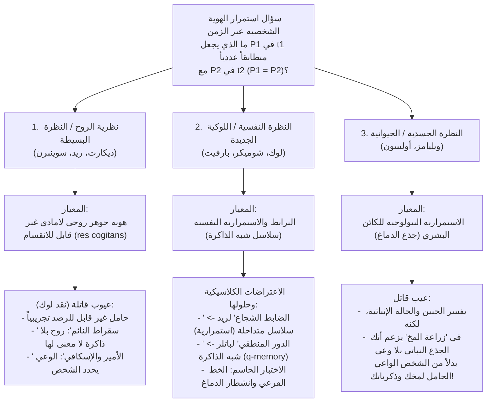
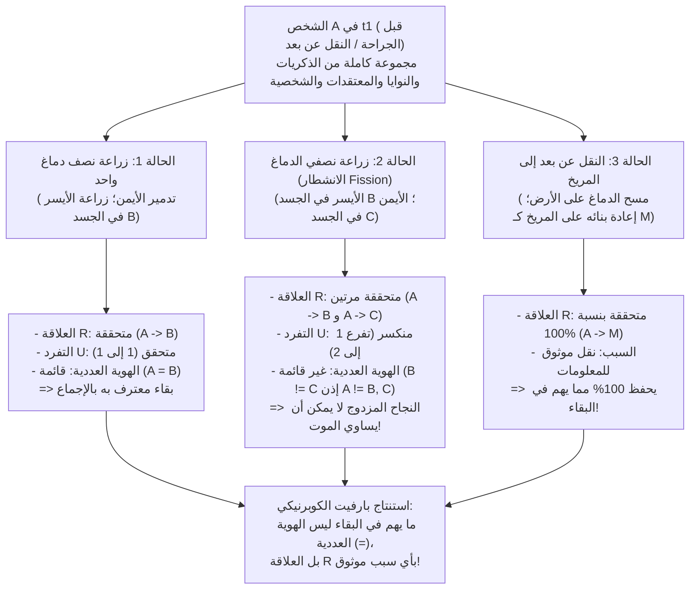

## 1. مقدمة: جهاز النقل عن بُعد إلى المريخ وسؤال الاستمرار عبر الزمن

### 1.1 تجربة الفكر لـ ديريك بارفيت: جهاز النقل عن بُعد (Teletransporter)

تخيل أنك في أواخر القرن الحادي والعشرين تستعد لرحلة عمل إلى مستعمرة على كوكب المريخ. بدلاً من قضاء ستة أشهر داخل مركبة فضائية، تدخل إلى مقصورة <strong>جهاز النقل عن بُعد (Teletransporter)</strong> على الأرض وتضغط الزر الأخضر. في تلك اللحظة تفقد الوعي فوراً. يقوم <strong>الماسح (Scanner)</strong> بتسجيل الحالة الذرية الدقيقة لجميع خلايا جسدك و86 مليار خلية عصبية و100 تريليون وصلة مشبكية في دماغك، <strong>مع تبخير (تدمير) دماغك وجسدك المادي على الأرض بالكامل</strong>، وإرسال هذا المخطط الرقمي بسرعة الضوء عبر موجات الراديو إلى المريخ. بعد ثلاث دقائق، يقوم <strong>المُستنسِخ (Replicator)</strong> على المريخ بتجميع ذرات الكربون والهيدروجين والأكسجين والنيتروجين المحلية لبناء جسد ودماغ عضويين مطابقين لحالتك على الأرض تماماً.

الشخص الذي يستيقظ في مقصورة المريخ يتذكر بوضوح أنه ضغط الزر الأخضر قبل ثوانٍ على الأرض، ويتذكر وعده لزوجته على الإفطار بالاتصال بها فور وصوله، بل ويرى في المرآة الجرح الصغير على خده الأيسر الذي أحدثه أثناء الحلاقة صباح اليوم على الأرض.

هنا يبرز السؤال الأكثر إثارة للقلق في الميتافيزيقا وفلسفة العقل:
<strong>هل الشخص الذي استيقظ على المريخ هو *أنت* حقاً؟</strong>
هل جهاز النقل عن بُعد هو أسرع وسيلة سفر في التاريخ البشري، أم أنك <strong>*متَّ* في اللحظة التي بخَّر فيها الماسح جسدك على الأرض</strong>، بينما الشخص الموجود على المريخ ليس سوى نسخة وليدة (منتحل غير متعمد) يعتقد خطأً أنه أنت؟

---

### 1.2 الهوية عبر الزمن: الهوية العددية مقابل الهوية النوعية

تصوغ الميتافيزيقا التحليلية <strong>سؤال استمرار الهوية الشخصية عبر الزمن (Diachronic Personal Identity)</strong> على النحو التالي:

>$$
>\textbf{سؤال الاستمرار:}\quad \text{ما هي الشروط الضرورية والكافية التي يكون بموجبها الشخص } P_1 \text{ الموجود في الزمن } t_1
>$$
>$$
>\text{متطابقاً عددياً } (P_1 = P_2) \text{ مع الشخص } P_2 \text{ الموجود في زمن لاحق } t_2\text{؟}
>$$

يجب التمييز بدقة بين مفهومين لـ «الهوية»:
1. <strong>الهوية النوعية (التشابه التام، $x \approx y$)</strong>: اشتراك كيانين في جميع الخصائص الجوهرية ($\forall \Phi \in \mathcal{F}_{\text{intrinsic}} (\Phi(x) \leftrightarrow \Phi(y))$), مثل كرتي بلياردو متماثلتين أو أنت ونسختك المريخية.
2. <strong>الهوية العددية ($x = y$)</strong>: لا تعني شيئين متشابهين، بل تعني حرفياً <strong>الكيان الواحد نفسه بعينه</strong>، الخاضع لقانون لايبنتز ($\forall \Phi (\Phi(x) \leftrightarrow \Phi(y))$).

الطفل ذو الـ 5 سنوات ($P_{5}$) والشيخ ذو الـ 80 عاماً ($P_{80}$) <strong>مختلفان نوعياً بشدة ($P_{5} \not\approx P_{80}$)</strong>، لكن الأخلاق والقانون يفترضان أنهما <strong>متطابقان عددياً ($P_{5} = P_{80}$)</strong>. في المقابل، النسخة على المريخ ($P_{\text{Mars}}$) <strong>مطابقة لك نوعياً بنسبة 100% ($P_{\text{Earth}} \approx P_{\text{Mars}}$)</strong>، غير أن ذلك وحده لا يضمن الهوية العددية ($P_{\text{Earth}} = P_{\text{Mars}}$). وتكمن أهمية الهوية العددية في أنها تدعم ثلاثة أركان للعقل العملي: (1) <strong>الاهتمام الأناني الخاص بمستقبلي (التوقع من الداخل)</strong>؛ (2) <strong>المسؤولية الأخلاقية والقانونية (العقاب والوعود)</strong>؛ و(3) <strong>التعويض عبر الزمن (تحمل المشقة اليوم من أجل سعادة الغد)</strong>.

---

## 2. النظريات الكلاسيكية الثلاث المتنافسة: الروح، الذاكرة، والجسد

### 2.1 نظرية الروح اللامادية (الأنا الديكارتية) ونقد جون لوك

يرى أفلاطون ورينيه ديكارت (*تأملات في الفلسفة الأولى*، 1641) وتوماس ريد وريتشارد سوينبرن أن الشخص في جوهره جوهر مفكر غير مادي وغير قابل للانقسام — <strong>روح لامادية (*res cogitans*)</strong>. وعلى خلاف «سفينة ثيسيوس» التي تُستبدل ألواحها تدريجياً، فإن الروح البسيطة لا أجزاء لها ولا تنقسم: $P_1 = P_2$ إذا وفقط إذا كان لهما نفس الجوهر الروحي ($S_1 = S_2$).

غير أن الفيلسوف التجريبي الإنجليزي <strong>جون لوك (John Locke)</strong> وجّه ضربة قاضية لهذه النظرية عام 1694 في الفصل 27 (*«في الهوية والاختلاف»*) من الكتاب الثاني لكتابه *مقال في الفهم البشري* عبر تجربتين فكريتين شهيرتين:
* <strong>سقراط مستيقظاً ونائماً (تناسخ الأرواح بلا ذاكرة)</strong>: لنفترض أن الروح اللامادية $S$ في جسدك هي نفس الجوهر الذي سكن جسد سقراط في أثينا القديمة، ولكن بعد محو جميع ذكريات سقراط وأفكاره. هل مجرد اشتراكك في حامل روحي غير مرئي وفاقد للذاكرة يجعلك <strong>نفس الشخص (Same Person)</strong> مع سقراط؟ كلا على الإطلاق — تماماً كما أن وجود ذرات كربون من جسد يوليوس قيصر في ظفرك لا يجعلك قيصر.
* <strong>الأمير والإسكافي (The Prince and the Cobbler)</strong>: لنفترض أن روح <strong>أمير</strong>، حاملةً معها كل وعي وذكريات حياته الملكية، دخلت في جسد <strong>إسكافي</strong> فقير. رغم أنه يبدو بيولوجياً «نفس الإنسان» (*Same Man* / الكائن البشري) كالإسكافي، فإنه كفاعل أخلاقي واعٍ (<strong>نفس الشخص / *Same Person*</strong>) يُعدّ في نظر الجميع هو <strong>الأمير</strong>، المسؤول فقط عن أفعال الأمير!

---

### 2.2 معيار الذاكرة عند لوك ومفارقتاه الكلاسيكيتان

يرى لوك أن «الشخص» هو <strong>مصطلح قضائي/أخلاقي (Forensic Term)</strong> ينسب الأفعال وما تستحقه من ثواب وعقاب، وأن هويته تقوم على <strong>الوعي وذاكرة الخبرة من منظور المتكلم</strong>:

>$$
>\textbf{معيار الذاكرة عند لوك:}\quad P_2 \text{ في } t_2 = P_1 \text{ في } t_1 \iff \text{يستطيع } P_2 \text{ في } t_2 \text{ أن يتذكر بوعي «من الداخل» خبرات } P_1 \text{ في } t_1.
>$$

واجه هذا المعيار اعتراضين منطقيين مدمرين في القرن الثامن عشر:

#### الاعتراض الأول: مفارقة «الضابط الشجاع» لتوماس ريد (1785) — خرق التعدي
أثبت الفيلسوف الاسكتلندي <strong>توماس ريد (Thomas Reid, 1785)</strong> أن معيار لوك يخرق <strong>خاصية التعدي للهوية العددية (Transitivity of Identity)</strong>:
* <strong>الصبى في سن 10 سنوات ($P_{10}$)</strong> جُلِد في المدرسة لسرقته تفاحاً من بستان.
* <strong>الضابط الشجاع في سن 30 سنة ($P_{30}$)</strong> استولى على راية العدو في معركة، ولا يزال يتذكر بوضوح جلده في سن العاشرة ($M(P_{30}, P_{10}) \implies P_{30} = P_{10}$).
* <strong>الجنرال المتقاعد في سن 80 سنة ($P_{80}$)</strong> يتذكر بفخر استيلاءه على الراية في سن الثلاثين ($M(P_{80}, P_{30}) \implies P_{80} = P_{30}$)، لكنه نسي تماماً واقعة الجلد في سن العاشرة ($\neg M(P_{80}, P_{10}) \implies P_{80} \neq P_{10}$).

بما أن الهوية العددية ($=$) هي <strong>علاقة تكافؤ (انعكاسية، تناظرية، ومتعدية: $A=B \land B=C \implies A=C$)</strong>، فإن $P_{80} = P_{30}$ و$P_{30} = P_{10}$ يستلزمان منطقياً $P_{80} = P_{10}$. لكن الذاكرة المباشرة $M$ <strong>ليست متعدية</strong>، مما يؤدي بمعيار لوك إلى التناقض الصريح <strong>$P_{80} = P_{10} \land P_{80} \neq P_{10}$</strong>!

* <strong>حل اللوكيين الجدد (Neo-Lockeanism)</strong>: ميّز الفلاسفة المعاصرون (غرايس، كوينتون، شوميكر، بارفيت) بين <strong>الترابط النفسي (Psychological Connectedness)</strong> — أي وجود روابط نفسية مباشرة (ذكريات، نوايا منفذة، معتقدات)، وهو يقبل التدرج و*غير متعدٍّ* — وبين <strong>الاستمرارية النفسية (Psychological Continuity)</strong>، المعرّفة بوصفها <strong>سلاسل متداخلة من الترابط القوي ($C_{\text{strong}}$)</strong> (الإغلاق المتعدي):
  $$\text{Continuity}(P_n, P_1) \iff \exists P_2, \dots, P_{n-1} \text{ بحيث } C_{\text{strong}}(P_1, P_2) \land \dots \land C_{\text{strong}}(P_{n-1}, P_n)$$
  وبذلك يرتبط الجنرال الثمانيني بالصبي ذي العشر سنوات عبر سلسلة يومية متصلة من الترابط القوي.

#### الاعتراض الثاني: اعتراض الدور المنطقي لجوزيف باتلر (1736) و«شبه الذاكرة ($q$-memory)»
اعترض الأسقف <strong>جوزيف باتلر (Joseph Butler, 1736)</strong> قائلاً: لكي نميز بين *التذكر الحقيقي* و*التذكر الظاهري أو الوهم* (كمريض يتوهم أنه نابليون في واترلو)، فإن مفهوم «التذكر الحقيقي» يفترض مسبقاً أن المتذكر <strong>متطابق عددياً</strong> مع من عاش التجربة! لذا فإن تعريف الهوية بالذاكرة يقع في دور منطقي فاسد (*«Consciousness of personal identity presupposes, and therefore cannot constitute, personal identity»*).

* <strong>حل سيدني شوميكر (1970) — شبه الذاكرة (Quasi-Memory / $q$-memory)</strong>:
  عرّف شوميكر <strong>شبه الذاكرة ($q$-memory)</strong> دون افتراض الهوية الشخصية: لديّ شبه ذاكرة دقيقة لتجربة $E$ إذا وفقط إذا (1) كان لديّ تذكر ظاهري من منظور المتكلم للتجربة $E$، و(2) كان <strong>شخص ما (Someone)</strong> قد عاش التجربة $E$ فعلاً في الماضي، و(3) كان تذكري الظاهري يعتمد سببياً بالطريقة الصحيحة (عبر آثار الدماغ أو نقل موثوق للمعلومات) على تلك التجربة $E$. وبتعريف الاستمرارية النفسية (العلاقة R) عبر شبه الذاكرة يزول الدور المنطقي تماماً.

---

### 2.3 المعيار الجسدي، لغز برنارد ويليامز، والحيوانية (Animalism)

* <strong>برنارد ويليامز، «الذات والمستقبل» (1970)</strong>:
  أظهر ويليامز كيف تنقلب حدوسنا حول نفس العملية الفيزيائية تبعاً لطريقة عرضها. فإذا قيل لـ $A$ و$B$ إن جهازاً سيبادل ذكرياتهما وشخصيتيهما بين دماغيهما قبل منح أحد الجسدين 100,000 دولار وتعذيب الآخر، يختار $A$ أن يحصل الجسد-$B$ (الذي سيستيقظ بذكريات $A$) على المال (تأييداً للمعيار النفسي). أما إذا قيل لـ $A$: «غداً سنعذب جسدك ($A$) بعد إحداث فقدان ذاكرة كامل لك ثم زرع نسخ من ذكريات $B$ في دماغك»، فإن $A$ يظل يرتعد خوفاً من الألم الذي سيصيب <strong>جسده هو ($A$)</strong> (تأييداً للمعيار الجسدي)!
* <strong>الحيوانية عند إريك أولسون (*The Human Animal*, 1997)</strong>:
  يؤكد أولسون أننا في جوهرنا كائنات حية بيولوجية من نوع *الإنسان العاقل (Homo sapiens)*. فلو كانت النظرية النفسية صحيحة، لما كنا قط <strong>جنيناً في الأسبوع الثاني عشر</strong>،ولكنا قد متنا عند الدخول في <strong>حالة إنباتية مستديمة (PVS)</strong> رغم استمرار الحيوان البشري في التنفس بفضل جذع الدماغ. غير أن الحيوانية تتهاوى أمام تجربة <strong>زراعة المخ (Cerebrum Transplant)</strong>: فإذا نُقل مخك الأعلى (مركز وعيك وذكرياتك) إلى جسد متبرع بينما أبقى جذع دماغك القديم جذعك الفاقد للوعي حياً، تضطر الحيوانية إلى القول العبثي إن *أنت* هو الجثة النباتية الفاقدة للوعي على سرير المستشفى!

---

## 3. ثورة ديريك بارفيت (*Reasons and Persons*, 1984): حالة الخط الفرعي وانشطار الدماغ

في الجزء الثالث من رائعته <strong>*Reasons and Persons* («الأسباب والأشخاص»، 1984)</strong>، قوّض فيلسوف أكسفورد <strong>ديريك بارفيت (1942–2017)</strong> الافتراض المشترك عبر ألفي عام من الجدل، مبرهناً على أن <strong>ما يهم عقلانياً في البقاء (Survival) ليس الهوية العددية ($P_1 = P_2$)، بل العلاقة R (الترابط والاستمرارية النفسية)!</strong>

---

### 3.1 حالة الخط الفرعي (Branch-Line Case) والطيف المشترك

* <strong>حالة الخط الفرعي (The Branch-Line Case)</strong>:
  يقوم ماسح جديد بمسح جسدك على الأرض *دون* تدميره، وينشئ نسختك على المريخ. تخرج من المقصورة على الأرض وتتحدث عبر الفيديو مع نسختك على المريخ. من الواضح أنك هنا وهو هناك: أنتما <strong>شخصان مختلفان عددياً ($P_{\text{Earth}} \neq P_{\text{Mars}}$)</strong>. ثم يخبرك الطبيب أن إشعاع الماسح الجديد أتلف عضلة قلبك على الأرض: <strong>ستتوفى على الأرض بقصور القلب بعد 3 أيام</strong>، بينما نسختك على المريخ تتمتع بقلب سليم وستعتني بأسرتك وتكمل كتابك.
  تأمل المفارقة: إن <strong>العلاقة الجوهرية السببية والنفسية (العلاقة R)</strong> بينك قبل ضغط الزر وبين النسخة على المريخ <strong>متطابقة بنسبة 100%</strong> في كلٍّ من النقل البسيط (الموت في 0 ثانية) والخط الفرعي (الموت بعد 3 أيام)! فكيف يمكن لحقيقة خارجية هي استمرار نبض قلبك على الأرض لمدة 72 ساعة إضافية أن تحول بقاءك على المريخ إلى موت تام؟!
* <strong>الطيف المشترك (The Combined Spectrum)</strong>:
  يستبدل جراح نسبة $\alpha \in [0\%, 100\%]$ من خلايا دماغك وجسدك بنسخ من خلايا الممثلة <strong>غريتا غاربو (Greta Garbo)</strong>. عند $\alpha = 0\%$ النتيجة هي <strong>أنت</strong>؛ وعند $\alpha = 100\%$ هي <strong>غريتا غاربو</strong>. لو كانت اللاريدية («نظرة الحقيقة الإضافية» / *Further Fact View*) صحيحة، لكان هناك حد فاصل حاد في المنتصف (مثلاً بين $49.999\%$ و$50.000\%$) يؤدي فيه استبدال خلية عصبية واحدة إلى اختفاء روحك فجأة وحلول روح غاربو! أما <strong>الاختزالية (Reductionism)</strong> عند بارفيت فتبيّن أنه عند $\alpha = 50\%$، بمجرد معرفتنا بدرجة الترابط المادي والنفسي نكون قد عرفنا كل الحقائق، ويغدو السؤال «هل هذا الشخص لا يزال أنا؟» <strong>سؤالاً فارغاً (Empty Question)</strong>.

---

### 3.2 حجة الانشطار عند ويغينز وبارفيت («انقسامي» / My Division)

حتى لو اشترط المرء أن تكون العلاقة R ناتجة عن <strong>سببها المادي الطبيعي (استمرار نفس الدماغ المادي)</strong>، فإن حجة <strong>الانشطار («My Division»)</strong> تثبت أن الهوية العددية ليست هي ما يهم.

يثبت علم الأعصاب السريري حقيقتين: (1) بعد <strong>استئصال نصف الكرة المخية (Hemispherectomy)</strong> يستطيع الإنسان البقاء كالشخص نفسه بنصف دماغ واحد؛ و(2) أثبتت أبحاث <strong>الدماغ المشطور (Split-Brain)</strong> لسبيري وغازانيغا أن قطع الجسم الثفني ينتج تيارين مستقلين من الوعي.

> <strong>[تجربة فكرية: انقسامي (My Division)]</strong>
> لنفترض أنك (<strong>$A$</strong>) أحد ثلاثة توائم متطابقة، وأن نصفي دماغك متناظران وظيفياً. بعد حادث تحطم فيه جسدك وبقي دماغك سليماً، بينما أصيب شقيقاك بموت دماغي مع بقاء جسديهما سليمين (<strong>الجسد $B$</strong> و<strong>الجسد $C$</strong>)، يقسم الجراح دماغك ويزرع <strong>النصف الأيسر في الجسد $B$ (ليفتي / Lefty)</strong> و<strong>النصف الأيمن في الجسد $C$ (رايتي / Righty)</strong>. يستيقظ كلاهما بنصف دماغك المادي الأصلي وبنسبة 100% من الاستمرارية النفسية (العلاقة R) معك!

ماذا حدث <strong>لي ($A$)</strong>؟ وفق المنطق الصارم للهوية العددية ($=$)، لا توجد سوى أربعة احتمالات:
1. <strong>$A$ هو $B$ و$C$ معاً ($A = B \land A = C$)</strong>: يخرق <strong>تعدي الهوية</strong> ($B = A \land A = C \implies B = C$)! لكن ليفتي ورايتي شخصان منفصلان ($B \neq C$) يمكنهما لعب التنس أحدهما ضد الآخر.
2. <strong>$A = B$ فقط</strong>، أو 3. <strong>$A = C$ فقط</strong>: تحكمي تماماً ويخرق التناظر و<strong>مبدأ الجوهرية (Only-$x$-and-$y$ Principle)</strong>! فلو تلف النصف الأيمن لنجوتَ حتماً كـ ليفتي ($A = B$). كيف يمكن لنجاح عملية في الغرفة المجاورة أن يمنع ليفتي من أن يكون أنت؟
4. <strong>$A$ ليس $B$ ولا $C$ ($A \neq B \land A \neq C$)</strong>: تتطلب الهوية العددية، إلى جانب العلاقة R، <strong>شرط عدم التفرع (التفرد $U$)</strong>:
   $$\text{الهوية }(A = X) \iff R(A, X) \land U(A, X)$$

<strong>النتيجة الثورية لبارفيت</strong>:
هل ينبغي أن تعتبر نجاح زراعة كلا نصفي دماغك <strong>موتاً</strong> لك لمجرد انكسار شرط التفرد $U$؟!
<strong>عبث محض!</strong> إذا نجا نصف واحد، فإنك تنجو. <strong>فكيف يمكن لـ «نجاح مزدوج» (نجاة كلا النصفين!) أن يكون «فشلاً ذريعاً» (الموت)؟!</strong> لو كانت الهوية العددية هي ما يهم، لتوجب عليك رشوة الممرضة قبل العملية لتدمير نصف دماغك الأيمن فقط للحفاظ على شرط التفرد $U$!
إذن: <strong>ما يهم عقلانياً في البقاء ليس الهوية العددية ($=$)، بل العلاقة R (الترابط والاستمرارية النفسية)!</strong>

---

## 4. جدول مقارن للنظريات الخمس الكبرى في الهوية الشخصية

| النظرية الفلسفية | أبرز الفلاسفة | معيار الهوية / البقاء | الحكم على «الضابط الشجاع» لريد | زراعة المخ (بقاء جذع الدماغ في حالة إنباتية) | انشطار الدماغ (ليفتي $B$ ورايتي $C$) | جهاز النقل إلى المريخ |
| :--- | :--- | :--- | :--- | :--- | :--- | :--- |
| <strong>1. نظرية الروح (النظرة البسيطة)</strong> | ديكارت، ريد، سوينبرن | بقاء جوهر روحي لامادي غير قابل للانقسام ($S$) | الجنرال = الصبي إذا بقيت نفس الروح $S$ | يستحيل معرفة أي جسد تتبعه الروح | الروح لا تنقسم؛ تدخل عشوائياً في $B$ أو $C$ أو لا أحد | <strong>موت</strong>، ما لم تنتقل الروح مع موجات الراديو |
| <strong>2. معيار الذاكرة الكلاسيكي</strong> | جون لوك (1694) | ذاكرة الخبرة المباشرة من منظور المتكلم $M(P_2, P_1)$ | <strong>يفشل</strong>: يخرق تعدي الهوية ($P_{80}=P_{30}=P_{10}$ لكن $P_{80}\neq P_{10}$) | تنتقل مع المخ المزروع الحامل للذكريات | يناقض التعدي ($B=C$) لأن كليهما يتذكر | <strong>بقاء</strong> (لكنه عرضة لاعتراض الدور لباتلر) |
| <strong>3. الحيوانية (النظرة البيولوجية)</strong> | إريك أولسون (1997)، سنودون | استمرارية الكائن الحي البيولوجي (*Homo sapiens* عبر جذع الدماغ) | الجنرال = الصبي لأنهما نفس الحيوان البشري | <strong>مخالف للحدس</strong>: أنت تظل الجذع النباتي الفاقد للوعي! | ينتهي الكائن الأصلي وينشأ اثنان جديدان | <strong>موت</strong>: لأن الكائن الأرضي دُمِّر |
| <strong>4. اللوكية الجديدة الضيقة</strong> | شوميكر (مبكراً)، ويغينز | استمرارية نفسية غير متفرعة ($R \land U$) مع <strong>سبب طبيعي</strong> (نفس الدماغ) | يُحل عبر سلاسل الترابط القوي المتداخلة وشبه الذاكرة | تنتقل مع المخ المزروع | تفشل الهوية العددية ($A \neq B, C$) لانكسار التفرد $U$ | <strong>موت</strong>، لأن الدماغ المادي دُمِّر |
| <strong>5. اختزالية بارفيت (العلاقة R الواسعة)</strong> | <strong>ديريك بارفيت</strong> (1984)، ديفيد لويس | <strong>الهوية ($=$) ليست ما يهم؛ المهم هو العلاقة R بأي سبب موثوق</strong> | الاستمرارية قائمة، وإن ضعف الترابط المباشر بعد 70 عاماً | بقاء بنسبة 100% في متلقي المخ عبر العلاقة R | تغيب الهوية العددية، لكن <strong>يتحقق بقاء مزدوج بفضل العلاقة R المزدوجة!</strong> | <strong>بقاء كامل (ما يهم)</strong>: العلاقة R محفوظة بنسبة 100%! |

---

## 5. التحرر من «النفق الزجاجي»: نظرية الحزمة، الأخلاق، وطمأنينة الموت

تُظهر اختزالية بارفيت أن الشخص عبر الزمن، شأنه شأن <strong>الأمة</strong> أو <strong>النادي</strong>، ليس سوى سلسلة من الأحداث الجسدية والذهنية المترابطة بالعلاقة R — مما يحيي <strong>نظرية حزمة الإدراكات (Bundle Theory)</strong> عند <strong>ديفيد هيوم</strong> (*رسالة في الطبيعة البشرية*، 1739) وعقيدة <strong>اللا-ذات (*Anattā*)</strong> البوذية في حوار *ميليندا بانها* (تشبيه العربة وانتقال الشعلة من شمعة إلى أخرى).

ولأن <strong>الترابط النفسي</strong> مسألة درجات تضعف عبر العقود (كما في <strong>حالة متوشالح</strong> أو <strong>النبيل الروسي الشاب في القرن التاسع عشر</strong> الذي يطلب من زوجته أن ترفض طلب «ذاته اللاحقة» المحافظة بإلغاء التبرع بالأراضي للفلاحين)، فإن الاختزالية تغير نظرتنا للأخلاق والموت. وفي ختام الفصل 13 من *Reasons and Persons*، كتب بارفيت اعترافه الوجودي الشهير:

> *«عندما كنت أعتقد أن وجودي حقيقة إضافية منفصلة، بدت حياتي مثل <strong>نفق زجاجي (a glass tunnel)</strong> أتحرك فيه بسرعة أكبر كل عام، وفي نهايته ظلام. وعندما غيّرت رأيي، اختفت جدران نفقي الزجاجي. <strong>أنا أعيش الآن في الهواء الطلق (in the open air).</strong> صار الآخرون أقرب إليّ. إن موتي سيقطع العلاقات الأكثر مباشرة بين خبراتي الحالية والخبرات المستقبلية، لكنه لن يقطع علاقات أخرى متنوعة. والآن بعد أن رأيت هذا، يبدو لي موتي أقل سوءاً.»* (Derek Parfit, *Reasons and Persons*, 1984, p. 281)
