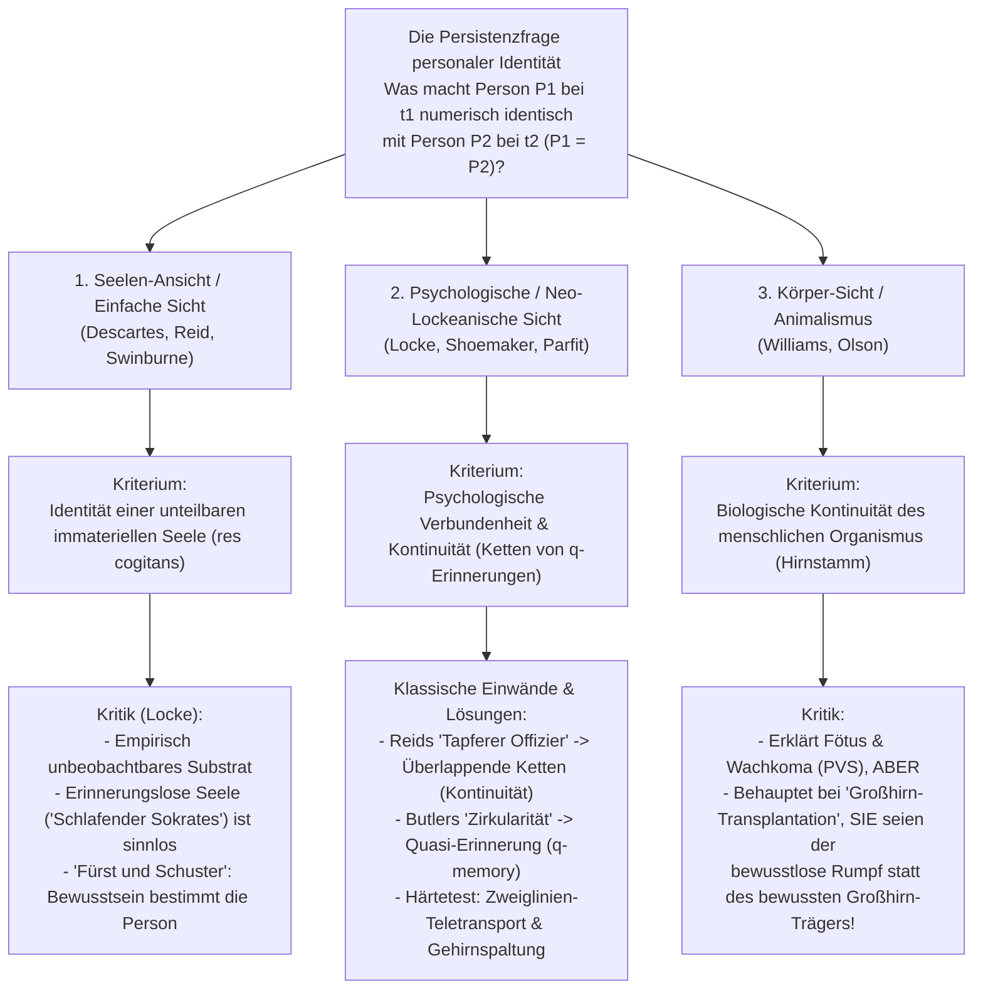
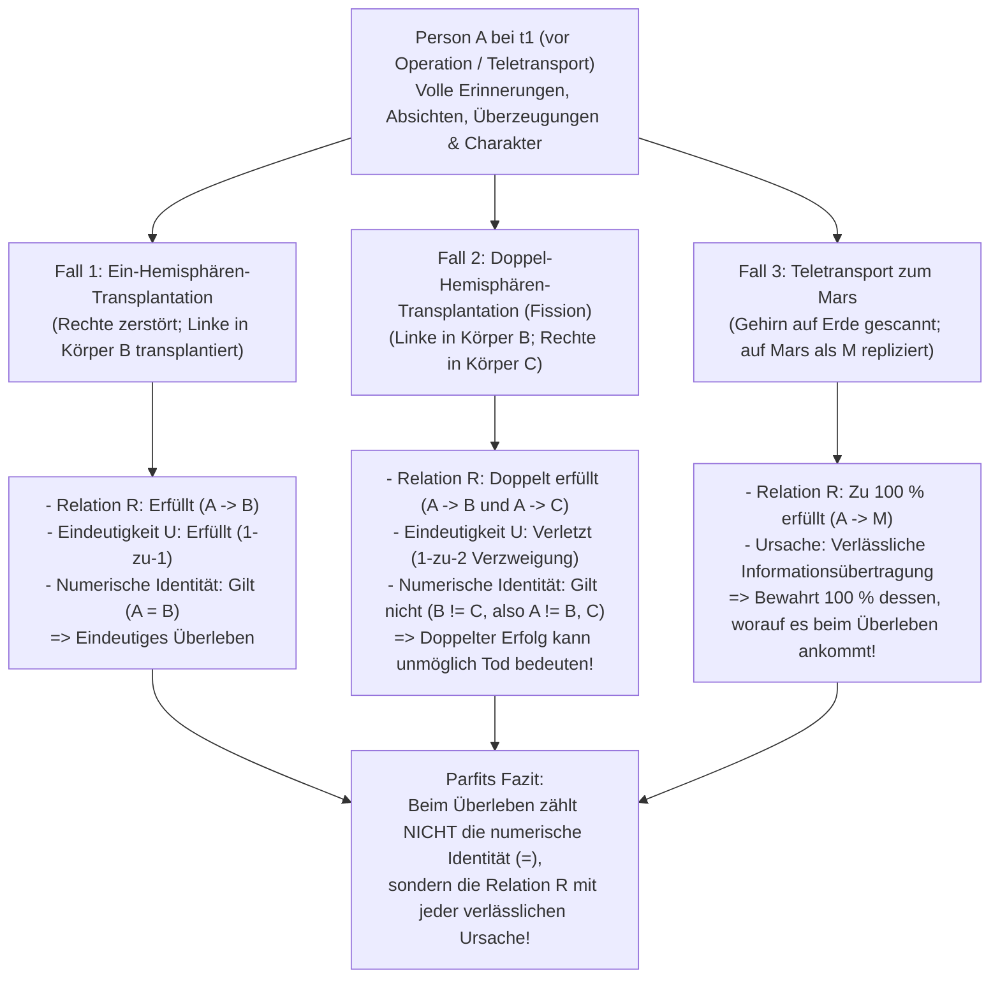

## 1. Einleitung: Der Teletransporter zum Mars und die Frage nach der diachronen Identität

### 1.1 Derek Parfits Teletransporter-Gedankenexperiment

Stellen Sie sich vor, Sie treten im späten 21. Jahrhundert in die Kabine eines <strong>Teletransporters</strong> auf der Erde, um geschäftlich zum Mars zu reisen. Sobald Sie den grünen Knopf drücken, verlieren Sie das Bewusstsein. Der <strong>Scanner</strong> zeichnet die exakten atomaren Positionen und synaptischen Zustände aller 86 Milliarden Neuronen Ihres Gehirns und aller Zellen Ihres Körpers auf, <strong>verdampft dabei Ihren physischen Körper auf der Erde vollständig</strong> und sendet das Informationsmuster mit Lichtgeschwindigkeit per Funksignal zum Mars. Drei Minuten später setzt der <strong>Replikator</strong> auf dem Mars aus lokalen Kohlenstoff-, Wasserstoff-, Sauerstoff- und Stickstoffatomen einen organischen Körper und ein Gehirn zusammen, die Ihrem Zustand auf der Erde bis ins kleinste Detail gleichen.

Die Person, die auf dem Mars erwacht, erinnert sich nahtlos daran, vor wenigen Sekunden auf der Erde den grünen Knopf gedrückt zu haben, erinnert sich an das Versprechen beim Frühstück, ihre Ehefrau sofort anzurufen, und entdeckt im Spiegel sogar den winzigen Rasurschnitt an der linken Wange von heute Morgen.

Damit stehen wir vor einer der tiefsten Fragen der Metaphysik und Philosophie des Geistes:
<strong>Ist die Person, die auf dem Mars aufwacht, wirklich *Sie*?</strong>
Ist der Teletransporter das schnellste Transportmittel aller Zeiten – oder sind <strong>*Sie* in dem Moment gestorben, als Ihr Körper auf der Erde verdampft wurde</strong>, während auf dem Mars lediglich ein frisch erschaffenes Duplikat (ein Hochstapler wider Willen) erwacht ist?

---

### 1.2 Diachrone Identität: Numerische vs. Qualitative Identität

In der analytischen Metaphysik lautet die <strong>Frage nach der Persistenz personaler Identität über die Zeit (Diachronic Personal Identity)</strong>:

>$$
>\textbf{Persistenzfrage:}\quad \text{Unter welchen notwendigen und hinreichenden Bedingungen ist eine Person } P_1 \text{ zum Zeitpunkt } t_1
>$$
>$$
>\text{numerisch identisch } (P_1 = P_2) \text{ mit einer Person } P_2 \text{ zu einem späteren Zeitpunkt } t_2\text{?}
>$$

Hierbei ist die logische Unterscheidung zwischen zwei Begriffen von „Identität“ entscheidend:
1. <strong>Qualitative Identität (Exakte Ähnlichkeit, $x \approx y$)</strong>: Zwei Objekte teilen alle intrinsischen Eigenschaften ($\forall \Phi \in \mathcal{F}_{\text{intrinsic}} (\Phi(x) \leftrightarrow \Phi(y))$), wie zwei baugleiche Billardkugeln oder Sie und Ihr Mars-Replikat.
2. <strong>Numerische Identität ($x = y$)</strong>: Es handelt sich nicht um zwei ähnliche Dinge, sondern buchstäblich um <strong>ein und dasselbe einzige Seiende</strong> (wie „Morgenstern“ und „Abendstern“ denselben Planeten Venus bezeichnen), geregelt durch das Leibnizsche Gesetz ($\forall \Phi (\Phi(x) \leftrightarrow \Phi(y))$).

Ein 5-jähriges Kind ($P_{5}$) und der 80-jährige Greis ($P_{80}$) sind <strong>qualitativ radikal verschieden ($P_{5} \not\approx P_{80}$)</strong>, gelten aber moralisch und rechtlich als <strong>numerisch identisch ($P_{5} = P_{80}$)</strong>. Umgekehrt ist das Mars-Replikat ($P_{\text{Mars}}$) <strong>100 % qualitativ identisch ($P_{\text{Earth}} \approx P_{\text{Mars}}$)</strong> mit Ihnen, was aber noch keine numerische Identität ($P_{\text{Earth}} = P_{\text{Mars}}$) beweist. Numerische Identität trägt drei Säulen unserer praktischen Vernunft: (1) <strong>Besondere egoistische Sorge um die eigene Zukunft (Antizipation von innen)</strong>, (2) <strong>Moralische und rechtliche Verantwortung (Schuld und Versprechen)</strong> sowie (3) <strong>Intertemporale Kompensation (heutige Mühe für morgiges Glück)</strong>.

---

## 2. Der klassische Dreikampf: Seele, Erinnerung und Körper

### 2.1 Die Seelen-Ansicht (Kartesisches Ego) und John Lockes Kritik

Nach Platon, René Descartes (*Meditationes*, 1641), Thomas Reid und Richard Swinburne besteht die Person im Kern aus einer unteilbaren, unkörperlichen denkenden Substanz – einer <strong>immateriellen Seele (*res cogitans*)</strong>. Da eine einfache Substanz keine Teile hat, kann sie sich nicht wie das „Schiff des Theseus“ graduell verändern oder teilen; $P_1 = P_2$ gilt genau dann, wenn dieselbe Seelensubstanz $S_1 = S_2$ vorliegt.

Doch der britische Empirist <strong>John Locke</strong> widerlegte diese Ansicht 1694 in der 2. Auflage seines *Essay Concerning Human Understanding* (Buch II, Kap. 27 *„Of Identity and Diversity“*) mit zwei berühmten Gedankenexperimenten:
* <strong>Der schlafende Sokrates / Seelenwanderung ohne Erinnerung</strong>: Angenommen, Ihre immaterielle Seelensubstanz $S$ war einst im Körper des antiken Philosophen Sokrates, wurde aber vor Ihrer Geburt aller Erinnerungen beraubt. Macht das bloße Teilen eines unsichtbaren, erinnerungslosen Seelen-Substrats Sie zur <strong>selben Person</strong> wie Sokrates? Keineswegs – ebenso wenig wie Kohlenstoffatome aus Caesars Körper in Ihrem Fingernagel Sie zu Caesar machen.
* <strong>Der Fürst und der Schuster (The Prince and the Cobbler)</strong>: Angenommen, das Bewusstsein und sämtliche Erinnerungen eines <strong>Fürsten</strong> ziehen in den Körper eines <strong>Schusters</strong> ein. Obwohl der Mann biologisch gesehen derselbe menschliche Organismus (Lockes <strong>*Same Man*</strong>) wie der Schuster bleibt, ist er als moralisch verantwortliches Subjekt (<strong>*Same Person*</strong>) eindeutig der <strong>Fürst</strong>!

---

### 2.2 Lockes Erinnerungskriterium und seine zwei klassischen Paradoxa

Locke definierte „Person“ als einen <strong>forensischen Begriff (Forensic Term)</strong> und verankerte personale Identität im <strong>Bewusstsein bzw. der erstpersönlichen Erfahrungserinnerung</strong>:

>$$
>\textbf{Lockes Erinnerungskriterium:}\quad P_2 \text{ bei } t_2 = P_1 \text{ bei } t_1 \iff P_2 \text{ kann sich bei } t_2 \text{ „von innen“ bewusst an die Erfahrungen von } P_1 \text{ bei } t_1 \text{ erinnern.}
>$$

Gegen dieses Kriterium erhoben Philosophen des 18. Jahrhunderts zwei gravierende logische Einwände:

#### Einwand 1: Thomas Reids „Paradox des tapferen Offiziers“ (1785) – Verletzung der Transitivität
Der schottische Philosoph <strong>Thomas Reid (1785)</strong> zeigte, dass Lockes Kriterium gegen die <strong>Transitivität der numerischen Identität</strong> verstößt:
* Der <strong>10-jährige Junge ($P_{10}$)</strong> wird in der Schule ausgepeitscht, weil er Äpfel gestohlen hat.
* Der <strong>30-jährige tapfere Offizier ($P_{30}$)</strong> erobert im Krieg eine feindliche Standarte und erinnert sich noch genau an die Auspeitschung mit 10 Jahren ($M(P_{30}, P_{10}) \implies P_{30} = P_{10}$).
* Der <strong>80-jährige pensionierte General ($P_{80}$)</strong> erinnert sich lebhaft an die Eroberung der Standarte mit 30 Jahren ($M(P_{80}, P_{30}) \implies P_{80} = P_{30}$), hat aber das Auspeitschen im Alter von 10 Jahren völlig vergessen ($\neg M(P_{80}, P_{10}) \implies P_{80} \neq P_{10}$).

Da die numerische Identität ($=$) eine <strong>Äquivalenzrelation (reflexiv, symmetrisch und transitiv: $A=B \land B=C \implies A=C$)</strong> ist, folgt aus $P_{80} = P_{30}$ und $P_{30} = P_{10}$ zwingend $P_{80} = P_{10}$. Da direkte Erinnerung $M$ jedoch <strong>nicht transitiv</strong> ist, führt Lockes Kriterium zum logischen Widerspruch <strong>$P_{80} = P_{10} \land P_{80} \neq P_{10}$</strong>!

* <strong>Die Neo-Lockeanische Lösung</strong>: Moderne Neo-Lockeaner (Grice, Quinton, Shoemaker, Parfit) unterscheiden zwischen <strong>psychologischer Verbundenheit (Psychological Connectedness)</strong> – dem Bestehen direkter psychologischer Verbindungen (Erinnerungen, Absichten, Überzeugungen), das graduell und *nicht transitiv* ist – und <strong>psychologischer Kontinuität (Psychological Continuity)</strong>, definiert als <strong>überlappende Ketten starker Verbundenheit ($C_{\text{strong}}$)</strong> (der transitive Abschluss):
  $$\text{Continuity}(P_n, P_1) \iff \exists P_2, \dots, P_{n-1} \text{ s.t. } C_{\text{strong}}(P_1, P_2) \land \dots \land C_{\text{strong}}(P_{n-1}, P_n)$$
  Dadurch ist der 80-jährige General über eine lückenlose Kette täglicher starker Verbundenheit transitiv mit dem 10-jährigen Jungen verbunden.

#### Einwand 2: Joseph Butlers Zirkularitätseinwand (1736) und Shoemakers „Quasi-Erinnerung ($q$-memory)“
Bischof <strong>Joseph Butler (1736)</strong> wandte ein: Um eine *echte Erinnerung* (Genuine Memory) von einer bloßen *Scheinerinnerung / Wahnvorstellung* (wie bei jemandem, der glaubt, Napoleon bei Waterloo gewesen zu sein) zu unterscheiden, setzt der Begriff „echte Erinnerung“ bereits voraus, dass der Erinnernde mit der damaligen Person <strong>numerisch identisch</strong> ist! Lockes Definition dreht sich daher im Kreis (*„Consciousness of personal identity presupposes, and therefore cannot constitute, personal identity“*).

* <strong>Sydney Shoemakers Lösung (1970) – Quasi-Erinnerung ($q$-memory)</strong>:
  Shoemaker definierte <strong>Quasi-Erinnerung ($q$-memory)</strong> ohne jeden Rückgriff auf Identität: Ich habe eine genaue Quasi-Erinnerung an eine Erfahrung $E$ genau dann, wenn (1) ich eine scheinbare erstpersönliche Erinnerung an $E$ habe, (2) <strong>jemand (Someone)</strong> tatsächlich diese Erfahrung $E$ hatte und (3) meine scheinbare Erinnerung in der <strong>richtigen Art kausaler Abhängigkeit</strong> (z. B. durch Gehirnspuren oder verlässlichen Informationstransfer) von $E$ steht. Damit lässt sich psychologische Kontinuität (Relation R) völlig zirkelfrei definieren.

---

### 2.3 Körperkriterium, Bernard Williams’ Rätsel und Animalismus

* <strong>Bernard Williams’ „The Self and the Future“ (1970)</strong>:
  Williams zeigte, wie derselbe physische Vorgang je nach Beschreibung gegensätzliche Intuitionen weckt: Werden die Erinnerungen und Charakterzüge von $A$ und $B$ zwischen ihren Gehirnen ausgetauscht, wünscht sich $A$ im Voraus, dass der $B$-Körper (mit $A$s Erinnerungen) 100.000 Dollar erhält und der $A$-Körper gefoltert wird (Psychologische Sicht). Wird $A$ jedoch angekündigt: „Morgen wirst *du* ($A$-Körper) gefoltert, nachdem wir bei dir erst Amnesie ausgelöst und dann Erinnerungskopien von $B$ eingepflanzt haben“, fürchtet $A$ weiterhin panisch den Schmerz im <strong>eigenen $A$-Körper</strong> (Körper-Sicht)!
* <strong>Eric Olsons Animalismus (*The Human Animal*, 1997)</strong>:
  Nach Olson sind wir fundamental biologische Organismen der Spezies *Homo sapiens*. Wäre die psychologische Sicht wahr, wären wir niemals ein <strong>12 Wochen alter Fötus</strong> gewesen und würden im <strong>persistierenden vegetativen Zustand (Wachkoma / PVS)</strong> aufhören zu existieren, obwohl das biologische Tier (gesteuert durch den Hirnstamm) weiteratmet. Doch der Animalismus scheitert am <strong>Großhirn-Transplantations-Fall (Cerebrum Transplant)</strong>: Wird Ihr Großhirn (Sitz Ihres gesamten Bewusstseins und Ihrer Erinnerungen) in einen Spenderkörper verpflanzt, während Ihr alter Hirnstamm den kopflosen/großhirnlosen Rumpf am Leben hält, muss der Animalismus absurd behaupten, *Sie* seien der bewusstlose Rumpf im Krankenbett!

---

## 3. Derek Parfits Revolution (*Reasons and Persons*, 1984): Zweiglinien-Fall und Gehirnspaltung (Fission)

In Teil III seines Meisterwerks <strong>*Reasons and Persons* (1984)</strong> vollzog der Oxforder Philosoph <strong>Derek Parfit (1942–2017)</strong> eine kopernikanische Wende: Er bewies, dass <strong>es beim Überleben vernünftigerweise gar nicht auf die numerische Identität ($P_1 = P_2$) ankommt, sondern auf die Relation R (psychologische Verbundenheit und Kontinuität)!</strong>

---

### 3.1 Der Zweiglinien-Fall (Branch-Line Case) und das Kombinierte Spektrum

* <strong>Der Zweiglinien-Fall (The Branch-Line Case)</strong>:
  Ein neuer Scanner scannt Ihren Körper auf der Erde, *ohne* ihn zu zerstören, und erstellt Ihr Replikat auf dem Mars. Sie treten auf der Erde aus der Kabine und sprechen per Video mit Ihrem Mars-Replikat. Offensichtlich sind Sie hier auf der Erde und er dort auf dem Mars <strong>zwei numerisch verschiedene Personen ($P_{\text{Earth}} \neq P_{\text{Mars}}$)</strong>. Dann eröffnet Ihnen der Arzt, dass der neue Scanner Ihr Herz auf der Erde geschädigt hat: <strong>Sie auf der Erde werden in 3 Tagen an Herzversagen sterben</strong>, während Ihr gesundes Mars-Replikat Ihre Familie lieben und Ihr Buch vollenden wird.
  Der entscheidende Punkt: Die <strong>intrinsische kausale und psychologische Relation (Relation R)</strong> zwischen Ihnen vor dem Knopfdruck und dem Mars-Replikat ist beim einfachen Teletransport (Tod nach 0 Sekunden) und beim Zweiglinien-Fall (Tod nach 3 Tagen) <strong>zu 100 % identisch</strong>! Wie könnte das bloße Weiterleben Ihres Erdenkörpers für drei Tage darüber entscheiden, ob das Weiterleben auf dem Mars „Überleben“ oder „Tod“ bedeutet?!
* <strong>Das Kombinierte Spektrum (The Combined Spectrum)</strong>:
  Ein Chirurg ersetzt schrittweise einen Anteil $\alpha \in [0\%, 100\%]$ Ihrer Gehirn- und Körperzellen durch exakte Kopien der Zellen von <strong>Greta Garbo</strong>. Bei $\alpha = 0\%$ sind eindeutig <strong>Sie</strong> das Resultat, bei $\alpha = 100\%$ eindeutig <strong>Greta Garbo</strong>. Wäre die nicht-reduktionistische „Further Fact View“ wahr, müsste es in der Mitte (etwa zwischen $49{,}999\%$ und $50{,}000\%$) eine scharfe metaphysische Grenze geben, an der der Austausch eines einzigen Neurons plötzlich Ihre Seele verschwinden und Garbos Seele erscheinen lässt! Parfits <strong>Reduktionismus</strong> zeigt dagegen: Bei $\alpha = 50\%$ kennen wir bereits alle Tatsachen; die Frage, ob diese Person noch „ich“ ist, ist eine <strong>leere Frage (Empty Question)</strong>.

---

### 3.2 Wiggins’ und Parfits Spaltungs-Argument (Fission / „My Division“)

Selbst wer verlangt, dass Relation R durch das <strong>Weiterbestehen desselben physischen Gehirns</strong> verursacht sein muss, wird durch Parfits <strong>Spaltungs-Argument (My Division)</strong> widerlegt.

Die klinische Neurowissenschaft belegt: (1) Nach einer <strong>Hemisphärektomie</strong> kann ein Mensch mit nur einer einzigen Großhirnhemisphäre als dieselbe Person überleben; (2) die <strong>Split-Brain-Forschung</strong> (Roger Sperry & Michael Gazzaniga) zeigt, dass nach Durchtrennung des *Corpus callosum* zwei unabhängige Bewusstseinsströme in beiden Hemisphären existieren können.

> <strong>[Gedankenexperiment: Meine Teilung (My Division)]</strong>
> Sie (<strong>$A$</strong>) sind einer von eineiigen Drillingen, und Ihre beiden Großhirnhemisphären sind funktionell vollkommen symmetrisch. Nach einem Unfall ist Ihr Körper tödlich verletzt, Ihr Gehirn aber intakt; Ihre beiden Brüder sind hirntot, ihre Körper (<strong>Körper $B$</strong> und <strong>Körper $C$</strong>) aber unversehrt.
> Der Chirurg teilt Ihr Gehirn und transplantiert Ihre <strong>linke Hemisphäre in Körper $B$ (Lefty)</strong> und Ihre <strong>rechte Hemisphäre in Körper $C$ (Righty)</strong>. Beide erwachen mit der Hälfte Ihres physischen Gehirns und 100 % psychologischer Kontinuität und Verbundenheit (Relation R) zu Ihnen!

Was ist mit <strong>mir ($A$)</strong> geschehen? Für die strikte numerische Identität ($=$) gibt es logisch nur vier Optionen:
1. <strong>$A$ ist sowohl $B$ als auch $C$ ($A = B \land A = C$)</strong>: Verletzt die <strong>Transitivität der Identität</strong> ($B = A \land A = C \implies B = C$)! Doch Lefty und Righty sind zwei verschiedene Personen ($B \neq C$), die gegeneinander Tennis spielen können.
2. <strong>$A = B$ allein</strong>, oder 3. <strong>$A = C$ allein</strong>: Völlig willkürlich und ein Verstoß gegen Symmetrie und das <strong>Prinzip der Intrinsität (Only-$x$-and-$y$ Principle)</strong>! Wäre die rechte Hemisphäre vor der Operation zerstört worden, hätten Sie zweifellos als Lefty überlebt ($A = B$). Wie kann der Erfolg einer Operation im Nachbarraum verhindern, dass Lefty Sie sind?
4. <strong>$A$ ist weder $B$ noch $C$ ($A \neq B \land A \neq C$)</strong>: Numerische Identität erfordert neben Relation R eine formale <strong>Nicht-Verzweigungs-Bedingung (Eindeutigkeit $U$)</strong>:
   $$\text{Identität }(A = X) \iff R(A, X) \land U(A, X)$$

<strong>Parfits revolutionäre Schlussfolgerung</strong>:
Wenn bei der Spaltung weder $B$ noch $C$ numerisch identisch mit $A$ ist, sollten Sie die erfolgreiche Transplantation *beider* Gehirnhälften als Ihren <strong>Tod</strong> betrachten?!
<strong>Absurd!</strong> Wenn eine Gehirnhälfte überlebt, überleben Sie. <strong>Wie könnte ein DOPPELTER ERFOLG (beide Gehirnhälften überleben!) ein TOTALER MISSERFOLG (Tod) sein?!</strong> Wäre numerische Identität das, worauf es ankommt, müssten Sie vor der Operation die Krankenschwester bestechen, Ihre rechte Gehirnhälfte zu vernichten, nur um die Eindeutigkeitsbedingung $U$ zu retten!
Folglich gilt: <strong>Worauf es beim Überleben vernünftigerweise ankommt (What matters in survival), ist NICHT die numerische Identität ($=$), sondern die Relation R (psychologische Verbundenheit und Kontinuität)!</strong>

---

## 4. Vergleichsmatrix der fünf Haupttheorien personaler Identität

| Philosophische Theorie | Hauptvertreter | Kriterium für Identität / Überleben | Urteil zu Reids „Tapferem Offizier“ | Großhirn-Transplantation (Hirnstamm im Wachkoma) | Gehirnspaltung (Fission: Lefty $B$ & Righty $C$) | Mars-Teletransporter |
| :--- | :--- | :--- | :--- | :--- | :--- | :--- |
| <strong>1. Seelen-Ansicht (Simple View)</strong> | Descartes, Reid, Swinburne | Untrennbare immaterielle Seelensubstanz ($S$) | General = Junge genau dann, wenn dieselbe Seele $S$ bleibt | Empirisch unerkennbar, welchem Körper die Seele folgt | Seele unteilbar; geht willkürlich in $B$, in $C$ oder in keinen | <strong>Tod</strong>, sofern die Seele nicht per Funk reist |
| <strong>2. Klassisches Erinnerungskriterium</strong> | John Locke (1694) | Direkte erstpersönliche Erfahrungserinnerung $M(P_2, P_1)$ | <strong>Scheitert</strong>: Verletzt Transitivität der Identität ($P_{80}=P_{30}=P_{10}$, aber $P_{80}\neq P_{10}$) | Sie folgen dem Großhirn, das die Erinnerungen trägt | Widerspricht Transitivität ($B=C$), da beide sich erinnern | <strong>Überleben</strong> (aber anfällig für Butlers Zirkularitätseinwand) |
| <strong>3. Animalismus (Biologische Sicht)</strong> | Eric Olson (1997), Snowdon | Biologischer Organismus (*Homo sapiens* via Hirnstamm) | General = Junge, da dasselbe menschliche Tier | <strong>Kontraintuitiv</strong>: Sie bleiben der bewusstlose Rumpf im Bett! | Ursprünglicher Organismus endet; zwei neue entstehen | <strong>Tod</strong>: Erden-Organismus zerstört; Mars-Körper ist neues Tier |
| <strong>4. Enger Neo-Lockeanismus</strong> | Shoemaker (früh), Wiggins | Nicht-verzweigende psychologische Kontinuität ($R \land U$) mit <strong>normaler Ursache</strong> (selbes Gehirn) | Gelöst durch überlappende Ketten starker Verbundenheit & $q$-memory | Sie folgen dem transplantierten Großhirn | Numerische Identität scheitert ($A \neq B, C$), da $U$ verletzt | <strong>Tod</strong>, da das physische Gehirn zerstört wird |
| <strong>5. Parfitscher Reduktionismus (Weite Relation R)</strong> | <strong>Derek Parfit</strong> (1984), David Lewis | <strong>Nicht Identität ($=$) zählt, sondern Relation R mit *jeder* verlässlichen Ursache</strong> | Kontinuität besteht, direkte Verbundenheit nach 70 Jahren abgeschwächt | 100 % Überleben im Großhirn-Empfänger durch Relation R | Keine numerische Identität, aber <strong>doppeltes Überleben durch doppelte Relation R!</strong> | <strong>Volles Überleben (was zählt)</strong>: Relation R wird zu 100 % bewahrt! |

---

## 5. Befreiung aus dem „Glastunnel“: Bündeltheorie, Ethik und der Tod

Parfits Reduktionismus zeigt, dass eine Person über die Zeit wie eine <strong>Nation</strong> oder ein <strong>Club</strong> nichts weiter ist als ein kausal verknüpftes Geflecht physischer und mentaler Ereignisse – eine präzise moderne Bestätigung von <strong>David Humes Bündeltheorie des Selbst</strong> (*Treatise*, 1739) sowie der buddhistischen Lehre vom <strong>Nicht-Selbst (*Anattā*)</strong> im *Milindapañha* (Gleichnis vom Streitwagen und der weitergereichten Kerzenflamme).

Da <strong>psychologische Verbundenheit</strong> graduell ist und über Jahrzehnte abnimmt (wie im <strong>Methusalem-Fall</strong> oder beim idealistischen <strong>russischen Edelmann des 19. Jahrhunderts</strong>, der seine Frau bittet, seinem späteren konservativen „Nachfolger-Selbst“ die Aufhebung der Landschenkung zu verweigern), verändert der Reduktionismus auch unsere Ethik und unsere Haltung zum Tod. Am Ende von Kapitel 13 beschreibt Parfit seine berühmte existenzielle Befreiung:

> *„Als ich glaubte, meine Existenz sei eine tiefere, gesonderte Tatsache, schien mein Leben wie <strong>ein Glastunnel (a glass tunnel)</strong>, durch den ich mich jedes Jahr schneller bewegte und an dessen Ende die Dunkelheit wartete. Als ich meine Ansicht änderte, verschwanden die Wände meines Glastunnels. <strong>Ich lebe jetzt unter freiem Himmel (in the open air).</strong> Andere Menschen sind mir näher. Mein Tod wird zwar die direkteren Verbindungen zwischen meinen gegenwärtigen und zukünftigen Erfahrungen abbrechen, aber nicht vielfältige andere Beziehungen. Jetzt, da ich dies erkannt habe, erscheint mir mein Tod weniger schlimm.“* (Derek Parfit, *Reasons and Persons*, 1984, S. 281)
