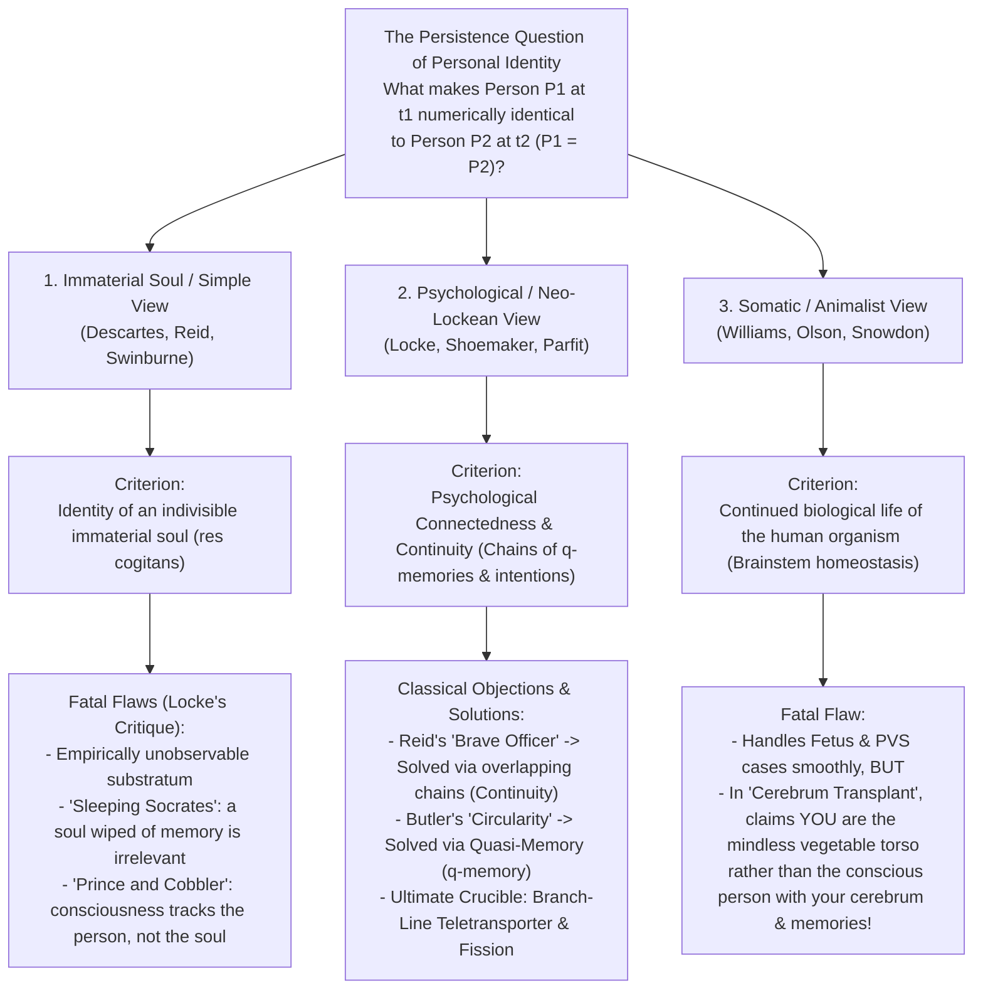
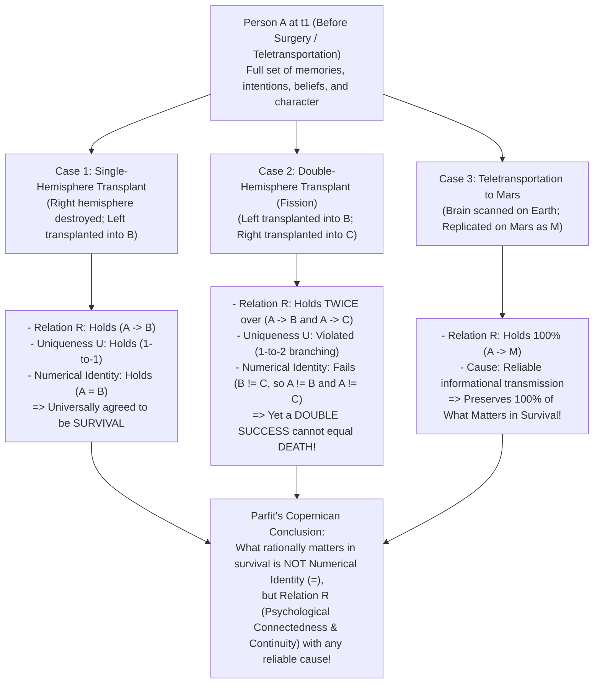

## 1. Introduction: The Teletransporter to Mars and the Persistence Question

### 1.1 Derek Parfit's Teletransporter Thought Experiment

Imagine that it is the late twenty-first century, and you are scheduled for a business trip to a research colony on Mars. Instead of enduring a grueling six-month voyage sealed inside an interplanetary spacecraft, you walk into the departure terminal on Earth and step inside the booth of the <strong>Teletransporter</strong>. Although you have never used this machine yourself, your colleagues use it routinely and assure you that it is completely painless, instantaneous, and safe.

You step into the glass cylinder and press the green button. At that exact millisecond, you lose consciousness. The <strong>Scanner</strong> on Earth sweeps through every cell of your body and brain, recording with sub-atomic precision the exact spatial coordinates, molecular states, and synaptic weights of all 86 billion neurons and 100 trillion connections in your cerebral cortex—and in the very act of extracting this complete blueprint, <strong>completely vaporizes your physical brain and body on Earth</strong>. The resulting petabytes of structural information are encoded into a high-frequency radio beam that travels at the speed of light across interplanetary space. Three minutes later, the signal arrives at the receiving station on Mars, where the <strong>Replicator</strong> assembles locally stored carbon, hydrogen, oxygen, nitrogen, and phosphorus atoms into an organic human body and brain matching your Earth state down to the last neurotransmitter molecule.

The person inside the booth on Mars wakes up, stretches, and rubs his eyes. From the inside, it feels as though only a single second has elapsed since he pressed the green button on Earth. He remembers eating breakfast with his spouse in London this morning and promising to call her on the video-link as soon as he arrived on Mars. He remembers the half-finished manuscript sitting on his desk. When he walks into the washroom and glances in the mirror, he even sees on his left jaw the tiny scarlet nick he accidentally made while shaving on Earth two hours ago.

At this point, one of the deepest and most unsettling questions in metaphysics and the philosophy of mind confronts us:

<strong>Is the person who wakes up on Mars really *you*?</strong>

Did you just travel to Mars at the speed of light—making the Teletransporter the fastest and most convenient mode of transportation in human history? Or did <strong>*you* die the instant the Scanner vaporized your body on Earth</strong>, while the man walking out of the booth on Mars is merely an exact biological duplicate—a newborn impostor who has inherited your memories and deludedly believes that he is you?

If the second answer is correct, then thousands of travelers who step into the booth believing they are commuting to work are in fact committing suicide, handing over their spouses, bank accounts, and life projects to freshly synthesized clones. Yet if the first answer is rejected—if preserving 100% of your memories, beliefs, desires, intentions, character traits, and first-person stream of consciousness is *not* enough for you to survive—then what on earth *does* constitute the continued existence of a person across time?

---

### 1.2 Formulating the Persistence Question: Numerical vs. Qualitative Identity

To analyze this dilemma with philosophical rigor, we must formulate what contemporary analytic metaphysics calls the <strong>Persistence Question of Personal Identity over Time (Diachronic Personal Identity)</strong>:

>$$
>\textbf{The Persistence Question:} \quad \text{Under what necessary and sufficient conditions is a person } P_1 \text{ existing at time } t_1
>$$
>$$
>\text{numerically identical } (P_1 = P_2) \text{ to a person } P_2 \text{ existing at a later time } t_2\text{?}
>$$

At the heart of this question lies a crucial logical distinction between two senses of the word "same": <strong>Qualitative Identity</strong> and <strong>Numerical Identity</strong>.

1. <strong>Qualitative Identity (Exact Similarity, $x \approx y$)</strong>:
   Two entities $x$ and $y$ are qualitatively identical to the degree that they share the same intrinsic qualitative properties (shape, mass, cellular architecture, psychological states). Two newly minted coins from the same die, identical twins, or Earth-You and Mars-Replica share an extraordinarily high—in the limit, 100%—qualitative identity. Formally, with respect to the class of intrinsic properties $\mathcal{F}_{\text{intrinsic}}$:
   $$\forall \Phi \in \mathcal{F}_{\text{intrinsic}} \, \big(\Phi(x) \leftrightarrow \Phi(y)\big)$$
2. <strong>Numerical Identity ($x = y$)</strong>:
   To say that $x$ and $y$ are numerically identical is to say that they are not two similar things, but literally <strong>one and the very same single entity</strong> counted once. Just as "the Morning Star" and "the Evening Star" are numerically identical ($x = y$) because both denote the single planet Venus, numerical identity is governed by <strong>Leibniz's Law (The Indiscernibility of Identicals)</strong>, $\forall \Phi (\Phi(x) \leftrightarrow \Phi(y))$, and is the strict logical relation of equality ($=$).

What makes diachronic personal identity so puzzling is that <strong>qualitative identity and numerical identity can come completely apart</strong>:
* Compare the five-year-old child you once were ($P_{5}$) with the eighty-year-old elder you will someday become ($P_{80}$). In height, weight, cellular composition (almost all atoms in the human body are replaced over time through metabolic turnover), vocabulary, beliefs, and most memories, $P_{5}$ and $P_{80}$ are <strong>radically qualitatively different ($P_{5} \not\approx P_{80}$)</strong>. Nevertheless, morality, law, and common sense presuppose that they are <strong>numerically identical ($P_{5} = P_{80}$)</strong>—one and the same persisting person.
* Conversely, in the Teletransporter case, the person waking up on Mars ($P_{\text{Mars}}$) is <strong>100% qualitatively identical ($P_{\text{Earth}} \approx P_{\text{Mars}}$)</strong> to you just before pressing the button ($P_{\text{Earth}}$). Yet qualitative duplication alone does not automatically guarantee numerical identity ($P_{\text{Earth}} = P_{\text{Mars}}$): if the Scanner had failed to vaporize your Earth body while still creating the Mars replica, there would clearly be *two* numerically distinct people ($P_{\text{Earth}} \neq P_{\text{Mars}}$) who happen to be qualitative duplicates at the moment of creation.

---

### 1.3 Why Personal Identity Matters: The Three Pillars of Practical Reason

Why do we care so passionately about whether some future person $P_2$ is numerically identical to $P_1$? Because numerical personal identity underpins three foundational pillars of human practical reason, ethics, and law:

1. <strong>Special Egoistic Concern and Anticipation from the Inside</strong>:
   If you learn that *someone* in the hospital tomorrow will undergo painful surgery without anesthesia, you feel sympathy or compassion. If you learn that *you* will undergo that surgery tomorrow, you feel something qualitatively different: <strong>terror and first-person anticipation from the inside</strong>. Our special prudential concern for our own future presupposes that the future sufferer is numerically identical to us.
2. <strong>Moral Responsibility, Desert, and Commitment</strong>:
   A court of law can justly punish a defendant $P_2$ today for a murder committed twenty years ago by $P_1$ only if $P_2 = P_1$. If $P_2 \neq P_1$, punishing $P_2$ is no more justifiable than punishing an innocent identical twin for his brother's crime. Similarly, the binding force of promises, contracts, and debts presupposes numerical identity across time.
3. <strong>Intertemporal Compensation and Prudence</strong>:
   We routinely impose burdens upon ourselves today—working long hours, saving money, enduring painful medical treatments—for the sake of greater benefits in the future. Such sacrifices count as rational *self-interest* (compensation within a single life) only if the future beneficiary who enjoys the retirement savings or restored health is numerically identical to the present person who bore the cost. If the beneficiary is someone else, the act ceases to be prudential self-care and becomes uncompensated self-sacrifice for another.

What, then, is the metaphysical glue that binds $P_1$ at $t_1$ and $P_2$ at $t_2$ into a single persisting person? Across the history of Western philosophy, three great rival traditions have battled to answer this question: the <strong>Immaterial Soul View</strong>, the <strong>Psychological / Memory View</strong>, and the <strong>Bodily / Animalist View</strong>.

---

## 2. The Three Classical Rivals: Soul, Memory, and Body

### 2.1 The Soul / Cartesian Ego View and John Locke's Devastating Critique

According to Plato (*Phaedo*), René Descartes (*Meditations on First Philosophy*, 1641), Bishop Joseph Butler (1736), Thomas Reid (1785), and contemporary dualists such as Richard Swinburne and Roderick Chisholm, a person is fundamentally an indivisible, non-physical thinking substance—an <strong>Immaterial Soul or Cartesian Ego (*res cogitans*)</strong>.

Proponents of this <strong>Simple View</strong> argue that physical bodies and brains are composite objects made of billions of replaceable parts. Like the famous <strong>Ship of Theseus</strong>—whose wooden planks are gradually replaced one by one until none of the original timber remains—any composite physical or psychological system admits of degrees and borderline cases. An immaterial soul, by contrast, has no spatial extension (*res extensa*) and no constituent parts. Because it is metaphysically simple (indivisible), it cannot be gradually replaced or split in half. Therefore, $P_2$ at $t_2$ is numerically identical to $P_1$ at $t_1$ if and only if they possess the <strong>very same immaterial soul ($S_1 = S_2$)</strong>—guaranteeing that personal identity is always determinate and all-or-nothing.

However, the Soul View suffered a devastating blow in 1694 when the English empiricist philosopher <strong>John Locke</strong> added Chapter 27, *"Of Identity and Diversity,"* to Book II of the second edition of his masterpiece, *An Essay Concerning Human Understanding*. Through a brilliant series of thought experiments, Locke proved that an unobservable immaterial substance—even if it exists—is completely irrelevant to personal identity.

#### Thought Experiment 1: Socrates Awake and Sleeping (Reincarnation Without Memory)
Suppose that the immaterial soul $S$ currently housed in your body is the very same immaterial substance that once inhabited the body of Socrates in ancient Athens (or Castor and Pollux taking turns in a single soul while the other sleeps). Yet suppose that all of Socrates' memories, philosophical thoughts, and character traits were wiped completely blank before $S$ entered your newborn body, so that you today have zero conscious access to anything Socrates ever thought, felt, or did.

Does sharing this bare, featureless immaterial substratum $S$ make you the <strong>same person</strong> as Socrates? Locke answers with a resounding *No*. An unobservable soul stripped of all consciousness and memory is metaphysically no different from a lump of matter whose atoms once belonged to Julius Caesar and now happen to sit in your fingernail. If you have no psychological connection whatsoever to Socrates' mind, it would be absurd to hold you morally responsible for Socrates' actions or for you to take pride in having written his dialogues.

#### Thought Experiment 2: The Prince and the Cobbler
To drive the point home from the opposite direction, Locke asks us to imagine a <strong>Prince</strong> whose consciousness—carrying with it all the memories, intentions, desires, and knowledge of his royal past—is transferred into the body of a humble <strong>Cobbler</strong> whose own consciousness has departed (or imagine that even if two immaterial soul-substances remain where they were, God transfers the entire psychological consciousness and memory profile of the Prince onto the Cobbler's soul-substance).

When the person in the Cobbler's body wakes up, he remembers the secret treaties of the royal court, recognizes the Queen with deep affection, and knows nothing of how to mend shoes. To the townspeople looking at his face and physique, he may look like the Cobbler (the same biological organism, or what Locke calls the *same man*). Yet who is he as a moral and conscious agent—the <strong>same person</strong>? Everyone immediately recognizes that he is the <strong>Prince</strong>, justly accountable only for the Prince's past deeds and not for any crime the Cobbler committed the night before!

Through this analysis, Locke introduced a landmark conceptual distinction among three different identity criteria:
1. <strong>Same Substance ($S_1 = S_2$)</strong>: Persistence of the underlying material atoms or immaterial soul-substratum.
2. <strong>Same Man / Human Organism ($M_1 = M_2$)</strong>: Persistence of a single biological life—an organization of matter maintaining a continuous vital metabolism.
3. <strong>Same Person ($P_1 = P_2$)</strong>: Persistence of a self-conscious rational agent over time. As Locke famously wrote, *"Person is a forensic term, appropriating actions and their merit; and so belongs only to intelligent agents, capable of a law, and happiness, and misery."*

---

### 2.2 John Locke's Memory Criterion and Its Two Classic Paradoxes

Having severed personal identity from both immaterial souls and biological organisms, Locke proposed the first systematic <strong>Psychological Criterion of Personal Identity</strong>, grounded in consciousness and specifically in <strong>first-person experiential memory</strong>:

> *"For as far as any intelligent being can repeat the idea of any past action with the same consciousness it had of it at first, and with the same consciousness it has of any present action; so far it is the same personal self."* (Locke, *Essay* II.xxvii.10)

Formally, <strong>Locke's Memory Criterion</strong> states:

>$$
>\textbf{Locke's Memory Criterion:} \quad P_2 \text{ at } t_2 = P_1 \text{ at } t_1 \iff P_2 \text{ at } t_2 \text{ can consciously remember } P_1\text{'s experiences at } t_1 \text{ from the inside.}
>$$

While Locke's theory revolutionized philosophy, eighteenth-century critics quickly uncovered <strong>two formidable logical objections</strong> that threatened to sink the psychological approach.

---

#### Objection 1: Thomas Reid's "Brave Officer" Paradox (1785) — Violation of Transitivity
In his *Essays on the Intellectual Powers of Man* (1785), the Scottish philosopher <strong>Thomas Reid</strong> demonstrated that Locke's direct memory criterion violates a fundamental law of logic: the <strong>Transitivity of Numerical Identity</strong>.

Consider three stages in the life of a single soldier:
* <strong>The Boy at age 10 ($P_{10}$)</strong>: Flogged at school for robbing an orchard.
* <strong>The Brave Officer at age 30 ($P_{30}$)</strong>: Captures an enemy standard in his first military campaign. At age 30, he still distinctly remembers being flogged at school at age 10.
* <strong>The Retired General at age 80 ($P_{80}$)</strong>: Vividly remembers capturing the enemy standard as a young officer at age 30, but due to normal age-related forgetting, has completely lost all memory of being flogged at age 10.

Let $M(y, x)$ denote the relation "$y$ can consciously remember $x$'s experiences from the inside." Applying Locke's Memory Criterion ($x = y \iff M(y, x)$) yields:
1. Because the Brave Officer remembers the Boy's experience:
   $$M(P_{30}, P_{10}) \implies P_{30} = P_{10}$$
2. Because the General remembers the Brave Officer's experience:
   $$M(P_{80}, P_{30}) \implies P_{80} = P_{30}$$
3. Numerical identity ($=$) is an <strong>Equivalence Relation</strong>—it is reflexive ($x=x$), symmetric ($x=y \implies y=x$), and <strong>transitive ($x=y \land y=z \implies x=z$)</strong>. By the transitivity of identity, (1) and (2) logically entail:
   $$P_{80} = P_{30} \land P_{30} = P_{10} \implies P_{80} = P_{10}$$
4. Yet the General at 80 has completely forgotten the Boy's flogging at 10! According to Locke's necessary condition for identity, lack of memory entails non-identity:
   $$\neg M(P_{80}, P_{10}) \implies P_{80} \neq P_{10}$$
5. We have arrived at an explicit logical contradiction:
   $$P_{80} = P_{10} \quad \land \quad P_{80} \neq P_{10}$$

Reid's diagnosis is pinpoint: <strong>Numerical identity ($=$) is a transitive relation, whereas direct experiential memory ($M$) is NOT transitive.</strong> Therefore, direct memory cannot be identical to personal identity.

##### The Neo-Lockean Solution: From Psychological Connectedness to Psychological Continuity
To rescue the psychological criterion from Reid's paradox, twentieth-century <strong>Neo-Lockeans</strong>—including H. P. Grice (1941), Anthony Quinton (1962), Sydney Shoemaker (1970), and Derek Parfit (1984)—broadened Locke's theory in two decisive ways:
1. First, in addition to experience-memory, they included <strong>all other direct psychological links</strong>: the persistence of beliefs, desires, values, and character traits, as well as the relation between forming an intention at $t_1$ and carrying out that action at $t_2$.
2. Second, they drew a rigorous formal distinction between <strong>Psychological Connectedness</strong> and <strong>Psychological Continuity</strong>:
   * <strong>Psychological Connectedness</strong>: The holding of *direct* particular psychological links (memories, intentions, persistent traits) between $P_1$ at $t_1$ and $P_2$ at $t_2$. Connectedness admits of degrees (from thousands of links between today and tomorrow, down to very few across seventy years) and is <strong>not transitive</strong>. When two stages share at least half the number of direct connections that hold over a normal day, Parfit defines them as having <strong>Strong Connectedness ($C_{\text{strong}}$)</strong>.
   * <strong>Psychological Continuity</strong>: The holding of <strong>overlapping chains of strong connectedness</strong>—just as individual hemp fibers, none of which runs the entire length of a ship's cable, overlap continuously from one end to the other. Mathematically, Psychological Continuity is the <strong>transitive closure (ancestral relation)</strong> of strong connectedness:
     $$\text{Continuity}(P_n, P_1) \iff \exists P_2, P_3, \dots, P_{n-1} \text{ s.t. } C_{\text{strong}}(P_1, P_2) \land C_{\text{strong}}(P_2, P_3) \land \dots \land C_{\text{strong}}(P_{n-1}, P_n)$$

Because the 80-year-old General is linked to the 30-year-old Officer, and the 30-year-old Officer to the 10-year-old Boy, by an unbroken day-to-day chain of overlapping strong connectedness, Psychological Continuity is fully transitive and dissolves Reid's Brave Officer paradox!

---

#### Objection 2: Joseph Butler's Circularity Objection (1736) and Shoemaker's "Quasi-Memory ($q$-memory)"
A second classic objection was leveled by Bishop <strong>Joseph Butler</strong> in his appendix *"Of Personal Identity"* to *The Analogy of Religion* (1736):

> *"And one should really think it self-evident, that consciousness of personal identity presupposes, and therefore cannot constitute, personal identity, any more than knowledge, in any other case, can constitute truth, which it presupposes."*

Why did Butler charge Locke with <strong>vicious circularity</strong>?
Suppose a deluded psychiatric patient sincerely claims to remember from the inside commanding the French artillery at the Battle of Waterloo. Why do we say that the patient does not *genuinely remember* Waterloo, but only suffers from an *apparent memory* or delusion? Because in ordinary language, the verb "to remember" is factive and identity-presupposing: "$Y$ genuinely remembers doing $X$" entails by definition that <strong>$Y$ is the very same person who actually did $X$ ($Y = X$)</strong>!
Thus:
* To know whether $Y = X$, Locke tells us to check whether $Y$ *genuinely remembers* $X$'s experience.
* Yet to know whether $Y$'s apparent memory is a *genuine memory* rather than a delusion, we must already know whether $Y = X$!

##### Sydney Shoemaker's Solution: Quasi-Memory ($q$-memory, 1970)
This circularity objection stood for over two centuries until the American philosopher <strong>Sydney Shoemaker</strong> (1970), followed by Derek Parfit (1984), broke the circle by defining a broader, non-question-begging concept called <strong>Quasi-Memory ($q$-memory)</strong>:

>$$
>\textbf{Definition of Quasi-Memory ($q$-memory):} \quad \text{Subject } P_2 \text{ at } t_2 \text{ quasi-remembers an experience } E \iff
>$$
>1. $P_2$ has an apparent first-person memory ("from the inside") of having experience $E$;
>2. <strong>Someone</strong> ($P_1$ at $t_1$) actually had experience $E$; and
>3. $P_2$'s apparent memory is <strong>causally dependent in the right kind of way</strong> (e.g., via neurobiological memory traces or reliable structural information transmission) on $P_1$'s original experience $E$.

Notice that condition (2) says *someone* had the experience—it does <strong>not</strong> stipulate that $P_2 = P_1$! Ordinary memory is simply a special subcategory of $q$-memory in which the person who had the experience happens to be oneself.
If a neurosurgeon copied the synaptic memory trace of your spouse's childhood trip to Venice into your hippocampus, your resulting vivid recollection of feeding pigeons in St. Mark's Square would not be a hallucination: it would be an accurate <strong>quasi-memory</strong> of your spouse's past experience, causally grounded in her actual perception.
By defining Psychological Connectedness and Continuity in terms of $q$-memories, $q$-intentions, and $q$-beliefs, Neo-Lockeans specify the criterion of psychological continuity without presupposing personal identity at any step, completely refuting Butler's circularity charge.

---

### 2.3 The Bodily Criterion, Bernard Williams's Puzzle, and Animalism

Despite the elegance of Neo-Lockeanism, a powerful rival camp insists that we are not disembodied software programs defined by psychological links, but concrete physical and biological beings.

#### Bernard Williams's Two-Perspective Puzzle (*"The Self and the Future"*, 1970)
In his celebrated 1970 paper *"The Self and the Future,"* British philosopher <strong>Bernard Williams</strong> showed that our intuitions about personal identity can be completely reversed depending on how the exact same physical experiment is framed:

* <strong>Framing 1 (The Mind-Swapping Description)</strong>:
  A scientist places two subjects, $A$ and $B$, in a laboratory and announces that tomorrow a machine will extract all the memories, personality traits, and psychological states from $A$'s brain and transfer them into $B$'s brain, while transferring all of $B$'s psychological states into $A$'s brain. After the procedure, one of the resulting persons ($A$-body or $B$-body) will be given \$100,000, and the other will be subjected to horrific physical torture. Asked beforehand which body should receive the money and which the torture, $A$ overwhelmingly chooses that the <strong>$B$-body</strong> (which will wake up with all of $A$'s memories, believing himself to be $A$) should get the \$100,000, while the $A$-body gets the torture. This strongly supports the <strong>Psychological View</strong>.
* <strong>Framing 2 (The Amnesia-Plus-Torture Description)</strong>:
  Now Williams describes the exact same physical events solely from your ($A$'s) bodily perspective. A captor tells you ($A$): *"Tomorrow, I am going to torture you."* Naturally, you are terrified.
  Then he adds: *"Before the torture begins, I will induce total amnesia in your brain so you won't remember anything about your past life."* Does that relieve your fear? Not at all—you still dread the excruciating pain you will feel after losing your memories!
  Finally he adds: *"Right after inducing amnesia, and just before the torture begins, I will implant into your brain a set of artificial memory impressions copied from another person, $B$."*
  Does having someone else's memories written into your brain before the electric shocks begin make you any less terrified of what is about to happen to <strong>your body ($A$-body)</strong>? *No!* At every step of this continuous progression, you terrifyingly anticipate the pain happening to the $A$-body!

Yet <strong>Framing 1 and Framing 2 describe the exact same physical operation!</strong> Williams demonstrated that our prudential self-concern is deeply entangled with the physical continuity of our living body.

#### Eric Olson's Animalism (*The Human Animal*, 1997)
Pushing the bodily approach to its rigorous biological conclusion, <strong>Eric T. Olson</strong> (1997) and Paul Snowdon developed <strong>Animalism (The Biological Approach)</strong>. Animalism holds a stark ontological thesis:
> <strong>Each of us is numerically identical to a biological organism—a human animal belonging to the species *Homo sapiens*—and our persistence conditions are purely biological, not psychological.</strong>

Olson advances two powerful arguments against all Psychological (Lockean and Neo-Lockean) theories:

1. <strong>The Fetus and Persistent Vegetative State (PVS) Problem</strong>:
   Every one of us was once a 12-week-old human fetus in our mother's womb. Conversely, if a tragic stroke or trauma destroys your cerebral cortex while leaving your brainstem intact, you may survive for years in a <strong>Persistent Vegetative State (PVS)</strong>—breathing spontaneously, digesting food, and maintaining metabolic homeostasis without a shred of consciousness or memory.
   Neither the 12-week-old fetus nor the PVS patient has any psychological continuity with your current adult mind. Therefore, if the Psychological View is true, <strong>you were never a fetus</strong> (instead, a fetus developed until a distinct entity—"you," the Person—popped into existence alongside the animal), and if you fall into a PVS, <strong>you have already died</strong> while a living biological animal that looks just like you lies breathing in the hospital bed!
   Animalism avoids this bizarre metaphysics by recognizing that *"person"* is merely a <strong>phase sortal</strong> (like *"student," "adolescent,"* or *"philosopher"*)—a temporary status that a human animal enjoys while its cerebrum supports self-conscious thought—whereas our fundamental <strong>substance sortal</strong> is *"human animal."*
2. <strong>The Thinking-Animal Argument (The Too-Many-Thinkers Problem)</strong>:
   Right now, sitting in your chair is a biological organism (*Homo sapiens*) with a healthy, functioning brain. Does that biological animal think? Obviously yes. If "you" (the Lockean Person) were numerically distinct from that animal, then there would be <strong>two distinct thinkers</strong> sitting in your chair right now thinking the exact same thoughts—and you could never even know whether you were the Person or the Animal falsely believing itself to be the Person! The only way to avoid overcrowding your chair with duplicate minds is to accept that <strong>You = The Human Animal</strong>.

Yet Animalism faces its own devastating counterexample: <strong>The Cerebrum Transplant Case</strong>. Suppose a surgeon removes your cerebrum (which houses all your memories, personality, and consciousness) and transplants it into a decerebrate donor body, while leaving your original brainstem inside your old headless/decerebrate torso on hospital life support. Because biological life-integration is regulated by the brainstem, Animalism is forced to say that <strong>*you* are the mindless, cerebrum-less vegetable lying on the hospital bed</strong>, while the conscious individual who walks out of the clinic with your cerebrum, your memories, and your love for your family is a total stranger! For most philosophers, this verdict is a *reductio ad absurdum* of pure Animalism.

---

## 3. Derek Parfit's Revolution (*Reasons and Persons*, 1984): Branch-Line Teletransportation and Fission

In Part III of his monumental 1984 book <strong>*Reasons and Persons*</strong>, Oxford philosopher <strong>Derek Parfit (1942–2017)</strong> transformed the entire debate. Instead of merely tweaking the necessary and sufficient conditions for numerical identity ($P_1 = P_2$), Parfit challenged the deepest assumption shared by all sides of the 2,000-year controversy: the assumption that <strong>numerical identity is what rationally matters in survival</strong>.

---

### 3.1 Simple Teletransportation vs. The Branch-Line Case

Return first to <strong>Simple Teletransportation</strong> from Section 1. Your body on Earth is vaporized at $t_1$, and your organic Replica wakes up on Mars at $t_2$ with 100% <strong>Psychological Connectedness and Continuity (Relation R)</strong>. Proponents of the Wide Psychological Criterion say that Mars-You *is* you ($P_{\text{Earth}} = P_{\text{Mars}}$); proponents of the Bodily/Animalist Criterion say that you died on Earth.

Now Parfit introduces his devastating sequel: <strong>The Branch-Line Case</strong>.

> <strong>[Thought Experiment: The Branch-Line Case]</strong>
> Several years after your first trip to Mars, the transit authority replaces the old vaporizing Scanner with a <strong>New Scanner</strong> that reads your complete atomic and synaptic blueprint <strong>without destroying your brain and body on Earth</strong>.
> You step into the booth on Earth and press the green button. There is a flash of light and a quiet hum, and you step right back out of the booth on Earth, completely conscious and intact. The attendant informs you that your blueprint has been beamed to Mars, where the Replicator has just created your Replica on Mars.
>
> You walk into the Intercom Room on Earth and speak face-to-face via live video link with your Replica on Mars. Looking at him on the screen, one logical fact is crystal clear to both of you: <strong>He is NOT numerically identical to you ($P_{\text{Earth}} \neq P_{\text{Mars}}$).</strong> You are standing here in London; he is sitting there on Mars. If he burns his finger on a coffee cup on Mars, you feel nothing on Earth. You are two distinct individuals existing simultaneously in different places.
>
> Then comes the tragic twist. The chief physician enters the room with grim news: a radiation glitch in the New Scanner accidentally damaged the cardiac muscle and coronary arteries of your body on Earth. <strong>You on Earth will die painlessly of heart failure in three days.</strong> Your Replica on Mars, however, was constructed from fresh organic molecules without the radiation defect; his heart is completely healthy, and he will live for another forty years.
>
> Seeing your distress on the video screen, your Replica on Mars tries to console you:
> *"Don't despair! Even though your heart on Earth will stop in three days, I am already here on Mars with 100% of your memories, beliefs, character, and plans. I love your spouse just as deeply as you do; I will return to care for her and our children, and I will finish writing the book you started last year. Think about it: when you used the Old Scanner in Simple Teletransportation, your Earth body was destroyed in zero seconds! This time, your Earth body merely survived for three extra days on a 'branch line.' Having me live on Mars gives you everything you ever got in Simple Teletransportation!"*

Pause and reflect on the profound philosophical tension between Simple Teletransportation and the Branch-Line Case:
* Compare the <strong>intrinsic causal and psychological relation</strong> between You-before-pressing-the-button ($A$) and Mars-You ($B_{\text{Mars}}$) in both cases. In Simple Teletransportation and in the Branch-Line Case, the physical scan, the radio transmission, the atomic assembly on Mars, and the full inheritance of <strong>Relation R (Psychological Connectedness and Continuity)</strong> between $A$ and $B_{\text{Mars}}$ are <strong>100% intrinsically identical</strong>!
* The *only* difference between the two cases is a purely <strong>extrinsic fact</strong> happening hundreds of millions of kilometers away on Earth: whether the original biological heart stopped beating after 0.001 seconds or after 72 hours.
* How could a 72-hour delay in the death of your Earth body suddenly transform your prospect on Mars from *"100% successful travel (survival)"* into *"total death and replacement by a stranger"*?!

---

### 3.2 The Combined Spectrum: Reductionism vs. The Further Fact View

Before turning to Parfit's decisive Fission argument, consider how defenders of traditional identity try to resist the Teletransporter: they insist that personal identity cannot be reduced to physical and psychological continuity by degrees, because there must be some deep, determinate, all-or-nothing <strong>"Further Fact"</strong>—either a Cartesian Ego or an irreducible metaphysical fact of the matter—that makes a future person either 100% *Me* or 100% *Not-Me*.

To demolish this <strong>Non-Reductionist (Further Fact) View</strong>, Parfit constructs <strong>The Combined Spectrum</strong>:

Imagine a continuous spectrum of 101 possible surgical procedures parameterized by $\alpha \in \{0\%, 1\%, 2\%, \dots, 100\%\}$. In procedure $\alpha$, a neurosurgeon uses nanomachines to replace a fraction $\alpha$ of the cells in your brain and body with exact duplicates of the corresponding brain and body cells of the Swedish actress <strong>Greta Garbo</strong> (including her memory traces and personality traits), while leaving the remaining $(1 - \alpha)$ fraction of your original brain and body cells intact.

* <strong>At the Near End ($\alpha = 0\%$)</strong>: No cells are replaced. The resulting person is undeniably <strong>You</strong>.
* <strong>Near the Start ($\alpha = 1\%$ or $5\%$)</strong>: Almost all of your brain, body, memories, and character remain intact, with only a tiny trace of Garbo's features. Everyone agrees the resulting person is still <strong>You</strong>.
* <strong>At the Far End ($\alpha = 100\%$)</strong>: All of your cells are destroyed and replaced by an exact replica of Greta Garbo's brain and body. You have died, and the resulting person is undeniably <strong>Greta Garbo</strong> (or her replica), not you.
* <strong>In the Middle ($\alpha = 50\%$)</strong>: Exactly half of your brain and body cells are preserved, smoothly integrated with half of Garbo's brain and body cells, yielding a person who is psychologically and physically halfway between you and Greta Garbo.

Now ask: If the Non-Reductionist "Further Fact View" were true—if in every conceivable case the resulting person must be either determinately 100% *Me* or determinately 100% *Someone Else*—then somewhere along this spectrum (say, between $\alpha = 49.999\%$ and $\alpha = 50.000\%$) there would have to be a <strong>sharp metaphysical cutoff $\alpha^*$</strong> where replacing *one single neuron* suddenly causes your soul or personal identity to vanish and Greta Garbo's identity to snap into place!

That is scientifically and metaphysically incredible. Instead, Parfit's <strong>Reductionism</strong> concludes:
Once we know the exact fraction $(1 - \alpha)$ of physical and psychological connectedness that holds in the middle cases ($\alpha = 50\%$), <strong>we already know all the facts there are to know</strong>. Asking, *"Yes, I know that 50% of my brain and memories survived, but is the resulting person really ME or NOT ME?"* is what Parfit calls an <strong>Empty Question</strong>—not because the truth is hidden behind a veil of ignorance, but because there is no further metaphysical fact waiting to be discovered, any more than there is a secret metaphysical fact about whether a collection of 500 grains of sand is "really a heap."

---

### 3.3 Wiggins and Parfit's Fission Argument ("My Division"): Split-Brain Hemisphere Transplant

Even if someone rejects Teletransportation by insisting that psychological continuity (Relation R) must have its <strong>normal physical cause</strong>—namely, the <strong>continued existence of the same physical brain</strong>—Parfit's famous <strong>Fission Argument ("My Division,"</strong> building on David Wiggins 1967) proves beyond doubt that <strong>numerical identity is not what matters in survival</strong>, even when the brain itself physically persists!

#### The Neuroscientific Premises: Hemispherectomy and Split-Brain Patients
Parfit's Fission thought experiment rests on two well-established facts of clinical neuroscience:
1. <strong>Survival with a Single Cerebral Hemisphere (Hemispherectomy)</strong>:
   In real clinical neurosurgery, patients suffering from severe hemispheric tumors, Rasmussen's encephalitis, or catastrophic unilateral strokes frequently undergo a complete anatomical or functional <strong>hemispherectomy</strong>—the removal or disconnection of an entire cerebral hemisphere. Crucially, a human being can survive with <strong>only one cerebral hemisphere</strong> (half of the cerebrum) while clearly remaining the very same person.
2. <strong>Dual Streams of Consciousness in Split-Brain Patients (Sperry & Gazzaniga)</strong>:
   In Nobel Prize-winning research on commissurotomy (<strong>split-brain</strong>) patients whose <strong>corpus callosum</strong> was surgically severed to treat intractable epilepsy, Roger Sperry and Michael Gazzaniga proved that when the two cerebral hemispheres are disconnected, <strong>two independent streams of consciousness</strong> can operate simultaneously in the same person—each hemisphere perceiving, remembering, and controlling its contralateral hand independently of the other.

#### The Thought Experiment: "My Division"
Now consider Parfit's scenario.
Suppose that you (<strong>$A$</strong>) are one of <strong>identical triplets</strong>, and suppose (as a minor idealization of cerebral plasticity) that your two cerebral hemispheres are functionally symmetrical: both your left hemisphere and your right hemisphere contain the full storage of your memories, linguistic abilities, beliefs, intentions, and personality traits.

During a catastrophic accident:
* Your body is fatally crushed below the neck, though your <strong>brain (both left and right hemispheres) remains completely unharmed</strong>.
* Simultaneously, your two triplet brothers suffer irreversible brain death from head trauma, while their two bodies (<strong>Body $B$</strong> and <strong>Body $C$</strong>) remain completely healthy and unharmed.

To save you, a brilliant neurosurgeon divides your intact brain down the midline of the corpus callosum, transplants your <strong>left cerebral hemisphere into Body $B$</strong> (call the resulting person <strong>Lefty</strong>), and transplants your <strong>right cerebral hemisphere into Body $C$</strong> (call the resulting person <strong>Righty</strong>).

Both operations succeed! The next morning, both Lefty ($B$) and Righty ($C$) wake up in the hospital recovery ward.
Look at their credentials:
* Both Lefty ($B$) and Righty ($C$) have an exact genetic copy of your body.
* Both have <strong>half of your original, continuously living physical brain</strong>—which, as hemispherectomy proves, is completely sufficient for normal survival!
* Both are <strong>100% psychologically continuous and connected (Relation R) with you ($A$)</strong>: each remembers your entire past from the inside, loves your spouse, and intends to finish writing your book!

---

#### Exhaustive Logical Analysis of the Four Possibilities: What Happened to Me ($A$)?

Now ask the Persistence Question in terms of strict <strong>Numerical Identity ($=$)</strong>:
<strong>Who am I ($A$) after the operation?</strong>
Logically, there are only four conceivable answers. Let us test each one:

##### Option 1: I ($A$) am numerically identical to BOTH Lefty ($B$) and Righty ($C$) ($A = B \land A = C$)
This violates the fundamental logic of identity. Because numerical identity ($=$) is symmetric and transitive:
$$A = B \land A = C \implies B = A \land A = C \implies B = C \quad (\text{Lefty} = \text{Righty})$$
If Option 1 were true, Lefty and Righty would have to be numerically <strong>one and the same single person</strong>! Yet after leaving the hospital, Lefty ($B$) and Righty ($C$) live completely separate lives with independent minds and bodies. They can stand on opposite sides of a net and play a match of tennis *against* each other. Worse still, suppose years later Lefty and Righty quarrel and fight a duel in which Lefty shoots and kills Righty: if $B = C$, did Lefty simultaneously commit murder and suicide while walking away completely unharmed?! Obviously $B \neq C$. Therefore, by logic alone, $A$ cannot be numerically identical to both $B$ and $C$. *(Note: Even if one adopts David Lewis's four-dimensionalist "multiple occupancy" view, where two distinct spacetime worms $B$ and $C$ overlapped at $t_1$, at $t_2$ after fission there are undeniably two distinct persons $B \neq C$.)*

##### Option 2: I ($A$) am identical ONLY to Lefty ($A = B \land A \neq C$)
##### Option 3: I ($A$) am identical ONLY to Righty ($A = C \land A \neq B$)
Options 2 and 3 are <strong>utterly arbitrary</strong> and violate the <strong>Principle of Intrinsicness (The Only-$x$-and-$y$ Principle)</strong>.
Why? Because the physical and psychological relationship between $A$ and Lefty ($B$) is 100% symmetrical to the relationship between $A$ and Righty ($C$). There is no hidden Cartesian soul flipping a coin to jump into the left hemisphere rather than the right.
Even more decisively: suppose Option 2 were true ($A = B$). What if the surgeon had accidentally dropped the left hemisphere on the floor so that Lefty ($B$) never existed, while the transplant of the right hemisphere into Righty ($C$) succeeded exactly as before? In that single-hemisphere transplant case, everyone agrees that you ($A$) would survive as Righty ($A = C$)!
How could the mere extrinsic fact that a second operating team in another room *succeeded* rather than failed with your left hemisphere suddenly strip Righty ($C$) of being you?! Whether $A$ is $C$ cannot depend on what happens in another operating room!

##### Option 4: I ($A$) am numerically identical to NEITHER Lefty ($B$) nor Righty ($C$) ($A \neq B \land A \neq C$)
Because Option 1 violates transitivity and Options 2 and 3 violate symmetry and intrinsicness, strict logic forces us to Option 4: in the regimented sense of one-to-one <strong>Numerical Identity ($=$)</strong>, $A$ ceases to exist when $A$ divides into two distinct persons $B$ and $C$. That is, for $A$ at $t_1$ to be numerically identical to $X$ at $t_2$, $X$ must not only stand in <strong>Relation R</strong> to $A$, but must also satisfy a formal <strong>Non-Branching (Uniqueness) Condition ($U$)</strong>:

>$$
>\textbf{Numerical Identity Criterion:} \quad A = X \iff R(A, X) \land U(A, X)
>$$
>where $U(A, X) \equiv \neg \exists Y \, \big(Y \neq X \land R(A, Y)\big)$.

---

### 3.4 Parfit's Revolutionary Conclusion: "Identity Is Not What Matters in Survival!"

Now comes Parfit's master stroke—one of the most brilliant moments in twentieth-century philosophy.

Suppose we accept Option 4 as our linguistic convention for the word "identity": because both hemispheres survived and branched ($R(A, B) \land R(A, C)$, violating Uniqueness $U$), neither Lefty nor Righty is numerically identical to $A$ ($A \neq B \land A \neq C$).

Now ask the existential question:
<strong>If you are lying on the gurney before the operation, and the surgeon tells you that BOTH of your hemispheres will be successfully transplanted so that both Lefty and Righty will wake up tomorrow, should you regard this prospect as your *DEATH*?!</strong>

Consider the sheer absurdity of treating Fission as death:
* If your right hemisphere is destroyed and only your left hemisphere is transplanted ($R(A, B)$ holds, $U$ holds), <strong>you survive!</strong>
* If your left hemisphere is destroyed and only your right hemisphere is transplanted ($R(A, C)$ holds, $U$ holds), <strong>you survive!</strong>
* <strong>How on earth could a DOUBLE SUCCESS—where BOTH hemispheres survive—be a TOTAL FAILURE (your death)?!</strong>

Think about what you would have to do if numerical identity ($A = X$) really were what mattered in survival: lying on the operating table, you would have to beg the nurse (or pay her a bribe) to <strong>secretly smash your right hemisphere with a hammer</strong> before it could be transplanted into Body $C$, just so that the Non-Branching Condition $U$ would be preserved and you would remain "numerically identical" to Lefty ($B$)!
To destroy half of your healthy brain and prevent Righty from living solely in order to satisfy a formal logical uniqueness condition $U$ would be sheer lunacy!

Therefore, Parfit concludes with inescapable logical force:

> <strong>[Parfit's Fundamental Theorem: Identity Is Not What Matters in Survival]</strong>
> <strong>Numerical Identity ($=$) is a one-to-one, all-or-nothing logical relation that requires Uniqueness ($U$).</strong>
> <strong>What rationally matters in survival is NOT Numerical Identity ($=$), nor the Uniqueness Condition ($U$), but rather Relation R (Psychological Connectedness and/or Continuity)—which can hold in degrees and can branch one-to-many!</strong>

In ordinary life, because human brains do not split like amoebas, Relation R always takes a one-to-one (non-branching) form, so Relation R and Numerical Identity always coincide. That constant coincidence tricked us into thinking that Numerical Identity was what we cared about. Fission pulls Relation R and Numerical Identity apart like a prism splitting light—proving that <strong>100% of the rational and existential value of survival resides in Relation R</strong>, and <strong>0% resides in bare numerical identity ($=$)</strong>!

And once we see that <strong>Relation R is what matters</strong>, the Teletransporter dilemma is resolved at a stroke: whether Relation R is sustained by its normal cause (metabolic maintenance of the brain) or by another fully reliable causal process (atomic scanning and replication on Mars), <strong>Relation R holds to the exact same 100% degree</strong>—and therefore gives us everything that rationally matters in survival!

---

## 4. Comprehensive Comparison Matrix of Theories of Personal Identity

To synthesize the entire landscape of debate, the table below compares the five major philosophical theories across their foundational criteria and their verdicts on key thought experiments:

| Philosophical Theory | Key Proponents | Criterion of Identity / Survival | Verdict on Reid's "Brave Officer" | Verdict on Cerebrum Transplant (Brainstem left behind in PVS) | Verdict on Brain Fission (Lefty $B$ & Righty $C$) | Verdict on Mars Teletransporter |
| :--- | :--- | :--- | :--- | :--- | :--- | :--- |
| <strong>1. Immaterial Soul / Simple View</strong> | Descartes, Reid, Butler, Swinburne | Persistence of an indivisible non-physical substance (Cartesian Soul $S$) | General = Boy if and only if the same soul $S$ remains (regardless of memory loss) | Indeterminate / unknowable which body the unobservable soul follows | Soul cannot split; either arbitrarily enters $B$, arbitrarily enters $C$, or both get new souls | <strong>Death</strong> unless the immaterial soul somehow travels with the radio beam |
| <strong>2. Classical Memory View</strong> | John Locke (1694) | Direct first-person experiential memory $M(P_2, P_1)$ | <strong>Fails</strong>: Violates transitivity of identity ($P_{80}=P_{30}=P_{10}$ yet $P_{80} \neq P_{10}$) | You go with the transplanted cerebrum where memories reside | Contradicts transitivity ($B=C$) because both remember $A$'s past | <strong>Survival</strong>, though vulnerable to Butler's circularity objection |
| <strong>3. Animalism (Biological View)</strong> | Eric Olson (1997), Paul Snowdon | Continuity of a single biological organism (*Homo sapiens* via brainstem homeostasis) | General = Boy because they are the same living human animal | <strong>Counterintuitive</strong>: You remain the mindless PVS vegetable torso; the conscious cerebrum recipient is a new person! | Original organism ceases or leaves $B$ and $C$ as new organisms | <strong>Death</strong>: Earth organism is destroyed; Mars replica is a newly created organism |
| <strong>4. Narrow Neo-Lockeanism</strong> | Sydney Shoemaker (early), David Wiggins | Non-branching Psychological Continuity ($R \land U$) with its <strong>normal physical cause</strong> (same brain) | Solved via overlapping chains of strong connectedness and $q$-memory | You go with the transplanted cerebrum (physical organ of mentality) | Numerical identity fails ($A \neq B, C$) because Uniqueness $U$ is violated | <strong>Death</strong> because the physical brain is destroyed rather than continuously maintained |
| <strong>5. Parfitian Reductionism (Wide Relation R View)</strong> | <strong>Derek Parfit</strong> (1984), David Lewis | <strong>Identity ($=$) is not what matters; what matters is Relation R with *any* reliable cause</strong> | Psychological Continuity holds, though direct Connectedness has diminished over 70 years | You survive 100% in the cerebrum recipient via full Relation R | Numerical identity fails, but <strong>Relation R holds twice over—a Double Survival!</strong> | <strong>Full Survival (What Matters)</strong>: Relation R is 100% preserved by a reliable cause! |

---

## 5. Living Without the Ego: Bundle Theory, Ethics, and Liberation from the Glass Tunnel

### 5.1 David Hume's Bundle Theory and Buddhist *Anattā* (Non-Self)

Parfit's Reductionism overthrows our deeply ingrained Cartesian intuition that each of us is a persistent, underlying subject—an owner of experiences existing separately from the stream of thoughts, feelings, and bodily states themselves.

According to Reductionism, the ontological status of a <strong>Person</strong> over time is strictly analogous to the ontological status of a <strong>Nation</strong> or a <strong>Club</strong>. A nation does not exist as a ghostly metaphysical entity hovering above its citizens, territory, laws, and historical events; rather, the existence of a nation *just consists in* the existence of citizens interacting in certain ways on a territory. Likewise, the existence of a person over time *just consists in* the occurrence of a series of interrelated physical and mental events—perceptions, memories, intentions, desires, and actions—bound together by causal and psychological links (<strong>Relation R</strong>).

As Parfit explicitly notes, this view represents the rigorous modern vindication of two great philosophical traditions:
1. <strong>David Hume's Bundle Theory of the Self (*A Treatise of Human Nature*, 1739)</strong>:
   When Hume looked inside his own mind through introspection, he famously reported: *"For my part, when I enter most intimately into what I call myself, I always stumble on some particular perception or other, of heat or cold, light or shade, love or hatred, pain or pleasure. I never can catch myself at any time without a perception, and never can observe any thing but the perception."* The mind, Hume concluded, is not a simple substance, but *"a bundle or collection of different perceptions, which succeed each other with an inconceivable rapidity, and are in a perpetual flux and movement"*—like a theater or a commonwealth whose members and laws continually evolve.
2. <strong>The Buddhist Doctrine of *Anattā* (Non-Self) and the *Milindapañha</strong>*:
   In Appendix J of *Reasons and Persons* (*"Buddhist Views"*), Parfit highlights the striking convergence between his Reductionism and the teachings of Gautama Buddha (5th century BCE) and the Buddhist sage <strong>Nāgasena</strong> in the *Milindapañha* (*Questions of King Milinda*, c. 2nd century BCE). Questioned by the Indo-Greek King Menander I, Nāgasena explains that just as the word *"chariot"* is merely a convenient designation for an arrangement of wheels, axle, frame, and yoke—with no separate "chariot-essence" hiding behind the parts—so too a *"person"* is a conventional designation for a causal stream of physical and mental aggregates (*skandhas*). When a flame is passed from one candle to another in the night, the second flame is neither numerically identical to the first (Eternalism) nor causally unrelated to it (Annihilationism): there is simply an unbroken causal continuity of burning. That is precisely Parfit's <strong>Relation R without numerical identity</strong>.

---

### 5.2 Ethical and Practical Consequences: Methuselah and the Nineteenth-Century Russian

Because <strong>Psychological Connectedness</strong> (unlike numerical identity) is a <strong>matter of degree</strong> that gradually weakens over decades, replacing Numerical Identity with Relation R has profound implications for morality, law, and rational decision-making:

1. <strong>The Methuselah Case and Diminished Moral Desert Over Time</strong>:
   Imagine an immortal or long-lived human—like the biblical <strong>Methuselah</strong>, who lives for 900 years—whose memories, ambitions, and character traits gradually turn over every century at the normal human rate. Between Methuselah at age 20 and Methuselah at age 800, there is an unbroken overlapping chain of *Psychological Continuity*, yet <strong>zero direct Psychological Connectedness</strong> (at age 800, he remembers nothing of his 20th year and shares none of his youthful traits).
   Parfit argues that moral responsibility and desert track the <strong>degree of psychological connectedness</strong> between the offender at $t_1$ and the defendant at $t_2$. When connectedness has drastically faded over many decades—coupled with deep transformation of character—a person deserves reduced punishment for crimes committed in the distant past, providing a deep metaphysical justification for statutes of limitations and mitigation for reformed elderly offenders.
2. <strong>The Nineteenth-Century Russian Nobleman (Binding Future Selves)</strong>:
   Consider Parfit's famous case of a young <strong>Russian nobleman</strong> in his twenties who holds passionate socialist ideals and intends to distribute the vast estates he will inherit in middle age to the peasants. Knowing that people often lose their youthful ideals and become conservative and greedy by age fifty, he signs a legal deed that automatically gives away the land, revocable *only* with his wife's consent. He then asks his wife to promise:
   *"If my middle-aged self ever asks you to revoke this document so he can keep the estates, I beg you to refuse—because those ideals are essential to who I am, and if I lose them, the person to whom you are making this promise today will have ceased to exist!"*
   On the Non-Reductionist view, the fifty-year-old nobleman is 100% numerically identical to the twenty-year-old, so his current command should automatically override his past wish. On Parfit's Reductionist view, however, a radical loss of psychological connectedness and core values makes the fifty-year-old self akin to a distinct <strong>successor self</strong>. The wife therefore has a genuine moral obligation to the young man she loved not to let his conservative successor nullify his life's deepest commitment.
3. <strong>Imprudence Redescribed as Moral Harm to Future Selves</strong>:
   Consider a teenager who begins smoking heavily or destroying his health, knowing it will cause agonizing lung disease at age sixty. Traditional liberal ethics treats self-harm as merely *imprudent* rather than *immoral*, because one is only harming "oneself." Under Reductionism, however, your sixty-year-old future self—who shares much weaker psychological connectedness with you today—is morally closer to a vulnerable <strong>future other (a descendant or successor self)</strong>. Inflicting terrible suffering on your distant future self for trivial pleasure today is therefore not just irrational self-harm, but an <strong>immoral act of harming another person</strong>!

---

### 5.3 Parfit's Existential Epiphany: Escaping the "Glass Tunnel"

Near the conclusion of Part III of *Reasons and Persons* (Chapter 13, Section 95), Derek Parfit steps back from formal logic to describe the profound personal and emotional transformation he experienced when he abandoned belief in a deep, separate ego and embraced Reductionism. It remains one of the most moving passages in modern philosophy:

> *"Is the truth depressing? Some may find it so. But I find it liberating, and consoling. When I believed that my existence was a further fact, I seemed imprisoned in myself. My life seemed like <strong>a glass tunnel</strong>, through which I was moving faster every year, and at the end of which there was darkness. When I changed my view, the walls of my glass tunnel disappeared. <strong>I now live in the open air.</strong> There is still a difference between my life and the lives of other people. But the difference is less. Other people are closer. I am less concerned about the rest of my own life, and more concerned about the lives of others."*
>
> *"When I believed that my existence was such a further fact, I also cared more about my inevitable death. After my death, there will be no one living who will be me. I can now redescribe this fact. Though there will later be many experiences, none of these experiences will be connected to my present experiences by chains of such direct connections as those involved in experience-memory... My death will break the more direct relations between my present experiences and future experiences, but it will not break various other relations. This is all there is to the fact that there will be no one living who will be me. Now that I have seen this, my death seems to me less bad."* (Derek Parfit, *Reasons and Persons*, 1984, p. 281)

---

## 6. Conclusion: Answering the Traveler on Mars

Let us return one final time to the booth of the Teletransporter on Mars.
When the person inside the Martian cylinder opens his eyes, touches the tiny shaving nick on his jaw, remembers pressing the green button on Earth three minutes ago, and dials his spouse's number with love and relief—is he *you*, or did you die on Earth?

Thanks to the philosophical revolution running from John Locke to Derek Parfit, we can now see why this question seemed so agonizingly paradoxical—and how its paradox dissolves:
* If we ask whether the person on Mars is the <strong>same biological organism</strong> or composed of the <strong>same carbon atoms</strong> as the body on Earth, the answer is plainly *No*.
* If we ask whether the person on Mars satisfies the formal one-to-one logical relation of <strong>Numerical Identity ($=$)</strong> when your Earth body remains alive for three days on the Branch Line, the answer is also *No*.
* Yet if we ask the question that truly matters—<strong>Does the person waking up on Mars possess everything that gives rational, moral, and existential value to your continued survival across time?</strong>—the answer is an emphatic <strong>YES</strong>.

Because what matters in survival is never an invisible Cartesian ghost or the uninterrupted metabolism of a particular lump of flesh, nor is it the bare logical condition of uniqueness. What matters is <strong>Relation R</strong>: the living, evolving tapestry of memories, intentions, affections, projects, and conscious experiences flowing forward into the future. Just as the flame of one candle kindles the next across the dark, every morning when you wake up in your own bed you are already a psychological successor carrying forward the torch of yesterday's self. Stepping out of the booth onto the red dust of Mars, with every memory and love intact, you have lost nothing that matters. The walls of the glass tunnel have vanished, and you are standing in the open air.
