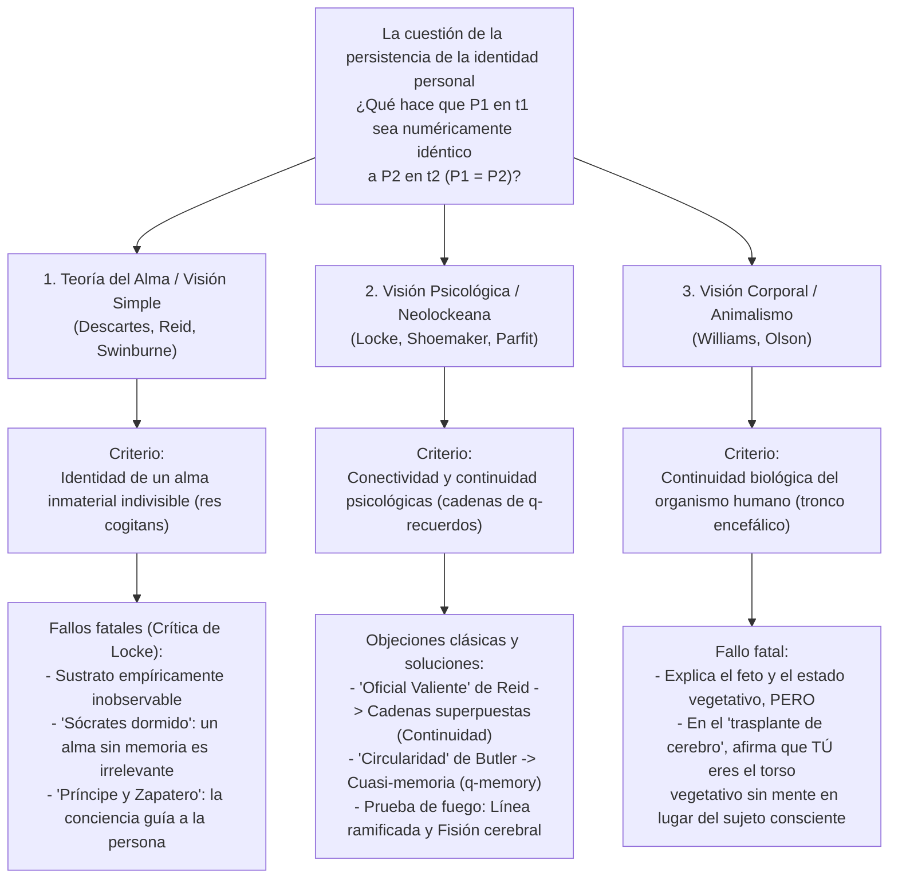
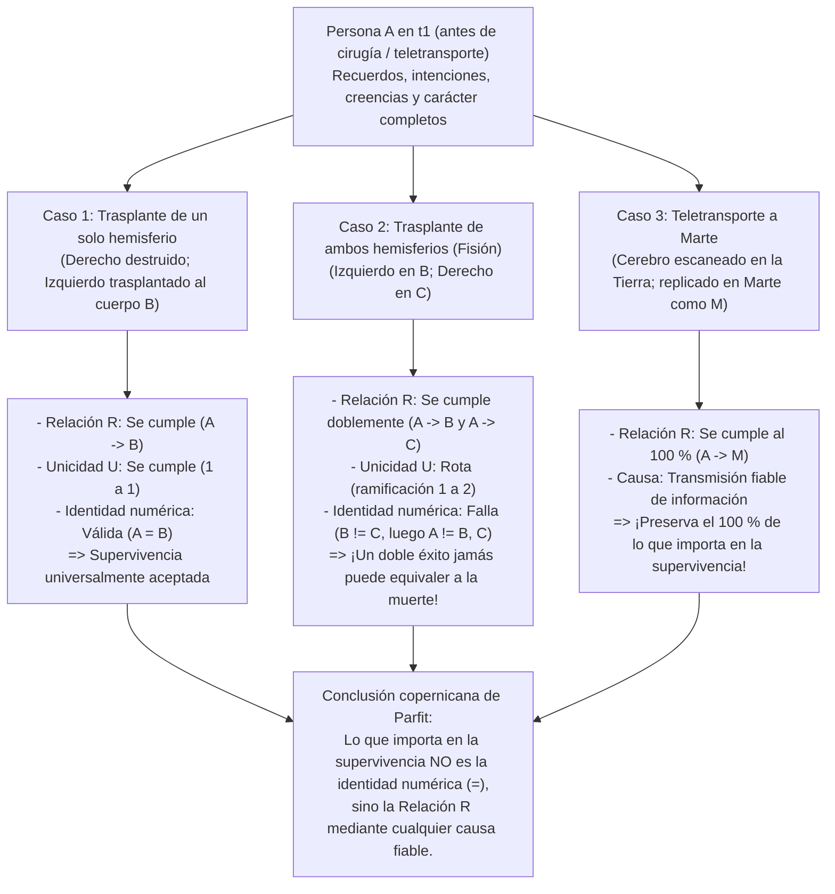

## 1. Introducción: El Teletransportador a Marte y la cuestión de la persistencia

### 1.1 El experimento mental del Teletransportador de Derek Parfit

Imagina que a finales del siglo XXI debes viajar por negocios a una colonia en Marte. En lugar de soportar seis meses en una nave espacial, entras en la cabina del <strong>Teletransportador</strong> en la Tierra y pulsas el botón verde. En ese instante pierdes el conocimiento. El <strong>Escáner</strong> registra con precisión atómica el estado exacto de todas tus células y de las 86.000 millones de neuronas y 100 billones de conexiones sinápticas de tu cerebro, <strong>vaporizando por completo tu cerebro y tu cuerpo en la Tierra</strong> mientras envía ese plano digital a la velocidad de la luz por ondas de radio hacia Marte. Tres minutos después, el <strong>Replicador</strong> en Marte ensambla átomos locales de carbono, hidrógeno, oxígeno y nitrógeno para reconstruir un cuerpo y un cerebro orgánicos exactamente iguales.

La persona que despierta en Marte recuerda haber pulsado el botón verde hace unos segundos en la Tierra, recuerda haber prometido a su esposa en el desayuno que la llamaría al llegar, e incluso ve en el espejo el pequeño corte en la mejilla izquierda que se hizo al afeitarse esa mañana en la Tierra.

Aquí surge la pregunta más inquietante de la metafísica y la filosofía de la mente:
<strong>¿La persona que despierta en Marte eres realmente *tú*?</strong>
¿Es el Teletransportador el medio de transporte más rápido de la historia, o <strong>*moriste* en el instante en que el Escáner vaporizó tu cuerpo en la Tierra</strong>, mientras que quien despierta en Marte es solo un duplicado recién nacido que cree erróneamente ser tú?

---

### 1.2 Identidad diacrónica: Identidad numérica frente a Identidad cualitativa

La metafísica analítica formula así la <strong>cuestión de la persistencia de la identidad personal a través del tiempo (Diachronic Personal Identity)</strong>:

>$$
>\textbf{Cuestión de la persistencia:}\quad \text{¿Bajo qué condiciones necesarias y suficientes una persona } P_1 \text{ que existe en } t_1
>$$
>$$
>\text{es numéricamente idéntica } (P_1 = P_2) \text{ a una persona } P_2 \text{ que existe en un tiempo posterior } t_2\text{?}
>$$

Debemos distinguir rigurosamente dos sentidos de «identidad»:
1. <strong>Identidad cualitativa (similitud exacta, $x \approx y$)</strong>: Dos entidades comparten todas sus propiedades intrínsecas ($\forall \Phi \in \mathcal{F}_{\text{intrinsic}} (\Phi(x) \leftrightarrow \Phi(y))$), como dos bolas de billar idénticas o tú y tu réplica marciana.
2. <strong>Identidad numérica ($x = y$)</strong>: No se trata de dos cosas similares, sino literalmente de <strong>una y la misma entidad única</strong>, regida por la Ley de Leibniz ($\forall \Phi (\Phi(x) \leftrightarrow \Phi(y))$).

El niño de 5 años ($P_{5}$) y el anciano de 80 años ($P_{80}$) son <strong>cualitativamente muy diferentes ($P_{5} \not\approx P_{80}$)</strong>, pero la moral y el derecho presuponen que son <strong>numéricamente idénticos ($P_{5} = P_{80}$)</strong>. A la inversa, la réplica en Marte ($P_{\text{Mars}}$) es <strong>100 % cualitativamente idéntica ($P_{\text{Earth}} \approx P_{\text{Mars}}$)</strong> a ti, pero eso no garantiza por sí solo la identidad numérica ($P_{\text{Earth}} = P_{\text{Mars}}$). La identidad numérica sostiene tres pilares de nuestra razón práctica: (1) la <strong>preocupación egoísta especial por el propio futuro (anticipación desde dentro)</strong>; (2) la <strong>responsabilidad moral y penal (castigo y promesas)</strong>; y (3) la <strong>compensación intertemporal (esfuerzo hoy para un beneficio mañana)</strong>.

---

## 2. Las tres teorías clásicas rivales: Alma, Memoria y Cuerpo

### 2.1 La teoría del alma inmaterial (Ego cartesiano) y la crítica de John Locke

Según Platón, René Descartes (*Meditaciones metafísicas*, 1641), Thomas Reid y Richard Swinburne, una persona es esencialmente una sustancia pensante inmaterial e indivisible: un <strong>alma inmaterial (*res cogitans*)</strong>. A diferencia del «barco de Teseo», cuyas tablas se reemplazan gradualmente, un alma simple carece de partes y no puede dividirse: $P_1 = P_2$ si y solo si poseen la misma sustancia anímica ($S_1 = S_2$).

Sin embargo, en 1694 el filósofo empirista inglés <strong>John Locke</strong> demolió esta postura en el capítulo 27 (*«Sobre la identidad y la diversidad»*) del Libro II de su *Ensayo sobre el entendimiento humano* mediante dos célebres experimentos mentales:
* <strong>Sócrates despierto y dormido (reencarnación sin memoria)</strong>: Supongamos que el alma inmaterial $S$ en tu cuerpo es exactamente la misma sustancia que habitó en Sócrates en la antigua Atenas, pero vaciada de todos sus recuerdos y pensamientos. ¿Compartir un sustrato inobservable y amnésico te convierte en la <strong>misma persona</strong> que Sócrates? En absoluto: no más que tener en tu uña átomos de carbono que alguna vez pertenecieron a Julio César.
* <strong>El Príncipe y el Zapatero (The Prince and the Cobbler)</strong>: Supongamos que el alma de un <strong>Príncipe</strong>, llevando consigo toda la conciencia y los recuerdos de su vida real, entra en el cuerpo de un humilde <strong>Zapatero</strong>. Aunque biológicamente parezca el «mismo hombre» (*Same Man* / organismo humano) que el zapatero, como agente moral y consciente (<strong>misma persona / *Same Person*</strong>) todo el mundo reconoce que es el <strong>Príncipe</strong>, responsable únicamente de los actos del Príncipe.

---

### 2.2 El criterio de la memoria de Locke y sus dos paradojas clásicas

Para Locke, «persona» es un <strong>término forense (Forensic Term)</strong> que adjudica acciones y mérito, y su identidad reside en la <strong>memoria experiencial en primera persona</strong>:

>$$
>\textbf{Criterio de Locke:}\quad P_2 \text{ en } t_2 = P_1 \text{ en } t_1 \iff P_2 \text{ en } t_2 \text{ puede recordar conscientemente «desde dentro» las experiencias de } P_1 \text{ en } t_1.
>$$

Esta teoría enfrentó dos objeciones lógicas devastadoras en el siglo XVIII:

#### Objeción 1: La paradoja del «Oficial Valiente» de Thomas Reid (1785) — Violación de la transitividad
El filósofo escocés <strong>Thomas Reid (1785)</strong> demostró que el criterio de Locke viola la <strong>transitividad de la identidad numérica</strong>:
* <strong>El niño de 10 años ($P_{10}$)</strong> es azotado en la escuela por robar manzanas de un huerto.
* <strong>El valiente oficial de 30 años ($P_{30}$)</strong> captura un estandarte enemigo en batalla y aún recuerda claramente haber sido azotado a los 10 años ($M(P_{30}, P_{10}) \implies P_{30} = P_{10}$).
* <strong>El general retirado de 80 años ($P_{80}$)</strong> recuerda vívidamente haber capturado el estandarte a los 30 años ($M(P_{80}, P_{30}) \implies P_{80} = P_{30}$), pero ha olvidado por completo los azotes a los 10 años ($\neg M(P_{80}, P_{10}) \implies P_{80} \neq P_{10}$).

Como la identidad numérica ($=$) es una <strong>relación de equivalencia (reflexiva, simétrica y transitiva: $A=B \land B=C \implies A=C$)</strong>, de $P_{80} = P_{30}$ y $P_{30} = P_{10}$ se sigue necesariamente $P_{80} = P_{10}$. Pero como la memoria directa $M$ <strong>no es transitiva</strong>, el criterio de Locke conduce a la contradicción lógica <strong>$P_{80} = P_{10} \land P_{80} \neq P_{10}$</strong>.

* <strong>La solución neolockeana</strong>: Los neolockeanos (Grice, Quinton, Shoemaker, Parfit) distinguen entre <strong>conectividad psicológica (Psychological Connectedness)</strong> — la posesión de vínculos psicológicos directos (recuerdos, intenciones cumplidas, creencias), que admite grados y *no es transitiva* — y <strong>continuidad psicológica (Psychological Continuity)</strong>, definida como <strong>cadenas superpuestas de conectividad fuerte ($C_{\text{strong}}$)</strong> (la clausura transitiva):
  $$\text{Continuity}(P_n, P_1) \iff \exists P_2, \dots, P_{n-1} \text{ tal que } C_{\text{strong}}(P_1, P_2) \land \dots \land C_{\text{strong}}(P_{n-1}, P_n)$$
  Así, el general de 80 años está vinculado al niño de 10 años mediante una cadena ininterrumpida de conectividad fuerte día tras día, salvando la transitividad.

#### Objeción 2: La objeción de circularidad de Joseph Butler (1736) y la «cuasi-memoria ($q$-memory)»
El obispo <strong>Joseph Butler (1736)</strong> objetó que, para distinguir un *recuerdo genuino* de un *recuerdo aparente o delirio* (como quien cree recordar haber sido Napoleón en Waterloo), el concepto de «recordar genuinamente» ya presupone que quien recuerda es <strong>numéricamente idéntico</strong> a quien vivió la experiencia. Definir la identidad mediante la memoria incurre en un círculo vicioso (*«Consciousness of personal identity presupposes, and therefore cannot constitute, personal identity»*).

* <strong>La solución de Sydney Shoemaker (1970) — Cuasi-memoria ($q$-memory)</strong>:
  Shoemaker definió la <strong>cuasi-memoria ($q$-memory)</strong> sin presuponer la identidad personal: tengo un cuasi-recuerdo exacto de una experiencia $E$ si y solo si (1) tengo un recuerdo aparente en primera persona de $E$, (2) <strong>alguien (Someone)</strong> tuvo realmente la experiencia $E$ en el pasado, y (3) mi recuerdo aparente depende causalmente de la manera adecuada (huellas cerebrales o transmisión fiable de información) de aquella experiencia $E$. Al definir la continuidad psicológica (Relación R) mediante la $q$-memoria, desaparece toda circularidad.

---

### 2.3 Criterio corporal, el rompecabezas de Bernard Williams y el Animalismo

* <strong>Bernard Williams, «The Self and the Future» (1970)</strong>:
  Williams mostró cómo el mismo proceso físico invierte nuestras intuiciones según cómo se describa. Si a $A$ y $B$ se les dice que un escáner intercambiará sus recuerdos y personalidades entre sus cerebros antes de dar 100.000 dólares a un cuerpo y torturar al otro, $A$ elige que el cuerpo-$B$ (que despertará con los recuerdos de $A$) reciba el dinero (visión psicológica). Pero si a $A$ se le dice: «Mañana torturaremos tu cuerpo ($A$), tras provocarte amnesia total e implantarte copias de los recuerdos de $B$», ¡$A$ sigue temiendo con pavor el dolor que sufrirá <strong>su propio cuerpo ($A$)</strong> (visión corporal)!
* <strong>El Animalismo de Eric Olson (*The Human Animal*, 1997)</strong>:
  Olson sostiene que somos fundamentalmente organismos biológicos de la especie *Homo sapiens*. Si la teoría psicológica fuera cierta, nunca habríamos sido un <strong>feto de 12 semanas</strong> y habríamos muerto al caer en un <strong>estado vegetativo persistente (EVP / PVS)</strong>, aunque el animal humano siga respirando gracias al tronco encefálico. Sin embargo, el Animalismo fracasa ante el <strong>trasplante de cerebro superior (Cerebrum Transplant)</strong>: si tu cerebro (sede de toda tu conciencia y recuerdos) se trasplanta a un cuerpo donante mientras tu tronco encefálico mantiene vivo tu antiguo torso descerebrado, ¡el Animalismo nos obliga a decir absurdamente que *tú* eres el torso inconsciente en la cama del hospital!

---

## 3. La revolución de Derek Parfit (*Reasons and Persons*, 1984): Caso de la línea ramificada y Fisión cerebral

En la Parte III de su obra maestra <strong>*Reasons and Persons* (1984)</strong>, el filósofo de Oxford <strong>Derek Parfit (1942–2017)</strong> derribó el supuesto compartido durante dos milenios: demostró que <strong>lo que importa racionalmente en la supervivencia NO es la identidad numérica ($P_1 = P_2$), sino la Relación R (conectividad y continuidad psicológicas)</strong>.

---

### 3.1 El caso de la línea ramificada (Branch-Line Case) y el Espectro combinado

* <strong>El caso de la línea ramificada (The Branch-Line Case)</strong>:
  Un Nuevo Escáner escanea tu cuerpo en la Tierra *sin* destruirlo y crea tu Réplica en Marte. Sales de la cabina en la Tierra y hablas por videollamada con tu Réplica en Marte. Claramente, tú estás aquí y él está allá: sois <strong>dos personas numéricamente distintas ($P_{\text{Earth}} \neq P_{\text{Mars}}$)</strong>. Entonces el médico te informa de que el Nuevo Escáner ha dañado tu tejido cardíaco en la Tierra: <strong>tú en la Tierra morirás de insuficiencia cardíaca en 3 días</strong>, mientras que tu Réplica en Marte, con un corazón sano, cuidará de tu familia y terminará tu libro.
  Observa la paradoja: la <strong>relación intrínseca causal y psicológica (Relación R)</strong> entre tú antes de pulsar el botón y tu Réplica en Marte es <strong>100 % idéntica</strong> tanto en la Teletransportación simple (muerte en 0 segundos) como en la Línea ramificada (muerte en 3 días). ¿Cómo podría el hecho extrínseco de que tu corazón en la Tierra lata durante 72 horas más convertir tu supervivencia en Marte en una muerte total?
* <strong>El Espectro combinado (The Combined Spectrum)</strong>:
  Un cirujano reemplaza una fracción $\alpha \in [0\%, 100\%]$ de tus células cerebrales y corporales por duplicados de las células de <strong>Greta Garbo</strong>. En $\alpha = 0\%$ eres <strong>Tú</strong>; en $\alpha = 100\%$ es <strong>Greta Garbo</strong>. Si el no-reduccionismo («visión del hecho adicional» / *Further Fact View*) fuera cierto, en algún punto intermedio (digamos entre $49,999\%$ y $50,000\%$) reemplazar una sola neurona haría que tu alma desapareciera de golpe y entrara la de Garbo. El <strong>Reduccionismo</strong> de Parfit muestra que en $\alpha = 50\%$, una vez conocidos los grados de continuidad física y psicológica, ya conocemos todos los hechos: preguntar si esa persona sigue siendo «yo» es una <strong>pregunta vacía (Empty Question)</strong>.

---

### 3.2 El argumento de la Fisión de Wiggins y Parfit («Mi División»)

Incluso si alguien exige que la Relación R tenga su <strong>causa física normal (la persistencia del mismo cerebro físico)</strong>, el argumento de la <strong>Fisión («My Division»)</strong> demuestra que la identidad numérica no es lo que importa.

La neurociencia clínica demuestra (1) que tras una <strong>hemisferectomía</strong> un ser humano sobrevive como la misma persona con un solo hemisferio cerebral, y (2) los estudios de <strong>cerebro dividido (Split-Brain)</strong> de Sperry y Gazzaniga prueban que al seccionar el cuerpo calloso operan dos flujos de conciencia independientes.

> <strong>[Experimento mental: Mi División (My Division)]</strong>
> Tú (<strong>$A$</strong>) eres uno de trillizos idénticos y tus dos hemisferios cerebrales son funcionalmente simétricos. Tras un accidente en el que tu cuerpo queda destrozado pero tu cerebro intacto, mientras tus dos hermanos sufren muerte cerebral con cuerpos sanos (<strong>Cuerpo $B$</strong> y <strong>Cuerpo $C$</strong>), el cirujano divide tu cerebro y trasplanta tu <strong>hemisferio izquierdo al Cuerpo $B$ (Lefty)</strong> y tu <strong>hemisferio derecho al Cuerpo $C$ (Righty)</strong>. ¡Ambos despiertan con la mitad de tu cerebro físico original y un 100 % de continuidad psicológica (Relación R) contigo!

¿Qué pasó conmigo (<strong>$A$</strong>)? Según la lógica estricta de la identidad numérica ($=$), solo existen cuatro opciones:
1. <strong>$A$ es tanto $B$ como $C$ ($A = B \land A = C$)</strong>: Viola la <strong>transitividad de la identidad</strong> ($B = A \land A = C \implies B = C$). Pero Lefty y Righty son dos personas distintas ($B \neq C$) que pueden jugar al tenis el uno contra el otro.
2. <strong>$A = B$ solamente</strong>, o 3. <strong>$A = C$ solamente</strong>: Totalmente arbitrario y viola la simetría y el <strong>principio de intrínsequidad (Only-$x$-and-$y$ Principle)</strong>. Si el hemisferio derecho se hubiera destruido, habrías sobrevivido como Lefty ($A = B$). ¿Cómo puede el éxito de una operación en el quirófano contiguo impedir que Lefty seas tú?
4. <strong>$A$ no es ni $B$ ni $C$ ($A \neq B \land A \neq C$)</strong>: La identidad numérica exige, además de la Relación R, una <strong>condición de no ramificación (Unicidad $U$)</strong>:
   $$\text{Identidad }(A = X) \iff R(A, X) \land U(A, X)$$

<strong>La conclusión revolucionaria de Parfit</strong>:
¿Deberías considerar el éxito del doble trasplante como tu <strong>muerte</strong> solo porque se rompe la unicidad $U$?
<strong>¡Absurdo!</strong> Si sobrevive un hemisferio, sobrevives. <strong>¿Cómo podría un DOBLE ÉXITO (¡ambos hemisferios sobreviven!) convertirse en un FRACASO TOTAL (la muerte)?!</strong> Si la identidad numérica fuera lo que importa, antes de la operación tendrías que sobornar a la enfermera para que destruyera tu hemisferio derecho con tal de preservar la condición de unicidad $U$.
Por consiguiente, <strong>lo que importa racionalmente en la supervivencia NO es la identidad numérica ($=$), sino la Relación R (conectividad y continuidad psicológicas)</strong>.

---

## 4. Matriz comparativa de las cinco grandes teorías de la identidad personal

| Teoría filosófica | Proponentes clave | Criterio de identidad / supervivencia | Veredicto sobre el «Oficial Valiente» de Reid | Trasplante de cerebro (tronco encefálico en estado vegetativo) | Fisión cerebral (Lefty $B$ y Righty $C$) | Teletransportador a Marte |
| :--- | :--- | :--- | :--- | :--- | :--- | :--- |
| <strong>1. Teoría del Alma (Visión Simple)</strong> | Descartes, Reid, Swinburne | Persistencia de una sustancia inmaterial indivisible ($S$) | General = Niño ssi permanece la misma alma $S$ | Incognoscible a qué cuerpo sigue el alma inobservable | El alma no se divide; entra arbitrariamente en $B$, en $C$ o en ninguno | <strong>Muerte</strong>, salvo que el alma viaje por radio |
| <strong>2. Criterio clásico de la memoria</strong> | John Locke (1694) | Memoria directa en primera persona $M(P_2, P_1)$ | <strong>Falla</strong>: Viola la transitividad de la identidad ($P_{80}=P_{30}=P_{10}$ pero $P_{80}\neq P_{10}$) | Vas con el cerebro trasplantado que guarda los recuerdos | Contradice la transitividad ($B=C$) porque ambos recuerdan | <strong>Supervivencia</strong> (pero vulnerable a la circularidad de Butler) |
| <strong>3. Animalismo (Visión biológica)</strong> | Eric Olson (1997), Snowdon | Continuidad de un organismo biológico (*Homo sapiens* vía tronco encefálico) | General = Niño por ser el mismo animal humano vivo | <strong>Contraintuitivo</strong>: ¡Tú sigues siendo el torso vegetativo sin mente! | El organismo original termina; surgen dos nuevos | <strong>Muerte</strong>: el organismo terrestre es destruido |
| <strong>4. Neolockeano estricto</strong> | Shoemaker (temprano), Wiggins | Continuidad psicológica no ramificada ($R \land U$) con <strong>causa normal</strong> (mismo cerebro) | Resuelto mediante cadenas superpuestas de conectividad fuerte y $q$-memoria | Vas con el cerebro trasplantado | Falla la identidad numérica ($A \neq B, C$) al violarse $U$ | <strong>Muerte</strong>, porque el cerebro físico es destruido |
| <strong>5. Reduccionismo de Parfit (Relación R amplia)</strong> | <strong>Derek Parfit</strong> (1984), David Lewis | <strong>La identidad ($=$) no es lo que importa; importa la Relación R con cualquier causa fiable</strong> | Hay continuidad, aunque la conectividad directa se atenúa tras 70 años | Sobrevives al 100 % en el receptor del cerebro vía Relación R | Falla la identidad numérica, pero <strong>¡hay doble supervivencia por doble Relación R!</strong> | <strong>Supervivencia plena (lo que importa)</strong>: ¡Relación R preservada al 100 %! |

---

## 5. Liberación del «túnel de cristal»: Teoría del haz, ética y serenidad ante la muerte

El Reduccionismo de Parfit muestra que una persona a través del tiempo, al igual que una <strong>nación</strong> o un <strong>club</strong>, no es más que una serie de sucesos físicos y mentales entrelazados por la Relación R, reivindicando la <strong>teoría del haz de percepciones (Bundle Theory)</strong> de <strong>David Hume</strong> (*Tratado de la naturaleza humana*, 1739) y la doctrina budista del <strong>No-Yo (*Anattā*)</strong> expuesta en el *Milindapañha* (el símil del carro y de la llama que pasa de una vela a otra).

Dado que la <strong>conectividad psicológica</strong> es una cuestión de grado que disminuye con las décadas (como en el <strong>caso de Matusalén</strong> o el del <strong>joven noble ruso del siglo XIX</strong> que pide a su esposa que se niegue a revocar la donación de tierras si su futuro «yo sucesor» de mediana edad se vuelve egoísta), el Reduccionismo transforma nuestra ética y nuestra actitud ante la muerte. Al final del capítulo 13 de *Reasons and Persons*, Parfit escribe su célebre confesión existencial:

> *«Cuando creía que mi existencia era un hecho adicional separado, mi vida parecía <strong>un túnel de cristal (a glass tunnel)</strong> por el que me movía más rápido cada año y al final del cual había oscuridad. Cuando cambié de opinión, las paredes de mi túnel de cristal desaparecieron. <strong>Ahora vivo al aire libre (in the open air).</strong> Las demás personas están más cerca. Mi muerte romperá las relaciones más directas entre mis experiencias presentes y las experiencias futuras, pero no romperá otras diversas relaciones. Ahora que he visto esto, mi muerte me parece menos mala.»* (Derek Parfit, *Reasons and Persons*, 1984, p. 281)
