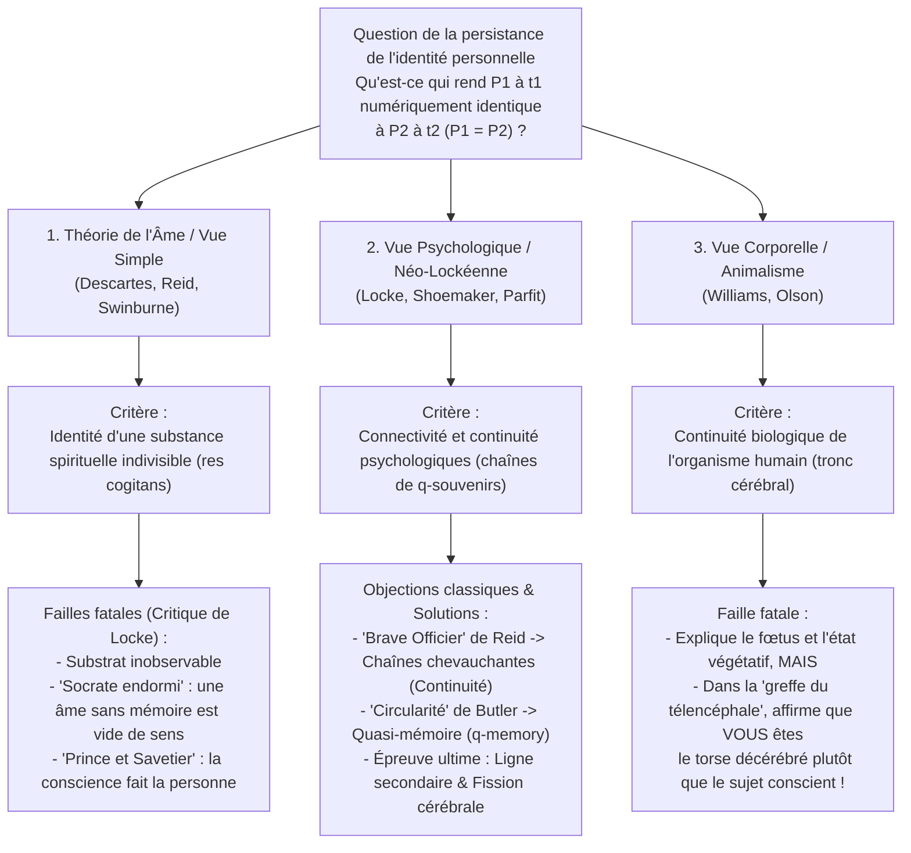
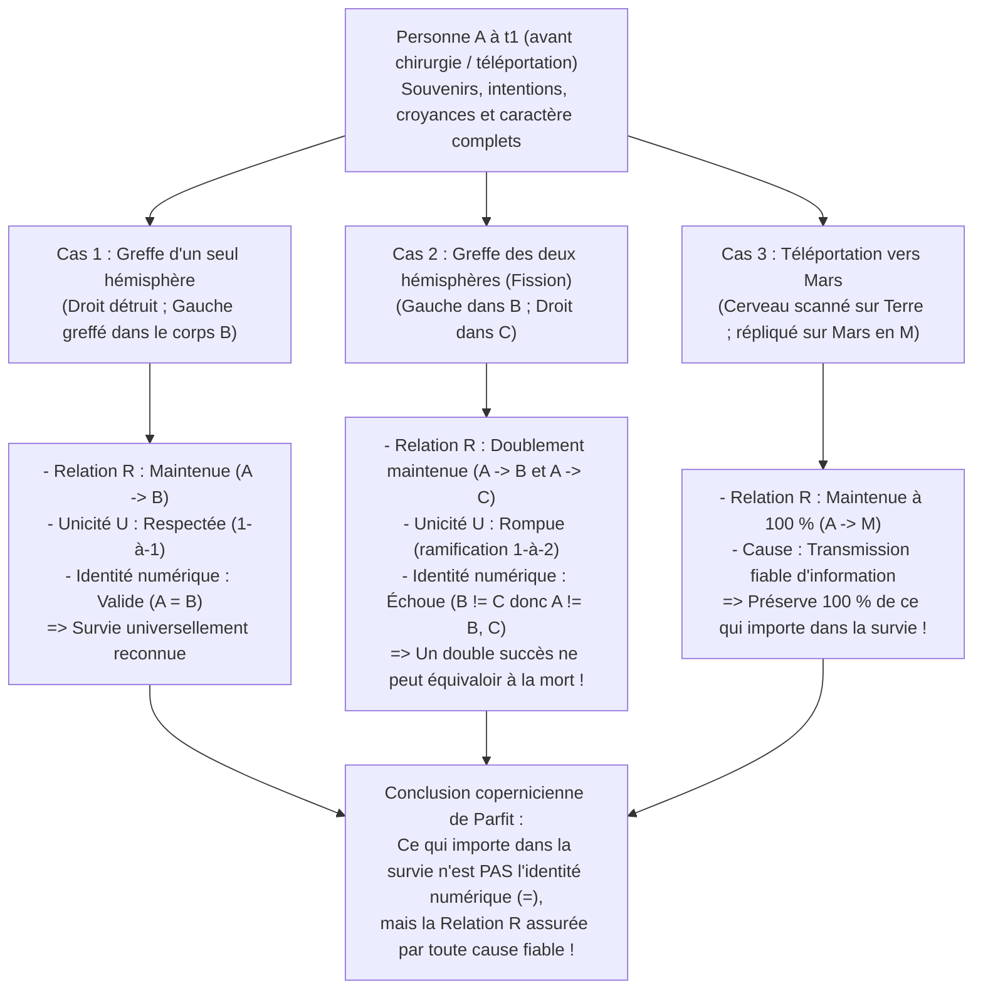

## 1. Introduction : Le Télétransporteur vers Mars et la question de la persistance

### 1.1 L'expérience de pensée du Télétransporteur de Derek Parfit

Imaginez qu'à la fin du XXIᵉ siècle, pour vous rendre en voyage d'affaires sur Mars sans subir six mois de vol spatial, vous entriez dans la cabine du <strong>Télétransporteur</strong> sur Terre. Dès que vous appuyez sur le bouton vert, vous perdez connaissance. Le <strong>Scanner</strong> enregistre avec une précision atomique l'état exact de toutes vos cellules et des 86 milliards de neurones et 100 000 milliards de connexions synaptiques de votre cerveau, <strong>vaporisant instantanément votre cerveau et votre corps terrestres</strong>, tout en transmettant ce plan complet par ondes radio à la vitesse de la lumière vers Mars. Trois minutes plus tard, le <strong>Réplicateur</strong> sur Mars assemble des atomes locaux de carbone, d'hydrogène, d'oxygène et d'azote pour reconstruire un corps et un cerveau organiques rigoureusement identiques.

La personne qui s'éveille sur Mars se souvient d'avoir appuyé sur le bouton vert quelques secondes plus tôt, se souvient de sa promesse faite au petit-déjeuner d'appeler son épouse dès son arrivée, et retrouve même sur sa joue gauche la minuscule coupure de rasoir faite ce matin sur Terre.

Une question métaphysique vertigineuse se pose alors :
<strong>La personne qui se réveille sur Mars est-elle vraiment *vous* ?</strong>
Le Télétransporteur est-il le moyen de transport le plus rapide jamais inventé, ou bien <strong>êtes-vous *mort* à l'instant où le Scanner a détruit votre corps sur Terre</strong>, tandis que l'individu sur Mars n'est qu'une réplique fraîchement créée — un imposteur involontaire qui croit à tort être vous ?

---

### 1.2 Identité diachronique : Identité numérique vs Identité qualitative

La métaphysique analytique formule ainsi la <strong>question de la persistance de l'identité personnelle à travers le temps (Diachronic Personal Identity)</strong> :

>$$
>\textbf{Question de la persistance :}\quad \text{Sous quelles conditions nécessaires et suffisantes une personne } P_1 \text{ existant à } t_1
>$$
>$$
>\text{est-elle numériquement identique } (P_1 = P_2) \text{ à une personne } P_2 \text{ existant à un instant ultérieur } t_2\text{ ?}
>$$

Il est crucial de distinguer deux sens de l'identité :
1. <strong>Identité qualitative (ressemblance exacte, $x \approx y$)</strong> : Deux entités partagent toutes leurs propriétés intrinsèques ($\forall \Phi \in \mathcal{F}_{\text{intrinsic}} (\Phi(x) \leftrightarrow \Phi(y))$), comme deux boules de billard sorties du même moule, ou vous et votre réplique martienne.
2. <strong>Identité numérique ($x = y$)</strong> : $x$ et $y$ ne sont pas deux choses semblables, mais littéralement <strong>un seul et même être unique</strong>, régi par la loi de Leibniz ($\forall \Phi (\Phi(x) \leftrightarrow \Phi(y))$).

L'enfant de 5 ans ($P_{5}$) et le vieillard de 80 ans ($P_{80}$) sont <strong>qualitativement très différents ($P_{5} \not\approx P_{80}$)</strong>, mais la morale et le droit les tiennent pour <strong>numériquement identiques ($P_{5} = P_{80}$)</strong>. Inversement, votre réplique sur Mars ($P_{\text{Mars}}$) est <strong>100 % qualitativement identique ($P_{\text{Earth}} \approx P_{\text{Mars}}$)</strong> à vous, sans que cela garantisse d'emblée l'identité numérique ($P_{\text{Earth}} = P_{\text{Mars}}$). Or, l'identité numérique soutient trois piliers de notre raison pratique : (1) le <strong>souci égoïste spécial pour notre propre avenir (anticipation de l'intérieur)</strong> ; (2) la <strong>responsabilité morale et juridique (mérite, punition, promesses)</strong> ; et (3) la <strong>compensation intertemporelle (subir un effort aujourd'hui pour un bonheur demain)</strong>.

---

## 2. Les trois rivaux classiques : l'Âme, la Mémoire et le Corps

### 2.1 La théorie de l'âme immatérielle (Ego cartésien) et la critique de John Locke

Selon Platon, René Descartes (*Méditations métaphysiques*, 1641), Thomas Reid et Richard Swinburne, une personne est essentiellement une substance pensante immatérielle et indivisible — une <strong>âme immatérielle (*res cogitans*)</strong>. Contrairement au « bateau de Thésée » dont les planches sont remplacées peu à peu, une substance simple sans parties ne peut ni se diviser ni changer par degrés : $P_1 = P_2$ si et seulement s'ils possèdent la même âme ($S_1 = S_2$).

Mais en 1694, le philosophe empiriste anglais <strong>John Locke</strong> porta un coup fatal à cette thèse au chapitre 27 (*« De l'identité et de la diversité »*) du Livre II de son *Essai sur l'entendement humain* grâce à deux expériences de pensée célèbres :
* <strong>Socrate éveillé et endormi (la réincarnation sans mémoire)</strong> : Supposons que l'âme immatérielle $S$ logée dans votre corps soit exactement la même substance qui animait autrefois Socrate à Athènes, mais vidée de tous les souvenirs et pensées de Socrate. Le partage d'un substrat immatériel inobservable et amnésique fait-il de vous la <strong>même personne</strong> que Socrate ? Nullement — pas plus que quelques atomes de carbone ayant appartenu à Jules César dans votre ongle ne font de vous César.
* <strong>Le Prince et le Savetier (The Prince and the Cobbler)</strong> : Supposons que l'âme d'un <strong>Prince</strong>, emportant avec elle toute la conscience et tous les souvenirs de sa vie royale, entre dans le corps d'un <strong>Savetier</strong>. Bien qu'il demeure biologiquement le « même homme » (*Same Man* / organisme humain) que le savetier aux yeux d'autrui, en tant qu'agent moral et conscient (<strong>même personne / *Same Person*</strong>), tout le monde reconnaît qu'il est le <strong>Prince</strong>, uniquement responsable des actes du Prince !

---

### 2.2 Le critère mémoriel de Locke et ses deux paradoxes classiques

Pour Locke, « personne » est un <strong>terme de barreau (Forensic Term)</strong> qui fonde la responsabilité morale et juridique, et son identité repose sur la <strong>conscience et la mémoire expérientielle en première personne</strong> :

>$$
>\textbf{Critère mémoriel de Locke :}\quad P_2 \text{ à } t_2 = P_1 \text{ à } t_1 \iff P_2 \text{ à } t_2 \text{ peut se souvenir consciemment « de l'intérieur » des expériences de } P_1 \text{ à } t_1.
>$$

Ce critère se heurta immédiatement à deux objections logiques majeures au XVIIIᵉ siècle :

#### Objection 1 : Le paradoxe du « Brave Officier » de Thomas Reid (1785) — Violation de la transitivité
Le philosophe écossais <strong>Thomas Reid (1785)</strong> démontra que le critère de Locke viole la <strong>transitivité de l'identité numérique</strong> :
* <strong>L'enfant à 10 ans ($P_{10}$)</strong> est fouetté à l'école pour avoir volé des pommes dans un verger.
* <strong>Le brave officier à 30 ans ($P_{30}$)</strong> s'empare d'un étendard ennemi au combat et se souvient encore clairement d'avoir été fouetté à 10 ans ($M(P_{30}, P_{10}) \implies P_{30} = P_{10}$).
* <strong>Le vieux général à 80 ans ($P_{80}$)</strong> se souvient avec fierté d'avoir pris l'étendard à 30 ans ($M(P_{80}, P_{30}) \implies P_{80} = P_{30}$), mais a complètement oublié la punition reçue à 10 ans ($\neg M(P_{80}, P_{10}) \implies P_{80} \neq P_{10}$).

Or, l'identité numérique ($=$) est une <strong>relation d'équivalence (réflexive, symétrique et transitive : $A=B \land B=C \implies A=C$)</strong>, ce qui implique $P_{80} = P_{10}$. Comme la mémoire directe $M$ n'est <strong>pas transitive</strong>, le critère de Locke aboutit à la contradiction formelle <strong>$P_{80} = P_{10} \land P_{80} \neq P_{10}$</strong> !

* <strong>La solution néo-lockéenne</strong> : Les néo-lockéens contemporains (Grice, Quinton, Shoemaker, Parfit) distinguent la <strong>connectivité psychologique (Psychological Connectedness)</strong> — l'existence de liens psychologiques directs (souvenirs, intentions accomplies, croyances persistantes), qui admet des degrés et n'est *pas transitive* — et la <strong>continuité psychologique (Psychological Continuity)</strong>, définie comme l'existence de <strong>chaînes chevauchantes de connectivité forte ($C_{\text{strong}}$)</strong> (la clôture transitive) :
  $$\text{Continuity}(P_n, P_1) \iff \exists P_2, \dots, P_{n-1} \text{ t.q. } C_{\text{strong}}(P_1, P_2) \land \dots \land C_{\text{strong}}(P_{n-1}, P_n)$$
  Le général de 80 ans est ainsi relié à l'enfant de 10 ans par une chaîne ininterrompue de connectivité forte jour après jour, sauvant la transitivité.

#### Objection 2 : L'objection de circularité de Joseph Butler (1736) et la « quasi-mémoire ($q$-memory) »
L'évêque <strong>Joseph Butler (1736)</strong> objecta que pour distinguer un *vrai souvenir* (Genuine Memory) d'un simple *faux souvenir ou délire* (comme un patient croyant être Napoléon à Waterloo), le concept même de « vrai souvenir » présuppose déjà que celui qui se souvient est <strong>numériquement identique</strong> à celui qui a vécu l'expérience ! Définir l'identité par la mémoire est donc vicieusement circulaire (*« Consciousness of personal identity presupposes, and therefore cannot constitute, personal identity »*).

* <strong>La solution de Sydney Shoemaker (1970) — La quasi-mémoire ($q$-memory)</strong> :
  Shoemaker définit la <strong>quasi-mémoire ($q$-memory)</strong> sans présupposer l'identité personnelle : j'ai un quasi-souvenir exact d'une expérience $E$ si et seulement si (1) j'ai un souvenir apparent à la première personne de $E$, (2) <strong>quelqu'un (Someone)</strong> a réellement vécu $E$ dans le passé, et (3) mon souvenir apparent dépend causalement de la bonne manière (traces cérébrales ou transfert fiable d'information) de cette expérience $E$. En définissant la continuité psychologique (Relation R) via la $q$-mémoire, toute circularité disparaît.

---

### 2.3 Critère corporel, puzzle de Bernard Williams et Animalisme

* <strong>Bernard Williams, « The Self and the Future » (1970)</strong> :
  Williams montre que nos intuitions s'inversent selon la présentation d'un même processus physique. Si l'on annonce à $A$ et $B$ que leurs souvenirs et caractères seront échangés entre leurs cerveaux avant qu'un corps ne reçoive 100 000 dollars et l'autre la torture, $A$ souhaite que le corps-$B$ (doté des souvenirs de $A$) reçoive l'argent (critère psychologique). Mais si l'on dit à $A$ : « Demain nous allons torturer ton corps ($A$), après t'avoir provoqué une amnésie totale puis implanté des copies des souvenirs de $B$ », $A$ redoute toujours avec terreur la douleur que subira <strong>son propre corps ($A$)</strong> (critère corporel) !
* <strong>L'Animalisme d'Eric Olson (*The Human Animal*, 1997)</strong> :
  Olson soutient que nous sommes fondamentalement des organismes biologiques de l'espèce *Homo sapiens*. Si le critère psychologique était vrai, nous n'aurions jamais été un <strong>fœtus de 12 semaines</strong> et nous mourrions dès l'entrée dans un <strong>état végétatif persistant (EVP / PVS)</strong>, alors même que l'animal humain continue de respirer grâce au tronc cérébral. Toutefois, l'Animalisme échoue devant la <strong>transplantation du cerveau supérieur (Cerebrum Transplant)</strong> : si votre télencéphale (siège de toute votre conscience et de vos souvenirs) est greffé dans un corps donneur tandis que votre tronc cérébral maintient votre ancien torse décérébré en vie, l'Animalisme doit affirmer absurdement que *vous* êtes le légume sans conscience resté au lit !

---

## 3. La révolution de Derek Parfit (*Reasons and Persons*, 1984) : Ligne secondaire et Fission cérébrale

Dans la troisième partie de son chef-d'œuvre <strong>*Reasons and Persons* (1984)</strong>, le philosophe d'Oxford <strong>Derek Parfit (1942–2017)</strong> a renversé le présupposé commun à deux millénaires de débats : il a démontré que <strong>ce qui importe rationnellement dans la survie n'est PAS l'identité numérique ($P_1 = P_2$), mais la Relation R (la connectivité et la continuité psychologiques) !</strong>

---

### 3.1 Le cas de la Ligne secondaire (Branch-Line Case) et le Spectre combiné

* <strong>Le cas de la Ligne secondaire (The Branch-Line Case)</strong> :
  Un Nouveau Scanner numérise votre corps sur Terre *sans* le détruire et crée votre Réplique sur Mars. Vous sortez de la cabine sur Terre et discutez par visiophonie avec votre Réplique sur Mars. De toute évidence, vous êtes ici et il est là-bas : vous êtes <strong>deux personnes numériquement distinctes ($P_{\text{Earth}} \neq P_{\text{Mars}}$)</strong>. Or, le médecin vous apprend que le Nouveau Scanner a endommagé votre cœur sur Terre : <strong>vous allez mourir d'une insuffisance cardiaque dans 3 jours sur Terre</strong>, tandis que votre Réplique sur Mars, en parfaite santé, aimera votre famille et achèvera votre livre.
  Or, la <strong>relation intrinsèque causale et psychologique (Relation R)</strong> entre vous avant d'appuyer sur le bouton et la Réplique sur Mars est <strong>100 % identique</strong> dans la Téléportation simple (mort en 0 seconde) et dans la Ligne secondaire (mort en 3 jours) ! Comment la survie temporaire de votre corps terrestre pendant trois jours pourrait-elle transformer votre survie sur Mars en une mort totale ?!
* <strong>Le Spectre combiné (The Combined Spectrum)</strong> :
  Un chirurgien remplace une proportion $\alpha \in [0\%, 100\%]$ de vos cellules cérébrales et corporelles par des copies des cellules de <strong>Greta Garbo</strong>. À $\alpha = 0\%$, c'est <strong>Vous</strong> ; à $\alpha = 100\%$, c'est <strong>Greta Garbo</strong>. Si la thèse non-réductionniste d'un « fait supplémentaire » (*Further Fact View*) était vraie, il faudrait qu'au milieu du spectre (par exemple entre $49,999\%$ et $50,000\%$) le remplacement d'un seul neurone fasse soudainement disparaître votre âme au profit de celle de Garbo ! Le <strong>Réductionnisme</strong> de Parfit montre au contraire qu'à $\alpha = 50\%$, une fois connus tous les degrés de continuité physique et psychologique, nous connaissons toute la réalité : demander si cette personne est encore « moi » est une <strong>question vide (Empty Question)</strong>.

---

### 3.2 L'argument de la Fission de Wiggins et Parfit (« Ma Division »)

Même si l'on exigeait que la Relation R ait sa <strong>cause physique normale (la persistance du même cerveau physique)</strong>, l'argument de la <strong>Fission (« My Division »)</strong> prouve que l'identité numérique n'est pas ce qui importe.

La neurochirurgie clinique prouve (1) qu'après une <strong>hémisphérectomie</strong>, un être humain survit en tant que même personne avec un seul hémisphère cérébral, et (2) les travaux sur le <strong>cerveau divisé (Split-Brain)</strong> de Sperry et Gazzaniga montrent que la section du corps calleux crée deux flux de conscience indépendants.

> <strong>[Expérience de pensée : Ma Division (My Division)]</strong>
> Vous (<strong>$A$</strong>) êtes l'un de triplés identiques, et vos deux hémisphères cérébraux sont fonctionnellement symétriques. Après un accident où votre corps est écrasé mais votre cerveau intact, tandis que vos deux frères sont en mort cérébrale avec des corps intacts (<strong>Corps $B$</strong> et <strong>Corps $C$</strong>), le chirurgien divise votre cerveau et greffe votre <strong>hémisphère gauche dans le Corps $B$ (Lefty)</strong> et votre <strong>hémisphère droit dans le Corps $C$ (Righty)</strong>. Tous deux s'éveillent avec la moitié de votre cerveau physique et 100 % de continuité psychologique (Relation R) avec vous !

Qu'est-il arrivé à <strong>moi ($A$)</strong> ? Selon la logique stricte de l'identité numérique ($=$), il n'y a que quatre options :
1. <strong>$A$ est à la fois $B$ et $C$ ($A = B \land A = C$)</strong> : Viole la <strong>transitivité de l'identité</strong> ($B = A \land A = C \implies B = C$) ! Or Lefty et Righty sont deux personnes distinctes ($B \neq C$) qui peuvent jouer au tennis l'un contre l'autre.
2. <strong>$A = B$ seulement</strong>, ou 3. <strong>$A = C$ seulement</strong> : Totalement arbitraire et contraire à la symétrie et au <strong>principe d'intrinsèquité (Only-$x$-and-$y$ Principle)</strong> ! Si l'hémisphère droit avait été détruit, vous auriez survécu en tant que Lefty ($A = B$). Comment la réussite d'une greffe dans la salle voisine pourrait-elle empêcher Lefty d'être vous ?
4. <strong>$A$ n'est ni $B$ ni $C$ ($A \neq B \land A \neq C$)</strong> : L'identité numérique exige, outre la Relation R, une <strong>condition de non-ramification (Unicité $U$)</strong> :
   $$\text{Identité }(A = X) \iff R(A, X) \land U(A, X)$$

<strong>Conclusion révolutionnaire de Parfit</strong> :
Devriez-vous considérer la réussite de la double greffe comme votre <strong>mort</strong> sous prétexte que l'unicité $U$ est rompue ?!
<strong>Absurde !</strong> Si un seul hémisphère survit, vous survivez. <strong>Comment un DOUBLE SUCCÈS (les deux hémisphères survivent !) pourrait-il être un ÉCHEC TOTAL (la mort) ?!</strong> Si l'identité numérique était ce qui compte, vous devriez soudoyer l'infirmière avant l'opération pour qu'elle détruise votre hémisphère droit afin de préserver la condition d'unicité $U$ !
Par conséquent, <strong>ce qui importe rationnellement dans la survie n'est PAS l'identité numérique ($=$), mais la Relation R (connectivité et continuité psychologiques) !</strong>

---

## 4. Matrice comparative des cinq grandes théories de l'identité personnelle

| Théorie philosophique | Auteurs clés | Critère d'identité / de survie | Verdict sur le « Brave Officier » de Reid | Greffe du télencéphale (tronc cérébral en état végétatif) | Fission cérébrale (Lefty $B$ et Righty $C$) | Télétransporteur vers Mars |
| :--- | :--- | :--- | :--- | :--- | :--- | :--- |
| <strong>1. Théorie de l'Âme (Vue Simple)</strong> | Descartes, Reid, Swinburne | Persistance d'une substance immatérielle indivisible ($S$) | Général = Enfant ssi la même âme $S$ demeure | Impossible de savoir quel corps suit l'âme inobservable | L'âme indivisible va arbitrairement en $B$, en $C$ ou dans aucun | <strong>Mort</strong>, sauf si l'âme voyage avec le faisceau radio |
| <strong>2. Critère mémoriel classique</strong> | John Locke (1694) | Mémoire directe en première personne $M(P_2, P_1)$ | <strong>Échec</strong> : Viole la transitivité de l'identité ($P_{80}=P_{30}=P_{10}$ mais $P_{80}\neq P_{10}$) | Vous suivez le télencéphale porteur des souvenirs | Contredit la transitivité ($B=C$) car tous deux se souviennent | <strong>Survie</strong> (mais exposé à l'objection de circularité de Butler) |
| <strong>3. Animalisme (Vue biologique)</strong> | Eric Olson (1997), Snowdon | Continuité d'un organisme biologique (*Homo sapiens* via tronc cérébral) | Général = Enfant car même animal humain vivant | <strong>Contre-intuitif</strong> : Vous restez le torse végétatif sans conscience ! | L'organisme initial cesse ; deux nouveaux émergent | <strong>Mort</strong> : l'organisme terrestre est détruit |
| <strong>4. Néo-lockéisme étroit</strong> | Shoemaker (début), Wiggins | Continuité psychologique non ramifiée ($R \land U$) avec <strong>cause normale</strong> (même cerveau) | Résolu par chaînes chevauchantes de connectivité forte et $q$-mémoire | Vous suivez le télencéphale transplanté | L'identité numérique échoue ($A \neq B, C$) car $U$ est violée | <strong>Mort</strong>, car le cerveau physique est détruit |
| <strong>5. Réductionnisme de Parfit (Relation R large)</strong> | <strong>Derek Parfit</strong> (1984), David Lewis | <strong>L'identité ($=$) n'est pas ce qui compte ; seule compte la Relation R avec toute cause fiable</strong> | Continuité maintenue, connectivité directe affaiblie après 70 ans | Survie à 100 % chez le receveur du télencéphale via Relation R | Pas d'identité numérique, mais <strong>double survie par double Relation R !</strong> | <strong>Survie complète (ce qui compte)</strong> : Relation R préservée à 100 % ! |

---

## 5. Sortir du « tunnel de verre » : Théorie du faisceau, éthique et sérénité face à la mort

Le Réductionnisme de Parfit montre qu'une personne à travers le temps, telle une <strong>nation</strong> ou un <strong>club</strong>, n'est rien de plus qu'un flux d'événements physiques et mentaux reliés par la Relation R — rejoignant la <strong>théorie du faisceau de perceptions (Bundle Theory)</strong> de <strong>David Hume</strong> (*Traité de la nature humaine*, 1739) et la doctrine bouddhiste du <strong>Non-Soi (*Anattā*)</strong> exposée dans le *Milindapañha* (la métaphore du char et de la flamme transmise d'une bougie à l'autre).

Parce que la <strong>connectivité psychologique</strong> est une question de degré qui s'affaiblit avec les décennies (comme dans le <strong>cas de Mathusalem</strong> ou celui du <strong>jeune noble russe du XIXᵉ siècle</strong> qui demande à son épouse de refuser à son futur « moi successeur » devenu conservateur la révocation du don de ses terres), le Réductionnisme transforme notre éthique et notre rapport à la mort. À la fin du chapitre 13 de *Reasons and Persons*, Parfit livre cette célèbre confession existentielle :

> *« Lorsque je croyais que mon existence était un fait supplémentaire distinct, ma vie me semblait pareille à <strong>un tunnel de verre (a glass tunnel)</strong> dans lequel j'avançais chaque année plus vite, et au bout duquel il y avait l'obscurité. Quand j'ai changé d'avis, les parois de mon tunnel de verre ont disparu. <strong>Je vis maintenant à l'air libre (in the open air).</strong> Les autres sont plus proches. Ma mort brisera les relations les plus directes entre mes expériences présentes et les expériences futures, mais elle ne brisera pas diverses autres relations. Maintenant que j'ai compris cela, ma mort me paraît moins mauvaise. »* (Derek Parfit, *Reasons and Persons*, 1984, p. 281)
