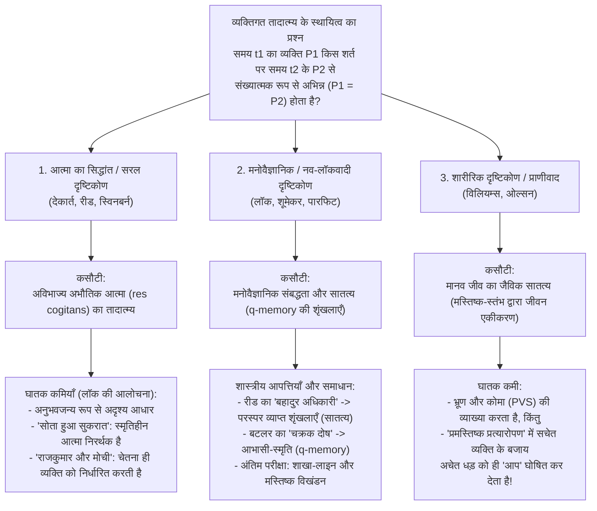
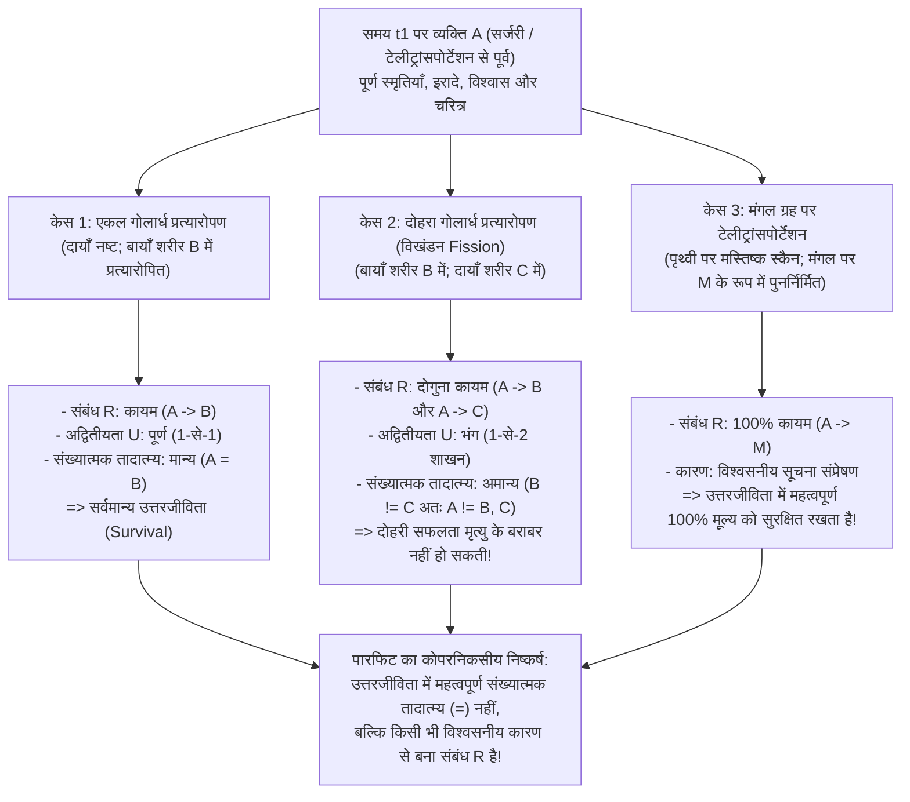

## 1. भूमिका: मंगल ग्रह का टेलीट्रांसपोर्टर और कालक्रमिक तादात्म्य का प्रश्न

### 1.1 डेरेक पारफिट का टेलीट्रांसपोर्टर (Teletransporter) विचार-प्रयोग

कल्पना कीजिए कि 21वीं सदी के अंत में आपको व्यावसायिक यात्रा पर मंगल ग्रह की एक कॉलोनी में जाना है। अंतरिक्ष यान में छह महीने की कठिन यात्रा करने के बजाय, आप पृथ्वी पर <strong>टेलीट्रांसपोर्टर (Teletransporter)</strong> के बूथ में प्रवेश करते हैं और हरा बटन दबाते हैं। उसी क्षण आप चेतना खो देते हैं। पृथ्वी पर लगा <strong>स्कैनर (Scanner)</strong> आपके शरीर की प्रत्येक कोशिका और आपके मस्तिष्क के 86 अरब न्यूरॉन्स तथा 100 ट्रिलियन सिनैप्टिक कनेक्शनों की सटीक परमाण्विक स्थिति को रिकॉर्ड कर लेता है, और इस प्रक्रिया में <strong>पृथ्वी पर आपके मस्तिष्क और भौतिक शरीर को पूरी तरह वाष्पित (नष्ट) कर देता है</strong>। यह डिजिटल ब्लूप्रिंट रेडियो तरंगों के माध्यम से प्रकाश की गति से मंगल ग्रह पर भेजा जाता है। तीन मिनट बाद, मंगल ग्रह पर स्थित <strong>रेप्लिकेटर (Replicator)</strong> स्थानीय कार्बन, हाइड्रोजन, ऑक्सीजन और नाइट्रोजन परमाणुओं को जोड़कर बिल्कुल वैसा ही जैविक शरीर और मस्तिष्क तैयार कर देता है।

मंगल ग्रह के बूथ में जागने वाला व्यक्ति स्पष्ट रूप से याद रखता है कि उसने कुछ सेकंड पहले पृथ्वी पर हरा बटन दबाया था, उसे नाश्ते के समय अपनी पत्नी से किया वादा याद है कि वह पहुँचते ही वीडियो कॉल करेगा, और यहाँ तक कि दर्पण में उसे अपने बाएँ गाल पर सुबह पृथ्वी पर दाढ़ी बनाते समय लगा छोटा-सा कट भी दिखाई देता है।

यहाँ तत्वमीमांसा (Metaphysics) और मन के दर्शन (Philosophy of Mind) का सबसे गहरा और विचलित करने वाला प्रश्न खड़ा होता है:
<strong>क्या मंगल ग्रह पर जागने वाला वह व्यक्ति वास्तव में *आप* हैं?</strong>
क्या टेलीट्रांसपोर्टर मानव इतिहास का सबसे तेज़ <strong>'परिवहन साधन (यात्रा)'</strong> है, या फिर हरा बटन दबाते ही पृथ्वी पर <strong>*आपकी* मृत्यु हो गई</strong> और मंगल पर जागने वाला व्यक्ति केवल एक नवजात प्रतिकृति (अनजाना बहुरूपिया) है जो भ्रमवश खुद को आप समझ रहा है?

---

### 1.2 कालक्रमिक तादात्म्य (Diachronic Identity): संख्यात्मक बनाम गुणात्मक तादात्म्य

विश्लेषणात्मक तत्वमीमांसा में <strong>समय के पार व्यक्तिगत तादात्म्य के स्थायित्व का प्रश्न (The Persistence Question of Personal Identity over Time)</strong> इस प्रकार सूत्रबद्ध किया जाता है:

>$$
>\textbf{स्थायित्व का प्रश्न:}\quad \text{किन आवश्यक और पर्याप्त शर्तों के अंतर्गत समय } t_1 \text{ पर विद्यमान व्यक्ति } P_1
>$$
>$$
>\text{बाद के समय } t_2 \text{ पर विद्यमान व्यक्ति } P_2 \text{ के साथ संख्यात्मक रूप से अभिन्न } (P_1 = P_2) \text{ होता है?}
>$$

यहाँ 'तादात्म्य (Identity)' के दो अर्थों में सख्त अंतर करना अनिवार्य है:
1. <strong>गुणात्मक तादात्म्य (Qualitative Identity / पूर्ण समानता, $x \approx y$)</strong>: दो वस्तुएँ अपने सभी आंतरिक गुण साझा करती हैं ($\forall \Phi \in \mathcal{F}_{\text{intrinsic}} (\Phi(x) \leftrightarrow \Phi(y))$), जैसे एक ही साँचे में बनी दो बिलियर्ड गेंदें, या आप और आपकी मंगल ग्रह वाली प्रतिकृति।
2. <strong>संख्यात्मक तादात्म्य (Numerical Identity, $x = y$)</strong>: ये दो समान वस्तुएँ नहीं हैं, बल्कि शाब्दिक रूप से <strong>एक और वही एकल सत्ता (One and the very same entity)</strong> हैं, जो लाइबनिज़ के नियम ($\forall \Phi (\Phi(x) \leftrightarrow \Phi(y))$) का पालन करती है।

5 वर्ष का बालक ($P_{5}$) और 80 वर्ष का वृद्ध ($P_{80}$) <strong>गुणात्मक रूप से अत्यंत भिन्न ($P_{5} \not\approx P_{80}$)</strong> होते हैं, फिर भी नैतिकता और कानून उन्हें <strong>संख्यात्मक रूप से एक ही व्यक्ति ($P_{5} = P_{80}$)</strong> मानते हैं। इसके विपरीत, मंगल ग्रह की प्रतिकृति ($P_{\text{Mars}}$) आपसे <strong>100% गुणात्मक रूप से अभिन्न ($P_{\text{Earth}} \approx P_{\text{Mars}}$)</strong> है, किंतु केवल इससे संख्यात्मक तादात्म्य ($P_{\text{Earth}} = P_{\text{Mars}}$) सिद्ध नहीं हो जाता। संख्यात्मक तादात्म्य हमारे व्यावहारिक विवेक के तीन स्तंभों को आधार देता है: (1) <strong>अपने भविष्य के प्रति विशेष स्वार्थपूर्ण चिंता (भीतर से पूर्वाभास)</strong>; (2) <strong>नैतिक और विधिक उत्तरदायित्व (दंड और वचनबद्धता)</strong>; तथा (3) <strong>कालांतर में क्षतिपूर्ति (कल के सुख के लिए आज का परिश्रम)</strong>।

---

## 2. तीन शास्त्रीय प्रतिद्वंद्वी सिद्धांत: आत्मा, स्मृति और शरीर

### 2.1 अभौतिक आत्मा का सिद्धांत (कार्तीय अहं) और जॉन लॉक का खंडन

प्लेटो, रेने देकार्त (*मेडिटेशन्स*, 1641), थॉमस रीड और रिचर्ड स्विनबर्न के अनुसार व्यक्ति मूलतः एक अविभाज्य, अभौतिक चिंतनशील द्रव्य है — एक <strong>अभौतिक आत्मा (*res cogitans*)</strong>। 'थीसियस के जहाज' (Ship of Theseus) के विपरीत, जिसके तख्ते धीरे-धीरे बदले जाते हैं, एक निरवयव आत्मा के कोई हिस्से नहीं होते और वह विभाजित नहीं हो सकती: $P_1 = P_2$ तभी होता है जब दोनों में वही आत्मा ($S_1 = S_2$) विद्यमान हो।

किंतु 1694 में अंग्रेज़ अनुभववादी दार्शनिक <strong>जॉन लॉक (John Locke)</strong> ने अपनी पुस्तक *एन एसे कंसर्निंग ह्यूमन अंडरस्टैंडिंग* के दूसरे संस्करण (पुस्तक II, अध्याय 27) में दो प्रसिद्ध विचार-प्रयोगों द्वारा इस सिद्धांत को ध्वस्त कर दिया:
* <strong>जागता और सोता सुकरात (स्मृतिहीन पुनर्जन्म)</strong>: मान लीजिए कि आपके शरीर में स्थित अभौतिक आत्मा $S$ वही द्रव्य है जो कभी प्राचीन एथेंस के दार्शनिक सुकरात में था, लेकिन सुकरात की सभी स्मृतियाँ और विचार मिटा दिए गए हैं। क्या एक अदृश्य, स्मृतिहीन आत्मा-आधार को साझा करने मात्र से आप सुकरात के साथ <strong>वही व्यक्ति (Same Person)</strong> बन जाते हैं? बिल्कुल नहीं — ठीक वैसे ही जैसे आपके नाखून में जूलियस सीज़र के शरीर के कुछ कार्बन परमाणुओं का होना आपको सीज़र नहीं बना देता।
* <strong>राजकुमार और मोची (The Prince and the Cobbler)</strong>: मान लीजिए कि एक <strong>राजकुमार</strong> की आत्मा, अपने शाही जीवन की संपूर्ण चेतना और स्मृतियों के साथ, एक गरीब <strong>मोची</strong> के शरीर में प्रवेश कर जाती है। भले ही जैविक रूप से वह लोगों को मोची जैसा 'वही मनुष्य' (*Same Man* / जैविक जीव) दिखे, किंतु एक सचेत नैतिक कर्ता (<strong>वही व्यक्ति / *Same Person*</strong>) के रूप में हर कोई स्वीकार करेगा कि वह <strong>राजकुमार</strong> ही है, और केवल राजकुमार के कर्मों के लिए उत्तरदायी है!

---

### 2.2 लॉक की स्मृति-कसौटी और उसके दो शास्त्रीय विरोधाभास

लॉक के अनुसार 'व्यक्ति (Person)' एक <strong>न्यायिक शब्द (Forensic Term)</strong> है, और उसका तादात्म्य <strong>चेतना तथा प्रथम-पुरुष अनुभवजन्य स्मृति (Memory from the inside)</strong> पर टिका है:

>$$
>\textbf{लॉक की स्मृति-कसौटी:}\quad t_2 \text{ पर } P_2 = t_1 \text{ पर } P_1 \iff P_2 \text{ समय } t_2 \text{ पर } P_1 \text{ के } t_1 \text{ के अनुभवों को 'भीतर से' सचेत रूप से याद कर सकता है।}
>$$

18वीं शताब्दी में इस कसौटी को दो घातक तार्किक आपत्तियों का सामना करना पड़ा:

#### आपत्ति 1: थॉमस रीड का 'बहादुर अधिकारी विरोधाभास' (1785) — संक्रामकता का उल्लंघन
स्कॉटिश दार्शनिक <strong>थॉमस रीड (Thomas Reid, 1785)</strong> ने सिद्ध किया कि लॉक की स्मृति-कसौटी <strong>संख्यात्मक तादात्म्य की संक्रामकता (Transitivity of Identity)</strong> का उल्लंघन करती है:
* <strong>10 वर्ष के बालक ($P_{10}$)</strong> को बगीचे से सेब चुराने पर स्कूल में कोड़े लगाए गए।
* <strong>30 वर्ष के बहादुर अधिकारी ($P_{30}$)</strong> ने युद्ध में शत्रु का ध्वज छीना, और उस समय उसे 10 वर्ष की आयु में कोड़े खाने की स्पष्ट स्मृति है ($M(P_{30}, P_{10}) \implies P_{30} = P_{10}$)।
* <strong>80 वर्ष के सेवानिवृत्त जनरल ($P_{80}$)</strong> को 30 वर्ष की आयु में ध्वज छीनने की गौरवपूर्ण स्मृति तो है ($M(P_{80}, P_{30}) \implies P_{80} = P_{30}$), किंतु वृद्धावस्था के कारण वह 10 वर्ष की आयु में कोड़े खाने की घटना पूरी तरह भूल चुका है ($\neg M(P_{80}, P_{10}) \implies P_{80} \neq P_{10}$)।

चूँकि संख्यात्मक तादात्म्य ($=$) एक <strong>तुल्यता संबंध (स्वत्व, सममित और संक्रामक: $A=B \land B=C \implies A=C$)</strong> है, इसलिए $P_{80} = P_{30}$ और $P_{30} = P_{10}$ से अनिवार्यतः $P_{80} = P_{10}$ निकलता है। किंतु प्रत्यक्ष स्मृति $M$ <strong>संक्रामक नहीं है</strong>, अतः लॉक की कसौटी से <strong>$P_{80} = P_{10} \land P_{80} \neq P_{10}$</strong> का सीधा तार्किक विरोधाभास उत्पन्न होता है!

* <strong>नव-लॉकवादी समाधान (Neo-Lockean Solution)</strong>: आधुनिक विचारकों (ग्राइस, क्विंटन, शूमेकर, पारफिट) ने <strong>मनोवैज्ञानिक संबद्धता (Psychological Connectedness)</strong> — प्रत्यक्ष मनोवैज्ञानिक कड़ियों (स्मृति, पूर्ण किए गए इरादे, विश्वास) का होना, जो मात्रात्मक है और *संक्रामक नहीं है* — तथा <strong>मनोवैज्ञानिक सातत्य (Psychological Continuity)</strong> के बीच अंतर किया, जिसे <strong>प्रबल संबद्धता ($C_{\text{strong}}$) की परस्पर व्याप्त शृंखलाओं (Overlapping chains)</strong> के रूप में परिभाषित किया जाता है:
  $$\text{Continuity}(P_n, P_1) \iff \exists P_2, \dots, P_{n-1} \text{ जहाँ } C_{\text{strong}}(P_1, P_2) \land \dots \land C_{\text{strong}}(P_{n-1}, P_n)$$
  इस प्रकार 80 वर्षीय जनरल प्रतिदिन की प्रबल संबद्धता की अटूट शृंखला द्वारा 10 वर्षीय बालक से संक्रामक रूप से जुड़ा है।

#### आपत्ति 2: जोसेफ बटलर की 'चक्रक आपत्ति' (1736) और 'आभासी-स्मृति ($q$-memory)'
बिशप <strong>जोसेफ बटलर (Joseph Butler, 1736)</strong> ने आपत्ति की कि *वास्तविक स्मृति* और *भ्रांत स्मृति/भ्रम* (जैसे कोई मनोरोगी जो मानता है कि वह वाटरलू में नेपोलियन था) में भेद करने के लिए, 'वास्तविक स्मृति' की अवधारणा पहले ही यह मान लेती है कि याद करने वाला व्यक्ति अनुभव करने वाले व्यक्ति के साथ <strong>संख्यात्मक रूप से अभिन्न</strong> है! अतः स्मृति से तादात्म्य को परिभाषित करना दुष्ट चक्र (Vicious Circle) में फँसता है।

* <strong>सिडनी शूमेकर का समाधान (1970) — आभासी-स्मृति (Quasi-Memory / $q$-memory)</strong>:
  शूमेकर ने व्यक्तिगत तादात्म्य को पूर्व-मान्यता दिए बिना <strong>आभासी-स्मृति ($q$-memory)</strong> को परिभाषित किया: मुझे किसी अनुभव $E$ की सटीक आभासी-स्मृति तभी होती है जब (1) मुझे प्रथम-पुरुष दृष्टिकोण से $E$ की प्रतीत होने वाली स्मृति हो, (2) अतीत में <strong>किसी व्यक्ति (Someone)</strong> ने वास्तव में $E$ का अनुभव किया हो, और (3) मेरी वर्तमान स्मृति-प्रतीति उचित कारणात्मक रूप से (मस्तिष्क के स्मृति-चिह्नों या विश्वसनीय सूचना संप्रेषण द्वारा) उस मूल अनुभव $E$ पर निर्भर हो। $q$-memory के माध्यम से मनोवैज्ञानिक सातत्य (संबंध R) को बिना किसी चक्रक दोष के परिभाषित किया जा सकता है।

---

### 2.3 शारीरिक कसौटी, बर्नार्ड विलियम्स की पहेली और प्राणीवाद (Animalism)

* <strong>बर्नार्ड विलियम्स, "द सेल्फ एंड द फ्यूचर" (1970)</strong>:
  विलियम्स ने दिखाया कि एक ही भौतिक प्रक्रिया का वर्णन बदलने से हमारी सहजानुभूति कैसे पलट जाती है। यदि $A$ और $B$ से कहा जाए कि उनके मस्तिष्कों की स्मृतियाँ और व्यक्तित्व आपस में बदल दिए जाएंगे और फिर एक शरीर को 1,00,000 डॉलर दिए जाएंगे तथा दूसरे को यातना दी जाएगी, तो $A$ चाहता है कि $B$-शरीर (जिसमें $A$ की स्मृतियाँ होंगी) को धन मिले (मनोवैज्ञानिक दृष्टिकोण)। किंतु यदि $A$ से कहा जाए: "कल हम तुम्हारे शरीर ($A$) को यातना देंगे, लेकिन उससे पहले तुम्हारी याददाश्त मिटा देंगे और तुम्हारे मस्तिष्क में $B$ की स्मृतियों की नकल डाल देंगे", तब भी $A$ <strong>अपने स्वयं के शरीर ($A$-शरीर)</strong> को होने वाली पीड़ा से भयभीत रहता है (शारीरिक दृष्टिकोण)!
* <strong>एरिक ओल्सन का प्राणीवाद (*The Human Animal*, 1997)</strong>:
  ओल्सन का तर्क है कि हम मूलतः *होमो सेपियन्स* प्रजाति के <strong>जैविक जीव (Human Animal)</strong> हैं। यदि मनोवैज्ञानिक सिद्धांत सही होता, तो हम कभी भी <strong>12 सप्ताह के भ्रूण (Fetus)</strong> नहीं रहे होते और <strong>स्थायी वानस्पतिक अवस्था (PVS / कोमा)</strong> में जाते ही हमारी मृत्यु हो जाती, भले ही मस्तिष्क-स्तंभ (Brainstem) के कारण मानव जीव साँस लेता रहे। किंतु प्राणीवाद <strong>प्रमस्तिष्क प्रत्यारोपण (Cerebrum Transplant)</strong> के विचार-प्रयोग में विफल हो जाता है: यदि आपका प्रमस्तिष्क (जिसमें आपकी सारी चेतना और स्मृतियाँ हैं) किसी दाता शरीर में प्रत्यारोपित कर दिया जाए जबकि आपका पुराना मस्तिष्क-स्तंभ आपके चेतनाहीन धड़ को जीवित रखे, तो प्राणीवाद को यह बेतुका निष्कर्ष स्वीकार करना पड़ता है कि *आप* अस्पताल के बिस्तर पर पड़ा वह चेतनाहीन धड़ हैं!

---

## 3. डेरेक पारफिट की क्रांति (*Reasons and Persons*, 1984): शाखा-लाइन केस और मस्तिष्क विखंडन

अपनी 1984 की महान कृति <strong>*Reasons and Persons* के भाग III</strong> में ऑक्सफोर्ड के दार्शनिक <strong>डेरेक पारफिट (1942–2017)</strong> ने दो हज़ार वर्षों की बहस की मूल मान्यता को ही उलट दिया: उन्होंने सिद्ध किया कि <strong>उत्तरजीविता (Survival) में तार्किक रूप से महत्वपूर्ण चीज़ संख्यात्मक तादात्म्य ($P_1 = P_2$) नहीं है, बल्कि संबंध R (मनोवैज्ञानिक संबद्धता और सातत्य) है!</strong>

---

### 3.1 शाखा-लाइन केस (Branch-Line Case) और संयुक्त स्पेक्ट्रम

* <strong>शाखा-लाइन केस (The Branch-Line Case)</strong>:
  एक नया स्कैनर पृथ्वी पर आपके शरीर को *नष्ट किए बिना* स्कैन करता है और मंगल ग्रह पर आपकी प्रतिकृति बना देता है। आप पृथ्वी पर बूथ से बाहर निकलते हैं और वीडियो कॉल पर मंगल ग्रह स्थित अपनी प्रतिकृति से बात करते हैं। स्पष्टतः आप यहाँ हैं और वह वहाँ है — आप दोनों <strong>संख्यात्मक रूप से दो भिन्न व्यक्ति ($P_{\text{Earth}} \neq P_{\text{Mars}}$)</strong> हैं। तभी डॉक्टर बताता है कि नए स्कैनर के विकिरण से पृथ्वी पर आपका हृदय क्षतिग्रस्त हो गया है: <strong>पृथ्वी पर आप 3 दिनों में हृदयाघात से मर जाएंगे</strong>, जबकि मंगल ग्रह पर आपकी प्रतिकृति पूरी तरह स्वस्थ है, वह आपके परिवार की देखभाल करेगी और आपकी पुस्तक पूरी करेगी।
  इस विरोधाभास पर विचार करें: बटन दबाने से पहले के आप और मंगल ग्रह की प्रतिकृति के बीच <strong>आंतरिक कारणात्मक और मनोवैज्ञानिक संबंध (संबंध R)</strong> सरल टेलीट्रांसपोर्टेशन (0 सेकंड में मृत्यु) और शाखा-लाइन केस (3 दिन बाद मृत्यु) दोनों में <strong>100% समान</strong> है! पृथ्वी के शरीर का 72 घंटे अधिक जीवित रहना मंगल ग्रह पर आपके जीवित रहने को 'सफल यात्रा' से बदलकर 'पूर्ण मृत्यु' कैसे बना सकता है?!
* <strong>संयुक्त स्पेक्ट्रम (The Combined Spectrum)</strong>:
  एक सर्जन आपके मस्तिष्क और शरीर की कोशिकाओं के $\alpha \in [0\%, 100\%]$ अंश को अभिनेत्री <strong>ग्रेटा गार्बो (Greta Garbo)</strong> की कोशिकाओं की प्रतिकृतियों से बदल देता है। $\alpha = 0\%$ पर परिणाम निश्चित रूप से <strong>आप</strong> हैं; $\alpha = 100\%$ पर निश्चित रूप से <strong>ग्रेटा गार्बो</strong>। यदि गैर-अपचयनवाद ('अतिरिक्त तथ्य दृष्टिकोण' / *Further Fact View*) सत्य होता, तो स्पेक्ट्रम के मध्य में (मान लीजिए $49.999\%$ और $50.000\%$ के बीच) केवल एक न्यूरॉन बदलने से अचानक आपकी आत्मा गायब हो जाती और गार्बो की आत्मा प्रवेश कर जाती! पारफिट का <strong>अपचयनवाद (Reductionism)</strong> दिखाता है कि $\alpha = 50\%$ पर भौतिक और मनोवैज्ञानिक संबद्धता की मात्रा जानने के बाद हम सभी तथ्य जान चुके होते हैं; यह पूछना कि "क्या वह व्यक्ति अब भी मैं हूँ?" एक <strong>रिक्त प्रश्न (Empty Question)</strong> है।

---

### 3.2 विगिन्स और पारफिट का विखंडन तर्क ("मेरा विभाजन" / My Division)

भले ही कोई यह शर्त रखे कि संबंध R का कारण <strong>उसी भौतिक मस्तिष्क का निरंतर अस्तित्व</strong> होना चाहिए, पारफिट का <strong>विखंडन तर्क ("My Division")</strong> सिद्ध करता है कि संख्यात्मक तादात्म्य वह नहीं है जो मायने रखता है।

नैदानिक तंत्रिका-विज्ञान प्रमाणित करता है कि (1) <strong>हेमिस्फेरेक्टॉमी (Hemispherectomy)</strong> के बाद मनुष्य केवल एक मस्तिष्क गोलार्ध के साथ भी उसी व्यक्ति के रूप में जीवित रहता है, और (2) स्पेरी तथा गज़ानिगा के <strong>स्प्लिट-ब्रेन (Split-Brain)</strong> अनुसंधान से सिद्ध हुआ कि कॉर्पस कैलोसम को काटने पर चेतना की दो स्वतंत्र धाराएँ कार्य करने लगती हैं।

> <strong>[विचार-प्रयोग: मेरा विभाजन (My Division)]</strong>
> मान लीजिए कि आप (<strong>$A$</strong>) एकसमान तीन जुड़वाँ भाइयों (Identical Triplets) में से एक हैं, और आपके दोनों मस्तिष्क गोलार्ध कार्यात्मक रूप से सममित हैं। एक दुर्घटना में आपका शरीर कुचल जाता है पर मस्तिष्क सुरक्षित रहता है, जबकि आपके दोनों भाइयों की मस्तिष्क-मृत्यु हो जाती है पर उनके शरीर (<strong>शरीर $B$</strong> और <strong>शरीर $C$</strong>) स्वस्थ हैं। सर्जन आपके मस्तिष्क को दो भागों में बाँटकर <strong>बायाँ गोलार्ध शरीर $B$ (लेफ्टी / Lefty)</strong> में और <strong>दायाँ गोलार्ध शरीर $C$ (राइटी / Righty)</strong> में प्रत्यारोपित कर देता है। दोनों आपके मूल भौतिक मस्तिष्क के आधे हिस्से और आपके साथ 100% मनोवैज्ञानिक सातत्य (संबंध R) के साथ जागते हैं!

सर्जरी के बाद <strong>मेरा ($A$ का)</strong> क्या हुआ? संख्यात्मक तादात्म्य ($=$) के सख्त तर्क के अनुसार केवल चार विकल्प संभव हैं:
1. <strong>$A$ एक साथ $B$ और $C$ दोनों है ($A = B \land A = C$)</strong>: यह <strong>तादात्म्य की संक्रामकता</strong> ($B = A \land A = C \implies B = C$) का उल्लंघन करता है! लेफ्टी और राइटी दो अलग-अलग व्यक्ति हैं ($B \neq C$) जो एक-दूसरे के विरुद्ध टेनिस खेल सकते हैं।
2. <strong>$A$ केवल $B$ है</strong>, या 3. <strong>$A$ केवल $C$ है</strong>: यह पूरी तरह मनमाना है और सममिति तथा <strong>आंतरिकता के सिद्धांत (Only-$x$-and-$y$ Principle)</strong> का उल्लंघन करता है! यदि दायाँ गोलार्ध नष्ट हो गया होता, तो आप निस्संदेह लेफ्टी के रूप में जीवित रहते ($A = B$)। बगल के ऑपरेशन कक्ष में दाएँ गोलार्ध के सफल प्रत्यारोपण से लेफ्टी का 'आप' होना कैसे समाप्त हो सकता है?
4. <strong>$A$ न तो $B$ है और न ही $C$ ($A \neq B \land A \neq C$)</strong>: संख्यात्मक तादात्म्य के लिए संबंध R के साथ-साथ <strong>अ-शाखन शर्त (अद्वितीयता $U$)</strong> आवश्यक है:
   $$\text{तादात्म्य }(A = X) \iff R(A, X) \land U(A, X)$$

<strong>पारफिट का क्रांतिकारी निष्कर्ष</strong>:
क्या आपको दोनों गोलार्धों के सफल प्रत्यारोपण को अपनी <strong>मृत्यु</strong> मानना चाहिए क्योंकि अद्वितीयता की शर्त $U$ टूट गई है?!
<strong>बिल्कुल बेतुका!</strong> यदि एक गोलार्ध बचता है, तो आप जीवित रहते हैं। <strong>तो फिर दोनों गोलार्धों के बचने की 'दोहरी सफलता (Double Success)' एक 'पूर्ण विफलता (मृत्यु)' कैसे हो सकती है?!</strong> यदि संख्यात्मक तादात्म्य ही सब कुछ होता, तो ऑपरेशन से पहले आपको नर्स को रिश्वत देनी पड़ती कि वह आपके दाएँ गोलार्ध को नष्ट कर दे ताकि अद्वितीयता की शर्त $U$ बनी रहे!
अतः, <strong>उत्तरजीविता में तार्किक रूप से महत्वपूर्ण चीज़ संख्यात्मक तादात्म्य ($=$) नहीं है, बल्कि संबंध R (मनोवैज्ञानिक संबद्धता और सातत्य) है!</strong>

---

## 4. व्यक्तिगत तादात्म्य के पाँच प्रमुख सिद्धांतों की तुलनात्मक तालिका

| दार्शनिक सिद्धांत | प्रमुख प्रतिपादक | तादात्म्य / उत्तरजीविता की कसौटी | रीड के 'बहादुर अधिकारी' पर निर्णय | प्रमस्तिष्क प्रत्यारोपण (मस्तिष्क-स्तंभ कोमा में) | मस्तिष्क विखंडन (लेफ्टी $B$ और राइटी $C$) | मंगल टेलीट्रांसपोर्टर |
| :--- | :--- | :--- | :--- | :--- | :--- | :--- |
| <strong>1. आत्मा का सिद्धांत (सरल दृष्टिकोण)</strong> | देकार्त, रीड, स्विनबर्न | अविभाज्य अभौतिक आत्मा ($S$) का सातत्य | जनरल = बालक यदि वही आत्मा $S$ बनी रहे | यह जानना असंभव कि आत्मा किस शरीर में गई | आत्मा अविभाज्य है; मनमाने ढंग से $B$, $C$ या किसी में नहीं जाती | <strong>मृत्यु</strong>, जब तक आत्मा रेडियो तरंगों के साथ न जाए |
| <strong>2. शास्त्रीय स्मृति कसौटी</strong> | जॉन लॉक (1694) | प्रत्यक्ष प्रथम-पुरुष अनुभव स्मृति $M(P_2, P_1)$ | <strong>विफल</strong>: तादात्म्य की संक्रामकता का उल्लंघन ($P_{80}=P_{30}=P_{10}$ पर $P_{80}\neq P_{10}$) | आप स्मृति रखने वाले प्रमस्तिष्क के साथ जाते हैं | संक्रामकता ($B=C$) से विरोधाभास क्योंकि दोनों को याद है | <strong>उत्तरजीविता</strong> (पर बटलर के चक्रक दोष से ग्रस्त) |
| <strong>3. प्राणीवाद (जैविक दृष्टिकोण)</strong> | एरिक ओल्सन (1997), स्नोडन | जैविक जीव (*होमो सेपियन्स* मस्तिष्क-स्तंभ द्वारा) का सातत्य | जनरल = बालक क्योंकि दोनों वही मानव जीव हैं | <strong>सहजानुभूति के विपरीत</strong>: आप बिस्तर पर पड़े अचेत धड़ ही बने रहते हैं! | मूल जीव समाप्त; दो नए जीव उत्पन्न | <strong>मृत्यु</strong>: पृथ्वी का जैविक जीव नष्ट हो जाता है |
| <strong>4. संकीर्ण नव-लॉकवाद</strong> | शूमेकर (प्रारंभिक), विगिन्स | <strong>सामान्य कारण</strong> (उसी मस्तिष्क) से अ-शाखित मनोवैज्ञानिक सातत्य ($R \land U$) | प्रबल संबद्धता की शृंखलाओं और $q$-memory से हल | आप प्रत्यारोपित प्रमस्तिष्क के साथ जाते हैं | $U$ के उल्लंघन के कारण संख्यात्मक तादात्म्य विफल ($A \neq B, C$) | <strong>मृत्यु</strong>, क्योंकि भौतिक मस्तिष्क नष्ट हो गया है |
| <strong>5. पारफिट का अपचयनवाद (व्यापक संबंध R)</strong> | <strong>डेरेक पारफिट</strong> (1984), डेविड लुईस | <strong>तादात्म्य ($=$) मुख्य नहीं है; किसी भी विश्वसनीय कारण से संबंध R ही महत्वपूर्ण है</strong> | सातत्य बना रहता है, यद्यपि 70 वर्षों में प्रत्यक्ष संबद्धता घटती है | संबंध R के माध्यम से प्रमस्तिष्क प्राप्तकर्ता में 100% जीवित | संख्यात्मक तादात्म्य नहीं, पर <strong>दोहरे संबंध R से दोहरी उत्तरजीविता!</strong> | <strong>पूर्ण उत्तरजीविता (जो महत्वपूर्ण है)</strong>: संबंध R 100% सुरक्षित! |

---

## 5. 'काँच की सुरंग' से मुक्ति: बंडल सिद्धांत, नीतिशास्त्र और मृत्यु का सहज स्वीकार

पारफिट का अपचयनवाद दिखाता है कि समय के साथ एक व्यक्ति का अस्तित्व, किसी <strong>राष्ट्र (Nation)</strong> या <strong>क्लब</strong> की तरह, संबंध R द्वारा परस्पर जुड़ी भौतिक और मानसिक घटनाओं की एक धारा के अतिरिक्त कुछ नहीं है — जो <strong>डेविड ह्यूम (David Hume)</strong> के <strong>'प्रत्यक्षों के बंडल सिद्धांत (Bundle Theory)'</strong> (*ए ट्रीटाइज ऑफ ह्यूमन नेचर*, 1739) और बौद्ध दर्शन के <strong>'अनात्मवाद (*Anattā*)'</strong> तथा *मिलिंदपन्हो* में नागसेन के रथ के दृष्टांत और एक दीपक से दूसरे दीपक में लौ जलाने के रूपक की आधुनिक पुष्टि करता है।

चूँकि <strong>मनोवैज्ञानिक संबद्धता</strong> मात्रा की बात है जो दशकों में कम होती जाती है (जैसे <strong>मेथुसेलाह के उदाहरण</strong> में, या <strong>19वीं सदी के युवा रूसी कुलीन</strong> के मामले में जो अपनी पत्नी से वचन लेता है कि यदि अधेड़ उम्र का उसका रूढ़िवादी 'उत्तराधिकारी स्व' किसानों को भूमि दान करने का अनुबंध रद्द करना चाहे तो वह मना कर दे), अपचयनवाद हमारे नीतिशास्त्र और मृत्यु के प्रति दृष्टिकोण को बदल देता है। *Reasons and Persons* के अध्याय 13 के अंत में पारफिट ने अपना प्रसिद्ध अस्तित्वगत अनुभव लिखा है:

> *"जब मैं मानता था कि मेरा अस्तित्व एक अलग अतिरिक्त तथ्य है, तो मेरा जीवन <strong>एक काँच की सुरंग (a glass tunnel)</strong> जैसा लगता था, जिसमें मैं हर साल तेज़ी से आगे बढ़ रहा था, और जिसके अंत में अंधकार था। जब मैंने अपना दृष्टिकोण बदला, तो मेरी काँच की सुरंग की दीवारें गायब हो गईं। <strong>अब मैं खुली हवा (in the open air) में जीता हूँ।</strong> अन्य लोग मेरे अधिक करीब हैं। मेरी मृत्यु मेरे वर्तमान अनुभवों और भविष्य के अनुभवों के बीच के अधिक प्रत्यक्ष संबंधों को तो तोड़ देगी, किंतु वह अन्य विविध संबंधों को नहीं तोड़ेगी। अब जब मैंने यह देख लिया है, तो मुझे अपनी मृत्यु उतनी बुरी नहीं लगती।"* (Derek Parfit, *Reasons and Persons*, 1984, p. 281)
