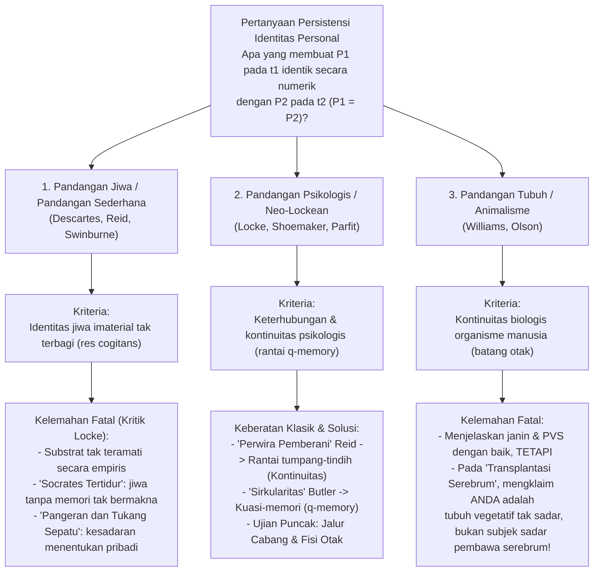
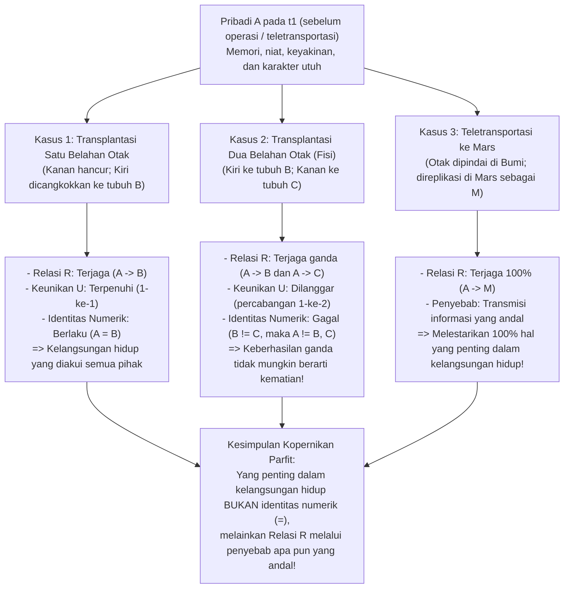

## 1. Pendahuluan: Teletransporter ke Mars dan Pertanyaan Persistensi

### 1.1 Eksperimen Pikiran Teletransporter Derek Parfit

Bayangkan pada akhir abad ke-21 Anda harus melakukan perjalanan dinas ke koloni di Mars. Alih-alih menghabiskan enam bulan di dalam pesawat ruang angkasa, Anda masuk ke bilik <strong>Teletransporter</strong> di Bumi dan menekan tombol hijau. Saat itu juga Anda kehilangan kesadaran. <strong>Pemindai (Scanner)</strong> merekam secara presisi atomik keadaan seluruh sel tubuh Anda serta 86 miliar neuron dan 100 triliun koneksi sinaptik di otak Anda, <strong>menguapkan (menghancurkan) otak dan tubuh fisik Anda di Bumi sepenuhnya</strong>, sambil memancarkan cetak biru digital tersebut dengan kecepatan cahaya melalui gelombang radio ke Mars. Tiga menit kemudian, <strong>Replikator</strong> di Mars merakit atom karbon, hidrogen, oksigen, dan nitrogen lokal untuk membangun kembali tubuh dan otak organik yang identik hingga molekul terakhir.

Orang yang terbangun di bilik Mars mengingat dengan jelas telah menekan tombol hijau beberapa detik lalu di Bumi, ingat janjinya saat sarapan untuk menelepon istrinya begitu tiba, dan bahkan melihat di cermin luka goresan kecil di pipi kirinya akibat bercukur pagi tadi di Bumi.

Di sinilah muncul pertanyaan paling mendasar dan mengguncang dalam metafisika dan filsafat budi:
<strong>Apakah orang yang terbangun di Mars itu benar-benar *Anda*?</strong>
Apakah Teletransporter merupakan moda transportasi tercepat dalam sejarah manusia, ataukah <strong>*Anda* telah mati saat Pemindai menguapkan tubuh Anda di Bumi</strong>, sedangkan orang di Mars hanyalah replika yang baru lahir (penipu tak sadar) yang secara keliru mengira dirinya adalah Anda?

---

### 1.2 Identitas Diakronis: Identitas Numerik vs. Identitas Kualitatif

Metafisika analitik merumuskan <strong>Pertanyaan Persistensi Identitas Personal Lintas Waktu (Diachronic Personal Identity)</strong> sebagai berikut:

>$$
>\textbf{Pertanyaan Persistensi:}\quad \text{Di bawah kondisi perlu dan cukup apakah seseorang } P_1 \text{ yang ada pada waktu } t_1
>$$
>$$
>\text{identik secara numerik } (P_1 = P_2) \text{ dengan seseorang } P_2 \text{ yang ada pada waktu berikutnya } t_2\text{?}
>$$

Kita harus membedakan secara ketat dua pengertian "identitas":
1. <strong>Identitas Kualitatif (Kemiripan Eksak, $x \approx y$)</strong>: Dua entitas berbagi seluruh properti intrinsiknya ($\forall \Phi \in \mathcal{F}_{\text{intrinsic}} (\Phi(x) \leftrightarrow \Phi(y))$), seperti dua bola biliar dari cetakan yang sama atau Anda dan replika Mars Anda.
2. <strong>Identitas Numerik ($x = y$)</strong>: Bukan dua hal yang mirip, melainkan secara harfiah <strong>satu dan entitas tunggal yang sama persis</strong>, tunduk pada Hukum Leibniz ($\forall \Phi (\Phi(x) \leftrightarrow \Phi(y))$).

Anak berusia 5 tahun ($P_{5}$) dan lansia berusia 80 tahun ($P_{80}$) <strong>berbeda secara kualitatif ($P_{5} \not\approx P_{80}$)</strong>, namun moralitas dan hukum menganggap mereka <strong>identik secara numerik ($P_{5} = P_{80}$)</strong>. Sebaliknya, replika di Mars ($P_{\text{Mars}}$) <strong>100% identik secara kualitatif ($P_{\text{Earth}} \approx P_{\text{Mars}}$)</strong> dengan Anda, tetapi itu saja tidak otomatis menjamin identitas numerik ($P_{\text{Earth}} = P_{\text{Mars}}$). Identitas numerik menopang tiga pilar nalar praktis kita: (1) <strong>kepedulian egoistik khusus terhadap masa depan sendiri (antisipasi dari dalam)</strong>; (2) <strong>tanggung jawab moral dan hukum (hukuman dan janji)</strong>; serta (3) <strong>kompensasi antarmasa (bersusah payah hari ini demi kebahagiaan esok hari)</strong>.

---

## 2. Tiga Teori Klasik yang Bersaing: Jiwa, Memori, dan Tubuh

### 2.1 Pandangan Jiwa Imaterial (Ego Kartesian) dan Kritik John Locke

Menurut Plato, René Descartes (*Meditations*, 1641), Thomas Reid, dan Richard Swinburne, seorang pribadi pada hakikatnya adalah substansi berpikir imaterial yang tak terbagi—<strong>Jiwa Imaterial (*res cogitans*)</strong>. Berbeda dengan "Kapal Theseus" yang papan-papannya diganti secara bertahap, jiwa yang sederhana tidak memiliki bagian dan tidak dapat dibagi: $P_1 = P_2$ jika dan hanya jika keduanya memiliki substansi jiwa yang sama ($S_1 = S_2$).

Namun pada tahun 1694, filsuf empiris Inggris <strong>John Locke</strong> meruntuhkan pandangan ini dalam Bab 27 (*"Of Identity and Diversity"*) Buku II *An Essay Concerning Human Understanding* melalui dua eksperimen pikiran terkenal:
* <strong>Socrates Terjaga dan Tertidur (Reinkarnasi Tanpa Memori)</strong>: Andaikan jiwa imaterial $S$ di tubuh Anda saat ini adalah substansi yang sama persis dengan yang dulu menghuni Socrates di Athena kuno, tetapi seluruh memori dan pikiran Socrates telah dihapus bersih. Apakah berbagi substrat tak terlihat tanpa ingatan itu membuat Anda <strong>pribadi yang sama (Same Person)</strong> dengan Socrates? Sama sekali tidak—tidak lebih dari atom karbon bekas tubuh Julius Caesar di kuku Anda membuat Anda menjadi Caesar.
* <strong>Pangeran dan Tukang Sepatu (The Prince and the Cobbler)</strong>: Andaikan jiwa seorang <strong>Pangeran</strong>, beserta seluruh kesadaran dan memori kehidupan istananya, masuk ke dalam tubuh seorang <strong>Tukang Sepatu</strong>. Meskipun secara biologis ia tampak sebagai "manusia/organisme yang sama" (*Same Man*) dengan si tukang sepatu, sebagai agen moral yang sadar (<strong>pribadi yang sama / *Same Person*</strong>) semua orang mengakui bahwa ia adalah sang <strong>Pangeran</strong>, yang hanya bertanggung jawab atas perbuatan Pangeran!

---

### 2.2 Kriteria Memori Locke dan Dua Paradoks Klasiknya

Bagi Locke, "pribadi (person)" adalah <strong>istilah forensik (Forensic Term)</strong> yang mengaitkan tindakan dengan pahala atau hukuman, dan identitasnya bertumpu pada <strong>kesadaran serta memori pengalaman sudut pandang orang pertama</strong>:

>$$
>\textbf{Kriteria Memori Locke:}\quad P_2 \text{ pada } t_2 = P_1 \text{ pada } t_1 \iff P_2 \text{ pada } t_2 \text{ dapat mengingat secara sadar "dari dalam" pengalaman } P_1 \text{ pada } t_1.
>$$

Kriteria ini segera menghadapi dua keberatan logis yang mematikan pada abad ke-18:

#### Keberatan 1: Paradoks "Perwira Pemberani" Thomas Reid (1785) — Pelanggaran Transitivitas
Filsuf Skotlandia <strong>Thomas Reid (1785)</strong> membuktikan bahwa kriteria memori Locke melanggar <strong>transitivitas identitas numerik</strong>:
* <strong>Bocah usia 10 tahun ($P_{10}$)</strong> dicambuk di sekolah karena mencuri apel di kebun.
* <strong>Perwira muda pemberani usia 30 tahun ($P_{30}$)</strong> merebut panji musuh di medan perang dan masih ingat jelas pernah dicambuk saat berusia 10 tahun ($M(P_{30}, P_{10}) \implies P_{30} = P_{10}$).
* <strong>Jenderal purnawirawan usia 80 tahun ($P_{80}$)</strong> mengingat dengan bangga perebutan panji pada usia 30 tahun ($M(P_{80}, P_{30}) \implies P_{80} = P_{30}$), tetapi telah lupa sama sekali akan hukuman cambuk pada usia 10 tahun ($\neg M(P_{80}, P_{10}) \implies P_{80} \neq P_{10}$).

Karena identitas numerik ($=$) adalah <strong>relasi ekuivalensi (refleksif, simetris, dan transitif: $A=B \land B=C \implies A=C$)</strong>, dari $P_{80} = P_{30}$ dan $P_{30} = P_{10}$ secara niscaya berlaku $P_{80} = P_{10}$. Namun karena memori langsung $M$ <strong>tidak transitif</strong>, kriteria Locke menghasilkan kontradiksi logis <strong>$P_{80} = P_{10} \land P_{80} \neq P_{10}$</strong>!

* <strong>Solusi Neo-Lockean</strong>: Para filsuf Neo-Lockean (Grice, Quinton, Shoemaker, Parfit) membedakan antara <strong>Keterhubungan Psikologis (Psychological Connectedness)</strong>—adanya ikatan psikologis langsung (memori, niat yang terlaksana, keyakinan), yang bersifat gradual dan *tidak transitif*—dan <strong>Kontinuitas Psikologis (Psychological Continuity)</strong>, yang didefinisikan sebagai <strong>rantai tumpang-tindih dari keterhubungan kuat ($C_{\text{strong}}$)</strong> (penutupan transitif):
  $$\text{Continuity}(P_n, P_1) \iff \exists P_2, \dots, P_{n-1} \text{ sehingga } C_{\text{strong}}(P_1, P_2) \land \dots \land C_{\text{strong}}(P_{n-1}, P_n)$$
  Sang Jenderal berusia 80 tahun tetap terhubung secara transitif dengan bocah 10 tahun melalui rantai keterhubungan kuat dari hari ke hari.

#### Keberatan 2: Keberatan Sirkularitas Joseph Butler (1736) dan "Kuasi-Memori ($q$-memory)"
Uskup <strong>Joseph Butler (1736)</strong> mengajukan keberatan: untuk membedakan *memori asli (genuine memory)* dari *memori semu atau delusi* (seperti pasien yang merasa ingat menjadi Napoleon di Waterloo), konsep "memori asli" sudah mengandaikan bahwa orang yang mengingat adalah <strong>identik secara numerik</strong> dengan orang yang mengalami peristiwa itu! Mendefinisikan identitas melalui memori terjebak dalam lingkaran setan (*"Consciousness of personal identity presupposes, and therefore cannot constitute, personal identity"*).

* <strong>Solusi Sydney Shoemaker (1970) — Kuasi-Memori ($q$-memory)</strong>:
  Shoemaker mendefinisikan <strong>kuasi-memori ($q$-memory)</strong> tanpa mengandaikan identitas personal: saya memiliki kuasi-memori akurat tentang pengalaman $E$ jika dan hanya jika (1) saya memiliki ingatan tampak sudut pandang orang pertama tentang $E$, (2) <strong>seseorang (Someone)</strong> benar-benar mengalami $E$ di masa lalu, dan (3) ingatan tampak saya bergantung secara kausal dengan cara yang tepat (melalui jejak saraf otak atau transmisi informasi yang andal) pada pengalaman $E$ tersebut. Dengan mendefinisikan kontinuitas psikologis (Relasi R) melalui $q$-memory, sirkularitas lenyap sepenuhnya.

---

### 2.3 Kriteria Tubuh, Teka-Teki Bernard Williams, dan Animalisme

* <strong>Bernard Williams, "The Self and the Future" (1970)</strong>:
  Williams menunjukkan bagaimana proses fisik yang sama persis membalikkan intuisi kita tergantung cara penyajiannya. Jika kepada $A$ dan $B$ dikatakan bahwa memori dan kepribadian mereka akan dipertukarkan antar-otak sebelum satu tubuh diberi \$100.000 dan tubuh lainnya disiksa, $A$ memilih agar tubuh-$B$ (yang akan bangun dengan memori $A$) menerima uang itu (pandangan psikologis). Namun jika kepada $A$ dikatakan: "Besok kami akan menyiksa tubuhmu ($A$), setelah membuatmu amnesia total lalu menanamkan salinan memori $B$ ke otakmu", $A$ tetap merasa ngeri membayangkan rasa sakit yang akan dialami <strong>tubuhnya sendiri ($A$)</strong> (pandangan tubuh)!
* <strong>Animalisme Eric Olson (*The Human Animal*, 1997)</strong>:
  Olson berpendapat bahwa kita pada dasarnya adalah organisme biologis dari spesies *Homo sapiens*. Jika pandangan psikologis benar, kita tidak pernah menjadi <strong>janin berusia 12 minggu</strong> dan kita telah mati saat jatuh ke dalam <strong>kondisi vegetatif persisten (PVS)</strong>, walaupun hewan manusia itu terus bernapas berkat batang otak. Namun Animalisme runtuh menghadapi <strong>Transplantasi Serebrum (Cerebrum Transplant)</strong>: jika otak besar Anda (tempat seluruh kesadaran dan memori) dicangkokkan ke tubuh donor sementara batang otak lama menjaga tubuh tanpa otak besar tetap bernapas, Animalisme terpaksa menyatakan secara absurd bahwa *Anda* adalah tubuh vegetatif tanpa pikiran di ranjang rumah sakit!

---

## 3. Revolusi Derek Parfit (*Reasons and Persons*, 1984): Kasus Jalur Cabang dan Fisi Otak

Dalam Bagian III mahakaryanya <strong>*Reasons and Persons* (1984)</strong>, filsuf Oxford <strong>Derek Parfit (1942–2017)</strong> meruntuhkan asumsi dasar perdebatan dua ribu tahun: ia membuktikan bahwa <strong>yang secara rasional penting dalam kelangsungan hidup (survival) BUKANLAH identitas numerik ($P_1 = P_2$), melainkan Relasi R (keterhubungan dan kontinuitas psikologis)!</strong>

---

### 3.1 Kasus Jalur Cabang (Branch-Line Case) dan Spektrum Gabungan

* <strong>Kasus Jalur Cabang (The Branch-Line Case)</strong>:
  Pemindai Baru memindai tubuh Anda di Bumi *tanpa* menghancurkannya dan menciptakan Replika Anda di Mars. Anda keluar dari bilik di Bumi dan berbicara melalui panggilan video dengan Replika Anda di Mars. Jelas sekali Anda di sini dan ia di sana: kalian adalah <strong>dua orang yang berbeda secara numerik ($P_{\text{Earth}} \neq P_{\text{Mars}}$)</strong>. Lalu dokter memberi tahu bahwa radiasi Pemindai Baru telah merusak jantung Anda di Bumi: <strong>Anda di Bumi akan meninggal karena gagal jantung dalam 3 hari</strong>, sedangkan Replika Anda di Mars memiliki jantung sehat, akan merawat keluarga Anda, dan menyelesaikan buku Anda.
  Perhatikan paradoksnya: <strong>relasi intrinsik kausal dan psikologis (Relasi R)</strong> antara Anda sebelum menekan tombol dan Replika di Mars adalah <strong>100% identik</strong> baik pada Teletransportasi Sederhana (mati dalam 0 detik) maupun pada Jalur Cabang (mati dalam 3 hari)! Bagaimana mungkin fakta ekstrinsik bahwa jantung di Bumi berdetak 72 jam lebih lama mengubah kelangsungan hidup Anda di Mars menjadi kematian total?!
* <strong>Spektrum Gabungan (The Combined Spectrum)</strong>:
  Seorang ahli bedah mengganti proporsi $\alpha \in [0\%, 100\%]$ sel otak dan tubuh Anda dengan duplikat sel aktris <strong>Greta Garbo</strong>. Pada $\alpha = 0\%$ hasilnya jelas <strong>Anda</strong>; pada $\alpha = 100\%$ jelas <strong>Greta Garbo</strong>. Jika pandangan non-reduksionis ("Pandangan Fakta Tambahan" / *Further Fact View*) benar, di suatu titik tengah (misalnya antara $49,999\%$ dan $50,000\%$) penggantian satu neuron saja harus membuat jiwa Anda lenyap seketika dan digantikan jiwa Garbo! <strong>Reduksionisme</strong> Parfit menunjukkan bahwa pada $\alpha = 50\%$, begitu kita mengetahui derajat keterhubungan fisik dan psikologis, kita sudah mengetahui seluruh fakta: bertanya apakah orang itu masih "saya" adalah <strong>Pertanyaan Kosong (Empty Question)</strong>.

---

### 3.2 Argumen Fisi Wiggins dan Parfit ("Pembelahan Diri Saya" / My Division)

Bahkan jika seseorang menuntut agar Relasi R disebabkan oleh <strong>penyebab fisik normal (bertahannya otak fisik yang sama)</strong>, argumen <strong>Fisi ("My Division")</strong> membuktikan bahwa identitas numerik bukanlah hal yang utama.

Neurosains klinis membuktikan: (1) setelah <strong>hemisferektomi</strong>, manusia dapat bertahan hidup sebagai pribadi yang sama hanya dengan satu belahan otak; (2) penelitian <strong>otak terbelah (Split-Brain)</strong> oleh Sperry dan Gazzaniga membuktikan bahwa pemotongan korpus kalosum menghasilkan dua aliran kesadaran independen.

> <strong>[Eksperimen Pikiran: Pembelahan Diri Saya (My Division)]</strong>
> Anda (<strong>$A$</strong>) adalah salah satu dari kembar tiga identik, dan kedua belahan otak Anda simetris secara fungsional. Setelah kecelakaan yang menghancurkan tubuh Anda namun membiarkan otak Anda utuh, sementara dua saudara kembar Anda mengalami mati otak dengan tubuh sehat (<strong>Tubuh $B$</strong> dan <strong>Tubuh $C$</strong>), dokter bedah membelah otak Anda dan mencangkokkan <strong>belahan kiri ke Tubuh $B$ (Lefty)</strong> serta <strong>belahan kanan ke Tubuh $C$ (Righty)</strong>. Keduanya terbangun dengan separuh otak fisik asli Anda dan 100% kontinuitas psikologis (Relasi R) dengan Anda!

Apa yang terjadi pada <strong>saya ($A$)</strong>? Menurut logika ketat identitas numerik ($=$), hanya ada empat kemungkinan:
1. <strong>$A$ adalah sekaligus $B$ dan $C$ ($A = B \land A = C$)</strong>: Melanggar <strong>transitivitas identitas</strong> ($B = A \land A = C \implies B = C$)! Padahal Lefty dan Righty adalah dua orang berbeda ($B \neq C$) yang bisa bermain tenis melawan satu sama lain.
2. <strong>$A = B$ saja</strong>, atau 3. <strong>$A = C$ saja</strong>: Sama sekali sewenang-wenang dan melanggar simetri serta <strong>prinsip intrinsik (Only-$x$-and-$y$ Principle)</strong>! Jika belahan kanan hancur, Anda pasti bertahan hidup sebagai Lefty ($A = B$). Bagaimana mungkin keberhasilan operasi di ruang sebelah membuat Lefty berhenti menjadi Anda?
4. <strong>$A$ bukan $B$ maupun $C$ ($A \neq B \land A \neq C$)</strong>: Identitas numerik menuntut, selain Relasi R, <strong>kondisi tanpa percabangan (Keunikan $U$)</strong>:
   $$\text{Identitas }(A = X) \iff R(A, X) \land U(A, X)$$

<strong>Kesimpulan Revolusioner Parfit</strong>:
Haruskah Anda menganggap keberhasilan pencangkokan kedua belahan otak sebagai <strong>kematian</strong> Anda hanya karena kondisi keunikan $U$ dilanggar?!
<strong>Mustahil!</strong> Jika satu belahan bertahan, Anda hidup. <strong>Bagaimana mungkin KEBERHASILAN GANDA (kedua belahan otak bertahan hidup!) berubah menjadi KEGAGALAN TOTAL (kematian)?!</strong> Jika identitas numerik yang penting, sebelum operasi Anda harus menyuap perawat untuk menghancurkan belahan otak kanan Anda demi menjaga kondisi keunikan $U$!
Oleh karena itu, <strong>yang secara rasional penting dalam kelangsungan hidup BUKANLAH identitas numerik ($=$), melainkan Relasi R (keterhubungan dan kontinuitas psikologis)!</strong>

---

## 4. Matriks Perbandingan Lima Teori Utama Identitas Personal

| Teori Filosofis | Tokoh Utama | Kriteria Identitas / Kelangsungan Hidup | Putusan atas "Perwira Pemberani" Reid | Transplantasi Serebrum (batang otak dalam kondisi vegetatif) | Fisi Otak (Lefty $B$ & Righty $C$) | Teletransporter ke Mars |
| :--- | :--- | :--- | :--- | :--- | :--- | :--- |
| <strong>1. Pandangan Jiwa (Simple View)</strong> | Descartes, Reid, Swinburne | Bertahannya substansi jiwa imaterial tak terbagi ($S$) | Jenderal = Bocah jhj jiwa $S$ yang sama bertahan | Tak dapat diketahui tubuh mana yang diikuti jiwa | Jiwa tak terbagi; masuk secara acak ke $B$, $C$, atau tidak keduanya | <strong>Mati</strong>, kecuali jiwa ikut berpindah bersama gelombang radio |
| <strong>2. Kriteria Memori Klasik</strong> | John Locke (1694) | Memori pengalaman langsung orang pertama $M(P_2, P_1)$ | <strong>Gagal</strong>: Melanggar transitivitas identitas ($P_{80}=P_{30}=P_{10}$ tapi $P_{80}\neq P_{10}$) | Anda ikut bersama serebrum pembawa memori | Bertentangan dengan transitivitas ($B=C$) karena keduanya ingat | <strong>Bertahan hidup</strong> (namun rentan terhadap sirkularitas Butler) |
| <strong>3. Animalisme (Pandangan Biologis)</strong> | Eric Olson (1997), Snowdon | Kontinuitas organisme biologis (*Homo sapiens* via batang otak) | Jenderal = Bocah karena hewan manusia yang sama | <strong>Kontraintuitif</strong>: Anda tetap menjadi tubuh vegetatif tanpa kesadaran! | Organisme awal berakhir; muncul dua organisme baru | <strong>Mati</strong>: organisme Bumi hancur |
| <strong>4. Neo-Lockean Sempit</strong> | Shoemaker (awal), Wiggins | Kontinuitas psikologis tanpa cabang ($R \land U$) dengan <strong>penyebab normal</strong> (otak yang sama) | Terpecahkan melalui rantai keterhubungan kuat & $q$-memory | Anda ikut bersama serebrum yang dicangkokkan | Identitas numerik gagal ($A \neq B, C$) karena $U$ dilanggar | <strong>Mati</strong>, karena otak fisik dihancurkan |
| <strong>5. Reduksionisme Parfit (Relasi R Luas)</strong> | <strong>Derek Parfit</strong> (1984), David Lewis | <strong>Identitas ($=$) bukan yang utama; yang penting adalah Relasi R dengan penyebab andal apa pun</strong> | Kontinuitas terjaga, meski keterhubungan langsung melemah setelah 70 tahun | Bertahan hidup 100% pada penerima serebrum via Relasi R | Identitas numerik gagal, tetapi <strong>kelangsungan hidup ganda melalui Relasi R ganda!</strong> | <strong>Kelangsungan hidup penuh (yang penting)</strong>: Relasi R terjaga 100%! |

---

## 5. Pembebasan dari "Terowongan Kaca": Teori Berkas, Etika, dan Ketenangan Menghadapi Kematian

Reduksionisme Parfit menunjukkan bahwa seorang pribadi lintas waktu, layaknya sebuah <strong>bangsa (nation)</strong> atau <strong>klub</strong>, tidak lain adalah rangkaian peristiwa fisik dan mental yang saling terkait oleh Relasi R—menghidupkan kembali <strong>Teori Berkas Persepsi (Bundle Theory)</strong> dari <strong>David Hume</strong> (*A Treatise of Human Nature*, 1739) dan ajaran Buddha tentang <strong>Tanpa-Aku (*Anattā*)</strong> dalam *Milindapañha* (perumpamaan kereta perang dan nyala api yang diteruskan dari satu lilin ke lilin berikutnya).

Karena <strong>keterhubungan psikologis</strong> merupakan masalah derajat yang melemah seiring dekade (seperti dalam <strong>kasus Metusalah</strong> atau <strong>bangsawan muda Rusia abad ke-19</strong> yang meminta istrinya menolak permintaan "diri penerusnya" yang kelak menjadi konservatif untuk membatalkan pembagian tanah), Reduksionisme mengubah etika dan cara pandang kita terhadap kematian. Di akhir Bab 13 *Reasons and Persons*, Parfit menuliskan pengakuan eksistensialnya yang terkenal:

> *"Ketika saya dulu percaya bahwa keberadaan saya adalah fakta tambahan yang terpisah, hidup saya tampak seperti <strong>terowongan kaca (a glass tunnel)</strong> yang saya lalui semakin cepat setiap tahun, dan di ujungnya terdapat kegelapan. Ketika saya mengubah pandangan saya, dinding terowongan kaca saya menghilang. <strong>Sekarang saya hidup di udara terbuka (in the open air).</strong> Orang lain terasa lebih dekat. Kematian saya memang akan memutuskan hubungan paling langsung antara pengalaman saya saat ini dan pengalaman masa depan, tetapi tidak akan memutuskan berbagai hubungan lainnya. Setelah menyadari hal ini, kematian saya tampak tidak lagi begitu buruk."* (Derek Parfit, *Reasons and Persons*, 1984, hlm. 281)
