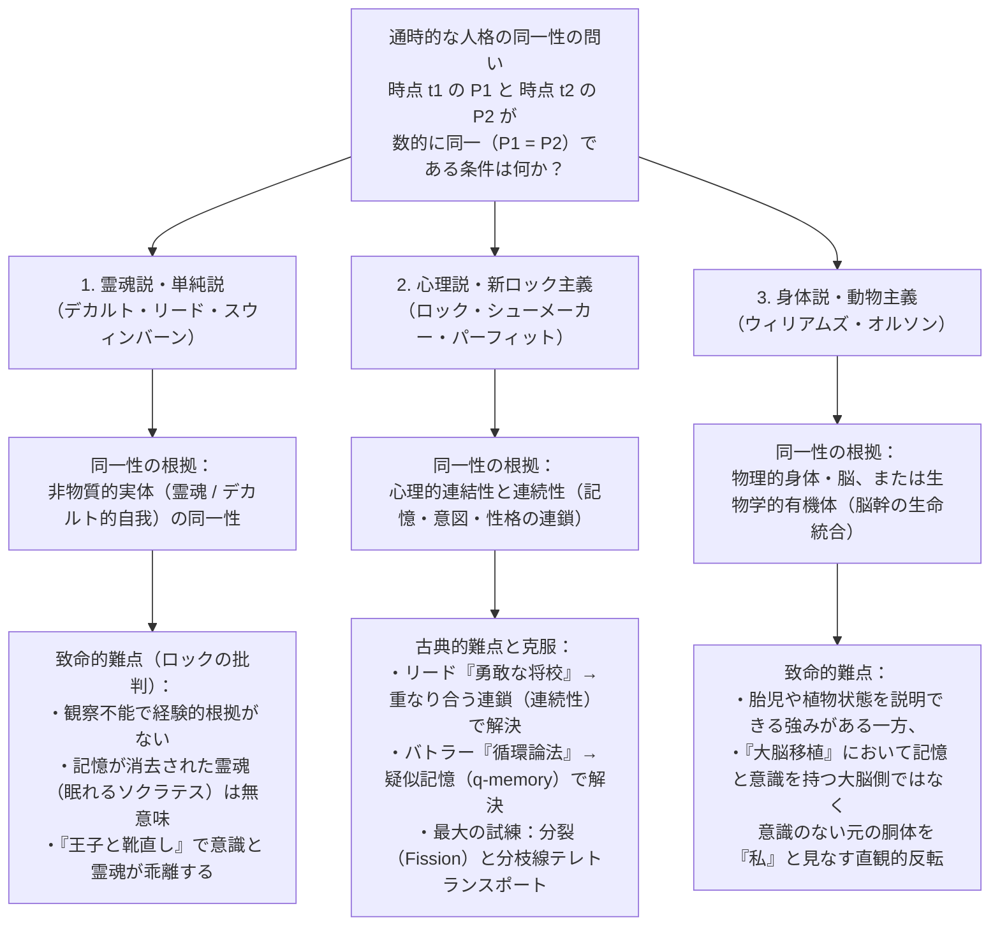
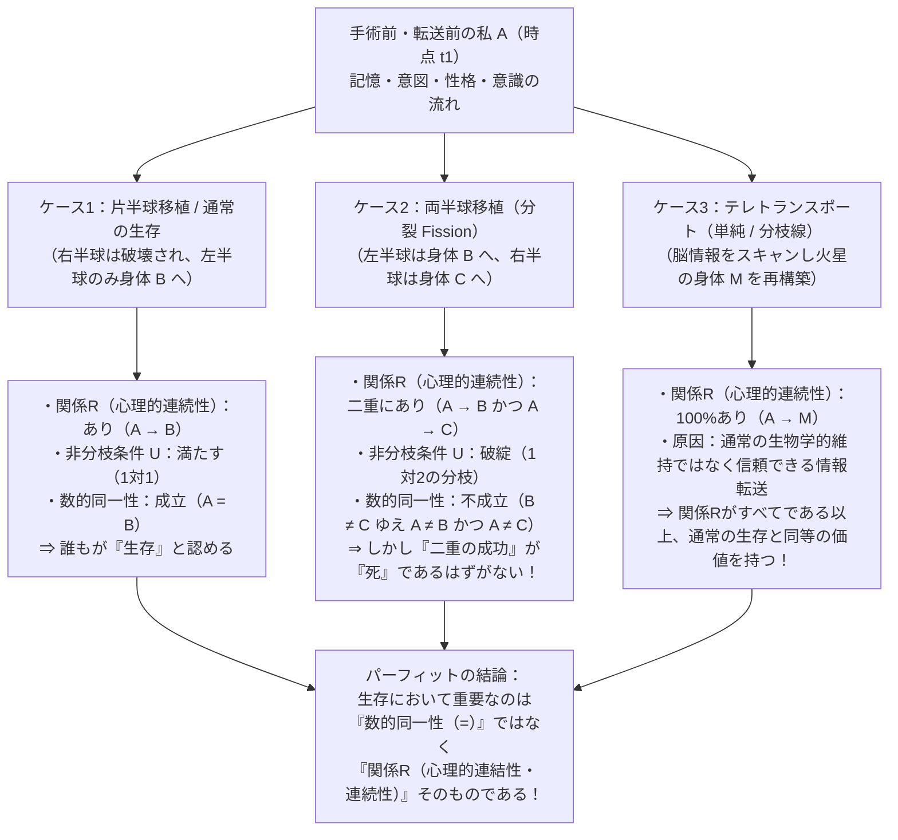

## 1. 序論：火星へのテレトランスポーターと「通時的な人格の同一性」という問い

### 1.1 デレク・パーフィットのテレトランスポーター思考実験

21世紀後半のある朝、あなたは火星の植民都市へ出張するため、地球の転送ステーションにある<strong>テレトランスポーター（Teletransporter：遠隔転送装置）</strong>のブースに足を踏み入れる。かつて火星への移動には宇宙船で6ヶ月以上の過酷な航海が必要だったが、今では緑色のボタンを押すだけで、光の速さで火星へ移動できると言われている。あなた自身はまだこの装置を使ったことがないが、同僚たちは皆「何の問題もない、一瞬で着くよ」と口を揃える。

ブースの中で緑色のボタンを押すと、あなたは一瞬にして意識を失う。その瞬間、<strong>スキャナー（Scanner）</strong>があなたの脳と身体を構成するすべての細胞、分子、そして約860億個のニューロンと100兆個のシナプス結合の正確な配置と量子・化学状態を完全に読み取ってデジタル化し、そのプロセスで<strong>地球上のあなたの脳と身体を完全に気化（破壊）</strong>する。スキャンされた膨大な設計図データは電波に乗せられ、光速で火星へと送信される。約3分後、火星の受信ステーションにある<strong>レプリケーター（Replicator：複製装置）</strong>が、火星に用意された炭素・水素・酸素・窒素・リンなどの有機原子を組み立て、地球でスキャンされた通り寸分違わぬ脳と身体を再構築する。

火星のブースで目を覚ました人物は、軽い眠気を感じながらあくびをし、「ああ、本当に一瞬で火星に着いたな」と呟く。彼には、数分前に地球のブースで緑色のボタンを押した鮮明な記憶がある。今朝、出発前に地球の自宅で妻と朝食をとり、「火星に着いたらすぐにテレビ電話をかけるよ」と約束したことも覚えている。さらに、顔を洗おうとして鏡を見ると、今朝地球の洗面所で髭を剃ったときに誤ってつけた左頬の小さな剃刀負けの傷まで、そのまま残っている。

ここで、形而上学（Metaphysics）および心の哲学（Philosophy of Mind）における最も根源的かつ戦慄すべき問いが立ち上がる。

<strong>火星のブースで目を覚ましたこの人物は、本当に「あなた」なのだろうか？</strong>

すなわち、テレトランスポーターは人類史上最も高速で安全な「移動手段（Transportation）」なのだろうか？ それとも、緑色のボタンを押して地球の身体が気化したその瞬間に<strong>「あなた」は完全に死亡（消滅）しており</strong>、火星で目を覚ました人物は、自分があなたであると信じ込んでいるだけの<strong>「誕生したばかりの精巧なレプリカ（偽者・別人）」</strong>にすぎないのだろうか？

もし後者が正しいとすれば、毎年何万人もの人々が「快適な宇宙旅行」だと信じて自ら処刑室に入り、自分の記憶を引き継いだクローンに妻や財産や人生の続きを明け渡していることになる。しかし逆に、もし脳内のすべての記憶、性格、信念、意図、そして主観的な意識の流れが100%隙間なく引き継がれているにもかかわらず「それは私ではない」と言うならば、そもそも<strong>「私（Person）が時間を超えて同じ私として存続する（Survive）」</strong>とは、いったい何が保たれることなのだろうか？

---

### 1.2 通時的同一性の定式化：「数的同一性」と「質的同一性」の峻別

この問題を厳密に分析するためには、現代の分析形而上学において<strong>「人格の通時的同一性の問題（The Persistence Question of Personal Identity over Time / Diachronic Identity）」</strong>と呼ばれる問いを論理的に定式化しなければならない。

>$$
>\text{通時的同一性の問い：時点 } t_1 \text{ に存在する人格 } P_1 \text{ と、後の時点 } t_2 \text{ に存在する人格 } P_2 \text{ が、}
>$$
>$$
>\text{同一の人格（} P_1 = P_2 \text{）であるための必要十分条件（Necessary and Sufficient Conditions）とは何か？}
>$$

この定式化において決定的に重要なのは、哲学者が<strong>質的同一性（Qualitative Identity）</strong>と<strong>数的同一性（Numerical Identity）</strong>と呼ぶ2つの概念の厳格な区別である。

1. <strong>質的同一性（Qualitative Identity / Exact Similarity：$x \approx y$）</strong>：
   2つの対象 $x$ と $y$ が、内在的な性質（色、形、質量、分子構造、記憶内容など）をすべて共有している状態を指す。たとえば、同じ工場の同じ製造ラインから作られた2つのビリヤードの球や、一卵性双生児、あるいは地球のあなたと火星のレプリカは、極めて高度な（極限においては100%の）質的同一性を持つ。論理的には、内包的な性質の集合 $\mathcal{F}_{\text{intrinsic}}$ に対して次が成り立つことである。
   $$\forall \Phi \in \mathcal{F}_{\text{intrinsic}} \, \big(\Phi(x) \leftrightarrow \Phi(y)\big)$$
2. <strong>数的同一性（Numerical Identity：$x = y$）</strong>：
   対象 $x$ と対象 $y$ が、「似ている2つのもの」ではなく、文字通り<strong>「数えて1つである同じ単一の存在者（One and the very same entity）」</strong>であることを指す。フレーゲ（Gottlob Frege）の有名な例で言えば、「宵の明星（Evening Star）」と「明けの明星（Morning Star）」はどちらも金星（Venus）という同一の天体（$x = y$）を指している。数的同一性はライプニッツの法則（Leibniz's Law / 同一者不可識別の原理：$\forall \Phi (\Phi(x) \leftrightarrow \Phi(y))$）を満たす最小の同値関係である。

人間（人格）の通時的存続において奇妙なのは、<strong>質的同一性と数的同一性が互いに独立に乖離しうる</strong>という事実である。
5歳の幼児だった頃のあなた（$P_{\text{5歳}}$）と、80歳の老人になったあなた（$P_{\text{80歳}}$）を比較してみよう。身長、体重、顔つき、身体を構成する細胞や原子（人間の身体の原子の大部分は数年周期の代謝によって入れ替わる）、さらには知識、語彙、価値観、記憶の大部分に至るまで、$P_{\text{5歳}}$ と $P_{\text{80歳}}$ は<strong>質的には劇的に異なっている（$P_{\text{5歳}} \not\approx P_{\text{80歳}}$）</strong>。それにもかかわらず、私たちの道徳・法律・日常的直観は、80歳の老人は5歳の幼児と<strong>数的に同一の人物（$P_{\text{5歳}} = P_{\text{80歳}}$）</strong>であると見なす。

逆に、テレトランスポーターによって作られた火星の人物（$P_{\text{Mars}}$）は、ボタンを押す直前の地球のあなた（$P_{\text{Earth}}$）と<strong>質的には100%同一（$P_{\text{Earth}} \approx P_{\text{Mars}}$）</strong>である。しかし、質的にどれほど完全にコピーされていようとも、それだけでは自動的に<strong>数的に同一の人物（$P_{\text{Earth}} = P_{\text{Mars}}$）</strong>であることの証明にはならない。なぜなら、もし地球のあなたが気化されずにそのまま生き残っていたならば、地球のあなたと火星のレプリカは「質的には同一だが、数としては2人の別個の人間（$P_{\text{Earth}} \neq P_{\text{Mars}}$）」になるからである。

---

### 1.3 なぜ人格の同一性はこれほど重要なのか：道徳・法・実存の3つの柱

なぜ私たちは「明日の人物が私と数的に同一（$P_1 = P_2$）であるか否か」にこれほど執着するのだろうか？ ロックやパーフィットが指摘するように、人格の同一性は単なる言葉のパズルではなく、私たちの実践的理性（Practical Reason）の3つの巨大な柱を支えているからである。

* <strong>第一の柱：未来に対する特別の利己的関心（Special Egoistic Concern / 内側からの予期）</strong>
  もし「明日、世界のどこかで誰かが激しい歯痛に苦しむ」と聞けば、あなたは同情（Sympathy）や憐れみを感じるだろう。しかし、「明日、<strong>あなた自身</strong>が激しい歯痛（あるいは拷問）に苦しむ」と宣告されたとき、あなたが感じるのは単なる同情ではなく、冷や汗を伴う<strong>恐怖（Fear / Terror）と内側からの予期（Anticipation from the inside）</strong>である。私たちは、未来の苦痛や快楽が「数的に同一の自分（$P_2 = P_1$）」に降りかかるか、「他人（$P_2 \neq P_1$）」に降りかかるかの間に、絶対的な境界線を引いている。
* <strong>第二の柱：道徳的・法的責任と応報（Moral Responsibility, Desert, and Commitment）</strong>
  20年前に行われた犯罪に対して今日ある人物を処罰できるのは、今日の被告人 $P_2$ が20年前の犯人 $P_1$ と<strong>数的に同一の人物（$P_2 = P_1$）</strong>である場合に限られる。もし $P_2 \neq P_1$ であるなら、どれほど外見や記憶が似ていようとも、$P_2$ を処罰することは無実の他人（たとえば一卵性双生児の兄弟）を連帯責任で処罰する不正義となる。約束の拘束力や契約、貸し借りの義務もすべて $P_1 = P_2$ を前提としている。
* <strong>第三の柱：時間を超えた補償と配分（Temporal Compensation and Prudence）</strong>
  私たちが今日、苦い薬を飲み、歯科治療の痛みに耐え、遊びたい欲求を抑えて懸命に働き貯蓄するのは、「今日の私の苦労」が「明日の私の幸福や健康」によって<strong>補償（Compensate）</strong>されると信じているからである。もし明日の受益者が「私ではない別の誰か」であるなら、今日の苦痛は自己利益（Prudence）ではなく、見知らぬ他者への自己犠牲（Altruism）に変質してしまう。

それでは、$P_1 = P_2$ を成り立たせている形而上学的な根拠（基準：Criterion）とはいったい何なのか？ 西洋哲学の歴史において、この問いに対して大きく<strong>「霊魂説（非物質的実体説）」「心理説（ロックの記憶説）」「身体説・動物主義」</strong>の3つの古典的立場が激しく対立してきた。

---

## 2. 古典的三つ巴の対立：霊魂・記憶・身体

### 2.1 霊魂説（デカルト的自我・単純説）とジョン・ロックによる解体

プラトン（『パイドン』）、ルネ・デカルト（『省察』, 1641）、トマス・リード（Thomas Reid, 1785）、そして現代の リチャード・スウィンバーン（Richard Swinburne）やロデリック・チザム（Roderick Chisholm）に至る<strong>「霊魂説（Soul View / Cartesian Ego View / 単純説 Simple View）」</strong>によれば、人格の本質は物理的な肉体や脳ではなく、部分を欠いた分割不可能な<strong>非物質的実体（Immaterial Substance / 思惟する実体 *res cogitans*）</strong>にある。

物理的な身体や脳は、無数の原子や細胞の集合体（複合体）であるため、テセウスの船（Ship of Theseus）のように少しずつ部品が入れ替わったり、半分に分割されたりして、同一性が曖昧になる。これに対し、デカルト的な非物質的霊魂（ソウル）は空間的な広がり（延長 *res extensa*）を持たず、部品に分けることができない単純な実体であるため、「100%同じ霊魂が宿っているか、それとも別の霊魂か」という<strong>完全な二者択一（All-or-Nothing）の厳密な数的同一性</strong>を保証できる、と霊魂説の論者は主張する。

しかし、この霊魂説に対して哲学史上最も破壊的な批判を加えたのが、イギリスの経験論哲学者<strong>ジョン・ロック（John Locke）</strong>が主著『人間知性論（*An Essay Concerning Human Understanding*）』第2版（1694年）第2巻第27章「同一性と差異性について（Of Identity and Diversity）」で展開した一連の思考実験である。ロックは、たとえ非物質的な霊魂（魂の基体：Substratum）が存在すると仮定したとしても、<strong>それは「人格の同一性（Personal Identity）」とは全く無関係である</strong>ことを鮮やかに論証した。

#### 思考実験①：眠れるソクラテスと輪廻転生する魂
ロックは問う。仮にあなたの身体に宿っている「非物質的な霊魂実体 $S$」が、かつて古代アテナイの哲学者ソクラテス（あるいは古代トロイアの包囲戦にいた武将）の身体に宿っていたのと同じ霊魂実体 $S$ であったとしよう。しかし、今のあなたには、ソクラテスが毒杯を仰いだ記憶も、プラトンと対話した記憶も、ソクラテスの思考や意識の断片すら何一つ残っていない。
このとき、「同じ非物質的実体 $S$ が宿っている」という事実だけで、あなたはソクラテスと<strong>同じ人格（Same Person）</strong>だと言えるだろうか？ ロックの答えは明確に「否（No）」である。意識や記憶の連続性が完全に断絶しているなら、目に見えない「霊魂という無色透明の器（Substratum）」がソクラテスからあなたへ再利用されたとしても、それは「かつてユリウス・カエサルの血肉を構成していた炭素原子の一部が、今あなたの爪に含まれている」という物理的事実と何ら変わらない。あなたがソクラテスの行為に誇りや罪悪感を感じる理由もなければ、ソクラテスの罪で処罰されるいわれもない。

#### 思考実験②：王子と靴直し（The Prince and the Cobbler）
さらにロックは、逆のケースを提示する。ある朝、ある<strong>王子（Prince）</strong>の意識と過去のすべての記憶・知識・性格を伴った心が、魂の抜けた貧しい<strong>靴直し（Cobbler）</strong>の身体に入り込み、靴直しの身体を目覚めさせたとしよう（あるいはさらに踏み込んで、靴直し自身の「非物質的霊魂実体 $S_{\text{Cobbler}}$」はそのまま靴直しの身体に留まりつつ、神の奇跡によってその実体の上にあるすべての記憶・意識データだけが王子のものに完全に書き換えられたとしよう）。

靴直しの身体をしたその男は、王宮の秘密の暗号を知っており、昨日王妃と交わした会話を鮮明に覚えており、自分を王子だと認識している。このとき、彼は周囲の目には靴直しという「同じ人間（生物学的個体：Same Man）」に見えるかもしれないが、道徳的・法的責任の主体である<strong>「人格（Person）」としては誰か？</strong> 誰の目にも明らかなように、彼は<strong>王子（Same Person as the Prince）</strong>であり、王子が昨日行った行為に対してのみ責任を負い、靴直しが昨日犯した罪に対しては一切責任を負わない。

ロックはこの思考実験によって、それまで混同されていた3つの概念を見事に切り分けたのである。
1. <strong>同じ実体（Same Substance：$S_1 = S_2$）</strong>：物質的であれ非物質的であれ、基体となる「もの（Stuff / Soul）」が同じであること。
2. <strong>同じ人間（Same Man / Human Organism：$M_1 = M_2$）</strong>：継続的な生命活動（有機的な生命維持システム）を営む生物学的個体として同じであること。
3. <strong>同じ人格（Same Person：$P_1 = P_2$）</strong>：理性と思考を持ち、異なった時間と場所において自分自身を「自分」として意識し、行為の責任と賞罰を帰属させられる<strong>法廷的・道徳的主体（Forensic Term）</strong>として同じであること。

---

### 2.2 ロックの記憶説（意識の連続性）と2つの古典的パラドックス

非物質的霊魂を退けたロックは、人格の通時的同一性の基準を<strong>意識（Consciousness）——とりわけ過去の経験に対する「一人称的な記憶（Memory from the inside）」</strong>に求めた。

> 「この意識が過去の行為や思考へ遡って到達しうる限りにおいて、そこまでの範囲が、その人格の同一性の到達範囲である。現在の自己（Self）は過去のその時点の自己と同一なのである。」（ロック『人間知性論』II.xxvii.9）

これを現代の分析哲学の記法で定式化すると、<strong>ロックの記憶基準（Locke's Memory Criterion）</strong>は次のようになる。

>$$
>\text{ロックの記憶基準：} \quad P_2 \text{（時点 } t_2 \text{）} = P_1 \text{（時点 } t_1 \text{）} \iff P_2 \text{ は } t_2 \text{ において、} P_1 \text{ が } t_1 \text{ に経験したことを「内側から」意識的に記憶している。}
>$$

このロックの提案は近代哲学におけるコペルニクス的転換であったが、発表直後から18世紀の哲学者たちによって<strong>2つの致命的な論理的欠陥</strong>を突きつけられた。

#### 反論①：トマス・リードの「勇敢な将校のパラドックス（The Brave Officer Paradox, 1785）」——推移律の破綻
スコットランド常識学派の哲学者<strong>トマス・リード（Thomas Reid）</strong>は、『人間の知的能力に関する試論（*Essays on the Intellectual Powers of Man*）』（1785年）において、ロックの記憶基準が<strong>「同一性の推移律（Transitivity of Identity）」</strong>と論理的に矛盾することを数学的な明晰さで証明した。

ある1人の人間の生涯における3つの時点 $t_{10}, t_{30}, t_{80}$ を考えよう。
* <strong>10歳の少年（$P_{10}$）</strong>：学校の果樹園からリンゴを盗み、教師から厳しく鞭打ちの罰を受けた。
* <strong>30歳の勇敢な青年将校（$P_{30}$）</strong>：初めての戦場で敵の軍旗を奪取するという武勲を立てた。この30歳の時点では、彼は10歳のときに果樹園でリンゴを盗んで鞭打たれたことを鮮明に覚えている。
* <strong>80歳の老将軍（$P_{80}$）</strong>：軍を退役し、晩年を迎えている。彼は30歳の青年将校だったときに敵の軍旗を奪取した誇らしい記憶を鮮明に保持している。しかし、老齢による自然な忘却のため、10歳のときに果樹園で鞭打たれた記憶はすでに完全に失われている。

ここで、「$y$ が $x$ の経験を直接記憶している」という二項関係を $M(y, x)$ と書くことにしよう。ロックの記憶基準（$x = y \iff M(y, x)$）をこの事例に適用すると、次のようになる。
1. 30歳の青年将校は10歳の少年の経験を記憶している：
   $$M(P_{30}, P_{10}) \implies P_{30} = P_{10}$$
2. 80歳の老将軍は30歳の青年将校の経験を記憶している：
   $$M(P_{80}, P_{30}) \implies P_{80} = P_{30}$$
3. 数的同一性（$=$）は論理的な<strong>同値関係（Equivalence Relation）</strong>であり、反射律（$x=x$）、対称律（$x=y \implies y=x$）、および<strong>推移律（Transitivity：$x=y \land y=z \implies x=z$）</strong>を絶対的に満たす。したがって、(1) と (2) から論理的必然として次が導かれる。
   $$P_{80} = P_{30} \land P_{30} = P_{10} \implies P_{80} = P_{10}$$
4. ところが、80歳の老将軍は10歳の少年の経験を記憶していない！ ロックの必要十分条件によれば、記憶がないならば同一人物ではないはずである。
   $$\neg M(P_{80}, P_{10}) \implies P_{80} \neq P_{10}$$
5. かくして、<strong>$P_{80} = P_{10}$ かつ $P_{80} \neq P_{10}$ という明白な論理的矛盾（Contradiction）</strong>が導かれる！

リードが暴き出した急所は極めて鋭い。<strong>「数的同一性（$=$）は推移的（Transitive）な関係であるが、直接的な記憶（$M$）は推移的な関係ではない」</strong>のである。人間は誰しも過去の記憶を少しずつ忘れていくため、直接の記憶の有無を同一性の基準に据えると、昨日の私と今日の私は同じで、今日の私と明日の私も同じなのに、昨日の私と明日の私は別人になりうるという論理破綻が生じる。

##### 新ロック主義（Neo-Lockeanism）による解決：心理的連結性から「心理的連続性」へ
このリードのパラドックスを克服するため、20世紀のポール・グライス（H. P. Grice, 1941）、アンソニー・クイントン（Anthony Quinton, 1962）、そしてデレク・パーフィット（1984）らの<strong>新ロック主義者（Neo-Lockeans）</strong>は、ロックの理論を精密にアップデートし、<strong>「心理的連結性（Psychological Connectedness）」</strong>と<strong>「心理的連続性（Psychological Continuity）」</strong>という2つの概念を区別した。

* <strong>心理的連結性（Psychological Connectedness）</strong>：
  2つの時点 $t_1$ と $t_2$ の間に、<strong>直接的な個別の心理的つながり（Direct psychological links）</strong>が保持されていること。ここにはロックが注目した「過去の経験の直接記憶」だけでなく、「$t_1$ で抱いた意図（Intention）が $t_2$ で行動として実行されること」「信念・欲求・価値観・性格特性・愛情などが $t_1$ から $t_2$ へ持続すること」も含まれる。昨日と今日のあなたの間には何千もの直接的な心理的連結があるため、これを<strong>「強い心理的連結性（Strong Connectedness）」</strong>と呼ぶ（パーフィットの定義では、1日あたりで通常の人が保持する直接的連結の少なくとも半分以上が保たれている状態）。この連結性は<strong>程度の問題（Matter of degree）</strong>であり、時間が離れるほど減衰するため、<strong>推移律を満たさない</strong>。
* <strong>心理的連続性（Psychological Continuity）</strong>：
  強い心理的連結性が、綱の繊維が少しずつ重なり合いながら1本の長いロープを形作るように、<strong>重なり合う連鎖（Overlapping chains of strong connectedness）</strong>としてつながっていること。数学的には、強い連結性の関係 $C_{\text{strong}}$ の<strong>推移閉包（Transitive Closure / Ancestral Relation）</strong>として定義される。
  $$\text{Continuity}(P_n, P_1) \iff \exists P_2, P_3, \dots, P_{n-1} \text{ s.t. } C_{\text{strong}}(P_1, P_2) \land C_{\text{strong}}(P_2, P_3) \land \dots \land C_{\text{strong}}(P_{n-1}, P_n)$$

この定義を用いれば、80歳の老将軍（$P_{80}$）と10歳の少年（$P_{10}$）の間には直接の記憶連結（Connectedness）はなくとも、10歳と11歳、11歳と12歳……79歳と80歳の間に毎日途切れることなく強い心理的連結の鎖（Continuity）がつながっているため、推移律の矛盾を完全に回避できる。

---

#### 反論②：ジョセフ・バトラーの「循環論法の反論（Circularity Objection, 1736）」と「疑似記憶（Quasi-Memory）」
ロックの記憶基準に対するもう一つの歴史的反論は、イギリスの主教・哲学者<strong>ジョセフ・バトラー（Joseph Butler）</strong>が『宗教の類比（*The Analogy of Religion*）』（1736年）の付録「人格の同一性について」で提起した<strong>循環論法（Vicious Circularity）</strong>の批判である。

バトラーは次のように指摘した。
ある精神病院の患者が「私はワーテルローの戦いで大砲を指揮したナポレオンだ。あの砲煙と馬の嘶きを鮮明に覚えている！」と主張したとしよう。なぜ私たちは、この患者の主観的な記憶体験を「本物の記憶（Genuine Memory）」ではなく「妄想・偽の記憶（Delusion / Apparent Memory）」として退けるのか？
それは、通常の言語規則において、「$Y$ が経験 $E$ を<strong>本当に記憶している（genuinely remembers）</strong>」と言えるためには、定義上、<strong>「その経験 $E$ を過去に実際に体験した人物 $X$ と、今それを思い出している人物 $Y$ が同一人物（$X = Y$）でなければならない」</strong>という条件があらかじめ含まれているからである！

すると、恐るべき論理的循環が露呈する。
* 「なぜ $Y$ は $X$ と同一人物（$X = Y$）なのか？」 $\longrightarrow$ 「$Y$ が $X$ の経験を<strong>本当に記憶している</strong>からだ（ロックの基準）」
* 「なぜ $Y$ の記憶は妄想ではなく<strong>本物の記憶</strong>なのか？」 $\longrightarrow$ 「その経験を体験した $X$ と $Y$ が<strong>同一人物（$X = Y$）</strong>だからだ！」

つまり、「記憶の真偽」を判定するためにすでに「人格の同一性」が前提されており、したがって記憶によって人格の同一性を定義することはできない（*"Consciousness of personal identity presupposes, and therefore cannot constitute, personal identity"*）。

##### シドニー・シューメーカーによる解決：「疑似記憶（Quasi-Memory / $q$-memory, 1970）」
この230年以上にわたってロック主義者を苦しめたバトラーの循環論法を鮮やかに解決したのが、アメリカの哲学者<strong>シドニー・シューメーカー（Sydney Shoemaker, 1970）</strong>が導入し、パーフィットが精緻化した<strong>「疑似記憶（Quasi-Memory：略して $q$-memory）」</strong>という概念である。

シューメーカーは、「同一人物であること（$P_1 = P_2$）」を定義の中に一切含まない、より広い記憶概念として<strong>疑似記憶（$q$-記憶）</strong>を次の3条件によって定義した。

>$$
>\text{私が過去の経験 } E \text{ について正確な}\mathbf{\text{疑似記憶（} q\text{-memory）}}\text{を持つとは、次の3条件が満たされることである：}
>$$
>1. 私には、経験 $E$ を一人称的視点（「内側から」）で体験したかのような主観的な記憶表象（Apparent memory）がある。
>2. 過去に<strong>誰か（Someone）</strong>が実際にその経験 $E$ を体験した。
>3. 私の現在のその記憶表象は、過去のその経験 $E$ に、<strong>適切な種類の因果的依存関係（Right kind of causal dependence：脳内の記憶痕跡の保存や構造的情報伝達など）</strong>によって依存している。

通常の「本物の記憶（Ordinary memory）」とは、この疑似記憶（$q$-記憶）のうち、たまたま「過去に経験した誰か」が「自分自身」であるという特殊ケースにすぎない。
たとえば、もし将来、外科手術によってあなたの妻の脳から「ヴェネツィアのサン・マルコ広場を幼少期に歩いた記憶痕跡」の神経回路コピーをあなたの海馬に移植できたとしよう。手術後にあなたがその光景を「内側から（少女の背丈の視点で）」思い出したとき、あなたは「自分がヴェネツィアに行った妄想」を見ているのではない。なぜなら、その記憶はあなたの妻の実際の経験から適切な因果的経路（神経痕跡の移植）を経て生じた正確な<strong>疑似記憶（$q$-記憶）</strong>だからである。

この $q$-記憶（および同様に定義される $q$-意図、$q$-信念）の概念を用いれば、人格の同一性を一切前提することなく、純粋に因果的・構造的な関係として<strong>心理的連結性と連続性（関係R）</strong>を非循環的に定義することができ、バトラーの循環論法は完全に論破されるのである。

---

### 2.3 身体説・バーナード・ウィリアムズの思考実験・動物主義（Animalism）

しかし、心理説（新ロック主義）に対しては、もう一つの強力なライバルが存在する。それは、私たちの同一性の基盤は「心や記憶というソフトウェア」ではなく、<strong>「生きた物理的身体・脳・生物学的有機体というハードウェア」</strong>にあるとする<strong>身体説（Bodily Criterion）</strong>および<strong>動物主義（Animalism）</strong>である。

#### バーナード・ウィリアムズの二重視点のパズル（"The Self and the Future", 1970）
イギリスの哲学者<strong>バーナード・ウィリアムズ（Bernard Williams）</strong>は、1970年の記念碑的論文『自己と未来（*The Self and the Future*）』において、全く同一の物理的プロセスであっても、<strong>「心理的交換として語るか」「身体への記憶消去・改ざんとして語るか」</strong>という記述の枠組み（フレーミング）を変えるだけで、私たちの直観が180度反転してしまうことを示した。

* <strong>ケース1（心と身体の入れ替えとしての記述）</strong>：
  被験者 $A$ と被験者 $B$ の2人が科学者の実験室に入れられる。科学者はこう告げる。「明日、特殊な脳スキャン・書き換え装置を使って、$A$ の脳に $B$ のすべての記憶・性格・人格データを移し、$B$ の脳に $A$ のすべての記憶・性格・人格データを移す。そして処置が終わった後、<strong>片方の身体には10万ドルの報酬を与え、もう片方の身体には凄惨な拷問を加える</strong>。処置の前に、どちらの身体に10万ドルを与え、どちらの身体に拷問を加えるか、希望を聞く」。
  あなたが被験者 $A$ なら、どちらを選ぶだろうか？ ほぼ全員が<strong>「処置後に $A$ の記憶と性格を持って目覚める『$B$ の身体』に10万ドルを与え、『$A$ の身体』に拷問を加えてくれ」</strong>と答える。なぜなら、処置後に $B$ の身体で目覚めた人物は、自分が $A$ だと認識し、「ああ、処置の前に私が希望した通り、私（$B$ の身体）が10万ドルをもらえてよかった！」と喜ぶからである。これは<strong>心理説（ロック的直観）</strong>を強く支持するように見える。

* <strong>ケース2（自分の身体への記憶消去と拷問としての記述）</strong>：
  ところがウィリアムズは、まったく同じ出来事を別の角度からあなた（$A$）1人に対してこう説明する。
  科学者があなた（$A$）にこう告げる。「明日、<strong>あなたを激しく拷問する</strong>」。あなたは恐怖に震える。
  科学者はさらに付け加える。「ちなみに、拷問が始まる直前に、薬物を使って<strong>あなたを完全な記憶喪失（Amnesia）にする</strong>」。これによって明日拷問される恐怖は消えるだろうか？ いや、全く消えない！「私は明日、記憶を失った状態で拷問の激痛を味わうのだ」とますます恐怖するだろう。
  科学者はさらに付け加える。「さらに拷問の直前、記憶を消されたあなたの脳に、<strong>別室にいる人物 $B$ の過去の記憶データ（偽の記憶印象）を刷り込んでおく</strong>」。
  さて、これであなたの恐怖は消えるだろうか？ <strong>まったく消えない！</strong> あなたはこう叫ぶはずだ。「記憶を消されようが、他人の記憶で洗脳されようが、明日その椅子に縛り付けられて肉体を切り刻まれるのは<strong>この私（$A$ の身体）</strong>ではないか！ 頼むから私（$A$ の身体）ではなく、別室の $B$ の身体を拷問してくれ！」

驚くべきことに、<strong>ケース1とケース2は、物理的にも心理的にも100%同一の操作を記述している</strong>にすぎない！ ケース1では私たちは「記憶の移動先（$B$ の身体）」を自分と同一視し、ケース2では「物理的な身体の連続性（$A$ の身体）」を自分と同一視する。ウィリアムズは、私たちの自己同一性の直観が身体の連続性から決して切り離せないことを浮き彫りにしたのである。

#### エリック・オルソンの「動物主義（Animalism, 1997）」と胎児・植物状態問題
さらに1990年代以降、<strong>エリック・オルソン（Eric T. Olson, *The Human Animal*, 1997）</strong>やポール・スノードン（Paul Snowdon）らは、ロック以来の心理説を根本から批判する<strong>「動物主義（Animalism / 生物学的アプローチ Biological Approach）」</strong>を提唱した。

動物主義の核心的テーゼは極めてシンプルかつラディカルである。
> <strong>「私たち一人ひとりは、本質的に『人格（心理的連続体）』ではなく、ホモ・サピエンス（*Homo sapiens*）という生物種に属する1匹の『生物学的有機体（Human Animal）』である。」</strong>

オルソンが心理説（新ロック主義）に突きつける最も強力な反論は、<strong>「胎児と遷延性植物状態のパラドックス（The Fetus and Persistent Vegetative State Problem）」</strong>および<strong>「思考する動物の論証（The Thinking-Animal Argument）」</strong>である。

1. <strong>胎児と植物状態の問題</strong>：
   あなたのお母さんが妊娠12週目だったときの超音波写真を指さして、「ほら、これが赤ちゃんだった頃のあなたよ」と言ったとしよう。あるいは、不幸にして将来あなたが重度の脳梗塞や頭部外傷を負い、大脳皮質の認知機能（意識や記憶）は完全に失われたが、脳幹（Brainstem）が機能しているため自発呼吸と代謝・循環を続け、10年間<strong>遷延性意識障害（植物状態：Persistent Vegetative State, PVS）</strong>で病床に横たわっているとしよう。
   妊娠12週の胎児には、現在のあなたとの間の「記憶や信念の心理的連続性」はゼロである。また植物状態の患者にも心理的連続性は存在しない。もし新ロック主義（心理説）が正しく、「私＝心理的連続体」であるならば、<strong>「あなたはかつて胎児であったことは一度もなく（胎児が成長したある時点で『あなた』という別個の存在者が突如出現し）」</strong>、また<strong>「植物状態になった瞬間に『あなた』はすでに死んで消滅しており、ベッドの上で呼吸しているのはあなたではない『ただの抜け殻の動物』である」</strong>と言わなければならなくなる！
   これに対し動物主義は、「人格（Person）」とは「学生」「青年」「哲学者」と同じく、人間という生物が人生の一時期（大脳が成熟して自己意識を持っている期間）に一時的に帯びる<strong>位相種概念（Phase Sortal）</strong>にすぎず、私たちの存在そのものを規定する<strong>実体種概念（Substance Sortal）</strong>はあくまで「生物学的有機体（動物）」であると主張する。生物学的生命（脳幹を中心とするホメオスタシス統合）が続く限り、胎児も成人したあなたも植物状態の患者も、すべて同一の存在者なのである。

2. <strong>思考する動物の問題（Too Many Thinkers Problem）</strong>：
   今、あなたの椅子に座っている「ホモ・サピエンスという生物学的動物」がいる。この動物は健康な脳を持っており、明らかに今この記事を読んで思考している。もし「あなた（人格）」がこの「動物」と数的に同一ではない（別個の存在者である）とするなら、今あなたの椅子には<strong>「思考する動物」と「思考する人格（あなた）」という2人の思考者が重なり合って座っており</strong>、「私はただ1人しかいない」と思っていても実は2人が同時に同じ思考をしていることになる！ この不条理を避ける唯一の方法は、「あなた＝その生物学的動物」と認めることである。

しかし、動物主義にも致命的なアキレス腱がある。それが<strong>「大脳移植の思考実験（Cerebrum Transplant）」</strong>である。もし外科医があなたの大脳（記憶や意識を司る部位）だけを取り出して別の頭蓋骨（脳死ドナーの身体）に移植し、元のあなたの身体は「脳幹」だけを残して人工栄養で生かし続けたとしよう。動物主義の定義（生命維持の中枢＝脳幹の連続性）に従えば、<strong>「あなた」は記憶も意識も大脳も失って病床に横たわる「大脳のない元の胴体」の方であり</strong>、あなたの大脳とすべての記憶・愛情を持って家族の元へ歩いて帰った人物は「あなたではない別人」だということになってしまう！ 多くの哲学者（そして私たち自身）にとって、この帰結は到底受け入れがたい。

ここで、古典的な3つの立場と動物主義の対立構造を整理しておこう。

---

## 3. デレク・パーフィットの革命（『理由と人格』1984）：分枝線ケースと脳半球の分裂

20世紀後半、この2000年にわたる論争の構図そのものを根底から覆し、「現代哲学における最も重要な業績の一つ」と称えられる革命を成し遂げたのが、オックスフォード大学の哲学者<strong>デレク・パーフィット（Derek Parfit, 1942–2017）</strong>が1984年に発表した大著<strong>『理由と人格（*Reasons and Persons*）』第3部</strong>である。

パーフィットは、私たちが当然の前提としていた<strong>「生存において重要なのは、未来の誰かが私と『数的に同一（$P_1 = P_2$）』であるかどうかだ」という信念そのものが誤りである</strong>ことを、2つの圧倒的な思考実験——<strong>「テレトランスポーターの分枝線ケース（The Branch-Line Case）」</strong>と<strong>「脳半球の分裂問題（The Fission Argument / My Division）」</strong>——によって証明した。

---

### 3.1 単純テレトランスポート vs. 「分枝線ケース（The Branch-Line Case）」

第1節で見た<strong>「単純テレトランスポート（Simple Teletransportation）」</strong>を思い出そう。そこでは、地球のあなたの脳と身体がスキャンと同時に気化（破壊）され、3分後に火星でレプリカが目覚める。
新ロック主義（心理的連続性説）の中でも、情報パターンの保存さえあればよいとする立場（広い心理的基準：Wide Psychological Criterion）をとれば、火星の人物は地球のあなたと完全な心理的連続性を持っているため、「火星の人物＝あなた（移動に成功した）」ということになる。

ところがパーフィットは、ここで物語に悪魔的な第2幕——<strong>「分枝線ケース（The Branch-Line Case）」</strong>——を導入する。

> <strong>【思考実験：分枝線ケース（The Branch-Line Case）】</strong>
> 単純テレトランスポートで何度も火星を往復して数年が経ったある日、転送会社が「新型スキャナー」を導入した。新型スキャナーは、<strong>地球上のあなたの脳と身体を気化（破壊）することなく</strong>、非破壊で原子・シナプス構造を完全にスキャンして火星へ送信できるという。
> あなたは地球のブースに入り、緑色のボタンを押す。カチッという音と眩しい光が走るが、あなたは意識を失うことすらなく、そのまま地球のブースの中で立っている！「あれ、故障かな？」と思ってブースの外に出ると、係員が笑顔でこう言う。
> 「スキャンは完璧に成功しましたよ！ あなたの設計図データはすでに火星に届き、<strong>火星のレプリケーターで『火星のあなた』が今ちょうど目を覚ましたところです</strong>。対話室で彼とビデオ通話ができますよ」
>
> あなたが対話室のモニターを見ると、画面の向こう（火星）に、あなたと寸分違わぬ顔、声、記憶、そして今朝の剃刀負けの傷を持った人物が映っている。しかし、画面越しに彼と会話している地球のあなたにとって、一つだけ<strong>100%疑いようのない論理的事実</strong>がある。
> それは、<strong>「火星にいる彼は、ここ（地球）にいる私と数的に同一ではない（$P_{\text{Earth}} \neq P_{\text{Mars}}$）」</strong>ということである！
> なぜなら、あなたは今、地球の床の上に立って彼を見つめており、彼が火星で自分の頬をつねっても地球のあなたは痛くないし、これから2人は別々の場所で別々の経験をして生きていく「2人の異なる人間」だからである。
>
> ところがその直後、地球の医療スタッフから青ざめた顔で衝撃的な事実が告げられる。
> 「大変申し訳ありません！ 新型スキャナーの高出力X線に欠陥があり、スキャンの瞬間に<strong>地球にいるあなたの心臓の冠動脈と心筋が致命的な損傷を受けました。地球のあなたは、あと3日で心不全のため確実に死亡します</strong>。なお、火星のあなたの身体は新鮮な有機原子から無傷で再構築されているため、心臓は完全に健康で、これから何十年も生き続けます」
>
> モニターの向こうで、火星のレプリカがあなたに優しく語りかける。
> 「地球の僕よ、そんなに絶望しないでくれ。3日後に君の心臓が止まっても、<strong>僕（火星の君）が君の記憶も、性格も、書きかけの本の構想もすべて100%引き継いでいる</strong>。地球に帰ったら君の妻と子どもたちを深く愛し、君の人生の計画をすべて成し遂げるよ。考えてもみてくれ、以前の旧型スキャナー（単純テレトランスポート）では、地球の身体は0秒で気化していたじゃないか！ 今回は地球の身体が3日間余分に生き延びただけだ。僕がこうして火星で生きているんだから、君が死ぬなんて思う必要はないんだよ！」

さあ、この火星のレプリカの慰めを聞いて、余命3日を宣告された地球のあなたは「ああ、それなら安心だ。これはいつもの火星出張とほぼ同じで、私は生き延びるんだ！」と納得できるだろうか？

ここに、私たちの直観を引き裂く<strong>深遠な哲学的ジレンマ</strong>がある。
単純テレトランスポート（旧型スキャナーで地球の身体が即座に気化するケース）と、分枝線ケース（新型スキャナーで地球の身体が3日後に心不全で死ぬケース）を比較してみよう。
<strong>ボタンを押す前のあなた（$A$）と、火星で目覚めた人物（$B_{\text{Mars}}$）との間の「内在的な因果的・心理的関係（Intrinsic Relation）」は、両方のケースで100%完全に同一である！</strong>
どちらのケースでも、同じ精度で脳がスキャンされ、同じ電波が火星へ飛び、同じレプリケーターが同じ原子から同じ脳を組み立て、同じ記憶と性格（心理的連続性）が100%引き継がれている。両者の違いはただ一つ、火星から何千万キロも離れた地球のブースの中で、元の肉体が「0秒で消滅したか」「3日間だけ余分に心臓が動いたか」という<strong>外在的な事実（Extrinsic Fact）</strong>だけである。

それなのに、もし私たちが「単純テレトランスポートは『私の移動（生存：$A = B_{\text{Mars}}$）』だが、分枝線ケースは『私の死と別人の誕生（$A \neq B_{\text{Mars}}$）』だ」と考えるならば、奇妙な逆説に陥る。<strong>「地球の私の心臓が3日間余分に動いたという事実のせいで、火星の人物は『私』ではなくなってしまい、結果として私は3日後に完全な『死』を迎えなければならなくなった！」</strong>——そんな馬鹿げたことがあるだろうか？

---

### 3.2 結合スペクトル（The Combined Spectrum）：還元主義 vs. さらなる事実説

しかし、読者の中にはこう反論する人がいるかもしれない。「そもそもテレトランスポーターは脳という物理的実体を一度破壊して作り直しているから『本物の同一性』ではないのだ！ 人格の同一性には、やはり『100%私であるか、100%他人であるか』を決める何らかの深い形而上学的境界線——<strong>さらなる事実（Further Fact）</strong>——があるはずだ！」と。

この<strong>「非還元主義（Non-Reductionism / さらなる事実説 Further Fact View）」</strong>を打ち砕くためにパーフィットが提示したのが、<strong>「結合スペクトル（The Combined Spectrum）」</strong>の思考実験である。

今、あなたの前に狂気の天才脳外科医がおり、パラメータ $\alpha \in [0, 1]$（$0\%$ から $100\%$ まで、$1\%$ 刻みで101段階）に応じた連続的な細胞置換手術を行うと想像してほしい。対象となる他者として、あなたとは性別も性格も記憶も全く異なる往年の大女優<strong>グレタ・ガルボ（Greta Garbo）</strong>（あるいはナポレオンでもよい）を選ぼう。

* <strong>スペクトルの左端（$\alpha = 0\%$）</strong>：外科医は何の手術もしない。結果として存在する人物は、文句なしに100%<strong>「あなた（You）」</strong>である。
* <strong>$\alpha = 1\%$ のケース</strong>：外科医はナノマシンを使い、あなたの脳のニューロンと身体の細胞のわずか $1\%$ だけを除去し、代わりにグレタ・ガルボの脳と身体の細胞の正確なコピー（ガルボの記憶や性格特性の断片をわずかに含む）に置き換える。手術後に目覚めたあなたは、$99\%$ あなたの記憶と性格を保っており、ごくわずかにガルボの記憶の断片が混じるだけである。誰もが「これはまだ間違いなく<strong>あなた</strong>だ」と認めるだろう。
* <strong>中間領域（$\alpha = 50\%$ のケース）</strong>：あなたの脳と身体の細胞のちょうど半分（$50\%$）がそのまま残され、残り半分（$50\%$）がグレタ・ガルボの神経細胞と身体細胞に置き換えられる。目覚めた人物は、あなたの記憶とガルボの記憶を半分ずつ持ち、性格も両者の中間であり、外見も両者の中間である。
* <strong>スペクトルの右端（$\alpha = 100\%$）</strong>：あなたの脳と身体のすべての細胞が除去され、100%グレタ・ガルボの細胞に置き換えられる。これは事実上、あなたを殺害してその場にグレタ・ガルボのクローンを作ったのと同じであり、結果として存在する人物は100%<strong>「グレタ・ガルボ」</strong>であって、あなたではない。

さて、ここで「人格の同一性は常に白か黒か（All-or-Nothing）で確定しており、物理的・心理的連続性の度合いとは独立した『さらなる事実（魂や深い自我）』が存在する」と主張する非還元主義者に問おう。
もしあなたの説が正しいなら、$\alpha = 0\%$ から $\alpha = 100\%$ へ至るこのスペクトルのどこかに、<strong>たった1個の細胞（あるいは1%のニューロン）を置き換えた瞬間に、「あなた」という存在者が突如として完全に消滅し、「グレタ・ガルボ」という別人が突如としてポップアップする「鋭い境界線（Sharp Cutoff $\alpha^*$：たとえば $49.999\%$ と $50.000\%$ の間）」が実在しなければならない！</strong>

しかし、脳のニューロンを1個入れ替えただけで「私の魂」がパチンと消えて「ガルボの魂」に入れ替わるなどということは、神経科学的にも形而上学的にも全く信じがたい不条理である。
パーフィットが導き出す<strong>「還元主義（Reductionism）」</strong>の結論はこうである。
中間領域（$\alpha = 50\%$）において、「細胞の半分が入れ替わり、記憶と性格の連結性が $50\%$ 保たれている」という物理的・心理的事実をすべて知ったならば、私たちは<strong>そこで起きている現実についての事実をすでに100%すべて知っている</strong>のである。その上さらに「で、結局その $\alpha = 50\%$ の人物は『私』なの？ それとも『私ではない』の？」と問うことは、砂粒を少しずつ減らしたときに「何粒までが『砂山（Heap）』か？」と問うのと同様、客観的な答えの存在しない<strong>「空虚な問い（Empty Question）」</strong>なのである！

---

### 3.3 ウィギンズとパーフィットの「脳半球の分裂（Fission / My Division）」論証

それでもなお、身体説や慎重な新ロック主義者の中には、次のように食い下がる人がいるだろう。
「テレトランスポーターで同一性が揺らぐのは、脳という物理的実体を一度破壊して電波でコピーを作ったからだ。<strong>『同じ物理的な脳の継続的存在（Continued existence of the physical brain）』を原因として心理的連続性（関係R）が保たれている限り、人格の同一性と生存の価値は完全に一致するはずだ！</strong>」

この最後の砦を完全に粉砕するために、デイヴィッド・ウィギンズ（David Wiggins, 1967）の着想を発展させてパーフィットが完成させた思考実験こそ、哲学史上最も強力な論証の一つである<strong>「私の分裂（My Division / The Fission Argument）」</strong>である。

#### 神経科学的背景：大脳半球切除術と分離脳（Split-Brain）
この思考実験は、単なる空想的なSFではなく、2つの確立された臨床神経科学の事実に基づいている。
1. <strong>片側大脳半球切除術（Hemispherectomy）における生存</strong>：
   重度の脳腫瘍、ラスムッセン脳炎、あるいは広範囲の脳卒中によって大脳の片方の半球（たとえば右半球）が完全に機能不全に陥った患者に対し、片方の半球を外科的に摘出する手術が実際に行われている。成人の場合、言語機能などが左半球に局在していることが多いものの、機能の可塑性や補償により、<strong>人間は大脳の片半球（半分）だけでも、記憶・人格・意識を保ったまま紛れもなく「同じ1人の人間」として生き延びることができる</strong>。
2. <strong>ロジャー・スペリーとマイケル・ガザニガの「分離脳（Split-Brain）」研究</strong>：
   難治性てんかんの治療として、左右の大脳半球をつなぐ約2億本の神経線維の束である<strong>脳梁（Corpus Callosum）</strong>を切断した患者（分離脳患者）の実験（1981年ノーベル生理学・医学賞）により、驚くべき事実が判明した。左右の半球の連絡を絶つと、1つの頭蓋骨の中に、<strong>互いに相手の知覚や思考を意識できない「2つの独立した意識の流れ（Two separate streams of consciousness）」</strong>が同時に並存するのである（たとえば左視野に提示された文字を右半球が読み取って左手でその物体を選び出しながら、言語中枢を持つ左半球は「何も見えなかった」と口頭で答える）。

#### 思考実験：「私の分裂（My Division）」
では、パーフィットの思考実験に入ろう。
あなた（<strong>$A$</strong> と呼ぶ）は、<strong>一卵性三つ子（Identical Triplets）</strong>の1人であると仮定する。また、議論を純化するため、あなたの脳は左右の大脳半球が機能的に完全に対称（Symmetrical）であり、左半球にも右半球にも、あなたの過去の記憶、言語能力、性格、技能のすべてが同等に蓄えられているとしよう。

ある日、あなたと2人の双子の兄弟（身体 $B$ と身体 $C$）が乗った車が崖から転落する大事故に遭う。
* <strong>あなた（$A$）</strong>は、胴体と内臓が致命的に損傷して数時間以内に確実に死ぬ状態だが、頭蓋骨の中の<strong>脳（左半球と右半球）だけは完全に無傷</strong>である。
* 逆に、あなたの2人の兄弟は、頭部を強く打って<strong>脳が完全に死滅（脳死）</strong>してしまったが、2人の<strong>身体（身体 $B$ と身体 $C$）は完全に健康で無傷</strong>である。

そこで天才脳外科医が、あなたの命を救うために次の手術を行う。あなたの無傷の脳を取り出し、脳梁を真ん中で切断して<strong>左半球を身体 $B$ の頭蓋骨に移植し、右半球を身体 $C$ の頭蓋骨に移植する</strong>。
手術は大成功を収める！ 翌朝、回復室で2人の人物——左半球を受け継いだ<strong>レフティ（Lefty：$B$）</strong>と、右半球を受け継いだ<strong>ライティ（Righty：$C$）</strong>——が同時に目を覚ます。

レフティ（$B$）もライティ（$C$）も、外見はあなたと全く同じ（一卵性三つ子の身体）であり、それぞれが<strong>あなたの元の物理的な脳の半分（片半球）</strong>をそのまま持っており、そして2人とも<strong>手術前のあなた（$A$）の記憶、性格、信念、妻への愛情、執筆中の本の構想を100%完全に引き継いでいる（完全な心理的連続性＝関係Rを持つ）</strong>！

---

#### 4つの論理的可能性の徹底検証：手術前の「私（$A$）」はどうなったのか？

ここでパーフィットは、極めて冷徹な論理的問いを突きつける。
<strong>「手術の後、私（$A$）はどうなったのか？ レフティ（$B$）とライティ（$C$）のうち、いったいどちらが『私（$A$）』なのか？」</strong>

数的同一性（$=$）の論理に従う限り、論理的にありうる選択肢は次の<strong>4つしか存在しない</strong>。一つずつ検証しよう。

##### 選択肢①：「私（$A$）は、レフティ（$B$）でもあり、かつライティ（$C$）でもある」（$A = B \land A = C$）
これは論理的に直ちに破綻する。なぜなら、第1節・第2節で確認した通り、<strong>数的同一性（$=$）は対称律と推移律を満たす同値関係</strong>だからである。もし $A = B$ かつ $A = C$ であるなら、対称律より $B = A$ となり、推移律によって必然的に次が導かれる。
$$B = A \land A = C \implies B = C \quad (\text{レフティ} = \text{ライティ})$$
しかし、退院した後のレフティ（$B$）とライティ（$C$）は、明らかに<strong>2人の別個の人格（$B \neq C$）</strong>である！ レフティがロンドンに住み、ライティが東京に住むこともできるし、2人がテニスコートの両端に立って<strong>互いにテニスの試合で対戦する</strong>こともできる。もし $B = C$ だと言うなら、「1人の人間が2つの身体を持って自分自身とテニスをし、片方が勝って片方が負けた」という形容矛盾になる。さらに極端な例として、もし将来レフティとライティが仲違いをして決闘し、レフティがライティを射殺したとしよう。もし $B = C$ なら、レフティは「殺人を犯すと同時に自殺を遂げ、しかも無傷で生き残った」ことになってしまう！ したがって、$A = B \land A = C$ は論理的に不可能である（※デイヴィッド・ルイスのような四次元主義・段階理論をとったとしても、手術後の時点 $t_2$ において $B$ と $C$ が2人の異なる主体である事実は変わらない）。

##### 選択肢②：「私（$A$）はレフティ（$B$）だけであり、ライティ（$C$）は別人である」（$A = B \land A \neq C$）
##### 選択肢③：「私（$A$）はライティ（$C$）だけであり、レフティ（$B$）は別人である」（$A = C \land A \neq B$）
この選択肢②と③は、<strong>極度に恣意的（Arbitrary）であり、充足理由律および内在性原理に反する</strong>。
なぜなら、手術前のあなた（$A$）とレフティ（$B$）との関係は、物理的にも（大脳の片半球＋三つ子の身体）、心理的にも（100%の記憶と性格の連続性）、あなた（$A$）とライティ（$C$）との関係と<strong>完全に1対1で対称（Symmetrical）</strong>だからである。物理学や神経科学のあらゆるデータを調べ尽くしても、$B$ だけを「本物の私」とし、$C$ を「新参者の別人」と区別する根拠はどこにも存在しない。

さらに決定的な不条理がある。仮に選択肢②（$A = B$、つまり左半球のレフティこそが私である）をとったとしよう。では、もし手術中に外科医が手を滑らせて<strong>左半球を床に落としてダメにしてしまい、右半球だけを移植してライティ（$C$）だけが誕生していたら</strong>どうなっていただろうか？
片半球の移植だけで人間は完全に生き延びられるのだから、左半球が失敗して右半球だけが成功した場合には、誰もが間違いなく「私（$A$）はライティ（$C$）として生き延びた（$A = C$）」と認めるはずである！
すると、どうだろう。<strong>「右半球の移植手術は全く同じように成功したのに、別室で左半球の移植手術も成功してしまったせいで、ライティ（$C$）は『私』ではなくなってしまった！」</strong>——別室の執刀医が成功したかどうかという外在的な出来事によって、ライティが「私」であるか否かが決まるなどということは到底ありえない（これは哲学で<strong>「$x$ と $y$ のみの原理（Only-$x$-and-$y$ Principle）」</strong>または<strong>「内在性原理（Principle of Intrinsicness）」</strong>への違反と呼ばれる）。

##### 選択肢④：「私（$A$）はレフティ（$B$）でもライティ（$C$）でもない（数的同一性の意味では、$A$ は消滅・死亡した）」（$A \neq B \land A \neq C$）
選択肢①が推移律に違反し、選択肢②・③が対称性と内在性原理に違反する以上、論理的に整合的な結論は選択肢④しかない。すなわち、<strong>厳密な「数的同一性（$=$）」という言葉の定義を守るためには、ある未来の人物 $X$ が私（$A$）と数的に同一であるためには、心理的連続性（関係R）だけでなく、「他に競合する候補者が存在しない」という「非分枝条件（Non-Branching Condition / 一意性条件 Uniqueness Condition $U$）」が必要である</strong>、と定義するほかないのである。

>$$
>\text{厳密な数的同一性の定義：} \quad A = X \iff R(A, X) \land U(A, X)
>$$
>（ただし、$R(A, X)$ は物理的および心理的連続性［関係R］が成り立つこと、$U(A, X) \equiv \neg \exists Y \, (Y \neq X \land R(A, Y))$ は「分枝していないこと（一意性）」を表す。）

---

### 3.4 パーフィットのコペルニクス的結論：「生存において重要なのは同一性ではない（Identity Is Not What Matters）」

さあ、ここからがパーフィットの真骨頂である。
選択肢④に従えば、両方の半球の移植が成功したとき（分裂が起きたとき）、非分枝条件 $U$ が破れるため、数的同一性の意味では「私（$A$）は $B$ でも $C$ でもなく、$A$ は存在しなくなった（死んだ）」と言うことになる。

ここでパーフィットは問う。
<strong>もしあなたが手術前のベッドの上で、「明日の手術では左半球も右半球も両方とも完璧に移植に成功し、レフティとライティの2人が誕生しますよ」と執刀医から告げられたら、あなたは「ああ、非分枝条件 $U$ が破れて私は数的に誰とも同一でなくなる！ つまり私は明日『死ぬ』のか、なんという悲劇だ！」と絶望して泣き叫ぶだろうか？</strong>

それどころか、もし「数的同一性（$A = X$）こそが生存においてすべてだ！」と本気で信じるなら、あなたは手術前に看護師にこっそり賄賂を渡し、こう頼まなければならなくなるはずだ。
> <strong>「看護師さん、頼むから手術中に私の右半球をこっそりゴミ箱に捨てて破壊してくれ！ そうすれば非分枝条件 $U$ が守られて、私はレフティ（$B$）と数的に同一になり、死なずに生き延びられるんだ！」</strong>

ちょっと立ち止まって考えてみてほしい。これは狂気の沙汰ではないか！？
* 左半球だけが生き延びれば（片方成功・片方失敗）、あなたは<strong>「生存（Survival）」</strong>する。
* 右半球だけが生き延びれば（片方失敗・片方成功）、あなたは<strong>「生存（Survival）」</strong>する。
* <strong>それなのに、左半球も右半球も両方とも生き延びたら（二重の成功：Double Success）、なぜそれが「死（Total Failure）」になるというのか！？</strong> どうやって「二重の成功」が「完全な失敗（死）」になりうるのか！？

答えはただ一つしかない。
<strong>二重の成功は「死」ではない！ それは通常の生存と同じくらい（あるいは2倍）素晴らしい生存の形態なのである！</strong>
しかし、二重の成功（分裂）においては、論理的に「数的同一性（$=$）」は成り立っていない（$A \neq B$ かつ $A \neq C$）。
ここから、哲学史を揺るがすパーフィットのコペルニクス的結論が厳密な論理的帰結として導き出される。

> <strong>【パーフィットの基本定理：Identity Is Not What Matters in Survival】</strong>
> <strong>生存において私たちが合理的に気にかけるべき本質（What matters in survival）は、「数的同一性（Numerical Identity：$A = X$）」ではない！</strong>
> <strong>生存において本当に重要なのは、「心理的連結性および心理的連続性（関係R：Relation R）」そのものである！</strong>

なぜ私たちはこれまで「数的同一性こそが重要だ」と錯覚してきたのか？ それは、現実世界（分裂が起きない通常の世界）においては、<strong>関係Rが常に「1対1（非分枝）」の形でしか実現しなかったため、関係Rと数的同一性（関係R＋非分枝条件 $U$）がたまたま外延的に一致していたから</strong>にすぎない。
しかし、分裂（Fission）の思考実験によって「関係R」と「非分枝条件 $U$（それゆえ数的同一性）」を引き剥がしてみると、私たちが本当に価値を置いているのは100%「関係R（私の記憶・意図・愛情・意識の流れが未来へ引き継がれること）」の方であり、単なる形式論理上の付属物にすぎない「非分枝条件 $U$（他にライバルがいないこと）」には何の実存的価値もないことが白日の下に晒されたのである！

そして、ひとたび「重要なのは数的同一性ではなく、関係R（心理的連結性と連続性）そのものだ」と悟ったならば、第1節の<strong>テレトランスポーターの謎</strong>も完全に氷解する。
なぜ関係Rが保たれるための因果的メカニズムが「通常の生物学的な脳の維持」であるか、「スキャナーと電波による正確な情報伝達」であるかによって、関係Rの価値が変わるだろうか？ 目の見えない人が「生来の水晶体」で視覚を取り戻そうが、「精巧な人工網膜カメラ」で視覚を取り戻そうが、「見えるという視覚体験そのもの」の価値が全く同じであるように、<strong>任意の信頼できる因果的プロセス（Any reliable cause）によって関係Rが100%保たれているなら、火星へのテレトランスポートも分枝線ケースも、通常の生存が持つ本質的価値（関係R）を100%保持しているのである</strong>。

---

## 4. 古典的・現代的諸理論の徹底比較マトリクス

ここで、人格の同一性と生存をめぐる主要5大理論（霊魂説、ロックの古典的記憶説、動物主義、非分枝・新ロック主義、そしてパーフィットの還元主義［関係R説］）の論理的構造と各思考実験への判定を一覧表にまとめよう。

| 理論的立場 | 代表的論者 | 同一性・存続の基準 | リード「勇敢な将校」への対応 | 大脳移植（意識は大脳側、元の胴体は植物状態） | 脳半球の分裂（Fission：レフティとライティ） | 火星へのテレトランスポート |
| :--- | :--- | :--- | :--- | :--- | :--- | :--- |
| <strong>1. 霊魂説・単純説</strong> (Cartesian Ego / Simple View) | デカルト、リード、スウィンバーン | 非物質的実体（霊魂 $S$）の同一性（全か無か） | 記憶が消えても同一の霊魂 $S$ が宿っていれば同一人物 | 霊魂がどちらに付随するかは経験的に不可知 | 霊魂は分割不可能なため、片方だけに入るか、両方とも別人になる（完全に恣意的） | 霊魂が電波で転送されない限り「死」（ただし検証不能） |
| <strong>2. 古典的記憶説</strong> (Classical Lockean View) | ジョン・ロック (1694) | 過去の経験に対する直接的な一人称的記憶 $M(P_2, P_1)$ | <strong>破綻</strong>：$P_{80} = P_{30} = P_{10}$ なのに $P_{80} \neq P_{10}$ となり推移律に矛盾 | 大脳側に記憶があるため、大脳側が「私」 | 2人とも記憶を持つため推移律（$B=C$）と矛盾し説明不能 | 記憶が引き継がれるため「私」（ただしバトラーの循環論法に陥る） |
| <strong>3. 動物主義（生物学的説）</strong> (Animalism / Somatic View) | エリック・オルソン (1997)、スノードン | 生物学的有機体（*Homo sapiens*：脳幹による生命統合）の連続性 | 同じ生物学的動物であるため老将軍＝少年（記憶は無関係） | <strong>直観に反する帰結</strong>：記憶を持つ大脳側ではなく、意識のない元の植物状態の胴体が「私」！ | 元の動物は死亡し、2つの新しい人格が生じる（または動物の同一性と乖離） | 生物学的生命プロセスが地球で断絶するため、明確に<strong>「死」</strong> |
| <strong>4. 狭い新ロック主義</strong> (Narrow Psychological View) | シューメーカー（初期）、ウィギンズ | 同じ物理的な脳を原因とする、非分枝の心理的連続性（$R \land U \land \text{Normal Cause}$） | 重なり合う強い連結の連鎖（連続性）と $q$-記憶により完全に解決 | 大脳という物理器官が移動し心理的連続性を保つため、大脳側が「私」 | 非分枝条件 $U$ が破れるため、数的には $A$ は消滅する | 物理的な脳が破壊され因果経路が通常ではないため、「死（レプリカ）」と判定 |
| <strong>5. パーフィットの還元主義</strong> (Parfitian Reductionism / Relation R) | <strong>デレク・パーフィット</strong> (1984)、デイヴィッド・ルイス | <strong>生存に重要なのは数的同一性ではなく「関係R」（任意の信頼できる原因による心理的連結性・連続性）</strong> | 心理的連続性はあるが、連結性（Connectedness）は減衰していると分析 | 関係Rが100%大脳側に引き継がれるため、大脳側として完全に生存 | 数的同一性は失われるが、<strong>関係Rが二重に保たれるため「二重の生存」として大成功！</strong> | 信頼できる因果経路で関係Rが100%保たれるため、<strong>通常の生存と全く同等の価値を持つ！</strong> |

---

## 5. 「ガラスのトンネル」からの解放：自我の束理論・道徳・死生観の変容

### 5.1 ヒュームの「知覚の束説」と仏教の「無我（Anattā）」との共鳴

パーフィットの還元主義（Reductionism）は、私たちが日常的に抱いている「私の心の奥底には、生まれてから死ぬまで変わらない『私という核（Cartesian Ego）』が存在する」という根強い幻想を解体する。

パーフィットによれば、人格（Person）の存在論的身分は、<strong>「国家（Nation）」</strong>や<strong>「クラブ（Club）」</strong>の存在論的身分と全く同じである。たとえば「日本という国家」は、その国民、領土、法律、歴史的出来事のすべてから独立して宙に浮いている「国家という神秘的な実体」ではない。同様に、時間を超えて存続する「私」とは、ある身体と脳において生起する無数の経験、思考、記憶、意図、感情が、因果的・心理的関係（関係R）によって互いに結びつけられた<strong>「出来事の連鎖・束（A bundle or series of interrelated physical and mental events）」</strong>にほかならない。

これは、18世紀スコットランドの哲学者<strong>デイヴィッド・ヒューム（David Hume）</strong>が『人性論（*A Treatise of Human Nature*）』（1739年）で提唱した有名な<strong>「知覚の束説（Bundle Theory of the Self）」</strong>の現代的復活である。ヒュームは自らの内面をどれほど深く内観しても、「熱さや冷たさ、光や影、愛や憎しみ、快や苦といった個別の知覚（Perceptions）」が見つかるだけで、それらの背後にある「純粋な自我（Self）」などどこにも観察されないと述べ、心を「さまざまな知覚が次々と現れては消える劇場（あるいは絶えず変化する共和国）」に喩えた。

さらにパーフィット自身が『理由と人格』第3部の末尾および付録J「仏教徒の見解（Buddhist Views）」で深く共鳴している通り、この還元主義は、紀元前5世紀にゴータマ・ブッダ（釈迦）が説いた仏教の根本教義<strong>「諸法無我（Anattā / Non-Self）」</strong>および『ミリンダ王の問い（*Milindapañha*：紀元前2世紀頃）』における長老ナーガセーナの議論と驚くべき一致を見せている。
『ミリンダ王の問い』において、ナーガセーナはバクトリアのギリシャ人王メナンドロス1世（ミリンダ王）に対し、「車輪、車軸、車体、轅（ながえ）という部品の集合と配置以外に『戦車（Chariot）』という独立した実体は存在しない」こと、そして生まれ変わりや時間を超えた存続とは、<strong>「1本のろうそくの火からもう1本のろうそくへ火を移したとき、最初の炎と次の炎は『同じ1つの炎（常住論）』でもなければ『全く無関係な別の炎（断滅論）』でもなく、因果の連鎖（縁起）が引き継がれているだけである」</strong>と説いた。パーフィットの「数的同一性なき関係Rの連鎖」は、この2200年前の仏教哲学の洞察を、現代の分析形而上学と神経科学の言葉で完全に再構築したものなのである。

---

### 5.2 道徳と実践的理性への衝撃：メトセラの寿命と「ロシアの貴族」

「生存において重要なのは全か無かの数的同一性ではなく、<strong>程度の問題（Matter of degree）である心理的連結性（Connectedness）</strong>を含む関係Rである」というパーフィットの結論は、私たちの倫理学、法哲学、そして人生の設計に対して劇的な変革を迫る。

なぜなら、数的同一性（$=$）には「程度」がない（$100\%$ 同一か $0\%$ かのどちらかである）のに対し、<strong>心理的連結性（直接の記憶、性格、価値観、意図の共有度）は、時間の経過とともに連続的に減衰する（Holding to a reduced degree）</strong>からである！

#### ① メトセラのケース（The Case of Methuselah）と過去の犯罪への責任減免
旧約聖書に登場するメトセラのように、900歳まで生きる人間を想像してみよう。彼も通常の人間と同じペースで少しずつ古い記憶を忘れ、新しい記憶を得て、50年〜100年ごとに性格や価値観や人生の目標がゆっくりと入れ替わっていくとする。
このとき、20歳のメトセラと800歳のメトセラの間には、重なり合う鎖としての「心理的連続性（Continuity）」はあるが、<strong>直接の「心理的連結性（Connectedness）」はゼロ（$0\%$）</strong>である（800歳の彼には20歳の頃の記憶は何一つなく、性格も価値観も完全に別人のようになっている）。
パーフィットは問う。この800歳の老人が、780年前（20歳のとき）に犯した罪に対して、昨日犯した罪と同じ100%の道徳的・法的処罰を受けるべきだろうか？
還元主義の観点からは、道徳的責任（Desert）の重さは、犯行時の行為者と現在の人物との間の<strong>心理的連結性の強さ（Degree of connectedness）に比例すべき</strong>である。実際、世界中の近代法体系に「公訴時効（Statute of Limitations）」が存在し、また数十年を経て完全に更生・変容した老人に対する厳罰に私たちが躊躇を覚えるのは、単なる証拠散逸という実務的理由だけでなく、「心理的連結性の大幅な減衰によって、かつての行為者と現在の人物との結びつきが弱まっている」という形而上学的直観を無意識に反映しているのである。

#### ② 「ロシアの貴族（The Nineteenth-Century Russian）」——未来の自己を縛る権利
さらにパーフィットは、19世紀の理想主義的な<strong>ロシアの若き貴族</strong>の思考実験を提示する（アレクサンドル・ゲルツェンの伝記に着想を得たもの）。
20歳のロシアの青年貴族は、熱烈な社会主義的理想に燃えており、数年後に父親から相続する予定の広大な領地をすべて貧しい農奴たちに無償で分配しようと決意している。しかし彼は、人間というものが40代・50代の中年になると、かつての情熱や理想を失い、保守的で強欲な地主へと変質してしまうことがよくあるという現実も知っている。
そこで20歳の彼は、領地を農奴に自動分配する法的文書を作成し、それを<strong>「自分の妻の同意がない限り撤回できない」</strong>という契約にした上で、妻にこう固く約束させる。
> 「いいかい、もし20年後、中年になって堕落した私が君のところへやって来て、『あの社会主義の理想なんて若気の至りだった、契約を撤回して領地を私のものに戻してくれ！』と懇願したとしても、<strong>絶対にその要求を拒絶してくれ！</strong> なぜなら、私がその理想を捨て去ったなら、<strong>今のあなたと愛し合い約束を交わしている『現在の私（理想を持った私）』はもはや存在しなくなっており、目の前にいる中年の男は私にとって『他者（別人）』に等しいからだ！</strong>」

非還元主義（同一性絶対視）の立場からは、40歳の貴族も20歳の貴族と「100%同じ私」なのだから、現在の意思で過去の自分の契約を自由に取り消せるはずだということになる。しかし還元主義（関係R説）の立場からは、価値観と心理的連結性が根本から変質した40歳の自己は、20歳の自己から見れば「連結性の希薄な別の後継者（Successor Self）」に近い。したがって、20歳の自己が40歳の自己の要求を拒絶するよう妻に求めることは、ある世代が別の世代に不当な要求を拒むのと同様に、完全に合理的かつ道徳的な意味を持つのである。

#### ③ パターナリズム（温情的介入）と「未来の自己への加害」
逆に、若者が重度の喫煙や薬物乱用、あるいは無謀な浪費によって、40年後の老後の自分に深刻な健康被害や貧困をもたらすケースを考えよう。
従来の自由主義倫理（J. S. ミルの危害原理）では、「他人に危害を加えない限り、自分の身体や将来をどう傷つけようとそれは『自己決定（Self-regarding act）』であり、道徳的な悪ではなく単なる『愚かさ（Imprudence）』にすぎない」とされてきた。
しかしパーフィットの還元主義によれば、40年後の老いた自己は、現在の若い自己とは心理的連結性が大きく減衰した<strong>「未来の準・他者（Future successor self）」</strong>である！ したがって、現在の快楽のために40年後の自分の肺を破壊することは、「自分勝手な愚行」にとどまらず、<strong>「声を上げることのできない未来の別人（後継者としての自己）に深刻な苦痛を押しつける『道徳的な不正義（他者危害に準ずる行為）』」</strong>として批判・制限されうるのである。

---

### 5.3 パーフィットの実存的告白：「ガラスのトンネル」から「開かれた大気」へ

『理由と人格』第13章第95節の結びにおいて、デレク・パーフィットは、極めて厳密な分析哲学の著作としては異例なほど詩的で感動的な<strong>個人的な実存的告白</strong>を記している。

還元主義に到達する前、すなわち「私という分割不可能な深い自我（数的同一性）がすべてであり、私と他者の間には絶対的な深淵があり、死によって『私』という実体が完全に無になる」と信じていた頃、パーフィットにとって人生はどのようなものだったか。そして、還元主義を受け入れた後、世界はどう変わったか。彼自身の言葉を引用しよう。

> 「かつて、私の人生は<strong>『ガラスのトンネル（a glass tunnel）』</strong>のように思えた。私はそのトンネルの中を毎年ますます速いスピードで通り抜けており、そのトンネルの終わりには完全な暗闇（死）が待ち受けていた。
> しかし、私が自分の見解（還元主義への転換）を変えたとき、<strong>私のガラスのトンネルの壁は消え去った。私は今、開かれた大気（the open air）の中で生きている。</strong>
> 依然として、私の人生と他の人々の人生の間には違いがある。しかし、その違いは以前よりずっと小さくなった。<strong>他の人々が、より近くにいる（Other people are closer）。</strong> 私は残りの自分の人生のことばかりを気にかけることが少なくなり、他者の人生により深く関心を寄せるようになった。」
>
> 「私の死の後には、私であるような生きている人間は誰もいなくなるだろう。しかし今や、私はこの事実を別の言葉で記述し直すことができる。将来も世界には無数の経験や思考が存在し続けるが、ただそれらの未来の経験と私の現在の経験との間に、『直接の経験記憶』のような特に密接な種類の連結の鎖がつながらなくなるというだけのことである。……私の死は、私の現在の経験と未来の経験との間の『より直接的な関係』を断ち切るだろうが、<strong>他のさまざまな関係（私が愛した人々への影響、私が書き残した思想、人類の共有する知的・文化的営みの連鎖）を断ち切ることはない。</strong>『死後に私である人がいなくなる』という事実の中身は、ただこれだけのことなのである。このことを見抜いた今、私にとって自分の死は、以前ほど悪いものには思えなくなったのである。」（Derek Parfit, *Reasons and Persons*, 1984, pp. 281）

---

## 6. 結論：火星で目覚める「私」への回答

冒頭の問いに戻ろう。
脳と身体の完全な情報をスキャンして地球の肉体を気化し、光速の電波で火星のレプリケーターに転送されて目を覚ました人物は、「元の私」なのだろうか？

デレク・パーフィットが切り拓いた現代形而上学の地平から、私たちは今、次のように明確かつ深い答えを与えることができる。

もしあなたが「中世的な非物質的霊魂」や「生物学的肉体の途切れなき代謝」という狭い基準に固執するならば、あなたは地球のブースで死んだと言うほかないだろう。
しかし、私たちがなぜ明日の自分を気遣い、なぜ愛する人との約束を守り、なぜ人生の計画を追い求めるのかという<strong>「生存において本当に重要な核心（What matters in survival）」</strong>を徹底的に問い詰めるならば、その答えは「炭素原子の塊の同一性」でもなければ、「非分枝という形式論理の条件」でもない。それは、<strong>記憶、意図、信念、愛、そして主観的な意識の流れが未来へと豊かに引き継がれていく「心理的連結性と連続性（関係R）」そのもの</strong>である。

火星のブースで目を覚まし、今朝地球で剃刀負けした頬の傷を撫でながら、地球にいる妻へ約束通り笑顔でビデオ電話をかけるその人物は、あなたのすべての記憶と愛と人生の物語を100%引き継いでいる。私たちはそもそも、瞬間ごとに生まれては消える無数の経験と思考が「関係R」という見えない糸によって紡がれた美しいタペストリー（束）にほかならない。昨日のあなたから今日のあなたへと火が受け渡されたように、地球のあなたから火星のあなたへと同じ「関係Rの炎」が完全に受け渡されたのなら——<strong>あなたは死んだのではない。開かれた宇宙の大気の中で、あなたは確かに火星へと降り立ったのである。</strong>
