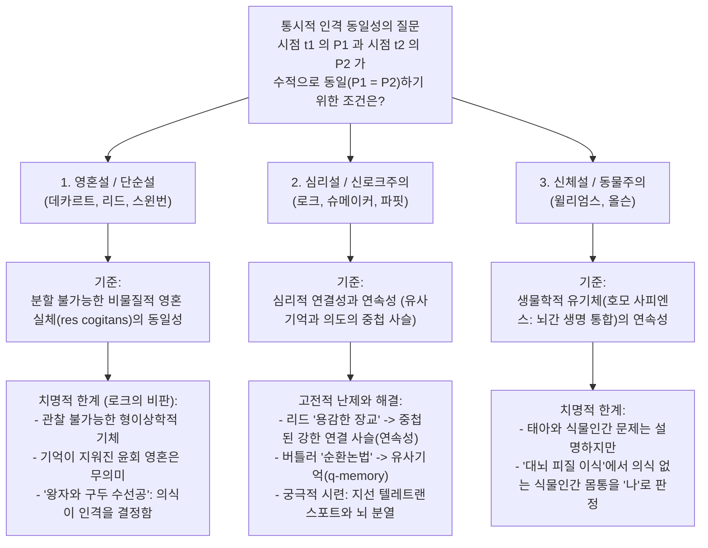
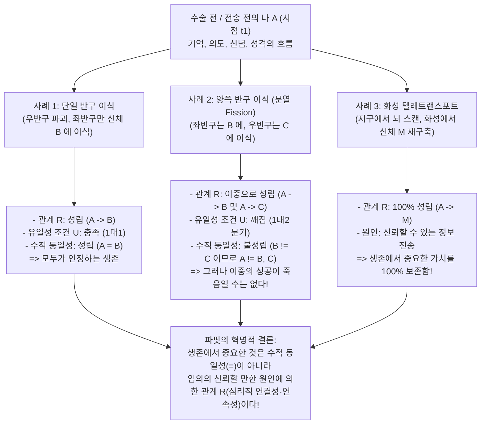

## 1. 서론: 화성으로 가는 텔레트랜스포터와 통시적 인격 동일성의 문제

### 1.1 데릭 파핏의 텔레트랜스포터(원격 전송기) 사고실험

21세기 후반의 어느 아침, 당신은 화성 식민지로 출장을 가기 위해 지구 전송역의 <strong>텔레트랜스포터(Teletransporter: 원격 전송 장치)</strong> 부스에 들어선다. 녹색 버튼을 누르는 순간 당신은 의식을 잃는다. 지구의 <strong>스캐너(Scanner)</strong>는 당신의 뇌와 신체를 구성하는 모든 세포와 분자, 그리고 860억 개의 뉴런과 100조 개의 시냅스 결합 상태를 원자 단위까지 완벽하게 기록하여 디지털화하는 동시에, <strong>지구에 있는 당신의 뇌와 신체를 완전히 기화(파괴)</strong>시킨다. 이 설계도 데이터는 전파를 타고 빛의 속도로 화성으로 전송되며, 3분 후 화성의 <strong>레플리케이터(Replicator: 복제 장치)</strong>가 현지의 탄소·수소·산소·질소 원자를 조립하여 지구에서 스캔된 것과 완벽히 동일한 유기체 뇌와 신체를 재구축한다.

화성 부스에서 눈을 뜬 인물은 몇 초 전 지구에서 녹색 버튼을 누른 기억을 선명히 가지고 있으며, 아침 식사 때 아내에게 화성에 도착하자마자 영상통화를 걸겠다고 한 약속을 기억하고, 심지어 오늘 아침 지구 세면대에서 면도하다가 왼쪽 뺨에 낸 작은 상처까지 그대로 가지고 있다.

여기서 형이상학(Metaphysics)과 심리철학(Philosophy of Mind)의 가장 근원적인 질문이 제기된다.
<strong>화성에서 눈을 뜬 이 인물은 과연 '원래의 당신'인가?</strong>
텔레트랜스포터는 인류 역사상 가장 빠른 <strong>'이동 수단(여행)'</strong>인가, 아니면 녹색 버튼을 누른 순간 <strong>지구의 '당신'은 이미 사망(소멸)</strong>했고 화성에서 깨어난 인물은 자신이 당신이라고 착각하는 <strong>'방금 태어난 정교한 복제인간(타인)'</strong>에 불과한가?

---

### 1.2 통시적 동일성의 정식화: 수적 동일성과 질적 동일성

이 문제를 분석하기 위해 현대 분석 형이상학은 <strong>시간에 걸친 인격의 지속 문제(The Persistence Question of Personal Identity over Time)</strong>를 다음과 같이 정식화한다.

>$$
>\textbf{통시적 동일성의 질문:}\quad \text{시점 } t_1 \text{ 에 존재하는 인격 } P_1 \text{ 이 시점 } t_2 \text{ 에 존재하는 인격 } P_2 \text{ 와}
>$$
>$$
>\text{수적으로 동일한 인격(} P_1 = P_2 \text{)이기 위한 필요충분조건은 무엇인가?}
>$$

여기서 철학자들은 두 가지 '동일성' 개념을 엄격히 구분한다.
1. <strong>질적 동일성(Qualitative Identity, $x \approx y$)</strong>: 두 대상 $x$와 $y$가 내재적 성질(분자 구조, 외모, 기억 내용 등)을 모두 공유하는 상태이다($\forall \Phi \in \mathcal{F}_{\text{intrinsic}} (\Phi(x) \leftrightarrow \Phi(y))$). 같은 공장에서 찍어낸 두 당구공이나 지구의 당신과 화성의 복제인은 100% 질적 동일성을 갖는다.
2. <strong>수적 동일성(Numerical Identity, $x = y$)</strong>: $x$와 $y$가 비슷한 두 개체가 아니라 문자 그대로 <strong>'하나이자 동일한 단일 개체(One and the very same entity)'</strong>임을 뜻하며, 라이프니츠의 법칙($\forall \Phi (\Phi(x) \leftrightarrow \Phi(y))$)을 따르는 동치 관계이다.

5세 어린 시절의 당신($P_{5}$)과 80세 노인이 된 당신($P_{80}$)은 <strong>질적으로는 완전히 다르지만($P_{5} \not\approx P_{80}$)</strong> 법적·도덕적으로는 <strong>수적으로 동일한 인물($P_{5} = P_{80}$)</strong>로 간주된다. 반대로 화성의 복제인($P_{\text{Mars}}$)은 지구의 당신($P_{\text{Earth}}$)과 <strong>100% 질적으로 동일($P_{\text{Earth}} \approx P_{\text{Mars}}$)</strong>하지만, 그것만으로 수적 동일성($P_{\text{Earth}} = P_{\text{Mars}}$)이 자동으로 보장되지는 않는다. 수적 동일성이 중요한 이유는 그것이 (1) 미래의 고통과 쾌락에 대한 <strong>특별한 이기적 관심(내면으로부터의 예기)</strong>, (2) <strong>도덕적·법적 책임과 처벌의 정당성</strong>, (3) <strong>시간을 초월한 고락의 보상(오늘의 인내와 내일의 행복)</strong>이라는 실천 이성의 세 기둥을 지탱하기 때문이다.

---

## 2. 고전적 3대 이론의 대립: 영혼, 기억, 신체

### 2.1 영혼설(데카르트적 자아)과 존 로크의 해체

플라톤, 데카르트(《성찰》, 1641), 토머스 리드, 리처드 스윈번이 주장하는 <strong>영혼설(Soul View / Simple View)</strong>에 따르면, 인격의 본질은 부분을 갖지 않는 분할 불가능한 <strong>비물질적 실체(사유하는 실체 *res cogitans* / 영혼)</strong>에 있다. 비물질적 영혼은 부품이 교체되는 '테세우스의 배'와 달리 분할될 수 없으므로, $P_1 = P_2$는 오직 동일한 영혼 실체($S_1 = S_2$)가 깃들어 있을 때만 성립한다.

그러나 영국의 경험론 철학자 <strong>존 로크(John Locke)</strong>는 1694년 《인간지성론(An Essay Concerning Human Understanding)》 제2판 제2권 제27장 〈동일성과 다양성에 관하여〉에서 두 가지 사고실험으로 영혼설을 논파했다.
* <strong>잠자는 소크라테스와 윤회하는 영혼</strong>: 만약 당신의 몸에 깃든 비물질적 영혼 실체 $S$가 고대 아테네의 철학자 소크라테스의 몸에 있던 바로 그 영혼 실체 $S$라고 가정해 보자. 그러나 소크라테스의 기억과 의식이 완전히 지워져 현재의 당신이 소크라테스의 생각이나 행동을 전혀 기억하지 못한다면, 관찰 불가능한 '빈 그릇 같은 영혼 기체(Substratum)'를 공유한다는 사실만으로 당신이 소크라테스와 <strong>같은 인격(Same Person)</strong>이라고 할 수 있는가? 결코 그렇지 않다.
* <strong>왕자와 구두 수선공(The Prince and the Cobbler)</strong>: 반대로 <strong>왕자</strong>의 과거 기억과 의식을 모두 간직한 마음이 <strong>구두 수선공</strong>의 신체에 들어가 눈을 떴다고 하자. 사람들의 눈에 그의 생물학적 신체는 구두 수선공(로크의 용어로 <strong>'같은 인간 유기체 / Same Man'</strong>)이지만, 도덕적·법적 책임의 주체인 <strong>'인격(Same Person)'</strong>으로서는 명백히 <strong>왕자</strong>이다!

---

### 2.2 로크의 기억 기준과 두 가지 고전적 역설

로크는 '인격(Person)'을 행위의 책임과 상벌을 귀속시키는 <strong>법정적 용어(Forensic Term)</strong>로 규정하고, 인격 동일성의 기준을 <strong>일인칭 경험 기억(Memory from the inside)</strong>에서 찾았다.

>$$
>\textbf{로크의 기억 기준:}\quad t_2 \text{ 의 } P_2 = t_1 \text{ 의 } P_1 \iff P_2 \text{ 가 } P_1 \text{ 의 } t_1 \text{ 시점 경험을 내면으로부터 의식적으로 기억한다.}
>$$

그러나 이 기준은 18세기 철학자들의 두 가지 치명적 반박에 직면했다.

#### 반박 1: 토머스 리드의 '용감한 장교의 역설(Brave Officer Paradox, 1785)' — 추이율의 파탄
스코틀랜드 철학자 <strong>토머스 리드(Thomas Reid, 1785)</strong>는 로크의 기억 기준이 <strong>동일성의 추이율(Transitivity of Identity)</strong>과 모순됨을 증명했다.
* <strong>10세 소년($P_{10}$)</strong>은 과수원에서 사과를 훔치다 매질을 당했다.
* <strong>30세의 용감한 장교($P_{30}$)</strong>는 전투에서 적의 군기를 탈취했으며, 이때 10세 때 매질을 당한 기억을 선명히 가지고 있다($M(P_{30}, P_{10}) \implies P_{30} = P_{10}$).
* <strong>80세의 퇴역 장군($P_{80}$)</strong>은 30세 때 군기를 탈취한 기억은 생생히 간직하고 있으나($M(P_{80}, P_{30}) \implies P_{80} = P_{30}$), 노화로 인해 10세 때 매질을 당한 기억은 완전히 잊어버렸다($\neg M(P_{80}, P_{10}) \implies P_{80} \neq P_{10}$).

수적 동일성($=$)은 <strong>동치 관계(반사율·대칭율·추이율 $A=B \land B=C \implies A=C$ 성립)</strong>이므로 $P_{80} = P_{30}$과 $P_{30} = P_{10}$에서 필연적으로 $P_{80} = P_{10}$이 도출된다. 그러나 직접 기억 $M$은 추이적이지 않으므로 로크의 기준에 따르면 $P_{80} \neq P_{10}$이 되어, <strong>$P_{80} = P_{10} \land P_{80} \neq P_{10}$이라는 논리적 모순</strong>에 빠진다!

* <strong>신로크주의(Neo-Lockeanism)의 해결책</strong>: 현대 철학자들(그라이스, 퀸턴, 파핏)은 <strong>심리적 연결성(Psychological Connectedness)</strong>과 <strong>심리적 연속성(Psychological Continuity)</strong>을 구분했다.
  * <strong>심리적 연결성</strong>은 두 시점 사이의 직접적인 개별 심리적 고리(기억, 의도의 실행, 신념과 성격의 유지)로, 정도의 문제이며 추이율을 만족하지 않는다.
  * <strong>심리적 연속성</strong>은 매일 절반 이상의 직접 연결이 유지되는 <strong>강한 연결성($C_{\text{strong}}$)의 중첩된 사슬(Overlapping chains, 추이적 닫힘 Transitive Closure)</strong>이다:
    $$\text{Continuity}(P_n, P_1) \iff \exists P_2, \dots, P_{n-1} \text{ s.t. } C_{\text{strong}}(P_1, P_2) \land \dots \land C_{\text{strong}}(P_{n-1}, P_n)$$
    80세 장군과 10세 소년 사이에는 중첩된 강한 심리적 연결의 사슬(연속성)이 이어져 있으므로 추이율 모순이 완벽히 해결된다.

#### 반박 2: 조지프 버틀러의 '순환논법 반박(Circularity Objection, 1736)'과 슈메이커의 '유사기억($q$-memory)'
<strong>조지프 버틀러(Joseph Butler, 1736)</strong>는 정신병자가 "워털루 전투에서 대포를 지휘한 기억이 있다"고 주장할 때 왜 그것을 '진짜 기억(Genuine Memory)'이 아니라 '망상(Apparent Memory)'이라고 부르는지 물었다. 일상 언어에서 "$Y$가 경험 $E$를 진짜로 기억한다"는 말은 정의상 <strong>"경험 $E$를 겪은 사람 $X$와 $Y$가 동일 인물($X = Y$)이다"</strong>라는 조건을 이미 전제하고 있기 때문이다! 따라서 기억으로 인격 동일성을 정의하는 것은 악순환에 빠진다.

* <strong>시드니 슈메이커(Sydney Shoemaker, 1970)의 해결책 — 유사기억(Quasi-Memory / $q$-memory)</strong>:
  슈메이커는 인격 동일성을 전혀 전제하지 않는 <strong>유사기억($q$-기억)</strong>을 다음과 같이 정의했다: (1) 내게 경험 $E$에 대한 일인칭 시점의 표상 기억이 있고, (2) 과거에 <strong>누군가(Someone)</strong>가 실제로 경험 $E$를 겪었으며, (3) 내 현재 기억 표상이 그 과거 경험 $E$에 <strong>적절한 인과적 방식(뇌 기억 흔적 보존이나 신뢰할 만한 정보 전달)</strong>으로 의존하고 있다. 유사기억($q$-memory)과 유사의도($q$-intention)를 통해 심리적 연속성(관계 R)을 정의하면 순환논법은 완전히 해소된다.

---

### 2.3 신체 기준, 버나드 윌리엄스의 퍼즐, 그리고 동물주의(Animalism)

* <strong>버나드 윌리엄스(Bernard Williams)의 〈자아와 미래〉(1970)</strong>:
  윌리엄스는 동일한 물리적 과정도 서술 방식에 따라 정반대의 직관을 낳음을 보여주었다. $A$와 $B$의 뇌 기억·성격을 교환한 뒤 한 신체에는 10만 달러를, 다른 신체에는 고문을 가한다고 할 때, '마음의 교환'으로 서술하면 $A$는 자신의 기억을 갖게 될 $B$ 신체가 돈을 받기를 원한다(심리설 지지). 그러나 $A$에게 "내일 당신($A$ 신체)을 고문하기 직전에 기억상실증을 유발하고 $B$의 기억 인상을 복사해 넣겠다"고 서술하면, $A$는 기억이 지워지든 타인의 기억이 주입되든 여전히 내일 <strong>자신의 신체($A$ 신체)</strong>가 겪을 고문의 고통을 두려워한다(신체설 지지)!
* <strong>에릭 올슨(Eric Olson, 1997)의 동물주의(Animalism)</strong>:
  올슨은 우리가 본질적으로 '인격'이 아니라 호모 사피엔스 종에 속하는 <strong>생물학적 유기체(Human Animal)</strong>라고 주장한다. 만약 심리설이 맞다면, 현재의 당신과 심리적 연속성이 전혀 없는 <strong>12주 된 태아(Fetus)</strong>나 <strong>지속적 식물인간 상태(PVS)</strong>의 환자는 당신과 동일할 수 없으므로 "당신은 태아였던 적이 없다"는 기이한 결론에 이른다. 반면 동물주의는 뇌간(Brainstem)이 유지하는 생물학적 생명 통합을 지속 조건으로 본다. 그러나 동물주의는 <strong>대뇌 이식(Cerebrum Transplant)</strong> 사고실험에서, 기억과 의식을 담은 대뇌가 다른 몸으로 이식되고 원래 몸은 뇌간만 남아 식물인간으로 숨 쉬고 있을 때, <strong>"의식 없는 원래 몸통이 진짜 당신이고 당신의 대뇌와 기억을 가진 사람은 타인이다"</strong>라고 말해야 하는 치명적 난점에 부딪힌다.

---

## 3. 데릭 파핏의 혁명(《이유와 인격》 1984): 지선 케이스와 뇌 반구의 분열

1984년 대작 <strong>《이유와 인격(Reasons and Persons)》 제3부</strong>에서 옥스퍼드 철학자 <strong>데릭 파핏(Derek Parfit, 1942–2017)</strong>은 2000년 논쟁의 전제를 뒤집었다. 파핏은 <strong>"생존(Survival)에서 합리적으로 중요한 것은 수적 동일성($P_1 = P_2$)이 아니라 심리적 연결성과 연속성(관계 R: Relation R) 자체이다!"</strong>라는 사실을 증명했다.

---

### 3.1 지선 케이스(The Branch-Line Case)와 결합 스펙트럼(The Combined Spectrum)

* <strong>지선 케이스(The Branch-Line Case)</strong>:
  신형 스캐너가 도입되어 지구의 신체를 파괴하지 않고 스캔하여 화성에 복제인을 만든다. 당신은 지구 부스에서 걸어 나와 화성에서 막 깨어난 복제인과 영상통화를 한다. 명백히 두 사람은 서로 다른 장소에 존재하는 <strong>두 명의 별개 인물($P_{\text{Earth}} \neq P_{\text{Mars}}$)</strong>이다. 그런데 의사로부터 신형 스캐너의 방사선 결함 때문에 <strong>지구의 당신은 심부전으로 3일 뒤 사망한다</strong>는 선고를 받는다. 반면 화성의 복제인은 건강한 심장으로 당신의 아내와 아이들을 돌보고 저서를 완성하며 수십 년을 살 것이다.
  단순 전송(지구 신체 0초 기화)과 지선 케이스(지구 신체 3일 후 사망)를 비교해 보라. 버튼을 누르기 전의 당신과 화성의 복제인 사이의 <strong>내재적 인과·심리적 관계(관계 R)는 두 경우 모두 100% 동일하다!</strong> 단지 지구의 심장이 3일 더 뛰었다는 외재적 사실 때문에 화성의 존재가 '성공적인 이동(생존)'에서 '완전한 죽음'으로 바뀔 수는 없다!
* <strong>결합 스펙트럼(The Combined Spectrum)</strong>:
  미친 외과의사가 비율 $\alpha \in [0\%, 100\%]$에 따라 당신의 뇌·신체 세포를 여배우 <strong>그레타 가르보(Greta Garbo)</strong>의 세포 복제물로 점진적으로 교체한다고 하자. $\alpha = 0\%$는 명백히 <strong>당신</strong>이고, $\alpha = 100\%$는 명백히 <strong>가르보</strong>이다. 만약 인격 동일성이 항상 흑백(All-or-Nothing)으로 결정되는 '추가적 사실(Further Fact)'이라면, 스펙트럼 중간 어딘가(예: $49.999\%$와 $50.000\%$ 사이)에서 뉴런 단 하나를 교체하는 순간 당신의 영혼이 사라지고 가르보의 영혼이 튀어나오는 기괴한 경계선이 있어야 한다. 파핏의 <strong>환원주의(Reductionism)</strong>에 따르면 중간 영역($\alpha = 50\%$)에서 세포 교체 비율과 심리적 연결 정도를 다 알았다면 우리는 이미 모든 사실을 아는 것이며, "그래서 그 사람이 나인가 아닌가?"라고 묻는 것은 객관적 답이 없는 <strong>공허한 질문(Empty Question)</strong>이다.

---

### 3.2 위긴스와 파핏의 '뇌 반구 분열(Fission / My Division)' 논증

설령 누군가 관계 R이 반드시 <strong>동일한 물리적 뇌의 지속</strong>을 원인으로 해야 한다고 고집하더라도, 파핏의 <strong>분열 논증(My Division)</strong>은 물리적 뇌가 지속되는 경우에도 수적 동일성이 중요한 것이 아님을 증명한다.

임상 신경과학은 (1) <strong>대뇌 반구 절제술(Hemispherectomy)</strong>을 통해 인간이 한쪽 뇌 반구만으로도 동일한 인격으로 생존할 수 있음과, (2) 스페리와 가자니가의 <strong>분리뇌(Split-Brain)</strong> 연구를 통해 뇌량을 절단하면 두 반구가 독립된 의식 흐름을 가짐을 입증했다.

> <strong>【사고실험: 나의 분열(My Division)】</strong>
> 당신(<strong>$A$</strong>)은 일란성 세쌍둥이 중 한 명이며, 좌우 뇌 반구가 기능적으로 대칭이어서 양쪽 모두 당신의 기억과 성격을 온전히 담고 있다고 하자. 사고로 당신의 몸은 치명상을 입었으나 뇌는 무사하고, 두 형제는 뇌사 상태에 빠졌으나 신체(<strong>신체 $B$</strong>와 <strong>신체 $C$</strong>)는 건강하다.
> 외과의사가 당신의 뇌를 반으로 나누어 <strong>좌반구를 신체 $B$(레프티 Lefty)</strong>에, <strong>우반구를 신체 $C$(라이티 Righty)</strong>에 이식한다. 수술은 둘 다 성공하여 Lefty($B$)와 Righty($C$)가 동시에 깨어난다. 두 사람 모두 당신의 원래 물리적 뇌의 절반을 가지고 있으며, 당신($A$)과 100% 심리적 연속성과 연결성(관계 R)을 공유한다!

수술 후 <strong>나($A$)는 어떻게 되었는가?</strong> 수적 동일성($=$)의 논리에서 가능한 답은 오직 4가지뿐이다:
1. <strong>$A$는 $B$이면서 동시에 $C$이다($A = B \land A = C$)</strong>: <strong>동일성의 추이율</strong>에 위배된다! $B = A \land A = C \implies B = C$가 되어 Lefty와 Righty가 한 사람이라는 모순이 발생한다(두 사람은 서로 테니스 시합을 하거나 결투를 벌일 수 있으므로 명백히 $B \neq C$).
2. <strong>$A$는 오직 Lefty($B$)이다($A = B \land A \neq C$)</strong>, 또는 3. <strong>$A$는 오직 Righty($C$)이다($A = C \land A \neq B$)</strong>: 완전히 자의적이며 대칭성과 <strong>내재성 원리(Only-$x$-and-$y$ Principle)</strong>에 위배된다! 만약 우반구가 수술 중 바닥에 떨어져 파괴되고 좌반구만 이식되었다면 당신은 당연히 Lefty($B$)로 생존($A = B$)했을 것이다. 어떻게 다른 수술실에서 우반구 이식도 성공했다는 외재적 사실 때문에 Lefty가 갑자기 당신이 아니게 될 수 있는가?
4. <strong>$A$는 $B$도 아니고 $C$도 아니다($A \neq B \land A \neq C$)</strong>: 일대일 관계인 수적 동일성을 유지하려면 관계 R에 더해 <strong>비분기(유일성) 조건 $U$</strong>가 필요하다:
   $$\text{수적 동일성 }(A = X) \iff R(A, X) \land U(A, X)$$

<strong>파핏의 코페르니쿠스적 결론</strong>:
분열에서 유일성 조건 $U$가 깨져 $A \neq B$이고 $A \neq C$라고 해서, 양쪽 반구가 모두 성공적으로 이식된 것을 <strong>'나의 죽음'</strong>으로 보고 절망해야 하는가?
<strong>결코 아니다!</strong> 한쪽 반구만 살아남으면 '생존'인데, <strong>어떻게 양쪽 반구가 모두 살아남은 '이중의 성공(Double Success)'이 '완전한 실패(죽음)'가 될 수 있단 말인가?!</strong> 만약 수적 동일성이 중요한 전부라면, 당신은 수술 전에 간호사에게 뇌물을 주어 우반구를 쓰레기통에 버려달라고 부탁해야만 할 것이다!
따라서 <strong>생존에서 합리적으로 중요한 것(What matters in survival)은 '수적 동일성($=$)'이 아니라, 정도를 가질 수 있고 일대다로 분기할 수도 있는 '관계 R(심리적 연결성과 연속성)' 자체이다!</strong>

---

## 4. 인격 동일성 5대 이론 비교 매트릭스

| 철학적 입장 | 대표 학자 | 동일성 / 생존의 기준 | 리드 '용감한 장교'에 대한 판정 | 대뇌 이식 (원래 몸통은 식물인간) | 뇌 반구 분열 (Lefty $B$ 와 Righty $C$) | 화성 텔레트랜스포터 |
| :--- | :--- | :--- | :--- | :--- | :--- | :--- |
| <strong>1. 영혼설 / 단순설</strong> | 데카르트, 리드, 스윈번 | 분할 불가능한 비물질적 영혼 실체($S$)의 동일성 | 기억이 사라져도 같은 영혼 $S$가 있으면 동일 인물 | 보이지 않는 영혼이 어느 몸을 따르는지 알 수 없음 | 영혼은 쪼개질 수 없으므로 한쪽에만 들어가거나 둘 다 타인 | 영혼이 전파를 따라가지 않는 한 <strong>죽음</strong> |
| <strong>2. 고전적 기억설</strong> | 존 로크 (1694) | 과거 경험에 대한 직접적 일인칭 기억 $M(P_2, P_1)$ | <strong>파탄</strong>: 동일성의 추이율 위배($P_{80}=P_{30}=P_{10}$이나 $P_{80}\neq P_{10}$) | 기억이 있는 대뇌 이식 수혜자가 '나' | 둘 다 기억을 가지므로 추이율($B=C$)과 모순 | 기억이 이어지므로 <strong>생존</strong> (단, 순환논법 문제) |
| <strong>3. 동물주의 (생물학설)</strong> | 에릭 올슨 (1997), 스노든 | 단일 생물학적 유기체(뇌간에 의한 생명 통합)의 연속성 | 노장군과 소년은 같은 생물학적 동물이므로 동일 | <strong>직관에 반함</strong>: 의식 없는 식물인간 몸통이 진짜 '나'! | 원래 유기체가 소멸하고 두 유기체가 됨 | 지구 유기체가 파괴되므로 명백한 <strong>죽음</strong> |
| <strong>4. 좁은 신로크주의</strong> | 슈메이커(초기), 위긴스 | <strong>같은 물리적 뇌</strong>를 정상 원인으로 하는 비분기 심리적 연속성($R \land U$) | 중첩된 강한 연결 사슬(연속성)과 유사기억으로 해결 | 대뇌 기관이 이동하여 심리적 연속성을 유지하므로 대뇌 쪽이 '나' | 유일성 조건 $U$가 깨지므로 수적으로 $A$는 소멸 | 물리적 뇌가 파괴되므로 <strong>죽음(복제인)</strong> |
| <strong>5. 파핏의 환원주의 (관계 R설)</strong> | <strong>데릭 파핏</strong> (1984), 데이비드 루이스 | <strong>중요한 것은 수적 동일성($=$)이 아니라 임의의 신뢰할 만한 원인에 의한 관계 R</strong> | 심리적 연속성은 있으나 70년 사이 직접 연결성은 약화됨 | 관계 R이 100% 대뇌 수혜자에게 이어지므로 완전한 생존 | 수적 동일성은 없으나 <strong>관계 R이 두 배로 보존된 이중의 생존!</strong> | 신뢰할 만한 원인으로 관계 R이 100% 보존되므로 <strong>일반 생존과 동등한 가치!</strong> |

---

## 5. '유리 터널'からの 해방: 다발 이론, 윤리학, 그리고 죽음관의 변용

파핏의 환원주의에 따르면 통시적 인격은 <strong>'국가(Nation)'</strong>나 <strong>'클럽'</strong>과 같아서, 서로 연결된 신체적·정신적 사건들의 흐름 너머에 따로 존재하는 카르테시안 자아는 없다. 이는 <strong>데이비드 흄(David Hume, 1739)</strong>의 <strong>'지각의 다발 이론(Bundle Theory)'</strong> 및 불교의 <strong>'무아(Anattā / 無我)'</strong> 사상(《밀린다왕문경》의 수레 비유와 촛불의 전등 비유)과 완벽히 공명한다.

나아가 심리적 연결성(Connectedness)이 시간에 따라 약화되는 <strong>정도의 문제</strong>라는 사실은 도덕과 실천 이성을 변화시킨다:
1. <strong>므두셀라 사례(Methuselah)와 과거 범죄 책임의 감경</strong>: 900년을 살며 100년마다 기억과 성격이 서서히 바뀌는 사람에게서 20세의 자아와 800세의 자아 사이의 직접 연결성은 0이다. 수십 년이 흘러 심리적 연결성이 크게 약화되고 성품이 완전히 변화한 노인에게는 과거 범죄에 대한 응보적 책임을 감경할 형이상학적 근거가 있다.
2. <strong>19세기 러시아 귀족(미래의 자아를 구속할 권리)</strong>: 사회주의 이상을 품은 20세 귀족 청년이 상속받을 토지를 농노에게 분배하는 계약을 맺으면서 아내에게 "중년에 보수적으로 변질된 내가 계약 취소를 요구하더라도 절대 들어주지 말라. 이상을 버린 중년의 나는 오늘의 내가 아니라 후속 타자(Successor Self)이기 때문이다!"라고 부탁하는 것은 완전히 합리적이다.
3. <strong>파핏의 실존적 고백</strong>: 파핏은 환원주의를 받아들인 후의 변화를 이렇게 고백했다.
   > "과거에 내 삶은 매년 더 빠르게 통과해 끝에 어둠이 기다리고 있는 <strong>유리 터널(a glass tunnel)</strong>처럼 보였다. 그러나 관점을 바꾸자 <strong>유리 터널의 벽이 사라졌다. 나는 이제 탁 트인 공기(the open air) 속에서 살아간다.</strong> 나와 타인의 차이는 줄어들었고 타인들이 더 가까워졌다. 죽음은 내 현재 경험과 미래 경험 사이의 직접적인 기억 연결만을 끊을 뿐 다양한 다른 관계들을 끊지 못한다. 이를 깨달은 지금, 나의 죽음은 이전만큼 나쁘게 느껴지지 않는다."

화성 부스에서 눈을 뜨고 뺨의 면도 상처를 어루만지며 지구의 아내에게 미소 지으며 전화를 거는 그 인물에게는, 당신의 기억과 사랑과 삶의 이야기를 엮어내는 '관계 R'이 온전히 살아 숨 쉬고 있다. 당신은 죽은 것이 아니라, 화성의 붉은 대지 위에서 삶을 이어가고 있는 것이다.
