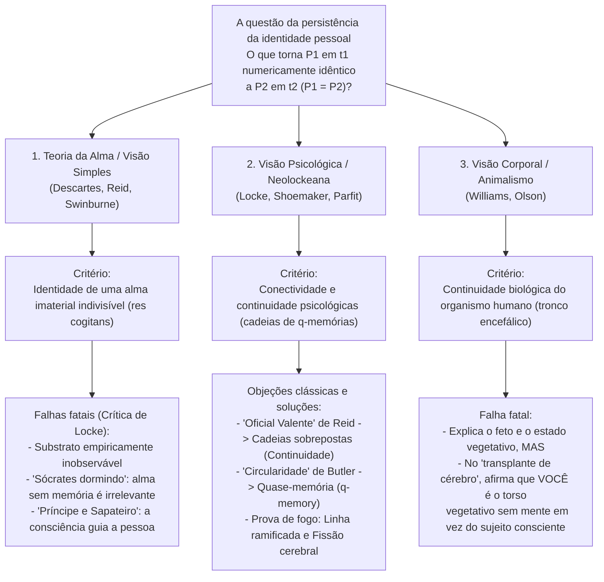
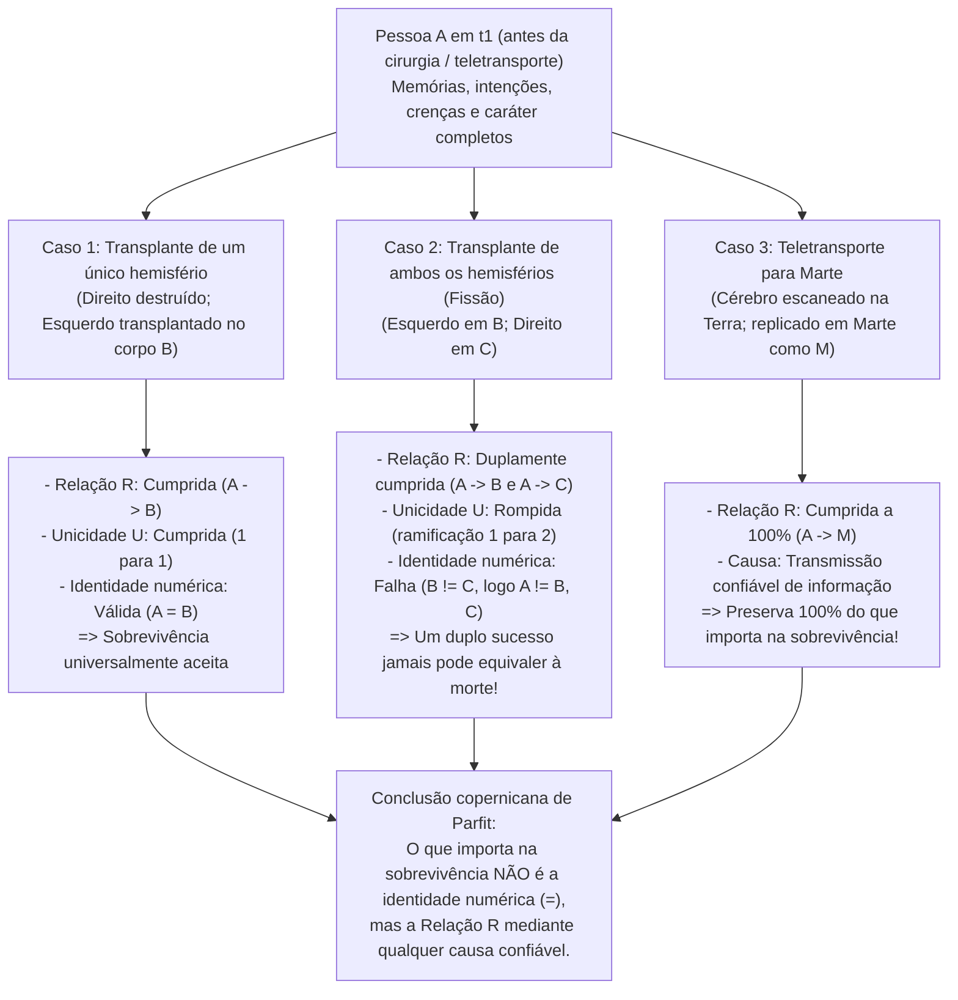

## 1. Introdução: O Teletransportador para Marte e a questão da persistência

### 1.1 O experimento mental do Teletransportador de Derek Parfit

Imagine que, no final do século XXI, você precisa viajar a negócios para uma colônia em Marte. Em vez de enfrentar seis meses em uma nave espacial, você entra na cabine do <strong>Teletransportador</strong> na Terra e aperta o botão verde. Nesse exato instante, você perde a consciência. O <strong>Scanner</strong> registra com precisão atômica o estado exato de todas as suas células e dos 86 bilhões de neurônios e 100 trilhões de conexões sinápticas do seu cérebro, <strong>vaporizando completamente seu cérebro e seu corpo na Terra</strong> enquanto transmite essa planta digital na velocidade da luz por ondas de rádio até Marte. Três minutos depois, o <strong>Replicador</strong> em Marte monta átomos locais de carbono, hidrogênio, oxigênio e nitrogênio para reconstruir um corpo e um cérebro orgânicos exatamente idênticos.

A pessoa que acorda em Marte lembra-se de ter apertado o botão verde há poucos segundos na Terra, lembra-se de ter prometido à esposa no café da manhã que ligaria assim que chegasse e até vê no espelho o pequeno corte no queixo esquerdo feito ao se barbear naquela manhã na Terra.

Surge então a questão mais inquietante da metafísica e da filosofia da mente:
<strong>A pessoa que acorda em Marte é realmente *você*?</strong>
O Teletransportador é o meio de transporte mais rápido da história, ou <strong>você *morreu* no instante em que o Scanner vaporizou seu corpo na Terra</strong>, enquanto quem desperta em Marte é apenas uma réplica recém-criada — um impostor involuntário que acredita erroneamente ser você?

---

### 1.2 Identidade diacrônica: Identidade numérica vs. Identidade qualitativa

A metafísica analítica formula assim a <strong>questão da persistência da identidade pessoal ao longo do tempo (Diachronic Personal Identity)</strong>:

>$$
>\textbf{Questão da persistência:}\quad \text{Sob quais condições necessárias e suficientes uma pessoa } P_1 \text{ que existe em } t_1
>$$
>$$
>\text{é numericamente idêntica } (P_1 = P_2) \text{ a uma pessoa } P_2 \text{ que existe em um instante posterior } t_2\text{?}
>$$

Devemos distinguir rigorosamente dois sentidos de «identidade»:
1. <strong>Identidade qualitativa (similaridade exata, $x \approx y$)</strong>: Duas entidades compartilham todas as suas propriedades intrínsecas ($\forall \Phi \in \mathcal{F}_{\text{intrinsic}} (\Phi(x) \leftrightarrow \Phi(y))$), como duas bolas de bilhar idênticas ou você e sua réplica marciana.
2. <strong>Identidade numérica ($x = y$)</strong>: Não se trata de duas coisas semelhantes, mas literalmente de <strong>uma e a mesma entidade única</strong>, regida pela Lei de Leibniz ($\forall \Phi (\Phi(x) \leftrightarrow \Phi(y))$).

A criança de 5 anos ($P_{5}$) e o idoso de 80 anos ($P_{80}$) são <strong>qualitativamente muito diferentes ($P_{5} \not\approx P_{80}$)</strong>, mas a moral e o direito pressupõem que são <strong>numericamente idênticos ($P_{5} = P_{80}$)</strong>. Inversamente, a réplica em Marte ($P_{\text{Mars}}$) é <strong>100% qualitativamente idêntica ($P_{\text{Earth}} \approx P_{\text{Mars}}$)</strong> a você, mas isso não garante automaticamente a identidade numérica ($P_{\text{Earth}} = P_{\text{Mars}}$). A identidade numérica sustenta três pilares da nossa razão prática: (1) a <strong>preocupação egoísta especial com o próprio futuro (antecipação por dentro)</strong>; (2) a <strong>responsabilidade moral e jurídica (punição e promessas)</strong>; e (3) a <strong>compensação intertemporal (esforço hoje para um benefício amanhã)</strong>.

---

## 2. As três teorias clássicas rivais: Alma, Memória e Corpo

### 2.1 A teoria da alma imaterial (Ego cartesiano) e a crítica de John Locke

Segundo Platão, René Descartes (*Meditações Metafísicas*, 1641), Thomas Reid e Richard Swinburne, uma pessoa é essencialmente uma substância pensante imaterial e indivisível: uma <strong>alma imaterial (*res cogitans*)</strong>. Ao contrário do «Barco de Teseu», cujas tábuas são substituídas gradualmente, uma alma simples não tem partes e não pode se dividir: $P_1 = P_2$ se e somente se possuem a mesma substância anímica ($S_1 = S_2$).

Contudo, em 1694, o filósofo empirista inglês <strong>John Locke</strong> refutou essa posição no capítulo 27 (*«Sobre a identidade e a diversidade»*) do Livro II do seu *Ensaio acerca do Entendimento Humano* por meio de dois célebres experimentos mentais:
* <strong>Sócrates acordado e dormindo (reencarnação sem memória)</strong>: Suponha que a alma imaterial $S$ em seu corpo seja exatamente a mesma substância que habitou Sócrates na antiga Atenas, mas esvaziada de todas as suas memórias e pensamentos. Compartilhar um substrato inobservável e amnésico torna você a <strong>mesma pessoa</strong> que Sócrates? De modo algum — não mais do que ter em sua unha átomos de carbono que um dia pertenceram a Júlio César.
* <strong>O Príncipe e o Sapateiro (The Prince and the Cobbler)</strong>: Suponha que a alma de um <strong>Príncipe</strong>, carregando toda a consciência e as memórias de sua vida real, entre no corpo de um humilde <strong>Sapateiro</strong>. Embora biologicamente pareça o «mesmo homem» (*Same Man* / organismo humano) que o sapateiro, como agente moral e consciente (<strong>mesma pessoa / *Same Person*</strong>) todos reconhecem que ele é o <strong>Príncipe</strong>, responsável apenas pelos atos do Príncipe.

---

### 2.2 O critério da memória de Locke e seus dois paradoxos clássicos

Para Locke, «pessoa» é um <strong>termo forense (Forensic Term)</strong> que apropria ações e mérito, e sua identidade reside na <strong>memória experiencial em primeira pessoa</strong>:

>$$
>\textbf{Critério de Locke:}\quad P_2 \text{ em } t_2 = P_1 \text{ em } t_1 \iff P_2 \text{ em } t_2 \text{ pode lembrar conscientemente «por dentro» as experiências de } P_1 \text{ em } t_1.
>$$

Essa teoria enfrentou duas objeções lógicas devastadoras no século XVIII:

#### Objeção 1: O paradoxo do «Oficial Valente» de Thomas Reid (1785) — Violação da transitividade
O filósofo escocês <strong>Thomas Reid (1785)</strong> demonstrou que o critério de Locke viola a <strong>transitividade da identidade numérica</strong>:
* <strong>O menino de 10 anos ($P_{10}$)</strong> é açoitado na escola por roubar maçãs de um pomar.
* <strong>O valente oficial de 30 anos ($P_{30}$)</strong> captura um estandarte inimigo em batalha e ainda se lembra claramente de ter sido açoitado aos 10 anos ($M(P_{30}, P_{10}) \implies P_{30} = P_{10}$).
* <strong>O general reformado de 80 anos ($P_{80}$)</strong> lembra-se vividamente de ter capturado o estandarte aos 30 anos ($M(P_{80}, P_{30}) \implies P_{80} = P_{30}$), mas esqueceu completamente os açoites aos 10 anos ($\neg M(P_{80}, P_{10}) \implies P_{80} \neq P_{10}$).

Como a identidade numérica ($=$) é uma <strong>relação de equivalência (reflexiva, simétrica e transitiva: $A=B \land B=C \implies A=C$)</strong>, de $P_{80} = P_{30}$ e $P_{30} = P_{10}$ segue-se necessariamente $P_{80} = P_{10}$. Mas como a memória direta $M$ <strong>não é transitiva</strong>, o critério de Locke leva à contradição lógica <strong>$P_{80} = P_{10} \land P_{80} \neq P_{10}$</strong>.

* <strong>A solução neolockeana</strong>: Os neolockeanos (Grice, Quinton, Shoemaker, Parfit) distinguem entre <strong>conectividade psicológica (Psychological Connectedness)</strong> — a posse de vínculos psicológicos diretos (memórias, intenções cumpridas, crenças), que admite graus e *não é transitiva* — e <strong>continuidade psicológica (Psychological Continuity)</strong>, definida como <strong>cadeias sobrepostas de conectividade forte ($C_{\text{strong}}$)</strong> (o fecho transitivo):
  $$\text{Continuity}(P_n, P_1) \iff \exists P_2, \dots, P_{n-1} \text{ tal que } C_{\text{strong}}(P_1, P_2) \land \dots \land C_{\text{strong}}(P_{n-1}, P_n)$$
  Assim, o general de 80 anos está ligado ao menino de 10 anos por uma cadeia ininterrupta de conectividade forte dia após dia, salvando a transitividade.

#### Objeção 2: A objeção de circularidade de Joseph Butler (1736) e a «quase-memória ($q$-memory)»
O bispo <strong>Joseph Butler (1736)</strong> objetou que, para distinguir uma *memória genuína* de uma *memória aparente ou delírio* (como alguém que acredita lembrar ter sido Napoleão em Waterloo), o conceito de «lembrar genuinamente» já pressupõe que quem lembra é <strong>numericamente idêntico</strong> a quem viveu a experiência. Definir a identidade pela memória incorre em um círculo vicioso (*«Consciousness of personal identity presupposes, and therefore cannot constitute, personal identity»*).

* <strong>A solução de Sydney Shoemaker (1970) — Quase-memória ($q$-memory)</strong>:
  Shoemaker definiu a <strong>quase-memória ($q$-memory)</strong> sem pressupor a identidade pessoal: tenho uma quase-memória exata de uma experiência $E$ se e somente se (1) tenho uma memória aparente em primeira pessoa de $E$, (2) <strong>alguém (Someone)</strong> teve realmente a experiência $E$ no passado, e (3) minha memória aparente depende causalmente da maneira adequada (traços cerebrais ou transmissão confiável de informação) daquela experiência $E$. Ao definir a continuidade psicológica (Relação R) mediante a $q$-memória, desaparece toda circularidade.

---

### 2.3 Critério corporal, o quebra-cabeça de Bernard Williams e o Animalismo

* <strong>Bernard Williams, «The Self and the Future» (1970)</strong>:
  Williams mostrou como o mesmo processo físico inverte nossas intuições conforme a descrição. Se a $A$ e $B$ for dito que um aparelho trocará suas memórias e personalidades entre seus cérebros antes de dar 100.000 dólares a um corpo e torturar o outro, $A$ escolhe que o corpo-$B$ (que despertará com as memórias de $A$) receba o dinheiro (visão psicológica). Mas se a $A$ for dito: «Amanhã torturaremos seu corpo ($A$), após provocar amnésia total e implantar cópias das memórias de $B$», $A$ continua temendo com pavor a dor que sofrerá <strong>seu próprio corpo ($A$)</strong> (visão corporal)!
* <strong>O Animalismo de Eric Olson (*The Human Animal*, 1997)</strong>:
  Olson sustenta que somos fundamentalmente organismos biológicos da espécie *Homo sapiens*. Se a teoria psicológica fosse verdadeira, nunca teríamos sido um <strong>feto de 12 semanas</strong> e teríamos morrido ao entrar em <strong>estado vegetativo persistente (EVP / PVS)</strong>, embora o animal humano continue respirando graças ao tronco encefálico. Contudo, o Animalismo fracassa diante do <strong>transplante de cérebro superior (Cerebrum Transplant)</strong>: se o seu telencéfalo (sede de toda a sua consciência e memórias) for transplantado para um corpo doador enquanto seu tronco encefálico mantém vivo seu antigo torso descerebrado, o Animalismo nos obriga a dizer absurdamente que *você* é o torso inconsciente na cama do hospital!

---

## 3. A revolução de Derek Parfit (*Reasons and Persons*, 1984): Caso da linha ramificada e Fissão cerebral

Na Parte III de sua obra-prima <strong>*Reasons and Persons* (1984)</strong>, o filósofo de Oxford <strong>Derek Parfit (1942–2017)</strong> derrubou o pressuposto compartilhado durante dois milênios: demonstrou que <strong>o que importa racionalmente na sobrevivência NÃO é a identidade numérica ($P_1 = P_2$), mas a Relação R (conectividade e continuidade psicológicas)</strong>.

---

### 3.1 O caso da linha ramificada (Branch-Line Case) e o Espectro combinado

* <strong>O caso da linha ramificada (The Branch-Line Case)</strong>:
  Um Novo Scanner escaneia seu corpo na Terra *sem* destruí-lo e cria sua Réplica em Marte. Você sai da cabine na Terra e conversa por vídeo com sua Réplica em Marte. Claramente, você está aqui e ele está lá: vocês são <strong>duas pessoas numericamente distintas ($P_{\text{Earth}} \neq P_{\text{Mars}}$)</strong>. Então o médico informa que o Novo Scanner danificou seu tecido cardíaco na Terra: <strong>você na Terra morrerá de insuficiência cardíaca em 3 dias</strong>, enquanto sua Réplica em Marte, com um coração saudável, cuidará de sua família e terminará seu livro.
  Observe o paradoxo: a <strong>relação intrínseca causal e psicológica (Relação R)</strong> entre você antes de apertar o botão e sua Réplica em Marte é <strong>100% idêntica</strong> tanto no Teletransporte simples (morte em 0 segundo) quanto na Linha ramificada (morte em 3 dias). Como poderia o fato extrínseco de seu coração na Terra bater por mais 72 horas transformar sua sobrevivência em Marte em uma morte total?
* <strong>O Espectro combinado (The Combined Spectrum)</strong>:
  Um cirurgião substitui uma fração $\alpha \in [0\%, 100\%]$ de suas células cerebrais e corporais por cópias das células de <strong>Greta Garbo</strong>. Em $\alpha = 0\%$ é <strong>Você</strong>; em $\alpha = 100\%$ é <strong>Greta Garbo</strong>. Se o não-reducionismo («visão do fato adicional» / *Further Fact View*) fosse verdadeiro, em algum ponto intermediário (digamos entre $49,999\%$ e $50,000\%$) substituir um único neurônio faria sua alma desaparecer de repente e entrar a de Garbo. O <strong>Reducionismo</strong> de Parfit mostra que em $\alpha = 50\%$, uma vez conhecidos os graus de continuidade física e psicológica, já conhecemos todos os fatos: perguntar se essa pessoa ainda é «eu» é uma <strong>pergunta vazia (Empty Question)</strong>.

---

### 3.2 O argumento da Fissão de Wiggins e Parfit («Minha Divisão»)

Mesmo que alguém exija que a Relação R tenha sua <strong>causa física normal (a persistência do mesmo cérebro físico)</strong>, o argumento da <strong>Fissão («My Division»)</strong> demonstra que a identidade numérica não é o que importa.

A neurociência clínica demonstra (1) que após uma <strong>hemisferectomia</strong> um ser humano sobrevive como a mesma pessoa com apenas um hemisfério cerebral, e (2) os estudos de <strong>cérebro dividido (Split-Brain)</strong> de Sperry e Gazzaniga provam que ao seccionar o corpo caloso operam dois fluxos de consciência independentes.

> <strong>[Experimento mental: Minha Divisão (My Division)]</strong>
> Você (<strong>$A$</strong>) é um de trigêmeos idênticos e seus dois hemisférios cerebrais são funcionalmente simétricos. Após um acidente em que seu corpo fica esmagado mas seu cérebro intacto, enquanto seus dois irmãos sofrem morte cerebral com corpos saudáveis (<strong>Corpo $B$</strong> e <strong>Corpo $C$</strong>), o cirurgião divide seu cérebro e transplanta seu <strong>hemisfério esquerdo para o Corpo $B$ (Lefty)</strong> e seu <strong>hemisfério direito para o Corpo $C$ (Righty)</strong>. Ambos despertam com metade do seu cérebro físico original e 100% de continuidade psicológica (Relação R) com você!

O que aconteceu comigo (<strong>$A$</strong>)? Pela lógica estrita da identidade numérica ($=$), existem apenas quatro opções:
1. <strong>$A$ é tanto $B$ quanto $C$ ($A = B \land A = C$)</strong>: Viola a <strong>transitividade da identidade</strong> ($B = A \land A = C \implies B = C$). Mas Lefty e Righty são duas pessoas distintas ($B \neq C$) que podem jogar tênis um contra o outro.
2. <strong>$A = B$ somente</strong>, ou 3. <strong>$A = C$ somente</strong>: Totalmente arbitrário e viola a simetria e o <strong>princípio de intrinsecidade (Only-$x$-and-$y$ Principle)</strong>. Se o hemisfério direito tivesse sido destruído, você teria sobrevivido como Lefty ($A = B$). Como pode o sucesso de uma operação na sala ao lado impedir que Lefty seja você?
4. <strong>$A$ não é nem $B$ nem $C$ ($A \neq B \land A \neq C$)</strong>: A identidade numérica exige, além da Relação R, uma <strong>condição de não ramificação (Unicidade $U$)</strong>:
   $$\text{Identidade }(A = X) \iff R(A, X) \land U(A, X)$$

<strong>A conclusão revolucionária de Parfit</strong>:
Você deveria considerar o sucesso do duplo transplante como sua <strong>morte</strong> apenas porque a unicidade $U$ foi quebrada?
<strong>Absurdo!</strong> Se um hemisfério sobrevive, você sobrevive. <strong>Como poderia um DUPLO SUCESSO (ambos os hemisférios sobrevivem!) tornar-se um FRACASSO TOTAL (a morte)?!</strong> Se a identidade numérica fosse o que importa, antes da cirurgia você teria de subornar a enfermeira para destruir seu hemisfério direito apenas para preservar a condição de unicidade $U$.
Portanto, <strong>o que importa racionalmente na sobrevivência NÃO é a identidade numérica ($=$), mas a Relação R (conectividade e continuidade psicológicas)</strong>.

---

## 4. Matriz comparativa das cinco grandes teorias da identidade pessoal

| Teoria filosófica | Principais autores | Critério de identidade / sobrevivência | Veredito sobre o «Oficial Valente» de Reid | Transplante de cérebro (tronco encefálico em estado vegetativo) | Fissão cerebral (Lefty $B$ e Righty $C$) | Teletransportador para Marte |
| :--- | :--- | :--- | :--- | :--- | :--- | :--- |
| <strong>1. Teoria da Alma (Visão Simples)</strong> | Descartes, Reid, Swinburne | Persistência de uma substância imaterial indivisível ($S$) | General = Menino sse permanece a mesma alma $S$ | Incognoscível qual corpo a alma inobservável segue | A alma não se divide; entra arbitrariamente em $B$, em $C$ ou em nenhum | <strong>Morte</strong>, salvo se a alma viajar pelo rádio |
| <strong>2. Critério clássico da memória</strong> | John Locke (1694) | Memória direta em primeira pessoa $M(P_2, P_1)$ | <strong>Falha</strong>: Viola a transitividade da identidade ($P_{80}=P_{30}=P_{10}$ mas $P_{80}\neq P_{10}$) | Você vai com o cérebro transplantado que guarda as memórias | Contradiz a transitividade ($B=C$) porque ambos lembram | <strong>Sobrevivência</strong> (mas vulnerável à circularidade de Butler) |
| <strong>3. Animalismo (Visão biológica)</strong> | Eric Olson (1997), Snowdon | Continuidade de um organismo biológico (*Homo sapiens* via tronco encefálico) | General = Menino por ser o mesmo animal humano vivo | <strong>Contraintuitivo</strong>: Você continua sendo o torso vegetativo sem mente! | O organismo original termina; surgem dois novos | <strong>Morte</strong>: o organismo terrestre é destruído |
| <strong>4. Neolockeano estrito</strong> | Shoemaker (inicial), Wiggins | Continuidade psicológica não ramificada ($R \land U$) com <strong>causa normal</strong> (mesmo cérebro) | Resolvido por cadeias sobrepostas de conectividade forte e $q$-memória | Você vai com o cérebro transplantado | Falha a identidade numérica ($A \neq B, C$) ao violar-se $U$ | <strong>Morte</strong>, porque o cérebro físico é destruído |
| <strong>5. Reducionismo de Parfit (Relação R ampla)</strong> | <strong>Derek Parfit</strong> (1984), David Lewis | <strong>A identidade ($=$) não é o que importa; importa a Relação R com qualquer causa confiável</strong> | Há continuidade, embora a conectividade direta diminua após 70 anos | Sobrevive 100% no receptor do cérebro via Relação R | Falha a identidade numérica, mas <strong>há dupla sobrevivência por dupla Relação R!</strong> | <strong>Sobrevivência plena (o que importa)</strong>: Relação R preservada a 100%! |

---

## 5. Libertação do «túnel de vidro»: Teoria do feixe, ética e serenidade diante da morte

O Reducionismo de Parfit mostra que uma pessoa ao longo do tempo, tal como uma <strong>nação</strong> ou um <strong>clube</strong>, não é mais do que uma série de eventos físicos e mentais entrelaçados pela Relação R, reivindicando a <strong>teoria do feixe de percepções (Bundle Theory)</strong> de <strong>David Hume</strong> (*Tratado da Natureza Humana*, 1739) e a doutrina budista do <strong>Não-Eu (*Anattā*)</strong> exposta no *Milindapañha* (a metáfora da carruagem e da chama transmitida de uma vela a outra).

Como a <strong>conectividade psicológica</strong> é uma questão de grau que diminui com as décadas (como no <strong>caso de Matusalém</strong> ou no do <strong>jovem nobre russo do século XIX</strong> que pede à esposa que se recuse a revogar a doação de terras caso seu futuro «eu sucessor» de meia-idade se torne egoísta), o Reducionismo transforma nossa ética e nossa atitude perante a morte. No final do capítulo 13 de *Reasons and Persons*, Parfit escreve sua célebre confissão existencial:

> *«Quando eu acreditava que minha existência era um fato adicional separado, minha vida parecia <strong>um túnel de vidro (a glass tunnel)</strong> pelo qual eu me movia mais rápido a cada ano, e no final do qual havia escuridão. Quando mudei de opinião, as paredes do meu túnel de vidro desapareceram. <strong>Agora vivo ao ar livre (in the open air).</strong> As outras pessoas estão mais próximas. Minha morte romperá as relações mais diretas entre minhas experiências presentes e as experiências futuras, mas não romperá diversas outras relações. Agora que vi isso, minha morte me parece menos ruim.»* (Derek Parfit, *Reasons and Persons*, 1984, p. 281)
