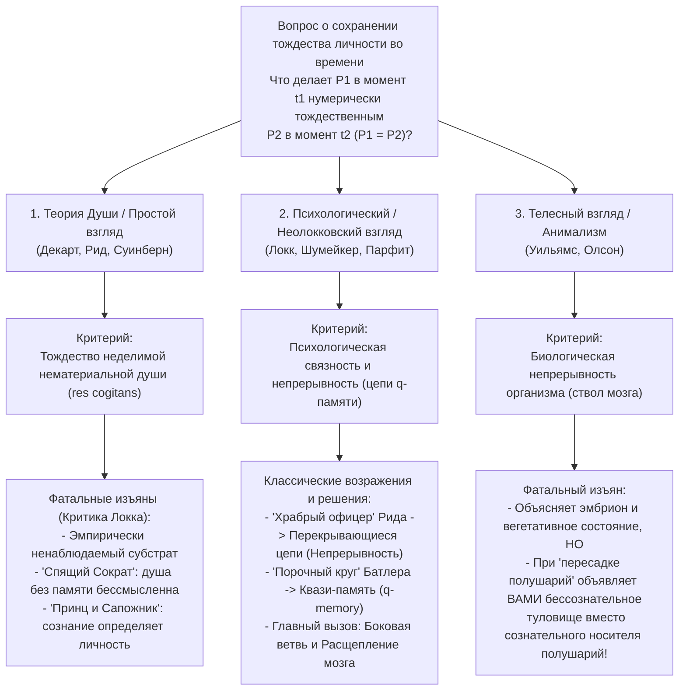
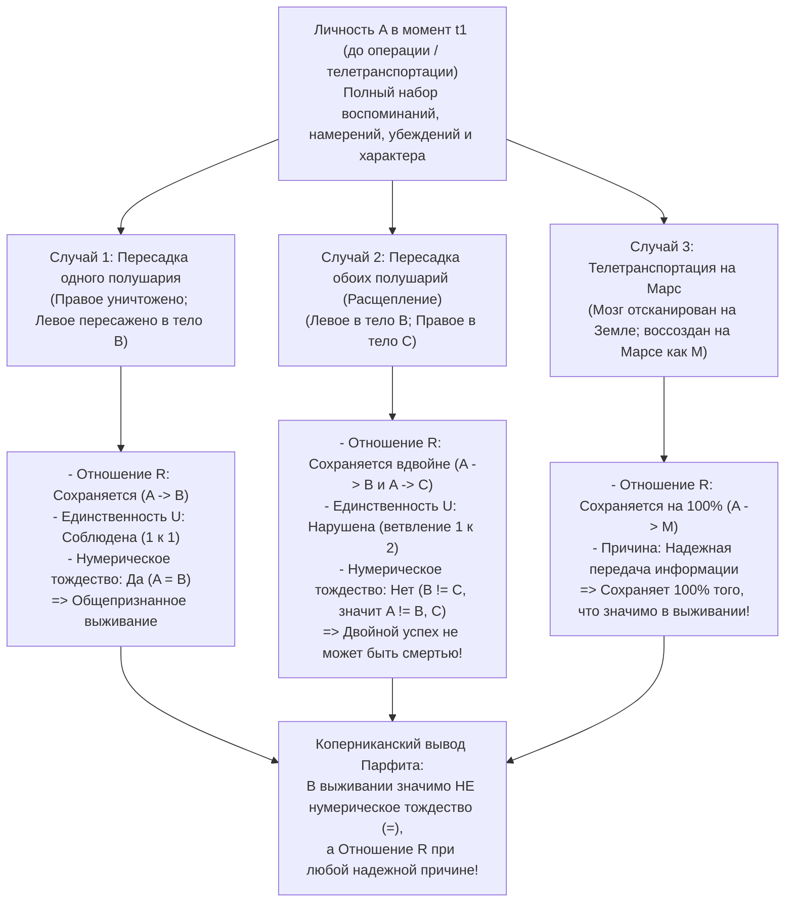

## 1. Введение: Телетранспортер на Марс и проблема сохранения личности во времени

### 1.1 Мысленный эксперимент Дерека Парфита с телетранспортером

Представьте, что в конце XXI века вам предстоит командировка в колонию на Марсе. Вместо шестимесячного перелета на космическом корабле вы заходите в кабину <strong>Телетранспортера (Teletransporter)</strong> на Земле и нажимаете зеленую кнопку. В это же мгновение вы теряете сознание. <strong>Сканер</strong> с атомной точностью считывает состояния всех клеток вашего тела, 86 миллиардов нейронов и 100 триллионов синаптических связей вашего мозга, <strong>полностью испаряя (уничтожая) ваш мозг и тело на Земле</strong>, и передает этот цифровой чертеж со скоростью света по радиолучу на Марс. Через три минуты <strong>Репликатор</strong> на Марсе собирает из местных атомов углерода, водорода, кислорода и азота органическое тело и мозг, в точности идентичные вашим земным.

Человек, очнувшийся в марсианской кабине, помнит, как несколько секунд назад нажал зеленую кнопку на Земле, помнит утреннее обещание позвонить жене сразу по прибытии и даже видит в зеркале крошечный порез на левой щеке, оставленный бритвой сегодня утром на Земле.

Перед нами встает самый фундаментальный и тревожный вопрос метафизики и философии сознания:
<strong>Действительно ли человек, проснувшийся на Марсе, — это *вы*?</strong>
Является ли Телетранспортер самым быстрым видом транспорта в истории, или же <strong>*вы* умерли в ту секунду, когда Сканер испарил ваше тело на Земле</strong>, а очнувшийся на Марсе человек — всего лишь только что созданный двойник (невольный самозванец), ошибочно полагающий, что он — это вы?

---

### 1.2 Диахроническое тождество: Нумерическое и качественное тождество

Аналитическая метафизика формулирует <strong>вопрос о сохранении (персистентности) тождества личности во времени (Diachronic Personal Identity)</strong> следующим образом:

>$$
>\textbf{Вопрос о сохранении:}\quad \text{При каких необходимых и достаточных условиях личность } P_1\text{, существующая в момент } t_1\text{,}
>$$
>$$
>\text{нумерически тождественна } (P_1 = P_2) \text{ личности } P_2\text{, существующей в более поздний момент } t_2\text{?}
>$$

Необходимо строго различать два смысла «тождества»:
1. <strong>Качественное тождество (точное сходство, $x \approx y$)</strong>: Два объекта разделяют все внутренние свойства ($\forall \Phi \in \mathcal{F}_{\text{intrinsic}} (\Phi(x) \leftrightarrow \Phi(y))$), подобно двум одинаковым бильярдным шарам или вам и вашей марсианской реплике.
2. <strong>Нумерическое (числовое) тождество ($x = y$)</strong>: Речь идет не о двух похожих вещах, а буквально об <strong>одной и той же единственной сущности</strong>, подчиняющейся закону Лейбница ($\forall \Phi (\Phi(x) \leftrightarrow \Phi(y))$).

5-летний ребенок ($P_{5}$) и 80-летний старик ($P_{80}$) <strong>качественно радикально различаются ($P_{5} \not\approx P_{80}$)</strong>, но мораль и право считают их <strong>нумерически тождественными ($P_{5} = P_{80}$)</strong>. Напротив, реплика на Марсе ($P_{\text{Mars}}$) <strong>на 100% качественно тождественна ($P_{\text{Earth}} \approx P_{\text{Mars}}$)</strong> вам, но само по себе это не гарантирует нумерического тождества ($P_{\text{Earth}} = P_{\text{Mars}}$). Нумерическое тождество служит опорой трех столпов практического разума: (1) <strong>особой эгоистической заботы о собственном будущем (предвосхищение «изнутри»)</strong>; (2) <strong>моральной и юридической ответственности (наказание и обещания)</strong>; и (3) <strong>межвременной компенсации (сегодняшние тяготы ради завтрашнего блага)</strong>.

---

## 2. Три классические конкурирующие теории: Душа, Память и Тело

### 2.1 Теория нематериальной души (картезианское Эго) и критика Джона Локка

Согласно Платону, Рене Декарту (*Размышления о первой философии*, 1641), Томасу Риду и Ричарду Суинберну, личность по своей сути есть неделимая нематериальная мыслящая субстанция — <strong>нематериальная душа (*res cogitans*)</strong>. В отличие от «корабля Тесея», доски которого постепенно заменяются, простая душа не имеет частей и не может делиться: $P_1 = P_2$ тогда и только тогда, когда в них пребывает одна и та же душа ($S_1 = S_2$).

Однако в 1694 году английский философ-эмпирик <strong>Джон Локк</strong> нанес сокрушительный удар по этой теории в главе 27 (*«О тождестве и различии»*) книги II своего *Опыта о человеческом разумении* с помощью двух знаменитых мысленных экспериментов:
* <strong>Бодрствующий и спящий Сократ (переселение душ без памяти)</strong>: Предположим, что нематериальная душа $S$ в вашем теле — это та же самая субстанция, которая некогда обитала в теле Сократа в древних Афинах, но лишенная всех воспоминаний и мыслей Сократа. Делает ли наличие ненаблюдаемого бессознательного субстрата вас <strong>той же личностью</strong>, что и Сократ? Ничуть — не более чем атомы углерода из тела Юлия Цезаря в вашем ногте делают вас Цезарем.
* <strong>Принц и Сапожник (The Prince and the Cobbler)</strong>: Предположим, что душа <strong>Принца</strong> со всем его сознанием и памятью о королевской жизни переселяется в тело бедного <strong>Сапожника</strong>. Хотя биологически для окружающих он остается «тем же человеком» (*Same Man* / биологическим организмом), что и сапожник, как сознательный моральный субъект (<strong>та же личность / *Same Person*</strong>) он, безусловно, является <strong>Принцем</strong> и несет ответственность только за поступки Принца!

---

### 2.2 Критерий памяти Локка и два классических парадокса

Для Локка «личность» — это <strong>судебный (правовой) термин (Forensic Term)</strong>, а ее тождество определяется <strong>сознанием и памятью об опыте от первого лица</strong>:

>$$
>\textbf{Критерий памяти Локка:}\quad P_2 \text{ в } t_2 = P_1 \text{ в } t_1 \iff P_2 \text{ в } t_2 \text{ может сознательно помнить «изнутри» опыт } P_1 \text{ в } t_1.
>$$

В XVIII веке против этого критерия были выдвинуты два сокрушительных логических возражения:

#### Возражение 1: Парадокс «Храброго офицера» Томаса Рида (1785) — Нарушение транзитивности
Шотландский философ <strong>Томас Рид (1785)</strong> доказал, что критерий Локка нарушает <strong>транзитивность нумерического тождества</strong>:
* <strong>10-летний мальчик ($P_{10}$)</strong> высечен в школе за кражу яблок из сада.
* <strong>30-летний храбрый офицер ($P_{30}$)</strong> захватывает вражеское знамя в бою и все еще ясно помнит порку в 10 лет ($M(P_{30}, P_{10}) \implies P_{30} = P_{10}$).
* <strong>80-летний отставной генерал ($P_{80}$)</strong> живо помнит захват знамени в 30 лет ($M(P_{80}, P_{30}) \implies P_{80} = P_{30}$), но полностью забыл порку в 10-летнем возрасте ($\neg M(P_{80}, P_{10}) \implies P_{80} \neq P_{10}$).

Поскольку нумерическое тождество ($=$) является <strong>отношением эквивалентности (рефлексивным, симметричным и транзитивным: $A=B \land B=C \implies A=C$)</strong>, из $P_{80} = P_{30}$ и $P_{30} = P_{10}$ логически следует $P_{80} = P_{10}$. Но прямая память $M$ <strong>не транзитивна</strong>, поэтому критерий Локка ведет к противоречию: <strong>$P_{80} = P_{10} \land P_{80} \neq P_{10}$</strong>!

* <strong>Неолокковское решение</strong>: Современные неолоккианцы (Грайс, Куинтон, Шумейкер, Парфит) разграничили <strong>психологическую связность (Psychological Connectedness)</strong> — наличие прямых психологических связей (воспоминаний, намерений, убеждений), которое имеет степени и *не транзитивно*, — и <strong>психологическую непрерывность (Psychological Continuity)</strong>, определяемую как <strong>перекрывающиеся цепи сильной связности ($C_{\text{strong}}$)</strong> (транзитивное замыкание):
  $$\text{Continuity}(P_n, P_1) \iff \exists P_2, \dots, P_{n-1} \text{ т.ч. } C_{\text{strong}}(P_1, P_2) \land \dots \land C_{\text{strong}}(P_{n-1}, P_n)$$
  Благодаря ежедневным перекрывающимся звеньям сильной связности 80-летний генерал транзитивно связан с 10-летним мальчиком.

#### Возражение 2: Порочный круг Джозефа Батлера (1736) и «квази-память ($q$-memory)»
Епископ <strong>Джозеф Батлер (1736)</strong> заметил: чтобы отличить *подлинное воспоминание* от *кажущегося воспоминания или бреда* (например, пациента, уверенного, что он был Наполеоном при Ватерлоо), само понятие «подлинной памяти» уже предполагает, что вспоминающий субъект <strong>нумерически тождествен</strong> тому, кто пережил этот опыт! Определение тождества через память образует порочный круг (*«Consciousness of personal identity presupposes, and therefore cannot constitute, personal identity»*).

* <strong>Решение Сидни Шумейкера (1970) — Квази-память ($q$-memory)</strong>:
  Шумейкер определил <strong>квази-память ($q$-memory)</strong> без предпосылки тождества личности: я имею точное квази-воспоминание об опыте $E$ тогда и только тогда, когда (1) у меня есть кажущееся воспоминание от первого лица об опыте $E$, (2) <strong>кто-то (Someone)</strong> действительно пережил опыт $E$ в прошлом, и (3) мое кажущееся воспоминание надлежащим причинно-следственным образом (через следы в мозге или надежную передачу информации) зависит от этого опыта $E$. Через $q$-память психологическая непрерывность (Отношение R) определяется без всякого круга.

---

### 2.3 Телесный критерий, загадка Бернарда Уильямса и Анимализм

* <strong>Бернард Уильямс, «Я и будущее» (1970)</strong>:
  Уильямс показал, как один и тот же физический процесс меняет наши интуиции на противоположные в зависимости от описания. Если $A$ и $B$ скажут, что прибор обменяет их память и характер между их мозгами, после чего одно тело получит 100 000 долларов, а другое подвергнется пыткам, $A$ выберет, чтобы деньги получило $B$-тело (которое очнется с памятью $A$) — в пользу психологического подхода. Но если $A$ скажут: «Завтра мы будем пытать твое тело ($A$), предварительно вызвав у тебя амнезию и записав в твой мозг копии воспоминаний $B$», $A$ по-прежнему в ужасе боится боли, которую испытает <strong>его собственное тело ($A$)</strong>!
* <strong>Анимализм Эрика Олсона (*The Human Animal*, 1997)</strong>:
  Олсон утверждает, что мы по своей сути являемся биологическими организмами вида *Homo sapiens*. Если бы психологическая теория была верна, мы никогда не были бы <strong>12-недельным эмбрионом</strong> и умирали бы при переходе в <strong>устойчивое вегетативное состояние (PVS)</strong>, хотя человеческое животное продолжает дышать благодаря стволу мозга. Однако Анимализм терпит крах в мысленном эксперименте с <strong>пересадкой больших полушарий мозга (Cerebrum Transplant)</strong>: если ваш конечный мозг (носитель всего сознания и памяти) пересадят в тело донора, а старый ствол мозга продолжит поддерживать дыхание в лишенном сознания туловище, Анимализм вынужден абсурдно утверждать, что *вы* — это бессознательный овощ на больничной койке!

---

## 3. Революция Дерека Парфита (*Reasons and Persons*, 1984): Случай боковой ветви и Расщепление мозга

В Части III своего фундаментального труда <strong>*Reasons and Persons* («Причины и лица», 1984)</strong> оксфордский философ <strong>Дерек Парфит (1942–2017)</strong> опроверг базовую предпосылку двухтысячелетних споров: он доказал, что <strong>в выживании рационально значимо НЕ нумерическое тождество ($P_1 = P_2$), а Отношение R (психологическая связность и непрерывность)!</strong>

---

### 3.1 Случай боковой ветви (Branch-Line Case) и Комбинированный спектр

* <strong>Случай боковой ветви (The Branch-Line Case)</strong>:
  Новый Сканер сканирует ваше тело на Земле, *не разрушая* его, и создает вашу Реплику на Марсе. Вы выходите из кабины на Земле и разговариваете по видеосвязи со своей Репликой на Марсе. Очевидно, что вы здесь, а он там — вы <strong>два нумерически различных человека ($P_{\text{Earth}} \neq P_{\text{Mars}}$)</strong>. Затем врач сообщает, что Новый Сканер повредил ваше сердце на Земле: <strong>вы на Земле умрете от сердечной недостаточности через 3 дня</strong>, тогда как здоровая Реплика на Марсе позаботится о вашей семье и допишет вашу книгу.
  Вдумайтесь в парадокс: <strong>внутреннее причинно-психологическое отношение (Отношение R)</strong> между вами до нажатия кнопки и Репликой на Марсе <strong>на 100% одинаково</strong> при Простой телетранспортации (смерть через 0 секунд) и на Боковой ветви (смерть через 3 дня)! Как может внешний факт того, что земное сердце билось лишние 72 часа, превратить ваше выживание на Марсе в полную смерть?!
* <strong>Комбинированный спектр (The Combined Spectrum)</strong>:
  Хирург заменяет долю $\alpha \in [0\%, 100\%]$ клеток вашего мозга и тела точными копиями клеток актрисы <strong>Греты Гарбо</strong>. При $\alpha = 0\%$ это <strong>Вы</strong>; при $\alpha = 100\%$ — <strong>Грета Гарбо</strong>. Если бы нередукционистский взгляд («теория дополнительного факта» / *Further Fact View*) был верен, где-то посередине (скажем, между $49,999\%$ и $50,000\%$) замена одного-единственного нейрона должна была бы мгновенно изгонять вашу душу и вселять душу Гарбо! <strong>Редукционизм</strong> Парфита показывает, что при $\alpha = 50\%$, зная степень физической и психологической связности, мы уже знаем все факты: вопрос «но остался ли этот человек мной?» является <strong>пустым вопросом (Empty Question)</strong>.

---

### 3.2 Аргумент расщепления Уиггинса и Парфита («Мое деление» / My Division)

Даже если требовать, чтобы Отношение R имело <strong>нормальную физическую причину (сохранение того же физического мозга)</strong>, аргумент <strong>Расщепления («My Division»)</strong> доказывает, что нумерическое тождество — не главное.

Клиническая нейронаука доказала: (1) после <strong>гемисферэктомии</strong> человек выживает как та же личность с одним полушарием мозга; (2) исследования <strong>расщепленного мозга (Split-Brain)</strong> Сперри и Газзаниги показали, что при рассечении мозолистого тела возникают два независимых потока сознания.

> <strong>[Мысленный эксперимент: Мое деление (My Division)]</strong>
> Вы (<strong>$A$</strong>) — один из однояйцевых тройняшек, а оба полушария вашего мозга функционально симметричны. После аварии ваше тело раздавлено, но мозг цел, а у двух братьев наступила смерть мозга при целых телах (<strong>Тело $B$</strong> и <strong>Тело $C$</strong>). Хирург делит ваш мозг пополам и пересаживает <strong>левое полушарие в Тело $B$ (Лефти / Lefty)</strong>, а <strong>правое полушарие — в Тело $C$ (Райти / Righty)</strong>. Оба просыпаются с половиной вашего физического мозга и 100% психологической непрерывностью (Отношением R) с вами!

Что случилось со <strong>мной ($A$)</strong>? Согласно строгой логике нумерического тождества ($=$), возможны лишь четыре варианта:
1. <strong>$A$ есть и $B$, и $C$ ($A = B \land A = C$)</strong>: Нарушает <strong>транзитивность тождества</strong> ($B = A \land A = C \implies B = C$)! Но Лефти и Райти — два разных человека ($B \neq C$), которые могут играть друг против друга в теннис.
2. <strong>$A = B$ (только Лефти)</strong>, или 3. <strong>$A = C$ (только Райти)</strong>: Абсолютно произвольно и нарушает симметрию и <strong>принцип внутренности (Only-$x$-and-$y$ Principle)</strong>! Если бы правое полушарие было уничтожено, вы бы выжили как Лефти ($A = B$). Как успех операции в соседней палате может лишить Лефти статуса вашего продолжения?
4. <strong>$A$ не есть ни $B$, ни $C$ ($A \neq B \land A \neq C$)</strong>: Нумерическое тождество требует, помимо Отношения R, формального <strong>условия неветвления (Единственности $U$)</strong>:
   $$\text{Тождество }(A = X) \iff R(A, X) \land U(A, X)$$

<strong>Революционный вывод Парфита</strong>:
Должны ли вы считать успешную пересадку обоих полушарий своей <strong>смертью</strong> только потому, что нарушено условие единственности $U$?!
<strong>Абсурд!</strong> Если выживает одно полушарие — вы выживаете. <strong>Как ДВОЙНОЙ УСПЕХ (выживание обоих полушарий!) может быть ПОЛНЫМ ПРОВАЛОМ (смертью)?!</strong> Если бы главным было нумерическое тождество, перед операцией вам пришлось бы подкупить медсестру, чтобы она уничтожила ваше правое полушарие ради сохранения единственности $U$!
Следовательно, <strong>в выживании рационально значимо НЕ нумерическое тождество ($=$), а Отношение R (психологическая связность и непрерывность)!</strong>

---

## 4. Сравнительная таблица пяти основных теорий тождества личности

| Философская теория | Ключевые авторы | Критерий тождества / выживания | Вердикт по «Храброму офицеру» Рида | Пересадка полушарий (ствол мозга в вегетативном теле) | Расщепление мозга (Лефти $B$ и Райти $C$) | Телетранспортер на Марс |
| :--- | :--- | :--- | :--- | :--- | :--- | :--- |
| <strong>1. Теория Души (Простой взгляд)</strong> | Декарт, Рид, Суинберн | Сохранение неделимой нематериальной души ($S$) | Генерал = Мальчик, если сохраняется та же душа $S$ | Невозможно узнать, за каким телом следует душа | Душа неделима; случайно входит в $B$, в $C$ или ни в кого | <strong>Смерть</strong>, если душа не летит по радиолучу |
| <strong>2. Классический критерий памяти</strong> | Джон Локк (1694) | Прямая память от первого лица $M(P_2, P_1)$ | <strong>Крах</strong>: Нарушает транзитивность тождества ($P_{80}=P_{30}=P_{10}$, но $P_{80}\neq P_{10}$) | Вы следуете за пересаженными полушариями с памятью | Противоречит транзитивности ($B=C$), т.к. помнят оба | <strong>Выживание</strong> (но уязвимо для круга Батлера) |
| <strong>3. Анимализм (Биологический взгляд)</strong> | Эрик Олсон (1997), Сноудон | Непрерывность биологического организма (*Homo sapiens* через ствол мозга) | Генерал = Мальчик как одно и то же человеческое животное | <strong>Контринтуитивно</strong>: Вы остаетесь бессознательным туловищем! | Исходный организм прекращает существование | <strong>Смерть</strong>: земной организм уничтожен |
| <strong>4. Узкий неолоккианизм</strong> | Шумейкер (ранний), Уиггинс | Неветвящаяся психологическая непрерывность ($R \land U$) с <strong>нормальной причиной</strong> (тот же мозг) | Решается через перекрывающиеся цепи сильной связности и $q$-память | Вы следуете за пересаженным мозгом | Нумерическое тождество рушится ($A \neq B, C$) из-за нарушения $U$ | <strong>Смерть</strong>, так как физический мозг уничтожен |
| <strong>5. Редукционизм Парфита (Широкое Отношение R)</strong> | <strong>Дерек Парфит</strong> (1984), Дэвид Льюис | <strong>Тождество ($=$) не главное; значимо Отношение R с любой надежной причиной</strong> | Непрерывность есть, но прямая связность ослабла за 70 лет | 100% выживание в реципиенте полушарий через Отношение R | Нет нумерического тождества, но <strong>двойное выживание через двойное Отношение R!</strong> | <strong>Полное выживание (то, что значимо)</strong>: Отношение R сохранено на 100%! |

---

## 5. Освобождение из «стеклянного туннеля»: Пучковая теория, этика и принятие смерти

Редукционизм Парфита показывает, что личность во времени, подобно <strong>нации</strong> или <strong>клубу</strong>, есть не что иное, как поток взаимосвязанных физических и ментальных событий (Отношение R), что возрождает <strong>пучковую теорию Я (Bundle Theory)</strong> <strong>Дэвида Юма</strong> (*Трактат о человеческой природе*, 1739) и буддийское учение об <strong>Анатмане (*Anattā* / Не-Я)</strong> из *Милиндапаньхи* (метафора колесницы и пламени, передаваемого от одной свечи к другой).

Поскольку <strong>психологическая связность</strong> имеет степени и ослабевает с десятилетиями (как в <strong>случае Мафусаила</strong> или <strong>молодого русского дворянина XIX века</strong>, просящего жену не позволять его будущему консервативному «преемнику-Я» отменить передачу земель крестьянам), Редукционизм меняет этику и отношение к смерти. В конце главы 13 *Reasons and Persons* Парфит оставил знаменитое признание:

> *«Когда я верил, что мое существование — это отдельный дополнительный факт, моя жизнь казалась мне <strong>стеклянным туннелем (a glass tunnel)</strong>, по которому я двигался с каждым годом все быстрее и в конце которого была тьма. Когда я изменил свой взгляд, стены моего стеклянного туннеля исчезли. <strong>Теперь я живу на открытом воздухе (in the open air).</strong> Другие люди стали ближе. Моя смерть прервет более прямые связи между моими нынешними переживаниями и будущими переживаниями, но не разорвет множество других связей. Теперь, когда я увидел это, моя смерть кажется мне менее страшной.»* (Derek Parfit, *Reasons and Persons*, 1984, p. 281)
