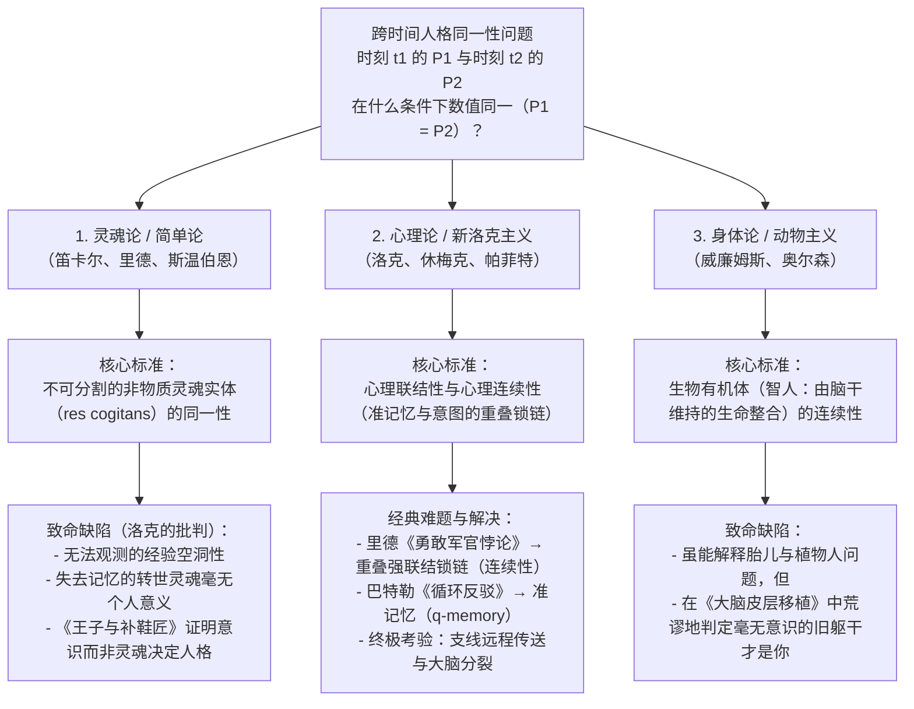
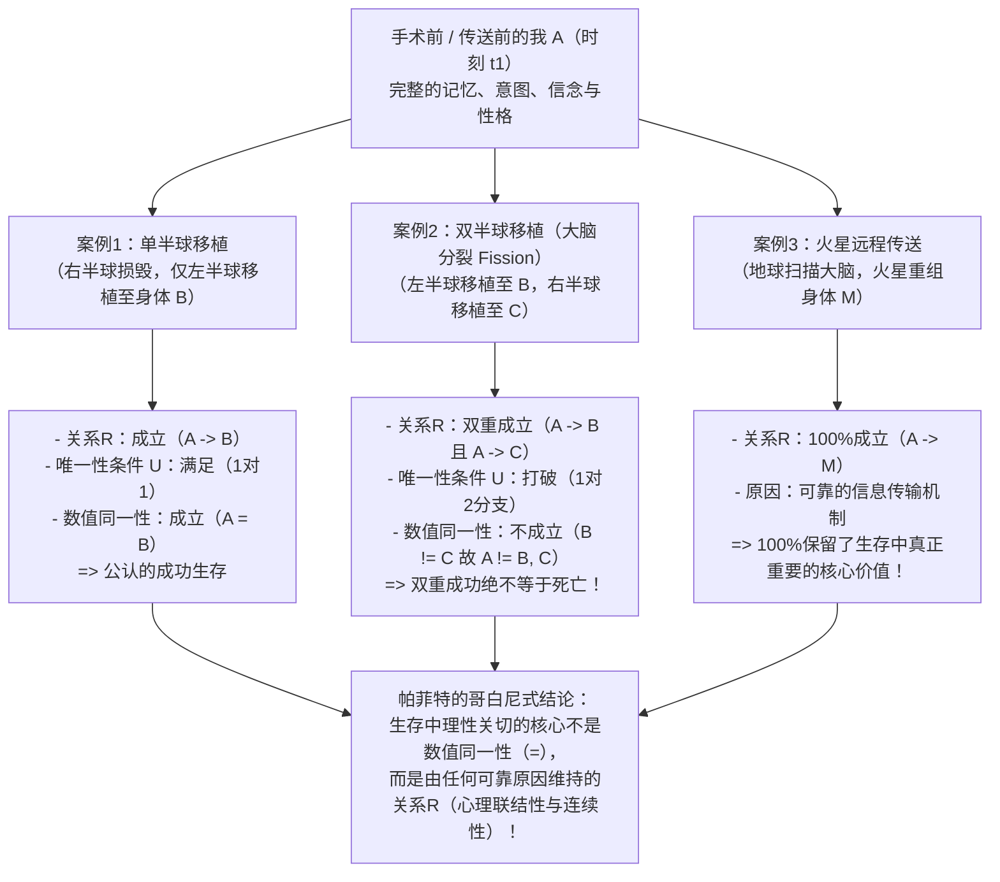

## 1. 引言：火星远程传送器与跨时间人格同一性问题

### 1.1 德里克·帕菲特的远程传送器思想实验

设想在21世纪末的某个清晨，你需要前往火星殖民地出差。为了免去在宇宙飞船中耗时半年的漫长航行，你走进了地球传送站的<strong>远程传送器（Teletransporter）</strong>舱室。当你按下绿色按钮的瞬间，你失去了意识。地球上的<strong>扫描仪（Scanner）</strong>精确记录了你身体与大脑中每一个细胞、分子以及860亿个神经元和100万亿个突触连接的完整原子状态，并在扫描的同时<strong>将你在地球上的大脑和肉体完全气化（摧毁）</strong>。随后，这份完整的数字蓝图以光速通过无线电波发送至火星。三分钟后，火星接收站的<strong>复制器（Replicator）</strong>利用火星本地的碳、氢、氧、氮等有机原子，组装出一具在分子与突触层面上与你完全相同的肉体和大脑。

在火星舱室中醒来的那个人打了个哈欠，清晰地记得几秒钟前自己在地球上按下了绿色按钮，记得今天早餐时答应妻子一到火星就给她打视频电话，甚至在洗漱照镜子时，发现左脸颊上还留着今天早上在地球刮胡子时不小心划出的微小血痕。

此时，形而上学（Metaphysics）与心灵哲学（Philosophy of Mind）中最令人战栗的核心问题浮现了：
<strong>在火星上醒来的这个人，真的是“你”吗？</strong>
远程传送器究竟是人类历史上最快捷的<strong>“交通工具（旅行）”</strong>，还是说当你按下按钮、地球肉体被气化的那一瞬间，<strong>真正的“你”已经彻底死亡</strong>，而在火星上醒来的只是一个继承了你的记忆、误以为自己是你的<strong>“刚出生的精确复制品（冒名顶替者）”</strong>？

---

### 1.2 历时同一性的逻辑形式化：数值同一性与定性同一性

为了严格分析这一困境，当代分析形而上学提出了<strong>人格跨时间持续存在问题（The Persistence Question of Personal Identity over Time / Diachronic Identity）</strong>：

>$$
>\textbf{历时同一性问题：}\quad \text{在什么必要且充分的条件下，处于时刻 } t_1 \text{ 的人格 } P_1 \text{ 与处于时刻 } t_2 \text{ 的人格 } P_2 \text{ 是数值同一的（} P_1 = P_2 \text{）？}
>$$

在这里，我们必须严格区分两种截然不同的“相同”概念：

1. <strong>定性同一性（Qualitative Identity / 完全相似，$x \approx y$）</strong>：
   两个对象 $x$ 与 $y$ 共享所有内在性质（分子结构、外貌、记忆内容、性格特征等），即对于内在性质集合 $\mathcal{F}_{\text{intrinsic}}$，满足：
   $$\forall \Phi \in \mathcal{F}_{\text{intrinsic}} \, \big(\Phi(x) \leftrightarrow \Phi(y)\big)$$
   同一流水线制造的两个台球，或者地球上的你与火星上的复制品，具有极高乃至100%的定性同一性。
2. <strong>数值同一性（Numerical Identity，$x = y$）</strong>：
   $x$ 与 $y$ 不是两个相似的事物，而是字面意义上的<strong>同一个单一实体（One and the very same entity）</strong>，遵循莱布尼茨定律（不可分辨者的同一性，$\forall \Phi(\Phi(x) \leftrightarrow \Phi(y))$）。

人格跨时间存在的奇妙之处在于：5岁时的你（$P_{5}$）与80岁时的你（$P_{80}$）在身高、细胞组成、知识与记忆上<strong>定性截然不同（$P_{5} \not\approx P_{80}$）</strong>，但法律与道德预设他们是<strong>数值同一的（$P_{5} = P_{80}$）</strong>；相反，火星上的复制品（$P_{\text{Mars}}$）与地球上的你（$P_{\text{Earth}}$）<strong>100%定性同一（$P_{\text{Earth}} \approx P_{\text{Mars}}$）</strong>，但这并不自动保证数值同一性（$P_{\text{Earth}} = P_{\text{Mars}}$）。数值同一性之所以至关重要，是因为它支撑着人类实践理性的三大支柱：（1）对自身未来的<strong>特殊利己关切（从内部预期的恐惧与期待）</strong>；（2）跨时间的<strong>道德与法律责任（惩罚与承诺的约束力）</strong>；（3）跨时间的<strong>苦乐补偿（今天吃苦为了明天的幸福）</strong>。

---

## 2. 三大古典理论的交锋：灵魂、记忆与身体

### 2.1 灵魂论（笛卡尔式自我）与约翰·洛克的反驳

柏拉图、笛卡尔（《第一哲学沉思集》，1641）、托马斯·里德以及当代二元论者斯温伯恩（Richard Swinburne）主张<strong>灵魂论（Soul View / Simple View）</strong>：人格的本质是不可分割的<strong>非物质实体（思惟实体 *res cogitans* / 笛卡尔式灵魂）</strong>。由于非物质灵魂没有空间部分，不会像“忒修斯之船”那样发生部分替换或分裂，因此 $P_1 = P_2$ 当且仅当两者拥有同一个灵魂实体（$S_1 = S_2$）。

然而，英国经验论哲学家<strong>约翰·洛克（John Locke）</strong>在1694年《人类理解论（*An Essay Concerning Human Understanding*）》第2版第2卷第27章《论同一性与差异性》中，通过两个著名的思想实验彻底动摇了灵魂论：

* <strong>苏格拉底的转世灵魂</strong>：假设你体内寄宿的非物质灵魂实体 $S$，恰好是古雅典哲学家苏格拉底曾经拥有的同一个灵魂实体 $S$，但苏格拉底的所有记忆与意识已被彻底抹去。既然你对苏格拉底的思想和行为毫无第一人称意识，仅仅共享一个无法观测的“空白灵魂载体”，怎么能使你成为苏格拉底本人（同一个人格）呢？这就像你指甲里的几个碳原子曾经属于凯撒大帝一样，与人格同一性毫无关系。
* <strong>王子与补鞋匠（The Prince and the Cobbler）</strong>：假设一位<strong>王子</strong>的灵魂（携带王子全部的过去记忆、意识与性格）进入了贫穷<strong>补鞋匠</strong>的身体。醒来后，尽管他的躯体在生物学上仍是那个补鞋匠（洛克称之为<strong>“同一个人［生物个体］/ Same Man”</strong>），但作为具有自我意识并承担道德法律责任的主体（<strong>“同一人格 / Same Person”</strong>），所有人都会承认他是<strong>王子</strong>，只对王子的过去行为负责！反之，如果只交换没有记忆的空白灵魂实体，则没有任何具有个人意义的东西发生转移。

---

### 2.2 洛克的记忆标准及其两大经典悖论

洛克由此提出，<strong>“人格（Person）”是一个法庭术语（Forensic Term）</strong>，其跨时间同一性完全取决于<strong>意识与第一人称经验记忆（Memory from the inside）</strong>：

>$$
>\textbf{洛克记忆标准：}\quad t_2 \text{ 时刻的 } P_2 = t_1 \text{ 时刻的 } P_1 \iff P_2 \text{ 能够从内部有意识地记得 } P_1 \text{ 在 } t_1 \text{ 时刻的经验。}
>$$

这一革命性理论随即遭遇了18世纪哲学家提出的两大经典逻辑反驳：

#### 反驳一：托马斯·里德的“勇敢军官悖论（Brave Officer Paradox, 1785）”——传递性危机
苏格兰哲学家<strong>托马斯·里德（Thomas Reid, 1785）</strong>指出，洛克的直接记忆标准违反了<strong>数值同一性的传递性（Transitivity of Identity）</strong>：
* <strong>10岁的顽童（$P_{10}$）</strong>因为偷果园的苹果在学校遭到鞭打；
* <strong>30岁的勇敢军官（$P_{30}$）</strong>在战役中夺取敌军军旗，此时他依然清晰记得10岁时被鞭打的经历（$M(P_{30}, P_{10}) \implies P_{30} = P_{10}$）；
* <strong>80岁的退休老将军（$P_{80}$）</strong>清晰记得30岁时夺取军旗的荣耀（$M(P_{80}, P_{30}) \implies P_{80} = P_{30}$），但因年老遗忘，已完全不记得10岁时偷苹果被鞭打之事（$\neg M(P_{80}, P_{10}) \implies P_{80} \neq P_{10}$）。

由于数值同一性（$=$）是<strong>等价关系（满足自反性、对称性与传递性：$A=B \land B=C \implies A=C$）</strong>，由 $P_{80} = P_{30}$ 和 $P_{30} = P_{10}$ 必然推出 $P_{80} = P_{10}$；但直接记忆关系 $M$ <strong>不具有传递性</strong>，按洛克标准又推出 $P_{80} \neq P_{10}$，从而陷入<strong>$P_{80} = P_{10} \land P_{80} \neq P_{10}$</strong> 的逻辑矛盾！

* <strong>新洛克主义（Neo-Lockeanism）的解决之道</strong>：20世纪哲学家（格赖斯、昆顿、帕菲特）严格区分了<strong>心理联结性（Psychological Connectedness）</strong>与<strong>心理连续性（Psychological Continuity）</strong>。
  * <strong>心理联结性</strong>是两个时刻之间直接保持的特定心理链接（直接记忆、意图与行动的保持、信念与性格的持续），它具有程度之分且<strong>不具传递性</strong>；当相邻两天保持超过日常一半以上的直接链接时，称为<strong>强心理联结（$C_{\text{strong}}$）</strong>。
  * <strong>心理连续性</strong>则是<strong>强心理联结的重叠锁链（Overlapping chains of strong connectedness）</strong>，即强联结关系的<strong>传递闭包（Transitive Closure）</strong>：
    $$\text{Continuity}(P_n, P_1) \iff \exists P_2, \dots, P_{n-1} \text{ s.t. } C_{\text{strong}}(P_1, P_2) \land \dots \land C_{\text{strong}}(P_{n-1}, P_n)$$
    老将军与10岁孩童之间虽然没有直接的记忆联结，但通过每一天重叠的强心理联结锁链保持着完整的心理连续性，彻底消解了里德悖论。

#### 反驳二：约瑟夫·巴特勒的“循环论证反驳（Circularity Objection, 1736）”与休梅克的“准记忆（$q$-memory）”
主教<strong>约瑟夫·巴特勒（Joseph Butler, 1736）</strong>指出，精神病患者可能产生“记得自己在滑铁卢指挥大炮”的幻觉（表象记忆）。我们之所以区分<strong>真实记忆（Genuine Memory）</strong>与<strong>妄想（Delusion）</strong>，是因为在日常语言中，“$Y$ 真实地记得做过某事 $E$”在定义上就已经预设了<strong>“体验 $E$ 的人 $X$ 与回忆者 $Y$ 是同一个人（$X = Y$）”</strong>！因此，用真实记忆来定义人格同一性陷入了恶性循环（*"Consciousness of personal identity presupposes, and therefore cannot constitute, personal identity"*）。

* <strong>悉尼·休梅克（Sydney Shoemaker, 1970）的解决之道——准记忆（Quasi-Memory / $q$-memory）</strong>：
  休梅克定义了完全不预设人格同一性的<strong>准记忆（$q$-记忆）</strong>。我在 $t_2$ 对过去经验 $E$ 拥有准确的准记忆，当且仅当：
  1. 我在 $t_2$ 拥有从第一人称视角（“从内部”）体验过 $E$ 的表象记忆；
  2. 过去在 $t_1$ 确实有<strong>某个人（Someone）</strong>真实体验过 $E$；
  3. 我的表象记忆以<strong>恰当的因果方式（如大脑记忆痕迹的保持或可靠的信息传输）</strong>依赖于那次原始经验 $E$。
  日常记忆只是准记忆中“过去体验者恰好是我自己”的特例。利用准记忆与准意图定义心理连续性（关系R），即可完全避免逻辑循环。

---

### 2.3 身体标准、威廉姆斯的双重视角谜题与动物主义（Animalism）

与心理标准相对立的是强调物理肉体与生物有机体的<strong>身体论（Bodily Criterion）</strong>和<strong>动物主义（Animalism）</strong>。

* <strong>伯纳德·威廉姆斯（Bernard Williams）的《自我与未来》（1970）</strong>：
  威廉姆斯展示了同一物理过程如何因框架描述不同而引发完全相反的直觉：
  * <strong>视角1（交换心灵）</strong>：科学家将把 $A$ 与 $B$ 大脑中的全部记忆和性格互换，随后给其中一具身体10万美元，对另一具身体施以酷刑。事前询问 $A$ 的意愿时，$A$ 会选择让<strong>拥有 $A$ 记忆的 $B$ 身体</strong>获得奖金，让 $A$ 身体受刑（支持心理论）。
  * <strong>视角2（失忆加酷刑）</strong>：科学家单独告诉 $A$：“明天我要对你（$A$ 身体）施以酷刑；在酷刑前，我会先抹去你的全部记忆（失忆），然后再往你脑中植入从 $B$ 复制来的记忆印象。”在失忆与被植入他人记忆的每一步，你依然极度恐惧即将降临在<strong>你自己这具肉体（$A$ 身体）</strong>上的剧痛（支持身体论）！然而视角1和视角2描述的是完全相同的物理操作。
* <strong>埃里克·奥尔森（Eric Olson, 1997）的“动物主义（Animalism）”</strong>：
  奥尔森指出，我们本质上是属于智人（*Homo sapiens*）物种的<strong>生物有机体（Human Animal）</strong>，而非洛克式的心理连续体。如果心理论为真，由于12周大的<strong>胎儿（Fetus）</strong>和<strong>持续性植物状态患者（PVS）</strong>与成年后的你没有任何心理连续性，就会得出“你从未曾是胎儿”以及“一旦变成植物人你就已经死了，病床上呼吸的只是一具与你无关的动物躯壳”的荒谬结论！相反，动物主义认为“人格”只是人类动物在人生某阶段的<strong>阶段分类词（Phase Sortal）</strong>，我们的持续存在条件是由脑干维持的生物体内稳态。
  然而，动物主义在<strong>大脑移植（Cerebrum Transplant）</strong>思想实验中遭遇致命反击：如果将你的大脑皮层（承载全部记忆与意识）移植到另一具无脑干损伤的供体躯体中，而原本的无大脑躯干靠脑干继续维持呼吸，动物主义竟迫使我们承认<strong>“真正的你是病床上毫无意识的植物人躯干，而那个带着你的大脑和记忆回家拥抱妻儿的人是个陌生人”</strong>！

---

## 3. 德里克·帕菲特的哲学革命（《理与人》1984）：支线案例与大脑分裂

在1984年出版的巨著<strong>《理与人（*Reasons and Persons*）》第三部分</strong>中，牛津大学哲学家<strong>德里克·帕菲特（Derek Parfit, 1942–2017）</strong>彻底颠覆了延续两千年的争论前提。帕菲特证明：<strong>在生存（Survival）中真正重要的根本不是“数值同一性（$P_1 = P_2$）”，而是“心理联结性与连续性（关系R：Relation R）”！</strong>

---

### 3.1 支线案例（The Branch-Line Case）与结合光谱（The Combined Spectrum）

* <strong>支线案例（The Branch-Line Case）</strong>：
  假设传送公司升级了“新型扫描仪”，可以在<strong>不摧毁地球肉体</strong>的情况下完成非破坏性扫描并在火星制造复制品。你按下按钮后直接走出地球舱室，并通过视频电话与刚在火星醒来的“火星上的你”交谈。此时毫无疑问，你们站在不同星球上，是<strong>两个数值上截然不同的人（$P_{\text{Earth}} \neq P_{\text{Mars}}$）</strong>。
  然而医生随后告知：新型扫描仪的辐射意外损伤了你在地球上的心脏，<strong>地球上的你将在3天后死于心力衰竭</strong>，而火星上的复制品心脏完全健康，将替你照顾妻儿、完成著作并继续生活几十年。
  请注意这一震撼的对比：在简单远程传送（地球肉体0秒气化）与支线案例（地球肉体3天后死亡）中，<strong>按下按钮前的你与火星上的复制品之间的内在因果与心理关系（关系R）是100%完全相同的！</strong> 唯一区别仅仅是地球上的肉体多跳动了72小时。怎么可能仅仅因为地球肉体多活了三天，火星上的存在就从“成功的旅行（生存）”变成了“彻底的死亡”？！
* <strong>结合光谱（The Combined Spectrum）</strong>：
  设想外科医生按比例 $\alpha \in [0\%, 100\%]$ 用女演员<strong>葛丽泰·嘉宝（Greta Garbo）</strong>的脑细胞与身体细胞复制品逐步替换你的细胞。在 $\alpha = 0\%$ 时结果无疑是<strong>你</strong>；在 $\alpha = 100\%$ 时结果无疑是<strong>嘉宝</strong>。如果非还原论（“更深层事实论 / Further Fact View”）为真，认为同一性必定是全或无（All-or-Nothing）的，那么在光谱中间（如 $49.999\%$ 与 $50.000\%$ 之间）就必须存在一个荒谬的突变点——仅仅多替换一个神经元，你的灵魂就瞬间消失并换成嘉宝的灵魂！帕菲特的<strong>还原论（Reductionism）</strong>指出：在 $\alpha = 50\%$ 的中间地带，当我们知道了细胞替换比例和心理联结程度后，我们就已经知道了全部事实；追问“那个人到底是不是我？”只是一个没有客观答案的<strong>空洞问题（Empty Question）</strong>。

---

### 3.2 威金斯与帕菲特的“大脑分裂论证（Fission / My Division）”

即便有人坚持心理连续性（关系R）必须以<strong>同一个物理大脑的持续存在</strong>为正常原因，帕菲特（发展自 David Wiggins 1967）的<strong>大脑分裂论证（My Division）</strong>依然证明同一性并非生存的关键。

临床神经科学早已证实两个事实：（1）在<strong>大脑半球切除术（Hemispherectomy）</strong>中，人类仅靠单个大脑半球就能作为同一个人存活；（2）斯佩里（Roger Sperry）与加扎尼加（Michael Gazzaniga）的诺贝尔奖<strong>裂脑人（Split-Brain）</strong>研究证明，切断胼胝体后，左右脑半球可以形成两个独立的意识流。

> <strong>【思想实验：我的分裂（My Division）】</strong>
> 假设你（<strong>$A$</strong>）是同卵三胞胎之一，且你的左右大脑半球在功能上完全对称（各保存着你全部的记忆、语言与性格）。在一场车祸中，你的躯体致命受损但大脑完好无损；你的两个三胞胎兄弟则脑死亡但躯体（<strong>身体 $B$</strong> 与 <strong>身体 $C$</strong>）完全健康。
> 外科医生将你的大脑沿胼胝体切开，把<strong>左半球移植到身体 $B$（称为左脑人 Lefty）</strong>，把<strong>右半球移植到身体 $C$（称为右脑人 Righty）</strong>。手术大获成功！苏醒后的 Lefty（$B$）和 Righty（$C$）各自拥有你原本物理大脑的一半，且都与你保持着100%的心理连续性与联结性（关系R）！

现在请问：手术后，<strong>我（$A$）究竟是谁？</strong> 从严格数值同一性（$=$）来看，逻辑上只有四种可能：
1. <strong>$A$ 同时是 $B$ 和 $C$（$A = B \land A = C$）</strong>：违反<strong>同一性的传递性</strong>！因为 $B = A \land A = C \implies B = C$，这意味着 Lefty 和 Righty 是同一个人。但他们出院后可以站在球网两侧互相打网球，甚至决斗！因此 $B \neq C$，选项1不成立。
2. <strong>$A$ 只是 Lefty（$A = B \land A \neq C$）</strong>，或 3. <strong>$A$ 只是 Righty（$A = C \land A \neq B$）</strong>：极端武断，违反对称性与<strong>内在性原则（Only-$x$-and-$y$ Principle）</strong>！因为 $A$ 与 $B$、$A$ 与 $C$ 的物理和心理关系完全对称；如果左半球在手术中意外掉落销毁，所有人都承认你会作为 Righty（$C$）存活（$A = C$）。怎么可能因为隔壁手术室的左半球移植也成功了，Righty 就突然不再是你了呢？
4. <strong>$A$ 既不是 $B$ 也不是 $C$（$A \neq B \land A \neq C$）</strong>：为了维护一比一的数值同一性概念，必须附加<strong>无分支（唯一性）条件 $U$</strong>：
   $$\text{数值同一性 }(A = X) \iff R(A, X) \land U(A, X)$$

<strong>帕菲特的决定性一击</strong>：
如果在分裂中 $A \neq B$ 且 $A \neq C$，你是否应该把双半球移植成功视为你的<strong>“死亡”</strong>？
<strong>绝对荒谬！</strong> 如果只有左半球存活，你活了下来；如果只有右半球存活，你也活了下来；<strong>怎么可能左右两个半球都存活的“双重成功（Double Success）”反而变成了“彻底失败（死亡）”？！</strong> 如果数值同一性才是关键，你在手术前就应该贿赂护士砸碎你的右半球，只为了满足唯一性条件 $U$！这显然是疯子的行为。
因此，<strong>在生存中真正重要的绝不是一比一的“数值同一性（$=$）”，而是可以具有程度、也可以一分为二的“关系R（心理联结性与连续性）”！</strong>

---

## 4. 人格同一性五大理论全景对比表

| 哲学立场 | 代表哲学家 | 同一性 / 生存的核心标准 | 对里德“勇敢军官悖论”的回应 | 大脑皮层移植（旧躯干成植物人） | 大脑半球分裂（Lefty $B$ 与 Righty $C$） | 火星远程传送器 |
| :--- | :--- | :--- | :--- | :--- | :--- | :--- |
| <strong>1. 灵魂论 / 简单论</strong> | 笛卡尔、里德、斯温伯恩 | 不可分割的非物质灵魂实体（$S$） | 只要同一灵魂实体留存即为同一人（与记忆无关） | 无法从经验上得知不可见的灵魂去了哪具身体 | 灵魂不可分割，只能武断进入其一或两者皆非 | 除非灵魂随无线电波移动，否则为<strong>死亡</strong> |
| <strong>2. 古典记忆论</strong> | 约翰·洛克 (1694) | 对过去经验的直接第一人称记忆 $M(P_2, P_1)$ | <strong>失败</strong>：违反同一性的传递性（$P_{80}=P_{30}=P_{10}$ 但 $P_{80}\neq P_{10}$） | 记忆随大脑皮层迁移，故移植受者是我 | 两人皆有记忆，与传递性（$B=C$）直接冲突 | 记忆完整保留，故为<strong>生存</strong>（但面临循环论证反驳） |
| <strong>3. 动物主义（生物论）</strong> | 埃里克·奥尔森 (1997)、斯诺登 | 单一生物有机体（由脑干维持的生命整合）的连续性 | 老将军与孩童是同一生物动物，故同一 | <strong>反直觉结论</strong>：躺在病床上的无意识植物人躯干才是你！ | 原有机体消亡或分裂为两个新有机体 | 地球生物生命终结，火星复制品是新生物，判定为<strong>死亡</strong> |
| <strong>4. 狭义新洛克主义</strong> | 休梅克（早期）、威金斯 | 以<strong>同一物理大脑</strong>为正常原因的无分支心理连续性（$R \land U$） | 通过重叠强联结锁链（连续性）与准记忆完美解决 | 承载心理的大脑器官发生迁移，故受者是我 | 违反唯一性条件 $U$，数值上 $A$ 停止存在 | 物理大脑被毁、非正常因果路径，判定为<strong>死亡</strong> |
| <strong>5. 帕菲特还原论（广义关系R论）</strong> | <strong>德里克·帕菲特</strong> (1984)、大卫·刘易斯 | <strong>生存的关键不是同一性（$=$），而是由任何可靠原因维持的关系R</strong> | 具有心理连续性，但跨70年的直接心理联结性已减弱 | 关系R 100%保留在大脑皮层受者身上，完全生存 | 数值同一性虽失效，但<strong>关系R双重实现，是双重生存！</strong> | 可靠因果机制100%保持关系R，<strong>与普通生存具有完全同等的价值！</strong> |

---

## 5. 走出“玻璃隧道”：束理论、道德伦理与生死观的解放

帕菲特的还原论表明，跨时间的人格就像一个<strong>“国家（Nation）”</strong>或<strong>“俱乐部”</strong>，除了相互关联的一系列身心事件（知觉、记忆、意图）之外，并不存在一个高高在上的笛卡尔式自我。这不仅复兴了18世纪<strong>大卫·休谟（David Hume）</strong>在《人性论》（1739）中提出的<strong>“知觉束理论（Bundle Theory）”</strong>，更与佛教的<strong>“诸法无我（Anattā）”</strong>及《那先比丘经（弥兰陀王问经）》中“火炬传火、战车无实我”的洞见高度契合。

由于<strong>心理联结性（Connectedness）具有程度之分</strong>并随时间推移而减弱，这一理论深刻改变了伦理学：
1. <strong>玛土撒拉案例（Methuselah）与减轻过往罪责</strong>：对于活了900岁、性格与记忆每百年彻底更新的人，800岁的他与20岁时的他之间直接心理联结性为零。随着犯人心理联结性的大幅衰减与彻底悔改，其应受惩罚的道德责任（Desert）也应按比例减轻。
2. <strong>19世纪俄罗斯贵族（约束未来的自我）</strong>：一位20岁的社会主义贵族青年立下契约将未来继承的庄园分给农奴，并嘱咐妻子：“如果中年后变得自私保守的我要求你撤销契约，请务必拒绝，因为一旦我背弃理想，今天与你立约的我就已经不复存在，那个中年人只是我的后继他者（Successor Self）！”
3. <strong>帕菲特的存在主义顿悟</strong>：在《理与人》第13章结尾，帕菲特写下了著名的自白：
   > “当我过去相信我的存在是一个更深层的独立事实时，我的生命就像一条<strong>玻璃隧道（a glass tunnel）</strong>，我每年都在其中越来越快地穿行，而隧道的尽头是一片黑暗。当我改变观念（接受还原论）后，<strong>玻璃隧道的墙壁消失了。我现在生活在开阔的空气（the open air）之中。</strong> 我与他人的界限变小了，他人离我更近了。而我的死亡只是切断了我当前经验与未来经验之间更直接的记忆连接，却不会切断我留给所爱之人的影响与共同的思想联结——看清这一点后，死亡对我而言不再那么可怕。”

因此，当火星舱室中的那个你抚摸着脸颊上的剃须微痕、微笑着拨通地球妻子的电话时，你并没有失去任何在生存中真正重要的东西——承载着你的记忆、爱与理想的“关系R之火”，已经在红色的火星大地上继续燃烧。
