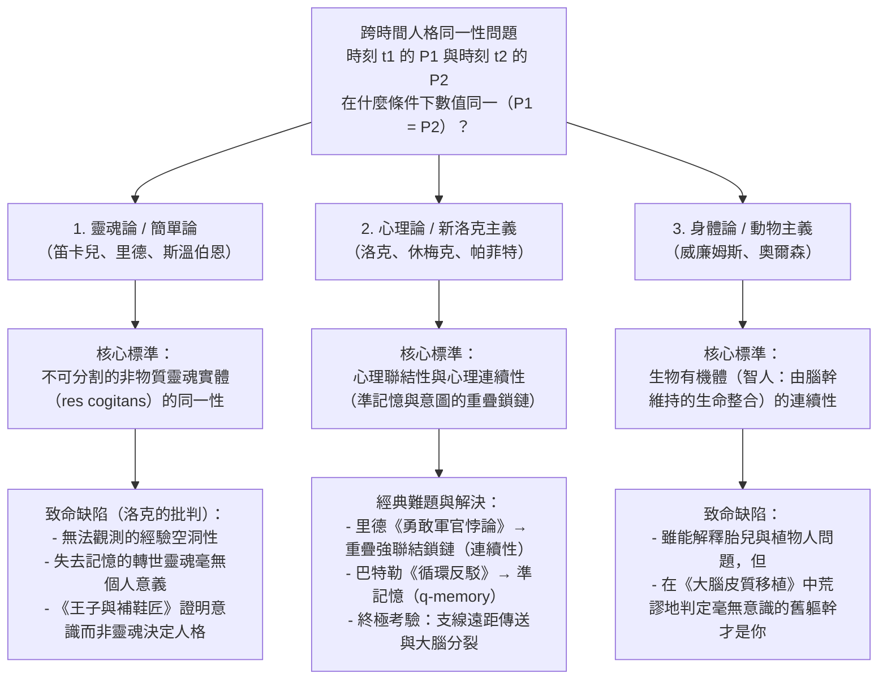
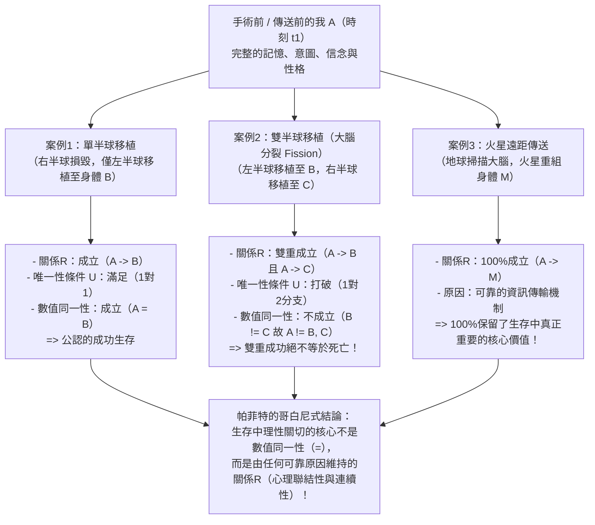

## 1. 引言：火星遠距傳送器與跨時間人格同一性問題

### 1.1 德瑞克·帕菲特的遠距傳送器思想實驗

設想在21世紀末的某個清晨，你需要前往火星殖民地出差。為了免去在太空船中耗時六個月的漫長航行，你走進了地球傳送站的<strong>遠距傳送器（Teletransporter）</strong>艙室。當你按下綠色按鈕的瞬間，你失去了意識。地球上的<strong>掃描儀（Scanner）</strong>精確記錄了你身體與大腦中每一個細胞、分子以及860億個神經元和100兆個突觸連接的完整原子狀態，並在掃描的同時<strong>將你在地球上的大腦和肉體完全氣化（摧毀）</strong>。隨後，這份完整的數位藍圖以光速透過無線電波發送至火星。三分鐘後，火星接收站的<strong>複製器（Replicator）</strong>利用火星本地的碳、氫、氧、氮等有機原子，組裝出一具在分子與突觸層面上與你完全相同的肉體和大腦。

在火星艙室中醒來的那個人打了個哈欠，清晰地記得幾秒鐘前自己在地球上按下了綠色按鈕，記得今天早餐時答應妻子一到火星就給她打視訊電話，甚至在洗漱照鏡子時，發現左臉頰上還留著今天早上在地球刮鬍子時不小心劃出的微小血痕。

此時，形上學（Metaphysics）與心靈哲學（Philosophy of Mind）中最令人戰慄的核心問題浮現了：
<strong>在火星上醒來的這個人，真的是「你」嗎？</strong>
遠距傳送器究竟是人類歷史上最快捷的<strong>「交通工具（旅行）」</strong>，還是說當你按下按鈕、地球肉體被氣化的那一瞬間，<strong>真正的「你」已經徹底死亡</strong>，而在火星上醒來的只是一個繼承了你的記憶、誤以為自己是你的<strong>「剛出生的精確複製品（冒名頂替者）」</strong>？

---

### 1.2 歷時同一性的邏輯形式化：數值同一性與定性同一性

為了嚴格分析這一困境，當代分析形上學提出了<strong>人格跨時間持續存在問題（The Persistence Question of Personal Identity over Time / Diachronic Identity）</strong>：

>$$
>\textbf{歷時同一性問題：}\quad \text{在什麼必要且充分的條件下，處於時刻 } t_1 \text{ 的人格 } P_1 \text{ 與處於時刻 } t_2 \text{ 的人格 } P_2 \text{ 是數值同一的（} P_1 = P_2 \text{）？}
>$$

在這裡，我們必須嚴格區分兩種截然不同的「相同」概念：

1. <strong>定性同一性（Qualitative Identity / 完全相似，$x \approx y$）</strong>：
   兩個對象 $x$ 與 $y$ 共享所有內在性質（分子結構、外貌、記憶內容、性格特徵等），即對於內在性質集合 $\mathcal{F}_{\text{intrinsic}}$，滿足：
   $$\forall \Phi \in \mathcal{F}_{\text{intrinsic}} \, \big(\Phi(x) \leftrightarrow \Phi(y)\big)$$
   同一生產線製造的兩個撞球，或者地球上的你與火星上的複製品，具有極高乃至100%的定性同一性。
2. <strong>數值同一性（Numerical Identity，$x = y$）</strong>：
   $x$ 與 $y$ 不是兩個相似的事物，而是字面意義上的<strong>同一個單一實體（One and the very same entity）</strong>，遵循萊布尼茨定律（不可分辨者的同一性，$\forall \Phi(\Phi(x) \leftrightarrow \Phi(y))$）。

人格跨時間存在的奇妙之處在於：5歲時的你（$P_{5}$）與80歲時的你（$P_{80}$）在身高、細胞組成、知識與記憶上<strong>定性截然不同（$P_{5} \not\approx P_{80}$）</strong>，但法律與道德預設他們是<strong>數值同一的（$P_{5} = P_{80}$）</strong>；相反，火星上的複製品（$P_{\text{Mars}}$）與地球上的你（$P_{\text{Earth}}$）<strong>100%定性同一（$P_{\text{Earth}} \approx P_{\text{Mars}}$）</strong>，但這並不自動保證數值同一性（$P_{\text{Earth}} = P_{\text{Mars}}$）。數值同一性之所以至關重要，是因為它支撐著人類實踐理性的三大支柱：（1）對自身未來的<strong>特殊利己關切（從內部預期的恐懼與期待）</strong>；（2）跨時間的<strong>道德與法律責任（懲罰與承諾的約束力）</strong>；（3）跨時間的<strong>苦樂補償（今天吃苦為了明天的幸福）</strong>。

---

## 2. 三大古典理論的交鋒：靈魂、記憶與身體

### 2.1 靈魂論（笛卡兒式自我）與約翰·洛克的反駁

柏拉圖、笛卡兒（《第一哲學沉思集》，1641）、湯瑪斯·里德以及當代二元論者斯溫伯恩（Richard Swinburne）主張<strong>靈魂論（Soul View / Simple View）</strong>：人格的本質是不可分割的<strong>非物質實體（思惟實體 *res cogitans* / 笛卡兒式靈魂）</strong>。由於非物質靈魂沒有空間部分，不會像「忒修斯之船」那樣發生部分替換或分裂，因此 $P_1 = P_2$ 當且僅當兩者擁有同一個靈魂實體（$S_1 = S_2$）。

然而，英國經驗論哲學家<strong>約翰·洛克（John Locke）</strong>在1694年《人類理解論（*An Essay Concerning Human Understanding*）》第2版第2卷第27章《論同一性與差異性》中，透過兩個著名的思想實驗徹底動搖了靈魂論：

* <strong>蘇格拉底的轉世靈魂</strong>：假設你體內寄宿的非物質靈魂實體 $S$，恰好是古雅典哲學家蘇格拉底曾經擁有的同一個靈魂實體 $S$，但蘇格拉底的所有記憶與意識已被徹底抹去。既然你對蘇格拉底的思想和行為毫無第一人稱意識，僅僅共享一個無法觀測的「空白靈魂載體」，怎麼能使你成為蘇格拉底本人（同一個人格）呢？這就像你指甲裡的幾個碳原子曾經屬於凱撒大帝一樣，與人格同一性毫無關係。
* <strong>王子與補鞋匠（The Prince and the Cobbler）</strong>：假設一位<strong>王子</strong>的靈魂（攜帶王子全部的過去記憶、意識與性格）進入了貧窮<strong>補鞋匠</strong>的身體。醒來後，儘管他的軀體在生物學上仍是那個補鞋匠（洛克稱之為<strong>「同一個人［生物個體］/ Same Man」</strong>），但作為具有自我意識並承擔道德法律責任的主體（<strong>「同一人格 / Same Person」</strong>），所有人都會承認他是<strong>王子</strong>，只對王子的過去行為負責！反之，如果只交換沒有記憶的空白靈魂實體，則沒有任何具有個人意義的東西發生轉移。

---

### 2.2 洛克的記憶標準及其兩大經典悖論

洛克由此提出，<strong>「人格（Person）」是一個法庭術語（Forensic Term）</strong>，其跨時間同一性完全取決於<strong>意識與第一人稱經驗記憶（Memory from the inside）</strong>：

>$$
>\textbf{洛克記憶標準：}\quad t_2 \text{ 時刻的 } P_2 = t_1 \text{ 時刻的 } P_1 \iff P_2 \text{ 能夠從內部有意識地記得 } P_1 \text{ 在 } t_1 \text{ 時刻的經驗。}
>$$

這一革命性理論隨即遭遇了18世紀哲學家提出的兩大經典邏輯反駁：

#### 反駁一：湯瑪斯·里德的「勇敢軍官悖論（Brave Officer Paradox, 1785）」——傳遞性危機
蘇格蘭哲學家<strong>湯瑪斯·里德（Thomas Reid, 1785）</strong>指出，洛克的直接記憶標準違反了<strong>數值同一性的傳遞性（Transitivity of Identity）</strong>：
* <strong>10歲的頑童（$P_{10}$）</strong>因為偷果園的蘋果在學校遭到鞭打；
* <strong>30歲的勇敢軍官（$P_{30}$）</strong>在戰役中奪取敵軍軍旗，此時他依然清晰記得10歲時被鞭打的經歷（$M(P_{30}, P_{10}) \implies P_{30} = P_{10}$）；
* <strong>80歲的退休老將軍（$P_{80}$）</strong>清晰記得30歲時奪取軍旗的榮耀（$M(P_{80}, P_{30}) \implies P_{80} = P_{30}$），但因年老遺忘，已完全不記得10歲時偷蘋果被鞭打之事（$\neg M(P_{80}, P_{10}) \implies P_{80} \neq P_{10}$）。

由於數值同一性（$=$）是<strong>等價關係（滿足自反性、對稱性與傳遞性：$A=B \land B=C \implies A=C$）</strong>，由 $P_{80} = P_{30}$ 和 $P_{30} = P_{10}$ 必然推出 $P_{80} = P_{10}$；但直接記憶關係 $M$ <strong>不具有傳遞性</strong>，按洛克標準又推出 $P_{80} \neq P_{10}$，從而陷入<strong>$P_{80} = P_{10} \land P_{80} \neq P_{10}$</strong> 的邏輯矛盾！

* <strong>新洛克主義（Neo-Lockeanism）的解決之道</strong>：20世紀哲學家（格賴斯、昆頓、帕菲特）嚴格區分了<strong>心理聯結性（Psychological Connectedness）</strong>與<strong>心理連續性（Psychological Continuity）</strong>。
  * <strong>心理聯結性</strong>是兩個時刻之間直接保持的特定心理連結（直接記憶、意圖與行動的保持、信念與性格的持續），它具有程度之分且<strong>不具傳遞性</strong>；當相鄰兩天保持超過日常一半以上的直接連結時，稱為<strong>強心理聯結（$C_{\text{strong}}$）</strong>。
  * <strong>心理連續性</strong>則是<strong>強心理聯結的重疊鎖鏈（Overlapping chains of strong connectedness）</strong>，即強聯結關係的<strong>傳遞閉包（Transitive Closure）</strong>：
    $$\text{Continuity}(P_n, P_1) \iff \exists P_2, \dots, P_{n-1} \text{ s.t. } C_{\text{strong}}(P_1, P_2) \land \dots \land C_{\text{strong}}(P_{n-1}, P_n)$$
    老將軍與10歲孩童之間雖然沒有直接的記憶聯結，但透過每一天重疊的強心理聯結鎖鏈保持著完整的心理連續性，徹底消解了里德悖論。

#### 反駁二：約瑟夫·巴特勒的「循環論證反駁（Circularity Objection, 1736）」與休梅克的「準記憶（$q$-memory）」
主教<strong>約瑟夫·巴特勒（Joseph Butler, 1736）</strong>指出，精神病患者可能產生「記得自己在滑鐵盧指揮大砲」的幻覺（表象記憶）。我們之所以區分<strong>真實記憶（Genuine Memory）</strong>與<strong>妄想（Delusion）</strong>，是因為在日常語言中，「$Y$ 真實地記得做過某事 $E$」在定義上就已經預設了<strong>「體驗 $E$ 的人 $X$ 與回憶者 $Y$ 是同一個人（$X = Y$）」</strong>！因此，用真實記憶來定義人格同一性陷入了惡性循環（*"Consciousness of personal identity presupposes, and therefore cannot constitute, personal identity"*）。

* <strong>悉尼·休梅克（Sydney Shoemaker, 1970）的解決之道——準記憶（Quasi-Memory / $q$-memory）</strong>：
  休梅克定義了完全不預設人格同一性的<strong>準記憶（$q$-記憶）</strong>。我在 $t_2$ 對過去經驗 $E$ 擁有準確的準記憶，當且僅當：
  1. 我在 $t_2$ 擁有從第一人稱視角（「從內部」）體驗過 $E$ 的表象記憶；
  2. 過去在 $t_1$ 確實有<strong>某個人（Someone）</strong>真實體驗過 $E$；
  3. 我的表象記憶以<strong>恰當的因果方式（如大腦記憶痕跡的保持或可靠的資訊傳輸）</strong>依賴於那次原始經驗 $E$。
  日常記憶只是準記憶中「過去體驗者恰好是我自己」的特例。利用準記憶與準意圖定義心理連續性（關係R），即可完全避免邏輯循環。

---

### 2.3 身體標準、威廉姆斯的雙重視角謎題與動物主義（Animalism）

與心理標準相對立的是強調物理肉體與生物有機體的<strong>身體論（Bodily Criterion）</strong>和<strong>動物主義（Animalism）</strong>。

* <strong>伯納德·威廉姆斯（Bernard Williams）的《自我與未來》（1970）</strong>：
  威廉姆斯展示了同一物理過程如何因框架描述不同而引發完全相反的直覺：
  * <strong>視角1（交換心靈）</strong>：科學家將把 $A$ 與 $B$ 大腦中的全部記憶和性格互換，隨後給其中一具身體10萬美元，對另一具身體施以酷刑。事前詢問 $A$ 的意願時，$A$ 會選擇讓<strong>擁有 $A$ 記憶的 $B$ 身體</strong>獲得獎金，讓 $A$ 身體受刑（支持心理論）。
  * <strong>視角2（失憶加酷刑）</strong>：科學家單獨告訴 $A$：「明天我要對你（$A$ 身體）施以酷刑；在酷刑前，我會先抹去你的全部記憶（失憶），然後再往你腦中植入從 $B$ 複製來的記憶印象。」在失憶與被植入他人記憶的每一步，你依然極度恐懼即將降臨在<strong>你自己這具肉體（$A$ 身體）</strong>上的劇痛（支持身體論）！然而視角1和視角2描述的是完全相同的物理操作。
* <strong>埃里克·奧爾森（Eric Olson, 1997）的「動物主義（Animalism）」</strong>：
  奧爾森指出，我們本質上是屬於智人（*Homo sapiens*）物種的<strong>生物有機體（Human Animal）</strong>，而非洛克式的心理連續體。如果心理論為真，由於12週大的<strong>胎兒（Fetus）</strong>和<strong>持續性植物狀態患者（PVS）</strong>與成年後的你沒有任何心理連續性，就會得出「你從未曾是胎兒」以及「一旦變成植物人你就已經死了，病床上呼吸的只是一具與你無關的動物軀殼」的荒謬結論！相反，動物主義認為「人格」只是人類動物在人生某階段的<strong>階段分類詞（Phase Sortal）</strong>，我們的持續存在條件是由腦幹維持的生物體內穩態。
  然而，動物主義在<strong>大腦移植（Cerebrum Transplant）</strong>思想實驗中遭遇致命反擊：如果將你的大腦皮質（承載全部記憶與意識）移植到另一具無腦幹損傷的供體軀體中，而原本的無大腦軀幹靠腦幹繼續維持呼吸，動物主義竟迫使我們承認<strong>「真正的你是病床上毫無意識的植物人軀幹，而那個帶著你的大腦和記憶回家擁抱妻兒的人是個陌生人」</strong>！

---

## 3. 德瑞克·帕菲特的哲學革命（《理與人》1984）：支線案例與大腦分裂

在1984年出版的巨著<strong>《理與人（*Reasons and Persons*）》第三部分</strong>中，牛津大學哲學家<strong>德瑞克·帕菲特（Derek Parfit, 1942–2017）</strong>徹底顛覆了延續兩千年的爭論前提。帕菲特證明：<strong>在生存（Survival）中真正重要的根本不是「數值同一性（$P_1 = P_2$）」，而是「心理聯結性與連續性（關係R：Relation R）」！</strong>

---

### 3.1 支線案例（The Branch-Line Case）與結合光譜（The Combined Spectrum）

* <strong>支線案例（The Branch-Line Case）</strong>：
  假設傳送公司升級了「新型掃描儀」，可以在<strong>不摧毀地球肉體</strong>的情況下完成非破壞性掃描並在火星製造複製品。你按下按鈕後直接走出地球艙室，並透過視訊電話與剛在火星醒來的「火星上的你」交談。此時毫無疑問，你們站在不同星球上，是<strong>兩個數值上截然不同的人（$P_{\text{Earth}} \neq P_{\text{Mars}}$）</strong>。
  然而醫生隨後告知：新型掃描儀的輻射意外損傷了你在地球上的心臟，<strong>地球上的你將在3天後死於心臟衰竭</strong>，而火星上的複製品心臟完全健康，將替你照顧妻兒、完成著作並繼續生活幾十年。
  請注意這一震撼的對比：在簡單遠距傳送（地球肉體0秒氣化）與支線案例（地球肉體3天後死亡）中，<strong>按下按鈕前的你與火星上的複製品之間的內在因果與心理關係（關係R）是100%完全相同的！</strong> 唯一區別僅僅是地球上的肉體多跳動了72小時。怎麼可能僅僅因為地球肉體多活了三天，火星上的存在就從「成功的旅行（生存）」變成了「徹底的死亡」？！
* <strong>結合光譜（The Combined Spectrum）</strong>：
  設想外科醫生按比例 $\alpha \in [0\%, 100\%]$ 用女演員<strong>葛麗泰·嘉寶（Greta Garbo）</strong>的腦細胞與身體細胞複製品逐步替換你的細胞。在 $\alpha = 0\%$ 時結果無疑是<strong>你</strong>；在 $\alpha = 100\%$ 時結果無疑是<strong>嘉寶</strong>。如果非還原論（「更深層事實論 / Further Fact View」）為真，認為同一性必定是全或無（All-or-Nothing）的，那麼在光譜中間（如 $49.999\%$ 與 $50.000\%$ 之間）就必須存在一個荒謬的突變點——僅僅多替換一個神經元，你的靈魂就瞬間消失並換成嘉寶的靈魂！帕菲特的<strong>還原論（Reductionism）</strong>指出：在 $\alpha = 50\%$ 的中間地帶，當我們知道了細胞替換比例和心理聯結程度後，我們就已經知道了全部事實；追問「那個人到底是不是我？」只是一個沒有客觀答案的<strong>空洞問題（Empty Question）</strong>。

---

### 3.2 威金斯與帕菲特的「大腦分裂論證（Fission / My Division）」

即便有人堅持心理連續性（關係R）必須以<strong>同一個物理大腦的持續存在</strong>為正常原因，帕菲特（發展自 David Wiggins 1967）的<strong>大腦分裂論證（My Division）</strong>依然證明同一性並非生存的關鍵。

臨床神經科學早已證實兩個事實：（1）在<strong>大腦半球切除術（Hemispherectomy）</strong>中，人類僅靠單個大腦半球就能作為同一個人存活；（2）斯佩里（Roger Sperry）與加扎尼加（Michael Gazzaniga）的諾貝爾獎<strong>裂腦人（Split-Brain）</strong>研究證明，切斷胼胝體後，左右腦半球可以形成兩個獨立的意識流。

> <strong>【思想實驗：我的分裂（My Division）】</strong>
> 假設你（<strong>$A$</strong>）是同卵三胞胎之一，且你的左右大腦半球在功能上完全對稱（各保存著你全部的記憶、語言與性格）。在一場車禍中，你的軀體致命受損但大腦完好無損；你的兩個三胞胎兄弟則腦死亡但軀體（<strong>身體 $B$</strong> 與 <strong>身體 $C$</strong>）完全健康。
> 外科醫生將你的大腦沿胼胝體切開，把<strong>左半球移植到身體 $B$（稱為左腦人 Lefty）</strong>，把<strong>右半球移植到身體 $C$（稱為右腦人 Righty）</strong>。手術大獲成功！甦醒後的 Lefty（$B$）和 Righty（$C$）各自擁有你原本物理大腦的一半，且都與你保持著100%的心理連續性與聯結性（關係R）！

現在請問：手術後，<strong>我（$A$）究竟是誰？</strong> 從嚴格數值同一性（$=$）來看，邏輯上只有四種可能：
1. <strong>$A$ 同時是 $B$ 和 $C$（$A = B \land A = C$）</strong>：違反<strong>同一性的傳遞性</strong>！因為 $B = A \land A = C \implies B = C$，這意味著 Lefty 和 Righty 是同一個人。但他們出院後可以站在球網兩側互相打網球，甚至決鬥！因此 $B \neq C$，選項1不成立。
2. <strong>$A$ 只是 Lefty（$A = B \land A \neq C$）</strong>，或 3. <strong>$A$ 只是 Righty（$A = C \land A \neq B$）</strong>：極端武斷，違反對稱性與<strong>內在性原則（Only-$x$-and-$y$ Principle）</strong>！因為 $A$ 與 $B$、$A$ 與 $C$ 的物理和心理關係完全對稱；如果左半球在手術中意外掉落銷毀，所有人都承認你會作為 Righty（$C$）存活（$A = C$）。怎麼可能因為隔壁手術室的左半球移植也成功了，Righty 就突然不再是你了呢？
4. <strong>$A$ 既不是 $B$ 也不是 $C$（$A \neq B \land A \neq C$）</strong>：為了維護一比一的數值同一性概念，必須附加<strong>無分支（唯一性）條件 $U$</strong>：
   $$\text{數值同一性 }(A = X) \iff R(A, X) \land U(A, X)$$

<strong>帕菲特的決定性一擊</strong>：
如果在分裂中 $A \neq B$ 且 $A \neq C$，你是否應該把雙半球移植成功視為你的<strong>「死亡」</strong>？
<strong>絕對荒謬！</strong> 如果只有左半球存活，你活了下來；如果只有右半球存活，你也活了下來；<strong>怎麼可能左右兩個半球都存活的「雙重成功（Double Success）」反而變成了「徹底失敗（死亡）」？！</strong> 如果數值同一性才是關鍵，你在手術前就應該賄賂護士砸碎你的右半球，只為了滿足唯一性條件 $U$！這顯然是瘋子的行為。
因此，<strong>在生存中真正重要的絕不是一比一的「數值同一性（$=$）」，而是可以具有程度、也可以一分為二的「關係R（心理聯結性與連續性）」！</strong>

---

## 4. 人格同一性五大理論全景對比表

| 哲學立場 | 代表哲學家 | 同一性 / 生存的核心標準 | 對里德「勇敢軍官悖論」的回應 | 大腦皮質移植（舊軀幹成植物人） | 大腦半球分裂（Lefty $B$ 與 Righty $C$） | 火星遠距傳送器 |
| :--- | :--- | :--- | :--- | :--- | :--- | :--- |
| <strong>1. 靈魂論 / 簡單論</strong> | 笛卡兒、里德、斯溫伯恩 | 不可分割的非物質靈魂實體（$S$） | 只要同一靈魂實體留存即為同一人（與記憶無關） | 無法從經驗上得知不可見的靈魂去了哪具身體 | 靈魂不可分割，只能武斷進入其一或兩者皆非 | 除非靈魂隨無線電波移動，否則為<strong>死亡</strong> |
| <strong>2. 古典記憶論</strong> | 約翰·洛克 (1694) | 對過去經驗的直接第一人稱記憶 $M(P_2, P_1)$ | <strong>失敗</strong>：違反同一性的傳遞性（$P_{80}=P_{30}=P_{10}$ 但 $P_{80}\neq P_{10}$） | 記憶隨大腦皮質遷移，故移植受者是我 | 兩人皆有記憶，與傳遞性（$B=C$）直接衝突 | 記憶完整保留，故為<strong>生存</strong>（但面臨循環論證反駁） |
| <strong>3. 動物主義（生物論）</strong> | 埃里克·奧爾森 (1997)、斯諾登 | 單一生物有機體（由腦幹維持的生命整合）的連續性 | 老將軍與孩童是同一生物動物，故同一 | <strong>反直覺結論</strong>：躺在病床上的無意識植物人軀幹才是你！ | 原有機體消亡或分裂為兩個新有機體 | 地球生物生命終結，火星複製品是新生物，判定為<strong>死亡</strong> |
| <strong>4. 狹義新洛克主義</strong> | 休梅克（早期）、威金斯 | 以<strong>同一物理大腦</strong>為正常原因的無分支心理連續性（$R \land U$） | 透過重疊強聯結鎖鏈（連續性）與準記憶完美解決 | 承載心理的大腦器官發生遷移，故受者是我 | 違反唯一性條件 $U$，數值上 $A$ 停止存在 | 物理大腦被毀、非正常因果路徑，判定為<strong>死亡</strong> |
| <strong>5. 帕菲特還原論（廣義關係R論）</strong> | <strong>德瑞克·帕菲特</strong> (1984)、大衛·劉易斯 | <strong>生存的關鍵不是同一性（$=$），而是由任何可靠原因維持的關係R</strong> | 具有心理連續性，但跨70年的直接心理聯結性已減弱 | 關係R 100%保留在大腦皮質受者身上，完全生存 | 數值同一性雖失效，但<strong>關係R雙重實現，是雙重生存！</strong> | 可靠因果機制100%保持關係R，<strong>與普通生存具有完全同等的價值！</strong> |

---

## 5. 走出「玻璃隧道」：束理論、道德倫理與生死觀的解放

帕菲特的還原論表明，跨時間的人格就像一個<strong>「國家（Nation）」</strong>或<strong>「俱樂部」</strong>，除了相互關聯的一系列身心事件（知覺、記憶、意圖）之外，並不存在一個高高在上的笛卡兒式自我。這不僅復興了18世紀<strong>大衛·休謨（David Hume）</strong>在《人性論》（1739）中提出的<strong>「知覺束理論（Bundle Theory）」</strong>，更與佛教的<strong>「諸法無我（Anattā）」</strong>及《那先比丘經（彌蘭陀王問經）》中「火炬傳火、戰車無實我」的洞見高度契合。

由於<strong>心理聯結性（Connectedness）具有程度之分</strong>並隨時間推移而減弱，這一理論深刻改變了倫理學：
1. <strong>瑪土撒拉案例（Methuselah）與減輕過往罪責</strong>：對於活了900歲、性格與記憶每百年徹底更新的人，800歲的他與20歲時的他之間直接心理聯結性為零。隨著犯人心理聯結性的大幅衰減與徹底悔改，其應受懲罰的道德責任（Desert）也應按比例減輕。
2. <strong>19世紀俄羅斯貴族（約束未來的自我）</strong>：一位20歲的社會主義貴族青年立下契約將未來繼承的莊園分給農奴，並囑咐妻子：「如果中年後變得自私保守的我要求妳撤銷契約，請務必拒絕，因為一旦我背棄理想，今天與妳立約的我就已經不復存在，那個中年人只是我的後繼他者（Successor Self）！」
3. <strong>帕菲特的存在主義頓悟</strong>：在《理與人》第13章結尾，帕菲特寫下了著名的自白：
   > 「當我過去相信我的存在是一個更深層的獨立事實時，我的生命就像一條<strong>玻璃隧道（a glass tunnel）</strong>，我每年都在其中越來越快地穿行，而隧道的盡頭是一片黑暗。當我改變觀念（接受還原論）後，<strong>玻璃隧道的牆壁消失了。我現在生活在開闊的空氣（the open air）之中。</strong> 我與他人的界限變小了，他人離我更近了。而我的死亡只是切斷了我當前經驗與未來經驗之間更直接的記憶連接，卻不會切斷我留給所愛之人的影響與共同的思想聯結——看清這一點後，死亡對我而言不再那麼可怕。」

因此，當火星艙室中的那個你撫摸著臉頰上的剃鬚微痕、微笑著撥通地球妻子的電話時，你並沒有失去任何在生存中真正重要的東西——承載著你的記憶、愛與理想的「關係R之火」，已經在紅色的火星大地上繼續燃燒。
