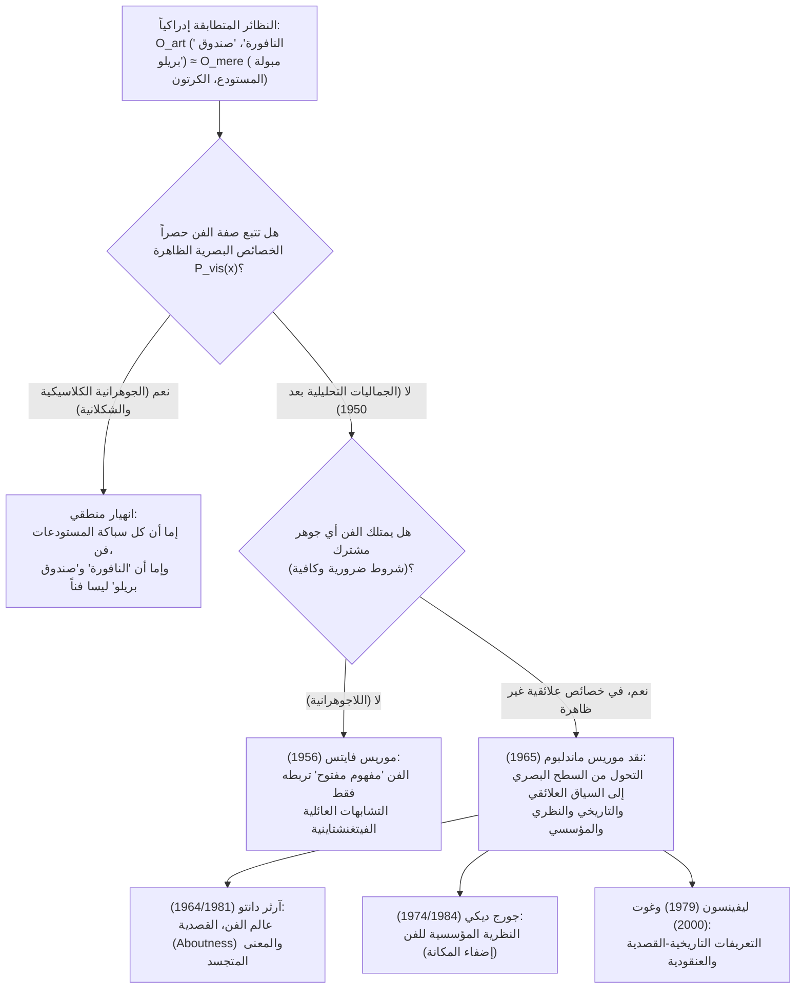
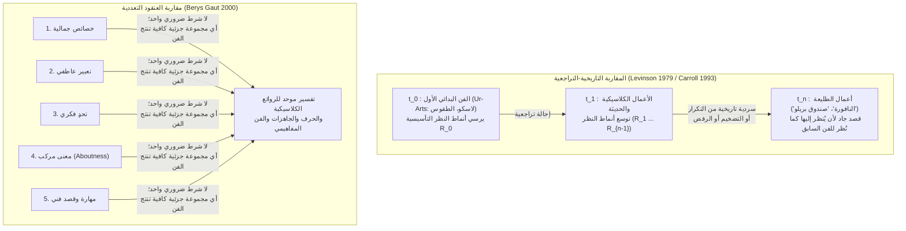

## 1. مقدمة: مبولة البورسلين عام 1917 وصندوق الصابون الخشبي عام 1964

في أبريل 1917، استعدت <strong>جمعية الفنانين المستقلين (Society of Independent Artists)</strong> في نيويورك لافتتاح معرضها الأول تحت شعار ديمقراطي جذري: *«لا لجنة تحكيم، ولا جوائز»*. كان لأي فنان يدفع رسوم اشتراك قدرها ستة دولارات الحق في عرض عملين. وقبل الافتتاح بأيام، وصل صندوق باسم فنان مجهول يُدعى «ريتشارد مات»: كان بداخله مبولة قياسية من البورسلين الأبيض اشتُريت من صالة عرض شركة J.L. Mott للأدوات الصحية، وقد أُديرت بزاوية $90^\circ$، ووُقِّعت بطلاء أسود <strong>«R. Mutt 1917»</strong>، وحملت عنوان <strong>*«النافورة» (Fountain)*</strong>.

كان المدبر الحقيقي وراء «ريتشارد مات» هو الفنان الطليعي الفرنسي <strong>مارسيل دوشامب (1887–1968)</strong>، رئيس لجنة التعليق في المعرض نفسه. منذ عام 1913، دأب دوشامب على تجريب ما أسماه <strong>«الجاهزات» (Readymades)</strong> (*عجلة الدراجة* 1913، *حامل الزجاجات* 1914) للإطاحة بما سماه بازدراء <strong>«الفن الشبكي» (*art rétinien*)</strong> — أي الرسم الذي يقتصر على إمتاع العين الجسدية — وإعادة الفن إلى خدمة الفكر (*cosa mentale*)، مشترطاً اختيار الغرض الجاهز في حالة من <strong>«اللامبالاة الجمالية» (*anesthésie*)</strong> التامة. وحينما رفض مجلس الإدارة عرض *«النافورة»* بحجة أنها «مجرد أداة سباكة عادية»، استقال دوشامب ونشر في مايو 1917 في المجلة الدادائية *The Blind Man* الدفاع الشهير الذي غيّر مسار فلسفة الفن في القرن العشرين:

> *«سواء صنع السيد مات النافورة بيديه أم لا، فذلك لا أهمية له إطلاقاً. لقد <strong>اختارها (CHOSE)</strong>. أخذ غرضاً عادياً من الحياة، ووضعه بحيث اختفت دلالته النفعية تحت العنوان الجديد وزاوية النظر الجديدة — <strong>لقد خلق فكرة جديدة لذلك الغرض</strong>.»*

وبعد قرابة نصف قرن، في أبريل 1964، ملأ <strong>آندي وارهول (1928–1987)</strong> قاعة Stable Gallery في مانهاتن بأكوام من <strong>*«صناديق بريلو» (Brillo Boxes)*</strong> — وهي صناديق من الخشب الرقائقي مطبوعة بالشاشة الحريرية بحيث تبدو مطابقة بصرياً لصناديق الكرتون التجارية للييف الصابون Brillo المكدسة في المتاجر الكبرى. وعند زيارة المعرض، أدرك فيلسوف جامعة كولومبيا <strong>آرثر دانتو (1924–2013)</strong> أن دوشامب ووارهول قد طرحا <strong>مشكلة النظائر التي لا يمكن التمييز بينها إدراكياً (Perceptually Indiscernible Counterparts)</strong>:

* لماذا تُعَد المبولة رقم 100 (*«النافورة»*) تحفة فنية بينما تظل المائة إلا واحدة المتبقية في المستودع «مجرد أشياء حقيقية» (*mere real things*)؟
* لماذا يُعَد *«صندوق بريلو»* لوارهول عملاً نحتياً بينما لا يُعَد كرتون بريلو التجاري الذي صممه جيمس هارفي فناً؟

---

## 2. انهيار الجوهرانية الجمالية الكلاسيكية: المحاكاة، التعبير، والشكل الدال

منذ أفلاطون حتى منتصف القرن العشرين، فُهِم مشروع تعريف الفن بوصفه بحثاً عن <strong>شروط ضرورية وكافية</strong>:

$$\forall x \Big( \text{Art}(x) \iff C_1(x) \land C_2(x) \land \dots \land C_n(x) \Big)$$

غير أن النماذج الكلاسيكية الثلاثة الكبرى تنهار أمام الأعمال الجاهزة والنظائر المتطابقة بصرياً:

1. <strong>المحاكاة / نظرية التقليد (Mimesis — أفلاطون *الجمهورية* الكتاب العاشر، أرسطو *فن الشعر*)</strong>: الفن بوصفه محاكاة للطبيعة. دحضتها الموسيقى المطلقة، والفن التجريدي (كاندينسكي، موندريان)، و*«نافورة»* دوشامب التي لا تصور مبولة بل *هي* مبولة بالفعل — في حين أن عشرات الآلاف من صناديق بريلو الخارجة من خط الإنتاج تنسخ النموذج الأصلي دون أن تكون فناً.
2. <strong>نظرية التعبير (Expression Theory — ليو تولستوي *ما الفن؟*، كولينغوود *مبادئ الفن*)</strong>: الفن بوصفه توضيحاً ونقلاً لانفعال الفنان الذاتي. دحضتها «اللامبالاة الجمالية» لدى دوشامب، والطباعة الآلية لدى وارهول (*«أريد أن أكون آلة»*)، وموسيقى المصادفة لدى جون كيج (*4'33"*).
3. <strong>الشكلانية (Formalism — كلايف بيل *Art* 1914، روجر فراي، مونرو بيردزلي)</strong>: تعريف الفن بـ <strong>«الشكل الدال» (Significant Form)</strong> المثير للانفعال الجمالي. غير أن <strong>حجة التطابق الإدراكي</strong> تدحض هذه الأطروحة صورياً:

ليكن $O_{\text{art}}$ هو *«نافورة»* دوشامب (أو *«صندوق بريلو»* لوارهول) وليكن $O_{\text{mere}}$ نظيره العادي في المستودع. ولتكن $P_{\text{vis}}(x)$ مجموعة الخصائص البصرية والشكلية الظاهرة للغرض $x$. بحكم الفرض:

$$P_{\text{vis}}(O_{\text{art}}) = P_{\text{vis}}(O_{\text{mere}}) \quad \Big( O_{\text{art}} \approx_{\text{percept}} O_{\text{mere}} \Big)$$

ومع ذلك، فإن وضعهما الأنطولوجي بالنسبة إلى الفن متناقض تماماً:

$$\text{Art}(O_{\text{art}}) \land \neg\text{Art}(O_{\text{mere}})$$

فلو كانت صفة الفن تابعة حصراً للخصائص البصرية الظاهرة $P_{\text{vis}}(x)$، فإما أن تكون جميع المباول في مستودعات السباكة أعمالاً فنية بالفعل، وإما ألا تكون *«النافورة»* و*«صندوق بريلو»* فناً. وعليه، <strong>فإن الحد الأنطولوجي الفاصل بين الفن واللافن لا يمكن أن يكمن في أي خاصية إدراكية ظاهرة للغرض ذاته</strong>.

| النموذج الكلاسيكي | أبرز الفلاسفة | الأطروحة المركزية (الجوهر المقترح) | كيف تدحضه الجاهزات والنظائر المتطابقة إدراكياً |
| :--- | :--- | :--- | :--- |
| <strong>المحاكاة (Mimesis)</strong> | أفلاطون، أرسطو، فازاري | الفن هو محاكاة أو تمثيل للطبيعة والفعل الإنساني | التجريد لا يحاكي شيئاً؛ *النافورة* تقدم الشيء ذاته؛ نسخ المصانع ليست فناً |
| <strong>نظرية التعبير</strong> | تولستوي، كولينغوود | الفن هو التوضيح التخيلي ونقل المشاعر الداخلية للفنان | «اللامبالاة الجمالية» لدوشامب وآلية وارهول ومصادفات كيج تقصي العاطفة |
| <strong>الشكلانية (Formalism)</strong> | كلايف بيل، روجر فراي، بيردزلي | يُعرَّف الفن بـ «الشكل الدال» الذي يثير التجربة الجمالية | أمام غرضين متطابقين بصرياً ($O_{\text{art}} \approx_{\text{percept}} O_{\text{mere}}$)، يعجز الشكل البصري عن التمييز |

---

## 3. اللاجوهرانية الفيتغنشتاينية لدى موريس فايتس والتحول العلائقي لدى ماندلبوم

### 3.1 «التشابهات العائلية» عند فيتغنشتاين و«المفهوم المفتوح»

في ورقته الشهيرة *«دور النظرية في علم الجمال»* (1956)، طبّق <strong>موريس فايتس (1916–1981)</strong> تحليل كلمة «لعبة» (*Spiel*) الذي قدمه <strong>لودفيغ فيتغنشتاين</strong> في *تحقيقات فلسفية* (1953، §§65–75) على مفهوم الفن. فبين ألعاب الألواح، والورق، والكرة، والألعاب الأولمبية لا يوجد قاسم مشترك واحد، بل *«شبكة معقدة من التشابهات المتداخلة والمتقاطعة»* — أي <strong>«تشابهات عائلية» (*Familienähnlichkeiten*)</strong>. ولأن الإبداع التوسعي وكسر القواعد جزء من منطق الممارسة الفنية ذاته، فإن «الفن» عند فايتس هو <strong>«مفهوم مفتوح» (Open Concept)</strong> لا يمكن إغلاقه بشروط ضرورية وكافية دون خنق الإبداع.

### 3.2 النقد الحاسم لموريس ماندلبوم (1965): الخصائص العلائقية غير المعروضة

في عام 1965، كشف <strong>موريس ماندلبوم</strong> المفارقة الكامنة في استعارة فيتغنشتاين: ما الذي يجعل الملامح المتشابهة في ست صور شخصية تشابهات *عائلية* بدلاً من تشابه عابر بين غرباء؟ إنه اشتراكهم في <strong>خاصية علائقية وراثية غير ظاهرة (سلف بيولوجي مشترك)</strong> لا تُرى على سطح الصور نفسه! وعلاوة على ذلك، لو كان التشابه البصري كافياً، لكانت أكثر الأشياء شبهاً بـ *«النافورة»* هي ملايين المباول العادية في المستودعات. وهكذا أثبت ماندلبوم أن <strong>فشل الجوهرانية البصرية يبرهن أن جوهر الفن يكمن في خصائص علائقية غير ظاهرة (القصد، التاريخ، المؤسسة)</strong>.

---

## 4. «عالم الفن» (1964) و*«تجلّي المألوف»* (1981) لآرثر دانتو

في مقاله الصادر في أكتوبر 1964 بعنوان *«عالم الفن» (The Artworld)*، صاغ <strong>آرثر دانتو</strong> أشهر عبارة في علم الجمال الحديث:

> <strong>«إن رؤية شيء ما بوصفه فناً تتطلب شيئاً لا تستطيع العين أن تبصره — جواً من النظرية الفنية، ومعرفة بتاريخ الفن: أي عالم فن (*an artworld*).»</strong>

### 4.1 التجربة الفكرية: صالة المربعات الحمراء المتطابقة

في رائعته الصادرة عام 1981 <strong>*«تجلّي المألوف» (The Transfiguration of the Commonplace)*</strong>، يتخيل دانتو صالة عرض تضم تسع لوحات مستطيلة مطلية جميعها بالأحمر الكادميوم ومستحيلة التمييز فيزيائياً:

1. <strong>*عبور بني إسرائيل البحر الأحمر*</strong> (لوحة تاريخية حيث غرق جيش فرعون للتو)
2. <strong>*مزاج كيركغور*</strong> (بورتريه سيكولوجي تعبيري)
3. <strong>*الساحة الحمراء*</strong> (منظر هندسي لساحة موسكو)
4. <strong>*نيرفانا*</strong> (لوحة ميتافيزيقية بوذية)
5. <strong>*مفرش المائدة الأحمر*</strong> (طبيعة صامتة وحشية لأحد تلاميذ ماتيس)
6. <strong>*بدون عنوان*</strong> (لوحة أحادية اللون تقليلية تؤكد تسطح اللوحة)
7. <strong>قماشة جورجوني المجهَّزة</strong> (لوحة من القرن السادس عشر طلى عليها المعلم البندقي طبقة تأسيس من الرصاص الأحمر قبل وفاته بالطاعون — <strong>وهي ليست عملاً فنياً</strong>)
8. <strong>مجرد سطح مطلي بالأحمر</strong> (طلاه دهّان يختبر أسطوانة الطلاء — <strong>«مجرد شيء حقيقي»</strong>)
9. <strong>*بدون عنوان («عن لا شيء»)* للفنان المفاهيمي J</strong> (عُرضت ببيان سجالي يعلن أنها «لا تدور حول أي شيء إطلاقاً»)

### 4.2 شرطا دانتو الضروريان: القصدية (*Aboutness*) والمعنى المتجسد (*Embodied Meaning*)

للتمييز بين الأعمال الفنية (1–6 و9) والأشياء العادية (7 و8)، يضع دانتو شرطين ضروريين:

1. <strong>القصدية الدلالية (*Aboutness* / «الكون-حول-شيء»)</strong>: كل عمل فني يدور *حول* شيء ما (حتى اللوحة 9 للفنان J تدور ميتا-فنياً *حول* التضاد بين الفن والمادية الفارغة، تماماً كالرقم $0$ في الرياضيات). أما كرتون بريلو في المتجر فلا يدور حول أي شيء.
2. <strong>المعنى المتجسد (Embodied Meaning)</strong>: بخلاف المقال الصحفي، لا يكتفي العمل الفني بذكر معناه، بل <strong>يجسّد</strong> معناه في حامله المادي كاستعارة بصرية أو قياس إضماري بلاغي (enthymeme).

---

## 5. النظرية المؤسسية للفن عند جورج ديكي (1974/1984) ومعضلة وولهايم

قدم الفيلسوف <strong>جورج ديكي (1926–2020)</strong> في كتابه *Art and the Aesthetic* (1974) قراءة سوسيولوجية وإنجازية لعالم الفن:

> <strong>[التعريف المؤسسي للفن عند ديكي (1974)]</strong>
> العمل الفني بالمعنى التصنيفي هو (1) <strong>مصنوع بشري (artifact)</strong>، (2) <strong>أُضفيت على مجموعة من جوانبه مكانة «مرشح للتذوق والتقدير» (candidate for appreciation) من قِبل شخص أو أشخاص يتصرفون بالنيابة عن مؤسسة اجتماعية معينة (عالم الفن)</strong> — وغالباً ما يكون الفنان نفسه.

### 5.1 معضلة ريتشارد وولهايم (1980): مشكلة *«أوثيفرون»* في الجماليات

في عام 1980، واجه <strong>ريتشارد وولهايم (1923–2003)</strong> نظرية ديكي بمعضلة قاتلة مستلهمة من محاورة *أوثيفرون* لأفلاطون:

> عندما يضفي ممثلو عالم الفن مكانة الفن على غرض $x$، فهل يفعلون ذلك <strong>لأسباب فنية وجيهة $R$</strong>، أم <strong>بصورة اعتباطية محضة بلا أسباب</strong>؟

- <strong>القرن الأول (لأسباب وجيهة)</strong>: إذا كانت هناك حاجة لأسباب جوهرية $R$ (مثل المعنى المتجسد عند دانتو)، فإن تلك الخصائص $R$ هي التي تجعل $x$ عملاً فنياً، وما دور المؤسسة إلا تصديق لاحق.
- <strong>القرن الثاني (إضفاء اعتباطي)</strong>: إذا لم تكن هناك حاجة لأي سبب، ينحدر الفن إلى لعبة بيروقراطية فارغة تعجز عن تفسير سبب تقدير البشرية العميق للفن.

فضلاً عن ذلك، تعجز النظرية المؤسسية عن تفسير <strong>فن المنعزلين (Outsider Art)</strong> (مثل ملحمة هنري دارجر السرية) و<strong>الفن البدائي الأول (*Ur-Art*)</strong> في كهوف لاسكو وشوفيه قبل 30 ألف عام من ظهور أي مؤسسة متحفية.

---

## 6. القصدية التاريخية ونظرية العنقود (Cluster Account)

لتجاوز هذه المآزق، برزت مقاربتان معاصرتان:

1. <strong>التعريف التاريخي-القصدي لجيرولد ليفينسون (1979)</strong>: يكون الغرض $x$ عملاً فنياً في الزمن $t$ إذا وفقط إذا كان مالكه الشرعي <strong>يقصد بجدية أن يُنظَر إلى $x$ (regarded) بإحدى الطرق التي نُظِر بها على نحو صحيح إلى الأعمال الفنية السابقة على $t$</strong>. وعبر الإحالة التراجعية حتى الفن البدائي الأول ($t_0$)، يشمل هذا التعريف الناسك المنعزل والطليعة الفنية معاً.
2. <strong>حساب العنقود (Cluster Account) لبيريس غوت (2000)</strong>: توجد حزمة من نحو عشر خصائص ذات صلة (الخصائص الجمالية، التعبير العاطفي، التحدي الفكري، المعنى المركب، المهارة والقصد الفني): <strong>لا توجد خاصية واحدة ضرورية بمفردها، لكن أي مجموعة جزئية كافية منها تجعل الغرض عملاً فنياً</strong>.

