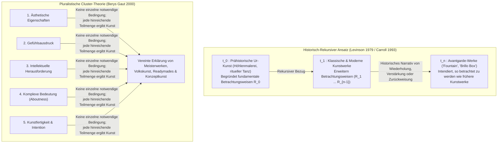

## 1. Einleitung: Das Porzellanurinal von 1917 und der Sperrholzkarton von 1964

Im April 1917 bereitete die neu gegründete <strong>Society of Independent Artists</strong> ihre erste Ausstellung in New York vor. Ihr Motto lautete radikal demokratisch: *„Keine Jury, keine Preise.“* Jeder Künstler, der sechs Dollar Mitgliedsgebühr zahlte, durfte zwei Werke ausstellen. Kurz vor der Eröffnung ging unter dem Pseudonym „Richard Mutt“ ein Paket ein: Es enthielt ein handelsübliches, weiß glasiertes Porzellanurinal der Firma J.L. Mott Iron Works, um $90^\circ$ gedreht, mit schwarzer Farbe signiert mit <strong>„R. Mutt 1917“</strong> und betitelt als <strong>*Fountain*</strong>.

Hinter „R. Mutt“ stand der französische Avantgardist <strong>Marcel Duchamp (1887–1968)</strong>, der selbst Vorsitzender des Hängekomitees war. Seit 1913 experimentierte Duchamp mit sogenannten <strong>„Readymades“</strong> (*Fahrrad-Rad* 1913, *Flaschentrockner* 1914). Er wollte die bloß das physische Auge bedienende <strong>„retinale Kunst“ (*art rétinien*)</strong> überwinden und die Kunst wieder in den Dienst des Intellekts (*cosa mentale*) stellen, wobei die Auswahl in einem Zustand völliger <strong>„ästhetischer Indifferenz“ (*anesthésie*)</strong> erfolgen musste. Als der Vorstand *Fountain* als „bloßes Sanitärprodukt“ von der Ausstellung ausschloss, trat Duchamp zurück und veröffentlichte im Mai 1917 in der Dada-Zeitschrift *The Blind Man* jene berühmte Verteidigung, die die Ästhetik des 20. Jahrhunderts revolutionierte:

> *„Ob Mr. Mutt die Fontäne mit eigenen Händen gemacht hat oder nicht, ist ohne jede Bedeutung. Er hat sie <strong>GEWÄHLT (CHOSE)</strong>. Er nahm einen gewöhnlichen Gebrauchsgegenstand, platzierte ihn so, dass seine nützliche Bedeutung unter dem neuen Titel und Blickwinkel verschwand – <strong>er schuf einen neuen Gedanken für dieses Objekt</strong>.“*

Fast ein halbes Jahrhundert später, im April 1964, füllte <strong>Andy Warhol (1928–1987)</strong> die New Yorker Stable Gallery vom Boden bis zur Decke mit <strong>*Brillo Boxes*</strong> – handgefertigten, im Siebdruckverfahren bedruckten Sperrholzkisten, die den gewöhnlichen Pappkartons für Brillo-Seifenpads im Supermarktlager optisch bis aufs Haar glichen. Der Philosoph <strong>Arthur C. Danto (1924–2013)</strong> erkannte beim Besuch der Galerie, dass Duchamp und Warhol das <strong>Problem wahrnehmungsmäßig ununterscheidbarer Gegenstücke (Perceptually Indiscernible Counterparts)</strong> aufgeworfen hatten:

* Warum ist das 100. Urinal (*Fountain*) ein Meisterwerk der Kunst, während die 99 identischen Urinale im Klempnerlager „bloße reale Dinge“ (*mere real things*) bleiben?
* Warum ist Warhols *Brillo Box* Skulptur, während der optisch ununterscheidbare Brillo-Karton im Supermarkt bloßes Verpackungsmaterial ist?

---

## 2. Der Zusammenbruch des klassischen Essentialismus: Mimesis, Ausdruck und Signifikante Form

Von Platon bis ins 20. Jahrhundert suchte die Philosophie nach <strong>notwendigen und hinreichenden Bedingungen</strong> für das Wesen der Kunst:

$$\forall x \Big( \text{Art}(x) \iff C_1(x) \land C_2(x) \land \dots \land C_n(x) \Big)$$

Doch alle drei klassischen Paradigmen scheitern an Readymades und ununterscheidbaren Gegenstücken:

1. <strong>Mimesis / Nachahmungstheorie (Platon *Politeia* X, Aristoteles *Poetik*)</strong>: Kunst als Nachahmung der Natur. Widerlegt durch absolute Musik, abstrakte Malerei (Kandinsky, Mondrian) und Duchamps *Fountain*, das kein Urinal abbildet, sondern schlicht eines *ist* – während tausende identische Brillo-Kartons vom Fließband trotz perfekter Kopie des Prototyps keine Kunstwerke sind.
2. <strong>Ausdruckstheorie (Leo Tolstoi *Was ist Kunst?*, R.G. Collingwood *The Principles of Art*)</strong>: Kunst als Klärung und Übertragung subjektiver Emotionen. Widerlegt durch Duchamps „ästhetische Indifferenz“, Warhols mechanische Siebdruck-Factory (*„Ich will eine Maschine sein“*) und John Cages Zufallskompositionen (*4'33"*).
3. <strong>Formalismus (Clive Bell *Art* 1914, Roger Fry, Monroe Beardsley)</strong>: Kunst definiert durch <strong>„Signifikante Form“ (Significant Form)</strong>, die ästhetische Emotionen weckt. Das <strong>Argument der Wahrnehmungsununterscheidbarkeit</strong> widerlegt den Formalismus zwingend:

Sei $O_{\text{art}}$ Duchamps *Fountain* (oder Warhols *Brillo Box*) und $O_{\text{mere}}$ das gewöhnliche Gegenstück im Lagerhaus. Sei $P_{\text{vis}}(x)$ die Menge aller manifesten visuellen und formalen Eigenschaften von $x$. Nach Voraussetzung gilt:

$$P_{\text{vis}}(O_{\text{art}}) = P_{\text{vis}}(O_{\text{mere}}) \quad \Big( O_{\text{art}} \approx_{\text{percept}} O_{\text{mere}} \Big)$$

Dennoch gilt für ihren ontologischen Kunststatus:

$$\text{Art}(O_{\text{art}}) \land \neg\text{Art}(O_{\text{mere}})$$

Supervenierte der Kunststatus allein auf manifesten formalen Eigenschaften $P_{\text{vis}}(x)$, müssten entweder alle Urinale in öffentlichen Toiletten weltweit Kunstwerke sein oder *Fountain* und *Brillo Box* wären keine Kunst. Folglich <strong>kann die ontologische Grenze zwischen Kunst und Nicht-Kunst in keiner sichtbaren Eigenschaft des Objekts selbst liegen</strong>.

| Klassisches Paradigma | Hauptvertreter | Kernthese (Vorgeschlagenes Wesen) | Widerlegung durch Readymades & Ununterscheidbare |
| :--- | :--- | :--- | :--- |
| <strong>Mimesis (Nachahmung)</strong> | Platon, Aristoteles, Vasari | Kunst ist Nachahmung oder Repräsentation der Natur und menschlichen Handelns | Abstrakte Kunst ahmt nichts nach; *Fountain* präsentiert ein reales Objekt; Fabrikkopien sind keine Kunst |
| <strong>Ausdruckstheorie</strong> | Tolstoi, Collingwood | Kunst ist die imaginative Klärung und Übertragung innerer Emotionen des Künstlers | Duchamps „ästhetische Indifferenz“, Warhols Mechanik und Cages Zufallsmusik schließen Emotionen aus |
| <strong>Formalismus</strong> | Clive Bell, Roger Fry, Beardsley | Kunst ist durch „Signifikante Form“ bestimmt, die ästhetische Erfahrung auslöst | Bei wahrnehmungsmäßig identischen Objekten ($O_{\text{art}} \approx_{\text{percept}} O_{\text{mere}}$) kann die sichtbare Form nicht unterscheiden |

---

## 3. Morris Weitz’ Anti-Essentialismus und Maurice Mandelbaums relationale Wende

### 3.1 Wittgensteins „Familienähnlichkeiten“ und der „Offene Begriff“

In seinem berühmten Aufsatz *„The Role of Theory in Aesthetics“* (1956) übertrug <strong>Morris Weitz (1916–1981)</strong> <strong>Ludwig Wittgensteins</strong> Analyse des Begriffs „Spiel“ (*Philosophische Untersuchungen*, 1953, §§65–75) auf die Kunst. Zwischen Brettspielen, Kartenspielen, Ballspielen und Olympischen Spielen gibt es kein gemeinsames Merkmal, sondern nur *„ein kompliziertes Netz von Ähnlichkeiten, die einander übergreifen und kreuzen“* – <strong>„Familienähnlichkeiten“</strong>. Da radikale Kreativität und Regelbruch zur Logik der Kunst gehören, ist „Kunst“ laut Weitz ein <strong>„offener Begriff“ (Open Concept)</strong>, dessen Anwendungsbedingungen niemals durch notwendige und hinreichende Bedingungen abgeschlossen werden dürfen.

### 3.2 Maurice Mandelbaums Kritik (1965): Nicht-manifeste relationale Eigenschaften

1965 deckte <strong>Maurice Mandelbaum</strong> die Schwäche dieser Metapher auf: Was macht die optischen Ähnlichkeiten auf sechs Porträtfotos zu *Familien*ähnlichkeiten statt zu zufälligen Doppelgängern? Eine <strong>nicht-manifeste, genetisch-relationale Eigenschaft (gemeinsame biologische Abstammung)</strong>, die auf der Fotooberfläche selbst unsichtbar ist! Zudem hätten nach bloßer visueller Familienähnlichkeit Millionen gewöhnlicher Fabrikurinale die größte Ähnlichkeit mit Duchamps *Fountain*. Mandelbaum bewies damit: <strong>Das Scheitern des visuellen Essentialismus beweist nicht den Anti-Essentialismus, sondern zeigt, dass das Wesen der Kunst in nicht-ausgestellten relationalen Eigenschaften (Intention, Geschichte, Institution) liegt.</strong>

---

## 4. Arthur C. Dantos „The Artworld“ (1964) und *Die Verklärung des Gewöhnlichen* (1981)

In seinem Essay *„The Artworld“* (1964) formulierte <strong>Arthur C. Danto</strong> den Schlüsselsatz der modernen Kunstphilosophie:

> <strong>„Etwas als Kunst zu sehen, erfordert etwas, was das Auge nicht erspähen kann – eine Atmosphäre künstlerischer Theorie, eine Kenntnis der Geschichte der Kunst: eine Kunstwelt (an artworld).“</strong>

### 4.1 Das Gedankenexperiment: Die Galerie ununterscheidbarer roter Quadrate

In seinem Hauptwerk <strong>*Die Verklärung des Gewöhnlichen* (*The Transfiguration of the Commonplace*, 1981)</strong> entwarf Danto eine Galerie mit neun mikroskopisch identischen, einfarbig kadmiumroten Leinwänden:

1. <strong>*Der Zug der Israeliten durch das Rote Meer*</strong> (Historienbild: die Ägypter sind gerade ertrunken)
2. <strong>*Kierkegaards Stimmung*</strong> (psychologisches Porträt)
3. <strong>*Roter Platz*</strong> (Moskauer Landschaftsbild)
4. <strong>*Nirvana*</strong> (metaphysisches buddhistisches Gemälde)
5. <strong>*Rotes Tischtuch*</strong> (fauvistisches Stillleben)
6. <strong>*Ohne Titel*</strong> (minimalistisches Monochrom)
7. <strong>Giorgiones grundierte Leinwand</strong> (16. Jh., auf die Giorgione nur eine rote Bleimennige-Grundierung auftrug, bevor er starb – <strong>kein Kunstwerk</strong>)
8. <strong>Eine bloß rot gestrichene Fläche</strong> (von einem Anstreicher bemalt – ein <strong>„bloßes reales Ding“</strong>)
9. <strong>J’s *Ohne Titel („Über Nichts“)*</strong> (ein Konzeptkunstwerk des Künstlers J, das polemisch „über gar nichts“ handelt)

### 4.2 Dantos zwei notwendige Bedingungen: *Aboutness* und *Verkörperte Bedeutung*

Was unterscheidet die echten Kunstwerke (1–6 und 9) von den bloßen Dingen (7 und 8)? Danto nennt zwei Bedingungen:

1. <strong>Aboutness (Semantische Intentionalität / „Über-etwas-Sein“)</strong>: Jedes Kunstwerk handelt *von* etwas (selbst Leinwand 9 handelt meta-künstlerisch vom Kontrast zwischen Sinn und leerer Materie, wie die Zahl $0$ in der Mathematik). Ein gewöhnlicher Brillo-Karton im Supermarkt hingegen handelt von gar nichts.
2. <strong>Verkörperte Bedeutung (Embodied Meaning)</strong>: Ein Kunstwerk konstatiert seine Bedeutung nicht bloß wie ein Sachtext, sondern <strong>verkörpert</strong> sie als visuelle Metapher oder rhetorisches Enthymem in seinem materiellen Träger.

---

## 5. George Dickies Institutionstheorie der Kunst (1974/1984) und Wollheims Dilemma

Der Philosoph <strong>George Dickie (1926–2020)</strong> deutete Dantos „Artworld“ in *Art and the Aesthetic* (1974) soziologisch um: Wie eine Eheschließung oder ein Doktortitel entsteht Kunst durch einen performativen Akt institutioneller Statusverleihung:

> <strong>[Dickies Institutionelle Definition der Kunst (1974)]</strong>
> Ein Kunstwerk im klassifikatorischen Sinn ist (1) <strong>ein Artefakt</strong>, (2) <strong>ein Bündel von Aspekten, dem von einer oder mehreren Personen, die im Namen einer bestimmten gesellschaftlichen Institution (der Kunstwelt) handeln (meist dem Künstler selbst), der Status eines Kandidaten für Wertschätzung (candidate for appreciation) verliehen wurde</strong>.

### 5.1 Richard Wollheims Dilemma (1980): Das *Euthyphron*-Problem der Ästhetik

<strong>Richard Wollheim (1923–2003)</strong> konfrontierte Dickies Theorie 1980 mit einem verheerenden Dilemma:

> Verleihen die Vertreter der Kunstwelt einem Objekt $x$ den Kunststatus aus <strong>guten künstlerischen Gründen $R$</strong> oder <strong>willkürlich ohne Gründe</strong>?

- <strong>Erstes Horn (Aus guten Gründen)</strong>: Wenn sachliche Gründe $R$ (wie Dantos verkörperte Bedeutung) vorliegen müssen, dann machen eben diese Eigenschaften $R$ das Objekt zur Kunst, und die Institution ratifiziert dies nur nachträglich.
- <strong>Zweites Horn (Willkürliche Verleihung)</strong>: Wenn keinerlei Gründe nötig sind, verkommt Kunst zu einem leeren bürokratischen Spiel, und es bleibt unerklärlich, warum die Menschheit Kunst als höchste geistige Errungenschaft verehrt.

Zudem scheitert die Institutionstheorie an <strong>isolierten Außenseiter-Künstlern</strong> (wie Henry Darger) sowie an prähistorischer <strong>Ur-Kunst</strong> (den Höhlenmalereien von Lascaux vor 30.000 Jahren), die lange vor jeder Kunstwelt-Institution entstand.

---

## 6. Historischer Intentionalismus und Cluster-Theorie

Um diese Aporien zu lösen, entwickelte die zeitgenössische Ästhetik zwei einflussreiche Modelle:

1. <strong>Jerrold Levinsons Historisch-Intentionale Definition (1979)</strong>: Ein Objekt $x$ ist zum Zeitpunkt $t$ genau dann ein Kunstwerk, wenn sein rechtmäßiger Besitzer ernsthaft <strong>beabsichtigt, dass $x$ so betrachtet (regarded) wird, wie frühere Kunstwerke vor $t$ korrekterweise betrachtet wurden</strong>. Durch diese rekursive Kette bis zurück zur prähistorischen Ur-Kunst ($t_0$) wird auch einsame Außenseiterkunst erfasst.
2. <strong>Berys Gauts Cluster-Theorie (2000)</strong>: Es gibt einen Cluster von ca. zehn kunstrelevanten Eigenschaften (ästhetische Qualität, Gefühlsausdruck, intellektuelle Herausforderung, komplexe Bedeutung, kunstfertige Intention usw.) – <strong>keine einzige ist einzeln notwendig, aber jede hinreichende Teilmenge macht ein Objekt zum Kunstwerk</strong>.

