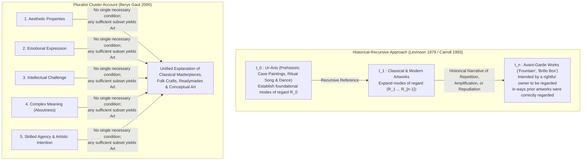

## 1. Introduction: The Porcelain Urinal of 1917 and the Plywood Soap Carton of 1964

In April 1917, the newly founded <strong>Society of Independent Artists</strong> prepared to open its inaugural exhibition at the Grand Central Palace in New York City. Modeled on the Parisian *Salon des Indépendants*, the Society proclaimed a radically democratic constitution: *"No jury, no prizes."* Any artist who paid the six-dollar initiation and membership fee was guaranteed the right to exhibit up to two works.

Days before the opening, a crate arrived bearing the entry fee of an unknown artist from Philadelphia named "Richard Mutt." When the board of directors unpacked the submission, they were stunned. Inside lay a standard, mass-produced flat-backed Bedfordshire model porcelain urinal purchased from the Fifth Avenue showroom of the <strong>J.L. Mott Iron Works</strong>, a plumbing supply company. The object had been rotated $90^\circ$ so that its flat back rested on the pedestal, signed and dated in clumsy black paint along its lower rim—<strong>"R. Mutt 1917"</strong>—and given the title <strong>*Fountain*</strong>.

The true orchestrator behind "Richard Mutt" was <strong>Marcel Duchamp (1887–1968)</strong>, the French avant-garde artist who was himself serving as head of the hanging committee for the very exhibition to which *Fountain* was submitted. For four years prior to 1917, Duchamp had been quietly experimenting with what he called <strong>"Readymades"</strong>: ordinary manufactured objects selected and modified slightly or not at all. In 1913, he mounted an inverted bicycle wheel onto a kitchen stool (*Bicycle Wheel*); in 1914, he purchased a galvanized-iron bottle dryer from the Bazar de l'Hôtel de Ville in Paris and designated it a sculpture without touching it (*Bottle Rack / Égouttoir*); in 1915, he bought a hardware-store snow shovel and inscribed it *In Advance of the Broken Arm*. Duchamp sought to overthrow what he disparagingly termed <strong>"retinal art" (*art rétinien*)</strong>—the post-Courbet assumption that painting exists merely to gratify the physical eye—and to return art to the service of the intellect (*cosa mentale*). To avoid the trap of conventional beauty or ugliness, Duchamp insisted that a readymade must be chosen in a state of complete <strong>"aesthetic indifference" (*anesthésie*)</strong>, devoid of either good or bad taste.

Faced with *Fountain*, the progressive rhetoric of the Society of Independent Artists collapsed. After a heated debate, the board of directors voted narrowly to suppress the work, hiding it behind a partition during the exhibition (where it was lost forever shortly after being photographed by Alfred Stieglitz at Gallery 291) and issuing a press statement declaring that *Fountain* was *"by no definition a work of art"* and merely *"a plain piece of plumbing."* Duchamp resigned from the board in protest and published an anonymous defense in the May 1917 issue of the Dadaist journal *The Blind Man* that permanently altered the trajectory of twentieth-century philosophy:

> *"Whether Mr. Mutt with his own hands made the fountain or not has no importance. He <strong>CHOSE</strong> it. He took an ordinary article of life, placed it so that its useful significance disappeared under the new title and point of view—<strong>created a new thought for that object</strong>."*

Nearly half a century later, in April 1964, a second philosophical earthquake struck Manhattan at the <strong>Stable Gallery</strong> on East 74th Street. <strong>Andy Warhol (1928–1987)</strong> filled the gallery floor to ceiling with stacks of wooden boxes silkscreened to look virtually identical to the corrugated cardboard shipping cartons used by Procter & Gamble (formerly the Brillo Manufacturing Corporation) to transport <strong>Brillo</strong> soap pads to supermarkets.

By a supreme historical irony, the commercial Brillo carton stacked in grocery warehouses had been designed by <strong>James Harvey</strong>, a second-generation Abstract Expressionist painter who worked freelance as a commercial package designer to support his studio practice. Yet Harvey's cardboard cartons were mere commercial packaging worth a few cents, whereas Warhol's <strong>*Brillo Box* (1964)</strong>—hand-fabricated out of plywood, painted white, and silkscreened in red and blue ink—was hailed as high sculpture and sold for hundreds of dollars (and decades later for millions at auction).

Among the visitors to the Stable Gallery that spring was the Columbia University philosopher <strong>Arthur C. Danto (1924–2013)</strong>. Looking at Warhol's stacks of boxes, Danto realized that Duchamp and Warhol had together posed a question that rendered 2,500 years of traditional aesthetics obsolete:

* Why is the 100th urinal in the J.L. Mott showroom (*Fountain*) a landmark work of fine art, while the other 99 identical urinals sitting on the warehouse shelf are "mere real things" (ordinary plumbing fixtures)?
* Why is Andy Warhol's *Brillo Box* a work of art while James Harvey's visually indistinguishable commercial Brillo carton in the supermarket stockroom is not?
* Conversely, if the two objects look exactly alike, why did Warhol bother fabricating his boxes out of plywood rather than simply exhibiting real cardboard Brillo cartons—and if he *had* exhibited the real cardboard cartons, wouldn't they have been artworks too?

This puzzle—known in analytic aesthetics as the <strong>Problem of Perceptually Indiscernible Counterparts</strong>—forced philosophers to confront a radical truth: <strong>whatever makes something a work of art cannot be any manifest visual, physical, or perceptual property accessible to the naked eye alone</strong>. This article traces the philosophical quest to define art across the twentieth and twenty-first centuries: from the collapse of classical essentialism and Morris Weitz's neo-Wittgensteinian open concept, through Arthur Danto's theory of the *Artworld* and embodied meaning, George Dickie's *Institutional Theory*, Jerrold Levinson's *Historical-Intentional Definition*, and Berys Gaut's *Cluster Account*, all the way to the contemporary frontier of Maurizio Cattelan's duct-taped banana and Generative AI.

---

## 2. The Collapse of Classical Aesthetic Essentialism: Mimesis, Expression, and Significant Form

From Socrates and Plato until the mid-twentieth century, the philosophical project of defining art was understood as a search for <strong>necessary and sufficient conditions</strong>—an invariant essence shared by all and only works of art:

$$\forall x \Big( \text{Art}(x) \iff C_1(x) \land C_2(x) \land \dots \land C_n(x) \Big)$$

If every condition $C_i(x)$ on the right-hand side is satisfied, $x$ is guaranteed to be art (joint sufficiency); if $x$ is a work of art, it must satisfy every $C_i(x)$ (individual necessity). A single counterexample—either a non-artwork that satisfies all the conditions (showing the definition is too broad) or an undisputed artwork that fails to satisfy at least one condition (showing the definition is too narrow)—refutes the candidate definition.

Across Western intellectual history, three grand essentialist paradigms dominated aesthetics.

### 2.1 The First Paradigm: Imitation / Mimesis ($M\acute{\iota}\mu\eta\sigma\iota\varsigma$)
For over two millennia, from antiquity through the Neo-Classical eighteenth century, art was defined as <strong>imitation or representation of nature and human action</strong>.

In Book X of the *Republic*, Plato famously argued that while a carpenter makes a physical bed by imitating the eternal Form (*Idea*) of the Bed, the painter merely copies the visual appearance of the carpenter's bed from a single angle; painting is thus an *"imitation of an imitation,"* thrice removed from truth. Aristotle, in the *Poetics*, defended the cognitive and moral value of *mimesis*, arguing that human beings take a natural delight in imitation and that tragedy imitates universalizable human actions to achieve the catharsis of pity and fear. During the Renaissance, Leon Battista Alberti, Giorgio Vasari, and Leonardo da Vinci conceptualized the canvas as an open window or a mirror held up to nature.

As a necessary condition for art, mimesis began to crumble in the nineteenth and early twentieth centuries with the rise of pure instrumental music ("absolute music" such as Bach's fugues or Brahms's symphonies), non-representational architecture, and above all the birth of <strong>Abstract Art</strong> in the works of Wassily Kandinsky, Piet Mondrian, and Kazimir Malevich. Duchamp's *Fountain* delivered the *coup de grâce*: the urinal does not copy, depict, or imitate a urinal—it simply <strong>is</strong> a urinal, presented directly rather than represented.

Could one rescue mimesis for Warhol by arguing that Warhol's plywood *Brillo Box* is an artwork precisely because it is a handmade *imitation* of a real cardboard Brillo box? Danto swiftly blocks this escape route. If merely being an exact visual copy of a first Brillo box were sufficient to make something art, then the second, third, and ten-thousandth cardboard Brillo boxes rolling off the factory assembly line—each an exact copy of the prototype—would also be works of art, as would every forged banknote and every mirror reflection in the world.

### 2.2 The Second Paradigm: Expression Theory
In the wake of the Romantic movement, philosophers replaced outer imitation with inner expression: <strong>art is the articulation, exteriorization, and transmission of the artist's subjective emotion</strong>.

In *What Is Art?* (1897), <strong>Leo Tolstoy</strong> defined art as a human activity wherein one person consciously, by means of external signs (lines, colors, sounds, words), hands on to others feelings they have lived through, so that other people are "infected" by these feelings and also experience them. A more sophisticated philosophical formulation was advanced by the British idealist philosopher <strong>R.G. Collingwood (1889–1943)</strong> in *The Principles of Art* (1938). Collingwood drew a sharp boundary between <strong>"craft"</strong> (which operates with a preconceived end and a pre-existing blueprint, selecting means to achieve a known result, such as making a table or writing a formulaic thriller to entertain) and <strong>"art proper."</strong> In genuine art, the artist begins with an inchoate, unclarified emotional perturbation and discovers what that emotion actually is only through the imaginative act of expressing it in a medium.

While Expression Theory illuminated Beethoven's late quartets, Van Gogh's brushwork, and Jackson Pollock's Abstract Expressionism, it collapsed when confronted with Duchampian Dadaism, Pop Art, Minimalism, and aleatoric (chance-based) composition. Duchamp selected *Bottle Rack* and *Fountain* specifically on the principle of complete emotional and aesthetic detachment. Warhol christened his studio "The Factory," delegated silkscreening to assistants, and declared, *"I want to be a machine."* John Cage composed *Music of Changes* (1951) by tossing coins according to the *I Ching* to eliminate personal taste and psychology, and in *4'33"* (1952) instructed a performer to sit silently at a piano so the audience would listen to ambient accidental sounds. In none of these canonical twentieth-century works is the clarification or transmission of the artist's personal emotion a necessary condition for arthood.

### 2.3 The Third Paradigm: Formalism and Aesthetic Experience Theory
Seeking an autonomous criterion that could defend Cézanne, Post-Impressionism, and abstract art without relying on either realistic depiction or biographical psychology, early twentieth-century theorists turned to <strong>Formalism</strong>.

In his influential book *Art* (1914), the Bloomsbury critic <strong>Clive Bell (1881–1964)</strong> asked: *"What quality is shared by all objects that provoke our aesthetic emotions?"* His famous answer was: <strong>"Significant Form"</strong>—relations and combinations of lines, colors, shapes, and volumes that move a sensitive observer to a sui generis "aesthetic emotion" wholly detached from practical life and narrative content. Along similar lines, <strong>Roger Fry</strong> and later the American philosopher <strong>Monroe Beardsley (1915–1985)</strong> developed functionalist aesthetic definitions, holding that an artwork is either an arrangement of conditions intended to be capable of affording an experience with marked aesthetic character, or an object belonging to a class normally intended to have this capacity.

Yet it is precisely against Formalism and perceptual aesthetic definitions that Duchamp's *Fountain* and Warhol's *Brillo Box* deal their most devastating blow. We can state this formally as the <strong>Perceptual Indiscernibility Argument</strong>:

Let $O_{\text{art}}$ be Duchamp's *Fountain* (or Warhol's *Brillo Box*), and let $O_{\text{mere}}$ be its ordinary counterpart (an identical Bedfordshire urinal in the J.L. Mott showroom, or a commercial Brillo carton in a grocery warehouse). Let $P_{\text{vis}}(x)$ denote the complete set of manifest visual, formal, and sensory properties of object $x$ (its lines, contours, colors, proportions, and surface geometry). By hypothesis:

$$P_{\text{vis}}(O_{\text{art}}) = P_{\text{vis}}(O_{\text{mere}}) \quad \Big( O_{\text{art}} \approx_{\text{percept}} O_{\text{mere}} \Big)$$

Yet their ontological status with respect to arthood is diametrically opposed:

$$\text{Art}(O_{\text{art}}) \land \neg\text{Art}(O_{\text{mere}})$$

If Formalism were true—if being a work of art supervened exclusively on manifest formal properties $P_{\text{vis}}(x)$—then we would be trapped in an inescapable dilemma:
1. Either *Fountain* possesses "Significant Form" in virtue of its gleaming white curves, in which case <strong>every single urinal in every plumbing warehouse and public restroom on Earth</strong> possesses that exact same Significant Form and is already a work of fine art;
2. Or the warehouse urinals lack Significant Form, in which case *Fountain* and *Brillo Box* also lack it and cannot be works of art.

Both horns are unacceptable. The inescapable conclusion is that <strong>the ontological boundary between art and non-art cannot be located anywhere within the manifest perceptual properties of the object itself</strong>.

| Classical Paradigm | Key Proponents | Core Thesis (Proposed Essence) | Why Readymades & Indiscernible Counterparts Refute It |
| :--- | :--- | :--- | :--- |
| <strong>Mimesis / Imitation Theory</strong> | Plato (*Republic* X) Aristotle (*Poetics*) Alberti, Vasari | Art is the imitation or representation of nature, reality, or human action. | Abstract art and absolute music imitate nothing; Duchamp's *Fountain* presents an actual object rather than depicting one; factory copies imitate prototypes without becoming art. |
| <strong>Expression Theory</strong> | Leo Tolstoy (*What Is Art?*) R.G. Collingwood (*The Principles of Art*) | Art is the imaginative clarification and transmission of the artist's inner emotions. | Duchamp's "aesthetic indifference," Warhol's mechanical silkscreening, and John Cage's chance operations explicitly exclude subjective emotional expression. |
| <strong>Formalism & Aesthetic Functionalism</strong> | Clive Bell (*Art*) Roger Fry Monroe Beardsley | Art is defined by "Significant Form" (relations of line, color, shape) capable of evoking aesthetic emotion/experience. | Given two perceptually identical objects ($O_{\text{art}} \approx_{\text{percept}} O_{\text{mere}}$), one is art and the other is a mere real thing; hence visual form alone cannot differentiate them. |

---

## 3. Morris Weitz's Neo-Wittgensteinian Anti-Essentialism and Maurice Mandelbaum's Relational Turn

Confronted with two millennia of failed definitions—from Mimesis and Expression to Formalism and Voluntarism—a group of Anglo-American philosophers in the 1950s (including Paul Ziff, William Kennick, and above all <strong>Morris Weitz</strong>) diagnosed the failure as a symptom of a deeper philosophical delusion. Perhaps aesthetics had failed to find the essence of art for the simple reason that <strong>art has no essence</strong>.

### 3.1 Wittgenstein's "Games" and Family Resemblances
In his landmark 1956 paper <strong>"The Role of Theory in Aesthetics"</strong> (published in *The Journal of Aesthetics and Art Criticism*), Morris Weitz (1916–1981) applied the method of <strong>Ludwig Wittgenstein's *Philosophical Investigations*</strong> (1953, §§65–75) directly to the concept of art.

In §66 of the *Investigations*, Wittgenstein famously challenged the Platonic craving for generality by examining the everyday word <strong>"game" (*Spiel*)</strong>:

> *"Consider for example the proceedings that we call 'games'. I mean board-games, card-games, ball-games, Olympic games, and so on. What is common to them all?—Don't say: 'There must be something common, or they would not be called "games"'—but <strong>look and see</strong> whether there is anything common to all.—For if you look at them you will not see something that is common to all, but similarities, relationships, and a whole series of them at that."*

Card games share an element of competition with chess, but patience (solitaire) does not; ball games involve physical skill, which chess lacks; ring-a-ring-a-roses involves amusement and rhythm, but no winning or losing. Instead of a single common thread running through every instance, we find *"a complicated network of similarities overlapping and criss-crossing"*—just as members of a human family share build, facial features, eye color, gait, and temperament in overlapping combinations without any single feature being possessed by every family member. Wittgenstein termed these <strong>"family resemblances" (*Familienähnlichkeiten*)</strong>.

### 3.2 Art as an "Open Concept"
Weitz argued that if we actually "look and see" at what we call "art" (Greek tragedy, Gothic cathedrals, Rembrandt portraits, Bach fugues, Duchamp's urinal, Joyce's *Finnegans Wake*), we find no common necessary and sufficient properties—only strands of family resemblances.

More importantly, Weitz drew a logical distinction between <strong>"closed concepts"</strong> and <strong>"open concepts."</strong> A concept is *closed* (like a geometric triangle) when its necessary and sufficient conditions can be exhaustively fixed once and for all. A concept is *open* when its conditions of application are emendable and corrigible—that is, when new, unforeseen cases can continually arise that require a decision on our part whether to extend the concept to cover the new case or to invent a new sub-concept.

According to Weitz, "art" (along with its sub-concepts like "novel," "tragedy," or "painting") is an inherently <strong>open concept</strong> because <strong>an expansive, adventurous creativity is part of the very logic of artistic practice</strong>. Artists are constantly inventing revolutionary works designed specifically to violate whatever rules or conditions previously held sway. Consequently, any philosophical attempt to close the concept of art with necessary and sufficient conditions would foreclose the very conditions of creativity in the arts.

What, then, was the real value of classical theories like Bell's Formalism or Tolstoy's Expressionism? Weitz distinguished between two uses of the sentence *"This is a work of art"*:
1. The <strong>descriptive (classificatory) use</strong>, which neutrally categorizes an object as belonging to the class of artworks; and
2. The <strong>evaluative (honorific) use</strong>, which praises an object as *successful* or *great* art.

Classical aesthetic theories, Weitz concluded, were never true classificatory definitions; rather, they were disguised <strong>honorific recommendations</strong>—valuable critical pleas urging viewers to pay attention to newly emphasized features of art (such as formal arrangement in Cézanne or emotional depth in Romanticism).

### 3.3 Maurice Mandelbaum's Decisive Critique (1965): Non-Exhibited Relational Properties
For nearly a decade, Weitz's anti-essentialism reigned as orthodoxy in Anglo-American aesthetics. Then, in 1965, the philosopher <strong>Maurice Mandelbaum (1908–1987)</strong> published a devastating rejoinder titled <strong>"Family Resemblances and Generalization Concerning the Arts"</strong> (*American Philosophical Quarterly*).

Mandelbaum began by exposing an unnoticed irony in Wittgenstein's own metaphor of "family resemblance." Suppose we look at a wall covered with dozens of portrait photographs and notice that six of the faces have overlapping similarities of nose, eyes, and jawline. What makes those similarities *family* resemblances rather than mere accidental look-alikes among strangers? Precisely the fact that those six individuals share a <strong>common biological ancestry—a non-manifest, genetic relational attribute that is not directly visible in the surface photographs themselves!</strong>

Wittgenstein and Weitz, Mandelbaum argued, failed to find a common essence of games or of art only because they restricted their gaze to <strong>manifest, directly exhibited perceptual properties</strong> (*"look and see"*). Consider a person laying out cards on a table for a game of solitaire versus a fortune-teller laying out the exact same cards for a tarot reading. Visually, the manifest physical behavior of the solitaire player resembles the fortune-teller far more than it resembles a rugby match or a chess game. Yet solitaire and rugby are games, whereas fortune-telling is not. Why? Because what unites all games is not a visual look, but a <strong>relational property</strong>: an activity governed by rules structured to generate an absorbing, non-practical challenge.

Moreover, Duchamp's *Fountain* and Warhol's *Brillo Box* completely blow apart the family resemblance theory of art recognition. If we classify new objects as art on the basis of their perceptual family resemblance to pre-existing objects, then the objects bearing the highest possible perceptual resemblance to Duchamp's *Fountain* are the millions of ordinary porcelain urinals in plumbing supply warehouses! Yet those urinals are not art.

Mandelbaum's conclusion revolutionized analytic aesthetics: <strong>the failure of visual essentialism does not entail anti-essentialism. Instead, it proves that the defining essence of art must be sought in *non-exhibited relational properties*—the hidden web of relations linking an object to its creator's intentions, its historical antecedents, and its theoretical and institutional context.</strong>

---

## 4. Arthur C. Danto's "The Artworld" (1964) and *The Transfiguration of the Commonplace* (1981)

Just months before Mandelbaum's paper appeared in print, <strong>Arthur C. Danto</strong> had already launched the relational revolution in his October 1964 *Journal of Philosophy* essay, <strong>"The Artworld."</strong> Reflecting directly on Warhol's *Brillo Box* exhibition at the Stable Gallery, Danto penned the most famous sentence in modern aesthetics:

> <strong>"To see something as art requires something the eye cannot decry—an atmosphere of artistic theory, a knowledge of the history of art: an artworld."</strong>

Why could Warhol's *Brillo Box* be a work of art in New York in 1964, whereas an identical painted wooden box fabricated in quattrocento Florence or seventeenth-century Amsterdam could not possibly have been a work of art? Because, Danto argued, what makes the difference between a mere commercial Brillo box and Warhol's *Brillo Box* is <strong>a certain theory of art</strong> that had evolved historically through Impressionism, Cubism, Duchamp, Abstract Expressionism, and Neo-Dada. Just as an uninitiated layperson looking into a cloud chamber sees only a faint white streak of water droplets whereas a physicist equipped with quantum electrodynamics sees the track of a positron, a viewer equipped with the theoretical atmosphere of the *Artworld* sees Warhol's plywood box not as mere carpentry, but as a philosophical intervention in the history of art.

Danto analyzed the grammar of this shift through what he called <strong>"the *is* of artistic identification."</strong> When we point to a dab of white paint in Pieter Bruegel's *Landscape with the Fall of Icarus* and say, *"That white dab <strong>is</strong> Icarus plunging into the sea,"* or when we point to Warhol's painted plywood cube and say, *"That <strong>is</strong> a Brillo Box,"* the word *"is"* does not express literal physical identity (like *"Water is $\text{H}_2\text{O}$"*). Rather, it marks an ontological <strong>transfiguration</strong>: a humble commonplace material object is transfigured into a vehicle of artistic representation and meaning.

### 4.1 The Thought Experiment: The Gallery of Indiscernible Red Squares
In his 1981 masterwork, <strong>*The Transfiguration of the Commonplace: A Philosophy of Art*</strong>, Danto sharpened the problem of perceptual indiscernibility to perfection by constructing his celebrated thought experiment: the <strong>Gallery of Indiscernible Red Squares</strong>.

Imagine walking into an exhibition space where nine rectangular canvases—identical to the last molecule in dimension, texture, and their uniform coat of flat cadmium red (or red lead) paint—hang side by side:

1. <strong>Canvas 1: *The Israelites Crossing the Red Sea*</strong> — A historical narrative painting inspired by a remark of Søren Kierkegaard. As the artist explains to the viewer, *"The Israelites have already crossed over to dry land, and the pursuing Egyptians have just drowned beneath the waves."*
2. <strong>Canvas 2: *Kierkegaard's Mood*</strong> — A psychological portrait by a Danish expressionist, externalizing the philosopher's turbulent inner angst in a field of crimson.
3. <strong>Canvas 3: *Red Square*</strong> — A witty geometric landscape painting of the famous Moscow plaza.
4. <strong>Canvas 4: *Nirvana*</strong> — A metaphysical Buddhist painting depicting the extinction of empirical desire and the end of *samsara*, where the red surface symbolizes the void beyond phenomena.
5. <strong>Canvas 5: *Red Tablecloth*</strong> — A Fauvist still life painted by a disgruntled disciple of Henri Matisse who zoomed in exclusively on the tablecloth of *The Red Room*.
6. <strong>Canvas 6: *Untitled* (Minimalist Monochrome)</strong> — A hard-edge modernist work asserting the literal flatness of the picture plane and the pure opticality of red pigment.
7. <strong>Object 7: Giorgione's Primed Ground Canvas</strong> — A historical artifact from sixteenth-century Venice on which the Renaissance master Giorgione laid down a traditional *imprimatura* (undercoat) of red lead ground, only to die of the plague before painting a single stroke of his intended sacred subject. Though priceless as a relic, it is <strong>not a work of art</strong>, but merely a prepared surface.
8. <strong>Object 8: A Mere Red-Painted Surface</strong> — A canvas covered in the exact same red paint by a housepainter testing a roller, devoid of any artistic context or intention: a <strong>"mere real thing."</strong>
9. <strong>Canvas 9: J's *Untitled* ("About Nothing")</strong> — Outraged that Objects 7 and 8 are excluded from the museum, a radical conceptual artist named <strong>J</strong> takes an identical red surface and exhibits it with the polemical manifesto: *"My painting is not about the Red Sea, Kierkegaard, or Nirvana; it is strictly an empty physical object <strong>about nothing at all</strong>!"*

From this dazzling thought experiment, Danto extracts two profound philosophical conclusions:
* <strong>First (The Ontology of Arthood):</strong> Since Objects 7 and 8 are non-artworks ("mere real things") while Canvases 1–6 and 9 are genuine artworks—despite all nine being perceptually indistinguishable—the boundary between art and non-art is wholly non-perceptual.
* <strong>Second (The Individuation and Aesthetics of Artworks):</strong> Even among the genuine artworks (Canvases 1–6 and 9), although they look 100% identical to the eye, <strong>they are completely different works of art possessing radically different aesthetic, expressive, and structural properties!</strong> Canvas 1 is a witty biblical narrative; Canvas 4 is a serene spiritual meditation; Canvas 6 is an austere formalist statement; Canvas 9 is a biting conceptual provocation. Even the physical edges of the canvas function differently in each work: in Canvas 1 they are a *framing window* cutting off a boundless sea, whereas in Canvas 6 they are the *literal boundaries* of a geometric shape. What we properly perceive and aesthetically evaluate in a work of art depends constitutively on how we <strong>interpret</strong> it in light of its title, its artist's intentions, and its art-historical location.

### 4.2 Danto's Two Necessary Conditions: *Aboutness* and *Embodied Meaning*
What, then, differentiates Canvases 1–6 and 9 (as well as Warhol's *Brillo Box*) from Objects 7 and 8 (and the supermarket Brillo carton)? In *The Transfiguration of the Commonplace* (and later refined in *After the End of Art* [1997] and *What Art Is* [2013]), Danto formulates two fundamental necessary conditions for any work of art:

1. <strong>Aboutness (Semantic Intentionality):</strong>
   Every work of art is <strong>*about* something</strong>—it possesses semantic intentionality, projecting a point of view or thesis toward the world or toward art itself. By contrast, a mere real thing (Giorgione's primed ground, a warehouse urinal, a grocery-store Brillo carton) is simply a piece of physical furniture in the universe; it has causal properties and practical utility, but it is <strong>not *about* anything</strong>.
   What about J's Canvas 9, which J explicitly claimed was "about nothing"? Danto points out that even Canvas 9 is deeply *about* something: it is a meta-artistic statement *about* the contrast between meaningful art and empty materiality, just as the number $0$ in mathematics is not the absence of a number, but a specific number signifying emptiness! Similarly, Warhol's *Brillo Box* is *about* the transfiguration of commercial mass culture and the philosophical boundary between art and non-art.

2. <strong>Embodied Meaning (Rhetorical and Metaphorical Structure):</strong>
   Of course, being *about* something is not sufficient for arthood—otherwise every newspaper article, stock market report, chemistry textbook, and philosophy essay would be a work of art. What distinguishes an artwork from an ordinary propositional text is that <strong>an artwork does not merely *state* its meaning; it *embodies* its meaning in its material and formal vehicle</strong>.
   Danto analyzes this embodiment through the Aristotelian rhetorical figures of <strong>metaphor</strong> and the <strong>enthymeme</strong> (a truncated syllogism with a missing premise that the audience must supply from their own cultural and theoretical background). When Duchamp rotates a porcelain urinal $90^\circ$ on a pedestal and entitles it *Fountain*, or when Warhol silkscreens commercial soap-pad graphics onto heavy museum-scale plywood boxes, the material object functions as a visual metaphor that recruits the viewer's mind to complete the thought. In his final book, *What Art Is* (2013), Danto summarized this by defining artworks as <strong>"embodied meanings"</strong> that function like <strong>"wakeful dreams"</strong>—publicly shared imaginative structures where thought and matter fuse through interpretation.

---

## 5. George Dickie's Institutional Theory of Art (1974 / 1984) and Richard Wollheim's Dilemma

While Danto's 1964 essay "The Artworld" conceived of the artworld as an intellectual and historical atmosphere of *artistic theory*, the philosopher <strong>George Dickie (1926–2020)</strong> read Danto's term through a sociological and performative lens. In a series of papers beginning in 1969 and culminating in his book <strong>*Art and the Aesthetic: An Institutional Analysis* (1974)</strong>, Dickie formulated the <strong>Institutional Theory of Art</strong>.

### 5.1 Arthood as Performative Status-Conferral
Dickie was skeptical of Danto's claim that every artwork must possess semantic *aboutness* and call for metaphorical interpretation. Surely, Dickie argued, an unadorned geometric carpet pattern, a purely non-referential minimalist sculpture by Donald Judd, or an aleatoric sound piece need not be "about" anything in a semantic sense to be a work of art.

Instead, Dickie looked to the legal and social philosophy of <strong>performative speech acts</strong> (J.L. Austin) and institutional roles. How does a piece of paper become legal tender, how do two people become legally married, or how does a person become a Ph.D. or the mayor of a city? Not by acquiring a new physical or visual property, but by having an <strong>institutional status conferred upon them</strong> by an authorized agent acting within an established social practice (the state, the church, the university).

According to Dickie, "the Artworld" is precisely such an established social institution—an informal but structured network of artists, museum directors, curators, gallery owners, art critics, art historians, and museum-going publics. In his classic 1974 formulation, Dickie defined a work of art as follows:

> <strong>Dickie's Institutional Definition of Art (1974 Version):</strong>
> *"A work of art in the classificatory sense is:*
> *1. <strong>an artifact</strong>*
> *2. <strong>a set of the aspects of which has had conferred upon it the status of candidate for appreciation by some person or persons acting on behalf of a certain social institution (the artworld)</strong>."*

Every clause of this definition was carefully engineered:
* <strong>Classificatory vs. Evaluative Sense:</strong> Like Weitz, Dickie strictly separates classifying something as an artwork from praising it as *good* art. Bad art, derivative art, and failed art are still art in the classificatory sense. Hence what is conferred is not actual appreciation, but the status of being a <strong>"candidate for appreciation."</strong> Even if every critic in New York pans an exhibition as worthless rubbish, the objects on the gallery pedestals are still candidates for appreciation—and therefore artworks.
* <strong>Artifactuality and "Artifactualization":</strong> Classical definitions assumed that an artifact must be physically handcrafted. How, then, can Duchamp's mass-produced urinal, or a piece of natural <strong>driftwood</strong> picked up on a beach and hung unaltered on a gallery wall, satisfy the artifact condition? In 1974, Dickie argued that an unaltered natural object can have artifactuality *conferred* upon it ("artifactualized"), or in his 1984 revision, that picking up, transporting, and mounting a piece of driftwood for display is itself using the object as a complex medium, thereby rendering it a human artifact.
* <strong>Who Confers the Status?</strong> A common caricature of Dickie's theory imagines that a museum director must walk around tapping objects with a magic wand. Dickie clarified that in the vast majority of cases, the "person acting on behalf of the artworld" who confers the status of candidate for appreciation is a single individual: <strong>the artist himself or herself</strong>! When Marcel Duchamp signed *"R. Mutt 1917"* on the urinal and submitted it to an exhibition, Duchamp—operating with the authority of an initiated member of the artworld—conferred the institutional status of art upon *Fountain*.

### 5.2 Richard Wollheim's Dilemma (1980): The *Euthyphro* Problem of Aesthetics
Dickie's Institutional Theory gained immediate fame for its clean, procedural elegance, yet it soon encountered a devastating philosophical objection formulated by the British philosopher <strong>Richard Wollheim (1923–2003)</strong> in his essay *"The Institutional Theory of Art"* (appended to the 1980 edition of *Art and Its Objects*).

Wollheim adapted the famous dilemma posed by Socrates in Plato's *Euthyphro* (*"Is the pious loved by the gods because it is pious, or is it pious merely because it is loved by the gods?"*) and applied it directly to the representatives of Dickie's Artworld:

> <strong>Wollheim's Dilemma:</strong>
> *When persons acting on behalf of the Artworld confer the status of art (candidate for appreciation) upon an object $x$, do they do so for <strong>good reasons</strong> (because $x$ possesses certain artistically relevant properties $R$), or do they do so <strong>arbitrarily without reasons</strong>?*

Whichever horn of the dilemma the institutional theorist chooses, the theory collapses:

1. <strong>The First Horn (Conferral for Good Reasons):</strong>
   Suppose the artist or curator must have *good artistic reasons* $R$ for conferring the status of art on $x$—for instance, that $x$ embodies a profound comment on art history, or challenges perceptual habits, or exhibits formal mastery. If so, then it is the possession of those underlying properties $R$ (such as Danto's *aboutness* and *embodied meaning*) that genuinely makes $x$ a work of art! The institutional act of status-conferral merely *recognizes* or *ratifies* an artistic status that $x$ already merits on substantive grounds. The Institutional Theory becomes explanatory redundant.
2. <strong>The Second Horn (Arbitrary Conferral without Reasons):</strong>
   Suppose instead that no reasons or criteria whatsoever are required—that anyone occupying a role in the Artworld can arbitrarily baptize anything at all as art by pure performative fiat. If that were true, then arthood would be reduced to an empty, bureaucratic parlor game. Most fatally, this horn makes it completely mysterious <strong>why human beings care so deeply about art</strong>—why societies build museums, fund arts education, and revere artistic creation as one of the highest achievements of the human spirit, whereas we do not revere arbitrary bureaucratic classifications.

### 5.3 Further Objections and Dickie's 1984 Revision (*The Art Circle*)
Beyond Wollheim's Dilemma, critics pressed three additional objections against Dickie's 1974 theory:

* <strong>Objection 1: Vicious Circularity.</strong> If we ask what makes something an artwork, Dickie answers: "It is conferred status by the Artworld." If we then ask what distinguishes the *Artworld* from the Plumbing World or the Real Estate World, the only possible answer is: "The Artworld is the institution dedicated to producing and presenting *artworks*."
* <strong>Objection 2: The Solitary / Outsider Artist and Prehistoric *Ur-Art*.</strong> What about an isolated creator working entirely outside the social institution of the Artworld? Consider <strong>Henry Darger</strong>, the reclusive Chicago hospital janitor who secretly wrote and illustrated a 15,000-page epic (*In the Realms of the Unreal*) in his one-room apartment with no intention of ever showing it to an artworld public; or a Paleolithic cave painter at <strong>Lascaux</strong> or <strong>Chauvet</strong> 30,000 years ago, long before any "Artworld institution" of galleries, curators, and critics existed. Under a strict institutional theory, Paleolithic cave paintings and solitary outsider creations could not be works of art when they were made.
* <strong>Objection 3: The Historical Paradox of *Fountain* Itself.</strong> In April 1917, the board of directors of the Society of Independent Artists—the official institutional body—explicitly <strong>rejected</strong> *Fountain* and refused to exhibit it. If institutional acceptance were required, *Fountain* would have failed to become art in 1917; and if Duchamp's private intention alone sufficed against the institution's refusal, then it is <strong>artistic intention</strong>, not social bureaucracy, doing the real philosophical work.

In response to these criticisms, Dickie published a major revision, <strong>*The Art Circle: A Theory of Art* (1984)</strong>. Abandoning the quasi-legal metaphor of a one-off performative ceremony of "status-conferral," Dickie reconceived the institution of art as a holistic, five-part interlocking system of roles:
1. An <strong>artist</strong> is a person who participates with understanding in the making of a work of art.
2. A <strong>work of art</strong> is an <strong>artifact of a kind created to be presented to an artworld public</strong>.
3. A <strong>public</strong> is a set of persons the members of which are prepared in some degree to understand an object which is presented to them.
4. The <strong>artworld system</strong> is a framework for the presentation of a work of art by an artist to an artworld public.
5. The <strong>artworld</strong> is the totality of all artworld systems.

Dickie openly acknowledged that these five definitions are circular, arguing that the circle is not vicious but <strong>informative</strong>: it maps a self-sustaining cultural practice whose parts cannot exist independently. Yet even in its 1984 form, the Institutional Theory remained unable to accommodate solitary outsider art created without reference to an artworld public, or to explain the internal historical evolution that links today's avant-garde to the earliest human art.

---

## 6. Historical Intentionalism, Historical Narrativism, and Cluster Accounts

To overcome both the over-intellectualization of Danto's theory and the sociological rigidity of Dickie's Institutional Theory, philosophers in the late twentieth and early twenty-first centuries developed two powerful alternatives: <strong>Historical Definitions</strong> (which define art vertically across time rather than horizontally across contemporary bureaucracy) and <strong>Cluster Accounts</strong> (which revive pluralism on a rigorous relational footing).

### 6.1 Jerrold Levinson's Historical-Intentional Definition (1979)
In his seminal 1979 paper <strong>"Defining Art Historically"</strong> (*British Journal of Aesthetics*), <strong>Jerrold Levinson</strong> argued that what makes an object a work of art at a given time $t$ is not its ratification by a contemporary social institution, but <strong>an intentional relation linking the object backward in time to the history of prior artworks</strong>.

Suppose a solitary hermit in the desert, or Henry Darger in his locked room, creates an assemblage of wire and paint with no desire ever to exhibit it to a gallery public. Why is it still a work of art? Because the maker seriously intends that the object be <strong>regarded</strong> (experienced, attended to, contemplated) in ways that previously existing artworks have been correctly regarded!

Levinson formulates this as a rigorous <strong>recursive (inductive) definition</strong>:

> <strong>Levinson's Historical-Intentional Definition of Art:</strong>
> *An object $x$ is a work of art at time $t$ if and only if $x$ is an object of which it is true at $t$ that some person or persons, having the <strong>proprietary right</strong> over $x$, non-passingly <strong>intends (or intended) $x$ for regard-as-a-work-of-art</strong>—i.e., regard in any way (or ways) in which prior artworks before $t$ are or were correctly (or standardly) regarded.*

Three features make Levinson's theory extraordinarily resilient:
1. <strong>Rich Plurality of "Ways of Regarding":</strong> Because the repertoire of "ways in which prior artworks have been correctly regarded" evolves over millennia, it includes not only traditional aesthetic contemplation of color, harmony, and proportion, or emotional empathy, but also—once Modernism and Dada enter art history—*conceptual interrogation, ironic reflection, and shock*. When Duchamp submitted *Fountain*, he intended it to be given the kind of close visual attention, critical interpretation, and spatial contemplation that sculptures had historically received (even while subverting their craft expectations).
2. <strong>The Base Case of *Ur-Arts* ($t_0$):</strong> If art at time $t_n$ refers back to art at $t_{n-1}$, which refers back to $t_{n-2}$, how does the chain begin without infinite regress? Just as mathematical induction has a base case $n=0$ and an inductive step $n \to n+1$, Levinson posits <strong>*Ur-arts*</strong> at $t_0$ (such as Paleolithic cave paintings, body ornamentation, and ritual dances). These earliest practices are not art by referring to prior art; rather, they are the historical *root activities* from which our entire genealogy of artistic regard genealogically descends.
3. <strong>The Proprietary Right Condition:</strong> Why did Levinson stipulate that the intender must possess a *"proprietary right"* (ownership or rightful authority) over the object $x$?
   Consider a brilliant counterexample: Suppose I walk into the Louvre today, point at Leonardo da Vinci's *Mona Lisa*—or point at a red fire extinguisher bolted to the museum hallway—and form the deadly serious intention that from this moment forward, that fire extinguisher shall be regarded as my readymade artwork titled *Quenched Desire*. Does the Louvre's fire extinguisher become my artwork? Of course not! Why could Duchamp turn the Bedfordshire urinal into *Fountain*, whereas I cannot turn the Louvre's fire extinguisher into my readymade? <strong>Because Duchamp paid J.L. Mott Iron Works for the urinal and owned the proprietary right to dispose of its identity!</strong> One cannot artistically appropriate an object over which one has no rightful authority.

### 6.2 Noël Carroll's Historical Narrativism (1993)
While sympathetic to Levinson's historical turn, the philosopher <strong>Noël Carroll</strong> argued in *"Historical Narrativism"* (1993) that we do not need a formal real definition of art at all; what we actually need is an account of how we rationally settle disputes when confronted with radical avant-garde works.

According to Carroll, when a baffling new candidate like *Fountain*, *Brillo Box*, or John Cage's *4'33"* appears, critics and viewers establish its arthood by constructing an <strong>identifying historical narrative</strong>. This narrative begins with an undisputed, recognized body of past artworks and artistic practices, reconstructs the specific artistic problem-situation facing the new artist, and demonstrates how the new work emerged as an intelligible response to that precedent—via one of three historical strategies:
* <strong>Repetition</strong> (continuing an established genre or convention),
* <strong>Amplification</strong> (expanding or refining partial potentials within an existing tradition), or
* <strong>Repudiation</strong> (self-consciously rejecting and subverting a dominant convention of the precursor tradition in order to expose its hidden assumptions).

Duchamp's *Fountain* is not a random prank by a plumber; it is intelligible as art because a truthful historical narrative connects it directly to the post-Impressionist and Cubist crisis of manual representation, Picasso and Braque's invention of *papier collé* (pasting real newspaper scraps onto canvas), and Duchamp's own systematic repudiation of "retinal painting."

### 6.3 Berys Gaut's Cluster Account (2000)
Meanwhile, in his influential essay <strong>"'Art' as a Cluster Concept" (2000)</strong>, the British philosopher <strong>Berys Gaut</strong> synthesized Wittgenstein's family-resemblance insight with relational aesthetics to formulate the <strong>Cluster Account of Art</strong>.

Gaut argues that "art" is a cluster concept governed by roughly ten criteria that count toward an object's being a work of art:
1. Possessing positive aesthetic properties (such as beauty, grace, or elegance);
2. Being expressive of emotion;
3. Being intellectually challenging (questioning received views and modes of thought);
4. Being formally complex and coherent;
5. Having a capacity to convey complex meanings (*aboutness*);
6. Exhibiting an individual point of view;
7. Being an exercise of creative imagination (originality);
8. Being an artifact or performance that is the product of a high degree of skill;
9. Belonging to an established artistic form (music, painting, film, sculpture, etc.); and
10. Being the product of an artistic intention to make a work of art.

Crucially, under Gaut's Cluster Account:
* <strong>No single criterion among (1)–(10) is individually necessary</strong> for a work to be art (though being the product of an action by an agent—artifactuality broadly construed—serves as a background necessary condition);
* <strong>Several different subsets of these criteria are jointly sufficient</strong> for an object to be art.

This immediately explains why both ancient Egyptian ritual carvings and Duchamp's *Fountain* are unquestionably works of art despite sharing almost no surface features! An ancient Egyptian tomb carving may lack (10) modern artistic intention and (3) avant-garde intellectual challenge, yet it abundantly satisfies (1) positive aesthetic properties, (4) formal coherence, (8) extraordinary craft skill, and (9) belonging to sculpture. Conversely, Duchamp's *Fountain* completely lacks (1) traditional beauty, (2) emotional expression, and (8) manual craft skill, yet it overwhelmingly satisfies (3) intellectual challenge, (5) complex meaning (*aboutness*), (6) individual perspective, (7) creative originality, and (10) artistic intention.

| Contemporary Theory of Art | Key Proponents | Core Mechanism of Arthood | Major Strengths | Principal Criticisms |
| :--- | :--- | :--- | :--- | :--- |
| <strong>Neo-Wittgensteinian Anti-Essentialism</strong> | Morris Weitz (1956) William Kennick (1958) | Art is an "Open Concept" united only by overlapping perceptual strands of Family Resemblance. | Honors radical avant-garde creativity and distinguishes classificatory from evaluative uses. | Fails Mandelbaum's critique: cannot explain why *Fountain* is art while visually identical warehouse urinals are not. |
| <strong>Artworld & Embodied Meaning</strong> | Arthur C. Danto (1964 / 1981 / 2013) | An object situated in an atmosphere of art theory/history that possesses *Aboutness* and *embodies its meaning* rhetorically. | Provides the deepest ontological and interpretive explanation of perceptually indiscernible counterparts. | Risks excluding purely decorative arts, non-semantic minimalist works, or absolute music that lack propositional *aboutness*. |
| <strong>Institutional Theory</strong> | George Dickie (1974 / 1984) | An artifact upon which the status of "candidate for appreciation" is conferred within the social framework of the Artworld. | Cleanly accounts for how readymades, found objects, and conceptual works function socially as art. | Vulnerable to Wollheim's Dilemma (reasons vs. arbitrariness), circularity, and the exclusion of solitary outsider artists and prehistoric *ur-art*. |
| <strong>Historical-Intentional & Narrative Theories</strong> | Jerrold Levinson (1979) Noël Carroll (1993) | Serious intention by a rightful owner that an object be *regarded* in ways prior artworks were regarded, or linked by an identifying historical narrative. | Rescues solitary outsider artists (Darger) and explains the historical continuity of avant-garde repudiation. | Faces difficulties defining pre-historical *ur-arts* ($t_0$) without circularity or handling wholly unprecedented modes of regard. |
| <strong>Cluster Account</strong> | Berys Gaut (2000) Denis Dutton (2009) | Pluralistic satisfaction of a sufficient subset of ~10 aesthetic, expressive, intellectual, formal, and intentional criteria. | Accommodates classical masterpieces, non-Western folk crafts, and conceptual readymades without forced reductionism. | Specifying exactly *which* subsets of criteria suffice (and why non-art journalism or advertising doesn't qualify) can appear ad hoc. |

---

## 7. The 21st-Century Frontier: Maurizio Cattelan's Banana, NFTs, and the "Inverse Brillo Box Problem" of Generative AI

Far from being a dusty mid-twentieth-century debate, the philosophical machinery forged by Duchamp, Danto, Dickie, and Levinson has become more urgent than ever in the twenty-first century, where three contemporary phenomena—<strong>hyper-conceptual art, Non-Fungible Tokens (NFTs), and Generative AI</strong>—test the limits of what art can be.

### 7.1 Maurizio Cattelan's *Comedian* (2019/2024): The Readymade as Pure Instruction
In December 2019, at Art Basel Miami Beach, the Italian artist <strong>Maurizio Cattelan</strong> unveiled a work at the Galerie Perrotin booth titled <strong>*Comedian*</strong>: a fresh ripe Cavendish banana bought from a local Miami bodega for thirty cents, affixed to the gallery wall at a precise angle with a strip of silver duct tape. Three editions sold at the fair for between \$120,000 and \$150,000 each, and in November 2024, an edition of *Comedian* sold at Sotheby's New York for an astonishing <strong>\$6.24 million</strong>.

When a performance artist (and later a visiting university student in Seoul) peeled the banana off the wall and ate it right in the gallery, the gallery directors calmly announced that the work had <strong>not</strong> been destroyed—and simply taped up a fresh banana. Why did eating the physical object not destroy the artwork?

Because what the collector purchased for \$6.24 million was neither a piece of perishable fruit nor a roll of tape, but a <strong>Certificate of Authenticity</strong> accompanied by a 14-page diagram specifying the exact height from the floor, angle, and length of duct tape required to install a fresh banana whenever the work is exhibited. Building on the 1960s Conceptual Art of <strong>Sol LeWitt</strong> (*"The idea becomes a machine that makes the art"*) and <strong>Joseph Kosuth</strong>, *Comedian* separates the physical token (the replaceable banana) from the ontological work of art (the conceptual instruction and institutional title).
* Through <strong>Dickie's lens</strong>, Art Basel and Sotheby's represent the ultimate institutional status-conferral machine.
* Through <strong>Danto's lens</strong>, *Comedian* is a work of art because it possesses razor-sharp *aboutness* and *embodied meaning*: by using the oldest slapstick prop in human comedy (a banana peel) to command millions of dollars from billionaire speculators, the work embodies a self-referential satire on global late-capitalist speculation and the absurdity of the art market itself. (Similarly, <strong>NFT art</strong>—where anyone can download a bitwise-identical `.jpg` file for free while the collector owns a cryptographic token on a blockchain—functions as a digital realization of Danto's indiscernibility thesis combined with Levinson's <strong>Proprietary Right Condition</strong>.)

### 7.2 Generative AI and the "Inverse Brillo Box Problem"
Yet the deepest philosophical challenge of the 2020s comes not from conceptual minimalism, but from <strong>Generative AI</strong> (diffusion models such as Midjourney, Stable Diffusion, and DALL-E, alongside large language and audio models). Intriguingly, Generative AI confronts aesthetics with the exact <strong>mirror image</strong> of the problem posed by Duchamp and Warhol—what we may call <strong>The Inverse Brillo Box Problem</strong>:

* <strong>The 1964 *Brillo Box* Problem:</strong> Warhol presented an object that looked like a banal, visually unremarkable industrial commodity devoid of traditional manual craft or aesthetic beauty, yet behind its plain surface stood <strong>a conscious human artist, a rich art-historical context, and deep semantic *aboutness</strong>*. Philosophers asked: *Can an object with zero traditional aesthetic form still be art in virtue of its hidden intentionality and theory?* (Answer: Yes.)
* <strong>The 2020s Generative AI Problem:</strong> An AI diffusion model outputs an image that looks like a breathtakingly intricate Rembrandt portrait, a sublime Romantic landscape, or a visionary surrealist composition—overflowing with manifest <strong>"Significant Form"</strong> ($P_{\text{vis}}$) that triggers powerful aesthetic emotions in human viewers—yet <strong>behind that dazzling visual surface sits a statistical algorithm sampling a conditional probability distribution $p(x \mid \text{prompt})$ in high-dimensional latent space, possessing zero subjective consciousness, zero lived emotional experience, and zero intrinsic mental intentionality (*aboutness*)!</strong> Philosophers must now ask the inverse question: *Can an object with supreme visual form be a work of art if its generative engine lacks a mind?*

In August 2022, this question erupted into public controversy when <strong>Jason Allen</strong> won first prize in the digital art category at the Colorado State Fair with *Théâtre D'opéra Spatial* (*Space Opera Theater*), an opulent neo-baroque sci-fi image generated using <strong>Midjourney</strong>. How do our philosophical theories of art adjudicate AI-generated works?

1. <strong>Formalism and Aesthetic Functionalism (Bell / Beardsley) $\implies$ [It IS Art]:</strong>
   If arthood depends exclusively on an image's manifest formal arrangement ($P_{\text{vis}}$) and its capacity to afford an aesthetic experience in a human viewer, then the causal genesis of the pixels is irrelevant. An AI image that moves a viewer aesthetically is a work of art.
2. <strong>Danto's *Aboutness* and *Embodied Meaning* $\implies$ [Autonomous AI Output Alone is NOT Art]:</strong>
   Recall Objects 7 and 8 in Danto's Gallery of Red Squares, or suppose that waves washing colored sand onto a beach accidentally form an exact visual replica of Leonardo's *Mona Lisa*. For Danto, a purely causal or statistical product without a conscious agent intending to express a point of view *about* the world is a <strong>"mere real thing,"</strong> no matter how visually stunning it looks. Because current AI architectures lack phenomenal consciousness and intrinsic semantic intentionality, an uncurated, autonomously generated AI image has no *aboutness* of its own—it is a statistical mirror of human training data, not an embodied meaning.
3. <strong>Levinson's Intentionalism & Duchamp's Readymade Selection $\implies$ [Human-Curated AI Art as a "Readymade from Latent Space"]:</strong>
   Yet here Duchamp's 1917 defense of *Fountain* returns with unexpected force! Recall Duchamp's words: *"Whether Mr. Mutt with his own hands made the fountain or not has no importance. He <strong>CHOSE</strong> it... and created a new thought for that object."*
   In creating *Théâtre D'opéra Spatial*, Jason Allen did not simply press a random button once; he spent over 80 hours iteratively crafting and revising more than 900 text prompts, <strong>selecting</strong> among hundreds of candidate outputs, inpainting compositional flaws, and framing the final work for exhibition. Just as nineteenth-century critics like Charles Baudelaire once denounced <strong>photography</strong> as a mechanical, soulless chemical process before philosophers recognized that the photographer exercises artistic intentionality through framing, lighting, timing, and selection, a human artist using Generative AI can be understood as exploring a vast mathematical warehouse—the model's <strong>latent space</strong>—and performing a <strong>Duchampian act of intentional selection, curation, and contextualization</strong>. When a human creator embeds genuine critical *aboutness* and historical intention into the selection and framing of an AI-generated artifact, the resulting work acquires arthood not from the silicon chip, but from the human mind that chose and transfigured it.

---

## 8. Conclusion: What Does the Museum Pedestal Actually Do?

Let us return to our opening question: <strong>Does placing an everyday object in a museum make it art?</strong>

If we examine the porcelain glaze of Duchamp's *Fountain* under an electron microscope, or analyze the plywood grain of Warhol's *Brillo Box*, we will never discover a physical "art-atom" or an optical property that differentiates it from the urinal in the hardware store or the soap-pad carton in the supermarket warehouse. As Maurice Mandelbaum demonstrated, and as Arthur Danto, George Dickie, and Jerrold Levinson articulated in their landmark theories, what separates a work of art ($O_{\text{art}}$) from a mere real thing ($O_{\text{mere}}$) is an <strong>invisible relational architecture</strong>: a historical lineage of artistic practice, an atmosphere of art theory, an institutional framework of presentation, a creator's intentional act of selection, and a viewer's willingness to interpret the object as an <strong>embodied meaning</strong>.

What, then, is the true philosophical function of the museum pedestal and the white gallery wall?
The museum pedestal is not an authoritarian wand that magically inflates the monetary price of plumbing fixtures and grocery cartons. Rather, the museum frame is a <strong>cognitive and phenomenological bracketing device</strong> (what Edmund Husserl called *epoché*). In our ordinary everyday lives, we relate to objects instrumentally and consumptively: we use a urinal as a sanitary fixture without looking at its sculptural form; we rip open a Brillo box to scrub pots and throw the cardboard in the trash; we peel a banana and eat it. Practical utility renders the object transparent and invisible to philosophical reflection.

When Duchamp, Warhol, or Cattelan wrenches an everyday object out of its practical circuit of utility and places it on a gallery pedestal, the institutional frame suspends our practical habits and commands us to shift from <strong>instrumental consumption</strong> to <strong>interpretive contemplation</strong>. Suddenly we stop and ask: *Why is this here? What does this mass-produced object reveal about modern industrial society, about human desire, about commercial design, and about the nature of art itself?*

As Arthur Danto realized in 1964, the ultimate achievement of Duchamp's *Fountain* and Warhol's *Brillo Box* was not the destruction of art, but the <strong>philosophical awakening of art</strong>. By stripping away every external disguise of manual craft and retinal beauty until the artwork looked identical to an ordinary object, twentieth-century art forced the question *"What is art?"* out of the margins of academic treatises and into the very heart of the artwork itself. When a commonplace object is transfigured in a museum, what is ultimately transfigured is not the porcelain or the plywood—it is our own capacity to look at the material world and see it charged with meaning.

---

## References and Further Reading

* <strong>Bell, Clive</strong> (1914). *Art*. London: Chatto & Windus.
* <strong>Carroll, Noël</strong> (1993). "Historical Narrativism." Reprinted in *Theories of Art Today*, ed. Noël Carroll (2000), Madison: University of Wisconsin Press, pp. 71–92.
* <strong>Collingwood, R.G.</strong> (1938). *The Principles of Art*. Oxford: Clarendon Press.
* <strong>Danto, Arthur C.</strong> (1964). "The Artworld." *The Journal of Philosophy*, 61(19), 571–584.
* <strong>Danto, Arthur C.</strong> (1981). *The Transfiguration of the Commonplace: A Philosophy of Art*. Cambridge, MA: Harvard University Press.
* <strong>Danto, Arthur C.</strong> (1997). *After the End of Art: Contemporary Art and the Pale of History*. Princeton, NJ: Princeton University Press.
* <strong>Danto, Arthur C.</strong> (2013). *What Art Is*. New Haven, CT: Yale University Press.
* <strong>Dickie, George</strong> (1974). *Art and the Aesthetic: An Institutional Analysis*. Ithaca, NY: Cornell University Press.
* <strong>Dickie, George</strong> (1984). *The Art Circle: A Theory of Art*. New York: Haven Publications.
* <strong>Gaut, Berys</strong> (2000). "'Art' as a Cluster Concept." In *Theories of Art Today*, ed. Noël Carroll, Madison: University of Wisconsin Press, pp. 25–44.
* <strong>Levinson, Jerrold</strong> (1979). "Defining Art Historically." *The British Journal of Aesthetics*, 19(3), 232–250.
* <strong>Mandelbaum, Maurice</strong> (1965). "Family Resemblances and Generalization Concerning the Arts." *American Philosophical Quarterly*, 2(3), 219–228.
* <strong>Weitz, Morris</strong> (1956). "The Role of Theory in Aesthetics." *The Journal of Aesthetics and Art Criticism*, 15(1), 27–35.
* <strong>Wittgenstein, Ludwig</strong> (1953). *Philosophical Investigations* (*Philosophische Untersuchungen*), trans. G.E.M. Anscombe. Oxford: Basil Blackwell.
* <strong>Wollheim, Richard</strong> (1980). *Art and Its Objects* (2nd ed., with six supplementary essays including "The Institutional Theory of Art"). Cambridge: Cambridge University Press.
