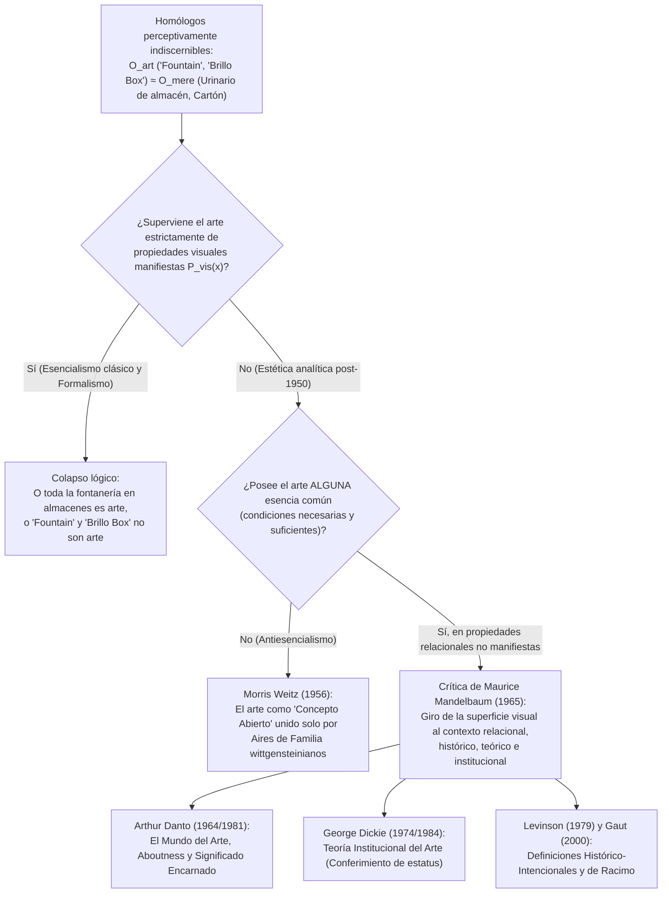
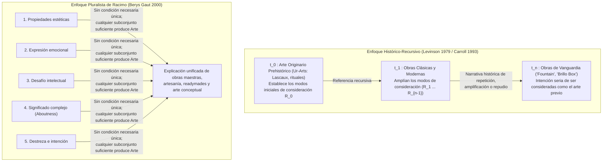

## 1. Introducción: El urinario de porcelana de 1917 y la caja de jabón de 1964

En abril de 1917, la recién fundada <strong>Society of Independent Artists</strong> preparaba su exposición inaugural en Nueva York bajo un lema radicalmente democrático: *«Sin jurado, sin premios»*. Cualquier artista que abonara seis dólares tenía derecho a exhibir dos obras. Días antes de la apertura llegó una caja enviada por un desconocido «Richard Mutt»: contenía un urinario estándar de porcelana blanca comprado en la tienda de fontanería J.L. Mott Iron Works, girado $90^\circ$, firmado con pintura negra <strong>«R. Mutt 1917»</strong> y titulado <strong>*Fountain* (*Fuente*)</strong>.

Tras «Richard Mutt» se encontraba <strong>Marcel Duchamp (1887–1968)</strong>, jefe del propio comité de montaje. Desde 1913, Duchamp venía experimentando con los <strong>«Readymades»</strong> (*Rueda de bicicleta* 1913, *Botellero* 1914) para derrocar el <strong>«arte retiniano» (*art rétinien*)</strong> —la pintura reducida al mero placer del ojo físico— y devolver el arte al servicio del intelecto (*cosa mentale*), eligiendo objetos en un estado de completa <strong>«indiferencia estética» (*anesthésie*)</strong>. Cuando la junta directiva ocultó *Fountain* declarando que era un simple «artículo de fontanería», Duchamp dimitió y publicó en mayo de 1917 en la revista dadaísta *The Blind Man* la defensa que transformó la filosofía del arte del siglo XX:

> *«Que el Sr. Mutt haya hecho la fuente con sus propias manos o no carece de importancia. Él la <strong>ELIGIÓ (CHOSE)</strong>. Tomó un artículo ordinario de la vida, lo colocó de tal modo que su significado útil desapareció bajo el nuevo título y punto de vista: <strong>creó un nuevo pensamiento para ese objeto</strong>.»*

Casi medio siglo después, en abril de 1964, <strong>Andy Warhol (1928–1987)</strong> llenó la Stable Gallery de Manhattan con pilas de <strong>*Brillo Boxes*</strong>: cajas de madera contrachapada serigrafiadas, visualmente indistinguibles de las cajas de cartón de esponjas jabonosas Brillo almacenadas en los supermercados. Al visitar la galería, el filósofo <strong>Arthur C. Danto (1924–2013)</strong> comprendió que Duchamp y Warhol habían planteado el <strong>Problema de los Homólogos Perceptivamente Indiscernibles (Perceptually Indiscernible Counterparts)</strong>:

* ¿Por qué el urinario número 100 (*Fountain*) es una obra maestra del arte mientras los otros 99 urinarios idénticos en el almacén son «meras cosas reales» (*mere real things*)?
* ¿Por qué la *Brillo Box* de Warhol es escultura mientras que el cartón comercial de Brillo diseñado por James Harvey es un simple envase?

---

## 2. El colapso del esencialismo estético clásico: Mímesis, Expresión y Forma Significante

Desde Platón hasta mediados del siglo XX, definir el arte consistía en buscar <strong>condiciones necesarias y suficientes</strong>:

$$\forall x \Big( \text{Art}(x) \iff C_1(x) \land C_2(x) \land \dots \land C_n(x) \Big)$$

Sin embargo, los tres grandes paradigmas clásicos se derrumban ante los readymades y los indiscernibles:

1. <strong>Mímesis / Teoría de la Imitación (Platón *República* X, Aristóteles *Poética*)</strong>: El arte como imitación de la naturaleza. Refutada por la música absoluta, el arte abstracto (Kandinsky, Mondrian) y *Fountain* de Duchamp, que no representa un urinario sino que *es* un urinario, mientras que diez mil cajas Brillo salidas de la fábrica copian el prototipo sin ser arte.
2. <strong>Teoría de la Expresión (León Tolstói *¿Qué es el arte?*, R.G. Collingwood *Los principios del arte*)</strong>: El arte como clarificación y transmisión de la emoción subjetiva del artista. Refutada por la «indiferencia estética» de Duchamp, la serigrafía mecánica de Warhol (*«Quiero ser una máquina»*) y la música aleatoria de John Cage (*4'33"*).
3. <strong>Formalismo (Clive Bell *Art* 1914, Roger Fry, Monroe Beardsley)</strong>: El arte definido por la <strong>«Forma Significante» (Significant Form)</strong> capaz de despertar una emoción estética. El <strong>Argumento de la Indiscernibilidad Perceptiva</strong> refuta formalmente esta tesis:

Sea $O_{\text{art}}$ *Fountain* de Duchamp (o la *Brillo Box* de Warhol) y $O_{\text{mere}}$ su homólogo ordinario en el almacén. Sea $P_{\text{vis}}(x)$ el conjunto completo de propiedades visuales y formales manifiestas de $x$. Por hipótesis:

$$P_{\text{vis}}(O_{\text{art}}) = P_{\text{vis}}(O_{\text{mere}}) \quad \Big( O_{\text{art}} \approx_{\text{percept}} O_{\text{mere}} \Big)$$

Pese a ello, su estatus ontológico respecto al arte es opuesto:

$$\text{Art}(O_{\text{art}}) \land \neg\text{Art}(O_{\text{mere}})$$

Si ser arte superviniera exclusivamente de las propiedades visuales manifiestas $P_{\text{vis}}(x)$, o bien todos los urinarios del planeta serían ya obras de arte, o bien *Fountain* y *Brillo Box* no serían arte. Por consiguiente, <strong>la frontera ontológica entre el arte y el no-arte no puede residir en ninguna propiedad perceptiva manifiesta del objeto mismo</strong>.

| Paradigma Clásico | Autores Clave | Tesis Central (Esencia Propuesta) | Refutación por Readymades e Indiscernibles |
| :--- | :--- | :--- | :--- |
| <strong>Mímesis (Imitación)</strong> | Platón, Aristóteles, Vasari | El arte es imitación o representación de la naturaleza y la acción humana | El arte abstracto no imita nada; *Fountain* presenta un objeto real; las copias de fábrica no son arte |
| <strong>Teoría de la Expresión</strong> | Tolstói, Collingwood | El arte es la clarificación imaginativa y transmisión de emociones internas | La «indiferencia estética» de Duchamp, la mecánica de Warhol y el azar de Cage excluyen la emoción |
| <strong>Formalismo</strong> | Clive Bell, Roger Fry, Beardsley | El arte se define por la «Forma Significante» que evoca emoción estética | Ante dos objetos perceptivamente idénticos ($O_{\text{art}} \approx_{\text{percept}} O_{\text{mere}}$), la forma visual no puede distinguirlos |

---

## 3. El antiesencialismo neowittgensteiniano de Morris Weitz y el giro relacional de Mandelbaum

### 3.1 Los «aires de familia» de Wittgenstein y el «concepto abierto»

En su célebre artículo *«The Role of Theory in Aesthetics»* (1956), <strong>Morris Weitz (1916–1981)</strong> aplicó al arte el análisis de la palabra «juego» (*Spiel*) desarrollado por <strong>Ludwig Wittgenstein</strong> en las *Investigaciones filosóficas* (1953, §§65–75). Entre los juegos de mesa, de cartas, de pelota y los Juegos Olímpicos no hay una propiedad común a todos, sino *«una complicada red de similitudes que se superponen y entrecruzan»*: <strong>«aires de familia» (*Familienähnlichkeiten*)</strong>. Dado que la creatividad expansiva y la ruptura de reglas forman parte de la lógica misma del arte, «arte» es según Weitz un <strong>«concepto abierto» (Open Concept)</strong> que ninguna definición por condiciones necesarias y suficientes puede cerrar sin asfixiar la creatividad.

### 3.2 La crítica decisiva de Maurice Mandelbaum (1965): Propiedades relacionales no exhibidas

En 1965, <strong>Maurice Mandelbaum</strong> expuso la ironía oculta en la metáfora de Wittgenstein: ¿qué hace que los parecidos faciales en seis fotografías sean parecidos *de familia* en lugar de coincidencias entre extraños? ¡Precisamente que comparten una <strong>propiedad relacional genética no manifiesta (un ancestro biológico común)</strong> que no es visible en la superficie de las fotos! Además, si bastara el parecido visual, los objetos más parecidos a *Fountain* serían los millones de urinarios de los almacenes. Mandelbaum demostró así que <strong>el fracaso del esencialismo visual prueba que la esencia del arte reside en propiedades relacionales no exhibidas (intención, historia, institución)</strong>.

---

## 4. «The Artworld» (1964) y *La transfiguración del lugar común* (1981) de Arthur Danto

En su ensayo de octubre de 1964, *«The Artworld»*, <strong>Arthur C. Danto</strong> escribió la frase más célebre de la estética moderna:

> <strong>«Ver algo como arte requiere algo que el ojo no puede divisar: una atmósfera de teoría artística, un conocimiento de la historia del arte: un mundo del arte (*an artworld*).»</strong>

### 4.1 El experimento mental: La galería de los cuadrados rojos indiscernibles

En su obra maestra de 1981, <strong>*La transfiguración del lugar común* (*The Transfiguration of the Commonplace*)</strong>, Danto imagina una galería con nueve lienzos rectangulares pintados uniformemente de rojo cadmio, físicamente indiscernibles:

1. <strong>*Los israelitas cruzando el Mar Rojo*</strong> (pintura histórica donde los egipcios acaban de ahogarse)
2. <strong>*El estado de ánimo de Kierkegaard*</strong> (retrato psicológico expresionista)
3. <strong>*Plaza Roja*</strong> (paisaje geométrico de Moscú)
4. <strong>*Nirvana*</strong> (pintura metafísica budista)
5. <strong>*Mantel rojo*</strong> (bodegón fauvista de un discípulo de Matisse)
6. <strong>*Sin título*</strong> (monocromo minimalista que afirma la planitud pictórica)
7. <strong>El lienzo imprimado de Giorgione</strong> (lienzo del siglo XVI sobre el que el maestro veneciano aplicó una capa base de plomo rojo antes de morir de peste: <strong>no es una obra de arte</strong>)
8. <strong>Una mera superficie pintada de rojo</strong> (pintada con rodillo por un pintor de brocha gorda: una <strong>«mera cosa real»</strong>)
9. <strong>*Sin título («Sobre nada»)* del artista conceptual J</strong> (expuesto polémicamente afirmando que la obra «no trata sobre nada en absoluto»)

### 4.2 Las dos condiciones necesarias de Danto: *Aboutness* y *Significado Encarnado*

Para distinguir las obras de arte (1–6 y 9) de las meras cosas (7 y 8), Danto formula dos condiciones necesarias:

1. <strong>*Aboutness* (Intencionalidad semántica / «ser-sobre-algo»)</strong>: Toda obra de arte trata *sobre* algo (incluso el lienzo 9 de J trata meta-artísticamente *sobre* el contraste entre arte y materialidad vacía, igual que el número $0$ en matemáticas). Una caja Brillo en el supermercado no trata sobre nada.
2. <strong>Significado Encarnado (Embodied Meaning)</strong>: A diferencia de un texto informativo, una obra de arte no se limita a enunciar un significado, sino que <strong>encarna</strong> su significado en su soporte material como una metáfora visual o un entimema retórico.

---

## 5. La Teoría Institucional del Arte de George Dickie (1974/1984) y el Dilema de Wollheim

El filósofo <strong>George Dickie (1926–2020)</strong> propuso en *Art and the Aesthetic* (1974) una lectura sociológica y performativa del mundo del arte:

> <strong>[Definición Institucional del Arte de Dickie (1974)]</strong>
> Una obra de arte en sentido clasificatorio es (1) <strong>un artefacto</strong>, (2) <strong>al cual un conjunto de sus aspectos le ha sido conferido el estatus de candidato para la apreciación (candidate for appreciation) por alguna persona o personas que actúan en nombre de cierta institución social (el mundo del arte)</strong> —normalmente el propio artista—.

### 5.1 El Dilema de Richard Wollheim (1980): El problema de *Eutifrón* en estética

En 1980, <strong>Richard Wollheim (1923–2003)</strong> planteó a Dickie un dilema devastador inspirado en el *Eutifrón* de Platón:

> Cuando los representantes del mundo del arte confieren el estatus de arte a un objeto $x$, ¿lo hacen por <strong>buenas razones artísticas $R$</strong>, o de manera <strong>puramente arbitraria sin razones</strong>?

- <strong>Primer cuerno (Por buenas razones)</strong>: Si se requieren razones sustantivas $R$ (como el significado encarnado de Danto), entonces son esas propiedades $R$ las que hacen de $x$ una obra de arte, y la institución solo ratifica ese estatus a posteriori.
- <strong>Segundo cuerno (Conferimiento arbitrario)</strong>: Si no se requiere razón alguna, el arte se reduce a un juego burocrático vacío, incapaz de explicar por qué la humanidad valora tan profundamente el arte.

Además, la teoría institucional no logra explicar el <strong>arte marginal / solitario</strong> (como la obra secreta de Henry Darger) ni el <strong>arte prehistórico originario (*Ur-Art*)</strong> de las cuevas de Lascaux o Altamira, creado 30.000 años antes de cualquier institución museística.

---

## 6. Intencionalismo Histórico y Teoría de Racimo (Cluster Account)

Para superar estas aporías, dos enfoques contemporáneos han cobrado protagonismo:

1. <strong>La Definición Histórico-Intencional de Jerrold Levinson (1979)</strong>: Un objeto $x$ es una obra de arte en el tiempo $t$ si y solo si su propietario legítimo <strong>tiene la intención seria de que $x$ sea considerado (regarded) de alguna de las maneras en que las obras de arte anteriores a $t$ fueron correctamente consideradas</strong>. Mediante una cadena recursiva hasta el arte prehistórico ($t_0$), esta definición abarca tanto al ermitaño solitario como a la vanguardia.
2. <strong>La Teoría de Racimo (Cluster Account) de Berys Gaut (2000)</strong>: Existe un racimo de unas diez propiedades relevantes (cualidades estéticas, expresión emocional, desafío intelectual, significado complejo, destreza e intención artística): <strong>ninguna es individualmente necesaria, pero cualquier subconjunto suficiente hace que un objeto sea arte</strong>.

