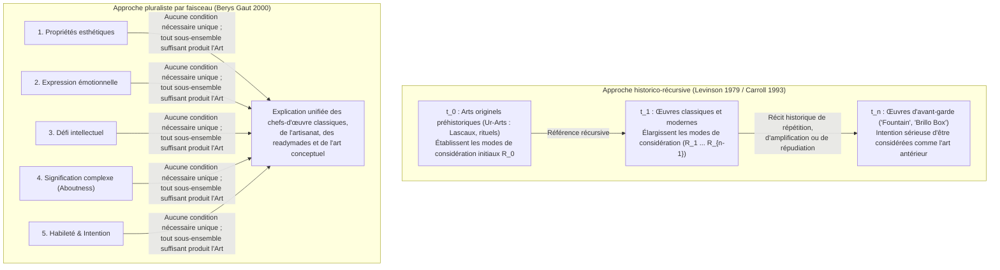

## 1. Introduction : L’urinoir en porcelaine de 1917 et le carton de savon en contreplaqué de 1964

En avril 1917, la nouvelle <strong>Society of Independent Artists</strong> préparait son exposition inaugurale à New York sous une devise radicalement démocratique : *« Ni jury, ni prix. »* Tout artiste s’acquittant de six dollars de cotisation avait le droit d’exposer deux œuvres.Quelques jours avant le vernissage, une caisse arriva au nom d’un inconnu, « Richard Mutt » : elle contenait un urinoir standard en porcelaine blanche acheté chez le fournisseur de plomberie J.L. Mott Iron Works, pivoté de $90^\circ$, signé à la peinture noire <strong>« R. Mutt 1917 »</strong> et intitulé <strong>*Fountain* (*Fontaine*)</strong>.

Derrière « R. Mutt » se cachait <strong>Marcel Duchamp (1887–1968)</strong>, lui-même chef du comité d’accrochage. Depuis 1913, Duchamp expérimentait ses <strong>« Readymades »</strong> (*Roue de bicyclette* 1913, *Porte-bouteilles* 1914) afin de renverser ce qu’il appelait avec dédain l’<strong>« art rétinien »</strong> — une peinture réduite au plaisir de l’œil physique — et de replacer l’art au service de l’intellect (*cosa mentale*), en choisissant l’objet dans un état de complète <strong>« indifférence esthétique » (*anesthésie*)</strong>. Lorsque le conseil d’administration refusa d’exposer *Fountain* au motif qu’il ne s’agissait que d’un « simple article de plomberie », Duchamp démissionna et publia en mai 1917 dans la revue dadaïste *The Blind Man* le manifeste qui transforma la philosophie de l’art au XXe siècle :

> *« Que M. Mutt ait fabriqué la fontaine de ses propres mains ou non n’a aucune importance. Il l’a <strong>CHOISIE</strong>. Il a pris un article ordinaire de la vie, l’a placé de telle sorte que sa signification d’usage a disparu sous le nouveau titre et le nouveau point de vue — <strong>il a créé une pensée nouvelle pour cet objet</strong>. »*

Près d’un demi-siècle plus tard, en avril 1964, <strong>Andy Warhol (1928–1987)</strong> remplit la Stable Gallery de Manhattan de piles de <strong>*Brillo Boxes*</strong> — des boîtes en contreplaqué sérigraphiées, visuellement indiscernables des cartons d’emballage de tampons à récurer Brillo empilés dans les supermarchés. En visitant l’exposition, le philosophe <strong>Arthur C. Danto (1924–2013)</strong> comprit que Duchamp et Warhol avaient posé le <strong>problème des homologues perceptivement indiscernables (Perceptually Indiscernible Counterparts)</strong> :

* Pourquoi le 100e urinoir (*Fountain*) est-il un chef-d’œuvre de l’art moderne alors que les 99 urinoirs identiques restés à l’entrepôt ne sont que de « simples choses réelles » (*mere real things*) ?
* Pourquoi la *Brillo Box* de Warhol est-elle de l’art alors que le carton commercial Brillo dessiné par James Harvey ne l’est pas ?

---

## 2. L’effondrement de l’essentialisme esthétique classique : Mimésis, Expression et Forme signifiante

De Platon jusqu’au milieu du XXe siècle, définir l’art consistait à chercher un ensemble de <strong>conditions nécessaires et suffisantes</strong> :

$$\forall x \Big( \text{Art}(x) \iff C_1(x) \land C_2(x) \land \dots \land C_n(x) \Big)$$

Or, les trois grands paradigmes classiques s’effondrent devant les readymades et les indiscernables :

1. <strong>La Mimésis / Théorie de l’imitation (Platon *République* X, Aristote *Poétique*)</strong> : L’art comme imitation de la nature. Réfutée par la musique absolue, l’art abstrait (Kandinsky, Mondrian) et *Fountain* de Duchamp, qui n’imite pas un urinoir mais *est* un urinoir — tandis que dix mille cartons Brillo sortant de l’usine copient le prototype sans être de l’art.
2. <strong>La Théorie de l’expression (Léon Tolstoï *Qu’est-ce que l’art ?*, R.G. Collingwood *The Principles of Art*)</strong> : L’art comme clarification et transmission de l’émotion subjective de l’artiste. Réfutée par l’« indifférence esthétique » de Duchamp, la sérigraphie mécanique de Warhol (*« Je veux être une machine »*) et la musique aléatoire de John Cage (*4'33"*).
3. <strong>Le Formalisme (Clive Bell *Art* 1914, Roger Fry, Monroe Beardsley)</strong> : L’art défini par la <strong>« Forme signifiante » (Significant Form)</strong> suscitant une émotion esthétique. L’<strong>argument de l’indiscernabilité perceptive</strong> réfute formellement cette thèse :

Soit $O_{\text{art}}$ *Fountain* de Duchamp (ou la *Brillo Box* de Warhol) et $O_{\text{mere}}$ son homologue ordinaire à l’entrepôt. Soit $P_{\text{vis}}(x)$ l’ensemble des propriétés visuelles et formelles manifestes de $x$. Par hypothèse :

$$P_{\text{vis}}(O_{\text{art}}) = P_{\text{vis}}(O_{\text{mere}}) \quad \Big( O_{\text{art}} \approx_{\text{percept}} O_{\text{mere}} \Big)$$

Pourtant, leur statut ontologique est opposé :

$$\text{Art}(O_{\text{art}}) \land \neg\text{Art}(O_{\text{mere}})$$

Si l’artité survenait uniquement sur les propriétés formelles manifestes $P_{\text{vis}}(x)$, soit tous les urinoirs du monde seraient déjà des œuvres d’art, soit *Fountain* et la *Brillo Box* n’en seraient pas. Par conséquent, <strong>la frontière ontologique entre l’art et le non-art ne peut résider dans aucune propriété perceptive manifeste de l’objet</strong>.

| Paradigme classique | Auteurs clés | Thèse centrale (Essence proposée) | Réfutation par les Readymades & les Indiscernables |
| :--- | :--- | :--- | :--- |
| <strong>Mimésis (Imitation)</strong> | Platon, Aristote, Vasari | L’art est l’imitation ou la représentation de la nature et de l’action humaine | L’art abstrait n’imite rien ; *Fountain* présente un objet réel ; les copies d’usine ne sont pas de l’art |
| <strong>Théorie de l’expression</strong> | Tolstoï, Collingwood | L’art est la clarification imaginative et la transmission des émotions de l’artiste | L’« indifférence esthétique » de Duchamp, la mécanique de Warhol et le hasard de Cage excluent l’émotion |
| <strong>Formalisme</strong> | Clive Bell, Roger Fry, Beardsley | L’art se définit par la « Forme signifiante » éveillant l’émotion esthétique | Face à deux objets perceptivement identiques ($O_{\text{art}} \approx_{\text{percept}} O_{\text{mere}}$), la forme visuelle ne peut trancher |

---

## 3. L’anti-essentialisme néo-wittgensteinien de Morris Weitz et le tournant relationnel de Mandelbaum

### 3.1 Les « airs de famille » de Wittgenstein et le « concept ouvert »

Dans son célèbre article *« The Role of Theory in Aesthetics »* (1956), <strong>Morris Weitz (1916–1981)</strong> appliqua à l’art l’analyse du mot « jeu » (*Spiel*) développée par <strong>Ludwig Wittgenstein</strong> dans les *Recherches philosophiques* (1953, §§65–75). Entre les jeux de société, les jeux de cartes, les jeux de balle et les Jeux olympiques, il n’existe aucune essence commune, mais seulement *« un réseau compliqué de similitudes qui se chevauchent et s’entrecroisent »* — des <strong>« airs de famille » (*Familienähnlichkeiten*)</strong>. Parce que la créativité expansive et la subversion des règles font partie de la logique même de l’art, « l’art » est selon Weitz un <strong>« concept ouvert » (Open Concept)</strong> que nulle définition par conditions nécessaires et suffisantes ne peut clore sans étouffer la création.

### 3.2 La critique décisive de Maurice Mandelbaum (1965) : Les propriétés relationnelles non exposées

En 1965, <strong>Maurice Mandelbaum</strong> révéla l’ironie cachée de la métaphore wittgensteinienne : qu’est-ce qui fait que les ressemblances entre six visages photographiés sont des ressemblances *familiales* plutôt que des sosies fortuits ? Précisément le partage d’une <strong>propriété relationnelle génétique non manifeste (une ascendance biologique commune)</strong> invisible à la surface des photographies ! En outre, si la ressemblance visuelle suffisait, les objets ressemblant le plus à *Fountain* seraient les millions d’urinoirs ordinaires dans les entrepôts. Mandelbaum démontra ainsi que <strong>l’échec de l’essentialisme visuel prouve que l’essence de l’art réside dans des propriétés relationnelles non manifestes (intentions, histoire, institution)</strong>.

---

## 4. « The Artworld » (1964) et *La Transfiguration du banal* (1981) d’Arthur Danto

Dans son essai d’octobre 1964, *« The Artworld »*, <strong>Arthur C. Danto</strong> écrivit la phrase la plus célèbre de l’esthétique contemporaine :

> <strong>« Voir quelque chose comme de l’art requiert quelque chose que l’œil ne peut apercevoir — une atmosphère de théorie artistique, une connaissance de l’histoire de l’art : un monde de l’art (*an artworld*). »</strong>

### 4.1 L’expérience de pensée : La galerie des carrés rouges indiscernables

Dans son chef-d’œuvre de 1981, <strong>*La Transfiguration du banal* (*The Transfiguration of the Commonplace*)</strong>, Danto imagine une galerie exposant neuf toiles rectangulaires uniformément peintes en rouge de cadmium, physiquement indiscernables :

1. <strong>*Les Israélites traversant la mer Rouge*</strong> (tableau historique où les Égyptiens viennent d’être engloutis)
2. <strong>*L’Humeur de Kierkegaard*</strong> (portrait psychologique expressionniste)
3. <strong>*Place Rouge*</strong> (paysage géométrique moscovite)
4. <strong>*Nirvana*</strong> (peinture métaphysique bouddhiste)
5. <strong>*Nappe rouge*</strong> (nature morte fauviste d’un disciple de Matisse)
6. <strong>*Sans titre*</strong> (monochrome minimaliste affirmant la planéité picturale)
7. <strong>La toile apprêtée de Giorgione</strong> (toile du XVIe siècle sur laquelle le maître vénitien posa un apprêt de minium rouge avant de mourir de la peste — <strong>ce n’est pas une œuvre d’art</strong>)
8. <strong>Une simple surface peinte en rouge</strong> (peinte au rouleau par un artisan — une <strong>« simple chose réelle »</strong>)
9. <strong>*Sans titre (« À propos de rien »)* de l’artiste conceptuel J</strong> (exposé pour déclarer polémiquement que l’œuvre « n’est à propos de rien »)

### 4.2 Les deux conditions nécessaires de Danto : *Aboutness* et *Signification incarnée*

Pour distinguer les œuvres d’art (1–6 et 9) des simples choses (7 et 8), Danto formule deux conditions nécessaires :

1. <strong>L’*Aboutness* (Intentionnalité sémantique / « être-à-propos-de »)</strong> : Toute œuvre d’art est *à propos de* quelque chose (même la toile 9 de J est méta-artistiquement *à propos* de l’opposition entre art et matérialité vide, comme le chiffre $0$ en mathématiques). Un carton Brillo au supermarché n’est à propos de rien.
2. <strong>La Signification incarnée (Embodied Meaning)</strong> : Contrairement à un article de journal, l’œuvre d’art ne se contente pas d’énoncer un sens ; elle <strong>incarne</strong> sa signification dans son support matériel à la manière d’une métaphore visuelle ou d’un enthymème rhétorique.

---

## 5. La théorie institutionnelle de l’art de George Dickie (1974/1984) et le dilemme de Wollheim

Le philosophe <strong>George Dickie (1926–2020)</strong> proposa dans *Art and the Aesthetic* (1974) une lecture sociologique et performative du monde de l’art :

> <strong>[Définition institutionnelle de l’art de Dickie (1974)]</strong>
> Une œuvre d’art au sens classificatoire est (1) <strong>un artefact</strong>, (2) <strong>dont un ensemble d’aspects s’est vu conférer le statut de candidat à l’appréciation (candidate for appreciation) par une ou plusieurs personnes agissant au nom d’une certaine institution sociale (le monde de l’art)</strong> — le plus souvent l’artiste lui-même.

### 5.1 Le dilemme de Richard Wollheim (1980) : Le problème d’*Euthyphron* en esthétique

En 1980, <strong>Richard Wollheim (1923–2003)</strong> opposa à Dickie un dilemme redoutable inspiré de l’*Euthyphron* de Platon :

> Lorsque les représentants du monde de l’art confèrent le statut d’art à un objet $x$, le font-ils pour de <strong>bonnes raisons artistiques $R$</strong>, ou de manière <strong>purement arbitraire sans raisons</strong> ?

- <strong>Première branche (Pour de bonnes raisons)</strong> : Si des raisons substantielles $R$ (comme la signification incarnée de Danto) sont requises, alors ce sont ces propriétés $R$ qui font de $x$ une œuvre d’art, et l’institution ne fait que ratifier ce statut après coup.
- <strong>Seconde branche (Octroi arbitraire)</strong> : Si aucune raison n’est requise, l’art se réduit à un jeu bureaucratique vide, incapable d’expliquer pourquoi l’humanité accorde une telle valeur spirituelle à l’art.

De plus, la théorie institutionnelle échoue à expliquer l’<strong>art brut / solitaire</strong> (comme l’œuvre secrète d’Henry Darger) et l’<strong>art préhistorique originel (*Ur-Art*)</strong> des grottes de Lascaux ou Chauvet, créé 30 000 ans avant toute institution muséale.

---

## 6. Intentionnalisme historique et théorie par faisceau (Cluster Account)

Pour surmonter ces impasses, deux approches contemporaines se sont imposées :

1. <strong>La définition historico-intentionnelle de Jerrold Levinson (1979)</strong> : Un objet $x$ est une œuvre d’art à l’instant $t$ si et seulement si son propriétaire légitime <strong>a sérieusement l’intention que $x$ soit considéré (regarded) de l’une des manières dont les œuvres d’art antérieures à $t$ ont été correctement considérées</strong>. Par récurrence jusqu’à l’art originel ($t_0$), cette définition intègre aussi bien l’ermite solitaire que l’avant-garde.
2. <strong>Le compte rendu par faisceau (Cluster Account) de Berys Gaut (2000)</strong> : Il existe un faisceau d’environ dix propriétés pertinentes (propriétés esthétiques, expression d’émotions, défi intellectuel, signification complexe, habileté et intention artistique) — <strong>aucune n’est individuellement nécessaire, mais tout sous-ensemble suffisant fait d’un objet une œuvre d’art</strong>.

